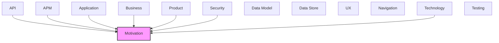

# Motivation

[← Back to README](../README.md)

Goals, requirements, drivers, and strategic outcomes of the architecture.

## Report Index

- [Layer Introduction](#layer-introduction)
- [Intra-Layer Relationships](#intra-layer-relationships)
- [Inter-Layer Dependencies](#inter-layer-dependencies)
- [Inter-Layer Relationships Table](#inter-layer-relationships-table)
- [Element Reference](#element-reference)

## Layer Introduction

| Metric                    | Count |
| ------------------------- | ----- |
| Elements                  | 28    |
| Intra-Layer Relationships | 28    |
| Inter-Layer Relationships | 62    |
| Inbound Relationships     | 62    |
| Outbound Relationships    | 0     |

**Cross-Layer References**:

- **Upstream layers**: [API](./07-api-layer-report.md), [APM](./12-apm-layer-report.md), [Application](./05-application-layer-report.md), [Business](./02-business-layer-report.md), [Product](./03-product-layer-report.md), [Security](./04-security-layer-report.md), [Technology](./06-technology-layer-report.md)

## Intra-Layer Relationships

```mermaid
flowchart LR
  subgraph motivation
    motivation_assessment_secure_key_placement_gaps["Secure Key Placement Gaps"]
    motivation_constraint_development_use_with_non_sensitive_data["Development Use With Non-Sensitive Data"]
    motivation_constraint_python_3_10_or_later["Python 3.10 Or Later"]
    motivation_driver_repeated_reference_api_calls["Repeated Reference API Calls"]
    motivation_driver_upstream_rate_limits_and_costs["Upstream Rate Limits And Costs"]
    motivation_goal_drop_in_without_custom_api_clients["Drop In Without Custom API Clients"]
    motivation_goal_reduce_upstream_api_cost_and_load["Reduce Upstream API Cost And Load"]
    motivation_goal_stay_within_upstream_rate_limits["Stay Within Upstream Rate Limits"]
    motivation_principle_keep_upstream_tls_verification["Keep Upstream TLS Verification"]
    motivation_principle_standard_library_only["Standard Library Only"]
    motivation_requirement_admin_debug_endpoints["Admin Debug Endpoints"]
    motivation_requirement_bounded_cache_size["Bounded Cache Size"]
    motivation_requirement_cache_get_and_post_by_request_signature["Cache GET And POST By Request Signature"]
    motivation_requirement_cache_only_successful_responses["Cache Only Successful Responses"]
    motivation_requirement_configurable_cache_ttl["Configurable Cache TTL"]
    motivation_requirement_deduplicate_concurrent_requests["Deduplicate Concurrent Requests"]
    motivation_requirement_distinguish_upstream_errors_from_outages["Distinguish Upstream Errors From Outages"]
    motivation_requirement_embeddable_module_lifecycle["Embeddable Module Lifecycle"]
    motivation_requirement_optional_secure_key_access_control["Optional Secure Key Access Control"]
    motivation_requirement_parent_application_logging_integration["Parent Application Logging Integration"]
    motivation_requirement_per_domain_rate_limiting["Per Domain Rate Limiting"]
    motivation_requirement_persistent_or_in_memory_cache["Persistent Or In Memory Cache"]
    motivation_requirement_programmatic_monitoring_interface["Programmatic Monitoring Interface"]
    motivation_requirement_redact_secrets_in_admin_output["Redact Secrets In Admin Output"]
    motivation_requirement_thread_safe_concurrent_handling["Thread Safe Concurrent Handling"]
    motivation_stakeholder_pipeline_developer["Pipeline Developer"]
    motivation_stakeholder_reference_api_provider["Reference API Provider"]
    motivation_value_cheaper_faster_pipeline_iteration["Cheaper Faster Pipeline Iteration"]
    motivation_assessment_secure_key_placement_gaps -->|associated-with| motivation_driver_upstream_rate_limits_and_costs
    motivation_constraint_development_use_with_non_sensitive_data -->|constrains| motivation_requirement_optional_secure_key_access_control
    motivation_constraint_python_3_10_or_later -->|constrains| motivation_requirement_embeddable_module_lifecycle
    motivation_driver_repeated_reference_api_calls -->|influence| motivation_goal_reduce_upstream_api_cost_and_load
    motivation_driver_upstream_rate_limits_and_costs -->|influence| motivation_goal_reduce_upstream_api_cost_and_load
    motivation_driver_upstream_rate_limits_and_costs -->|influence| motivation_goal_stay_within_upstream_rate_limits
    motivation_principle_keep_upstream_tls_verification -->|influence| motivation_goal_drop_in_without_custom_api_clients
    motivation_principle_standard_library_only -->|influence| motivation_goal_drop_in_without_custom_api_clients
    motivation_requirement_admin_debug_endpoints -->|realizes| motivation_goal_drop_in_without_custom_api_clients
    motivation_requirement_bounded_cache_size -->|realizes| motivation_goal_reduce_upstream_api_cost_and_load
    motivation_requirement_cache_get_and_post_by_request_signature -->|realizes| motivation_goal_reduce_upstream_api_cost_and_load
    motivation_requirement_cache_only_successful_responses -->|realizes| motivation_goal_reduce_upstream_api_cost_and_load
    motivation_requirement_configurable_cache_ttl -->|realizes| motivation_goal_reduce_upstream_api_cost_and_load
    motivation_requirement_deduplicate_concurrent_requests -->|realizes| motivation_goal_reduce_upstream_api_cost_and_load
    motivation_requirement_deduplicate_concurrent_requests -->|realizes| motivation_goal_stay_within_upstream_rate_limits
    motivation_requirement_distinguish_upstream_errors_from_outages -->|realizes| motivation_goal_drop_in_without_custom_api_clients
    motivation_requirement_embeddable_module_lifecycle -->|realizes| motivation_goal_drop_in_without_custom_api_clients
    motivation_requirement_optional_secure_key_access_control -->|realizes| motivation_principle_keep_upstream_tls_verification
    motivation_requirement_parent_application_logging_integration -->|realizes| motivation_goal_drop_in_without_custom_api_clients
    motivation_requirement_per_domain_rate_limiting -->|realizes| motivation_goal_stay_within_upstream_rate_limits
    motivation_requirement_persistent_or_in_memory_cache -->|realizes| motivation_goal_reduce_upstream_api_cost_and_load
    motivation_requirement_programmatic_monitoring_interface -->|realizes| motivation_goal_drop_in_without_custom_api_clients
    motivation_requirement_redact_secrets_in_admin_output -->|realizes| motivation_goal_drop_in_without_custom_api_clients
    motivation_requirement_thread_safe_concurrent_handling -->|realizes| motivation_goal_drop_in_without_custom_api_clients
    motivation_stakeholder_pipeline_developer -->|associated-with| motivation_driver_repeated_reference_api_calls
    motivation_stakeholder_pipeline_developer -->|influence| motivation_goal_drop_in_without_custom_api_clients
    motivation_stakeholder_reference_api_provider -->|associated-with| motivation_driver_upstream_rate_limits_and_costs
    motivation_value_cheaper_faster_pipeline_iteration -->|associated-with| motivation_goal_reduce_upstream_api_cost_and_load
  end
```

## Inter-Layer Dependencies

## Inter-Layer Relationships Table

| Relationship ID                                                    | Source Node                                                    | Dest Node                                                         | Dest Layer   | Predicate    | Cardinality  | Strength |
| ------------------------------------------------------------------ | -------------------------------------------------------------- | ----------------------------------------------------------------- | ------------ | ------------ | ------------ | -------- |
| `api.operation.satisfies.motivation.requirement`                   | `api.operation.delete-proxied-upstream-request`                | `motivation.requirement.distinguish-upstream-errors-from-outages` | `motivation` | `satisfies`  | many-to-many | medium   |
| `api.operation.satisfies.motivation.requirement`                   | `api.operation.delete-proxied-upstream-request`                | `motivation.requirement.per-domain-rate-limiting`                 | `motivation` | `satisfies`  | many-to-many | medium   |
| `api.operation.satisfies.motivation.requirement`                   | `api.operation.get-admin-cache-domain`                         | `motivation.requirement.admin-debug-endpoints`                    | `motivation` | `satisfies`  | many-to-many | medium   |
| `api.operation.satisfies.motivation.requirement`                   | `api.operation.get-admin-cache`                                | `motivation.requirement.admin-debug-endpoints`                    | `motivation` | `satisfies`  | many-to-many | medium   |
| `api.operation.satisfies.motivation.requirement`                   | `api.operation.get-admin-config`                               | `motivation.requirement.admin-debug-endpoints`                    | `motivation` | `satisfies`  | many-to-many | medium   |
| `api.operation.satisfies.motivation.requirement`                   | `api.operation.get-admin-config`                               | `motivation.requirement.redact-secrets-in-admin-output`           | `motivation` | `satisfies`  | many-to-many | medium   |
| `api.operation.satisfies.motivation.requirement`                   | `api.operation.get-admin-domains`                              | `motivation.requirement.admin-debug-endpoints`                    | `motivation` | `satisfies`  | many-to-many | medium   |
| `api.operation.satisfies.motivation.requirement`                   | `api.operation.get-admin-health`                               | `motivation.requirement.admin-debug-endpoints`                    | `motivation` | `satisfies`  | many-to-many | medium   |
| `api.operation.satisfies.motivation.requirement`                   | `api.operation.get-admin-status`                               | `motivation.requirement.admin-debug-endpoints`                    | `motivation` | `satisfies`  | many-to-many | medium   |
| `api.operation.satisfies.motivation.requirement`                   | `api.operation.get-proxied-upstream-request`                   | `motivation.requirement.cache-get-and-post-by-request-signature`  | `motivation` | `satisfies`  | many-to-many | medium   |
| `api.operation.satisfies.motivation.requirement`                   | `api.operation.get-proxied-upstream-request`                   | `motivation.requirement.deduplicate-concurrent-requests`          | `motivation` | `satisfies`  | many-to-many | medium   |
| `api.operation.satisfies.motivation.requirement`                   | `api.operation.get-proxied-upstream-request`                   | `motivation.requirement.distinguish-upstream-errors-from-outages` | `motivation` | `satisfies`  | many-to-many | medium   |
| `api.operation.satisfies.motivation.requirement`                   | `api.operation.get-proxied-upstream-request`                   | `motivation.requirement.per-domain-rate-limiting`                 | `motivation` | `satisfies`  | many-to-many | medium   |
| `api.operation.satisfies.motivation.requirement`                   | `api.operation.post-admin-validate-config`                     | `motivation.requirement.admin-debug-endpoints`                    | `motivation` | `satisfies`  | many-to-many | medium   |
| `api.operation.satisfies.motivation.requirement`                   | `api.operation.post-proxied-upstream-request`                  | `motivation.requirement.cache-get-and-post-by-request-signature`  | `motivation` | `satisfies`  | many-to-many | medium   |
| `api.operation.satisfies.motivation.requirement`                   | `api.operation.post-proxied-upstream-request`                  | `motivation.requirement.deduplicate-concurrent-requests`          | `motivation` | `satisfies`  | many-to-many | medium   |
| `api.operation.satisfies.motivation.requirement`                   | `api.operation.post-proxied-upstream-request`                  | `motivation.requirement.distinguish-upstream-errors-from-outages` | `motivation` | `satisfies`  | many-to-many | medium   |
| `api.operation.satisfies.motivation.requirement`                   | `api.operation.post-proxied-upstream-request`                  | `motivation.requirement.per-domain-rate-limiting`                 | `motivation` | `satisfies`  | many-to-many | medium   |
| `api.operation.satisfies.motivation.requirement`                   | `api.operation.put-proxied-upstream-request`                   | `motivation.requirement.distinguish-upstream-errors-from-outages` | `motivation` | `satisfies`  | many-to-many | medium   |
| `api.operation.satisfies.motivation.requirement`                   | `api.operation.put-proxied-upstream-request`                   | `motivation.requirement.per-domain-rate-limiting`                 | `motivation` | `satisfies`  | many-to-many | medium   |
| `apm.metricinstrument.satisfies.motivation.requirement`            | `apm.metricinstrument.cache-engine-statistics`                 | `motivation.requirement.programmatic-monitoring-interface`        | `motivation` | `satisfies`  | many-to-many | medium   |
| `apm.metricinstrument.satisfies.motivation.requirement`            | `apm.metricinstrument.upstream-responses-by-status`            | `motivation.requirement.programmatic-monitoring-interface`        | `motivation` | `satisfies`  | many-to-many | medium   |
| `application.applicationfunction.satisfies.motivation.requirement` | `application.applicationfunction.write-redacted-access-log`    | `motivation.requirement.optional-secure-key-access-control`       | `motivation` | `satisfies`  | many-to-many | medium   |
| `application.applicationservice.delivers.motivation.value`         | `application.applicationservice.cached-reference-proxying`     | `motivation.value.cheaper-faster-pipeline-iteration`              | `motivation` | `delivers`   | many-to-many | medium   |
| `application.applicationservice.realizes.motivation.goal`          | `application.applicationservice.cached-reference-proxying`     | `motivation.goal.reduce-upstream-api-cost-and-load`               | `motivation` | `realizes`   | many-to-many | medium   |
| `business.businessservice.delivers.motivation.value`               | `business.businessservice.cached-reference-data-access`        | `motivation.value.cheaper-faster-pipeline-iteration`              | `motivation` | `delivers`   | many-to-many | medium   |
| `business.businessservice.realizes.motivation.goal`                | `business.businessservice.cached-reference-data-access`        | `motivation.goal.reduce-upstream-api-cost-and-load`               | `motivation` | `realizes`   | many-to-many | medium   |
| `business.businessservice.satisfies.motivation.requirement`        | `business.businessservice.cached-reference-data-access`        | `motivation.requirement.per-domain-rate-limiting`                 | `motivation` | `satisfies`  | many-to-many | medium   |
| `product.feature.satisfies.motivation.requirement`                 | `product.feature.admin-debug-endpoints`                        | `motivation.requirement.admin-debug-endpoints`                    | `motivation` | `satisfies`  | many-to-many | medium   |
| `product.feature.satisfies.motivation.requirement`                 | `product.feature.admin-debug-endpoints`                        | `motivation.requirement.redact-secrets-in-admin-output`           | `motivation` | `satisfies`  | many-to-many | medium   |
| `product.feature.satisfies.motivation.requirement`                 | `product.feature.embeddable-caching-proxy-module`              | `motivation.requirement.embeddable-module-lifecycle`              | `motivation` | `satisfies`  | many-to-many | medium   |
| `product.feature.satisfies.motivation.requirement`                 | `product.feature.embeddable-caching-proxy-module`              | `motivation.requirement.parent-application-logging-integration`   | `motivation` | `satisfies`  | many-to-many | medium   |
| `product.feature.satisfies.motivation.requirement`                 | `product.feature.embeddable-caching-proxy-module`              | `motivation.requirement.thread-safe-concurrent-handling`          | `motivation` | `satisfies`  | many-to-many | medium   |
| `product.feature.satisfies.motivation.requirement`                 | `product.feature.fine-grained-rate-limits`                     | `motivation.requirement.per-domain-rate-limiting`                 | `motivation` | `satisfies`  | many-to-many | medium   |
| `product.feature.satisfies.motivation.requirement`                 | `product.feature.monitoring-metrics`                           | `motivation.requirement.programmatic-monitoring-interface`        | `motivation` | `satisfies`  | many-to-many | medium   |
| `product.feature.satisfies.motivation.requirement`                 | `product.feature.path-based-domain-mapping`                    | `motivation.requirement.distinguish-upstream-errors-from-outages` | `motivation` | `satisfies`  | many-to-many | medium   |
| `product.feature.satisfies.motivation.requirement`                 | `product.feature.per-domain-ttl`                               | `motivation.requirement.configurable-cache-ttl`                   | `motivation` | `satisfies`  | many-to-many | medium   |
| `product.feature.delivers.motivation.value`                        | `product.feature.persistent-sqlite-cache`                      | `motivation.value.cheaper-faster-pipeline-iteration`              | `motivation` | `delivers`   | many-to-many | medium   |
| `product.feature.satisfies.motivation.requirement`                 | `product.feature.persistent-sqlite-cache`                      | `motivation.requirement.bounded-cache-size`                       | `motivation` | `satisfies`  | many-to-many | medium   |
| `product.feature.satisfies.motivation.requirement`                 | `product.feature.persistent-sqlite-cache`                      | `motivation.requirement.cache-get-and-post-by-request-signature`  | `motivation` | `satisfies`  | many-to-many | medium   |
| `product.feature.satisfies.motivation.requirement`                 | `product.feature.persistent-sqlite-cache`                      | `motivation.requirement.cache-only-successful-responses`          | `motivation` | `satisfies`  | many-to-many | medium   |
| `product.feature.satisfies.motivation.requirement`                 | `product.feature.persistent-sqlite-cache`                      | `motivation.requirement.persistent-or-in-memory-cache`            | `motivation` | `satisfies`  | many-to-many | medium   |
| `product.feature.satisfies.motivation.requirement`                 | `product.feature.request-coalescing`                           | `motivation.requirement.deduplicate-concurrent-requests`          | `motivation` | `satisfies`  | many-to-many | medium   |
| `product.feature.satisfies.motivation.requirement`                 | `product.feature.secure-key-authentication`                    | `motivation.requirement.optional-secure-key-access-control`       | `motivation` | `satisfies`  | many-to-many | medium   |
| `product.persona.references.motivation.stakeholder`                | `product.persona.pipeline-builder`                             | `motivation.stakeholder.pipeline-developer`                       | `motivation` | `references` | many-to-many | medium   |
| `product.softwarecapability.supports.motivation.goal`              | `product.softwarecapability.configurable-domain-routing`       | `motivation.goal.drop-in-without-custom-api-clients`              | `motivation` | `supports`   | many-to-many | medium   |
| `product.softwarecapability.supports.motivation.goal`              | `product.softwarecapability.operational-visibility`            | `motivation.goal.drop-in-without-custom-api-clients`              | `motivation` | `supports`   | many-to-many | medium   |
| `product.softwarecapability.supports.motivation.goal`              | `product.softwarecapability.proxy-access-control`              | `motivation.goal.drop-in-without-custom-api-clients`              | `motivation` | `supports`   | many-to-many | medium   |
| `product.softwarecapability.supports.motivation.goal`              | `product.softwarecapability.rate-limiting-and-throttling`      | `motivation.goal.stay-within-upstream-rate-limits`                | `motivation` | `supports`   | many-to-many | medium   |
| `product.softwarecapability.supports.motivation.goal`              | `product.softwarecapability.request-deduplication`             | `motivation.goal.reduce-upstream-api-cost-and-load`               | `motivation` | `supports`   | many-to-many | medium   |
| `product.softwarecapability.supports.motivation.goal`              | `product.softwarecapability.request-deduplication`             | `motivation.goal.stay-within-upstream-rate-limits`                | `motivation` | `supports`   | many-to-many | medium   |
| `product.softwarecapability.supports.motivation.goal`              | `product.softwarecapability.response-caching`                  | `motivation.goal.reduce-upstream-api-cost-and-load`               | `motivation` | `supports`   | many-to-many | medium   |
| `security.countermeasure.satisfies.motivation.requirement`         | `security.countermeasure.admin-endpoints-switch`               | `motivation.requirement.admin-debug-endpoints`                    | `motivation` | `satisfies`  | many-to-many | medium   |
| `security.countermeasure.satisfies.motivation.requirement`         | `security.countermeasure.admin-rate-limiting`                  | `motivation.requirement.admin-debug-endpoints`                    | `motivation` | `satisfies`  | many-to-many | medium   |
| `security.countermeasure.satisfies.motivation.requirement`         | `security.countermeasure.config-secret-redaction`              | `motivation.requirement.redact-secrets-in-admin-output`           | `motivation` | `satisfies`  | many-to-many | medium   |
| `security.countermeasure.satisfies.motivation.requirement`         | `security.countermeasure.constant-time-key-comparison`         | `motivation.requirement.optional-secure-key-access-control`       | `motivation` | `satisfies`  | many-to-many | medium   |
| `security.countermeasure.satisfies.motivation.requirement`         | `security.countermeasure.proxy-key-redacted-from-access-log`   | `motivation.requirement.optional-secure-key-access-control`       | `motivation` | `satisfies`  | many-to-many | medium   |
| `security.countermeasure.satisfies.motivation.requirement`         | `security.countermeasure.proxy-key-stripped-before-forwarding` | `motivation.requirement.optional-secure-key-access-control`       | `motivation` | `satisfies`  | many-to-many | medium   |
| `security.countermeasure.satisfies.motivation.requirement`         | `security.countermeasure.secure-key-authentication`            | `motivation.requirement.optional-secure-key-access-control`       | `motivation` | `satisfies`  | many-to-many | medium   |
| `technology.systemsoftware.satisfies.motivation.constraint`        | `technology.systemsoftware.cpython-runtime`                    | `motivation.constraint.python-3-10-or-later`                      | `motivation` | `satisfies`  | many-to-many | medium   |
| `technology.systemsoftware.satisfies.motivation.principle`         | `technology.systemsoftware.cpython-runtime`                    | `motivation.principle.standard-library-only`                      | `motivation` | `satisfies`  | many-to-many | medium   |
| `technology.systemsoftware.satisfies.motivation.principle`         | `technology.systemsoftware.python-urllib`                      | `motivation.principle.keep-upstream-tls-verification`             | `motivation` | `satisfies`  | many-to-many | medium   |

## Element Reference

### Secure Key Placement Gaps {#secure-key-placement-gaps}

**ID**: `motivation.assessment.secure-key-placement-gaps`

**Type**: `assessment`

Checked against a running proxy after #8 and #10 (unreleased 0.5.3): all four placements (path prefix, key= query parameter, X-API-Buddy-Key header, Authorization Bearer) authenticate, and the proxy key is not forwarded upstream in any of them. Fixed since 0.5.2, where a path-prefix key got 404, a key= parameter got 500 and the header key was forwarded. The last gap, a path or query key written to the stderr access log, is closed by Proxy Key Redacted From Access Log.

#### Attributes

| Name           | Value                                                                                                                                                                  |
| -------------- | ---------------------------------------------------------------------------------------------------------------------------------------------------------------------- |
| assessmentType | gap                                                                                                                                                                    |
| documentation  | Assessed 2026-11-25 by probing a running proxy with each placement and a recording upstream; regression tests in tests/integration_tests/test_secure_key_placement.py. |

#### Relationships

| Type        | Related Element                                    | Predicate         | Direction |
| ----------- | -------------------------------------------------- | ----------------- | --------- |
| intra-layer | `motivation.driver.upstream-rate-limits-and-costs` | `associated-with` | outbound  |

### Development Use With Non-Sensitive Data {#development-use-with-non-sensitive-data}

**ID**: `motivation.constraint.development-use-with-non-sensitive-data`

**Type**: `constraint`

Intended for development against reference data that is not sensitive and changes slowly; the local HTTP leg is unencrypted, so it is not for highly sensitive upstreams or hostile local environments.

#### Attributes

| Name           | Value          |
| -------------- | -------------- |
| constraintType | organizational |

#### Relationships

| Type        | Related Element                                             | Predicate    | Direction |
| ----------- | ----------------------------------------------------------- | ------------ | --------- |
| intra-layer | `motivation.requirement.optional-secure-key-access-control` | `constrains` | outbound  |

### Python 3.10 Or Later {#python-3-10-or-later}

**ID**: `motivation.constraint.python-3-10-or-later`

**Type**: `constraint`

The package requires Python &gt;= 3.10 and is tested on CPython 3.10 to 3.15.

#### Attributes

| Name           | Value     |
| -------------- | --------- |
| constraintType | technical |

#### Relationships

| Type        | Related Element                                      | Predicate    | Direction |
| ----------- | ---------------------------------------------------- | ------------ | --------- |
| inter-layer | `technology.systemsoftware.cpython-runtime`          | `satisfies`  | inbound   |
| intra-layer | `motivation.requirement.embeddable-module-lifecycle` | `constrains` | outbound  |

### Repeated Reference API Calls {#repeated-reference-api-calls}

**ID**: `motivation.driver.repeated-reference-api-calls`

**Type**: `driver`

Pipelines re-request the same slowly-changing reference data every time they run during development, so most upstream calls are redundant.

#### Attributes

| Name     | Value       |
| -------- | ----------- |
| category | operational |

#### Relationships

| Type        | Related Element                                     | Predicate         | Direction |
| ----------- | --------------------------------------------------- | ----------------- | --------- |
| intra-layer | `motivation.goal.reduce-upstream-api-cost-and-load` | `influence`       | outbound  |
| intra-layer | `motivation.stakeholder.pipeline-developer`         | `associated-with` | inbound   |

### Upstream Rate Limits And Costs {#upstream-rate-limits-and-costs}

**ID**: `motivation.driver.upstream-rate-limits-and-costs`

**Type**: `driver`

Upstream reference APIs throttle or block heavy callers and paid APIs bill per request, so redundant calls cost money and get pipelines rate limited.

#### Attributes

| Name     | Value    |
| -------- | -------- |
| category | business |

#### Relationships

| Type        | Related Element                                     | Predicate         | Direction |
| ----------- | --------------------------------------------------- | ----------------- | --------- |
| intra-layer | `motivation.assessment.secure-key-placement-gaps`   | `associated-with` | inbound   |
| intra-layer | `motivation.goal.reduce-upstream-api-cost-and-load` | `influence`       | outbound  |
| intra-layer | `motivation.goal.stay-within-upstream-rate-limits`  | `influence`       | outbound  |
| intra-layer | `motivation.stakeholder.reference-api-provider`     | `associated-with` | inbound   |

### Drop In Without Custom API Clients {#drop-in-without-custom-api-clients}

**ID**: `motivation.goal.drop-in-without-custom-api-clients`

**Type**: `goal`

Let an application use the proxy by pointing its existing API client's base URL at it, either embedded as a Python module or run standalone, with no separate HTTP proxy configuration and no disabled TLS checks.

#### Attributes

| Name     | Value  |
| -------- | ------ |
| priority | medium |

#### Relationships

| Type        | Related Element                                                   | Predicate   | Direction |
| ----------- | ----------------------------------------------------------------- | ----------- | --------- |
| inter-layer | `product.softwarecapability.configurable-domain-routing`          | `supports`  | inbound   |
| inter-layer | `product.softwarecapability.operational-visibility`               | `supports`  | inbound   |
| inter-layer | `product.softwarecapability.proxy-access-control`                 | `supports`  | inbound   |
| intra-layer | `motivation.principle.keep-upstream-tls-verification`             | `influence` | inbound   |
| intra-layer | `motivation.principle.standard-library-only`                      | `influence` | inbound   |
| intra-layer | `motivation.requirement.admin-debug-endpoints`                    | `realizes`  | inbound   |
| intra-layer | `motivation.requirement.distinguish-upstream-errors-from-outages` | `realizes`  | inbound   |
| intra-layer | `motivation.requirement.embeddable-module-lifecycle`              | `realizes`  | inbound   |
| intra-layer | `motivation.requirement.parent-application-logging-integration`   | `realizes`  | inbound   |
| intra-layer | `motivation.requirement.programmatic-monitoring-interface`        | `realizes`  | inbound   |
| intra-layer | `motivation.requirement.redact-secrets-in-admin-output`           | `realizes`  | inbound   |
| intra-layer | `motivation.requirement.thread-safe-concurrent-handling`          | `realizes`  | inbound   |
| intra-layer | `motivation.stakeholder.pipeline-developer`                       | `influence` | inbound   |

### Reduce Upstream API Cost And Load {#reduce-upstream-api-cost-and-load}

**ID**: `motivation.goal.reduce-upstream-api-cost-and-load`

**Type**: `goal`

Serve repeated requests for reference data locally so pipelines make far fewer upstream calls.

#### Attributes

| Name     | Value |
| -------- | ----- |
| priority | high  |

#### Relationships

| Type        | Related Element                                                  | Predicate         | Direction |
| ----------- | ---------------------------------------------------------------- | ----------------- | --------- |
| inter-layer | `application.applicationservice.cached-reference-proxying`       | `realizes`        | inbound   |
| inter-layer | `business.businessservice.cached-reference-data-access`          | `realizes`        | inbound   |
| inter-layer | `product.softwarecapability.request-deduplication`               | `supports`        | inbound   |
| inter-layer | `product.softwarecapability.response-caching`                    | `supports`        | inbound   |
| intra-layer | `motivation.driver.repeated-reference-api-calls`                 | `influence`       | inbound   |
| intra-layer | `motivation.driver.upstream-rate-limits-and-costs`               | `influence`       | inbound   |
| intra-layer | `motivation.requirement.bounded-cache-size`                      | `realizes`        | inbound   |
| intra-layer | `motivation.requirement.cache-get-and-post-by-request-signature` | `realizes`        | inbound   |
| intra-layer | `motivation.requirement.cache-only-successful-responses`         | `realizes`        | inbound   |
| intra-layer | `motivation.requirement.configurable-cache-ttl`                  | `realizes`        | inbound   |
| intra-layer | `motivation.requirement.deduplicate-concurrent-requests`         | `realizes`        | inbound   |
| intra-layer | `motivation.requirement.persistent-or-in-memory-cache`           | `realizes`        | inbound   |
| intra-layer | `motivation.value.cheaper-faster-pipeline-iteration`             | `associated-with` | inbound   |

### Stay Within Upstream Rate Limits {#stay-within-upstream-rate-limits}

**ID**: `motivation.goal.stay-within-upstream-rate-limits`

**Type**: `goal`

Keep the requests that do reach an upstream inside its published per-second, per-minute and per-hour limits instead of being blocked.

#### Attributes

| Name     | Value |
| -------- | ----- |
| priority | high  |

#### Relationships

| Type        | Related Element                                           | Predicate   | Direction |
| ----------- | --------------------------------------------------------- | ----------- | --------- |
| inter-layer | `product.softwarecapability.rate-limiting-and-throttling` | `supports`  | inbound   |
| inter-layer | `product.softwarecapability.request-deduplication`        | `supports`  | inbound   |
| intra-layer | `motivation.driver.upstream-rate-limits-and-costs`        | `influence` | inbound   |
| intra-layer | `motivation.requirement.deduplicate-concurrent-requests`  | `realizes`  | inbound   |
| intra-layer | `motivation.requirement.per-domain-rate-limiting`         | `realizes`  | inbound   |

### Keep Upstream TLS Verification {#keep-upstream-tls-verification}

**ID**: `motivation.principle.keep-upstream-tls-verification`

**Type**: `principle`

Clients talk plain HTTP to the local proxy, but every request leaving the machine goes to the upstream over HTTPS with normal certificate verification; the proxy never asks the application to disable certificate checks.

#### Attributes

| Name     | Value    |
| -------- | -------- |
| category | security |

#### Relationships

| Type        | Related Element                                             | Predicate   | Direction |
| ----------- | ----------------------------------------------------------- | ----------- | --------- |
| inter-layer | `technology.systemsoftware.python-urllib`                   | `satisfies` | inbound   |
| intra-layer | `motivation.goal.drop-in-without-custom-api-clients`        | `influence` | outbound  |
| intra-layer | `motivation.requirement.optional-secure-key-access-control` | `realizes`  | inbound   |

### Standard Library Only {#standard-library-only}

**ID**: `motivation.principle.standard-library-only`

**Type**: `principle`

The package keeps its runtime dependencies to the Python standard library (pyproject dependencies = \[\]) to stay small and easy to embed.

#### Attributes

| Name     | Value       |
| -------- | ----------- |
| category | development |

#### Relationships

| Type        | Related Element                                      | Predicate   | Direction |
| ----------- | ---------------------------------------------------- | ----------- | --------- |
| inter-layer | `technology.systemsoftware.cpython-runtime`          | `satisfies` | inbound   |
| intra-layer | `motivation.goal.drop-in-without-custom-api-clients` | `influence` | outbound  |

### Admin Debug Endpoints {#admin-debug-endpoints}

**ID**: `motivation.requirement.admin-debug-endpoints`

**Type**: `requirement`

Expose /admin/health, /admin/config, /admin/status, /admin/domains, /admin/cache, /admin/cache/\{domain\} and POST /admin/validate-config, behind the secure key, rate limited per client IP, and switchable off with admin.enabled.

#### Attributes

| Name            | Value      |
| --------------- | ---------- |
| priority        | medium     |
| requirementType | functional |

#### Relationships

| Type        | Related Element                                      | Predicate   | Direction |
| ----------- | ---------------------------------------------------- | ----------- | --------- |
| inter-layer | `api.operation.get-admin-cache-domain`               | `satisfies` | inbound   |
| inter-layer | `api.operation.get-admin-cache`                      | `satisfies` | inbound   |
| inter-layer | `api.operation.get-admin-config`                     | `satisfies` | inbound   |
| inter-layer | `api.operation.get-admin-domains`                    | `satisfies` | inbound   |
| inter-layer | `api.operation.get-admin-health`                     | `satisfies` | inbound   |
| inter-layer | `api.operation.get-admin-status`                     | `satisfies` | inbound   |
| inter-layer | `api.operation.post-admin-validate-config`           | `satisfies` | inbound   |
| inter-layer | `product.feature.admin-debug-endpoints`              | `satisfies` | inbound   |
| inter-layer | `security.countermeasure.admin-endpoints-switch`     | `satisfies` | inbound   |
| inter-layer | `security.countermeasure.admin-rate-limiting`        | `satisfies` | inbound   |
| intra-layer | `motivation.goal.drop-in-without-custom-api-clients` | `realizes`  | outbound  |

### Bounded Cache Size {#bounded-cache-size}

**ID**: `motivation.requirement.bounded-cache-size`

**Type**: `requirement`

The cache holds at most cache.max_cache_entries entries (default 1000), evicting least recently accessed entries, and skips responses over cache.max_cache_response_size (default 10 MB); bodies over 1 KB are zlib-compressed.

#### Attributes

| Name            | Value          |
| --------------- | -------------- |
| priority        | medium         |
| requirementType | non-functional |

#### Relationships

| Type        | Related Element                                     | Predicate   | Direction |
| ----------- | --------------------------------------------------- | ----------- | --------- |
| inter-layer | `product.feature.persistent-sqlite-cache`           | `satisfies` | inbound   |
| intra-layer | `motivation.goal.reduce-upstream-api-cost-and-load` | `realizes`  | outbound  |

### Cache GET And POST By Request Signature {#cache-get-and-post-by-request-signature}

**ID**: `motivation.requirement.cache-get-and-post-by-request-signature`

**Type**: `requirement`

GET responses are cached by method plus normalized URL (lower-cased scheme and host, sorted query, trailing slash ignored); POST responses also key on the request body, JSON bodies normalized with sorted keys and other bodies hashed. PUT and DELETE are forwarded without caching. (PATCH has no handler, so http.server answers 501.)

#### Attributes

| Name            | Value      |
| --------------- | ---------- |
| priority        | critical   |
| requirementType | functional |

#### Relationships

| Type        | Related Element                                     | Predicate   | Direction |
| ----------- | --------------------------------------------------- | ----------- | --------- |
| inter-layer | `api.operation.get-proxied-upstream-request`        | `satisfies` | inbound   |
| inter-layer | `api.operation.post-proxied-upstream-request`       | `satisfies` | inbound   |
| inter-layer | `product.feature.persistent-sqlite-cache`           | `satisfies` | inbound   |
| intra-layer | `motivation.goal.reduce-upstream-api-cost-and-load` | `realizes`  | outbound  |

### Cache Only Successful Responses {#cache-only-successful-responses}

**ID**: `motivation.requirement.cache-only-successful-responses`

**Type**: `requirement`

Only 2xx responses are cached, so upstream errors, 429s and replayed 304s are never served for a whole TTL.

#### Attributes

| Name            | Value      |
| --------------- | ---------- |
| priority        | high       |
| requirementType | functional |

#### Relationships

| Type        | Related Element                                     | Predicate   | Direction |
| ----------- | --------------------------------------------------- | ----------- | --------- |
| inter-layer | `product.feature.persistent-sqlite-cache`           | `satisfies` | inbound   |
| intra-layer | `motivation.goal.reduce-upstream-api-cost-and-load` | `realizes`  | outbound  |

### Configurable Cache TTL {#configurable-cache-ttl}

**ID**: `motivation.requirement.configurable-cache-ttl`

**Type**: `requirement`

Cache entries expire after cache.default_ttl_seconds (default 86400) unless the domain mapping sets ttl_seconds; expired entries are deleted on read and at startup.

#### Attributes

| Name            | Value      |
| --------------- | ---------- |
| priority        | high       |
| requirementType | functional |

#### Relationships

| Type        | Related Element                                     | Predicate   | Direction |
| ----------- | --------------------------------------------------- | ----------- | --------- |
| inter-layer | `product.feature.per-domain-ttl`                    | `satisfies` | inbound   |
| intra-layer | `motivation.goal.reduce-upstream-api-cost-and-load` | `realizes`  | outbound  |

### Deduplicate Concurrent Requests {#deduplicate-concurrent-requests}

**ID**: `motivation.requirement.deduplicate-concurrent-requests`

**Type**: `requirement`

Concurrent cache misses for the same cache key make one upstream request; the other callers wait (up to 60 s) and share its result, and do not count against rate limits.

#### Attributes

| Name            | Value      |
| --------------- | ---------- |
| priority        | high       |
| requirementType | functional |

#### Relationships

| Type        | Related Element                                     | Predicate   | Direction |
| ----------- | --------------------------------------------------- | ----------- | --------- |
| inter-layer | `api.operation.get-proxied-upstream-request`        | `satisfies` | inbound   |
| inter-layer | `api.operation.post-proxied-upstream-request`       | `satisfies` | inbound   |
| inter-layer | `product.feature.request-coalescing`                | `satisfies` | inbound   |
| intra-layer | `motivation.goal.reduce-upstream-api-cost-and-load` | `realizes`  | outbound  |
| intra-layer | `motivation.goal.stay-within-upstream-rate-limits`  | `realizes`  | outbound  |

### Distinguish Upstream Errors From Outages {#distinguish-upstream-errors-from-outages}

**ID**: `motivation.requirement.distinguish-upstream-errors-from-outages`

**Type**: `requirement`

Upstream HTTP error statuses, bodies and headers pass through to the client unchanged; network failures and a mapping with no upstream answer 502, and an unmapped domain answers 404.

#### Attributes

| Name            | Value      |
| --------------- | ---------- |
| priority        | medium     |
| requirementType | functional |

#### Relationships

| Type        | Related Element                                      | Predicate   | Direction |
| ----------- | ---------------------------------------------------- | ----------- | --------- |
| inter-layer | `api.operation.delete-proxied-upstream-request`      | `satisfies` | inbound   |
| inter-layer | `api.operation.get-proxied-upstream-request`         | `satisfies` | inbound   |
| inter-layer | `api.operation.post-proxied-upstream-request`        | `satisfies` | inbound   |
| inter-layer | `api.operation.put-proxied-upstream-request`         | `satisfies` | inbound   |
| inter-layer | `product.feature.path-based-domain-mapping`          | `satisfies` | inbound   |
| intra-layer | `motivation.goal.drop-in-without-custom-api-clients` | `realizes`  | outbound  |

### Embeddable Module Lifecycle {#embeddable-module-lifecycle}

**ID**: `motivation.requirement.embeddable-module-lifecycle`

**Type**: `requirement`

The proxy is importable as a Python class that a parent application starts (blocking or in a background thread), stops, reconfigures at runtime and uses as a context manager.

#### Attributes

| Name            | Value      |
| --------------- | ---------- |
| priority        | high       |
| requirementType | functional |

#### Relationships

| Type        | Related Element                                      | Predicate    | Direction |
| ----------- | ---------------------------------------------------- | ------------ | --------- |
| inter-layer | `product.feature.embeddable-caching-proxy-module`    | `satisfies`  | inbound   |
| intra-layer | `motivation.constraint.python-3-10-or-later`         | `constrains` | inbound   |
| intra-layer | `motivation.goal.drop-in-without-custom-api-clients` | `realizes`   | outbound  |

### Optional Secure Key Access Control {#optional-secure-key-access-control}

**ID**: `motivation.requirement.optional-secure-key-access-control`

**Type**: `requirement`

When security.require_secure_key is set, every request must carry the proxy's secure key (generated as 256 random bits, or supplied as security.secure_key) as a path prefix, a ?key= query parameter, an X-API-Buddy-Key header or an Authorization Bearer token, else 401.

#### Attributes

| Name            | Value      |
| --------------- | ---------- |
| priority        | high       |
| requirementType | functional |

#### Relationships

| Type        | Related Element                                                 | Predicate    | Direction |
| ----------- | --------------------------------------------------------------- | ------------ | --------- |
| inter-layer | `application.applicationfunction.write-redacted-access-log`     | `satisfies`  | inbound   |
| inter-layer | `product.feature.secure-key-authentication`                     | `satisfies`  | inbound   |
| inter-layer | `security.countermeasure.constant-time-key-comparison`          | `satisfies`  | inbound   |
| inter-layer | `security.countermeasure.proxy-key-redacted-from-access-log`    | `satisfies`  | inbound   |
| inter-layer | `security.countermeasure.proxy-key-stripped-before-forwarding`  | `satisfies`  | inbound   |
| inter-layer | `security.countermeasure.secure-key-authentication`             | `satisfies`  | inbound   |
| intra-layer | `motivation.constraint.development-use-with-non-sensitive-data` | `constrains` | inbound   |
| intra-layer | `motivation.principle.keep-upstream-tls-verification`           | `realizes`   | outbound  |

### Parent Application Logging Integration {#parent-application-logging-integration}

**ID**: `motivation.requirement.parent-application-logging-integration`

**Type**: `requirement`

Logging is configurable (level, format, console and rotating file handlers) and can attach to a parent application's logger.

#### Attributes

| Name            | Value      |
| --------------- | ---------- |
| priority        | low        |
| requirementType | functional |

#### Relationships

| Type        | Related Element                                      | Predicate   | Direction |
| ----------- | ---------------------------------------------------- | ----------- | --------- |
| inter-layer | `product.feature.embeddable-caching-proxy-module`    | `satisfies` | inbound   |
| intra-layer | `motivation.goal.drop-in-without-custom-api-clients` | `realizes`  | outbound  |

### Per Domain Rate Limiting {#per-domain-rate-limiting}

**ID**: `motivation.requirement.per-domain-rate-limiting`

**Type**: `requirement`

Each mapped domain is limited per hour (throttling.default_requests_per_hour or domain_limits) and optionally per minute and per second (max_requests_per_minute, max_requests_per_second). The proxy sleeps to stay inside the limits, and answers 429 with Retry-After and X-RateLimit headers when the wait would exceed throttling.progressive_max_delay. Only upstream requests count: cache hits are never throttled.

#### Attributes

| Name            | Value      |
| --------------- | ---------- |
| priority        | high       |
| requirementType | functional |

#### Relationships

| Type        | Related Element                                         | Predicate   | Direction |
| ----------- | ------------------------------------------------------- | ----------- | --------- |
| inter-layer | `api.operation.delete-proxied-upstream-request`         | `satisfies` | inbound   |
| inter-layer | `api.operation.get-proxied-upstream-request`            | `satisfies` | inbound   |
| inter-layer | `api.operation.post-proxied-upstream-request`           | `satisfies` | inbound   |
| inter-layer | `api.operation.put-proxied-upstream-request`            | `satisfies` | inbound   |
| inter-layer | `business.businessservice.cached-reference-data-access` | `satisfies` | inbound   |
| inter-layer | `product.feature.fine-grained-rate-limits`              | `satisfies` | inbound   |
| intra-layer | `motivation.goal.stay-within-upstream-rate-limits`      | `realizes`  | outbound  |

### Persistent Or In Memory Cache {#persistent-or-in-memory-cache}

**ID**: `motivation.requirement.persistent-or-in-memory-cache`

**Type**: `requirement`

cache.database_path selects an on-disk SQLite file, or ':memory:' for a shared in-memory SQLite database.

#### Attributes

| Name            | Value      |
| --------------- | ---------- |
| priority        | high       |
| requirementType | functional |

#### Relationships

| Type        | Related Element                                     | Predicate   | Direction |
| ----------- | --------------------------------------------------- | ----------- | --------- |
| inter-layer | `product.feature.persistent-sqlite-cache`           | `satisfies` | inbound   |
| intra-layer | `motivation.goal.reduce-upstream-api-cost-and-load` | `realizes`  | outbound  |

### Programmatic Monitoring Interface {#programmatic-monitoring-interface}

**ID**: `motivation.requirement.programmatic-monitoring-interface`

**Type**: `requirement`

A monitoring interface reports cache statistics, upstream response times, error rates and volumes, database health, proxy health and throttling state.

#### Attributes

| Name            | Value      |
| --------------- | ---------- |
| priority        | medium     |
| requirementType | functional |

#### Relationships

| Type        | Related Element                                      | Predicate   | Direction |
| ----------- | ---------------------------------------------------- | ----------- | --------- |
| inter-layer | `apm.metricinstrument.cache-engine-statistics`       | `satisfies` | inbound   |
| inter-layer | `apm.metricinstrument.upstream-responses-by-status`  | `satisfies` | inbound   |
| inter-layer | `product.feature.monitoring-metrics`                 | `satisfies` | inbound   |
| intra-layer | `motivation.goal.drop-in-without-custom-api-clients` | `realizes`  | outbound  |

### Redact Secrets In Admin Output {#redact-secrets-in-admin-output}

**ID**: `motivation.requirement.redact-secrets-in-admin-output`

**Type**: `requirement`

Configuration returned by the admin endpoints has every field whose name contains key, secret, password or token replaced by \[REDACTED\].

#### Attributes

| Name            | Value          |
| --------------- | -------------- |
| priority        | high           |
| requirementType | non-functional |

#### Relationships

| Type        | Related Element                                      | Predicate   | Direction |
| ----------- | ---------------------------------------------------- | ----------- | --------- |
| inter-layer | `api.operation.get-admin-config`                     | `satisfies` | inbound   |
| inter-layer | `product.feature.admin-debug-endpoints`              | `satisfies` | inbound   |
| inter-layer | `security.countermeasure.config-secret-redaction`    | `satisfies` | inbound   |
| intra-layer | `motivation.goal.drop-in-without-custom-api-clients` | `realizes`  | outbound  |

### Thread Safe Concurrent Handling {#thread-safe-concurrent-handling}

**ID**: `motivation.requirement.thread-safe-concurrent-handling`

**Type**: `requirement`

Requests are served concurrently by a threading HTTP server; shared cache, throttle and in-flight state is guarded by locks and SQLite access retries on lock contention.

#### Attributes

| Name            | Value          |
| --------------- | -------------- |
| priority        | high           |
| requirementType | non-functional |

#### Relationships

| Type        | Related Element                                      | Predicate   | Direction |
| ----------- | ---------------------------------------------------- | ----------- | --------- |
| inter-layer | `product.feature.embeddable-caching-proxy-module`    | `satisfies` | inbound   |
| intra-layer | `motivation.goal.drop-in-without-custom-api-clients` | `realizes`  | outbound  |

### Pipeline Developer {#pipeline-developer}

**ID**: `motivation.stakeholder.pipeline-developer`

**Type**: `stakeholder`

Developers building and tuning NLP and LLM pipelines, bots and graphs that call public reference APIs (ConceptNet, DBpedia, Wikidata) and paid APIs such as search engines on every run.

#### Attributes

| Name | Value    |
| ---- | -------- |
| type | end-user |

#### Relationships

| Type        | Related Element                                      | Predicate         | Direction |
| ----------- | ---------------------------------------------------- | ----------------- | --------- |
| inter-layer | `product.persona.pipeline-builder`                   | `references`      | inbound   |
| intra-layer | `motivation.driver.repeated-reference-api-calls`     | `associated-with` | outbound  |
| intra-layer | `motivation.goal.drop-in-without-custom-api-clients` | `influence`       | outbound  |

### Reference API Provider {#reference-api-provider}

**ID**: `motivation.stakeholder.reference-api-provider`

**Type**: `stakeholder`

Operators of the public and paid upstream APIs the proxy fronts. They publish rate limits and bear the load of repeated identical requests.

#### Attributes

| Name | Value    |
| ---- | -------- |
| type | external |

#### Relationships

| Type        | Related Element                                    | Predicate         | Direction |
| ----------- | -------------------------------------------------- | ----------------- | --------- |
| intra-layer | `motivation.driver.upstream-rate-limits-and-costs` | `associated-with` | outbound  |

### Cheaper Faster Pipeline Iteration {#cheaper-faster-pipeline-iteration}

**ID**: `motivation.value.cheaper-faster-pipeline-iteration`

**Type**: `value`

Reruns are served from the local cache in milliseconds and cost nothing upstream, so developers iterate faster and spend less on paid APIs.

#### Attributes

| Name      | Value       |
| --------- | ----------- |
| valueType | operational |

#### Relationships

| Type        | Related Element                                            | Predicate         | Direction |
| ----------- | ---------------------------------------------------------- | ----------------- | --------- |
| inter-layer | `application.applicationservice.cached-reference-proxying` | `delivers`        | inbound   |
| inter-layer | `business.businessservice.cached-reference-data-access`    | `delivers`        | inbound   |
| inter-layer | `product.feature.persistent-sqlite-cache`                  | `delivers`        | inbound   |
| intra-layer | `motivation.goal.reduce-upstream-api-cost-and-load`        | `associated-with` | outbound  |

---

Generated: 2026-11-25T16:28:13.357Z | Model Version: 0.1.0
