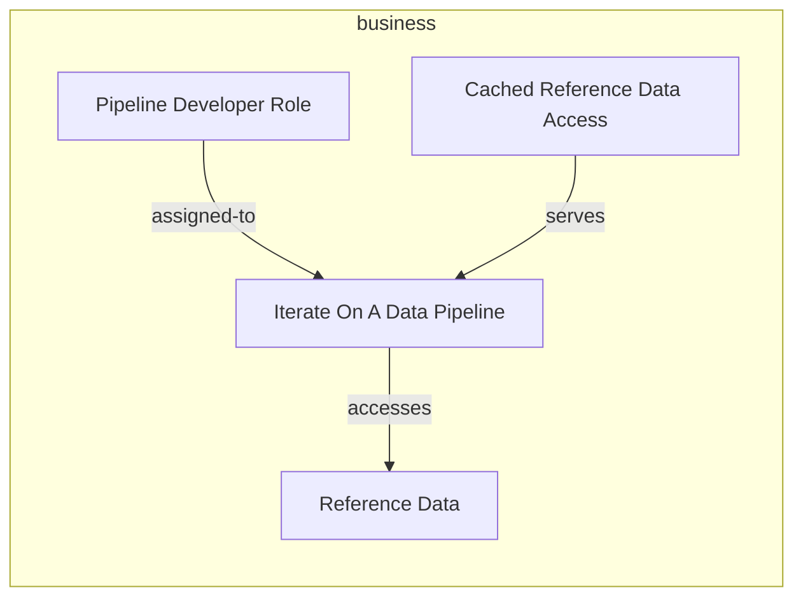
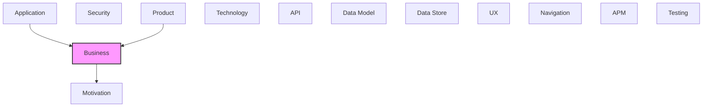

# Business

[← Back to README](../README.md)

Business processes, functions, roles, and services.

## Report Index

- [Layer Introduction](#layer-introduction)
- [Intra-Layer Relationships](#intra-layer-relationships)
- [Inter-Layer Dependencies](#inter-layer-dependencies)
- [Inter-Layer Relationships Table](#inter-layer-relationships-table)
- [Element Reference](#element-reference)

## Layer Introduction

| Metric                    | Count |
| ------------------------- | ----- |
| Elements                  | 4     |
| Intra-Layer Relationships | 3     |
| Inter-Layer Relationships | 6     |
| Inbound Relationships     | 3     |
| Outbound Relationships    | 3     |

**Cross-Layer References**:

- **Upstream layers**: [Application](./05-application-layer-report.md), [Product](./03-product-layer-report.md)
- **Downstream layers**: [Motivation](./01-motivation-layer-report.md)

## Intra-Layer Relationships

## Inter-Layer Dependencies

## Inter-Layer Relationships Table

| Relationship ID                                                    | Source Node                                                   | Dest Node                                               | Dest Layer   | Predicate    | Cardinality  | Strength |
| ------------------------------------------------------------------ | ------------------------------------------------------------- | ------------------------------------------------------- | ------------ | ------------ | ------------ | -------- |
| `application.applicationservice.realizes.business.businessservice` | `application.applicationservice.cached-reference-proxying`    | `business.businessservice.cached-reference-data-access` | `business`   | `realizes`   | many-to-many | medium   |
| `business.businessservice.delivers.motivation.value`               | `business.businessservice.cached-reference-data-access`       | `motivation.value.cheaper-faster-pipeline-iteration`    | `motivation` | `delivers`   | many-to-many | medium   |
| `business.businessservice.realizes.motivation.goal`                | `business.businessservice.cached-reference-data-access`       | `motivation.goal.reduce-upstream-api-cost-and-load`     | `motivation` | `realizes`   | many-to-many | medium   |
| `business.businessservice.satisfies.motivation.requirement`        | `business.businessservice.cached-reference-data-access`       | `motivation.requirement.per-domain-rate-limiting`       | `motivation` | `satisfies`  | many-to-many | medium   |
| `product.persona.references.business.businessrole`                 | `product.persona.pipeline-builder`                            | `business.businessrole.pipeline-developer-role`         | `business`   | `references` | many-to-many | medium   |
| `product.userworkflow.realizes.business.businessprocess`           | `product.userworkflow.route-pipeline-calls-through-the-proxy` | `business.businessprocess.iterate-on-a-data-pipeline`   | `business`   | `realizes`   | many-to-many | medium   |

## Element Reference

### Reference Data {#reference-data}

**ID**: `business.businessobject.reference-data`

**Type**: `businessobject`

Slowly-changing public or paid data (ConceptNet assertions, DBpedia and Wikidata entities, search results) that pipelines read from external APIs.

#### Relationships

| Type        | Related Element                                       | Predicate  | Direction |
| ----------- | ----------------------------------------------------- | ---------- | --------- |
| intra-layer | `business.businessprocess.iterate-on-a-data-pipeline` | `accesses` | inbound   |

### Iterate On A Data Pipeline {#iterate-on-a-data-pipeline}

**ID**: `business.businessprocess.iterate-on-a-data-pipeline`

**Type**: `businessprocess`

Repeatedly change, rerun and evaluate a pipeline that fetches reference data from external APIs.

#### Relationships

| Type        | Related Element                                               | Predicate     | Direction |
| ----------- | ------------------------------------------------------------- | ------------- | --------- |
| inter-layer | `product.userworkflow.route-pipeline-calls-through-the-proxy` | `realizes`    | inbound   |
| intra-layer | `business.businessobject.reference-data`                      | `accesses`    | outbound  |
| intra-layer | `business.businessrole.pipeline-developer-role`               | `assigned-to` | inbound   |
| intra-layer | `business.businessservice.cached-reference-data-access`       | `serves`      | inbound   |

### Pipeline Developer Role {#pipeline-developer-role}

**ID**: `business.businessrole.pipeline-developer-role`

**Type**: `businessrole`

The person who builds, runs and tunes a data or LLM pipeline that depends on external reference data.

#### Relationships

| Type        | Related Element                                       | Predicate     | Direction |
| ----------- | ----------------------------------------------------- | ------------- | --------- |
| inter-layer | `product.persona.pipeline-builder`                    | `references`  | inbound   |
| intra-layer | `business.businessprocess.iterate-on-a-data-pipeline` | `assigned-to` | outbound  |

### Cached Reference Data Access {#cached-reference-data-access}

**ID**: `business.businessservice.cached-reference-data-access`

**Type**: `businessservice`

Access to external reference data that answers repeated questions locally and paces the rest to the provider's limits.

#### Relationships

| Type        | Related Element                                            | Predicate   | Direction |
| ----------- | ---------------------------------------------------------- | ----------- | --------- |
| inter-layer | `application.applicationservice.cached-reference-proxying` | `realizes`  | inbound   |
| inter-layer | `motivation.value.cheaper-faster-pipeline-iteration`       | `delivers`  | outbound  |
| inter-layer | `motivation.goal.reduce-upstream-api-cost-and-load`        | `realizes`  | outbound  |
| inter-layer | `motivation.requirement.per-domain-rate-limiting`          | `satisfies` | outbound  |
| intra-layer | `business.businessprocess.iterate-on-a-data-pipeline`      | `serves`    | outbound  |

---

Generated: 2026-11-24T18:04:53.605Z | Model Version: 0.1.0
