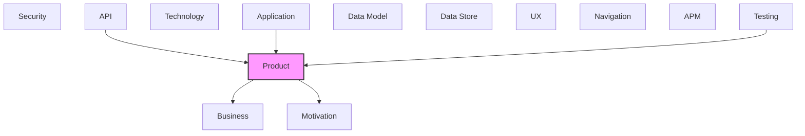

# Product

[← Back to README](../README.md)

Product features, capabilities, personas, and milestones.

## Report Index

- [Layer Introduction](#layer-introduction)
- [Intra-Layer Relationships](#intra-layer-relationships)
- [Inter-Layer Dependencies](#inter-layer-dependencies)
- [Inter-Layer Relationships Table](#inter-layer-relationships-table)
- [Element Reference](#element-reference)

## Layer Introduction

| Metric                    | Count |
| ------------------------- | ----- |
| Elements                  | 25    |
| Intra-Layer Relationships | 59    |
| Inter-Layer Relationships | 59    |
| Inbound Relationships     | 33    |
| Outbound Relationships    | 26    |

**Cross-Layer References**:

- **Upstream layers**: [API](./07-api-layer-report.md), [Application](./05-application-layer-report.md), [Testing](./13-testing-layer-report.md)
- **Downstream layers**: [Business](./02-business-layer-report.md), [Motivation](./01-motivation-layer-report.md)

## Intra-Layer Relationships

```mermaid
flowchart LR
  subgraph product
    product_feature_admin_debug_endpoints["Admin Debug Endpoints"]
    product_feature_api_buddy_cli["Api Buddy CLI"]
    product_feature_embeddable_caching_proxy_module["Embeddable Caching Proxy Module"]
    product_feature_fine_grained_rate_limits["Fine Grained Rate Limits"]
    product_feature_monitoring_metrics["Monitoring Metrics"]
    product_feature_path_based_domain_mapping["Path Based Domain Mapping"]
    product_feature_per_domain_ttl["Per Domain TTL"]
    product_feature_persistent_sqlite_cache["Persistent SQLite Cache"]
    product_feature_request_coalescing["Request Coalescing"]
    product_feature_secure_key_authentication["Secure Key Authentication"]
    product_feature_upstream_auth_passthrough["Upstream Auth Passthrough"]
    product_milestone_release_0_5_2["Release 0.5.2"]
    product_persona_pipeline_builder["Pipeline Builder"]
    product_softwarecapability_configurable_domain_routing["Configurable Domain Routing"]
    product_softwarecapability_operational_visibility["Operational Visibility"]
    product_softwarecapability_proxy_access_control["Proxy Access Control"]
    product_softwarecapability_rate_limiting_and_throttling["Rate Limiting And Throttling"]
    product_softwarecapability_request_deduplication["Request Deduplication"]
    product_softwarecapability_response_caching["Response Caching"]
    product_userworkflow_route_pipeline_calls_through_the_proxy["Route Pipeline Calls Through The Proxy"]
    product_workflowstep_check_cache_and_throttling["Check Cache And Throttling"]
    product_workflowstep_map_upstream_domains["Map Upstream Domains"]
    product_workflowstep_point_clients_at_the_proxy["Point Clients At The Proxy"]
    product_workflowstep_rerun_the_pipeline["Rerun The Pipeline"]
    product_workflowstep_start_the_proxy["Start The Proxy"]
    product_feature_admin_debug_endpoints -->|realizes| product_softwarecapability_operational_visibility
    product_feature_admin_debug_endpoints -->|scheduled-for| product_milestone_release_0_5_2
    product_feature_admin_debug_endpoints -->|serves| product_persona_pipeline_builder
    product_feature_api_buddy_cli -->|realizes| product_softwarecapability_configurable_domain_routing
    product_feature_api_buddy_cli -->|scheduled-for| product_milestone_release_0_5_2
    product_feature_api_buddy_cli -->|serves| product_persona_pipeline_builder
    product_feature_embeddable_caching_proxy_module -->|realizes| product_softwarecapability_configurable_domain_routing
    product_feature_embeddable_caching_proxy_module -->|scheduled-for| product_milestone_release_0_5_2
    product_feature_embeddable_caching_proxy_module -->|serves| product_persona_pipeline_builder
    product_feature_fine_grained_rate_limits -->|realizes| product_softwarecapability_rate_limiting_and_throttling
    product_feature_fine_grained_rate_limits -->|scheduled-for| product_milestone_release_0_5_2
    product_feature_fine_grained_rate_limits -->|serves| product_persona_pipeline_builder
    product_feature_monitoring_metrics -->|realizes| product_softwarecapability_operational_visibility
    product_feature_monitoring_metrics -->|scheduled-for| product_milestone_release_0_5_2
    product_feature_monitoring_metrics -->|serves| product_persona_pipeline_builder
    product_feature_path_based_domain_mapping -->|realizes| product_softwarecapability_configurable_domain_routing
    product_feature_path_based_domain_mapping -->|scheduled-for| product_milestone_release_0_5_2
    product_feature_path_based_domain_mapping -->|serves| product_persona_pipeline_builder
    product_feature_per_domain_ttl -->|realizes| product_softwarecapability_response_caching
    product_feature_per_domain_ttl -->|scheduled-for| product_milestone_release_0_5_2
    product_feature_per_domain_ttl -->|serves| product_persona_pipeline_builder
    product_feature_persistent_sqlite_cache -->|realizes| product_softwarecapability_response_caching
    product_feature_persistent_sqlite_cache -->|scheduled-for| product_milestone_release_0_5_2
    product_feature_persistent_sqlite_cache -->|serves| product_persona_pipeline_builder
    product_feature_request_coalescing -->|realizes| product_softwarecapability_request_deduplication
    product_feature_request_coalescing -->|scheduled-for| product_milestone_release_0_5_2
    product_feature_request_coalescing -->|serves| product_persona_pipeline_builder
    product_feature_secure_key_authentication -->|realizes| product_softwarecapability_proxy_access_control
    product_feature_secure_key_authentication -->|scheduled-for| product_milestone_release_0_5_2
    product_feature_secure_key_authentication -->|serves| product_persona_pipeline_builder
    product_feature_upstream_auth_passthrough -->|realizes| product_softwarecapability_configurable_domain_routing
    product_feature_upstream_auth_passthrough -->|scheduled-for| product_milestone_release_0_5_2
    product_feature_upstream_auth_passthrough -->|serves| product_persona_pipeline_builder
    product_softwarecapability_configurable_domain_routing -->|scheduled-for| product_milestone_release_0_5_2
    product_softwarecapability_operational_visibility -->|scheduled-for| product_milestone_release_0_5_2
    product_softwarecapability_proxy_access_control -->|scheduled-for| product_milestone_release_0_5_2
    product_softwarecapability_rate_limiting_and_throttling -->|scheduled-for| product_milestone_release_0_5_2
    product_softwarecapability_request_deduplication -->|scheduled-for| product_milestone_release_0_5_2
    product_softwarecapability_response_caching -->|scheduled-for| product_milestone_release_0_5_2
    product_userworkflow_route_pipeline_calls_through_the_proxy -->|composes| product_workflowstep_check_cache_and_throttling
    product_userworkflow_route_pipeline_calls_through_the_proxy -->|composes| product_workflowstep_map_upstream_domains
    product_userworkflow_route_pipeline_calls_through_the_proxy -->|composes| product_workflowstep_point_clients_at_the_proxy
    product_userworkflow_route_pipeline_calls_through_the_proxy -->|composes| product_workflowstep_rerun_the_pipeline
    product_userworkflow_route_pipeline_calls_through_the_proxy -->|composes| product_workflowstep_start_the_proxy
    product_userworkflow_route_pipeline_calls_through_the_proxy -->|serves| product_persona_pipeline_builder
    product_workflowstep_check_cache_and_throttling -->|uses| product_feature_admin_debug_endpoints
    product_workflowstep_check_cache_and_throttling -->|uses| product_feature_monitoring_metrics
    product_workflowstep_map_upstream_domains -->|flows-to| product_workflowstep_start_the_proxy
    product_workflowstep_map_upstream_domains -->|uses| product_feature_path_based_domain_mapping
    product_workflowstep_point_clients_at_the_proxy -->|flows-to| product_workflowstep_rerun_the_pipeline
    product_workflowstep_point_clients_at_the_proxy -->|uses| product_feature_path_based_domain_mapping
    product_workflowstep_point_clients_at_the_proxy -->|uses| product_feature_secure_key_authentication
    product_workflowstep_rerun_the_pipeline -->|flows-to| product_workflowstep_check_cache_and_throttling
    product_workflowstep_rerun_the_pipeline -->|uses| product_feature_fine_grained_rate_limits
    product_workflowstep_rerun_the_pipeline -->|uses| product_feature_persistent_sqlite_cache
    product_workflowstep_rerun_the_pipeline -->|uses| product_feature_request_coalescing
    product_workflowstep_start_the_proxy -->|flows-to| product_workflowstep_point_clients_at_the_proxy
    product_workflowstep_start_the_proxy -->|uses| product_feature_api_buddy_cli
    product_workflowstep_start_the_proxy -->|uses| product_feature_embeddable_caching_proxy_module
  end
```

## Inter-Layer Dependencies

## Inter-Layer Relationships Table

| Relationship ID                                                      | Source Node                                                                                                                   | Dest Node                                                         | Dest Layer   | Predicate    | Cardinality  | Strength |
| -------------------------------------------------------------------- | ----------------------------------------------------------------------------------------------------------------------------- | ----------------------------------------------------------------- | ------------ | ------------ | ------------ | -------- |
| `api.operation.exposes.product.feature`                              | `api.operation.delete-proxied-upstream-request`                                                                               | `product.feature.path-based-domain-mapping`                       | `product`    | `exposes`    | many-to-many | medium   |
| `api.operation.exposes.product.feature`                              | `api.operation.get-admin-cache-domain`                                                                                        | `product.feature.admin-debug-endpoints`                           | `product`    | `exposes`    | many-to-many | medium   |
| `api.operation.exposes.product.feature`                              | `api.operation.get-admin-cache`                                                                                               | `product.feature.admin-debug-endpoints`                           | `product`    | `exposes`    | many-to-many | medium   |
| `api.operation.exposes.product.feature`                              | `api.operation.get-admin-config`                                                                                              | `product.feature.admin-debug-endpoints`                           | `product`    | `exposes`    | many-to-many | medium   |
| `api.operation.exposes.product.feature`                              | `api.operation.get-admin-domains`                                                                                             | `product.feature.admin-debug-endpoints`                           | `product`    | `exposes`    | many-to-many | medium   |
| `api.operation.exposes.product.feature`                              | `api.operation.get-admin-health`                                                                                              | `product.feature.admin-debug-endpoints`                           | `product`    | `exposes`    | many-to-many | medium   |
| `api.operation.exposes.product.feature`                              | `api.operation.get-admin-status`                                                                                              | `product.feature.admin-debug-endpoints`                           | `product`    | `exposes`    | many-to-many | medium   |
| `api.operation.exposes.product.feature`                              | `api.operation.get-proxied-upstream-request`                                                                                  | `product.feature.path-based-domain-mapping`                       | `product`    | `exposes`    | many-to-many | medium   |
| `api.operation.exposes.product.feature`                              | `api.operation.post-admin-validate-config`                                                                                    | `product.feature.admin-debug-endpoints`                           | `product`    | `exposes`    | many-to-many | medium   |
| `api.operation.exposes.product.feature`                              | `api.operation.post-proxied-upstream-request`                                                                                 | `product.feature.path-based-domain-mapping`                       | `product`    | `exposes`    | many-to-many | medium   |
| `api.operation.exposes.product.feature`                              | `api.operation.put-proxied-upstream-request`                                                                                  | `product.feature.path-based-domain-mapping`                       | `product`    | `exposes`    | many-to-many | medium   |
| `application.applicationservice.realizes.product.feature`            | `application.applicationservice.admin-diagnostics`                                                                            | `product.feature.admin-debug-endpoints`                           | `product`    | `realizes`   | many-to-many | medium   |
| `application.applicationservice.realizes.product.softwarecapability` | `application.applicationservice.admin-diagnostics`                                                                            | `product.softwarecapability.operational-visibility`               | `product`    | `realizes`   | many-to-many | medium   |
| `application.applicationservice.realizes.product.feature`            | `application.applicationservice.cached-reference-proxying`                                                                    | `product.feature.fine-grained-rate-limits`                        | `product`    | `realizes`   | many-to-many | medium   |
| `application.applicationservice.realizes.product.feature`            | `application.applicationservice.cached-reference-proxying`                                                                    | `product.feature.path-based-domain-mapping`                       | `product`    | `realizes`   | many-to-many | medium   |
| `application.applicationservice.realizes.product.feature`            | `application.applicationservice.cached-reference-proxying`                                                                    | `product.feature.per-domain-ttl`                                  | `product`    | `realizes`   | many-to-many | medium   |
| `application.applicationservice.realizes.product.feature`            | `application.applicationservice.cached-reference-proxying`                                                                    | `product.feature.persistent-sqlite-cache`                         | `product`    | `realizes`   | many-to-many | medium   |
| `application.applicationservice.realizes.product.feature`            | `application.applicationservice.cached-reference-proxying`                                                                    | `product.feature.request-coalescing`                              | `product`    | `realizes`   | many-to-many | medium   |
| `application.applicationservice.realizes.product.feature`            | `application.applicationservice.cached-reference-proxying`                                                                    | `product.feature.secure-key-authentication`                       | `product`    | `realizes`   | many-to-many | medium   |
| `application.applicationservice.realizes.product.feature`            | `application.applicationservice.cached-reference-proxying`                                                                    | `product.feature.upstream-auth-passthrough`                       | `product`    | `realizes`   | many-to-many | medium   |
| `application.applicationservice.realizes.product.softwarecapability` | `application.applicationservice.cached-reference-proxying`                                                                    | `product.softwarecapability.configurable-domain-routing`          | `product`    | `realizes`   | many-to-many | medium   |
| `application.applicationservice.realizes.product.softwarecapability` | `application.applicationservice.cached-reference-proxying`                                                                    | `product.softwarecapability.proxy-access-control`                 | `product`    | `realizes`   | many-to-many | medium   |
| `application.applicationservice.realizes.product.softwarecapability` | `application.applicationservice.cached-reference-proxying`                                                                    | `product.softwarecapability.rate-limiting-and-throttling`         | `product`    | `realizes`   | many-to-many | medium   |
| `application.applicationservice.realizes.product.softwarecapability` | `application.applicationservice.cached-reference-proxying`                                                                    | `product.softwarecapability.request-deduplication`                | `product`    | `realizes`   | many-to-many | medium   |
| `application.applicationservice.realizes.product.softwarecapability` | `application.applicationservice.cached-reference-proxying`                                                                    | `product.softwarecapability.response-caching`                     | `product`    | `realizes`   | many-to-many | medium   |
| `application.applicationservice.realizes.product.feature`            | `application.applicationservice.embedded-proxy-control`                                                                       | `product.feature.embeddable-caching-proxy-module`                 | `product`    | `realizes`   | many-to-many | medium   |
| `application.applicationservice.realizes.product.softwarecapability` | `application.applicationservice.embedded-proxy-control`                                                                       | `product.softwarecapability.configurable-domain-routing`          | `product`    | `realizes`   | many-to-many | medium   |
| `application.applicationservice.realizes.product.feature`            | `application.applicationservice.monitoring-statistics`                                                                        | `product.feature.monitoring-metrics`                              | `product`    | `realizes`   | many-to-many | medium   |
| `application.applicationservice.realizes.product.softwarecapability` | `application.applicationservice.monitoring-statistics`                                                                        | `product.softwarecapability.operational-visibility`               | `product`    | `realizes`   | many-to-many | medium   |
| `product.feature.satisfies.motivation.requirement`                   | `product.feature.admin-debug-endpoints`                                                                                       | `motivation.requirement.admin-debug-endpoints`                    | `motivation` | `satisfies`  | many-to-many | medium   |
| `product.feature.satisfies.motivation.requirement`                   | `product.feature.admin-debug-endpoints`                                                                                       | `motivation.requirement.redact-secrets-in-admin-output`           | `motivation` | `satisfies`  | many-to-many | medium   |
| `product.feature.satisfies.motivation.requirement`                   | `product.feature.embeddable-caching-proxy-module`                                                                             | `motivation.requirement.embeddable-module-lifecycle`              | `motivation` | `satisfies`  | many-to-many | medium   |
| `product.feature.satisfies.motivation.requirement`                   | `product.feature.embeddable-caching-proxy-module`                                                                             | `motivation.requirement.parent-application-logging-integration`   | `motivation` | `satisfies`  | many-to-many | medium   |
| `product.feature.satisfies.motivation.requirement`                   | `product.feature.embeddable-caching-proxy-module`                                                                             | `motivation.requirement.thread-safe-concurrent-handling`          | `motivation` | `satisfies`  | many-to-many | medium   |
| `product.feature.satisfies.motivation.requirement`                   | `product.feature.fine-grained-rate-limits`                                                                                    | `motivation.requirement.per-domain-rate-limiting`                 | `motivation` | `satisfies`  | many-to-many | medium   |
| `product.feature.satisfies.motivation.requirement`                   | `product.feature.monitoring-metrics`                                                                                          | `motivation.requirement.programmatic-monitoring-interface`        | `motivation` | `satisfies`  | many-to-many | medium   |
| `product.feature.satisfies.motivation.requirement`                   | `product.feature.path-based-domain-mapping`                                                                                   | `motivation.requirement.distinguish-upstream-errors-from-outages` | `motivation` | `satisfies`  | many-to-many | medium   |
| `product.feature.satisfies.motivation.requirement`                   | `product.feature.per-domain-ttl`                                                                                              | `motivation.requirement.configurable-cache-ttl`                   | `motivation` | `satisfies`  | many-to-many | medium   |
| `product.feature.delivers.motivation.value`                          | `product.feature.persistent-sqlite-cache`                                                                                     | `motivation.value.cheaper-faster-pipeline-iteration`              | `motivation` | `delivers`   | many-to-many | medium   |
| `product.feature.satisfies.motivation.requirement`                   | `product.feature.persistent-sqlite-cache`                                                                                     | `motivation.requirement.bounded-cache-size`                       | `motivation` | `satisfies`  | many-to-many | medium   |
| `product.feature.satisfies.motivation.requirement`                   | `product.feature.persistent-sqlite-cache`                                                                                     | `motivation.requirement.cache-get-and-post-by-request-signature`  | `motivation` | `satisfies`  | many-to-many | medium   |
| `product.feature.satisfies.motivation.requirement`                   | `product.feature.persistent-sqlite-cache`                                                                                     | `motivation.requirement.cache-only-successful-responses`          | `motivation` | `satisfies`  | many-to-many | medium   |
| `product.feature.satisfies.motivation.requirement`                   | `product.feature.persistent-sqlite-cache`                                                                                     | `motivation.requirement.persistent-or-in-memory-cache`            | `motivation` | `satisfies`  | many-to-many | medium   |
| `product.feature.satisfies.motivation.requirement`                   | `product.feature.request-coalescing`                                                                                          | `motivation.requirement.deduplicate-concurrent-requests`          | `motivation` | `satisfies`  | many-to-many | medium   |
| `product.feature.satisfies.motivation.requirement`                   | `product.feature.secure-key-authentication`                                                                                   | `motivation.requirement.optional-secure-key-access-control`       | `motivation` | `satisfies`  | many-to-many | medium   |
| `product.persona.references.business.businessrole`                   | `product.persona.pipeline-builder`                                                                                            | `business.businessrole.pipeline-developer-role`                   | `business`   | `references` | many-to-many | medium   |
| `product.persona.references.motivation.stakeholder`                  | `product.persona.pipeline-builder`                                                                                            | `motivation.stakeholder.pipeline-developer`                       | `motivation` | `references` | many-to-many | medium   |
| `product.softwarecapability.supports.motivation.goal`                | `product.softwarecapability.configurable-domain-routing`                                                                      | `motivation.goal.drop-in-without-custom-api-clients`              | `motivation` | `supports`   | many-to-many | medium   |
| `product.softwarecapability.supports.motivation.goal`                | `product.softwarecapability.operational-visibility`                                                                           | `motivation.goal.drop-in-without-custom-api-clients`              | `motivation` | `supports`   | many-to-many | medium   |
| `product.softwarecapability.supports.motivation.goal`                | `product.softwarecapability.proxy-access-control`                                                                             | `motivation.goal.drop-in-without-custom-api-clients`              | `motivation` | `supports`   | many-to-many | medium   |
| `product.softwarecapability.supports.motivation.goal`                | `product.softwarecapability.rate-limiting-and-throttling`                                                                     | `motivation.goal.stay-within-upstream-rate-limits`                | `motivation` | `supports`   | many-to-many | medium   |
| `product.softwarecapability.supports.motivation.goal`                | `product.softwarecapability.request-deduplication`                                                                            | `motivation.goal.reduce-upstream-api-cost-and-load`               | `motivation` | `supports`   | many-to-many | medium   |
| `product.softwarecapability.supports.motivation.goal`                | `product.softwarecapability.request-deduplication`                                                                            | `motivation.goal.stay-within-upstream-rate-limits`                | `motivation` | `supports`   | many-to-many | medium   |
| `product.softwarecapability.supports.motivation.goal`                | `product.softwarecapability.response-caching`                                                                                 | `motivation.goal.reduce-upstream-api-cost-and-load`               | `motivation` | `supports`   | many-to-many | medium   |
| `product.userworkflow.realizes.business.businessprocess`             | `product.userworkflow.route-pipeline-calls-through-the-proxy`                                                                 | `business.businessprocess.iterate-on-a-data-pipeline`             | `business`   | `realizes`   | many-to-many | medium   |
| `testing.testcasesketch.tests.product.feature`                       | `testing.testcasesketch.test-proxy-key-wins-over-other-candidates-test-header-key-with-long-domain-and-upstream-query-key`    | `product.feature.upstream-auth-passthrough`                       | `product`    | `tests`      | many-to-many | medium   |
| `testing.testcasesketch.tests.product.feature`                       | `testing.testcasesketch.test-proxy-key-wins-over-other-candidates-test-header-key-with-upstream-query-key`                    | `product.feature.upstream-auth-passthrough`                       | `product`    | `tests`      | many-to-many | medium   |
| `testing.testcasesketch.tests.product.feature`                       | `testing.testcasesketch.test-upstream-credentials-pass-through-test-upstream-bearer-token-is-forwarded`                       | `product.feature.upstream-auth-passthrough`                       | `product`    | `tests`      | many-to-many | medium   |
| `testing.testcasesketch.tests.product.feature`                       | `testing.testcasesketch.test-upstream-credentials-pass-through-test-upstream-key-parameter-is-forwarded-when-security-is-off` | `product.feature.upstream-auth-passthrough`                       | `product`    | `tests`      | many-to-many | medium   |

## Element Reference

### Admin Debug Endpoints {#admin-debug-endpoints}

**ID**: `product.feature.admin-debug-endpoints`

**Type**: `feature`

HTTP endpoints for health, sanitized config, status, domains, cache and config validation.

#### Attributes

| Name     | Value     |
| -------- | --------- |
| priority | medium    |
| status   | delivered |

#### Relationships

| Type        | Related Element                                         | Predicate       | Direction |
| ----------- | ------------------------------------------------------- | --------------- | --------- |
| inter-layer | `api.operation.get-admin-cache-domain`                  | `exposes`       | inbound   |
| inter-layer | `api.operation.get-admin-cache`                         | `exposes`       | inbound   |
| inter-layer | `api.operation.get-admin-config`                        | `exposes`       | inbound   |
| inter-layer | `api.operation.get-admin-domains`                       | `exposes`       | inbound   |
| inter-layer | `api.operation.get-admin-health`                        | `exposes`       | inbound   |
| inter-layer | `api.operation.get-admin-status`                        | `exposes`       | inbound   |
| inter-layer | `api.operation.post-admin-validate-config`              | `exposes`       | inbound   |
| inter-layer | `application.applicationservice.admin-diagnostics`      | `realizes`      | inbound   |
| inter-layer | `motivation.requirement.admin-debug-endpoints`          | `satisfies`     | outbound  |
| inter-layer | `motivation.requirement.redact-secrets-in-admin-output` | `satisfies`     | outbound  |
| intra-layer | `product.softwarecapability.operational-visibility`     | `realizes`      | outbound  |
| intra-layer | `product.milestone.release-0-5-2`                       | `scheduled-for` | outbound  |
| intra-layer | `product.persona.pipeline-builder`                      | `serves`        | outbound  |
| intra-layer | `product.workflowstep.check-cache-and-throttling`       | `uses`          | inbound   |

### Api Buddy CLI {#api-buddy-cli}

**ID**: `product.feature.api-buddy-cli`

**Type**: `feature`

api-buddy command that runs the proxy standalone from a JSON config, generates a default config, or prints a new secure key.

#### Attributes

| Name     | Value     |
| -------- | --------- |
| priority | high      |
| status   | delivered |

#### Relationships

| Type        | Related Element                                          | Predicate       | Direction |
| ----------- | -------------------------------------------------------- | --------------- | --------- |
| intra-layer | `product.softwarecapability.configurable-domain-routing` | `realizes`      | outbound  |
| intra-layer | `product.milestone.release-0-5-2`                        | `scheduled-for` | outbound  |
| intra-layer | `product.persona.pipeline-builder`                       | `serves`        | outbound  |
| intra-layer | `product.workflowstep.start-the-proxy`                   | `uses`          | inbound   |

### Embeddable Caching Proxy Module {#embeddable-caching-proxy-module}

**ID**: `product.feature.embeddable-caching-proxy-module`

**Type**: `feature`

CachingProxy class a Python app imports, starts in a background thread or as a context manager, and stops.

#### Attributes

| Name     | Value     |
| -------- | --------- |
| priority | critical  |
| status   | delivered |

#### Relationships

| Type        | Related Element                                                 | Predicate       | Direction |
| ----------- | --------------------------------------------------------------- | --------------- | --------- |
| inter-layer | `application.applicationservice.embedded-proxy-control`         | `realizes`      | inbound   |
| inter-layer | `motivation.requirement.embeddable-module-lifecycle`            | `satisfies`     | outbound  |
| inter-layer | `motivation.requirement.parent-application-logging-integration` | `satisfies`     | outbound  |
| inter-layer | `motivation.requirement.thread-safe-concurrent-handling`        | `satisfies`     | outbound  |
| intra-layer | `product.softwarecapability.configurable-domain-routing`        | `realizes`      | outbound  |
| intra-layer | `product.milestone.release-0-5-2`                               | `scheduled-for` | outbound  |
| intra-layer | `product.persona.pipeline-builder`                              | `serves`        | outbound  |
| intra-layer | `product.workflowstep.start-the-proxy`                          | `uses`          | inbound   |

### Fine Grained Rate Limits {#fine-grained-rate-limits}

**ID**: `product.feature.fine-grained-rate-limits`

**Type**: `feature`

Per-second, per-minute and per-hour limits per domain, delays applied only to cache misses, 429 past the maximum delay.

#### Attributes

| Name     | Value     |
| -------- | --------- |
| priority | high      |
| status   | delivered |

#### Relationships

| Type        | Related Element                                            | Predicate       | Direction |
| ----------- | ---------------------------------------------------------- | --------------- | --------- |
| inter-layer | `application.applicationservice.cached-reference-proxying` | `realizes`      | inbound   |
| inter-layer | `motivation.requirement.per-domain-rate-limiting`          | `satisfies`     | outbound  |
| intra-layer | `product.softwarecapability.rate-limiting-and-throttling`  | `realizes`      | outbound  |
| intra-layer | `product.milestone.release-0-5-2`                          | `scheduled-for` | outbound  |
| intra-layer | `product.persona.pipeline-builder`                         | `serves`        | outbound  |
| intra-layer | `product.workflowstep.rerun-the-pipeline`                  | `uses`          | inbound   |

### Monitoring Metrics {#monitoring-metrics}

**ID**: `product.feature.monitoring-metrics`

**Type**: `feature`

MonitoringManager and get_metrics() report cache, upstream, database, health and throttling statistics.

#### Attributes

| Name     | Value     |
| -------- | --------- |
| priority | medium    |
| status   | delivered |

#### Relationships

| Type        | Related Element                                            | Predicate       | Direction |
| ----------- | ---------------------------------------------------------- | --------------- | --------- |
| inter-layer | `application.applicationservice.monitoring-statistics`     | `realizes`      | inbound   |
| inter-layer | `motivation.requirement.programmatic-monitoring-interface` | `satisfies`     | outbound  |
| intra-layer | `product.softwarecapability.operational-visibility`        | `realizes`      | outbound  |
| intra-layer | `product.milestone.release-0-5-2`                          | `scheduled-for` | outbound  |
| intra-layer | `product.persona.pipeline-builder`                         | `serves`        | outbound  |
| intra-layer | `product.workflowstep.check-cache-and-throttling`          | `uses`          | inbound   |

### Path Based Domain Mapping {#path-based-domain-mapping}

**ID**: `product.feature.path-based-domain-mapping`

**Type**: `feature`

http://127.0.0.1:&lt;port&gt;/&lt;domain_key&gt;/&lt;path&gt; is forwarded to &lt;upstream&gt;&lt;path&gt; with the query string, so a client only changes its base URL.

#### Attributes

| Name     | Value     |
| -------- | --------- |
| priority | critical  |
| status   | delivered |

#### Relationships

| Type        | Related Element                                                   | Predicate       | Direction |
| ----------- | ----------------------------------------------------------------- | --------------- | --------- |
| inter-layer | `api.operation.delete-proxied-upstream-request`                   | `exposes`       | inbound   |
| inter-layer | `api.operation.get-proxied-upstream-request`                      | `exposes`       | inbound   |
| inter-layer | `api.operation.post-proxied-upstream-request`                     | `exposes`       | inbound   |
| inter-layer | `api.operation.put-proxied-upstream-request`                      | `exposes`       | inbound   |
| inter-layer | `application.applicationservice.cached-reference-proxying`        | `realizes`      | inbound   |
| inter-layer | `motivation.requirement.distinguish-upstream-errors-from-outages` | `satisfies`     | outbound  |
| intra-layer | `product.softwarecapability.configurable-domain-routing`          | `realizes`      | outbound  |
| intra-layer | `product.milestone.release-0-5-2`                                 | `scheduled-for` | outbound  |
| intra-layer | `product.persona.pipeline-builder`                                | `serves`        | outbound  |
| intra-layer | `product.workflowstep.map-upstream-domains`                       | `uses`          | inbound   |
| intra-layer | `product.workflowstep.point-clients-at-the-proxy`                 | `uses`          | inbound   |

### Per Domain TTL {#per-domain-ttl}

**ID**: `product.feature.per-domain-ttl`

**Type**: `feature`

System default TTL with per-domain ttl_seconds overrides.

#### Attributes

| Name     | Value     |
| -------- | --------- |
| priority | high      |
| status   | delivered |

#### Relationships

| Type        | Related Element                                            | Predicate       | Direction |
| ----------- | ---------------------------------------------------------- | --------------- | --------- |
| inter-layer | `application.applicationservice.cached-reference-proxying` | `realizes`      | inbound   |
| inter-layer | `motivation.requirement.configurable-cache-ttl`            | `satisfies`     | outbound  |
| intra-layer | `product.softwarecapability.response-caching`              | `realizes`      | outbound  |
| intra-layer | `product.milestone.release-0-5-2`                          | `scheduled-for` | outbound  |
| intra-layer | `product.persona.pipeline-builder`                         | `serves`        | outbound  |

### Persistent SQLite Cache {#persistent-sqlite-cache}

**ID**: `product.feature.persistent-sqlite-cache`

**Type**: `feature`

On-disk or in-memory SQLite cache with compression, LRU eviction and a size cap.

#### Attributes

| Name     | Value     |
| -------- | --------- |
| priority | critical  |
| status   | delivered |

#### Relationships

| Type        | Related Element                                                  | Predicate       | Direction |
| ----------- | ---------------------------------------------------------------- | --------------- | --------- |
| inter-layer | `application.applicationservice.cached-reference-proxying`       | `realizes`      | inbound   |
| inter-layer | `motivation.value.cheaper-faster-pipeline-iteration`             | `delivers`      | outbound  |
| inter-layer | `motivation.requirement.bounded-cache-size`                      | `satisfies`     | outbound  |
| inter-layer | `motivation.requirement.cache-get-and-post-by-request-signature` | `satisfies`     | outbound  |
| inter-layer | `motivation.requirement.cache-only-successful-responses`         | `satisfies`     | outbound  |
| inter-layer | `motivation.requirement.persistent-or-in-memory-cache`           | `satisfies`     | outbound  |
| intra-layer | `product.softwarecapability.response-caching`                    | `realizes`      | outbound  |
| intra-layer | `product.milestone.release-0-5-2`                                | `scheduled-for` | outbound  |
| intra-layer | `product.persona.pipeline-builder`                               | `serves`        | outbound  |
| intra-layer | `product.workflowstep.rerun-the-pipeline`                        | `uses`          | inbound   |

### Request Coalescing {#request-coalescing}

**ID**: `product.feature.request-coalescing`

**Type**: `feature`

Concurrent identical misses share one upstream fetch.

#### Attributes

| Name     | Value     |
| -------- | --------- |
| priority | high      |
| status   | delivered |

#### Relationships

| Type        | Related Element                                            | Predicate       | Direction |
| ----------- | ---------------------------------------------------------- | --------------- | --------- |
| inter-layer | `application.applicationservice.cached-reference-proxying` | `realizes`      | inbound   |
| inter-layer | `motivation.requirement.deduplicate-concurrent-requests`   | `satisfies`     | outbound  |
| intra-layer | `product.softwarecapability.request-deduplication`         | `realizes`      | outbound  |
| intra-layer | `product.milestone.release-0-5-2`                          | `scheduled-for` | outbound  |
| intra-layer | `product.persona.pipeline-builder`                         | `serves`        | outbound  |
| intra-layer | `product.workflowstep.rerun-the-pipeline`                  | `uses`          | inbound   |

### Secure Key Authentication {#secure-key-authentication}

**ID**: `product.feature.secure-key-authentication`

**Type**: `feature`

Optional proxy key in header, bearer token, path prefix or query.

#### Attributes

| Name     | Value     |
| -------- | --------- |
| priority | medium    |
| status   | delivered |

#### Relationships

| Type        | Related Element                                             | Predicate       | Direction |
| ----------- | ----------------------------------------------------------- | --------------- | --------- |
| inter-layer | `application.applicationservice.cached-reference-proxying`  | `realizes`      | inbound   |
| inter-layer | `motivation.requirement.optional-secure-key-access-control` | `satisfies`     | outbound  |
| intra-layer | `product.softwarecapability.proxy-access-control`           | `realizes`      | outbound  |
| intra-layer | `product.milestone.release-0-5-2`                           | `scheduled-for` | outbound  |
| intra-layer | `product.persona.pipeline-builder`                          | `serves`        | outbound  |
| intra-layer | `product.workflowstep.point-clients-at-the-proxy`           | `uses`          | inbound   |

### Upstream Auth Passthrough {#upstream-auth-passthrough}

**ID**: `product.feature.upstream-auth-passthrough`

**Type**: `feature`

Client headers and query parameters, including an upstream Authorization token or key= parameter, are forwarded to the upstream. Only Host, Connection, Content-Length and the proxy's own key are left out.

#### Attributes

| Name     | Value     |
| -------- | --------- |
| priority | medium    |
| status   | delivered |

#### Relationships

| Type        | Related Element                                                                                                               | Predicate       | Direction |
| ----------- | ----------------------------------------------------------------------------------------------------------------------------- | --------------- | --------- |
| inter-layer | `application.applicationservice.cached-reference-proxying`                                                                    | `realizes`      | inbound   |
| inter-layer | `testing.testcasesketch.test-proxy-key-wins-over-other-candidates-test-header-key-with-long-domain-and-upstream-query-key`    | `tests`         | inbound   |
| inter-layer | `testing.testcasesketch.test-proxy-key-wins-over-other-candidates-test-header-key-with-upstream-query-key`                    | `tests`         | inbound   |
| inter-layer | `testing.testcasesketch.test-upstream-credentials-pass-through-test-upstream-bearer-token-is-forwarded`                       | `tests`         | inbound   |
| inter-layer | `testing.testcasesketch.test-upstream-credentials-pass-through-test-upstream-key-parameter-is-forwarded-when-security-is-off` | `tests`         | inbound   |
| intra-layer | `product.softwarecapability.configurable-domain-routing`                                                                      | `realizes`      | outbound  |
| intra-layer | `product.milestone.release-0-5-2`                                                                                             | `scheduled-for` | outbound  |
| intra-layer | `product.persona.pipeline-builder`                                                                                            | `serves`        | outbound  |

### Release 0.5.2 {#release-0-5-2}

**ID**: `product.milestone.release-0-5-2`

**Type**: `milestone`

Current release: drops unused runtime dependencies and Python 3.8/3.9, refreshes tooling, deterministic tests.

#### Attributes

| Name   | Value     |
| ------ | --------- |
| status | completed |

#### Relationships

| Type        | Related Element                                           | Predicate       | Direction |
| ----------- | --------------------------------------------------------- | --------------- | --------- |
| intra-layer | `product.feature.admin-debug-endpoints`                   | `scheduled-for` | inbound   |
| intra-layer | `product.feature.api-buddy-cli`                           | `scheduled-for` | inbound   |
| intra-layer | `product.feature.embeddable-caching-proxy-module`         | `scheduled-for` | inbound   |
| intra-layer | `product.feature.fine-grained-rate-limits`                | `scheduled-for` | inbound   |
| intra-layer | `product.feature.monitoring-metrics`                      | `scheduled-for` | inbound   |
| intra-layer | `product.feature.path-based-domain-mapping`               | `scheduled-for` | inbound   |
| intra-layer | `product.feature.per-domain-ttl`                          | `scheduled-for` | inbound   |
| intra-layer | `product.feature.persistent-sqlite-cache`                 | `scheduled-for` | inbound   |
| intra-layer | `product.feature.request-coalescing`                      | `scheduled-for` | inbound   |
| intra-layer | `product.feature.secure-key-authentication`               | `scheduled-for` | inbound   |
| intra-layer | `product.feature.upstream-auth-passthrough`               | `scheduled-for` | inbound   |
| intra-layer | `product.softwarecapability.configurable-domain-routing`  | `scheduled-for` | inbound   |
| intra-layer | `product.softwarecapability.operational-visibility`       | `scheduled-for` | inbound   |
| intra-layer | `product.softwarecapability.proxy-access-control`         | `scheduled-for` | inbound   |
| intra-layer | `product.softwarecapability.rate-limiting-and-throttling` | `scheduled-for` | inbound   |
| intra-layer | `product.softwarecapability.request-deduplication`        | `scheduled-for` | inbound   |
| intra-layer | `product.softwarecapability.response-caching`             | `scheduled-for` | inbound   |

### Pipeline Builder {#pipeline-builder}

**ID**: `product.persona.pipeline-builder`

**Type**: `persona`

A Python developer wiring reference APIs into an NLP or LLM pipeline, comfortable with configuration files and HTTP clients, who reruns the pipeline many times a day.

#### Attributes

| Name        | Value        |
| ----------- | ------------ |
| category    | primary      |
| proficiency | intermediate |

#### Relationships

| Type        | Related Element                                               | Predicate    | Direction |
| ----------- | ------------------------------------------------------------- | ------------ | --------- |
| inter-layer | `business.businessrole.pipeline-developer-role`               | `references` | outbound  |
| inter-layer | `motivation.stakeholder.pipeline-developer`                   | `references` | outbound  |
| intra-layer | `product.feature.admin-debug-endpoints`                       | `serves`     | inbound   |
| intra-layer | `product.feature.api-buddy-cli`                               | `serves`     | inbound   |
| intra-layer | `product.feature.embeddable-caching-proxy-module`             | `serves`     | inbound   |
| intra-layer | `product.feature.fine-grained-rate-limits`                    | `serves`     | inbound   |
| intra-layer | `product.feature.monitoring-metrics`                          | `serves`     | inbound   |
| intra-layer | `product.feature.path-based-domain-mapping`                   | `serves`     | inbound   |
| intra-layer | `product.feature.per-domain-ttl`                              | `serves`     | inbound   |
| intra-layer | `product.feature.persistent-sqlite-cache`                     | `serves`     | inbound   |
| intra-layer | `product.feature.request-coalescing`                          | `serves`     | inbound   |
| intra-layer | `product.feature.secure-key-authentication`                   | `serves`     | inbound   |
| intra-layer | `product.feature.upstream-auth-passthrough`                   | `serves`     | inbound   |
| intra-layer | `product.userworkflow.route-pipeline-calls-through-the-proxy` | `serves`     | inbound   |

### Configurable Domain Routing {#configurable-domain-routing}

**ID**: `product.softwarecapability.configurable-domain-routing`

**Type**: `softwarecapability`

Map short domain keys to upstream base URLs with per-domain TTL and limits, validated against defaults.

#### Attributes

| Name   | Value     |
| ------ | --------- |
| status | delivered |

#### Relationships

| Type        | Related Element                                            | Predicate       | Direction |
| ----------- | ---------------------------------------------------------- | --------------- | --------- |
| inter-layer | `application.applicationservice.cached-reference-proxying` | `realizes`      | inbound   |
| inter-layer | `application.applicationservice.embedded-proxy-control`    | `realizes`      | inbound   |
| inter-layer | `motivation.goal.drop-in-without-custom-api-clients`       | `supports`      | outbound  |
| intra-layer | `product.feature.api-buddy-cli`                            | `realizes`      | inbound   |
| intra-layer | `product.feature.embeddable-caching-proxy-module`          | `realizes`      | inbound   |
| intra-layer | `product.feature.path-based-domain-mapping`                | `realizes`      | inbound   |
| intra-layer | `product.feature.upstream-auth-passthrough`                | `realizes`      | inbound   |
| intra-layer | `product.milestone.release-0-5-2`                          | `scheduled-for` | outbound  |

### Operational Visibility {#operational-visibility}

**ID**: `product.softwarecapability.operational-visibility`

**Type**: `softwarecapability`

Report cache, upstream, database, throttling and health metrics, programmatically and over HTTP.

#### Attributes

| Name   | Value     |
| ------ | --------- |
| status | delivered |

#### Relationships

| Type        | Related Element                                        | Predicate       | Direction |
| ----------- | ------------------------------------------------------ | --------------- | --------- |
| inter-layer | `application.applicationservice.admin-diagnostics`     | `realizes`      | inbound   |
| inter-layer | `application.applicationservice.monitoring-statistics` | `realizes`      | inbound   |
| inter-layer | `motivation.goal.drop-in-without-custom-api-clients`   | `supports`      | outbound  |
| intra-layer | `product.feature.admin-debug-endpoints`                | `realizes`      | inbound   |
| intra-layer | `product.feature.monitoring-metrics`                   | `realizes`      | inbound   |
| intra-layer | `product.milestone.release-0-5-2`                      | `scheduled-for` | outbound  |

### Proxy Access Control {#proxy-access-control}

**ID**: `product.softwarecapability.proxy-access-control`

**Type**: `softwarecapability`

Restrict use of the proxy to callers holding its secure key.

#### Attributes

| Name   | Value     |
| ------ | --------- |
| status | delivered |

#### Relationships

| Type        | Related Element                                            | Predicate       | Direction |
| ----------- | ---------------------------------------------------------- | --------------- | --------- |
| inter-layer | `application.applicationservice.cached-reference-proxying` | `realizes`      | inbound   |
| inter-layer | `motivation.goal.drop-in-without-custom-api-clients`       | `supports`      | outbound  |
| intra-layer | `product.feature.secure-key-authentication`                | `realizes`      | inbound   |
| intra-layer | `product.milestone.release-0-5-2`                          | `scheduled-for` | outbound  |

### Rate Limiting And Throttling {#rate-limiting-and-throttling}

**ID**: `product.softwarecapability.rate-limiting-and-throttling`

**Type**: `softwarecapability`

Pace upstream requests per domain inside per-second, per-minute and per-hour limits.

#### Attributes

| Name   | Value     |
| ------ | --------- |
| status | delivered |

#### Relationships

| Type        | Related Element                                            | Predicate       | Direction |
| ----------- | ---------------------------------------------------------- | --------------- | --------- |
| inter-layer | `application.applicationservice.cached-reference-proxying` | `realizes`      | inbound   |
| inter-layer | `motivation.goal.stay-within-upstream-rate-limits`         | `supports`      | outbound  |
| intra-layer | `product.feature.fine-grained-rate-limits`                 | `realizes`      | inbound   |
| intra-layer | `product.milestone.release-0-5-2`                          | `scheduled-for` | outbound  |

### Request Deduplication {#request-deduplication}

**ID**: `product.softwarecapability.request-deduplication`

**Type**: `softwarecapability`

Collapse concurrent identical cache misses into one upstream request.

#### Attributes

| Name   | Value     |
| ------ | --------- |
| status | delivered |

#### Relationships

| Type        | Related Element                                            | Predicate       | Direction |
| ----------- | ---------------------------------------------------------- | --------------- | --------- |
| inter-layer | `application.applicationservice.cached-reference-proxying` | `realizes`      | inbound   |
| inter-layer | `motivation.goal.reduce-upstream-api-cost-and-load`        | `supports`      | outbound  |
| inter-layer | `motivation.goal.stay-within-upstream-rate-limits`         | `supports`      | outbound  |
| intra-layer | `product.feature.request-coalescing`                       | `realizes`      | inbound   |
| intra-layer | `product.milestone.release-0-5-2`                          | `scheduled-for` | outbound  |

### Response Caching {#response-caching}

**ID**: `product.softwarecapability.response-caching`

**Type**: `softwarecapability`

Store upstream responses in SQLite and replay them until their TTL expires.

#### Attributes

| Name   | Value     |
| ------ | --------- |
| status | delivered |

#### Relationships

| Type        | Related Element                                            | Predicate       | Direction |
| ----------- | ---------------------------------------------------------- | --------------- | --------- |
| inter-layer | `application.applicationservice.cached-reference-proxying` | `realizes`      | inbound   |
| inter-layer | `motivation.goal.reduce-upstream-api-cost-and-load`        | `supports`      | outbound  |
| intra-layer | `product.feature.per-domain-ttl`                           | `realizes`      | inbound   |
| intra-layer | `product.feature.persistent-sqlite-cache`                  | `realizes`      | inbound   |
| intra-layer | `product.milestone.release-0-5-2`                          | `scheduled-for` | outbound  |

### Route Pipeline Calls Through The Proxy {#route-pipeline-calls-through-the-proxy}

**ID**: `product.userworkflow.route-pipeline-calls-through-the-proxy`

**Type**: `userworkflow`

Configure the proxy for the APIs a pipeline uses, start it, point the API clients at it and rerun the pipeline with repeat calls answered from the cache.

#### Attributes

| Name       | Value  |
| ---------- | ------ |
| complexity | simple |

#### Relationships

| Type        | Related Element                                       | Predicate  | Direction |
| ----------- | ----------------------------------------------------- | ---------- | --------- |
| inter-layer | `business.businessprocess.iterate-on-a-data-pipeline` | `realizes` | outbound  |
| intra-layer | `product.workflowstep.check-cache-and-throttling`     | `composes` | outbound  |
| intra-layer | `product.workflowstep.map-upstream-domains`           | `composes` | outbound  |
| intra-layer | `product.workflowstep.point-clients-at-the-proxy`     | `composes` | outbound  |
| intra-layer | `product.workflowstep.rerun-the-pipeline`             | `composes` | outbound  |
| intra-layer | `product.workflowstep.start-the-proxy`                | `composes` | outbound  |
| intra-layer | `product.persona.pipeline-builder`                    | `serves`   | outbound  |

### Check Cache And Throttling {#check-cache-and-throttling}

**ID**: `product.workflowstep.check-cache-and-throttling`

**Type**: `workflowstep`

Read get_metrics(), the MonitoringManager or the admin endpoints.

#### Attributes

| Name     | Value                                                             |
| -------- | ----------------------------------------------------------------- |
| action   | Read get_metrics(), the MonitoringManager or the admin endpoints. |
| sequence | 5                                                                 |

#### Relationships

| Type        | Related Element                                               | Predicate  | Direction |
| ----------- | ------------------------------------------------------------- | ---------- | --------- |
| intra-layer | `product.userworkflow.route-pipeline-calls-through-the-proxy` | `composes` | inbound   |
| intra-layer | `product.feature.admin-debug-endpoints`                       | `uses`     | outbound  |
| intra-layer | `product.feature.monitoring-metrics`                          | `uses`     | outbound  |
| intra-layer | `product.workflowstep.rerun-the-pipeline`                     | `flows-to` | inbound   |

### Map Upstream Domains {#map-upstream-domains}

**ID**: `product.workflowstep.map-upstream-domains`

**Type**: `workflowstep`

Add a domain_mappings entry per upstream with its base URL, TTL and limits.

#### Attributes

| Name     | Value                                                                       |
| -------- | --------------------------------------------------------------------------- |
| action   | Add a domain_mappings entry per upstream with its base URL, TTL and limits. |
| sequence | 1                                                                           |

#### Relationships

| Type        | Related Element                                               | Predicate  | Direction |
| ----------- | ------------------------------------------------------------- | ---------- | --------- |
| intra-layer | `product.userworkflow.route-pipeline-calls-through-the-proxy` | `composes` | inbound   |
| intra-layer | `product.workflowstep.start-the-proxy`                        | `flows-to` | outbound  |
| intra-layer | `product.feature.path-based-domain-mapping`                   | `uses`     | outbound  |

### Point Clients At The Proxy {#point-clients-at-the-proxy}

**ID**: `product.workflowstep.point-clients-at-the-proxy`

**Type**: `workflowstep`

Set each API client's base URL to http://127.0.0.1:&lt;port&gt;/&lt;domain_key&gt;/, adding the secure key if required.

#### Attributes

| Name     | Value                                                                                                                   |
| -------- | ----------------------------------------------------------------------------------------------------------------------- |
| action   | Set each API client's base URL to http://127.0.0.1:&lt;port&gt;/&lt;domain_key&gt;/, adding the secure key if required. |
| sequence | 3                                                                                                                       |

#### Relationships

| Type        | Related Element                                               | Predicate  | Direction |
| ----------- | ------------------------------------------------------------- | ---------- | --------- |
| intra-layer | `product.userworkflow.route-pipeline-calls-through-the-proxy` | `composes` | inbound   |
| intra-layer | `product.workflowstep.rerun-the-pipeline`                     | `flows-to` | outbound  |
| intra-layer | `product.feature.path-based-domain-mapping`                   | `uses`     | outbound  |
| intra-layer | `product.feature.secure-key-authentication`                   | `uses`     | outbound  |
| intra-layer | `product.workflowstep.start-the-proxy`                        | `flows-to` | inbound   |

### Rerun The Pipeline {#rerun-the-pipeline}

**ID**: `product.workflowstep.rerun-the-pipeline`

**Type**: `workflowstep`

Run the pipeline again; repeated requests come back from the cache.

#### Attributes

| Name     | Value                                                               |
| -------- | ------------------------------------------------------------------- |
| action   | Run the pipeline again; repeated requests come back from the cache. |
| sequence | 4                                                                   |

#### Relationships

| Type        | Related Element                                               | Predicate  | Direction |
| ----------- | ------------------------------------------------------------- | ---------- | --------- |
| intra-layer | `product.userworkflow.route-pipeline-calls-through-the-proxy` | `composes` | inbound   |
| intra-layer | `product.workflowstep.point-clients-at-the-proxy`             | `flows-to` | inbound   |
| intra-layer | `product.workflowstep.check-cache-and-throttling`             | `flows-to` | outbound  |
| intra-layer | `product.feature.fine-grained-rate-limits`                    | `uses`     | outbound  |
| intra-layer | `product.feature.persistent-sqlite-cache`                     | `uses`     | outbound  |
| intra-layer | `product.feature.request-coalescing`                          | `uses`     | outbound  |

### Start The Proxy {#start-the-proxy}

**ID**: `product.workflowstep.start-the-proxy`

**Type**: `workflowstep`

Start it embedded with CachingProxy.start() or standalone with api-buddy --config.

#### Attributes

| Name     | Value                                                                              |
| -------- | ---------------------------------------------------------------------------------- |
| action   | Start it embedded with CachingProxy.start() or standalone with api-buddy --config. |
| sequence | 2                                                                                  |

#### Relationships

| Type        | Related Element                                               | Predicate  | Direction |
| ----------- | ------------------------------------------------------------- | ---------- | --------- |
| intra-layer | `product.userworkflow.route-pipeline-calls-through-the-proxy` | `composes` | inbound   |
| intra-layer | `product.workflowstep.map-upstream-domains`                   | `flows-to` | inbound   |
| intra-layer | `product.workflowstep.point-clients-at-the-proxy`             | `flows-to` | outbound  |
| intra-layer | `product.feature.api-buddy-cli`                               | `uses`     | outbound  |
| intra-layer | `product.feature.embeddable-caching-proxy-module`             | `uses`     | outbound  |

---

Generated: 2026-11-25T10:54:35.596Z | Model Version: 0.1.0
