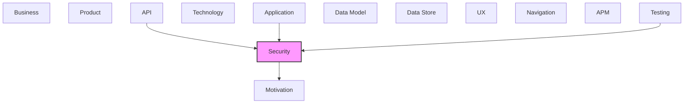

# Security

[← Back to README](../README.md)

Authentication, authorization, security threats, and controls.

## Report Index

- [Layer Introduction](#layer-introduction)
- [Intra-Layer Relationships](#intra-layer-relationships)
- [Inter-Layer Dependencies](#inter-layer-dependencies)
- [Inter-Layer Relationships Table](#inter-layer-relationships-table)
- [Element Reference](#element-reference)

## Layer Introduction

| Metric                    | Count |
| ------------------------- | ----- |
| Elements                  | 15    |
| Intra-Layer Relationships | 20    |
| Inter-Layer Relationships | 25    |
| Inbound Relationships     | 20    |
| Outbound Relationships    | 5     |

**Cross-Layer References**:

- **Upstream layers**: [API](./07-api-layer-report.md), [Application](./05-application-layer-report.md), [Testing](./13-testing-layer-report.md)
- **Downstream layers**: [Motivation](./01-motivation-layer-report.md)

## Intra-Layer Relationships

```mermaid
flowchart LR
  subgraph security
    security_countermeasure_admin_endpoints_switch["Admin Endpoints Switch"]
    security_countermeasure_admin_rate_limiting["Admin Rate Limiting"]
    security_countermeasure_config_secret_redaction["Config Secret Redaction"]
    security_countermeasure_constant_time_key_comparison["Constant Time Key Comparison"]
    security_countermeasure_loopback_default_bind["Loopback Default Bind"]
    security_countermeasure_secure_key_authentication["Secure Key Authentication"]
    security_dataclassification_public_reference_data["Public Reference Data"]
    security_secureresource_admin_endpoint_resource["Admin Endpoint Resource"]
    security_secureresource_cache_database_resource["Cache Database Resource"]
    security_secureresource_proxy_endpoint_resource["Proxy Endpoint Resource"]
    security_threat_admin_endpoint_abuse["Admin Endpoint Abuse"]
    security_threat_proxy_key_forwarded_upstream["Proxy Key Forwarded Upstream"]
    security_threat_secret_disclosure_via_admin_config["Secret Disclosure Via Admin Config"]
    security_threat_timing_attack_on_secure_key["Timing Attack On Secure Key"]
    security_threat_unauthorized_local_use_of_the_proxy["Unauthorized Local Use Of The Proxy"]
    security_countermeasure_admin_endpoints_switch -->|mitigates| security_threat_secret_disclosure_via_admin_config
    security_countermeasure_admin_endpoints_switch -->|protects| security_secureresource_admin_endpoint_resource
    security_countermeasure_admin_rate_limiting -->|mitigates| security_threat_admin_endpoint_abuse
    security_countermeasure_admin_rate_limiting -->|protects| security_secureresource_admin_endpoint_resource
    security_countermeasure_config_secret_redaction -->|mitigates| security_threat_secret_disclosure_via_admin_config
    security_countermeasure_config_secret_redaction -->|protects| security_secureresource_admin_endpoint_resource
    security_countermeasure_constant_time_key_comparison -->|mitigates| security_threat_timing_attack_on_secure_key
    security_countermeasure_constant_time_key_comparison -->|protects| security_secureresource_proxy_endpoint_resource
    security_countermeasure_loopback_default_bind -->|mitigates| security_threat_unauthorized_local_use_of_the_proxy
    security_countermeasure_loopback_default_bind -->|protects| security_secureresource_proxy_endpoint_resource
    security_countermeasure_secure_key_authentication -->|mitigates| security_threat_secret_disclosure_via_admin_config
    security_countermeasure_secure_key_authentication -->|mitigates| security_threat_unauthorized_local_use_of_the_proxy
    security_countermeasure_secure_key_authentication -->|protects| security_secureresource_admin_endpoint_resource
    security_countermeasure_secure_key_authentication -->|protects| security_secureresource_proxy_endpoint_resource
    security_dataclassification_public_reference_data -->|governs| security_secureresource_cache_database_resource
    security_threat_admin_endpoint_abuse -->|targets| security_secureresource_admin_endpoint_resource
    security_threat_proxy_key_forwarded_upstream -->|targets| security_secureresource_proxy_endpoint_resource
    security_threat_secret_disclosure_via_admin_config -->|targets| security_secureresource_admin_endpoint_resource
    security_threat_timing_attack_on_secure_key -->|targets| security_secureresource_proxy_endpoint_resource
    security_threat_unauthorized_local_use_of_the_proxy -->|targets| security_secureresource_proxy_endpoint_resource
  end
```

## Inter-Layer Dependencies

## Inter-Layer Relationships Table

| Relationship ID                                                    | Source Node                                                                | Dest Node                                                   | Dest Layer   | Predicate    | Cardinality  | Strength |
| ------------------------------------------------------------------ | -------------------------------------------------------------------------- | ----------------------------------------------------------- | ------------ | ------------ | ------------ | -------- |
| `api.operation.references.security.secureresource`                 | `api.operation.delete-proxied-upstream-request`                            | `security.secureresource.proxy-endpoint-resource`           | `security`   | `references` | many-to-many | medium   |
| `api.operation.references.security.secureresource`                 | `api.operation.get-admin-cache-domain`                                     | `security.secureresource.admin-endpoint-resource`           | `security`   | `references` | many-to-many | medium   |
| `api.operation.references.security.secureresource`                 | `api.operation.get-admin-cache`                                            | `security.secureresource.admin-endpoint-resource`           | `security`   | `references` | many-to-many | medium   |
| `api.operation.realizes.security.countermeasure`                   | `api.operation.get-admin-config`                                           | `security.countermeasure.config-secret-redaction`           | `security`   | `realizes`   | many-to-many | medium   |
| `api.operation.references.security.secureresource`                 | `api.operation.get-admin-config`                                           | `security.secureresource.admin-endpoint-resource`           | `security`   | `references` | many-to-many | medium   |
| `api.operation.references.security.secureresource`                 | `api.operation.get-admin-domains`                                          | `security.secureresource.admin-endpoint-resource`           | `security`   | `references` | many-to-many | medium   |
| `api.operation.references.security.secureresource`                 | `api.operation.get-admin-health`                                           | `security.secureresource.admin-endpoint-resource`           | `security`   | `references` | many-to-many | medium   |
| `api.operation.references.security.secureresource`                 | `api.operation.get-admin-status`                                           | `security.secureresource.admin-endpoint-resource`           | `security`   | `references` | many-to-many | medium   |
| `api.operation.references.security.secureresource`                 | `api.operation.get-proxied-upstream-request`                               | `security.secureresource.proxy-endpoint-resource`           | `security`   | `references` | many-to-many | medium   |
| `api.operation.references.security.secureresource`                 | `api.operation.post-admin-validate-config`                                 | `security.secureresource.admin-endpoint-resource`           | `security`   | `references` | many-to-many | medium   |
| `api.operation.references.security.secureresource`                 | `api.operation.post-proxied-upstream-request`                              | `security.secureresource.proxy-endpoint-resource`           | `security`   | `references` | many-to-many | medium   |
| `api.operation.references.security.secureresource`                 | `api.operation.put-proxied-upstream-request`                               | `security.secureresource.proxy-endpoint-resource`           | `security`   | `references` | many-to-many | medium   |
| `api.ratelimit.realizes.security.countermeasure`                   | `api.ratelimit.admin-endpoint-rate-limit`                                  | `security.countermeasure.admin-rate-limiting`               | `security`   | `realizes`   | many-to-many | medium   |
| `api.securityscheme.references.security.secureresource`            | `api.securityscheme.api-buddy-bearer-token`                                | `security.secureresource.proxy-endpoint-resource`           | `security`   | `references` | many-to-many | medium   |
| `api.securityscheme.references.security.secureresource`            | `api.securityscheme.api-buddy-key-header`                                  | `security.secureresource.proxy-endpoint-resource`           | `security`   | `references` | many-to-many | medium   |
| `api.securityscheme.references.security.secureresource`            | `api.securityscheme.api-buddy-key-query`                                   | `security.secureresource.proxy-endpoint-resource`           | `security`   | `references` | many-to-many | medium   |
| `application.applicationfunction.accesses.security.secureresource` | `application.applicationfunction.get-cached-response`                      | `security.secureresource.cache-database-resource`           | `security`   | `accesses`   | many-to-many | medium   |
| `application.applicationfunction.accesses.security.secureresource` | `application.applicationfunction.handle-admin-request`                     | `security.secureresource.admin-endpoint-resource`           | `security`   | `accesses`   | many-to-many | medium   |
| `application.applicationfunction.accesses.security.secureresource` | `application.applicationfunction.validate-secure-key`                      | `security.secureresource.proxy-endpoint-resource`           | `security`   | `accesses`   | many-to-many | medium   |
| `security.countermeasure.satisfies.motivation.requirement`         | `security.countermeasure.admin-endpoints-switch`                           | `motivation.requirement.admin-debug-endpoints`              | `motivation` | `satisfies`  | many-to-many | medium   |
| `security.countermeasure.satisfies.motivation.requirement`         | `security.countermeasure.admin-rate-limiting`                              | `motivation.requirement.admin-debug-endpoints`              | `motivation` | `satisfies`  | many-to-many | medium   |
| `security.countermeasure.satisfies.motivation.requirement`         | `security.countermeasure.config-secret-redaction`                          | `motivation.requirement.redact-secrets-in-admin-output`     | `motivation` | `satisfies`  | many-to-many | medium   |
| `security.countermeasure.satisfies.motivation.requirement`         | `security.countermeasure.constant-time-key-comparison`                     | `motivation.requirement.optional-secure-key-access-control` | `motivation` | `satisfies`  | many-to-many | medium   |
| `security.countermeasure.satisfies.motivation.requirement`         | `security.countermeasure.secure-key-authentication`                        | `motivation.requirement.optional-secure-key-access-control` | `motivation` | `satisfies`  | many-to-many | medium   |
| `testing.testcasesketch.tests.security.countermeasure`             | `testing.testcasesketch.test-admin-endpoint-methods-test-is-admin-enabled` | `security.countermeasure.admin-endpoints-switch`            | `security`   | `tests`      | many-to-many | medium   |

## Element Reference

### Admin Endpoints Switch {#admin-endpoints-switch}

**ID**: `security.countermeasure.admin-endpoints-switch`

**Type**: `countermeasure`

admin.enabled=false makes /admin/\* answer 404.

#### Attributes

| Name          | Value     |
| ------------- | --------- |
| effectiveness | high      |
| implemented   | true      |
| type          | technical |

#### Relationships

| Type        | Related Element                                                            | Predicate   | Direction |
| ----------- | -------------------------------------------------------------------------- | ----------- | --------- |
| inter-layer | `motivation.requirement.admin-debug-endpoints`                             | `satisfies` | outbound  |
| inter-layer | `testing.testcasesketch.test-admin-endpoint-methods-test-is-admin-enabled` | `tests`     | inbound   |
| intra-layer | `security.threat.secret-disclosure-via-admin-config`                       | `mitigates` | outbound  |
| intra-layer | `security.secureresource.admin-endpoint-resource`                          | `protects`  | outbound  |

### Admin Rate Limiting {#admin-rate-limiting}

**ID**: `security.countermeasure.admin-rate-limiting`

**Type**: `countermeasure`

Per-IP limit on admin endpoints.

#### Attributes

| Name          | Value     |
| ------------- | --------- |
| effectiveness | medium    |
| implemented   | true      |
| type          | technical |

#### Relationships

| Type        | Related Element                                   | Predicate   | Direction |
| ----------- | ------------------------------------------------- | ----------- | --------- |
| inter-layer | `api.ratelimit.admin-endpoint-rate-limit`         | `realizes`  | inbound   |
| inter-layer | `motivation.requirement.admin-debug-endpoints`    | `satisfies` | outbound  |
| intra-layer | `security.threat.admin-endpoint-abuse`            | `mitigates` | outbound  |
| intra-layer | `security.secureresource.admin-endpoint-resource` | `protects`  | outbound  |

### Config Secret Redaction {#config-secret-redaction}

**ID**: `security.countermeasure.config-secret-redaction`

**Type**: `countermeasure`

Sensitive-looking fields are redacted in admin output.

#### Attributes

| Name          | Value     |
| ------------- | --------- |
| effectiveness | medium    |
| implemented   | true      |
| type          | technical |

#### Relationships

| Type        | Related Element                                         | Predicate   | Direction |
| ----------- | ------------------------------------------------------- | ----------- | --------- |
| inter-layer | `api.operation.get-admin-config`                        | `realizes`  | inbound   |
| inter-layer | `motivation.requirement.redact-secrets-in-admin-output` | `satisfies` | outbound  |
| intra-layer | `security.threat.secret-disclosure-via-admin-config`    | `mitigates` | outbound  |
| intra-layer | `security.secureresource.admin-endpoint-resource`       | `protects`  | outbound  |

### Constant Time Key Comparison {#constant-time-key-comparison}

**ID**: `security.countermeasure.constant-time-key-comparison`

**Type**: `countermeasure`

hmac.compare_digest prevents timing attacks on the key.

#### Attributes

| Name          | Value     |
| ------------- | --------- |
| effectiveness | high      |
| implemented   | true      |
| type          | technical |

#### Relationships

| Type        | Related Element                                             | Predicate   | Direction |
| ----------- | ----------------------------------------------------------- | ----------- | --------- |
| inter-layer | `motivation.requirement.optional-secure-key-access-control` | `satisfies` | outbound  |
| intra-layer | `security.threat.timing-attack-on-secure-key`               | `mitigates` | outbound  |
| intra-layer | `security.secureresource.proxy-endpoint-resource`           | `protects`  | outbound  |

### Loopback Default Bind {#loopback-default-bind}

**ID**: `security.countermeasure.loopback-default-bind`

**Type**: `countermeasure`

The server binds to 127.0.0.1 unless configured otherwise.

#### Attributes

| Name          | Value     |
| ------------- | --------- |
| effectiveness | medium    |
| implemented   | true      |
| type          | technical |

#### Relationships

| Type        | Related Element                                       | Predicate   | Direction |
| ----------- | ----------------------------------------------------- | ----------- | --------- |
| intra-layer | `security.threat.unauthorized-local-use-of-the-proxy` | `mitigates` | outbound  |
| intra-layer | `security.secureresource.proxy-endpoint-resource`     | `protects`  | outbound  |

### Secure Key Authentication {#secure-key-authentication}

**ID**: `security.countermeasure.secure-key-authentication`

**Type**: `countermeasure`

Optional 256-bit proxy key required on every request.

#### Attributes

| Name          | Value     |
| ------------- | --------- |
| effectiveness | medium    |
| implemented   | true      |
| type          | technical |

#### Relationships

| Type        | Related Element                                             | Predicate   | Direction |
| ----------- | ----------------------------------------------------------- | ----------- | --------- |
| inter-layer | `motivation.requirement.optional-secure-key-access-control` | `satisfies` | outbound  |
| intra-layer | `security.threat.secret-disclosure-via-admin-config`        | `mitigates` | outbound  |
| intra-layer | `security.threat.unauthorized-local-use-of-the-proxy`       | `mitigates` | outbound  |
| intra-layer | `security.secureresource.admin-endpoint-resource`           | `protects`  | outbound  |
| intra-layer | `security.secureresource.proxy-endpoint-resource`           | `protects`  | outbound  |

### Public Reference Data {#public-reference-data}

**ID**: `security.dataclassification.public-reference-data`

**Type**: `dataclassification`

Cached upstream responses are assumed non-sensitive reference data; the cache file is stored unencrypted.

#### Relationships

| Type        | Related Element                                   | Predicate | Direction |
| ----------- | ------------------------------------------------- | --------- | --------- |
| intra-layer | `security.secureresource.cache-database-resource` | `governs` | outbound  |

### Admin Endpoint Resource {#admin-endpoint-resource}

**ID**: `security.secureresource.admin-endpoint-resource`

**Type**: `secureresource`

The /admin/\* paths.

#### Attributes

| Name     | Value     |
| -------- | --------- |
| resource | /admin/\* |
| type     | api       |

#### Relationships

| Type        | Related Element                                        | Predicate    | Direction |
| ----------- | ------------------------------------------------------ | ------------ | --------- |
| inter-layer | `api.operation.get-admin-cache-domain`                 | `references` | inbound   |
| inter-layer | `api.operation.get-admin-cache`                        | `references` | inbound   |
| inter-layer | `api.operation.get-admin-config`                       | `references` | inbound   |
| inter-layer | `api.operation.get-admin-domains`                      | `references` | inbound   |
| inter-layer | `api.operation.get-admin-health`                       | `references` | inbound   |
| inter-layer | `api.operation.get-admin-status`                       | `references` | inbound   |
| inter-layer | `api.operation.post-admin-validate-config`             | `references` | inbound   |
| inter-layer | `application.applicationfunction.handle-admin-request` | `accesses`   | inbound   |
| intra-layer | `security.countermeasure.admin-endpoints-switch`       | `protects`   | inbound   |
| intra-layer | `security.countermeasure.admin-rate-limiting`          | `protects`   | inbound   |
| intra-layer | `security.countermeasure.config-secret-redaction`      | `protects`   | inbound   |
| intra-layer | `security.countermeasure.secure-key-authentication`    | `protects`   | inbound   |
| intra-layer | `security.threat.admin-endpoint-abuse`                 | `targets`    | inbound   |
| intra-layer | `security.threat.secret-disclosure-via-admin-config`   | `targets`    | inbound   |

### Cache Database Resource {#cache-database-resource}

**ID**: `security.secureresource.cache-database-resource`

**Type**: `secureresource`

The SQLite cache file holding upstream responses.

#### Attributes

| Name     | Value               |
| -------- | ------------------- |
| resource | cache.database_path |
| type     | database            |

#### Relationships

| Type        | Related Element                                       | Predicate  | Direction |
| ----------- | ----------------------------------------------------- | ---------- | --------- |
| inter-layer | `application.applicationfunction.get-cached-response` | `accesses` | inbound   |
| intra-layer | `security.dataclassification.public-reference-data`   | `governs`  | inbound   |

### Proxy Endpoint Resource {#proxy-endpoint-resource}

**ID**: `security.secureresource.proxy-endpoint-resource`

**Type**: `secureresource`

The proxied upstream paths.

#### Attributes

| Name     | Value                   |
| -------- | ----------------------- |
| resource | /\{domainKey\}/\{path\} |
| type     | api                     |

#### Relationships

| Type        | Related Element                                        | Predicate    | Direction |
| ----------- | ------------------------------------------------------ | ------------ | --------- |
| inter-layer | `api.operation.delete-proxied-upstream-request`        | `references` | inbound   |
| inter-layer | `api.operation.get-proxied-upstream-request`           | `references` | inbound   |
| inter-layer | `api.operation.post-proxied-upstream-request`          | `references` | inbound   |
| inter-layer | `api.operation.put-proxied-upstream-request`           | `references` | inbound   |
| inter-layer | `api.securityscheme.api-buddy-bearer-token`            | `references` | inbound   |
| inter-layer | `api.securityscheme.api-buddy-key-header`              | `references` | inbound   |
| inter-layer | `api.securityscheme.api-buddy-key-query`               | `references` | inbound   |
| inter-layer | `application.applicationfunction.validate-secure-key`  | `accesses`   | inbound   |
| intra-layer | `security.countermeasure.constant-time-key-comparison` | `protects`   | inbound   |
| intra-layer | `security.countermeasure.loopback-default-bind`        | `protects`   | inbound   |
| intra-layer | `security.countermeasure.secure-key-authentication`    | `protects`   | inbound   |
| intra-layer | `security.threat.proxy-key-forwarded-upstream`         | `targets`    | inbound   |
| intra-layer | `security.threat.timing-attack-on-secure-key`          | `targets`    | inbound   |
| intra-layer | `security.threat.unauthorized-local-use-of-the-proxy`  | `targets`    | inbound   |

### Admin Endpoint Abuse {#admin-endpoint-abuse}

**ID**: `security.threat.admin-endpoint-abuse`

**Type**: `threat`

Flooding admin endpoints that run database queries.

#### Attributes

| Name       | Value                   |
| ---------- | ----------------------- |
| impact     | low                     |
| likelihood | low                     |
| threatens  | Admin Endpoint Resource |

#### Relationships

| Type        | Related Element                                   | Predicate   | Direction |
| ----------- | ------------------------------------------------- | ----------- | --------- |
| intra-layer | `security.countermeasure.admin-rate-limiting`     | `mitigates` | inbound   |
| intra-layer | `security.secureresource.admin-endpoint-resource` | `targets`   | outbound  |

### Proxy Key Forwarded Upstream {#proxy-key-forwarded-upstream}

**ID**: `security.threat.proxy-key-forwarded-upstream`

**Type**: `threat`

Request headers are forwarded to the upstream unfiltered, so an X-API-Buddy-Key header (or a Bearer token used as the proxy key) reaches the upstream API. No countermeasure in 0.5.2.

#### Attributes

| Name       | Value                   |
| ---------- | ----------------------- |
| impact     | low                     |
| likelihood | high                    |
| threatens  | Proxy Endpoint Resource |

#### Relationships

| Type        | Related Element                                   | Predicate | Direction |
| ----------- | ------------------------------------------------- | --------- | --------- |
| intra-layer | `security.secureresource.proxy-endpoint-resource` | `targets` | outbound  |

### Secret Disclosure Via Admin Config {#secret-disclosure-via-admin-config}

**ID**: `security.threat.secret-disclosure-via-admin-config`

**Type**: `threat`

Reading keys or tokens from /admin/config.

#### Attributes

| Name       | Value                   |
| ---------- | ----------------------- |
| impact     | moderate                |
| likelihood | moderate                |
| threatens  | Admin Endpoint Resource |

#### Relationships

| Type        | Related Element                                     | Predicate   | Direction |
| ----------- | --------------------------------------------------- | ----------- | --------- |
| intra-layer | `security.countermeasure.admin-endpoints-switch`    | `mitigates` | inbound   |
| intra-layer | `security.countermeasure.config-secret-redaction`   | `mitigates` | inbound   |
| intra-layer | `security.countermeasure.secure-key-authentication` | `mitigates` | inbound   |
| intra-layer | `security.secureresource.admin-endpoint-resource`   | `targets`   | outbound  |

### Timing Attack On Secure Key {#timing-attack-on-secure-key}

**ID**: `security.threat.timing-attack-on-secure-key`

**Type**: `threat`

Guessing the key from comparison timing.

#### Attributes

| Name       | Value                   |
| ---------- | ----------------------- |
| impact     | low                     |
| likelihood | low                     |
| threatens  | Proxy Endpoint Resource |

#### Relationships

| Type        | Related Element                                        | Predicate   | Direction |
| ----------- | ------------------------------------------------------ | ----------- | --------- |
| intra-layer | `security.countermeasure.constant-time-key-comparison` | `mitigates` | inbound   |
| intra-layer | `security.secureresource.proxy-endpoint-resource`      | `targets`   | outbound  |

### Unauthorized Local Use Of The Proxy {#unauthorized-local-use-of-the-proxy}

**ID**: `security.threat.unauthorized-local-use-of-the-proxy`

**Type**: `threat`

Other software on the machine uses the proxy and its upstream credentials or quota.

#### Attributes

| Name       | Value                   |
| ---------- | ----------------------- |
| impact     | moderate                |
| likelihood | moderate                |
| threatens  | Proxy Endpoint Resource |

#### Relationships

| Type        | Related Element                                     | Predicate   | Direction |
| ----------- | --------------------------------------------------- | ----------- | --------- |
| intra-layer | `security.countermeasure.loopback-default-bind`     | `mitigates` | inbound   |
| intra-layer | `security.countermeasure.secure-key-authentication` | `mitigates` | inbound   |
| intra-layer | `security.secureresource.proxy-endpoint-resource`   | `targets`   | outbound  |

---

Generated: 2026-11-24T18:04:53.605Z | Model Version: 0.1.0
