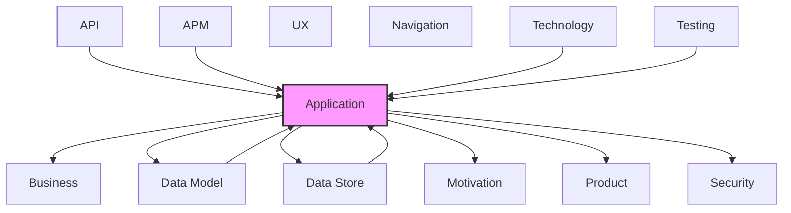

# Application

[← Back to README](../README.md)

Application components, services, and interactions.

## Report Index

- [Layer Introduction](#layer-introduction)
- [Intra-Layer Relationships](#intra-layer-relationships)
- [Inter-Layer Dependencies](#inter-layer-dependencies)
- [Inter-Layer Relationships Table](#inter-layer-relationships-table)
- [Element Reference](#element-reference)

## Layer Introduction

| Metric                    | Count |
| ------------------------- | ----- |
| Elements                  | 84    |
| Intra-Layer Relationships | 165   |
| Inter-Layer Relationships | 624   |
| Inbound Relationships     | 572   |
| Outbound Relationships    | 52    |

**Cross-Layer References**:

- **Upstream layers**: [API](./07-api-layer-report.md), [APM](./12-apm-layer-report.md), [Data Model](./08-data-model-layer-report.md), [Data Store](./09-data-store-layer-report.md), [Technology](./06-technology-layer-report.md), [Testing](./13-testing-layer-report.md)
- **Downstream layers**: [Business](./02-business-layer-report.md), [Data Model](./08-data-model-layer-report.md), [Data Store](./09-data-store-layer-report.md), [Motivation](./01-motivation-layer-report.md), [Product](./03-product-layer-report.md), [Security](./04-security-layer-report.md)

## Intra-Layer Relationships

*This layer has >30 elements. Summary table shown instead of diagram.*

| Element                                                             | Type                   | Relationships |
| ------------------------------------------------------------------- | ---------------------- | ------------- |
| `application.applicationcomponent.admin-rate-limiter`               | `applicationcomponent` | 2             |
| `application.applicationcomponent.api-buddy-cli`                    | `applicationcomponent` | 7             |
| `application.applicationcomponent.cache-engine`                     | `applicationcomponent` | 11            |
| `application.applicationcomponent.caching-proxy`                    | `applicationcomponent` | 21            |
| `application.applicationcomponent.configuration-manager`            | `applicationcomponent` | 3             |
| `application.applicationcomponent.database-manager`                 | `applicationcomponent` | 8             |
| `application.applicationcomponent.in-flight-tracker`                | `applicationcomponent` | 5             |
| `application.applicationcomponent.logger-manager`                   | `applicationcomponent` | 5             |
| `application.applicationcomponent.metrics-collector`                | `applicationcomponent` | 2             |
| `application.applicationcomponent.monitoring-manager`               | `applicationcomponent` | 9             |
| `application.applicationcomponent.proxy-http-request-handler`       | `applicationcomponent` | 19            |
| `application.applicationcomponent.security-manager`                 | `applicationcomponent` | 7             |
| `application.applicationcomponent.threaded-http-server`             | `applicationcomponent` | 2             |
| `application.applicationcomponent.throttle-manager`                 | `applicationcomponent` | 9             |
| `application.applicationcomponent.ttl-manager`                      | `applicationcomponent` | 2             |
| `application.applicationcomponent.upstream-reference-api`           | `applicationcomponent` | 1             |
| `application.applicationfunction.aggregate-upstream-metrics`        | `applicationfunction`  | 3             |
| `application.applicationfunction.apply-progressive-throttling`      | `applicationfunction`  | 4             |
| `application.applicationfunction.calculate-required-delay`          | `applicationfunction`  | 3             |
| `application.applicationfunction.check-admin-rate-limit`            | `applicationfunction`  | 2             |
| `application.applicationfunction.check-cacheable-status`            | `applicationfunction`  | 2             |
| `application.applicationfunction.check-should-throttle`             | `applicationfunction`  | 4             |
| `application.applicationfunction.clean-up-expired-entries`          | `applicationfunction`  | 1             |
| `application.applicationfunction.clear-cache`                       | `applicationfunction`  | 4             |
| `application.applicationfunction.clear-proxy-cache`                 | `applicationfunction`  | 4             |
| `application.applicationfunction.complete-in-flight-request`        | `applicationfunction`  | 3             |
| `application.applicationfunction.configure-logging`                 | `applicationfunction`  | 2             |
| `application.applicationfunction.create-default-config`             | `applicationfunction`  | 1             |
| `application.applicationfunction.detect-proxy-bearer-token`         | `applicationfunction`  | 2             |
| `application.applicationfunction.evict-least-recently-used-entries` | `applicationfunction`  | 3             |
| `application.applicationfunction.execute-sql-with-retry`            | `applicationfunction`  | 5             |
| `application.applicationfunction.extract-secure-key`                | `applicationfunction`  | 5             |
| `application.applicationfunction.forward-upstream-request`          | `applicationfunction`  | 7             |
| `application.applicationfunction.generate-cache-key`                | `applicationfunction`  | 2             |
| `application.applicationfunction.generate-secure-key`               | `applicationfunction`  | 1             |
| `application.applicationfunction.get-cache-stats`                   | `applicationfunction`  | 3             |
| `application.applicationfunction.get-cached-response`               | `applicationfunction`  | 3             |
| `application.applicationfunction.get-database-stats`                | `applicationfunction`  | 2             |
| `application.applicationfunction.get-logger`                        | `applicationfunction`  | 1             |
| `application.applicationfunction.get-monitoring-manager`            | `applicationfunction`  | 2             |
| `application.applicationfunction.get-proxy-health`                  | `applicationfunction`  | 2             |
| `application.applicationfunction.get-proxy-metrics`                 | `applicationfunction`  | 3             |
| `application.applicationfunction.get-secure-key`                    | `applicationfunction`  | 2             |
| `application.applicationfunction.get-throttling-stats`              | `applicationfunction`  | 3             |
| `application.applicationfunction.get-upstream-stats`                | `applicationfunction`  | 5             |
| `application.applicationfunction.handle-admin-request`              | `applicationfunction`  | 4             |
| `application.applicationfunction.initialize-schema`                 | `applicationfunction`  | 1             |
| `application.applicationfunction.join-or-own-in-flight-request`     | `applicationfunction`  | 3             |
| `application.applicationfunction.load-config-file`                  | `applicationfunction`  | 1             |
| `application.applicationfunction.merge-configuration-with-defaults` | `applicationfunction`  | 2             |
| `application.applicationfunction.normalize-upstream-response`       | `applicationfunction`  | 3             |
| `application.applicationfunction.record-proxy-event`                | `applicationfunction`  | 3             |
| `application.applicationfunction.record-upstream-request`           | `applicationfunction`  | 3             |
| `application.applicationfunction.reload-configuration`              | `applicationfunction`  | 3             |
| `application.applicationfunction.report-cache-performance`          | `applicationfunction`  | 2             |
| `application.applicationfunction.report-cache-statistics`           | `applicationfunction`  | 1             |
| `application.applicationfunction.report-component-status`           | `applicationfunction`  | 1             |
| `application.applicationfunction.report-domain-mapping-statistics`  | `applicationfunction`  | 2             |
| `application.applicationfunction.resolve-domain-ttl`                | `applicationfunction`  | 3             |
| `application.applicationfunction.restore-throttle-state`            | `applicationfunction`  | 2             |
| `application.applicationfunction.sanitize-configuration`            | `applicationfunction`  | 1             |
| `application.applicationfunction.snapshot-throttle-state`           | `applicationfunction`  | 2             |
| `application.applicationfunction.start-proxy`                       | `applicationfunction`  | 2             |
| `application.applicationfunction.stop-proxy`                        | `applicationfunction`  | 2             |
| `application.applicationfunction.store-cached-response`             | `applicationfunction`  | 7             |
| `application.applicationfunction.store-upstream-metrics`            | `applicationfunction`  | 5             |
| `application.applicationfunction.strip-proxy-key-from-query`        | `applicationfunction`  | 2             |
| `application.applicationfunction.throttle-upstream-request`         | `applicationfunction`  | 5             |
| `application.applicationfunction.update-configuration-value`        | `applicationfunction`  | 2             |
| `application.applicationfunction.validate-configuration`            | `applicationfunction`  | 2             |
| `application.applicationfunction.validate-posted-configuration`     | `applicationfunction`  | 3             |
| `application.applicationfunction.validate-request-key`              | `applicationfunction`  | 6             |
| `application.applicationfunction.validate-secure-key`               | `applicationfunction`  | 4             |
| `application.applicationfunction.wait-for-in-flight-result`         | `applicationfunction`  | 3             |
| `application.applicationinterface.admin-http-endpoint`              | `applicationinterface` | 2             |
| `application.applicationinterface.proxy-http-endpoint`              | `applicationinterface` | 2             |
| `application.applicationprocess.proxy-request-pipeline`             | `applicationprocess`   | 15            |
| `application.applicationservice.admin-diagnostics`                  | `applicationservice`   | 2             |
| `application.applicationservice.cached-reference-proxying`          | `applicationservice`   | 3             |
| `application.applicationservice.embedded-proxy-control`             | `applicationservice`   | 8             |
| `application.applicationservice.monitoring-statistics`              | `applicationservice`   | 7             |
| `application.dataobject.domain-throttle-state`                      | `dataobject`           | 8             |
| `application.dataobject.in-flight-request`                          | `dataobject`           | 4             |
| `application.dataobject.proxy-metrics-snapshot`                     | `dataobject`           | 2             |

## Inter-Layer Dependencies

## Inter-Layer Relationships Table

| Relationship ID                                                        | Source Node                                                                                                                | Dest Node                                                           | Dest Layer    | Predicate    | Cardinality  | Strength |
| ---------------------------------------------------------------------- | -------------------------------------------------------------------------------------------------------------------------- | ------------------------------------------------------------------- | ------------- | ------------ | ------------ | -------- |
| `api.openapidocument.realizes.application.applicationservice`          | `api.openapidocument.reference-api-buddy-http-api`                                                                         | `application.applicationservice.cached-reference-proxying`          | `application` | `realizes`   | many-to-many | medium   |
| `api.operation.realizes.application.applicationfunction`               | `api.operation.delete-proxied-upstream-request`                                                                            | `application.applicationfunction.forward-upstream-request`          | `application` | `realizes`   | many-to-many | medium   |
| `api.operation.references.application.applicationservice`              | `api.operation.delete-proxied-upstream-request`                                                                            | `application.applicationservice.cached-reference-proxying`          | `application` | `references` | many-to-many | medium   |
| `api.operation.realizes.application.applicationfunction`               | `api.operation.get-admin-cache-domain`                                                                                     | `application.applicationfunction.report-cache-statistics`           | `application` | `realizes`   | many-to-many | medium   |
| `api.operation.references.application.applicationservice`              | `api.operation.get-admin-cache-domain`                                                                                     | `application.applicationservice.admin-diagnostics`                  | `application` | `references` | many-to-many | medium   |
| `api.operation.realizes.application.applicationfunction`               | `api.operation.get-admin-cache`                                                                                            | `application.applicationfunction.report-cache-statistics`           | `application` | `realizes`   | many-to-many | medium   |
| `api.operation.references.application.applicationservice`              | `api.operation.get-admin-cache`                                                                                            | `application.applicationservice.admin-diagnostics`                  | `application` | `references` | many-to-many | medium   |
| `api.operation.realizes.application.applicationfunction`               | `api.operation.get-admin-config`                                                                                           | `application.applicationfunction.sanitize-configuration`            | `application` | `realizes`   | many-to-many | medium   |
| `api.operation.references.application.applicationservice`              | `api.operation.get-admin-config`                                                                                           | `application.applicationservice.admin-diagnostics`                  | `application` | `references` | many-to-many | medium   |
| `api.operation.realizes.application.applicationfunction`               | `api.operation.get-admin-domains`                                                                                          | `application.applicationfunction.report-domain-mapping-statistics`  | `application` | `realizes`   | many-to-many | medium   |
| `api.operation.references.application.applicationservice`              | `api.operation.get-admin-domains`                                                                                          | `application.applicationservice.admin-diagnostics`                  | `application` | `references` | many-to-many | medium   |
| `api.operation.realizes.application.applicationfunction`               | `api.operation.get-admin-health`                                                                                           | `application.applicationfunction.handle-admin-request`              | `application` | `realizes`   | many-to-many | medium   |
| `api.operation.references.application.applicationservice`              | `api.operation.get-admin-health`                                                                                           | `application.applicationservice.admin-diagnostics`                  | `application` | `references` | many-to-many | medium   |
| `api.operation.realizes.application.applicationfunction`               | `api.operation.get-admin-status`                                                                                           | `application.applicationfunction.report-component-status`           | `application` | `realizes`   | many-to-many | medium   |
| `api.operation.references.application.applicationservice`              | `api.operation.get-admin-status`                                                                                           | `application.applicationservice.admin-diagnostics`                  | `application` | `references` | many-to-many | medium   |
| `api.operation.realizes.application.applicationfunction`               | `api.operation.get-proxied-upstream-request`                                                                               | `application.applicationfunction.forward-upstream-request`          | `application` | `realizes`   | many-to-many | medium   |
| `api.operation.references.application.applicationservice`              | `api.operation.get-proxied-upstream-request`                                                                               | `application.applicationservice.cached-reference-proxying`          | `application` | `references` | many-to-many | medium   |
| `api.operation.realizes.application.applicationfunction`               | `api.operation.post-admin-validate-config`                                                                                 | `application.applicationfunction.validate-posted-configuration`     | `application` | `realizes`   | many-to-many | medium   |
| `api.operation.references.application.applicationservice`              | `api.operation.post-admin-validate-config`                                                                                 | `application.applicationservice.admin-diagnostics`                  | `application` | `references` | many-to-many | medium   |
| `api.operation.realizes.application.applicationfunction`               | `api.operation.post-proxied-upstream-request`                                                                              | `application.applicationfunction.forward-upstream-request`          | `application` | `realizes`   | many-to-many | medium   |
| `api.operation.references.application.applicationservice`              | `api.operation.post-proxied-upstream-request`                                                                              | `application.applicationservice.cached-reference-proxying`          | `application` | `references` | many-to-many | medium   |
| `api.operation.realizes.application.applicationfunction`               | `api.operation.put-proxied-upstream-request`                                                                               | `application.applicationfunction.forward-upstream-request`          | `application` | `realizes`   | many-to-many | medium   |
| `api.operation.references.application.applicationservice`              | `api.operation.put-proxied-upstream-request`                                                                               | `application.applicationservice.cached-reference-proxying`          | `application` | `references` | many-to-many | medium   |
| `apm.metricinstrument.monitors.application.applicationcomponent`       | `apm.metricinstrument.cache-engine-statistics`                                                                             | `application.applicationcomponent.cache-engine`                     | `application` | `monitors`   | many-to-many | medium   |
| `apm.metricinstrument.monitors.application.applicationcomponent`       | `apm.metricinstrument.proxy-cache-hits`                                                                                    | `application.applicationcomponent.cache-engine`                     | `application` | `monitors`   | many-to-many | medium   |
| `apm.metricinstrument.monitors.application.applicationcomponent`       | `apm.metricinstrument.proxy-cache-misses`                                                                                  | `application.applicationcomponent.cache-engine`                     | `application` | `monitors`   | many-to-many | medium   |
| `apm.metricinstrument.monitors.application.applicationcomponent`       | `apm.metricinstrument.proxy-errors`                                                                                        | `application.applicationcomponent.proxy-http-request-handler`       | `application` | `monitors`   | many-to-many | medium   |
| `apm.metricinstrument.monitors.application.applicationcomponent`       | `apm.metricinstrument.proxy-throttled-requests`                                                                            | `application.applicationcomponent.throttle-manager`                 | `application` | `monitors`   | many-to-many | medium   |
| `apm.metricinstrument.monitors.application.applicationcomponent`       | `apm.metricinstrument.proxy-total-requests`                                                                                | `application.applicationcomponent.caching-proxy`                    | `application` | `monitors`   | many-to-many | medium   |
| `apm.metricinstrument.monitors.application.applicationcomponent`       | `apm.metricinstrument.upstream-response-time`                                                                              | `application.applicationcomponent.upstream-reference-api`           | `application` | `monitors`   | many-to-many | medium   |
| `apm.metricinstrument.monitors.application.applicationcomponent`       | `apm.metricinstrument.upstream-responses-by-status`                                                                        | `application.applicationcomponent.upstream-reference-api`           | `application` | `monitors`   | many-to-many | medium   |
| `apm.resource.maps-to.application.applicationcomponent`                | `apm.resource.reference-api-buddy-process`                                                                                 | `application.applicationcomponent.caching-proxy`                    | `application` | `maps-to`    | many-to-many | medium   |
| `application.applicationcomponent.accesses.data-model.objectschema`    | `application.applicationcomponent.admin-rate-limiter`                                                                      | `data-model.objectschema.admin-config`                              | `data-model`  | `accesses`   | many-to-many | medium   |
| `application.applicationcomponent.accesses.data-model.objectschema`    | `application.applicationcomponent.caching-proxy`                                                                           | `data-model.objectschema.proxy-configuration`                       | `data-model`  | `accesses`   | many-to-many | medium   |
| `application.applicationcomponent.accesses.data-store.database`        | `application.applicationcomponent.database-manager`                                                                        | `data-store.database.api-buddy-cache-database`                      | `data-store`  | `accesses`   | many-to-many | medium   |
| `application.applicationcomponent.accesses.data-model.objectschema`    | `application.applicationcomponent.logger-manager`                                                                          | `data-model.objectschema.logging-config`                            | `data-model`  | `accesses`   | many-to-many | medium   |
| `application.applicationcomponent.accesses.data-model.objectschema`    | `application.applicationcomponent.security-manager`                                                                        | `data-model.objectschema.security-config`                           | `data-model`  | `accesses`   | many-to-many | medium   |
| `application.applicationcomponent.accesses.data-model.objectschema`    | `application.applicationcomponent.throttle-manager`                                                                        | `data-model.objectschema.domain-mapping`                            | `data-model`  | `accesses`   | many-to-many | medium   |
| `application.applicationcomponent.accesses.data-model.objectschema`    | `application.applicationcomponent.ttl-manager`                                                                             | `data-model.objectschema.domain-mapping`                            | `data-model`  | `accesses`   | many-to-many | medium   |
| `application.applicationfunction.accesses.data-store.collection`       | `application.applicationfunction.aggregate-upstream-metrics`                                                               | `data-store.collection.metrics`                                     | `data-store`  | `accesses`   | many-to-many | medium   |
| `application.applicationfunction.accesses.data-store.collection`       | `application.applicationfunction.clean-up-expired-entries`                                                                 | `data-store.collection.cache-entries`                               | `data-store`  | `accesses`   | many-to-many | medium   |
| `application.applicationfunction.accesses.data-store.collection`       | `application.applicationfunction.clear-cache`                                                                              | `data-store.collection.cache-entries`                               | `data-store`  | `accesses`   | many-to-many | medium   |
| `application.applicationfunction.accesses.data-model.objectschema`     | `application.applicationfunction.create-default-config`                                                                    | `data-model.objectschema.proxy-configuration`                       | `data-model`  | `accesses`   | many-to-many | medium   |
| `application.applicationfunction.accesses.data-store.collection`       | `application.applicationfunction.evict-least-recently-used-entries`                                                        | `data-store.collection.cache-entries`                               | `data-store`  | `accesses`   | many-to-many | medium   |
| `application.applicationfunction.accesses.data-model.objectschema`     | `application.applicationfunction.forward-upstream-request`                                                                 | `data-model.objectschema.domain-mapping`                            | `data-model`  | `accesses`   | many-to-many | medium   |
| `application.applicationfunction.accesses.data-model.objectschema`     | `application.applicationfunction.get-cached-response`                                                                      | `data-model.objectschema.cached-response`                           | `data-model`  | `accesses`   | many-to-many | medium   |
| `application.applicationfunction.accesses.data-store.collection`       | `application.applicationfunction.get-cached-response`                                                                      | `data-store.collection.cache-entries`                               | `data-store`  | `accesses`   | many-to-many | medium   |
| `application.applicationfunction.accesses.security.secureresource`     | `application.applicationfunction.get-cached-response`                                                                      | `security.secureresource.cache-database-resource`                   | `security`    | `accesses`   | many-to-many | medium   |
| `application.applicationfunction.accesses.security.secureresource`     | `application.applicationfunction.handle-admin-request`                                                                     | `security.secureresource.admin-endpoint-resource`                   | `security`    | `accesses`   | many-to-many | medium   |
| `application.applicationfunction.accesses.data-store.collection`       | `application.applicationfunction.initialize-schema`                                                                        | `data-store.collection.config-history`                              | `data-store`  | `accesses`   | many-to-many | medium   |
| `application.applicationfunction.accesses.data-model.objectschema`     | `application.applicationfunction.load-config-file`                                                                         | `data-model.objectschema.proxy-configuration`                       | `data-model`  | `accesses`   | many-to-many | medium   |
| `application.applicationfunction.accesses.data-model.objectschema`     | `application.applicationfunction.merge-configuration-with-defaults`                                                        | `data-model.objectschema.proxy-configuration`                       | `data-model`  | `accesses`   | many-to-many | medium   |
| `application.applicationfunction.accesses.data-model.objectschema`     | `application.applicationfunction.reload-configuration`                                                                     | `data-model.objectschema.proxy-configuration`                       | `data-model`  | `accesses`   | many-to-many | medium   |
| `application.applicationfunction.accesses.data-store.collection`       | `application.applicationfunction.report-cache-performance`                                                                 | `data-store.collection.cache-entries`                               | `data-store`  | `accesses`   | many-to-many | medium   |
| `application.applicationfunction.accesses.data-model.objectschema`     | `application.applicationfunction.resolve-domain-ttl`                                                                       | `data-model.objectschema.domain-mapping`                            | `data-model`  | `accesses`   | many-to-many | medium   |
| `application.applicationfunction.accesses.data-model.objectschema`     | `application.applicationfunction.sanitize-configuration`                                                                   | `data-model.objectschema.proxy-configuration`                       | `data-model`  | `accesses`   | many-to-many | medium   |
| `application.applicationfunction.accesses.data-model.objectschema`     | `application.applicationfunction.store-cached-response`                                                                    | `data-model.objectschema.cached-response`                           | `data-model`  | `accesses`   | many-to-many | medium   |
| `application.applicationfunction.accesses.data-store.collection`       | `application.applicationfunction.store-cached-response`                                                                    | `data-store.collection.cache-entries`                               | `data-store`  | `accesses`   | many-to-many | medium   |
| `application.applicationfunction.accesses.data-store.collection`       | `application.applicationfunction.store-upstream-metrics`                                                                   | `data-store.collection.metrics`                                     | `data-store`  | `accesses`   | many-to-many | medium   |
| `application.applicationfunction.accesses.data-model.objectschema`     | `application.applicationfunction.update-configuration-value`                                                               | `data-model.objectschema.proxy-configuration`                       | `data-model`  | `accesses`   | many-to-many | medium   |
| `application.applicationfunction.accesses.data-model.objectschema`     | `application.applicationfunction.validate-configuration`                                                                   | `data-model.objectschema.proxy-configuration`                       | `data-model`  | `accesses`   | many-to-many | medium   |
| `application.applicationfunction.accesses.security.secureresource`     | `application.applicationfunction.validate-secure-key`                                                                      | `security.secureresource.proxy-endpoint-resource`                   | `security`    | `accesses`   | many-to-many | medium   |
| `application.applicationprocess.accesses.data-model.objectschema`      | `application.applicationprocess.proxy-request-pipeline`                                                                    | `data-model.objectschema.cached-response`                           | `data-model`  | `accesses`   | many-to-many | medium   |
| `application.applicationservice.realizes.product.feature`              | `application.applicationservice.admin-diagnostics`                                                                         | `product.feature.admin-debug-endpoints`                             | `product`     | `realizes`   | many-to-many | medium   |
| `application.applicationservice.realizes.product.softwarecapability`   | `application.applicationservice.admin-diagnostics`                                                                         | `product.softwarecapability.operational-visibility`                 | `product`     | `realizes`   | many-to-many | medium   |
| `application.applicationservice.delivers.motivation.value`             | `application.applicationservice.cached-reference-proxying`                                                                 | `motivation.value.cheaper-faster-pipeline-iteration`                | `motivation`  | `delivers`   | many-to-many | medium   |
| `application.applicationservice.realizes.business.businessservice`     | `application.applicationservice.cached-reference-proxying`                                                                 | `business.businessservice.cached-reference-data-access`             | `business`    | `realizes`   | many-to-many | medium   |
| `application.applicationservice.realizes.motivation.goal`              | `application.applicationservice.cached-reference-proxying`                                                                 | `motivation.goal.reduce-upstream-api-cost-and-load`                 | `motivation`  | `realizes`   | many-to-many | medium   |
| `application.applicationservice.realizes.product.feature`              | `application.applicationservice.cached-reference-proxying`                                                                 | `product.feature.fine-grained-rate-limits`                          | `product`     | `realizes`   | many-to-many | medium   |
| `application.applicationservice.realizes.product.feature`              | `application.applicationservice.cached-reference-proxying`                                                                 | `product.feature.path-based-domain-mapping`                         | `product`     | `realizes`   | many-to-many | medium   |
| `application.applicationservice.realizes.product.feature`              | `application.applicationservice.cached-reference-proxying`                                                                 | `product.feature.per-domain-ttl`                                    | `product`     | `realizes`   | many-to-many | medium   |
| `application.applicationservice.realizes.product.feature`              | `application.applicationservice.cached-reference-proxying`                                                                 | `product.feature.persistent-sqlite-cache`                           | `product`     | `realizes`   | many-to-many | medium   |
| `application.applicationservice.realizes.product.feature`              | `application.applicationservice.cached-reference-proxying`                                                                 | `product.feature.request-coalescing`                                | `product`     | `realizes`   | many-to-many | medium   |
| `application.applicationservice.realizes.product.feature`              | `application.applicationservice.cached-reference-proxying`                                                                 | `product.feature.secure-key-authentication`                         | `product`     | `realizes`   | many-to-many | medium   |
| `application.applicationservice.realizes.product.feature`              | `application.applicationservice.cached-reference-proxying`                                                                 | `product.feature.upstream-auth-passthrough`                         | `product`     | `realizes`   | many-to-many | medium   |
| `application.applicationservice.realizes.product.softwarecapability`   | `application.applicationservice.cached-reference-proxying`                                                                 | `product.softwarecapability.configurable-domain-routing`            | `product`     | `realizes`   | many-to-many | medium   |
| `application.applicationservice.realizes.product.softwarecapability`   | `application.applicationservice.cached-reference-proxying`                                                                 | `product.softwarecapability.proxy-access-control`                   | `product`     | `realizes`   | many-to-many | medium   |
| `application.applicationservice.realizes.product.softwarecapability`   | `application.applicationservice.cached-reference-proxying`                                                                 | `product.softwarecapability.rate-limiting-and-throttling`           | `product`     | `realizes`   | many-to-many | medium   |
| `application.applicationservice.realizes.product.softwarecapability`   | `application.applicationservice.cached-reference-proxying`                                                                 | `product.softwarecapability.request-deduplication`                  | `product`     | `realizes`   | many-to-many | medium   |
| `application.applicationservice.realizes.product.softwarecapability`   | `application.applicationservice.cached-reference-proxying`                                                                 | `product.softwarecapability.response-caching`                       | `product`     | `realizes`   | many-to-many | medium   |
| `application.applicationservice.realizes.product.feature`              | `application.applicationservice.embedded-proxy-control`                                                                    | `product.feature.embeddable-caching-proxy-module`                   | `product`     | `realizes`   | many-to-many | medium   |
| `application.applicationservice.realizes.product.softwarecapability`   | `application.applicationservice.embedded-proxy-control`                                                                    | `product.softwarecapability.configurable-domain-routing`            | `product`     | `realizes`   | many-to-many | medium   |
| `application.applicationservice.realizes.product.feature`              | `application.applicationservice.monitoring-statistics`                                                                     | `product.feature.monitoring-metrics`                                | `product`     | `realizes`   | many-to-many | medium   |
| `application.applicationservice.realizes.product.softwarecapability`   | `application.applicationservice.monitoring-statistics`                                                                     | `product.softwarecapability.operational-visibility`                 | `product`     | `realizes`   | many-to-many | medium   |
| `data-model.objectschema.realizes.application.dataobject`              | `data-model.objectschema.proxy-metrics-record`                                                                             | `application.dataobject.proxy-metrics-snapshot`                     | `application` | `realizes`   | many-to-many | medium   |
| `data-model.objectschema.realizes.application.dataobject`              | `data-model.objectschema.throttle-state-record`                                                                            | `application.dataobject.domain-throttle-state`                      | `application` | `realizes`   | many-to-many | medium   |
| `data-store.accesspattern.serves.application.applicationfunction`      | `data-store.accesspattern.cache-access-update`                                                                             | `application.applicationfunction.get-cached-response`               | `application` | `serves`     | many-to-many | medium   |
| `data-store.accesspattern.serves.application.applicationfunction`      | `data-store.accesspattern.cache-clear`                                                                                     | `application.applicationfunction.clear-cache`                       | `application` | `serves`     | many-to-many | medium   |
| `data-store.accesspattern.serves.application.applicationfunction`      | `data-store.accesspattern.cache-lookup-by-key`                                                                             | `application.applicationfunction.get-cached-response`               | `application` | `serves`     | many-to-many | medium   |
| `data-store.accesspattern.serves.application.applicationfunction`      | `data-store.accesspattern.cache-upsert`                                                                                    | `application.applicationfunction.store-cached-response`             | `application` | `serves`     | many-to-many | medium   |
| `data-store.accesspattern.serves.application.applicationfunction`      | `data-store.accesspattern.expired-entry-scan`                                                                              | `application.applicationfunction.clean-up-expired-entries`          | `application` | `serves`     | many-to-many | medium   |
| `data-store.accesspattern.serves.application.applicationfunction`      | `data-store.accesspattern.lru-eviction-scan`                                                                               | `application.applicationfunction.evict-least-recently-used-entries` | `application` | `serves`     | many-to-many | medium   |
| `data-store.accesspattern.serves.application.applicationfunction`      | `data-store.accesspattern.metrics-insert`                                                                                  | `application.applicationfunction.store-upstream-metrics`            | `application` | `serves`     | many-to-many | medium   |
| `data-store.accesspattern.serves.application.applicationfunction`      | `data-store.accesspattern.upstream-metrics-aggregation`                                                                    | `application.applicationfunction.aggregate-upstream-metrics`        | `application` | `serves`     | many-to-many | medium   |
| `technology.artifact.realizes.application.applicationcomponent`        | `technology.artifact.reference-api-buddy-package`                                                                          | `application.applicationcomponent.api-buddy-cli`                    | `application` | `realizes`   | many-to-many | medium   |
| `technology.artifact.realizes.application.applicationcomponent`        | `technology.artifact.reference-api-buddy-package`                                                                          | `application.applicationcomponent.caching-proxy`                    | `application` | `realizes`   | many-to-many | medium   |
| `technology.systemsoftware.serves.application.applicationcomponent`    | `technology.systemsoftware.cpython-runtime`                                                                                | `application.applicationcomponent.caching-proxy`                    | `application` | `serves`     | many-to-many | medium   |
| `technology.systemsoftware.serves.application.applicationcomponent`    | `technology.systemsoftware.python-http-server`                                                                             | `application.applicationcomponent.proxy-http-request-handler`       | `application` | `serves`     | many-to-many | medium   |
| `technology.systemsoftware.serves.application.applicationcomponent`    | `technology.systemsoftware.python-http-server`                                                                             | `application.applicationcomponent.threaded-http-server`             | `application` | `serves`     | many-to-many | medium   |
| `technology.systemsoftware.serves.application.applicationcomponent`    | `technology.systemsoftware.python-urllib`                                                                                  | `application.applicationcomponent.proxy-http-request-handler`       | `application` | `serves`     | many-to-many | medium   |
| `technology.technologyservice.serves.application.applicationcomponent` | `technology.technologyservice.embedded-sqlite-storage`                                                                     | `application.applicationcomponent.database-manager`                 | `application` | `serves`     | many-to-many | medium   |
| `testing.testcasesketch.tests.application.applicationcomponent`        | `testing.testcasesketch.dbpedia-threading-test-test-concurrent-requests`                                                   | `application.applicationcomponent.caching-proxy`                    | `application` | `tests`      | many-to-many | medium   |
| `testing.testcasesketch.tests.application.applicationfunction`         | `testing.testcasesketch.dbpedia-threading-test-test-concurrent-requests`                                                   | `application.applicationfunction.start-proxy`                       | `application` | `tests`      | many-to-many | medium   |
| `testing.testcasesketch.tests.application.applicationfunction`         | `testing.testcasesketch.dbpedia-threading-test-test-concurrent-requests`                                                   | `application.applicationfunction.stop-proxy`                        | `application` | `tests`      | many-to-many | medium   |
| `testing.testcasesketch.tests.application.applicationfunction`         | `testing.testcasesketch.test-admin-endpoint-methods-test-cache-statistics-with-cache-engine`                               | `application.applicationfunction.report-cache-statistics`           | `application` | `tests`      | many-to-many | medium   |
| `testing.testcasesketch.tests.application.applicationfunction`         | `testing.testcasesketch.test-admin-endpoint-methods-test-cache-statistics-without-cache-engine`                            | `application.applicationfunction.report-cache-statistics`           | `application` | `tests`      | many-to-many | medium   |
| `testing.testcasesketch.tests.application.applicationfunction`         | `testing.testcasesketch.test-admin-endpoint-methods-test-component-status-error`                                           | `application.applicationfunction.report-component-status`           | `application` | `tests`      | many-to-many | medium   |
| `testing.testcasesketch.tests.application.applicationfunction`         | `testing.testcasesketch.test-admin-endpoint-methods-test-component-status-healthy`                                         | `application.applicationfunction.report-component-status`           | `application` | `tests`      | many-to-many | medium   |
| `testing.testcasesketch.tests.application.applicationfunction`         | `testing.testcasesketch.test-admin-endpoint-methods-test-component-status-unavailable`                                     | `application.applicationfunction.report-component-status`           | `application` | `tests`      | many-to-many | medium   |
| `testing.testcasesketch.tests.application.applicationfunction`         | `testing.testcasesketch.test-admin-endpoint-methods-test-config-sanitization`                                              | `application.applicationfunction.sanitize-configuration`            | `application` | `tests`      | many-to-many | medium   |
| `testing.testcasesketch.tests.application.applicationfunction`         | `testing.testcasesketch.test-admin-endpoint-methods-test-config-validation-empty-body`                                     | `application.applicationfunction.validate-posted-configuration`     | `application` | `tests`      | many-to-many | medium   |
| `testing.testcasesketch.tests.application.applicationfunction`         | `testing.testcasesketch.test-admin-endpoint-methods-test-config-validation-valid`                                          | `application.applicationfunction.validate-posted-configuration`     | `application` | `tests`      | many-to-many | medium   |
| `testing.testcasesketch.tests.application.applicationfunction`         | `testing.testcasesketch.test-admin-endpoint-methods-test-config-warnings-generation`                                       | `application.applicationfunction.handle-admin-request`              | `application` | `tests`      | many-to-many | medium   |
| `testing.testcasesketch.tests.application.applicationfunction`         | `testing.testcasesketch.test-admin-endpoint-methods-test-domain-mapping-statistics`                                        | `application.applicationfunction.report-domain-mapping-statistics`  | `application` | `tests`      | many-to-many | medium   |
| `testing.testcasesketch.tests.application.applicationfunction`         | `testing.testcasesketch.test-admin-endpoint-methods-test-is-admin-path`                                                    | `application.applicationfunction.handle-admin-request`              | `application` | `tests`      | many-to-many | medium   |
| `testing.testcasesketch.tests.application.applicationfunction`         | `testing.testcasesketch.test-admin-endpoint-methods-test-overall-status-determination`                                     | `application.applicationfunction.handle-admin-request`              | `application` | `tests`      | many-to-many | medium   |
| `testing.testcasesketch.tests.application.applicationfunction`         | `testing.testcasesketch.test-admin-endpoints-integration-test-admin-cache-domain-endpoint`                                 | `application.applicationfunction.handle-admin-request`              | `application` | `tests`      | many-to-many | medium   |
| `testing.testcasesketch.tests.application.applicationfunction`         | `testing.testcasesketch.test-admin-endpoints-integration-test-admin-cache-domain-not-found`                                | `application.applicationfunction.handle-admin-request`              | `application` | `tests`      | many-to-many | medium   |
| `testing.testcasesketch.tests.application.applicationfunction`         | `testing.testcasesketch.test-admin-endpoints-integration-test-admin-cache-endpoint`                                        | `application.applicationfunction.handle-admin-request`              | `application` | `tests`      | many-to-many | medium   |
| `testing.testcasesketch.tests.application.applicationfunction`         | `testing.testcasesketch.test-admin-endpoints-integration-test-admin-config-endpoint`                                       | `application.applicationfunction.handle-admin-request`              | `application` | `tests`      | many-to-many | medium   |
| `testing.testcasesketch.tests.application.applicationfunction`         | `testing.testcasesketch.test-admin-endpoints-integration-test-admin-domains-endpoint`                                      | `application.applicationfunction.handle-admin-request`              | `application` | `tests`      | many-to-many | medium   |
| `testing.testcasesketch.tests.application.applicationfunction`         | `testing.testcasesketch.test-admin-endpoints-integration-test-admin-endpoint-not-found`                                    | `application.applicationfunction.handle-admin-request`              | `application` | `tests`      | many-to-many | medium   |
| `testing.testcasesketch.tests.application.applicationfunction`         | `testing.testcasesketch.test-admin-endpoints-integration-test-admin-health-endpoint`                                       | `application.applicationfunction.handle-admin-request`              | `application` | `tests`      | many-to-many | medium   |
| `testing.testcasesketch.tests.application.applicationfunction`         | `testing.testcasesketch.test-admin-endpoints-integration-test-admin-method-not-allowed`                                    | `application.applicationfunction.handle-admin-request`              | `application` | `tests`      | many-to-many | medium   |
| `testing.testcasesketch.tests.application.applicationfunction`         | `testing.testcasesketch.test-admin-endpoints-integration-test-admin-status-endpoint`                                       | `application.applicationfunction.handle-admin-request`              | `application` | `tests`      | many-to-many | medium   |
| `testing.testcasesketch.tests.application.applicationfunction`         | `testing.testcasesketch.test-admin-endpoints-integration-test-admin-validate-config-empty-body`                            | `application.applicationfunction.handle-admin-request`              | `application` | `tests`      | many-to-many | medium   |
| `testing.testcasesketch.tests.application.applicationfunction`         | `testing.testcasesketch.test-admin-endpoints-integration-test-admin-validate-config-endpoint`                              | `application.applicationfunction.handle-admin-request`              | `application` | `tests`      | many-to-many | medium   |
| `testing.testcasesketch.tests.application.applicationfunction`         | `testing.testcasesketch.test-admin-endpoints-integration-test-admin-validate-config-invalid-json`                          | `application.applicationfunction.handle-admin-request`              | `application` | `tests`      | many-to-many | medium   |
| `testing.testcasesketch.tests.application.applicationfunction`         | `testing.testcasesketch.test-admin-endpoints-integration-test-admin-validate-config-invalid`                               | `application.applicationfunction.handle-admin-request`              | `application` | `tests`      | many-to-many | medium   |
| `testing.testcasesketch.tests.application.applicationfunction`         | `testing.testcasesketch.test-admin-endpoints-integration-test-non-admin-request`                                           | `application.applicationfunction.handle-admin-request`              | `application` | `tests`      | many-to-many | medium   |
| `testing.testcasesketch.tests.application.applicationfunction`         | `testing.testcasesketch.test-admin-endpoints-with-security-test-admin-endpoint-with-invalid-key`                           | `application.applicationfunction.handle-admin-request`              | `application` | `tests`      | many-to-many | medium   |
| `testing.testcasesketch.tests.application.applicationfunction`         | `testing.testcasesketch.test-admin-endpoints-with-security-test-admin-endpoint-with-valid-key`                             | `application.applicationfunction.handle-admin-request`              | `application` | `tests`      | many-to-many | medium   |
| `testing.testcasesketch.tests.application.applicationfunction`         | `testing.testcasesketch.test-admin-endpoints-with-security-test-admin-endpoint-without-key`                                | `application.applicationfunction.handle-admin-request`              | `application` | `tests`      | many-to-many | medium   |
| `testing.testcasesketch.tests.application.applicationfunction`         | `testing.testcasesketch.test-admin-endpoints-with-security-test-admin-validate-config-with-security`                       | `application.applicationfunction.handle-admin-request`              | `application` | `tests`      | many-to-many | medium   |
| `testing.testcasesketch.tests.application.applicationprocess`          | `testing.testcasesketch.test-admin-health`                                                                                 | `application.applicationprocess.proxy-request-pipeline`             | `application` | `tests`      | many-to-many | medium   |
| `testing.testcasesketch.tests.application.applicationcomponent`        | `testing.testcasesketch.test-admin-rate-limiter-test-clear-all`                                                            | `application.applicationcomponent.admin-rate-limiter`               | `application` | `tests`      | many-to-many | medium   |
| `testing.testcasesketch.tests.application.applicationfunction`         | `testing.testcasesketch.test-admin-rate-limiter-test-clear-all`                                                            | `application.applicationfunction.check-admin-rate-limit`            | `application` | `tests`      | many-to-many | medium   |
| `testing.testcasesketch.tests.application.applicationcomponent`        | `testing.testcasesketch.test-admin-rate-limiter-test-clear-client`                                                         | `application.applicationcomponent.admin-rate-limiter`               | `application` | `tests`      | many-to-many | medium   |
| `testing.testcasesketch.tests.application.applicationfunction`         | `testing.testcasesketch.test-admin-rate-limiter-test-clear-client`                                                         | `application.applicationfunction.check-admin-rate-limit`            | `application` | `tests`      | many-to-many | medium   |
| `testing.testcasesketch.tests.application.applicationcomponent`        | `testing.testcasesketch.test-admin-rate-limiter-test-initial-state`                                                        | `application.applicationcomponent.admin-rate-limiter`               | `application` | `tests`      | many-to-many | medium   |
| `testing.testcasesketch.tests.application.applicationfunction`         | `testing.testcasesketch.test-admin-rate-limiter-test-initial-state`                                                        | `application.applicationfunction.check-admin-rate-limit`            | `application` | `tests`      | many-to-many | medium   |
| `testing.testcasesketch.tests.application.applicationfunction`         | `testing.testcasesketch.test-admin-rate-limiter-test-multiple-clients`                                                     | `application.applicationfunction.check-admin-rate-limit`            | `application` | `tests`      | many-to-many | medium   |
| `testing.testcasesketch.tests.application.applicationcomponent`        | `testing.testcasesketch.test-admin-rate-limiter-test-rate-limiting`                                                        | `application.applicationcomponent.admin-rate-limiter`               | `application` | `tests`      | many-to-many | medium   |
| `testing.testcasesketch.tests.application.applicationfunction`         | `testing.testcasesketch.test-admin-rate-limiter-test-rate-limiting`                                                        | `application.applicationfunction.check-admin-rate-limit`            | `application` | `tests`      | many-to-many | medium   |
| `testing.testcasesketch.tests.application.applicationcomponent`        | `testing.testcasesketch.test-admin-rate-limiter-test-thread-safety`                                                        | `application.applicationcomponent.admin-rate-limiter`               | `application` | `tests`      | many-to-many | medium   |
| `testing.testcasesketch.tests.application.applicationfunction`         | `testing.testcasesketch.test-admin-rate-limiter-test-time-window-expiry`                                                   | `application.applicationfunction.check-admin-rate-limit`            | `application` | `tests`      | many-to-many | medium   |
| `testing.testcasesketch.tests.application.applicationfunction`         | `testing.testcasesketch.test-admin-rate-limiting-test-rate-limiting-enforcement`                                           | `application.applicationfunction.handle-admin-request`              | `application` | `tests`      | many-to-many | medium   |
| `testing.testcasesketch.tests.application.applicationcomponent`        | `testing.testcasesketch.test-backoff-and-jitter-test-retry-backoff-cap`                                                    | `application.applicationcomponent.database-manager`                 | `application` | `tests`      | many-to-many | medium   |
| `testing.testcasesketch.tests.application.applicationcomponent`        | `testing.testcasesketch.test-backoff-and-jitter-test-retry-backoff-timing`                                                 | `application.applicationcomponent.database-manager`                 | `application` | `tests`      | many-to-many | medium   |
| `testing.testcasesketch.tests.application.applicationprocess`          | `testing.testcasesketch.test-basic-performance-test-repeated-requests-performance`                                         | `application.applicationprocess.proxy-request-pipeline`             | `application` | `tests`      | many-to-many | medium   |
| `testing.testcasesketch.tests.application.applicationprocess`          | `testing.testcasesketch.test-basic-performance-test-sequential-requests-performance`                                       | `application.applicationprocess.proxy-request-pipeline`             | `application` | `tests`      | many-to-many | medium   |
| `testing.testcasesketch.tests.application.applicationcomponent`        | `testing.testcasesketch.test-basic-queries`                                                                                | `application.applicationcomponent.caching-proxy`                    | `application` | `tests`      | many-to-many | medium   |
| `testing.testcasesketch.tests.application.applicationprocess`          | `testing.testcasesketch.test-cache-and-upstream`                                                                           | `application.applicationprocess.proxy-request-pipeline`             | `application` | `tests`      | many-to-many | medium   |
| `testing.testcasesketch.tests.application.applicationcomponent`        | `testing.testcasesketch.test-cache-behavior`                                                                               | `application.applicationcomponent.caching-proxy`                    | `application` | `tests`      | many-to-many | medium   |
| `testing.testcasesketch.tests.application.applicationcomponent`        | `testing.testcasesketch.test-cache-engine-ttl-test-cache-engine-without-config`                                            | `application.applicationcomponent.cache-engine`                     | `application` | `tests`      | many-to-many | medium   |
| `testing.testcasesketch.tests.application.applicationcomponent`        | `testing.testcasesketch.test-cache-engine-ttl-test-cache-engine-without-config`                                            | `application.applicationcomponent.database-manager`                 | `application` | `tests`      | many-to-many | medium   |
| `testing.testcasesketch.tests.application.applicationfunction`         | `testing.testcasesketch.test-cache-engine-ttl-test-cache-engine-without-config`                                            | `application.applicationfunction.store-cached-response`             | `application` | `tests`      | many-to-many | medium   |
| `testing.testcasesketch.tests.application.applicationcomponent`        | `testing.testcasesketch.test-cache-eviction-edge-cases-test-cache-eviction-with-concurrent-access`                         | `application.applicationcomponent.cache-engine`                     | `application` | `tests`      | many-to-many | medium   |
| `testing.testcasesketch.tests.application.applicationcomponent`        | `testing.testcasesketch.test-cache-eviction-edge-cases-test-eviction-with-large-number-of-entries`                         | `application.applicationcomponent.cache-engine`                     | `application` | `tests`      | many-to-many | medium   |
| `testing.testcasesketch.tests.application.applicationcomponent`        | `testing.testcasesketch.test-cache-expiry`                                                                                 | `application.applicationcomponent.cache-engine`                     | `application` | `tests`      | many-to-many | medium   |
| `testing.testcasesketch.tests.application.applicationcomponent`        | `testing.testcasesketch.test-cache-first-throttling-test-cache-hits-bypass-throttling-integration`                         | `application.applicationcomponent.caching-proxy`                    | `application` | `tests`      | many-to-many | medium   |
| `testing.testcasesketch.tests.application.applicationcomponent`        | `testing.testcasesketch.test-cache-first-throttling-test-throttling-metrics-include-cache-miss-flag`                       | `application.applicationcomponent.caching-proxy`                    | `application` | `tests`      | many-to-many | medium   |
| `testing.testcasesketch.tests.application.applicationcomponent`        | `testing.testcasesketch.test-cache-management-edge-cases-test-clear-cache-with-none-domain`                                | `application.applicationcomponent.cache-engine`                     | `application` | `tests`      | many-to-many | medium   |
| `testing.testcasesketch.tests.application.applicationcomponent`        | `testing.testcasesketch.test-cache-management-edge-cases-test-clear-cache-with-specific-domain`                            | `application.applicationcomponent.cache-engine`                     | `application` | `tests`      | many-to-many | medium   |
| `testing.testcasesketch.tests.application.applicationcomponent`        | `testing.testcasesketch.test-cache-management-edge-cases-test-stats-update-with-thread-safety`                             | `application.applicationcomponent.cache-engine`                     | `application` | `tests`      | many-to-many | medium   |
| `testing.testcasesketch.tests.application.applicationcomponent`        | `testing.testcasesketch.test-cache-performance-metrics`                                                                    | `application.applicationcomponent.cache-engine`                     | `application` | `tests`      | many-to-many | medium   |
| `testing.testcasesketch.tests.application.applicationcomponent`        | `testing.testcasesketch.test-cache-statistics-corner-cases-test-cache-statistics-edge-cases`                               | `application.applicationcomponent.cache-engine`                     | `application` | `tests`      | many-to-many | medium   |
| `testing.testcasesketch.tests.application.applicationcomponent`        | `testing.testcasesketch.test-cache-statistics-corner-cases-test-stats-thread-safety`                                       | `application.applicationcomponent.cache-engine`                     | `application` | `tests`      | many-to-many | medium   |
| `testing.testcasesketch.tests.application.applicationprocess`          | `testing.testcasesketch.test-cache-throttling-interaction-test-cache-hit-bypasses-throttling`                              | `application.applicationprocess.proxy-request-pipeline`             | `application` | `tests`      | many-to-many | medium   |
| `testing.testcasesketch.tests.application.applicationprocess`          | `testing.testcasesketch.test-cache-throttling-interaction-test-cache-miss-applies-throttling`                              | `application.applicationprocess.proxy-request-pipeline`             | `application` | `tests`      | many-to-many | medium   |
| `testing.testcasesketch.tests.application.applicationprocess`          | `testing.testcasesketch.test-cache-throttling-interaction-test-cache-miss-no-throttling-forwards-to-upstream`              | `application.applicationprocess.proxy-request-pipeline`             | `application` | `tests`      | many-to-many | medium   |
| `testing.testcasesketch.tests.application.applicationcomponent`        | `testing.testcasesketch.test-cache-validation-errors-test-malformed-datetime-handling`                                     | `application.applicationcomponent.cache-engine`                     | `application` | `tests`      | many-to-many | medium   |
| `testing.testcasesketch.tests.application.applicationcomponent`        | `testing.testcasesketch.test-callbacks-and-graceful-shutdown`                                                              | `application.applicationcomponent.caching-proxy`                    | `application` | `tests`      | many-to-many | medium   |
| `testing.testcasesketch.tests.application.applicationfunction`         | `testing.testcasesketch.test-callbacks-and-graceful-shutdown`                                                              | `application.applicationfunction.start-proxy`                       | `application` | `tests`      | many-to-many | medium   |
| `testing.testcasesketch.tests.application.applicationfunction`         | `testing.testcasesketch.test-callbacks-and-graceful-shutdown`                                                              | `application.applicationfunction.stop-proxy`                        | `application` | `tests`      | many-to-many | medium   |
| `testing.testcasesketch.tests.application.applicationcomponent`        | `testing.testcasesketch.test-cleanup-and-error-recovery-test-close-empty-pool`                                             | `application.applicationcomponent.database-manager`                 | `application` | `tests`      | many-to-many | medium   |
| `testing.testcasesketch.tests.application.applicationcomponent`        | `testing.testcasesketch.test-cleanup-and-error-recovery-test-close-with-connection-close-error`                            | `application.applicationcomponent.database-manager`                 | `application` | `tests`      | many-to-many | medium   |
| `testing.testcasesketch.tests.application.applicationcomponent`        | `testing.testcasesketch.test-cleanup-and-error-recovery-test-close-with-connections-in-pool`                               | `application.applicationcomponent.database-manager`                 | `application` | `tests`      | many-to-many | medium   |
| `testing.testcasesketch.tests.application.applicationcomponent`        | `testing.testcasesketch.test-cleanup-and-error-recovery-test-destructor-calls-close`                                       | `application.applicationcomponent.database-manager`                 | `application` | `tests`      | many-to-many | medium   |
| `testing.testcasesketch.tests.application.applicationcomponent`        | `testing.testcasesketch.test-cleanup-expired-entries`                                                                      | `application.applicationcomponent.cache-engine`                     | `application` | `tests`      | many-to-many | medium   |
| `testing.testcasesketch.tests.application.applicationcomponent`        | `testing.testcasesketch.test-cleanup-removes-old-timestamps`                                                               | `application.applicationcomponent.throttle-manager`                 | `application` | `tests`      | many-to-many | medium   |
| `testing.testcasesketch.tests.application.applicationcomponent`        | `testing.testcasesketch.test-clear-cache`                                                                                  | `application.applicationcomponent.caching-proxy`                    | `application` | `tests`      | many-to-many | medium   |
| `testing.testcasesketch.tests.application.applicationfunction`         | `testing.testcasesketch.test-clear-cache`                                                                                  | `application.applicationfunction.clear-proxy-cache`                 | `application` | `tests`      | many-to-many | medium   |
| `testing.testcasesketch.tests.application.applicationcomponent`        | `testing.testcasesketch.test-cli-startup`                                                                                  | `application.applicationcomponent.api-buddy-cli`                    | `application` | `tests`      | many-to-many | medium   |
| `testing.testcasesketch.tests.application.applicationcomponent`        | `testing.testcasesketch.test-cli-startup-with-different-port`                                                              | `application.applicationcomponent.api-buddy-cli`                    | `application` | `tests`      | many-to-many | medium   |
| `testing.testcasesketch.tests.application.applicationcomponent`        | `testing.testcasesketch.test-cliargument-parsing-test-cli-custom-host`                                                     | `application.applicationcomponent.api-buddy-cli`                    | `application` | `tests`      | many-to-many | medium   |
| `testing.testcasesketch.tests.application.applicationcomponent`        | `testing.testcasesketch.test-cliargument-parsing-test-cli-custom-log-level`                                                | `application.applicationcomponent.api-buddy-cli`                    | `application` | `tests`      | many-to-many | medium   |
| `testing.testcasesketch.tests.application.applicationcomponent`        | `testing.testcasesketch.test-cliargument-parsing-test-cli-custom-port`                                                     | `application.applicationcomponent.api-buddy-cli`                    | `application` | `tests`      | many-to-many | medium   |
| `testing.testcasesketch.tests.application.applicationcomponent`        | `testing.testcasesketch.test-cliargument-parsing-test-cli-generate-config`                                                 | `application.applicationcomponent.api-buddy-cli`                    | `application` | `tests`      | many-to-many | medium   |
| `testing.testcasesketch.tests.application.applicationcomponent`        | `testing.testcasesketch.test-cliargument-parsing-test-cli-help-output`                                                     | `application.applicationcomponent.api-buddy-cli`                    | `application` | `tests`      | many-to-many | medium   |
| `testing.testcasesketch.tests.application.applicationcomponent`        | `testing.testcasesketch.test-cliargument-parsing-test-cli-security-key-only`                                               | `application.applicationcomponent.api-buddy-cli`                    | `application` | `tests`      | many-to-many | medium   |
| `testing.testcasesketch.tests.application.applicationcomponent`        | `testing.testcasesketch.test-cliargument-parsing-test-cli-version-output`                                                  | `application.applicationcomponent.api-buddy-cli`                    | `application` | `tests`      | many-to-many | medium   |
| `testing.testcasesketch.tests.application.applicationcomponent`        | `testing.testcasesketch.test-cliargument-validation-test-cli-edge-case-port-max`                                           | `application.applicationcomponent.api-buddy-cli`                    | `application` | `tests`      | many-to-many | medium   |
| `testing.testcasesketch.tests.application.applicationcomponent`        | `testing.testcasesketch.test-cliargument-validation-test-cli-edge-case-port-zero`                                          | `application.applicationcomponent.api-buddy-cli`                    | `application` | `tests`      | many-to-many | medium   |
| `testing.testcasesketch.tests.application.applicationcomponent`        | `testing.testcasesketch.test-cliargument-validation-test-cli-invalid-log-level-argument`                                   | `application.applicationcomponent.api-buddy-cli`                    | `application` | `tests`      | many-to-many | medium   |
| `testing.testcasesketch.tests.application.applicationcomponent`        | `testing.testcasesketch.test-cliargument-validation-test-cli-invalid-port-argument`                                        | `application.applicationcomponent.api-buddy-cli`                    | `application` | `tests`      | many-to-many | medium   |
| `testing.testcasesketch.tests.application.applicationcomponent`        | `testing.testcasesketch.test-cliconfiguration-handling-test-cli-with-config-file`                                          | `application.applicationcomponent.api-buddy-cli`                    | `application` | `tests`      | many-to-many | medium   |
| `testing.testcasesketch.tests.application.applicationcomponent`        | `testing.testcasesketch.test-cliconfiguration-handling-test-cli-with-invalid-config-file`                                  | `application.applicationcomponent.api-buddy-cli`                    | `application` | `tests`      | many-to-many | medium   |
| `testing.testcasesketch.tests.application.applicationcomponent`        | `testing.testcasesketch.test-clidefault-behavior-test-cli-default-configuration-message`                                   | `application.applicationcomponent.api-buddy-cli`                    | `application` | `tests`      | many-to-many | medium   |
| `testing.testcasesketch.tests.application.applicationcomponent`        | `testing.testcasesketch.test-clidefault-behavior-test-cli-startup-information-display`                                     | `application.applicationcomponent.api-buddy-cli`                    | `application` | `tests`      | many-to-many | medium   |
| `testing.testcasesketch.tests.application.applicationcomponent`        | `testing.testcasesketch.test-cliintegration-test-cli-custom-host-port-integration`                                         | `application.applicationcomponent.api-buddy-cli`                    | `application` | `tests`      | many-to-many | medium   |
| `testing.testcasesketch.tests.application.applicationcomponent`        | `testing.testcasesketch.test-cliintegration-test-cli-generate-config-integration`                                          | `application.applicationcomponent.api-buddy-cli`                    | `application` | `tests`      | many-to-many | medium   |
| `testing.testcasesketch.tests.application.applicationcomponent`        | `testing.testcasesketch.test-cliintegration-test-cli-help-integration`                                                     | `application.applicationcomponent.api-buddy-cli`                    | `application` | `tests`      | many-to-many | medium   |
| `testing.testcasesketch.tests.application.applicationcomponent`        | `testing.testcasesketch.test-cliintegration-test-cli-invalid-arguments-integration`                                        | `application.applicationcomponent.api-buddy-cli`                    | `application` | `tests`      | many-to-many | medium   |
| `testing.testcasesketch.tests.application.applicationcomponent`        | `testing.testcasesketch.test-cliintegration-test-cli-invalid-log-level-integration`                                        | `application.applicationcomponent.api-buddy-cli`                    | `application` | `tests`      | many-to-many | medium   |
| `testing.testcasesketch.tests.application.applicationcomponent`        | `testing.testcasesketch.test-cliintegration-test-cli-malformed-config-file-integration`                                    | `application.applicationcomponent.api-buddy-cli`                    | `application` | `tests`      | many-to-many | medium   |
| `testing.testcasesketch.tests.application.applicationcomponent`        | `testing.testcasesketch.test-cliintegration-test-cli-nonexistent-config-file-integration`                                  | `application.applicationcomponent.api-buddy-cli`                    | `application` | `tests`      | many-to-many | medium   |
| `testing.testcasesketch.tests.application.applicationcomponent`        | `testing.testcasesketch.test-cliintegration-test-cli-security-key-integration`                                             | `application.applicationcomponent.api-buddy-cli`                    | `application` | `tests`      | many-to-many | medium   |
| `testing.testcasesketch.tests.application.applicationcomponent`        | `testing.testcasesketch.test-cliintegration-test-cli-version-integration`                                                  | `application.applicationcomponent.api-buddy-cli`                    | `application` | `tests`      | many-to-many | medium   |
| `testing.testcasesketch.tests.application.applicationcomponent`        | `testing.testcasesketch.test-cliintegration-test-cli-with-config-file-integration`                                         | `application.applicationcomponent.api-buddy-cli`                    | `application` | `tests`      | many-to-many | medium   |
| `testing.testcasesketch.tests.application.applicationcomponent`        | `testing.testcasesketch.test-cliserver-startup-test-cli-keyboard-interrupt-handling`                                       | `application.applicationcomponent.api-buddy-cli`                    | `application` | `tests`      | many-to-many | medium   |
| `testing.testcasesketch.tests.application.applicationcomponent`        | `testing.testcasesketch.test-cliserver-startup-test-cli-server-startup-error-handling`                                     | `application.applicationcomponent.api-buddy-cli`                    | `application` | `tests`      | many-to-many | medium   |
| `testing.testcasesketch.tests.application.applicationcomponent`        | `testing.testcasesketch.test-cliserver-startup-test-cli-server-startup-success`                                            | `application.applicationcomponent.api-buddy-cli`                    | `application` | `tests`      | many-to-many | medium   |
| `testing.testcasesketch.tests.application.applicationcomponent`        | `testing.testcasesketch.test-cliserver-startup-test-cli-server-startup-with-security-key`                                  | `application.applicationcomponent.api-buddy-cli`                    | `application` | `tests`      | many-to-many | medium   |
| `testing.testcasesketch.tests.application.applicationcomponent`        | `testing.testcasesketch.test-combined-rate-limiting`                                                                       | `application.applicationcomponent.throttle-manager`                 | `application` | `tests`      | many-to-many | medium   |
| `testing.testcasesketch.tests.application.applicationcomponent`        | `testing.testcasesketch.test-component-integration`                                                                        | `application.applicationcomponent.caching-proxy`                    | `application` | `tests`      | many-to-many | medium   |
| `testing.testcasesketch.tests.application.applicationfunction`         | `testing.testcasesketch.test-component-integration`                                                                        | `application.applicationfunction.get-proxy-metrics`                 | `application` | `tests`      | many-to-many | medium   |
| `testing.testcasesketch.tests.application.applicationcomponent`        | `testing.testcasesketch.test-compression-and-decompression`                                                                | `application.applicationcomponent.cache-engine`                     | `application` | `tests`      | many-to-many | medium   |
| `testing.testcasesketch.tests.application.applicationcomponent`        | `testing.testcasesketch.test-compression-edge-cases-test-decompression-exception-path`                                     | `application.applicationcomponent.cache-engine`                     | `application` | `tests`      | many-to-many | medium   |
| `testing.testcasesketch.tests.application.applicationfunction`         | `testing.testcasesketch.test-compression-header-handling-test-header-updates-after-decompression`                          | `application.applicationfunction.normalize-upstream-response`       | `application` | `tests`      | many-to-many | medium   |
| `testing.testcasesketch.tests.application.applicationprocess`          | `testing.testcasesketch.test-concurrent-performance-test-concurrent-requests-different-endpoints`                          | `application.applicationprocess.proxy-request-pipeline`             | `application` | `tests`      | many-to-many | medium   |
| `testing.testcasesketch.tests.application.applicationprocess`          | `testing.testcasesketch.test-concurrent-performance-test-concurrent-requests-same-endpoint`                                | `application.applicationprocess.proxy-request-pipeline`             | `application` | `tests`      | many-to-many | medium   |
| `testing.testcasesketch.tests.application.applicationcomponent`        | `testing.testcasesketch.test-concurrent-requests`                                                                          | `application.applicationcomponent.caching-proxy`                    | `application` | `tests`      | many-to-many | medium   |
| `testing.testcasesketch.tests.application.applicationfunction`         | `testing.testcasesketch.test-concurrent-requests`                                                                          | `application.applicationfunction.get-monitoring-manager`            | `application` | `tests`      | many-to-many | medium   |
| `testing.testcasesketch.tests.application.applicationfunction`         | `testing.testcasesketch.test-concurrent-requests`                                                                          | `application.applicationfunction.start-proxy`                       | `application` | `tests`      | many-to-many | medium   |
| `testing.testcasesketch.tests.application.applicationfunction`         | `testing.testcasesketch.test-concurrent-requests`                                                                          | `application.applicationfunction.stop-proxy`                        | `application` | `tests`      | many-to-many | medium   |
| `testing.testcasesketch.tests.application.applicationcomponent`        | `testing.testcasesketch.test-concurrent-requests-wait-for-first`                                                           | `application.applicationcomponent.in-flight-tracker`                | `application` | `tests`      | many-to-many | medium   |
| `testing.testcasesketch.tests.application.applicationfunction`         | `testing.testcasesketch.test-concurrent-requests-wait-for-first`                                                           | `application.applicationfunction.complete-in-flight-request`        | `application` | `tests`      | many-to-many | medium   |
| `testing.testcasesketch.tests.application.applicationfunction`         | `testing.testcasesketch.test-concurrent-requests-wait-for-first`                                                           | `application.applicationfunction.join-or-own-in-flight-request`     | `application` | `tests`      | many-to-many | medium   |
| `testing.testcasesketch.tests.application.applicationcomponent`        | `testing.testcasesketch.test-configuration-manager-edge-cases-test-configuration-manager-reload-invalid-config`            | `application.applicationcomponent.configuration-manager`            | `application` | `tests`      | many-to-many | medium   |
| `testing.testcasesketch.tests.application.applicationcomponent`        | `testing.testcasesketch.test-configuration-manager-edge-cases-test-configuration-manager-reload-preserves-state-on-error`  | `application.applicationcomponent.configuration-manager`            | `application` | `tests`      | many-to-many | medium   |
| `testing.testcasesketch.tests.application.applicationcomponent`        | `testing.testcasesketch.test-configuration-manager-edge-cases-test-configuration-manager-update-creates-nested-keys`       | `application.applicationcomponent.configuration-manager`            | `application` | `tests`      | many-to-many | medium   |
| `testing.testcasesketch.tests.application.applicationcomponent`        | `testing.testcasesketch.test-configuration-manager-edge-cases-test-configuration-manager-update-deep-nesting`              | `application.applicationcomponent.configuration-manager`            | `application` | `tests`      | many-to-many | medium   |
| `testing.testcasesketch.tests.application.applicationcomponent`        | `testing.testcasesketch.test-configuration-manager-edge-cases-test-configuration-manager-update-invalid-config`            | `application.applicationcomponent.configuration-manager`            | `application` | `tests`      | many-to-many | medium   |
| `testing.testcasesketch.tests.application.applicationcomponent`        | `testing.testcasesketch.test-configuration-manager-edge-cases-test-configuration-manager-with-invalid-config`              | `application.applicationcomponent.configuration-manager`            | `application` | `tests`      | many-to-many | medium   |
| `testing.testcasesketch.tests.application.applicationfunction`         | `testing.testcasesketch.test-configuration-validation-test-invalid-cache-database-path-type`                               | `application.applicationfunction.validate-configuration`            | `application` | `tests`      | many-to-many | medium   |
| `testing.testcasesketch.tests.application.applicationfunction`         | `testing.testcasesketch.test-configuration-validation-test-invalid-cache-max-cache-response-size-type`                     | `application.applicationfunction.validate-configuration`            | `application` | `tests`      | many-to-many | medium   |
| `testing.testcasesketch.tests.application.applicationfunction`         | `testing.testcasesketch.test-configuration-validation-test-invalid-config-not-dictionary`                                  | `application.applicationfunction.validate-configuration`            | `application` | `tests`      | many-to-many | medium   |
| `testing.testcasesketch.tests.application.applicationfunction`         | `testing.testcasesketch.test-configuration-validation-test-invalid-logging-backup-count-type`                              | `application.applicationfunction.validate-configuration`            | `application` | `tests`      | many-to-many | medium   |
| `testing.testcasesketch.tests.application.applicationfunction`         | `testing.testcasesketch.test-configuration-validation-test-invalid-logging-date-format-type`                               | `application.applicationfunction.validate-configuration`            | `application` | `tests`      | many-to-many | medium   |
| `testing.testcasesketch.tests.application.applicationfunction`         | `testing.testcasesketch.test-configuration-validation-test-invalid-logging-enable-console-type`                            | `application.applicationfunction.validate-configuration`            | `application` | `tests`      | many-to-many | medium   |
| `testing.testcasesketch.tests.application.applicationfunction`         | `testing.testcasesketch.test-configuration-validation-test-invalid-logging-enable-file-type`                               | `application.applicationfunction.validate-configuration`            | `application` | `tests`      | many-to-many | medium   |
| `testing.testcasesketch.tests.application.applicationfunction`         | `testing.testcasesketch.test-configuration-validation-test-invalid-logging-file-path-type`                                 | `application.applicationfunction.validate-configuration`            | `application` | `tests`      | many-to-many | medium   |
| `testing.testcasesketch.tests.application.applicationfunction`         | `testing.testcasesketch.test-configuration-validation-test-invalid-logging-format-type`                                    | `application.applicationfunction.validate-configuration`            | `application` | `tests`      | many-to-many | medium   |
| `testing.testcasesketch.tests.application.applicationfunction`         | `testing.testcasesketch.test-configuration-validation-test-invalid-logging-level-type`                                     | `application.applicationfunction.validate-configuration`            | `application` | `tests`      | many-to-many | medium   |
| `testing.testcasesketch.tests.application.applicationfunction`         | `testing.testcasesketch.test-configuration-validation-test-invalid-logging-max-file-size-type`                             | `application.applicationfunction.validate-configuration`            | `application` | `tests`      | many-to-many | medium   |
| `testing.testcasesketch.tests.application.applicationfunction`         | `testing.testcasesketch.test-configuration-validation-test-invalid-logging-parent-logger-type`                             | `application.applicationfunction.validate-configuration`            | `application` | `tests`      | many-to-many | medium   |
| `testing.testcasesketch.tests.application.applicationfunction`         | `testing.testcasesketch.test-configuration-validation-test-invalid-security-log-security-events-type`                      | `application.applicationfunction.validate-configuration`            | `application` | `tests`      | many-to-many | medium   |
| `testing.testcasesketch.tests.application.applicationfunction`         | `testing.testcasesketch.test-configuration-validation-test-invalid-security-require-secure-key-type`                       | `application.applicationfunction.validate-configuration`            | `application` | `tests`      | many-to-many | medium   |
| `testing.testcasesketch.tests.application.applicationfunction`         | `testing.testcasesketch.test-configuration-validation-test-invalid-server-host-type`                                       | `application.applicationfunction.validate-configuration`            | `application` | `tests`      | many-to-many | medium   |
| `testing.testcasesketch.tests.application.applicationfunction`         | `testing.testcasesketch.test-configuration-validation-test-invalid-server-request-timeout-type`                            | `application.applicationfunction.validate-configuration`            | `application` | `tests`      | many-to-many | medium   |
| `testing.testcasesketch.tests.application.applicationfunction`         | `testing.testcasesketch.test-configuration-validation-test-invalid-throttling-default-requests-per-hour-type`              | `application.applicationfunction.validate-configuration`            | `application` | `tests`      | many-to-many | medium   |
| `testing.testcasesketch.tests.application.applicationfunction`         | `testing.testcasesketch.test-configuration-validation-test-invalid-throttling-progressive-max-delay-type`                  | `application.applicationfunction.validate-configuration`            | `application` | `tests`      | many-to-many | medium   |
| `testing.testcasesketch.tests.application.applicationfunction`         | `testing.testcasesketch.test-configuration-validation-test-missing-required-config-fields`                                 | `application.applicationfunction.validate-configuration`            | `application` | `tests`      | many-to-many | medium   |
| `testing.testcasesketch.tests.application.applicationfunction`         | `testing.testcasesketch.test-configuration-validation-test-multiple-validation-errors`                                     | `application.applicationfunction.validate-configuration`            | `application` | `tests`      | many-to-many | medium   |
| `testing.testcasesketch.tests.application.applicationfunction`         | `testing.testcasesketch.test-configuration-validation-test-partial-config-sections`                                        | `application.applicationfunction.validate-configuration`            | `application` | `tests`      | many-to-many | medium   |
| `testing.testcasesketch.tests.application.applicationfunction`         | `testing.testcasesketch.test-configuration-validation-test-valid-boolean-values-for-booleans`                              | `application.applicationfunction.validate-configuration`            | `application` | `tests`      | many-to-many | medium   |
| `testing.testcasesketch.tests.application.applicationfunction`         | `testing.testcasesketch.test-configuration-validation-test-valid-integer-values-for-integers`                              | `application.applicationfunction.validate-configuration`            | `application` | `tests`      | many-to-many | medium   |
| `testing.testcasesketch.tests.application.applicationfunction`         | `testing.testcasesketch.test-configuration-validation-test-valid-logging-file-path-none`                                   | `application.applicationfunction.validate-configuration`            | `application` | `tests`      | many-to-many | medium   |
| `testing.testcasesketch.tests.application.applicationfunction`         | `testing.testcasesketch.test-configuration-validation-test-valid-logging-file-path-string`                                 | `application.applicationfunction.validate-configuration`            | `application` | `tests`      | many-to-many | medium   |
| `testing.testcasesketch.tests.application.applicationfunction`         | `testing.testcasesketch.test-configuration-validation-test-valid-logging-parent-logger-none`                               | `application.applicationfunction.validate-configuration`            | `application` | `tests`      | many-to-many | medium   |
| `testing.testcasesketch.tests.application.applicationfunction`         | `testing.testcasesketch.test-configuration-validation-test-valid-logging-parent-logger-string`                             | `application.applicationfunction.validate-configuration`            | `application` | `tests`      | many-to-many | medium   |
| `testing.testcasesketch.tests.application.applicationcomponent`        | `testing.testcasesketch.test-configured-upstream-caching`                                                                  | `application.applicationcomponent.threaded-http-server`             | `application` | `tests`      | many-to-many | medium   |
| `testing.testcasesketch.tests.application.applicationcomponent`        | `testing.testcasesketch.test-connection-error-handling-test-connection-creation-failure`                                   | `application.applicationcomponent.database-manager`                 | `application` | `tests`      | many-to-many | medium   |
| `testing.testcasesketch.tests.application.applicationcomponent`        | `testing.testcasesketch.test-connection-error-handling-test-connection-pool-exhaustion`                                    | `application.applicationcomponent.database-manager`                 | `application` | `tests`      | many-to-many | medium   |
| `testing.testcasesketch.tests.application.applicationcomponent`        | `testing.testcasesketch.test-connection-error-handling-test-return-connection-when-pool-full`                              | `application.applicationcomponent.database-manager`                 | `application` | `tests`      | many-to-many | medium   |
| `testing.testcasesketch.tests.application.applicationcomponent`        | `testing.testcasesketch.test-connection-pooling`                                                                           | `application.applicationcomponent.database-manager`                 | `application` | `tests`      | many-to-many | medium   |
| `testing.testcasesketch.tests.application.applicationcomponent`        | `testing.testcasesketch.test-context-manager-lifecycle`                                                                    | `application.applicationcomponent.caching-proxy`                    | `application` | `tests`      | many-to-many | medium   |
| `testing.testcasesketch.tests.application.applicationfunction`         | `testing.testcasesketch.test-create-default-config-test-create-default-config-cache-settings`                              | `application.applicationfunction.create-default-config`             | `application` | `tests`      | many-to-many | medium   |
| `testing.testcasesketch.tests.application.applicationfunction`         | `testing.testcasesketch.test-create-default-config-test-create-default-config-domain-mappings`                             | `application.applicationfunction.create-default-config`             | `application` | `tests`      | many-to-many | medium   |
| `testing.testcasesketch.tests.application.applicationfunction`         | `testing.testcasesketch.test-create-default-config-test-create-default-config-security-settings`                           | `application.applicationfunction.create-default-config`             | `application` | `tests`      | many-to-many | medium   |
| `testing.testcasesketch.tests.application.applicationfunction`         | `testing.testcasesketch.test-create-default-config-test-create-default-config-server-settings`                             | `application.applicationfunction.create-default-config`             | `application` | `tests`      | many-to-many | medium   |
| `testing.testcasesketch.tests.application.applicationfunction`         | `testing.testcasesketch.test-create-default-config-test-create-default-config-structure`                                   | `application.applicationfunction.create-default-config`             | `application` | `tests`      | many-to-many | medium   |
| `testing.testcasesketch.tests.application.applicationfunction`         | `testing.testcasesketch.test-create-default-config-test-create-default-config-throttling-settings`                         | `application.applicationfunction.create-default-config`             | `application` | `tests`      | many-to-many | medium   |
| `testing.testcasesketch.tests.application.applicationcomponent`        | `testing.testcasesketch.test-data-migration-edge-cases-test-concurrent-schema-initialization`                              | `application.applicationcomponent.database-manager`                 | `application` | `tests`      | many-to-many | medium   |
| `testing.testcasesketch.tests.application.applicationcomponent`        | `testing.testcasesketch.test-data-migration-edge-cases-test-execute-query-with-zero-retries`                               | `application.applicationcomponent.database-manager`                 | `application` | `tests`      | many-to-many | medium   |
| `testing.testcasesketch.tests.application.applicationcomponent`        | `testing.testcasesketch.test-data-migration-edge-cases-test-execute-update-with-zero-retries`                              | `application.applicationcomponent.database-manager`                 | `application` | `tests`      | many-to-many | medium   |
| `testing.testcasesketch.tests.application.applicationfunction`         | `testing.testcasesketch.test-data-migration-edge-cases-test-execute-update-with-zero-retries`                              | `application.applicationfunction.execute-sql-with-retry`            | `application` | `tests`      | many-to-many | medium   |
| `testing.testcasesketch.tests.application.applicationcomponent`        | `testing.testcasesketch.test-data-migration-edge-cases-test-schema-initialization-with-existing-tables`                    | `application.applicationcomponent.database-manager`                 | `application` | `tests`      | many-to-many | medium   |
| `testing.testcasesketch.tests.application.applicationfunction`         | `testing.testcasesketch.test-data-migration-edge-cases-test-schema-initialization-with-existing-tables`                    | `application.applicationfunction.execute-sql-with-retry`            | `application` | `tests`      | many-to-many | medium   |
| `testing.testcasesketch.tests.application.applicationcomponent`        | `testing.testcasesketch.test-database-initialization-failures-test-database-initialization-with-invalid-path`              | `application.applicationcomponent.database-manager`                 | `application` | `tests`      | many-to-many | medium   |
| `testing.testcasesketch.tests.application.applicationcomponent`        | `testing.testcasesketch.test-database-initialization-failures-test-database-initialization-with-regular-path`              | `application.applicationcomponent.database-manager`                 | `application` | `tests`      | many-to-many | medium   |
| `testing.testcasesketch.tests.application.applicationcomponent`        | `testing.testcasesketch.test-database-initialization-failures-test-database-initialization-with-uri-path`                  | `application.applicationcomponent.database-manager`                 | `application` | `tests`      | many-to-many | medium   |
| `testing.testcasesketch.tests.application.applicationcomponent`        | `testing.testcasesketch.test-database-persistence-failures-test-database-failure-during-cleanup`                           | `application.applicationcomponent.cache-engine`                     | `application` | `tests`      | many-to-many | medium   |
| `testing.testcasesketch.tests.application.applicationfunction`         | `testing.testcasesketch.test-database-persistence-failures-test-database-failure-during-cleanup`                           | `application.applicationfunction.clean-up-expired-entries`          | `application` | `tests`      | many-to-many | medium   |
| `testing.testcasesketch.tests.application.applicationcomponent`        | `testing.testcasesketch.test-database-persistence-failures-test-database-failure-during-get`                               | `application.applicationcomponent.cache-engine`                     | `application` | `tests`      | many-to-many | medium   |
| `testing.testcasesketch.tests.application.applicationfunction`         | `testing.testcasesketch.test-database-persistence-failures-test-database-failure-during-get`                               | `application.applicationfunction.generate-cache-key`                | `application` | `tests`      | many-to-many | medium   |
| `testing.testcasesketch.tests.application.applicationfunction`         | `testing.testcasesketch.test-database-persistence-failures-test-database-failure-during-get`                               | `application.applicationfunction.get-cached-response`               | `application` | `tests`      | many-to-many | medium   |
| `testing.testcasesketch.tests.application.applicationfunction`         | `testing.testcasesketch.test-database-persistence-failures-test-database-failure-during-get`                               | `application.applicationfunction.store-cached-response`             | `application` | `tests`      | many-to-many | medium   |
| `testing.testcasesketch.tests.application.applicationcomponent`        | `testing.testcasesketch.test-database-persistence-failures-test-database-persistence-failure-handling`                     | `application.applicationcomponent.cache-engine`                     | `application` | `tests`      | many-to-many | medium   |
| `testing.testcasesketch.tests.application.applicationfunction`         | `testing.testcasesketch.test-database-persistence-failures-test-database-persistence-failure-handling`                     | `application.applicationfunction.generate-cache-key`                | `application` | `tests`      | many-to-many | medium   |
| `testing.testcasesketch.tests.application.applicationfunction`         | `testing.testcasesketch.test-database-persistence-failures-test-database-persistence-failure-handling`                     | `application.applicationfunction.store-cached-response`             | `application` | `tests`      | many-to-many | medium   |
| `testing.testcasesketch.tests.application.applicationcomponent`        | `testing.testcasesketch.test-date-time-converters-test-adapt-datetime-iso`                                                 | `application.applicationcomponent.database-manager`                 | `application` | `tests`      | many-to-many | medium   |
| `testing.testcasesketch.tests.application.applicationcomponent`        | `testing.testcasesketch.test-date-time-converters-test-convert-datetime`                                                   | `application.applicationcomponent.database-manager`                 | `application` | `tests`      | many-to-many | medium   |
| `testing.testcasesketch.tests.application.applicationcomponent`        | `testing.testcasesketch.test-date-time-converters-test-convert-timestamp`                                                  | `application.applicationcomponent.database-manager`                 | `application` | `tests`      | many-to-many | medium   |
| `testing.testcasesketch.tests.application.applicationfunction`         | `testing.testcasesketch.test-datetime-cleanup-operations-test-cleanup-exception-handling-in-datetime-parsing`              | `application.applicationfunction.clean-up-expired-entries`          | `application` | `tests`      | many-to-many | medium   |
| `testing.testcasesketch.tests.application.applicationfunction`         | `testing.testcasesketch.test-datetime-cleanup-operations-test-cleanup-expired-entries-datetime-handling`                   | `application.applicationfunction.clean-up-expired-entries`          | `application` | `tests`      | many-to-many | medium   |
| `testing.testcasesketch.tests.application.applicationfunction`         | `testing.testcasesketch.test-datetime-cleanup-operations-test-cleanup-with-datetime-object`                                | `application.applicationfunction.clean-up-expired-entries`          | `application` | `tests`      | many-to-many | medium   |
| `testing.testcasesketch.tests.application.applicationfunction`         | `testing.testcasesketch.test-datetime-cleanup-operations-test-cleanup-with-standard-datetime-string`                       | `application.applicationfunction.clean-up-expired-entries`          | `application` | `tests`      | many-to-many | medium   |
| `testing.testcasesketch.tests.application.applicationfunction`         | `testing.testcasesketch.test-datetime-cleanup-operations-test-mixed-datetime-formats-in-cleanup`                           | `application.applicationfunction.clean-up-expired-entries`          | `application` | `tests`      | many-to-many | medium   |
| `testing.testcasesketch.tests.application.applicationfunction`         | `testing.testcasesketch.test-datetime-handling-test-datetime-fallback-handling`                                            | `application.applicationfunction.clean-up-expired-entries`          | `application` | `tests`      | many-to-many | medium   |
| `testing.testcasesketch.tests.application.applicationfunction`         | `testing.testcasesketch.test-datetime-handling-test-datetime-object-handling`                                              | `application.applicationfunction.clean-up-expired-entries`          | `application` | `tests`      | many-to-many | medium   |
| `testing.testcasesketch.tests.application.applicationfunction`         | `testing.testcasesketch.test-datetime-handling-test-integer-created-at-handling`                                           | `application.applicationfunction.clean-up-expired-entries`          | `application` | `tests`      | many-to-many | medium   |
| `testing.testcasesketch.tests.application.applicationfunction`         | `testing.testcasesketch.test-deep-merge-edge-cases-test-deep-merge-preserves-original-objects`                             | `application.applicationfunction.merge-configuration-with-defaults` | `application` | `tests`      | many-to-many | medium   |
| `testing.testcasesketch.tests.application.applicationfunction`         | `testing.testcasesketch.test-deep-merge-edge-cases-test-deep-merge-with-different-types`                                   | `application.applicationfunction.merge-configuration-with-defaults` | `application` | `tests`      | many-to-many | medium   |
| `testing.testcasesketch.tests.application.applicationfunction`         | `testing.testcasesketch.test-deep-merge-edge-cases-test-deep-merge-with-new-keys`                                          | `application.applicationfunction.merge-configuration-with-defaults` | `application` | `tests`      | many-to-many | medium   |
| `testing.testcasesketch.tests.application.applicationfunction`         | `testing.testcasesketch.test-deep-merge-edge-cases-test-deep-merge-with-none-values`                                       | `application.applicationfunction.merge-configuration-with-defaults` | `application` | `tests`      | many-to-many | medium   |
| `testing.testcasesketch.tests.application.applicationfunction`         | `testing.testcasesketch.test-default-config-valid`                                                                         | `application.applicationfunction.validate-configuration`            | `application` | `tests`      | many-to-many | medium   |
| `testing.testcasesketch.tests.application.applicationfunction`         | `testing.testcasesketch.test-deflate-handling-test-deflate-decompression-error`                                            | `application.applicationfunction.normalize-upstream-response`       | `application` | `tests`      | many-to-many | medium   |
| `testing.testcasesketch.tests.application.applicationcomponent`        | `testing.testcasesketch.test-delete-and-clear`                                                                             | `application.applicationcomponent.cache-engine`                     | `application` | `tests`      | many-to-many | medium   |
| `testing.testcasesketch.tests.application.applicationcomponent`        | `testing.testcasesketch.test-different-cache-keys-independent`                                                             | `application.applicationcomponent.in-flight-tracker`                | `application` | `tests`      | many-to-many | medium   |
| `testing.testcasesketch.tests.application.applicationfunction`         | `testing.testcasesketch.test-different-cache-keys-independent`                                                             | `application.applicationfunction.complete-in-flight-request`        | `application` | `tests`      | many-to-many | medium   |
| `testing.testcasesketch.tests.application.applicationfunction`         | `testing.testcasesketch.test-different-cache-keys-independent`                                                             | `application.applicationfunction.join-or-own-in-flight-request`     | `application` | `tests`      | many-to-many | medium   |
| `testing.testcasesketch.tests.application.applicationcomponent`        | `testing.testcasesketch.test-different-domains-independent`                                                                | `application.applicationcomponent.throttle-manager`                 | `application` | `tests`      | many-to-many | medium   |
| `testing.testcasesketch.tests.application.applicationcomponent`        | `testing.testcasesketch.test-domain-specific-limits`                                                                       | `application.applicationcomponent.throttle-manager`                 | `application` | `tests`      | many-to-many | medium   |
| `testing.testcasesketch.tests.application.applicationcomponent`        | `testing.testcasesketch.test-empty-normalized-path-handling`                                                               | `application.applicationcomponent.cache-engine`                     | `application` | `tests`      | many-to-many | medium   |
| `testing.testcasesketch.tests.application.applicationcomponent`        | `testing.testcasesketch.test-enhanced-throttling-stats`                                                                    | `application.applicationcomponent.cache-engine`                     | `application` | `tests`      | many-to-many | medium   |
| `testing.testcasesketch.tests.application.applicationcomponent`        | `testing.testcasesketch.test-enhanced-throttling-stats`                                                                    | `application.applicationcomponent.database-manager`                 | `application` | `tests`      | many-to-many | medium   |
| `testing.testcasesketch.tests.application.applicationcomponent`        | `testing.testcasesketch.test-enhanced-throttling-stats`                                                                    | `application.applicationcomponent.monitoring-manager`               | `application` | `tests`      | many-to-many | medium   |
| `testing.testcasesketch.tests.application.applicationcomponent`        | `testing.testcasesketch.test-enhanced-throttling-stats`                                                                    | `application.applicationcomponent.throttle-manager`                 | `application` | `tests`      | many-to-many | medium   |
| `testing.testcasesketch.tests.application.applicationfunction`         | `testing.testcasesketch.test-enhanced-throttling-stats`                                                                    | `application.applicationfunction.check-should-throttle`             | `application` | `tests`      | many-to-many | medium   |
| `testing.testcasesketch.tests.application.applicationfunction`         | `testing.testcasesketch.test-enhanced-throttling-stats`                                                                    | `application.applicationfunction.get-throttling-stats`              | `application` | `tests`      | many-to-many | medium   |
| `testing.testcasesketch.tests.application.applicationfunction`         | `testing.testcasesketch.test-enhanced-throttling-stats`                                                                    | `application.applicationfunction.record-upstream-request`           | `application` | `tests`      | many-to-many | medium   |
| `testing.testcasesketch.tests.application.applicationcomponent`        | `testing.testcasesketch.test-error-handling-for-missing-methods`                                                           | `application.applicationcomponent.monitoring-manager`               | `application` | `tests`      | many-to-many | medium   |
| `testing.testcasesketch.tests.application.applicationfunction`         | `testing.testcasesketch.test-error-handling-for-missing-methods`                                                           | `application.applicationfunction.get-cache-stats`                   | `application` | `tests`      | many-to-many | medium   |
| `testing.testcasesketch.tests.application.applicationfunction`         | `testing.testcasesketch.test-error-handling-for-missing-methods`                                                           | `application.applicationfunction.get-database-stats`                | `application` | `tests`      | many-to-many | medium   |
| `testing.testcasesketch.tests.application.applicationfunction`         | `testing.testcasesketch.test-error-handling-for-missing-methods`                                                           | `application.applicationfunction.get-throttling-stats`              | `application` | `tests`      | many-to-many | medium   |
| `testing.testcasesketch.tests.application.applicationfunction`         | `testing.testcasesketch.test-error-handling-for-missing-methods`                                                           | `application.applicationfunction.get-upstream-stats`                | `application` | `tests`      | many-to-many | medium   |
| `testing.testcasesketch.tests.application.applicationcomponent`        | `testing.testcasesketch.test-error-handling-paths-test-database-query-edge-cases`                                          | `application.applicationcomponent.cache-engine`                     | `application` | `tests`      | many-to-many | medium   |
| `testing.testcasesketch.tests.application.applicationcomponent`        | `testing.testcasesketch.test-error-handling-paths-test-normalize-request-body-error-handling`                              | `application.applicationcomponent.cache-engine`                     | `application` | `tests`      | many-to-many | medium   |
| `testing.testcasesketch.tests.application.applicationcomponent`        | `testing.testcasesketch.test-error-handling-paths-test-normalize-url-error-handling`                                       | `application.applicationcomponent.cache-engine`                     | `application` | `tests`      | many-to-many | medium   |
| `testing.testcasesketch.tests.application.applicationcomponent`        | `testing.testcasesketch.test-error-propagation`                                                                            | `application.applicationcomponent.in-flight-tracker`                | `application` | `tests`      | many-to-many | medium   |
| `testing.testcasesketch.tests.application.applicationfunction`         | `testing.testcasesketch.test-error-propagation`                                                                            | `application.applicationfunction.complete-in-flight-request`        | `application` | `tests`      | many-to-many | medium   |
| `testing.testcasesketch.tests.application.applicationfunction`         | `testing.testcasesketch.test-error-propagation`                                                                            | `application.applicationfunction.join-or-own-in-flight-request`     | `application` | `tests`      | many-to-many | medium   |
| `testing.testcasesketch.tests.application.applicationfunction`         | `testing.testcasesketch.test-exception-handling-test-exception-handling-in-request`                                        | `application.applicationfunction.forward-upstream-request`          | `application` | `tests`      | many-to-many | medium   |
| `testing.testcasesketch.tests.application.applicationfunction`         | `testing.testcasesketch.test-exception-handling-test-exception-traceback-writing`                                          | `application.applicationfunction.forward-upstream-request`          | `application` | `tests`      | many-to-many | medium   |
| `testing.testcasesketch.tests.application.applicationcomponent`        | `testing.testcasesketch.test-extract-from-header`                                                                          | `application.applicationcomponent.security-manager`                 | `application` | `tests`      | many-to-many | medium   |
| `testing.testcasesketch.tests.application.applicationcomponent`        | `testing.testcasesketch.test-extract-from-path`                                                                            | `application.applicationcomponent.security-manager`                 | `application` | `tests`      | many-to-many | medium   |
| `testing.testcasesketch.tests.application.applicationcomponent`        | `testing.testcasesketch.test-extract-from-query-accepts-parse-qs-lists`                                                    | `application.applicationcomponent.security-manager`                 | `application` | `tests`      | many-to-many | medium   |
| `testing.testcasesketch.tests.application.applicationfunction`         | `testing.testcasesketch.test-extract-from-query-accepts-parse-qs-lists`                                                    | `application.applicationfunction.extract-secure-key`                | `application` | `tests`      | many-to-many | medium   |
| `testing.testcasesketch.tests.application.applicationcomponent`        | `testing.testcasesketch.test-extract-from-query-prefers-the-proxy-key-among-several`                                       | `application.applicationcomponent.security-manager`                 | `application` | `tests`      | many-to-many | medium   |
| `testing.testcasesketch.tests.application.applicationfunction`         | `testing.testcasesketch.test-extract-from-query-prefers-the-proxy-key-among-several`                                       | `application.applicationfunction.extract-secure-key`                | `application` | `tests`      | many-to-many | medium   |
| `testing.testcasesketch.tests.application.applicationcomponent`        | `testing.testcasesketch.test-extract-from-query`                                                                           | `application.applicationcomponent.security-manager`                 | `application` | `tests`      | many-to-many | medium   |
| `testing.testcasesketch.tests.application.applicationcomponent`        | `testing.testcasesketch.test-extract-secure-key-falls-back-to-first-candidate`                                             | `application.applicationcomponent.security-manager`                 | `application` | `tests`      | many-to-many | medium   |
| `testing.testcasesketch.tests.application.applicationfunction`         | `testing.testcasesketch.test-extract-secure-key-falls-back-to-first-candidate`                                             | `application.applicationfunction.extract-secure-key`                | `application` | `tests`      | many-to-many | medium   |
| `testing.testcasesketch.tests.application.applicationcomponent`        | `testing.testcasesketch.test-extract-secure-key-prefers-the-proxy-key`                                                     | `application.applicationcomponent.security-manager`                 | `application` | `tests`      | many-to-many | medium   |
| `testing.testcasesketch.tests.application.applicationfunction`         | `testing.testcasesketch.test-extract-secure-key-prefers-the-proxy-key`                                                     | `application.applicationfunction.extract-secure-key`                | `application` | `tests`      | many-to-many | medium   |
| `testing.testcasesketch.tests.application.applicationcomponent`        | `testing.testcasesketch.test-extract-secure-key-priority`                                                                  | `application.applicationcomponent.security-manager`                 | `application` | `tests`      | many-to-many | medium   |
| `testing.testcasesketch.tests.application.applicationfunction`         | `testing.testcasesketch.test-extract-secure-key-priority`                                                                  | `application.applicationfunction.extract-secure-key`                | `application` | `tests`      | many-to-many | medium   |
| `testing.testcasesketch.tests.application.applicationcomponent`        | `testing.testcasesketch.test-extract-secure-key-strips-query-key`                                                          | `application.applicationcomponent.security-manager`                 | `application` | `tests`      | many-to-many | medium   |
| `testing.testcasesketch.tests.application.applicationfunction`         | `testing.testcasesketch.test-extract-secure-key-strips-query-key`                                                          | `application.applicationfunction.extract-secure-key`                | `application` | `tests`      | many-to-many | medium   |
| `testing.testcasesketch.tests.application.applicationcomponent`        | `testing.testcasesketch.test-first-request-proceeds-immediately`                                                           | `application.applicationcomponent.in-flight-tracker`                | `application` | `tests`      | many-to-many | medium   |
| `testing.testcasesketch.tests.application.applicationfunction`         | `testing.testcasesketch.test-first-request-proceeds-immediately`                                                           | `application.applicationfunction.complete-in-flight-request`        | `application` | `tests`      | many-to-many | medium   |
| `testing.testcasesketch.tests.application.applicationfunction`         | `testing.testcasesketch.test-first-request-proceeds-immediately`                                                           | `application.applicationfunction.join-or-own-in-flight-request`     | `application` | `tests`      | many-to-many | medium   |
| `testing.testcasesketch.tests.application.applicationcomponent`        | `testing.testcasesketch.test-generate-cache-key-get`                                                                       | `application.applicationcomponent.cache-engine`                     | `application` | `tests`      | many-to-many | medium   |
| `testing.testcasesketch.tests.application.applicationcomponent`        | `testing.testcasesketch.test-generate-cache-key-post-json`                                                                 | `application.applicationcomponent.cache-engine`                     | `application` | `tests`      | many-to-many | medium   |
| `testing.testcasesketch.tests.application.applicationcomponent`        | `testing.testcasesketch.test-generate-secure-key-length-and-format`                                                        | `application.applicationcomponent.security-manager`                 | `application` | `tests`      | many-to-many | medium   |
| `testing.testcasesketch.tests.application.applicationfunction`         | `testing.testcasesketch.test-generate-secure-key-length-and-format`                                                        | `application.applicationfunction.generate-secure-key`               | `application` | `tests`      | many-to-many | medium   |
| `testing.testcasesketch.tests.application.applicationcomponent`        | `testing.testcasesketch.test-get-cache-stats-returns-expected-keys`                                                        | `application.applicationcomponent.monitoring-manager`               | `application` | `tests`      | many-to-many | medium   |
| `testing.testcasesketch.tests.application.applicationfunction`         | `testing.testcasesketch.test-get-cache-stats-returns-expected-keys`                                                        | `application.applicationfunction.get-cache-stats`                   | `application` | `tests`      | many-to-many | medium   |
| `testing.testcasesketch.tests.application.applicationcomponent`        | `testing.testcasesketch.test-get-database-stats-returns-expected-keys`                                                     | `application.applicationcomponent.monitoring-manager`               | `application` | `tests`      | many-to-many | medium   |
| `testing.testcasesketch.tests.application.applicationfunction`         | `testing.testcasesketch.test-get-database-stats-returns-expected-keys`                                                     | `application.applicationfunction.get-database-stats`                | `application` | `tests`      | many-to-many | medium   |
| `testing.testcasesketch.tests.application.applicationcomponent`        | `testing.testcasesketch.test-get-proxy-health-returns-expected-keys`                                                       | `application.applicationcomponent.monitoring-manager`               | `application` | `tests`      | many-to-many | medium   |
| `testing.testcasesketch.tests.application.applicationfunction`         | `testing.testcasesketch.test-get-proxy-health-returns-expected-keys`                                                       | `application.applicationfunction.get-proxy-health`                  | `application` | `tests`      | many-to-many | medium   |
| `testing.testcasesketch.tests.application.applicationcomponent`        | `testing.testcasesketch.test-get-secure-key`                                                                               | `application.applicationcomponent.caching-proxy`                    | `application` | `tests`      | many-to-many | medium   |
| `testing.testcasesketch.tests.application.applicationfunction`         | `testing.testcasesketch.test-get-secure-key`                                                                               | `application.applicationfunction.get-secure-key`                    | `application` | `tests`      | many-to-many | medium   |
| `testing.testcasesketch.tests.application.applicationcomponent`        | `testing.testcasesketch.test-get-throttling-stats-returns-expected-keys`                                                   | `application.applicationcomponent.monitoring-manager`               | `application` | `tests`      | many-to-many | medium   |
| `testing.testcasesketch.tests.application.applicationfunction`         | `testing.testcasesketch.test-get-throttling-stats-returns-expected-keys`                                                   | `application.applicationfunction.get-throttling-stats`              | `application` | `tests`      | many-to-many | medium   |
| `testing.testcasesketch.tests.application.applicationcomponent`        | `testing.testcasesketch.test-get-upstream-stats-returns-expected-keys`                                                     | `application.applicationcomponent.monitoring-manager`               | `application` | `tests`      | many-to-many | medium   |
| `testing.testcasesketch.tests.application.applicationfunction`         | `testing.testcasesketch.test-get-upstream-stats-returns-expected-keys`                                                     | `application.applicationfunction.get-upstream-stats`                | `application` | `tests`      | many-to-many | medium   |
| `testing.testcasesketch.tests.application.applicationfunction`         | `testing.testcasesketch.test-gzip-handling-test-gzip-decompression-error`                                                  | `application.applicationfunction.normalize-upstream-response`       | `application` | `tests`      | many-to-many | medium   |
| `testing.testcasesketch.tests.application.applicationcomponent`        | `testing.testcasesketch.test-handler-cache-ttlintegration-test-cache-hit-preserves-original-ttl`                           | `application.applicationcomponent.caching-proxy`                    | `application` | `tests`      | many-to-many | medium   |
| `testing.testcasesketch.tests.application.applicationfunction`         | `testing.testcasesketch.test-handler-cache-ttlintegration-test-cache-hit-preserves-original-ttl`                           | `application.applicationfunction.stop-proxy`                        | `application` | `tests`      | many-to-many | medium   |
| `testing.testcasesketch.tests.application.applicationcomponent`        | `testing.testcasesketch.test-handler-cache-ttlintegration-test-different-domains-get-different-ttls-in-same-proxy`         | `application.applicationcomponent.caching-proxy`                    | `application` | `tests`      | many-to-many | medium   |
| `testing.testcasesketch.tests.application.applicationfunction`         | `testing.testcasesketch.test-handler-cache-ttlintegration-test-different-domains-get-different-ttls-in-same-proxy`         | `application.applicationfunction.stop-proxy`                        | `application` | `tests`      | many-to-many | medium   |
| `testing.testcasesketch.tests.application.applicationcomponent`        | `testing.testcasesketch.test-handler-cache-ttlintegration-test-end-to-end-ttl-resolution-fast-api`                         | `application.applicationcomponent.caching-proxy`                    | `application` | `tests`      | many-to-many | medium   |
| `testing.testcasesketch.tests.application.applicationfunction`         | `testing.testcasesketch.test-handler-cache-ttlintegration-test-end-to-end-ttl-resolution-fast-api`                         | `application.applicationfunction.stop-proxy`                        | `application` | `tests`      | many-to-many | medium   |
| `testing.testcasesketch.tests.application.applicationcomponent`        | `testing.testcasesketch.test-handler-cache-ttlintegration-test-end-to-end-ttl-resolution-slow-api`                         | `application.applicationcomponent.caching-proxy`                    | `application` | `tests`      | many-to-many | medium   |
| `testing.testcasesketch.tests.application.applicationfunction`         | `testing.testcasesketch.test-handler-cache-ttlintegration-test-end-to-end-ttl-resolution-slow-api`                         | `application.applicationfunction.stop-proxy`                        | `application` | `tests`      | many-to-many | medium   |
| `testing.testcasesketch.tests.application.applicationcomponent`        | `testing.testcasesketch.test-handler-cache-ttlintegration-test-end-to-end-ttl-resolution-unmapped-domain`                  | `application.applicationcomponent.caching-proxy`                    | `application` | `tests`      | many-to-many | medium   |
| `testing.testcasesketch.tests.application.applicationfunction`         | `testing.testcasesketch.test-handler-cache-ttlintegration-test-end-to-end-ttl-resolution-unmapped-domain`                  | `application.applicationfunction.stop-proxy`                        | `application` | `tests`      | many-to-many | medium   |
| `testing.testcasesketch.tests.application.applicationcomponent`        | `testing.testcasesketch.test-handler-cache-ttlintegration-test-post-request-with-domain-specific-ttl`                      | `application.applicationcomponent.caching-proxy`                    | `application` | `tests`      | many-to-many | medium   |
| `testing.testcasesketch.tests.application.applicationfunction`         | `testing.testcasesketch.test-handler-cache-ttlintegration-test-post-request-with-domain-specific-ttl`                      | `application.applicationfunction.stop-proxy`                        | `application` | `tests`      | many-to-many | medium   |
| `testing.testcasesketch.tests.application.applicationcomponent`        | `testing.testcasesketch.test-handler-edge-cases-test-admin-health-endpoint`                                                | `application.applicationcomponent.proxy-http-request-handler`       | `application` | `tests`      | many-to-many | medium   |
| `testing.testcasesketch.tests.application.applicationcomponent`        | `testing.testcasesketch.test-handler-edge-cases-test-cache-hit-scenario`                                                   | `application.applicationcomponent.proxy-http-request-handler`       | `application` | `tests`      | many-to-many | medium   |
| `testing.testcasesketch.tests.application.applicationcomponent`        | `testing.testcasesketch.test-handler-edge-cases-test-cache-hit`                                                            | `application.applicationcomponent.proxy-http-request-handler`       | `application` | `tests`      | many-to-many | medium   |
| `testing.testcasesketch.tests.application.applicationcomponent`        | `testing.testcasesketch.test-handler-edge-cases-test-cache-miss-and-set`                                                   | `application.applicationcomponent.proxy-http-request-handler`       | `application` | `tests`      | many-to-many | medium   |
| `testing.testcasesketch.tests.application.applicationcomponent`        | `testing.testcasesketch.test-handler-edge-cases-test-cache-miss-scenario`                                                  | `application.applicationcomponent.proxy-http-request-handler`       | `application` | `tests`      | many-to-many | medium   |
| `testing.testcasesketch.tests.application.applicationfunction`         | `testing.testcasesketch.test-handler-edge-cases-test-connection-error-recovery`                                            | `application.applicationfunction.forward-upstream-request`          | `application` | `tests`      | many-to-many | medium   |
| `testing.testcasesketch.tests.application.applicationfunction`         | `testing.testcasesketch.test-handler-edge-cases-test-deflate-compression-handling`                                         | `application.applicationfunction.forward-upstream-request`          | `application` | `tests`      | many-to-many | medium   |
| `testing.testcasesketch.tests.application.applicationfunction`         | `testing.testcasesketch.test-handler-edge-cases-test-deflate-decompression-failure`                                        | `application.applicationfunction.forward-upstream-request`          | `application` | `tests`      | many-to-many | medium   |
| `testing.testcasesketch.tests.application.applicationfunction`         | `testing.testcasesketch.test-handler-edge-cases-test-deflate-decompression-success`                                        | `application.applicationfunction.forward-upstream-request`          | `application` | `tests`      | many-to-many | medium   |
| `testing.testcasesketch.tests.application.applicationfunction`         | `testing.testcasesketch.test-handler-edge-cases-test-domain-mapping-edge-cases`                                            | `application.applicationfunction.forward-upstream-request`          | `application` | `tests`      | many-to-many | medium   |
| `testing.testcasesketch.tests.application.applicationfunction`         | `testing.testcasesketch.test-handler-edge-cases-test-domain-not-mapped`                                                    | `application.applicationfunction.forward-upstream-request`          | `application` | `tests`      | many-to-many | medium   |
| `testing.testcasesketch.tests.application.applicationcomponent`        | `testing.testcasesketch.test-handler-edge-cases-test-empty-request-body-post`                                              | `application.applicationcomponent.proxy-http-request-handler`       | `application` | `tests`      | many-to-many | medium   |
| `testing.testcasesketch.tests.application.applicationcomponent`        | `testing.testcasesketch.test-handler-edge-cases-test-exception-handling`                                                   | `application.applicationcomponent.proxy-http-request-handler`       | `application` | `tests`      | many-to-many | medium   |
| `testing.testcasesketch.tests.application.applicationfunction`         | `testing.testcasesketch.test-handler-edge-cases-test-forward-request-invalid-path`                                         | `application.applicationfunction.forward-upstream-request`          | `application` | `tests`      | many-to-many | medium   |
| `testing.testcasesketch.tests.application.applicationfunction`         | `testing.testcasesketch.test-handler-edge-cases-test-forward-request-network-error`                                        | `application.applicationfunction.forward-upstream-request`          | `application` | `tests`      | many-to-many | medium   |
| `testing.testcasesketch.tests.application.applicationfunction`         | `testing.testcasesketch.test-handler-edge-cases-test-forward-request-no-upstream`                                          | `application.applicationfunction.forward-upstream-request`          | `application` | `tests`      | many-to-many | medium   |
| `testing.testcasesketch.tests.application.applicationfunction`         | `testing.testcasesketch.test-handler-edge-cases-test-forward-request-unmapped-domain`                                      | `application.applicationfunction.forward-upstream-request`          | `application` | `tests`      | many-to-many | medium   |
| `testing.testcasesketch.tests.application.applicationfunction`         | `testing.testcasesketch.test-handler-edge-cases-test-gzip-compression-handling`                                            | `application.applicationfunction.forward-upstream-request`          | `application` | `tests`      | many-to-many | medium   |
| `testing.testcasesketch.tests.application.applicationfunction`         | `testing.testcasesketch.test-handler-edge-cases-test-gzip-decompression-failure`                                           | `application.applicationfunction.forward-upstream-request`          | `application` | `tests`      | many-to-many | medium   |
| `testing.testcasesketch.tests.application.applicationfunction`         | `testing.testcasesketch.test-handler-edge-cases-test-gzip-decompression-success`                                           | `application.applicationfunction.forward-upstream-request`          | `application` | `tests`      | many-to-many | medium   |
| `testing.testcasesketch.tests.application.applicationfunction`         | `testing.testcasesketch.test-handler-edge-cases-test-gzip-magic-number-detection`                                          | `application.applicationfunction.forward-upstream-request`          | `application` | `tests`      | many-to-many | medium   |
| `testing.testcasesketch.tests.application.applicationcomponent`        | `testing.testcasesketch.test-handler-edge-cases-test-handler-initialization`                                               | `application.applicationcomponent.proxy-http-request-handler`       | `application` | `tests`      | many-to-many | medium   |
| `testing.testcasesketch.tests.application.applicationcomponent`        | `testing.testcasesketch.test-handler-edge-cases-test-handler-logger-fallback`                                              | `application.applicationcomponent.proxy-http-request-handler`       | `application` | `tests`      | many-to-many | medium   |
| `testing.testcasesketch.tests.application.applicationcomponent`        | `testing.testcasesketch.test-handler-edge-cases-test-handler-without-proxy-instance`                                       | `application.applicationcomponent.proxy-http-request-handler`       | `application` | `tests`      | many-to-many | medium   |
| `testing.testcasesketch.tests.application.applicationfunction`         | `testing.testcasesketch.test-handler-edge-cases-test-header-filtering`                                                     | `application.applicationfunction.forward-upstream-request`          | `application` | `tests`      | many-to-many | medium   |
| `testing.testcasesketch.tests.application.applicationcomponent`        | `testing.testcasesketch.test-handler-edge-cases-test-http-method-handlers-exist`                                           | `application.applicationcomponent.proxy-http-request-handler`       | `application` | `tests`      | many-to-many | medium   |
| `testing.testcasesketch.tests.application.applicationcomponent`        | `testing.testcasesketch.test-handler-edge-cases-test-http-methods-coverage`                                                | `application.applicationcomponent.proxy-http-request-handler`       | `application` | `tests`      | many-to-many | medium   |
| `testing.testcasesketch.tests.application.applicationfunction`         | `testing.testcasesketch.test-handler-edge-cases-test-invalid-headers-processing`                                           | `application.applicationfunction.forward-upstream-request`          | `application` | `tests`      | many-to-many | medium   |
| `testing.testcasesketch.tests.application.applicationfunction`         | `testing.testcasesketch.test-handler-edge-cases-test-invalid-path-handling`                                                | `application.applicationfunction.forward-upstream-request`          | `application` | `tests`      | many-to-many | medium   |
| `testing.testcasesketch.tests.application.applicationfunction`         | `testing.testcasesketch.test-handler-edge-cases-test-large-request-body-handling`                                          | `application.applicationfunction.forward-upstream-request`          | `application` | `tests`      | many-to-many | medium   |
| `testing.testcasesketch.tests.application.applicationcomponent`        | `testing.testcasesketch.test-handler-edge-cases-test-malformed-request-handling`                                           | `application.applicationcomponent.proxy-http-request-handler`       | `application` | `tests`      | many-to-many | medium   |
| `testing.testcasesketch.tests.application.applicationcomponent`        | `testing.testcasesketch.test-handler-edge-cases-test-metrics-collection-on-throttle`                                       | `application.applicationcomponent.proxy-http-request-handler`       | `application` | `tests`      | many-to-many | medium   |
| `testing.testcasesketch.tests.application.applicationcomponent`        | `testing.testcasesketch.test-handler-edge-cases-test-no-proxy-attribute-logger`                                            | `application.applicationcomponent.proxy-http-request-handler`       | `application` | `tests`      | many-to-many | medium   |
| `testing.testcasesketch.tests.application.applicationcomponent`        | `testing.testcasesketch.test-handler-edge-cases-test-post-request-with-body`                                               | `application.applicationcomponent.proxy-http-request-handler`       | `application` | `tests`      | many-to-many | medium   |
| `testing.testcasesketch.tests.application.applicationfunction`         | `testing.testcasesketch.test-handler-edge-cases-test-query-parameters-handling`                                            | `application.applicationfunction.forward-upstream-request`          | `application` | `tests`      | many-to-many | medium   |
| `testing.testcasesketch.tests.application.applicationfunction`         | `testing.testcasesketch.test-handler-edge-cases-test-query-parameters-in-url`                                              | `application.applicationfunction.forward-upstream-request`          | `application` | `tests`      | many-to-many | medium   |
| `testing.testcasesketch.tests.application.applicationfunction`         | `testing.testcasesketch.test-handler-edge-cases-test-root-path-handling`                                                   | `application.applicationfunction.forward-upstream-request`          | `application` | `tests`      | many-to-many | medium   |
| `testing.testcasesketch.tests.application.applicationfunction`         | `testing.testcasesketch.test-handler-edge-cases-test-root-path-with-query`                                                 | `application.applicationfunction.forward-upstream-request`          | `application` | `tests`      | many-to-many | medium   |
| `testing.testcasesketch.tests.application.applicationcomponent`        | `testing.testcasesketch.test-handler-edge-cases-test-security-manager-authorized`                                          | `application.applicationcomponent.proxy-http-request-handler`       | `application` | `tests`      | many-to-many | medium   |
| `testing.testcasesketch.tests.application.applicationcomponent`        | `testing.testcasesketch.test-handler-edge-cases-test-security-manager-integration`                                         | `application.applicationcomponent.proxy-http-request-handler`       | `application` | `tests`      | many-to-many | medium   |
| `testing.testcasesketch.tests.application.applicationcomponent`        | `testing.testcasesketch.test-handler-edge-cases-test-security-manager-unauthorized`                                        | `application.applicationcomponent.proxy-http-request-handler`       | `application` | `tests`      | many-to-many | medium   |
| `testing.testcasesketch.tests.application.applicationcomponent`        | `testing.testcasesketch.test-handler-edge-cases-test-security-manager-valid-key`                                           | `application.applicationcomponent.proxy-http-request-handler`       | `application` | `tests`      | many-to-many | medium   |
| `testing.testcasesketch.tests.application.applicationcomponent`        | `testing.testcasesketch.test-handler-edge-cases-test-throttling-integration`                                               | `application.applicationcomponent.proxy-http-request-handler`       | `application` | `tests`      | many-to-many | medium   |
| `testing.testcasesketch.tests.application.applicationcomponent`        | `testing.testcasesketch.test-handler-edge-cases-test-throttling-rate-limit-exceeded`                                       | `application.applicationcomponent.proxy-http-request-handler`       | `application` | `tests`      | many-to-many | medium   |
| `testing.testcasesketch.tests.application.applicationfunction`         | `testing.testcasesketch.test-handler-edge-cases-test-timeout-scenarios`                                                    | `application.applicationfunction.forward-upstream-request`          | `application` | `tests`      | many-to-many | medium   |
| `testing.testcasesketch.tests.application.applicationcomponent`        | `testing.testcasesketch.test-handler-edge-cases-test-transparent-proxy-for-unmatched-domain`                               | `application.applicationcomponent.proxy-http-request-handler`       | `application` | `tests`      | many-to-many | medium   |
| `testing.testcasesketch.tests.application.applicationcomponent`        | `testing.testcasesketch.test-handler-edge-cases-test-unmatched-domain-transparent-proxy`                                   | `application.applicationcomponent.proxy-http-request-handler`       | `application` | `tests`      | many-to-many | medium   |
| `testing.testcasesketch.tests.application.applicationprocess`          | `testing.testcasesketch.test-handler-ttlintegration-test-handler-creates-proper-cached-response-object`                    | `application.applicationprocess.proxy-request-pipeline`             | `application` | `tests`      | many-to-many | medium   |
| `testing.testcasesketch.tests.application.applicationprocess`          | `testing.testcasesketch.test-handler-ttlintegration-test-handler-no-hardcoded-ttl-in-response`                             | `application.applicationprocess.proxy-request-pipeline`             | `application` | `tests`      | many-to-many | medium   |
| `testing.testcasesketch.tests.application.applicationprocess`          | `testing.testcasesketch.test-handler-ttlintegration-test-handler-passes-correct-domain-key-for-different-domains`          | `application.applicationprocess.proxy-request-pipeline`             | `application` | `tests`      | many-to-many | medium   |
| `testing.testcasesketch.tests.application.applicationprocess`          | `testing.testcasesketch.test-handler-ttlintegration-test-handler-post-request-with-body`                                   | `application.applicationprocess.proxy-request-pipeline`             | `application` | `tests`      | many-to-many | medium   |
| `testing.testcasesketch.tests.application.applicationprocess`          | `testing.testcasesketch.test-handler-ttlintegration-test-handler-unmapped-domain-fallback`                                 | `application.applicationprocess.proxy-request-pipeline`             | `application` | `tests`      | many-to-many | medium   |
| `testing.testcasesketch.tests.application.applicationprocess`          | `testing.testcasesketch.test-handler-ttlintegration-test-handler-without-cache-engine`                                     | `application.applicationprocess.proxy-request-pipeline`             | `application` | `tests`      | many-to-many | medium   |
| `testing.testcasesketch.tests.application.applicationcomponent`        | `testing.testcasesketch.test-hour-level-still-works-with-new-limits`                                                       | `application.applicationcomponent.throttle-manager`                 | `application` | `tests`      | many-to-many | medium   |
| `testing.testcasesketch.tests.application.applicationfunction`         | `testing.testcasesketch.test-hour-level-still-works-with-new-limits`                                                       | `application.applicationfunction.calculate-required-delay`          | `application` | `tests`      | many-to-many | medium   |
| `testing.testcasesketch.tests.application.applicationfunction`         | `testing.testcasesketch.test-hour-level-still-works-with-new-limits`                                                       | `application.applicationfunction.record-upstream-request`           | `application` | `tests`      | many-to-many | medium   |
| `testing.testcasesketch.tests.application.applicationcomponent`        | `testing.testcasesketch.test-insert-and-query-cache-entry`                                                                 | `application.applicationcomponent.database-manager`                 | `application` | `tests`      | many-to-many | medium   |
| `testing.testcasesketch.tests.application.applicationcomponent`        | `testing.testcasesketch.test-invalid-config-raises`                                                                        | `application.applicationcomponent.configuration-manager`            | `application` | `tests`      | many-to-many | medium   |
| `testing.testcasesketch.tests.application.applicationfunction`         | `testing.testcasesketch.test-invalid-path-handling-test-invalid-path-error`                                                | `application.applicationfunction.forward-upstream-request`          | `application` | `tests`      | many-to-many | medium   |
| `testing.testcasesketch.tests.application.applicationcomponent`        | `testing.testcasesketch.test-is-proxy-authorization`                                                                       | `application.applicationcomponent.security-manager`                 | `application` | `tests`      | many-to-many | medium   |
| `testing.testcasesketch.tests.application.applicationfunction`         | `testing.testcasesketch.test-is-proxy-authorization`                                                                       | `application.applicationfunction.detect-proxy-bearer-token`         | `application` | `tests`      | many-to-many | medium   |
| `testing.testcasesketch.tests.application.applicationcomponent`        | `testing.testcasesketch.test-large-result-queries`                                                                         | `application.applicationcomponent.caching-proxy`                    | `application` | `tests`      | many-to-many | medium   |
| `testing.testcasesketch.tests.application.applicationfunction`         | `testing.testcasesketch.test-load-config-test-load-config-empty-file`                                                      | `application.applicationfunction.load-config-file`                  | `application` | `tests`      | many-to-many | medium   |
| `testing.testcasesketch.tests.application.applicationfunction`         | `testing.testcasesketch.test-load-config-test-load-config-file-not-found`                                                  | `application.applicationfunction.load-config-file`                  | `application` | `tests`      | many-to-many | medium   |
| `testing.testcasesketch.tests.application.applicationfunction`         | `testing.testcasesketch.test-load-config-test-load-config-invalid-json`                                                    | `application.applicationfunction.load-config-file`                  | `application` | `tests`      | many-to-many | medium   |
| `testing.testcasesketch.tests.application.applicationfunction`         | `testing.testcasesketch.test-load-config-test-load-valid-config`                                                           | `application.applicationfunction.load-config-file`                  | `application` | `tests`      | many-to-many | medium   |
| `testing.testcasesketch.tests.application.applicationprocess`          | `testing.testcasesketch.test-load-performance-test-high-volume-sequential-load`                                            | `application.applicationprocess.proxy-request-pipeline`             | `application` | `tests`      | many-to-many | medium   |
| `testing.testcasesketch.tests.application.applicationprocess`          | `testing.testcasesketch.test-load-performance-test-sustained-concurrent-load`                                              | `application.applicationprocess.proxy-request-pipeline`             | `application` | `tests`      | many-to-many | medium   |
| `testing.testcasesketch.tests.application.applicationcomponent`        | `testing.testcasesketch.test-log-security-event-prints`                                                                    | `application.applicationcomponent.caching-proxy`                    | `application` | `tests`      | many-to-many | medium   |
| `testing.testcasesketch.tests.application.applicationfunction`         | `testing.testcasesketch.test-logger-fallback-test-logger-fallback-when-no-proxy`                                           | `application.applicationfunction.forward-upstream-request`          | `application` | `tests`      | many-to-many | medium   |
| `testing.testcasesketch.tests.application.applicationcomponent`        | `testing.testcasesketch.test-logger-file-output-test-file-logging`                                                         | `application.applicationcomponent.logger-manager`                   | `application` | `tests`      | many-to-many | medium   |
| `testing.testcasesketch.tests.application.applicationfunction`         | `testing.testcasesketch.test-logger-file-output-test-file-logging`                                                         | `application.applicationfunction.configure-logging`                 | `application` | `tests`      | many-to-many | medium   |
| `testing.testcasesketch.tests.application.applicationfunction`         | `testing.testcasesketch.test-logger-file-output-test-file-logging`                                                         | `application.applicationfunction.get-logger`                        | `application` | `tests`      | many-to-many | medium   |
| `testing.testcasesketch.tests.application.applicationcomponent`        | `testing.testcasesketch.test-logger-integration-test-configure-logging`                                                    | `application.applicationcomponent.logger-manager`                   | `application` | `tests`      | many-to-many | medium   |
| `testing.testcasesketch.tests.application.applicationfunction`         | `testing.testcasesketch.test-logger-integration-test-configure-logging`                                                    | `application.applicationfunction.configure-logging`                 | `application` | `tests`      | many-to-many | medium   |
| `testing.testcasesketch.tests.application.applicationfunction`         | `testing.testcasesketch.test-logger-integration-test-configure-logging`                                                    | `application.applicationfunction.get-logger`                        | `application` | `tests`      | many-to-many | medium   |
| `testing.testcasesketch.tests.application.applicationcomponent`        | `testing.testcasesketch.test-logger-integration-test-get-logger-function`                                                  | `application.applicationcomponent.logger-manager`                   | `application` | `tests`      | many-to-many | medium   |
| `testing.testcasesketch.tests.application.applicationfunction`         | `testing.testcasesketch.test-logger-integration-test-get-logger-function`                                                  | `application.applicationfunction.get-logger`                        | `application` | `tests`      | many-to-many | medium   |
| `testing.testcasesketch.tests.application.applicationcomponent`        | `testing.testcasesketch.test-logger-integration-test-reconfigure-logging`                                                  | `application.applicationcomponent.logger-manager`                   | `application` | `tests`      | many-to-many | medium   |
| `testing.testcasesketch.tests.application.applicationfunction`         | `testing.testcasesketch.test-logger-integration-test-reconfigure-logging`                                                  | `application.applicationfunction.configure-logging`                 | `application` | `tests`      | many-to-many | medium   |
| `testing.testcasesketch.tests.application.applicationfunction`         | `testing.testcasesketch.test-logger-integration-test-reconfigure-logging`                                                  | `application.applicationfunction.get-logger`                        | `application` | `tests`      | many-to-many | medium   |
| `testing.testcasesketch.tests.application.applicationcomponent`        | `testing.testcasesketch.test-logger-integration-test-set-log-level-function`                                               | `application.applicationcomponent.logger-manager`                   | `application` | `tests`      | many-to-many | medium   |
| `testing.testcasesketch.tests.application.applicationfunction`         | `testing.testcasesketch.test-logger-integration-test-set-log-level-function`                                               | `application.applicationfunction.configure-logging`                 | `application` | `tests`      | many-to-many | medium   |
| `testing.testcasesketch.tests.application.applicationfunction`         | `testing.testcasesketch.test-logger-integration-test-set-log-level-function`                                               | `application.applicationfunction.get-logger`                        | `application` | `tests`      | many-to-many | medium   |
| `testing.testcasesketch.tests.application.applicationcomponent`        | `testing.testcasesketch.test-logger-manager-test-configure-basic`                                                          | `application.applicationcomponent.logger-manager`                   | `application` | `tests`      | many-to-many | medium   |
| `testing.testcasesketch.tests.application.applicationcomponent`        | `testing.testcasesketch.test-logger-manager-test-get-logger`                                                               | `application.applicationcomponent.logger-manager`                   | `application` | `tests`      | many-to-many | medium   |
| `testing.testcasesketch.tests.application.applicationfunction`         | `testing.testcasesketch.test-logger-manager-test-get-logger`                                                               | `application.applicationfunction.get-logger`                        | `application` | `tests`      | many-to-many | medium   |
| `testing.testcasesketch.tests.application.applicationcomponent`        | `testing.testcasesketch.test-logger-manager-test-get-logger-with-parent`                                                   | `application.applicationcomponent.logger-manager`                   | `application` | `tests`      | many-to-many | medium   |
| `testing.testcasesketch.tests.application.applicationfunction`         | `testing.testcasesketch.test-logger-manager-test-get-logger-with-parent`                                                   | `application.applicationfunction.get-logger`                        | `application` | `tests`      | many-to-many | medium   |
| `testing.testcasesketch.tests.application.applicationcomponent`        | `testing.testcasesketch.test-logger-manager-test-get-logger-without-configuration`                                         | `application.applicationcomponent.logger-manager`                   | `application` | `tests`      | many-to-many | medium   |
| `testing.testcasesketch.tests.application.applicationfunction`         | `testing.testcasesketch.test-logger-manager-test-get-logger-without-configuration`                                         | `application.applicationfunction.get-logger`                        | `application` | `tests`      | many-to-many | medium   |
| `testing.testcasesketch.tests.application.applicationcomponent`        | `testing.testcasesketch.test-logger-manager-test-set-level`                                                                | `application.applicationcomponent.logger-manager`                   | `application` | `tests`      | many-to-many | medium   |
| `testing.testcasesketch.tests.application.applicationcomponent`        | `testing.testcasesketch.test-lru-eviction`                                                                                 | `application.applicationcomponent.cache-engine`                     | `application` | `tests`      | many-to-many | medium   |
| `testing.testcasesketch.tests.application.applicationcomponent`        | `testing.testcasesketch.test-malformed-queries`                                                                            | `application.applicationcomponent.caching-proxy`                    | `application` | `tests`      | many-to-many | medium   |
| `testing.testcasesketch.tests.application.applicationcomponent`        | `testing.testcasesketch.test-max-cache-entries-test-default-is-1000`                                                       | `application.applicationcomponent.caching-proxy`                    | `application` | `tests`      | many-to-many | medium   |
| `testing.testcasesketch.tests.application.applicationfunction`         | `testing.testcasesketch.test-max-cache-entries-test-invalid-values-are-rejected`                                           | `application.applicationfunction.merge-configuration-with-defaults` | `application` | `tests`      | many-to-many | medium   |
| `testing.testcasesketch.tests.application.applicationfunction`         | `testing.testcasesketch.test-max-cache-entries-test-invalid-values-are-rejected`                                           | `application.applicationfunction.validate-configuration`            | `application` | `tests`      | many-to-many | medium   |
| `testing.testcasesketch.tests.application.applicationcomponent`        | `testing.testcasesketch.test-max-cache-entries-test-read-from-config`                                                      | `application.applicationcomponent.caching-proxy`                    | `application` | `tests`      | many-to-many | medium   |
| `testing.testcasesketch.tests.application.applicationcomponent`        | `testing.testcasesketch.test-max-cache-entries-test-survives-reload`                                                       | `application.applicationcomponent.caching-proxy`                    | `application` | `tests`      | many-to-many | medium   |
| `testing.testcasesketch.tests.application.applicationcomponent`        | `testing.testcasesketch.test-max-delay-exceeded`                                                                           | `application.applicationcomponent.throttle-manager`                 | `application` | `tests`      | many-to-many | medium   |
| `testing.testcasesketch.tests.application.applicationfunction`         | `testing.testcasesketch.test-max-delay-exceeded`                                                                           | `application.applicationfunction.calculate-required-delay`          | `application` | `tests`      | many-to-many | medium   |
| `testing.testcasesketch.tests.application.applicationfunction`         | `testing.testcasesketch.test-max-delay-exceeded`                                                                           | `application.applicationfunction.record-upstream-request`           | `application` | `tests`      | many-to-many | medium   |
| `testing.testcasesketch.tests.application.applicationcomponent`        | `testing.testcasesketch.test-memory-cleanup-edge-cases-test-compression-failure-handling`                                  | `application.applicationcomponent.cache-engine`                     | `application` | `tests`      | many-to-many | medium   |
| `testing.testcasesketch.tests.application.applicationcomponent`        | `testing.testcasesketch.test-memory-cleanup-edge-cases-test-decompression-failure-handling`                                | `application.applicationcomponent.cache-engine`                     | `application` | `tests`      | many-to-many | medium   |
| `testing.testcasesketch.tests.application.applicationcomponent`        | `testing.testcasesketch.test-memory-cleanup-edge-cases-test-memory-cleanup-on-cache-full`                                  | `application.applicationcomponent.cache-engine`                     | `application` | `tests`      | many-to-many | medium   |
| `testing.testcasesketch.tests.application.applicationfunction`         | `testing.testcasesketch.test-merge-with-defaults`                                                                          | `application.applicationfunction.merge-configuration-with-defaults` | `application` | `tests`      | many-to-many | medium   |
| `testing.testcasesketch.tests.application.applicationcomponent`        | `testing.testcasesketch.test-metrics-collection`                                                                           | `application.applicationcomponent.caching-proxy`                    | `application` | `tests`      | many-to-many | medium   |
| `testing.testcasesketch.tests.application.applicationfunction`         | `testing.testcasesketch.test-metrics-collection`                                                                           | `application.applicationfunction.get-proxy-metrics`                 | `application` | `tests`      | many-to-many | medium   |
| `testing.testcasesketch.tests.application.applicationcomponent`        | `testing.testcasesketch.test-monitoring-manager-initialization`                                                            | `application.applicationcomponent.monitoring-manager`               | `application` | `tests`      | many-to-many | medium   |
| `testing.testcasesketch.tests.application.applicationcomponent`        | `testing.testcasesketch.test-monitoring-manager-method`                                                                    | `application.applicationcomponent.caching-proxy`                    | `application` | `tests`      | many-to-many | medium   |
| `testing.testcasesketch.tests.application.applicationfunction`         | `testing.testcasesketch.test-monitoring-manager-method`                                                                    | `application.applicationfunction.get-monitoring-manager`            | `application` | `tests`      | many-to-many | medium   |
| `testing.testcasesketch.tests.application.applicationfunction`         | `testing.testcasesketch.test-monitoring-manager-method`                                                                    | `application.applicationfunction.stop-proxy`                        | `application` | `tests`      | many-to-many | medium   |
| `testing.testcasesketch.tests.application.applicationcomponent`        | `testing.testcasesketch.test-multi-window-priority`                                                                        | `application.applicationcomponent.throttle-manager`                 | `application` | `tests`      | many-to-many | medium   |
| `testing.testcasesketch.tests.application.applicationfunction`         | `testing.testcasesketch.test-network-error-handling-test-network-connection-error`                                         | `application.applicationfunction.forward-upstream-request`          | `application` | `tests`      | many-to-many | medium   |
| `testing.testcasesketch.tests.application.applicationcomponent`        | `testing.testcasesketch.test-no-rate-limiting-when-not-configured`                                                         | `application.applicationcomponent.throttle-manager`                 | `application` | `tests`      | many-to-many | medium   |
| `testing.testcasesketch.tests.application.applicationcomponent`        | `testing.testcasesketch.test-no-throttle-under-limit`                                                                      | `application.applicationcomponent.throttle-manager`                 | `application` | `tests`      | many-to-many | medium   |
| `testing.testcasesketch.tests.application.applicationprocess`          | `testing.testcasesketch.test-non-cacheable-methods-test-concurrent-put-and-delete-get-their-own-responses`                 | `application.applicationprocess.proxy-request-pipeline`             | `application` | `tests`      | many-to-many | medium   |
| `testing.testcasesketch.tests.application.applicationcomponent`        | `testing.testcasesketch.test-per-minute-rate-limiting`                                                                     | `application.applicationcomponent.throttle-manager`                 | `application` | `tests`      | many-to-many | medium   |
| `testing.testcasesketch.tests.application.applicationcomponent`        | `testing.testcasesketch.test-per-second-rate-limiting`                                                                     | `application.applicationcomponent.throttle-manager`                 | `application` | `tests`      | many-to-many | medium   |
| `testing.testcasesketch.tests.application.applicationcomponent`        | `testing.testcasesketch.test-persist-and-load-state`                                                                       | `application.applicationcomponent.throttle-manager`                 | `application` | `tests`      | many-to-many | medium   |
| `testing.testcasesketch.tests.application.applicationcomponent`        | `testing.testcasesketch.test-progressive-throttling`                                                                       | `application.applicationcomponent.throttle-manager`                 | `application` | `tests`      | many-to-many | medium   |
| `testing.testcasesketch.tests.application.applicationcomponent`        | `testing.testcasesketch.test-proxy-httprequest-handler-class-test-handler-initialization-with-proxy`                       | `application.applicationcomponent.proxy-http-request-handler`       | `application` | `tests`      | many-to-many | medium   |
| `testing.testcasesketch.tests.application.applicationcomponent`        | `testing.testcasesketch.test-proxy-httprequest-handler-class-test-handler-initialization-without-proxy`                    | `application.applicationcomponent.proxy-http-request-handler`       | `application` | `tests`      | many-to-many | medium   |
| `testing.testcasesketch.tests.application.applicationcomponent`        | `testing.testcasesketch.test-proxy-httprequest-handler-class-test-http-method-routing`                                     | `application.applicationcomponent.proxy-http-request-handler`       | `application` | `tests`      | many-to-many | medium   |
| `testing.testcasesketch.tests.application.applicationfunction`         | `testing.testcasesketch.test-proxy-key-wins-over-other-candidates-test-header-key-with-long-domain-and-upstream-query-key` | `application.applicationfunction.extract-secure-key`                | `application` | `tests`      | many-to-many | medium   |
| `testing.testcasesketch.tests.application.applicationfunction`         | `testing.testcasesketch.test-proxy-key-wins-over-other-candidates-test-header-key-with-long-domain`                        | `application.applicationfunction.extract-secure-key`                | `application` | `tests`      | many-to-many | medium   |
| `testing.testcasesketch.tests.application.applicationfunction`         | `testing.testcasesketch.test-proxy-key-wins-over-other-candidates-test-header-key-with-upstream-query-key`                 | `application.applicationfunction.extract-secure-key`                | `application` | `tests`      | many-to-many | medium   |
| `testing.testcasesketch.tests.application.applicationfunction`         | `testing.testcasesketch.test-proxy-key-wins-over-other-candidates-test-key-repeated-in-query-is-not-forwarded`             | `application.applicationfunction.strip-proxy-key-from-query`        | `application` | `tests`      | many-to-many | medium   |
| `testing.testcasesketch.tests.application.applicationfunction`         | `testing.testcasesketch.test-proxy-key-wins-over-other-candidates-test-proxy-query-key-after-upstream-query-key`           | `application.applicationfunction.extract-secure-key`                | `application` | `tests`      | many-to-many | medium   |
| `testing.testcasesketch.tests.application.applicationfunction`         | `testing.testcasesketch.test-proxy-key-wins-over-other-candidates-test-proxy-query-key-after-upstream-query-key`           | `application.applicationfunction.strip-proxy-key-from-query`        | `application` | `tests`      | many-to-many | medium   |
| `testing.testcasesketch.tests.application.applicationfunction`         | `testing.testcasesketch.test-proxy-key-wins-over-other-candidates-test-proxy-query-key-before-upstream-query-key`          | `application.applicationfunction.extract-secure-key`                | `application` | `tests`      | many-to-many | medium   |
| `testing.testcasesketch.tests.application.applicationfunction`         | `testing.testcasesketch.test-proxy-key-wins-over-other-candidates-test-proxy-query-key-before-upstream-query-key`          | `application.applicationfunction.strip-proxy-key-from-query`        | `application` | `tests`      | many-to-many | medium   |
| `testing.testcasesketch.tests.application.applicationfunction`         | `testing.testcasesketch.test-proxy-key-wins-over-other-candidates-test-query-key-with-long-domain`                         | `application.applicationfunction.extract-secure-key`                | `application` | `tests`      | many-to-many | medium   |
| `testing.testcasesketch.tests.application.applicationcomponent`        | `testing.testcasesketch.test-proxy-startup-and-stop-multiple-times`                                                        | `application.applicationcomponent.caching-proxy`                    | `application` | `tests`      | many-to-many | medium   |
| `testing.testcasesketch.tests.application.applicationfunction`         | `testing.testcasesketch.test-proxy-startup-and-stop-multiple-times`                                                        | `application.applicationfunction.start-proxy`                       | `application` | `tests`      | many-to-many | medium   |
| `testing.testcasesketch.tests.application.applicationfunction`         | `testing.testcasesketch.test-proxy-startup-and-stop-multiple-times`                                                        | `application.applicationfunction.stop-proxy`                        | `application` | `tests`      | many-to-many | medium   |
| `testing.testcasesketch.tests.application.applicationcomponent`        | `testing.testcasesketch.test-proxy-startup`                                                                                | `application.applicationcomponent.caching-proxy`                    | `application` | `tests`      | many-to-many | medium   |
| `testing.testcasesketch.tests.application.applicationfunction`         | `testing.testcasesketch.test-proxy-startup`                                                                                | `application.applicationfunction.start-proxy`                       | `application` | `tests`      | many-to-many | medium   |
| `testing.testcasesketch.tests.application.applicationfunction`         | `testing.testcasesketch.test-proxy-startup`                                                                                | `application.applicationfunction.stop-proxy`                        | `application` | `tests`      | many-to-many | medium   |
| `testing.testcasesketch.tests.application.applicationcomponent`        | `testing.testcasesketch.test-proxy-ttlintegration-test-proxy-cache-engine-without-config`                                  | `application.applicationcomponent.caching-proxy`                    | `application` | `tests`      | many-to-many | medium   |
| `testing.testcasesketch.tests.application.applicationfunction`         | `testing.testcasesketch.test-proxy-ttlintegration-test-proxy-cache-engine-without-config`                                  | `application.applicationfunction.stop-proxy`                        | `application` | `tests`      | many-to-many | medium   |
| `testing.testcasesketch.tests.application.applicationcomponent`        | `testing.testcasesketch.test-proxy-ttlintegration-test-proxy-config-reload-updates-cache-engine`                           | `application.applicationcomponent.caching-proxy`                    | `application` | `tests`      | many-to-many | medium   |
| `testing.testcasesketch.tests.application.applicationfunction`         | `testing.testcasesketch.test-proxy-ttlintegration-test-proxy-config-reload-updates-cache-engine`                           | `application.applicationfunction.reload-configuration`              | `application` | `tests`      | many-to-many | medium   |
| `testing.testcasesketch.tests.application.applicationfunction`         | `testing.testcasesketch.test-proxy-ttlintegration-test-proxy-config-reload-updates-cache-engine`                           | `application.applicationfunction.stop-proxy`                        | `application` | `tests`      | many-to-many | medium   |
| `testing.testcasesketch.tests.application.applicationcomponent`        | `testing.testcasesketch.test-proxy-ttlintegration-test-proxy-context-manager-with-ttl-config`                              | `application.applicationcomponent.caching-proxy`                    | `application` | `tests`      | many-to-many | medium   |
| `testing.testcasesketch.tests.application.applicationcomponent`        | `testing.testcasesketch.test-proxy-ttlintegration-test-proxy-initializes-cache-engine-with-config`                         | `application.applicationcomponent.caching-proxy`                    | `application` | `tests`      | many-to-many | medium   |
| `testing.testcasesketch.tests.application.applicationfunction`         | `testing.testcasesketch.test-proxy-ttlintegration-test-proxy-initializes-cache-engine-with-config`                         | `application.applicationfunction.stop-proxy`                        | `application` | `tests`      | many-to-many | medium   |
| `testing.testcasesketch.tests.application.applicationcomponent`        | `testing.testcasesketch.test-proxy-ttlintegration-test-proxy-without-ttl-config`                                           | `application.applicationcomponent.caching-proxy`                    | `application` | `tests`      | many-to-many | medium   |
| `testing.testcasesketch.tests.application.applicationfunction`         | `testing.testcasesketch.test-proxy-ttlintegration-test-proxy-without-ttl-config`                                           | `application.applicationfunction.stop-proxy`                        | `application` | `tests`      | many-to-many | medium   |
| `testing.testcasesketch.tests.application.applicationfunction`         | `testing.testcasesketch.test-remove-query-param-keeps-other-parameters-verbatim`                                           | `application.applicationfunction.strip-proxy-key-from-query`        | `application` | `tests`      | many-to-many | medium   |
| `testing.testcasesketch.tests.application.applicationcomponent`        | `testing.testcasesketch.test-request-body-normalization-exception-handling`                                                | `application.applicationcomponent.cache-engine`                     | `application` | `tests`      | many-to-many | medium   |
| `testing.testcasesketch.tests.application.applicationfunction`         | `testing.testcasesketch.test-request-header-filtering-test-problematic-header-filtering`                                   | `application.applicationfunction.forward-upstream-request`          | `application` | `tests`      | many-to-many | medium   |
| `testing.testcasesketch.tests.application.applicationcomponent`        | `testing.testcasesketch.test-reset-throttle`                                                                               | `application.applicationcomponent.throttle-manager`                 | `application` | `tests`      | many-to-many | medium   |
| `testing.testcasesketch.tests.application.applicationcomponent`        | `testing.testcasesketch.test-sanitize-path-removes-null-and-nonascii`                                                      | `application.applicationcomponent.caching-proxy`                    | `application` | `tests`      | many-to-many | medium   |
| `testing.testcasesketch.tests.application.applicationcomponent`        | `testing.testcasesketch.test-schema-created`                                                                               | `application.applicationcomponent.database-manager`                 | `application` | `tests`      | many-to-many | medium   |
| `testing.testcasesketch.tests.application.applicationfunction`         | `testing.testcasesketch.test-secure-key-not-in-cache-key-test-every-placement-shares-one-cache-entry`                      | `application.applicationfunction.extract-secure-key`                | `application` | `tests`      | many-to-many | medium   |
| `testing.testcasesketch.tests.application.applicationfunction`         | `testing.testcasesketch.test-secure-key-placements-test-bearer-key`                                                        | `application.applicationfunction.extract-secure-key`                | `application` | `tests`      | many-to-many | medium   |
| `testing.testcasesketch.tests.application.applicationfunction`         | `testing.testcasesketch.test-secure-key-placements-test-header-key`                                                        | `application.applicationfunction.extract-secure-key`                | `application` | `tests`      | many-to-many | medium   |
| `testing.testcasesketch.tests.application.applicationfunction`         | `testing.testcasesketch.test-secure-key-placements-test-path-prefix-key`                                                   | `application.applicationfunction.extract-secure-key`                | `application` | `tests`      | many-to-many | medium   |
| `testing.testcasesketch.tests.application.applicationfunction`         | `testing.testcasesketch.test-secure-key-placements-test-query-key-keeps-other-parameters`                                  | `application.applicationfunction.strip-proxy-key-from-query`        | `application` | `tests`      | many-to-many | medium   |
| `testing.testcasesketch.tests.application.applicationfunction`         | `testing.testcasesketch.test-secure-key-placements-test-query-key`                                                         | `application.applicationfunction.extract-secure-key`                | `application` | `tests`      | many-to-many | medium   |
| `testing.testcasesketch.tests.application.applicationprocess`          | `testing.testcasesketch.test-security-validation-test-security-validation-failure`                                         | `application.applicationprocess.proxy-request-pipeline`             | `application` | `tests`      | many-to-many | medium   |
| `testing.testcasesketch.tests.application.applicationcomponent`        | `testing.testcasesketch.test-sequential-requests-dont-interfere`                                                           | `application.applicationcomponent.in-flight-tracker`                | `application` | `tests`      | many-to-many | medium   |
| `testing.testcasesketch.tests.application.applicationfunction`         | `testing.testcasesketch.test-sequential-requests-dont-interfere`                                                           | `application.applicationfunction.complete-in-flight-request`        | `application` | `tests`      | many-to-many | medium   |
| `testing.testcasesketch.tests.application.applicationfunction`         | `testing.testcasesketch.test-sequential-requests-dont-interfere`                                                           | `application.applicationfunction.join-or-own-in-flight-request`     | `application` | `tests`      | many-to-many | medium   |
| `testing.testcasesketch.tests.application.applicationcomponent`        | `testing.testcasesketch.test-server-handles-multiple-requests`                                                             | `application.applicationcomponent.threaded-http-server`             | `application` | `tests`      | many-to-many | medium   |
| `testing.testcasesketch.tests.application.applicationcomponent`        | `testing.testcasesketch.test-server-responds-not-implemented`                                                              | `application.applicationcomponent.threaded-http-server`             | `application` | `tests`      | many-to-many | medium   |
| `testing.testcasesketch.tests.application.applicationcomponent`        | `testing.testcasesketch.test-set-and-get-cache-entry`                                                                      | `application.applicationcomponent.cache-engine`                     | `application` | `tests`      | many-to-many | medium   |
| `testing.testcasesketch.tests.application.applicationcomponent`        | `testing.testcasesketch.test-set-too-large-response`                                                                       | `application.applicationcomponent.cache-engine`                     | `application` | `tests`      | many-to-many | medium   |
| `testing.testcasesketch.tests.application.applicationcomponent`        | `testing.testcasesketch.test-shutdown-cleanup-procedures-test-shutdown-cleanup-procedures`                                 | `application.applicationcomponent.cache-engine`                     | `application` | `tests`      | many-to-many | medium   |
| `testing.testcasesketch.tests.application.applicationcomponent`        | `testing.testcasesketch.test-start-stop`                                                                                   | `application.applicationcomponent.caching-proxy`                    | `application` | `tests`      | many-to-many | medium   |
| `testing.testcasesketch.tests.application.applicationfunction`         | `testing.testcasesketch.test-start-stop`                                                                                   | `application.applicationfunction.start-proxy`                       | `application` | `tests`      | many-to-many | medium   |
| `testing.testcasesketch.tests.application.applicationfunction`         | `testing.testcasesketch.test-start-stop`                                                                                   | `application.applicationfunction.stop-proxy`                        | `application` | `tests`      | many-to-many | medium   |
| `testing.testcasesketch.tests.application.applicationcomponent`        | `testing.testcasesketch.test-stats-reporting`                                                                              | `application.applicationcomponent.in-flight-tracker`                | `application` | `tests`      | many-to-many | medium   |
| `testing.testcasesketch.tests.application.applicationfunction`         | `testing.testcasesketch.test-stats-reporting`                                                                              | `application.applicationfunction.complete-in-flight-request`        | `application` | `tests`      | many-to-many | medium   |
| `testing.testcasesketch.tests.application.applicationfunction`         | `testing.testcasesketch.test-stats-reporting`                                                                              | `application.applicationfunction.join-or-own-in-flight-request`     | `application` | `tests`      | many-to-many | medium   |
| `testing.testcasesketch.tests.application.applicationcomponent`        | `testing.testcasesketch.test-stats-tracking`                                                                               | `application.applicationcomponent.cache-engine`                     | `application` | `tests`      | many-to-many | medium   |
| `testing.testcasesketch.tests.application.applicationcomponent`        | `testing.testcasesketch.test-thread-safety`                                                                                | `application.applicationcomponent.database-manager`                 | `application` | `tests`      | many-to-many | medium   |
| `testing.testcasesketch.tests.application.applicationcomponent`        | `testing.testcasesketch.test-throttle-headers`                                                                             | `application.applicationcomponent.configuration-manager`            | `application` | `tests`      | many-to-many | medium   |
| `testing.testcasesketch.tests.application.applicationcomponent`        | `testing.testcasesketch.test-throttle-headers`                                                                             | `application.applicationcomponent.threaded-http-server`             | `application` | `tests`      | many-to-many | medium   |
| `testing.testcasesketch.tests.application.applicationcomponent`        | `testing.testcasesketch.test-throttle-over-limit`                                                                          | `application.applicationcomponent.throttle-manager`                 | `application` | `tests`      | many-to-many | medium   |
| `testing.testcasesketch.tests.application.applicationprocess`          | `testing.testcasesketch.test-throttled-inflight-cleanup-test-repeated-429-returns-promptly`                                | `application.applicationprocess.proxy-request-pipeline`             | `application` | `tests`      | many-to-many | medium   |
| `testing.testcasesketch.tests.application.applicationprocess`          | `testing.testcasesketch.test-throttled-request`                                                                            | `application.applicationprocess.proxy-request-pipeline`             | `application` | `tests`      | many-to-many | medium   |
| `testing.testcasesketch.tests.application.applicationfunction`         | `testing.testcasesketch.test-throttling-integration-test-throttling-with-metrics-collection`                               | `application.applicationfunction.throttle-upstream-request`         | `application` | `tests`      | many-to-many | medium   |
| `testing.testcasesketch.tests.application.applicationcomponent`        | `testing.testcasesketch.test-timeout-waiting-for-inflight-request`                                                         | `application.applicationcomponent.in-flight-tracker`                | `application` | `tests`      | many-to-many | medium   |
| `testing.testcasesketch.tests.application.applicationfunction`         | `testing.testcasesketch.test-timeout-waiting-for-inflight-request`                                                         | `application.applicationfunction.complete-in-flight-request`        | `application` | `tests`      | many-to-many | medium   |
| `testing.testcasesketch.tests.application.applicationfunction`         | `testing.testcasesketch.test-timeout-waiting-for-inflight-request`                                                         | `application.applicationfunction.join-or-own-in-flight-request`     | `application` | `tests`      | many-to-many | medium   |
| `testing.testcasesketch.tests.application.applicationfunction`         | `testing.testcasesketch.test-timeout-waiting-for-inflight-request`                                                         | `application.applicationfunction.wait-for-in-flight-result`         | `application` | `tests`      | many-to-many | medium   |
| `testing.testcasesketch.tests.application.applicationcomponent`        | `testing.testcasesketch.test-transaction-rollback-scenarios-test-execute-query-max-retries-exceeded`                       | `application.applicationcomponent.database-manager`                 | `application` | `tests`      | many-to-many | medium   |
| `testing.testcasesketch.tests.application.applicationcomponent`        | `testing.testcasesketch.test-transaction-rollback-scenarios-test-execute-query-with-database-locked-retry`                 | `application.applicationcomponent.database-manager`                 | `application` | `tests`      | many-to-many | medium   |
| `testing.testcasesketch.tests.application.applicationcomponent`        | `testing.testcasesketch.test-transaction-rollback-scenarios-test-execute-query-with-non-locked-error`                      | `application.applicationcomponent.database-manager`                 | `application` | `tests`      | many-to-many | medium   |
| `testing.testcasesketch.tests.application.applicationcomponent`        | `testing.testcasesketch.test-transaction-rollback-scenarios-test-execute-update-max-retries-exceeded`                      | `application.applicationcomponent.database-manager`                 | `application` | `tests`      | many-to-many | medium   |
| `testing.testcasesketch.tests.application.applicationfunction`         | `testing.testcasesketch.test-transaction-rollback-scenarios-test-execute-update-max-retries-exceeded`                      | `application.applicationfunction.execute-sql-with-retry`            | `application` | `tests`      | many-to-many | medium   |
| `testing.testcasesketch.tests.application.applicationcomponent`        | `testing.testcasesketch.test-transaction-rollback-scenarios-test-execute-update-with-database-locked-retry`                | `application.applicationcomponent.database-manager`                 | `application` | `tests`      | many-to-many | medium   |
| `testing.testcasesketch.tests.application.applicationfunction`         | `testing.testcasesketch.test-transaction-rollback-scenarios-test-execute-update-with-database-locked-retry`                | `application.applicationfunction.execute-sql-with-retry`            | `application` | `tests`      | many-to-many | medium   |
| `testing.testcasesketch.tests.application.applicationcomponent`        | `testing.testcasesketch.test-transaction-rollback-scenarios-test-execute-update-with-non-locked-error`                     | `application.applicationcomponent.database-manager`                 | `application` | `tests`      | many-to-many | medium   |
| `testing.testcasesketch.tests.application.applicationfunction`         | `testing.testcasesketch.test-transaction-rollback-scenarios-test-execute-update-with-non-locked-error`                     | `application.applicationfunction.execute-sql-with-retry`            | `application` | `tests`      | many-to-many | medium   |
| `testing.testcasesketch.tests.application.applicationfunction`         | `testing.testcasesketch.test-ttlconfiguration-test-invalid-default-ttl-configuration`                                      | `application.applicationfunction.validate-configuration`            | `application` | `tests`      | many-to-many | medium   |
| `testing.testcasesketch.tests.application.applicationfunction`         | `testing.testcasesketch.test-ttlconfiguration-test-invalid-domain-ttl-configuration`                                       | `application.applicationfunction.validate-configuration`            | `application` | `tests`      | many-to-many | medium   |
| `testing.testcasesketch.tests.application.applicationfunction`         | `testing.testcasesketch.test-ttlconfiguration-test-missing-ttl-configuration-uses-default`                                 | `application.applicationfunction.validate-configuration`            | `application` | `tests`      | many-to-many | medium   |
| `testing.testcasesketch.tests.application.applicationfunction`         | `testing.testcasesketch.test-ttlconfiguration-test-valid-ttl-configuration`                                                | `application.applicationfunction.validate-configuration`            | `application` | `tests`      | many-to-many | medium   |
| `testing.testcasesketch.tests.application.applicationfunction`         | `testing.testcasesketch.test-ttlconfiguration-test-zero-ttl-validation`                                                    | `application.applicationfunction.validate-configuration`            | `application` | `tests`      | many-to-many | medium   |
| `testing.testcasesketch.tests.application.applicationcomponent`        | `testing.testcasesketch.test-ttlmanager-test-default-ttl-resolution`                                                       | `application.applicationcomponent.ttl-manager`                      | `application` | `tests`      | many-to-many | medium   |
| `testing.testcasesketch.tests.application.applicationfunction`         | `testing.testcasesketch.test-ttlmanager-test-default-ttl-resolution`                                                       | `application.applicationfunction.resolve-domain-ttl`                | `application` | `tests`      | many-to-many | medium   |
| `testing.testcasesketch.tests.application.applicationcomponent`        | `testing.testcasesketch.test-ttlmanager-test-domain-specific-ttl-resolution`                                               | `application.applicationcomponent.ttl-manager`                      | `application` | `tests`      | many-to-many | medium   |
| `testing.testcasesketch.tests.application.applicationfunction`         | `testing.testcasesketch.test-ttlmanager-test-domain-specific-ttl-resolution`                                               | `application.applicationfunction.resolve-domain-ttl`                | `application` | `tests`      | many-to-many | medium   |
| `testing.testcasesketch.tests.application.applicationcomponent`        | `testing.testcasesketch.test-ttlmanager-test-fallback-to-default-for-unmapped-domain`                                      | `application.applicationcomponent.ttl-manager`                      | `application` | `tests`      | many-to-many | medium   |
| `testing.testcasesketch.tests.application.applicationfunction`         | `testing.testcasesketch.test-ttlmanager-test-fallback-to-default-for-unmapped-domain`                                      | `application.applicationfunction.resolve-domain-ttl`                | `application` | `tests`      | many-to-many | medium   |
| `testing.testcasesketch.tests.application.applicationcomponent`        | `testing.testcasesketch.test-ttlmanager-test-invalid-domain-mapping-format`                                                | `application.applicationcomponent.ttl-manager`                      | `application` | `tests`      | many-to-many | medium   |
| `testing.testcasesketch.tests.application.applicationfunction`         | `testing.testcasesketch.test-ttlmanager-test-invalid-domain-mapping-format`                                                | `application.applicationfunction.resolve-domain-ttl`                | `application` | `tests`      | many-to-many | medium   |
| `testing.testcasesketch.tests.application.applicationcomponent`        | `testing.testcasesketch.test-ttlmanager-test-missing-cache-config-uses-default`                                            | `application.applicationcomponent.ttl-manager`                      | `application` | `tests`      | many-to-many | medium   |
| `testing.testcasesketch.tests.application.applicationfunction`         | `testing.testcasesketch.test-ttlmanager-test-missing-cache-config-uses-default`                                            | `application.applicationfunction.resolve-domain-ttl`                | `application` | `tests`      | many-to-many | medium   |
| `testing.testcasesketch.tests.application.applicationprocess`          | `testing.testcasesketch.test-unauthorized-request`                                                                         | `application.applicationprocess.proxy-request-pipeline`             | `application` | `tests`      | many-to-many | medium   |
| `testing.testcasesketch.tests.application.applicationcomponent`        | `testing.testcasesketch.test-update-and-reload-config`                                                                     | `application.applicationcomponent.caching-proxy`                    | `application` | `tests`      | many-to-many | medium   |
| `testing.testcasesketch.tests.application.applicationfunction`         | `testing.testcasesketch.test-update-and-reload-config`                                                                     | `application.applicationfunction.reload-configuration`              | `application` | `tests`      | many-to-many | medium   |
| `testing.testcasesketch.tests.application.applicationfunction`         | `testing.testcasesketch.test-update-and-reload-config`                                                                     | `application.applicationfunction.update-configuration-value`        | `application` | `tests`      | many-to-many | medium   |
| `testing.testcasesketch.tests.application.applicationcomponent`        | `testing.testcasesketch.test-update-and-reload`                                                                            | `application.applicationcomponent.configuration-manager`            | `application` | `tests`      | many-to-many | medium   |
| `testing.testcasesketch.tests.application.applicationcomponent`        | `testing.testcasesketch.test-update-invalid-key-raises`                                                                    | `application.applicationcomponent.configuration-manager`            | `application` | `tests`      | many-to-many | medium   |
| `testing.testcasesketch.tests.application.applicationfunction`         | `testing.testcasesketch.test-upstream-configuration-errors-test-no-upstream-configured`                                    | `application.applicationfunction.forward-upstream-request`          | `application` | `tests`      | many-to-many | medium   |
| `testing.testcasesketch.tests.application.applicationfunction`         | `testing.testcasesketch.test-upstream-credentials-pass-through-test-upstream-bearer-token-is-forwarded`                    | `application.applicationfunction.detect-proxy-bearer-token`         | `application` | `tests`      | many-to-many | medium   |
| `testing.testcasesketch.tests.application.applicationprocess`          | `testing.testcasesketch.test-upstream-errors-test-network-error-is-not-cached`                                             | `application.applicationprocess.proxy-request-pipeline`             | `application` | `tests`      | many-to-many | medium   |
| `testing.testcasesketch.tests.application.applicationprocess`          | `testing.testcasesketch.test-upstream-errors-test-upstream-error-is-not-cached`                                            | `application.applicationprocess.proxy-request-pipeline`             | `application` | `tests`      | many-to-many | medium   |
| `testing.testcasesketch.tests.application.applicationprocess`          | `testing.testcasesketch.test-upstream-errors-test-upstream-error-status-is-passed-through`                                 | `application.applicationprocess.proxy-request-pipeline`             | `application` | `tests`      | many-to-many | medium   |
| `testing.testcasesketch.tests.application.applicationcomponent`        | `testing.testcasesketch.test-url-normalization-edge-cases`                                                                 | `application.applicationcomponent.cache-engine`                     | `application` | `tests`      | many-to-many | medium   |
| `testing.testcasesketch.tests.application.applicationcomponent`        | `testing.testcasesketch.test-validate-request-invalid-key`                                                                 | `application.applicationcomponent.caching-proxy`                    | `application` | `tests`      | many-to-many | medium   |
| `testing.testcasesketch.tests.application.applicationfunction`         | `testing.testcasesketch.test-validate-request-invalid-key`                                                                 | `application.applicationfunction.validate-request-key`              | `application` | `tests`      | many-to-many | medium   |
| `testing.testcasesketch.tests.application.applicationcomponent`        | `testing.testcasesketch.test-validate-request-missing-key`                                                                 | `application.applicationcomponent.caching-proxy`                    | `application` | `tests`      | many-to-many | medium   |
| `testing.testcasesketch.tests.application.applicationfunction`         | `testing.testcasesketch.test-validate-request-missing-key`                                                                 | `application.applicationfunction.validate-request-key`              | `application` | `tests`      | many-to-many | medium   |
| `testing.testcasesketch.tests.application.applicationcomponent`        | `testing.testcasesketch.test-validate-request-no-key-required`                                                             | `application.applicationcomponent.caching-proxy`                    | `application` | `tests`      | many-to-many | medium   |
| `testing.testcasesketch.tests.application.applicationfunction`         | `testing.testcasesketch.test-validate-request-no-key-required`                                                             | `application.applicationfunction.validate-request-key`              | `application` | `tests`      | many-to-many | medium   |
| `testing.testcasesketch.tests.application.applicationcomponent`        | `testing.testcasesketch.test-validate-request-success-header`                                                              | `application.applicationcomponent.caching-proxy`                    | `application` | `tests`      | many-to-many | medium   |
| `testing.testcasesketch.tests.application.applicationfunction`         | `testing.testcasesketch.test-validate-request-success-header`                                                              | `application.applicationfunction.validate-request-key`              | `application` | `tests`      | many-to-many | medium   |
| `testing.testcasesketch.tests.application.applicationcomponent`        | `testing.testcasesketch.test-validate-request-success-path`                                                                | `application.applicationcomponent.caching-proxy`                    | `application` | `tests`      | many-to-many | medium   |
| `testing.testcasesketch.tests.application.applicationfunction`         | `testing.testcasesketch.test-validate-request-success-path`                                                                | `application.applicationfunction.validate-request-key`              | `application` | `tests`      | many-to-many | medium   |
| `testing.testcasesketch.tests.application.applicationcomponent`        | `testing.testcasesketch.test-validate-request-success-query`                                                               | `application.applicationcomponent.caching-proxy`                    | `application` | `tests`      | many-to-many | medium   |
| `testing.testcasesketch.tests.application.applicationfunction`         | `testing.testcasesketch.test-validate-request-success-query`                                                               | `application.applicationfunction.validate-request-key`              | `application` | `tests`      | many-to-many | medium   |
| `testing.testcasesketch.tests.application.applicationcomponent`        | `testing.testcasesketch.test-validate-secure-key-success-and-failure`                                                      | `application.applicationcomponent.security-manager`                 | `application` | `tests`      | many-to-many | medium   |
| `testing.testcasesketch.tests.application.applicationcomponent`        | `testing.testcasesketch.test-waiter-count-tracking`                                                                        | `application.applicationcomponent.in-flight-tracker`                | `application` | `tests`      | many-to-many | medium   |
| `testing.testcasesketch.tests.application.applicationfunction`         | `testing.testcasesketch.test-waiter-count-tracking`                                                                        | `application.applicationfunction.complete-in-flight-request`        | `application` | `tests`      | many-to-many | medium   |
| `testing.testcasesketch.tests.application.applicationfunction`         | `testing.testcasesketch.test-waiter-count-tracking`                                                                        | `application.applicationfunction.join-or-own-in-flight-request`     | `application` | `tests`      | many-to-many | medium   |
| `testing.testcasesketch.tests.application.applicationcomponent`        | `testing.testcasesketch.wikidata-smoke-test-test-concurrent-requests`                                                      | `application.applicationcomponent.caching-proxy`                    | `application` | `tests`      | many-to-many | medium   |

## Element Reference

### Admin Rate Limiter {#admin-rate-limiter}

**ID**: `application.applicationcomponent.admin-rate-limiter`

**Type**: `applicationcomponent`

Per-client-IP sliding one-minute counter guarding the admin endpoints.

#### Attributes

| Name | Value    |
| ---- | -------- |
| type | internal |

#### Relationships

| Type        | Related Element                                                     | Predicate     | Direction |
| ----------- | ------------------------------------------------------------------- | ------------- | --------- |
| inter-layer | `data-model.objectschema.admin-config`                              | `accesses`    | outbound  |
| inter-layer | `testing.testcasesketch.test-admin-rate-limiter-test-clear-all`     | `tests`       | inbound   |
| inter-layer | `testing.testcasesketch.test-admin-rate-limiter-test-clear-client`  | `tests`       | inbound   |
| inter-layer | `testing.testcasesketch.test-admin-rate-limiter-test-initial-state` | `tests`       | inbound   |
| inter-layer | `testing.testcasesketch.test-admin-rate-limiter-test-rate-limiting` | `tests`       | inbound   |
| inter-layer | `testing.testcasesketch.test-admin-rate-limiter-test-thread-safety` | `tests`       | inbound   |
| intra-layer | `application.applicationfunction.check-admin-rate-limit`            | `assigned-to` | outbound  |
| intra-layer | `application.applicationcomponent.proxy-http-request-handler`       | `uses`        | inbound   |

### Api Buddy CLI {#api-buddy-cli}

**ID**: `application.applicationcomponent.api-buddy-cli`

**Type**: `applicationcomponent`

argparse entry point (api-buddy console script) that loads or generates config, applies host, port and log-level overrides and runs the proxy blocking.

#### Attributes

| Name | Value    |
| ---- | -------- |
| type | internal |

#### Relationships

| Type        | Related Element                                                                           | Predicate     | Direction |
| ----------- | ----------------------------------------------------------------------------------------- | ------------- | --------- |
| inter-layer | `technology.artifact.reference-api-buddy-package`                                         | `realizes`    | inbound   |
| inter-layer | `testing.testcasesketch.test-cli-startup`                                                 | `tests`       | inbound   |
| inter-layer | `testing.testcasesketch.test-cli-startup-with-different-port`                             | `tests`       | inbound   |
| inter-layer | `testing.testcasesketch.test-cliargument-parsing-test-cli-custom-host`                    | `tests`       | inbound   |
| inter-layer | `testing.testcasesketch.test-cliargument-parsing-test-cli-custom-log-level`               | `tests`       | inbound   |
| inter-layer | `testing.testcasesketch.test-cliargument-parsing-test-cli-custom-port`                    | `tests`       | inbound   |
| inter-layer | `testing.testcasesketch.test-cliargument-parsing-test-cli-generate-config`                | `tests`       | inbound   |
| inter-layer | `testing.testcasesketch.test-cliargument-parsing-test-cli-help-output`                    | `tests`       | inbound   |
| inter-layer | `testing.testcasesketch.test-cliargument-parsing-test-cli-security-key-only`              | `tests`       | inbound   |
| inter-layer | `testing.testcasesketch.test-cliargument-parsing-test-cli-version-output`                 | `tests`       | inbound   |
| inter-layer | `testing.testcasesketch.test-cliargument-validation-test-cli-edge-case-port-max`          | `tests`       | inbound   |
| inter-layer | `testing.testcasesketch.test-cliargument-validation-test-cli-edge-case-port-zero`         | `tests`       | inbound   |
| inter-layer | `testing.testcasesketch.test-cliargument-validation-test-cli-invalid-log-level-argument`  | `tests`       | inbound   |
| inter-layer | `testing.testcasesketch.test-cliargument-validation-test-cli-invalid-port-argument`       | `tests`       | inbound   |
| inter-layer | `testing.testcasesketch.test-cliconfiguration-handling-test-cli-with-config-file`         | `tests`       | inbound   |
| inter-layer | `testing.testcasesketch.test-cliconfiguration-handling-test-cli-with-invalid-config-file` | `tests`       | inbound   |
| inter-layer | `testing.testcasesketch.test-clidefault-behavior-test-cli-default-configuration-message`  | `tests`       | inbound   |
| inter-layer | `testing.testcasesketch.test-clidefault-behavior-test-cli-startup-information-display`    | `tests`       | inbound   |
| inter-layer | `testing.testcasesketch.test-cliintegration-test-cli-custom-host-port-integration`        | `tests`       | inbound   |
| inter-layer | `testing.testcasesketch.test-cliintegration-test-cli-generate-config-integration`         | `tests`       | inbound   |
| inter-layer | `testing.testcasesketch.test-cliintegration-test-cli-help-integration`                    | `tests`       | inbound   |
| inter-layer | `testing.testcasesketch.test-cliintegration-test-cli-invalid-arguments-integration`       | `tests`       | inbound   |
| inter-layer | `testing.testcasesketch.test-cliintegration-test-cli-invalid-log-level-integration`       | `tests`       | inbound   |
| inter-layer | `testing.testcasesketch.test-cliintegration-test-cli-malformed-config-file-integration`   | `tests`       | inbound   |
| inter-layer | `testing.testcasesketch.test-cliintegration-test-cli-nonexistent-config-file-integration` | `tests`       | inbound   |
| inter-layer | `testing.testcasesketch.test-cliintegration-test-cli-security-key-integration`            | `tests`       | inbound   |
| inter-layer | `testing.testcasesketch.test-cliintegration-test-cli-version-integration`                 | `tests`       | inbound   |
| inter-layer | `testing.testcasesketch.test-cliintegration-test-cli-with-config-file-integration`        | `tests`       | inbound   |
| inter-layer | `testing.testcasesketch.test-cliserver-startup-test-cli-keyboard-interrupt-handling`      | `tests`       | inbound   |
| inter-layer | `testing.testcasesketch.test-cliserver-startup-test-cli-server-startup-error-handling`    | `tests`       | inbound   |
| inter-layer | `testing.testcasesketch.test-cliserver-startup-test-cli-server-startup-success`           | `tests`       | inbound   |
| inter-layer | `testing.testcasesketch.test-cliserver-startup-test-cli-server-startup-with-security-key` | `tests`       | inbound   |
| intra-layer | `application.applicationfunction.create-default-config`                                   | `assigned-to` | outbound  |
| intra-layer | `application.applicationfunction.load-config-file`                                        | `assigned-to` | outbound  |
| intra-layer | `application.applicationcomponent.caching-proxy`                                          | `uses`        | outbound  |
| intra-layer | `application.applicationcomponent.logger-manager`                                         | `uses`        | outbound  |
| intra-layer | `application.applicationcomponent.security-manager`                                       | `uses`        | outbound  |
| intra-layer | `application.applicationservice.cached-reference-proxying`                                | `serves`      | inbound   |
| intra-layer | `application.applicationservice.embedded-proxy-control`                                   | `serves`      | inbound   |

### Cache Engine {#cache-engine}

**ID**: `application.applicationcomponent.cache-engine`

**Type**: `applicationcomponent`

Generates cache keys, reads and writes cache_entries with TTL expiry, zlib compression over 1 KB, a response size cap and LRU eviction, and keeps hit/miss statistics.

#### Attributes

| Name | Value    |
| ---- | -------- |
| type | internal |

#### Relationships

| Type        | Related Element                                                                                        | Predicate     | Direction |
| ----------- | ------------------------------------------------------------------------------------------------------ | ------------- | --------- |
| inter-layer | `apm.metricinstrument.cache-engine-statistics`                                                         | `monitors`    | inbound   |
| inter-layer | `apm.metricinstrument.proxy-cache-hits`                                                                | `monitors`    | inbound   |
| inter-layer | `apm.metricinstrument.proxy-cache-misses`                                                              | `monitors`    | inbound   |
| inter-layer | `testing.testcasesketch.test-cache-engine-ttl-test-cache-engine-without-config`                        | `tests`       | inbound   |
| inter-layer | `testing.testcasesketch.test-cache-eviction-edge-cases-test-cache-eviction-with-concurrent-access`     | `tests`       | inbound   |
| inter-layer | `testing.testcasesketch.test-cache-eviction-edge-cases-test-eviction-with-large-number-of-entries`     | `tests`       | inbound   |
| inter-layer | `testing.testcasesketch.test-cache-expiry`                                                             | `tests`       | inbound   |
| inter-layer | `testing.testcasesketch.test-cache-management-edge-cases-test-clear-cache-with-none-domain`            | `tests`       | inbound   |
| inter-layer | `testing.testcasesketch.test-cache-management-edge-cases-test-clear-cache-with-specific-domain`        | `tests`       | inbound   |
| inter-layer | `testing.testcasesketch.test-cache-management-edge-cases-test-stats-update-with-thread-safety`         | `tests`       | inbound   |
| inter-layer | `testing.testcasesketch.test-cache-performance-metrics`                                                | `tests`       | inbound   |
| inter-layer | `testing.testcasesketch.test-cache-statistics-corner-cases-test-cache-statistics-edge-cases`           | `tests`       | inbound   |
| inter-layer | `testing.testcasesketch.test-cache-statistics-corner-cases-test-stats-thread-safety`                   | `tests`       | inbound   |
| inter-layer | `testing.testcasesketch.test-cache-validation-errors-test-malformed-datetime-handling`                 | `tests`       | inbound   |
| inter-layer | `testing.testcasesketch.test-cleanup-expired-entries`                                                  | `tests`       | inbound   |
| inter-layer | `testing.testcasesketch.test-compression-and-decompression`                                            | `tests`       | inbound   |
| inter-layer | `testing.testcasesketch.test-compression-edge-cases-test-decompression-exception-path`                 | `tests`       | inbound   |
| inter-layer | `testing.testcasesketch.test-database-persistence-failures-test-database-failure-during-cleanup`       | `tests`       | inbound   |
| inter-layer | `testing.testcasesketch.test-database-persistence-failures-test-database-failure-during-get`           | `tests`       | inbound   |
| inter-layer | `testing.testcasesketch.test-database-persistence-failures-test-database-persistence-failure-handling` | `tests`       | inbound   |
| inter-layer | `testing.testcasesketch.test-delete-and-clear`                                                         | `tests`       | inbound   |
| inter-layer | `testing.testcasesketch.test-empty-normalized-path-handling`                                           | `tests`       | inbound   |
| inter-layer | `testing.testcasesketch.test-enhanced-throttling-stats`                                                | `tests`       | inbound   |
| inter-layer | `testing.testcasesketch.test-error-handling-paths-test-database-query-edge-cases`                      | `tests`       | inbound   |
| inter-layer | `testing.testcasesketch.test-error-handling-paths-test-normalize-request-body-error-handling`          | `tests`       | inbound   |
| inter-layer | `testing.testcasesketch.test-error-handling-paths-test-normalize-url-error-handling`                   | `tests`       | inbound   |
| inter-layer | `testing.testcasesketch.test-generate-cache-key-get`                                                   | `tests`       | inbound   |
| inter-layer | `testing.testcasesketch.test-generate-cache-key-post-json`                                             | `tests`       | inbound   |
| inter-layer | `testing.testcasesketch.test-lru-eviction`                                                             | `tests`       | inbound   |
| inter-layer | `testing.testcasesketch.test-memory-cleanup-edge-cases-test-compression-failure-handling`              | `tests`       | inbound   |
| inter-layer | `testing.testcasesketch.test-memory-cleanup-edge-cases-test-decompression-failure-handling`            | `tests`       | inbound   |
| inter-layer | `testing.testcasesketch.test-memory-cleanup-edge-cases-test-memory-cleanup-on-cache-full`              | `tests`       | inbound   |
| inter-layer | `testing.testcasesketch.test-request-body-normalization-exception-handling`                            | `tests`       | inbound   |
| inter-layer | `testing.testcasesketch.test-set-and-get-cache-entry`                                                  | `tests`       | inbound   |
| inter-layer | `testing.testcasesketch.test-set-too-large-response`                                                   | `tests`       | inbound   |
| inter-layer | `testing.testcasesketch.test-shutdown-cleanup-procedures-test-shutdown-cleanup-procedures`             | `tests`       | inbound   |
| inter-layer | `testing.testcasesketch.test-stats-tracking`                                                           | `tests`       | inbound   |
| inter-layer | `testing.testcasesketch.test-url-normalization-edge-cases`                                             | `tests`       | inbound   |
| intra-layer | `application.applicationfunction.clean-up-expired-entries`                                             | `assigned-to` | outbound  |
| intra-layer | `application.applicationfunction.clear-cache`                                                          | `assigned-to` | outbound  |
| intra-layer | `application.applicationfunction.evict-least-recently-used-entries`                                    | `assigned-to` | outbound  |
| intra-layer | `application.applicationfunction.generate-cache-key`                                                   | `assigned-to` | outbound  |
| intra-layer | `application.applicationfunction.get-cached-response`                                                  | `assigned-to` | outbound  |
| intra-layer | `application.applicationfunction.report-cache-performance`                                             | `assigned-to` | outbound  |
| intra-layer | `application.applicationfunction.store-cached-response`                                                | `assigned-to` | outbound  |
| intra-layer | `application.applicationcomponent.database-manager`                                                    | `uses`        | outbound  |
| intra-layer | `application.applicationcomponent.ttl-manager`                                                         | `uses`        | outbound  |
| intra-layer | `application.applicationcomponent.caching-proxy`                                                       | `uses`        | inbound   |
| intra-layer | `application.applicationcomponent.monitoring-manager`                                                  | `uses`        | inbound   |

### Caching Proxy {#caching-proxy}

**ID**: `application.applicationcomponent.caching-proxy`

**Type**: `applicationcomponent`

Facade and composition root: builds the security, database, cache, throttle, in-flight and metrics components from the config, owns the server lifecycle (start/stop, context manager), and offers clear_cache, update_config, reload_config, get_metrics and get_monitoring_manager.

#### Attributes

| Name | Value    |
| ---- | -------- |
| type | internal |

#### Relationships

| Type        | Related Element                                                                                                    | Predicate     | Direction |
| ----------- | ------------------------------------------------------------------------------------------------------------------ | ------------- | --------- |
| inter-layer | `apm.metricinstrument.proxy-total-requests`                                                                        | `monitors`    | inbound   |
| inter-layer | `apm.resource.reference-api-buddy-process`                                                                         | `maps-to`     | inbound   |
| inter-layer | `data-model.objectschema.proxy-configuration`                                                                      | `accesses`    | outbound  |
| inter-layer | `technology.artifact.reference-api-buddy-package`                                                                  | `realizes`    | inbound   |
| inter-layer | `technology.systemsoftware.cpython-runtime`                                                                        | `serves`      | inbound   |
| inter-layer | `testing.testcasesketch.dbpedia-threading-test-test-concurrent-requests`                                           | `tests`       | inbound   |
| inter-layer | `testing.testcasesketch.test-basic-queries`                                                                        | `tests`       | inbound   |
| inter-layer | `testing.testcasesketch.test-cache-behavior`                                                                       | `tests`       | inbound   |
| inter-layer | `testing.testcasesketch.test-cache-first-throttling-test-cache-hits-bypass-throttling-integration`                 | `tests`       | inbound   |
| inter-layer | `testing.testcasesketch.test-cache-first-throttling-test-throttling-metrics-include-cache-miss-flag`               | `tests`       | inbound   |
| inter-layer | `testing.testcasesketch.test-callbacks-and-graceful-shutdown`                                                      | `tests`       | inbound   |
| inter-layer | `testing.testcasesketch.test-clear-cache`                                                                          | `tests`       | inbound   |
| inter-layer | `testing.testcasesketch.test-component-integration`                                                                | `tests`       | inbound   |
| inter-layer | `testing.testcasesketch.test-concurrent-requests`                                                                  | `tests`       | inbound   |
| inter-layer | `testing.testcasesketch.test-context-manager-lifecycle`                                                            | `tests`       | inbound   |
| inter-layer | `testing.testcasesketch.test-get-secure-key`                                                                       | `tests`       | inbound   |
| inter-layer | `testing.testcasesketch.test-handler-cache-ttlintegration-test-cache-hit-preserves-original-ttl`                   | `tests`       | inbound   |
| inter-layer | `testing.testcasesketch.test-handler-cache-ttlintegration-test-different-domains-get-different-ttls-in-same-proxy` | `tests`       | inbound   |
| inter-layer | `testing.testcasesketch.test-handler-cache-ttlintegration-test-end-to-end-ttl-resolution-fast-api`                 | `tests`       | inbound   |
| inter-layer | `testing.testcasesketch.test-handler-cache-ttlintegration-test-end-to-end-ttl-resolution-slow-api`                 | `tests`       | inbound   |
| inter-layer | `testing.testcasesketch.test-handler-cache-ttlintegration-test-end-to-end-ttl-resolution-unmapped-domain`          | `tests`       | inbound   |
| inter-layer | `testing.testcasesketch.test-handler-cache-ttlintegration-test-post-request-with-domain-specific-ttl`              | `tests`       | inbound   |
| inter-layer | `testing.testcasesketch.test-large-result-queries`                                                                 | `tests`       | inbound   |
| inter-layer | `testing.testcasesketch.test-log-security-event-prints`                                                            | `tests`       | inbound   |
| inter-layer | `testing.testcasesketch.test-malformed-queries`                                                                    | `tests`       | inbound   |
| inter-layer | `testing.testcasesketch.test-max-cache-entries-test-default-is-1000`                                               | `tests`       | inbound   |
| inter-layer | `testing.testcasesketch.test-max-cache-entries-test-read-from-config`                                              | `tests`       | inbound   |
| inter-layer | `testing.testcasesketch.test-max-cache-entries-test-survives-reload`                                               | `tests`       | inbound   |
| inter-layer | `testing.testcasesketch.test-metrics-collection`                                                                   | `tests`       | inbound   |
| inter-layer | `testing.testcasesketch.test-monitoring-manager-method`                                                            | `tests`       | inbound   |
| inter-layer | `testing.testcasesketch.test-proxy-startup-and-stop-multiple-times`                                                | `tests`       | inbound   |
| inter-layer | `testing.testcasesketch.test-proxy-startup`                                                                        | `tests`       | inbound   |
| inter-layer | `testing.testcasesketch.test-proxy-ttlintegration-test-proxy-cache-engine-without-config`                          | `tests`       | inbound   |
| inter-layer | `testing.testcasesketch.test-proxy-ttlintegration-test-proxy-config-reload-updates-cache-engine`                   | `tests`       | inbound   |
| inter-layer | `testing.testcasesketch.test-proxy-ttlintegration-test-proxy-context-manager-with-ttl-config`                      | `tests`       | inbound   |
| inter-layer | `testing.testcasesketch.test-proxy-ttlintegration-test-proxy-initializes-cache-engine-with-config`                 | `tests`       | inbound   |
| inter-layer | `testing.testcasesketch.test-proxy-ttlintegration-test-proxy-without-ttl-config`                                   | `tests`       | inbound   |
| inter-layer | `testing.testcasesketch.test-sanitize-path-removes-null-and-nonascii`                                              | `tests`       | inbound   |
| inter-layer | `testing.testcasesketch.test-start-stop`                                                                           | `tests`       | inbound   |
| inter-layer | `testing.testcasesketch.test-update-and-reload-config`                                                             | `tests`       | inbound   |
| inter-layer | `testing.testcasesketch.test-validate-request-invalid-key`                                                         | `tests`       | inbound   |
| inter-layer | `testing.testcasesketch.test-validate-request-missing-key`                                                         | `tests`       | inbound   |
| inter-layer | `testing.testcasesketch.test-validate-request-no-key-required`                                                     | `tests`       | inbound   |
| inter-layer | `testing.testcasesketch.test-validate-request-success-header`                                                      | `tests`       | inbound   |
| inter-layer | `testing.testcasesketch.test-validate-request-success-path`                                                        | `tests`       | inbound   |
| inter-layer | `testing.testcasesketch.test-validate-request-success-query`                                                       | `tests`       | inbound   |
| inter-layer | `testing.testcasesketch.wikidata-smoke-test-test-concurrent-requests`                                              | `tests`       | inbound   |
| intra-layer | `application.applicationcomponent.api-buddy-cli`                                                                   | `uses`        | inbound   |
| intra-layer | `application.applicationfunction.clear-proxy-cache`                                                                | `assigned-to` | outbound  |
| intra-layer | `application.applicationfunction.get-monitoring-manager`                                                           | `assigned-to` | outbound  |
| intra-layer | `application.applicationfunction.get-proxy-metrics`                                                                | `assigned-to` | outbound  |
| intra-layer | `application.applicationfunction.get-secure-key`                                                                   | `assigned-to` | outbound  |
| intra-layer | `application.applicationfunction.reload-configuration`                                                             | `assigned-to` | outbound  |
| intra-layer | `application.applicationfunction.start-proxy`                                                                      | `assigned-to` | outbound  |
| intra-layer | `application.applicationfunction.stop-proxy`                                                                       | `assigned-to` | outbound  |
| intra-layer | `application.applicationfunction.update-configuration-value`                                                       | `assigned-to` | outbound  |
| intra-layer | `application.applicationfunction.validate-request-key`                                                             | `assigned-to` | outbound  |
| intra-layer | `application.applicationcomponent.cache-engine`                                                                    | `uses`        | outbound  |
| intra-layer | `application.applicationcomponent.database-manager`                                                                | `uses`        | outbound  |
| intra-layer | `application.applicationcomponent.in-flight-tracker`                                                               | `uses`        | outbound  |
| intra-layer | `application.applicationcomponent.logger-manager`                                                                  | `uses`        | outbound  |
| intra-layer | `application.applicationcomponent.metrics-collector`                                                               | `uses`        | outbound  |
| intra-layer | `application.applicationcomponent.monitoring-manager`                                                              | `uses`        | outbound  |
| intra-layer | `application.applicationcomponent.proxy-http-request-handler`                                                      | `uses`        | outbound  |
| intra-layer | `application.applicationcomponent.security-manager`                                                                | `uses`        | outbound  |
| intra-layer | `application.applicationcomponent.threaded-http-server`                                                            | `uses`        | outbound  |
| intra-layer | `application.applicationcomponent.throttle-manager`                                                                | `uses`        | outbound  |
| intra-layer | `application.applicationcomponent.proxy-http-request-handler`                                                      | `uses`        | inbound   |

### Configuration Manager {#configuration-manager}

**ID**: `application.applicationcomponent.configuration-manager`

**Type**: `applicationcomponent`

Holds DEFAULT_CONFIG, deep-merges user config into it and validates types. CachingProxy does not use it (it applies its own minimal defaults); the validator backs POST /admin/validate-config.

#### Attributes

| Name | Value    |
| ---- | -------- |
| type | internal |

#### Relationships

| Type        | Related Element                                                                                                           | Predicate     | Direction |
| ----------- | ------------------------------------------------------------------------------------------------------------------------- | ------------- | --------- |
| inter-layer | `testing.testcasesketch.test-configuration-manager-edge-cases-test-configuration-manager-reload-invalid-config`           | `tests`       | inbound   |
| inter-layer | `testing.testcasesketch.test-configuration-manager-edge-cases-test-configuration-manager-reload-preserves-state-on-error` | `tests`       | inbound   |
| inter-layer | `testing.testcasesketch.test-configuration-manager-edge-cases-test-configuration-manager-update-creates-nested-keys`      | `tests`       | inbound   |
| inter-layer | `testing.testcasesketch.test-configuration-manager-edge-cases-test-configuration-manager-update-deep-nesting`             | `tests`       | inbound   |
| inter-layer | `testing.testcasesketch.test-configuration-manager-edge-cases-test-configuration-manager-update-invalid-config`           | `tests`       | inbound   |
| inter-layer | `testing.testcasesketch.test-configuration-manager-edge-cases-test-configuration-manager-with-invalid-config`             | `tests`       | inbound   |
| inter-layer | `testing.testcasesketch.test-invalid-config-raises`                                                                       | `tests`       | inbound   |
| inter-layer | `testing.testcasesketch.test-throttle-headers`                                                                            | `tests`       | inbound   |
| inter-layer | `testing.testcasesketch.test-update-and-reload`                                                                           | `tests`       | inbound   |
| inter-layer | `testing.testcasesketch.test-update-invalid-key-raises`                                                                   | `tests`       | inbound   |
| intra-layer | `application.applicationfunction.merge-configuration-with-defaults`                                                       | `assigned-to` | outbound  |
| intra-layer | `application.applicationfunction.validate-configuration`                                                                  | `assigned-to` | outbound  |
| intra-layer | `application.applicationcomponent.proxy-http-request-handler`                                                             | `uses`        | inbound   |

### Database Manager {#database-manager}

**ID**: `application.applicationcomponent.database-manager`

**Type**: `applicationcomponent`

SQLite access with a pool of five connections (WAL, busy_timeout 5 s), schema creation, locked-database retries with backoff, and upstream metrics storage and aggregation.

#### Attributes

| Name | Value    |
| ---- | -------- |
| type | internal |

#### Relationships

| Type        | Related Element                                                                                               | Predicate     | Direction |
| ----------- | ------------------------------------------------------------------------------------------------------------- | ------------- | --------- |
| inter-layer | `data-store.database.api-buddy-cache-database`                                                                | `accesses`    | outbound  |
| inter-layer | `technology.technologyservice.embedded-sqlite-storage`                                                        | `serves`      | inbound   |
| inter-layer | `testing.testcasesketch.test-backoff-and-jitter-test-retry-backoff-cap`                                       | `tests`       | inbound   |
| inter-layer | `testing.testcasesketch.test-backoff-and-jitter-test-retry-backoff-timing`                                    | `tests`       | inbound   |
| inter-layer | `testing.testcasesketch.test-cache-engine-ttl-test-cache-engine-without-config`                               | `tests`       | inbound   |
| inter-layer | `testing.testcasesketch.test-cleanup-and-error-recovery-test-close-empty-pool`                                | `tests`       | inbound   |
| inter-layer | `testing.testcasesketch.test-cleanup-and-error-recovery-test-close-with-connection-close-error`               | `tests`       | inbound   |
| inter-layer | `testing.testcasesketch.test-cleanup-and-error-recovery-test-close-with-connections-in-pool`                  | `tests`       | inbound   |
| inter-layer | `testing.testcasesketch.test-cleanup-and-error-recovery-test-destructor-calls-close`                          | `tests`       | inbound   |
| inter-layer | `testing.testcasesketch.test-connection-error-handling-test-connection-creation-failure`                      | `tests`       | inbound   |
| inter-layer | `testing.testcasesketch.test-connection-error-handling-test-connection-pool-exhaustion`                       | `tests`       | inbound   |
| inter-layer | `testing.testcasesketch.test-connection-error-handling-test-return-connection-when-pool-full`                 | `tests`       | inbound   |
| inter-layer | `testing.testcasesketch.test-connection-pooling`                                                              | `tests`       | inbound   |
| inter-layer | `testing.testcasesketch.test-data-migration-edge-cases-test-concurrent-schema-initialization`                 | `tests`       | inbound   |
| inter-layer | `testing.testcasesketch.test-data-migration-edge-cases-test-execute-query-with-zero-retries`                  | `tests`       | inbound   |
| inter-layer | `testing.testcasesketch.test-data-migration-edge-cases-test-execute-update-with-zero-retries`                 | `tests`       | inbound   |
| inter-layer | `testing.testcasesketch.test-data-migration-edge-cases-test-schema-initialization-with-existing-tables`       | `tests`       | inbound   |
| inter-layer | `testing.testcasesketch.test-database-initialization-failures-test-database-initialization-with-invalid-path` | `tests`       | inbound   |
| inter-layer | `testing.testcasesketch.test-database-initialization-failures-test-database-initialization-with-regular-path` | `tests`       | inbound   |
| inter-layer | `testing.testcasesketch.test-database-initialization-failures-test-database-initialization-with-uri-path`     | `tests`       | inbound   |
| inter-layer | `testing.testcasesketch.test-date-time-converters-test-adapt-datetime-iso`                                    | `tests`       | inbound   |
| inter-layer | `testing.testcasesketch.test-date-time-converters-test-convert-datetime`                                      | `tests`       | inbound   |
| inter-layer | `testing.testcasesketch.test-date-time-converters-test-convert-timestamp`                                     | `tests`       | inbound   |
| inter-layer | `testing.testcasesketch.test-enhanced-throttling-stats`                                                       | `tests`       | inbound   |
| inter-layer | `testing.testcasesketch.test-insert-and-query-cache-entry`                                                    | `tests`       | inbound   |
| inter-layer | `testing.testcasesketch.test-schema-created`                                                                  | `tests`       | inbound   |
| inter-layer | `testing.testcasesketch.test-thread-safety`                                                                   | `tests`       | inbound   |
| inter-layer | `testing.testcasesketch.test-transaction-rollback-scenarios-test-execute-query-max-retries-exceeded`          | `tests`       | inbound   |
| inter-layer | `testing.testcasesketch.test-transaction-rollback-scenarios-test-execute-query-with-database-locked-retry`    | `tests`       | inbound   |
| inter-layer | `testing.testcasesketch.test-transaction-rollback-scenarios-test-execute-query-with-non-locked-error`         | `tests`       | inbound   |
| inter-layer | `testing.testcasesketch.test-transaction-rollback-scenarios-test-execute-update-max-retries-exceeded`         | `tests`       | inbound   |
| inter-layer | `testing.testcasesketch.test-transaction-rollback-scenarios-test-execute-update-with-database-locked-retry`   | `tests`       | inbound   |
| inter-layer | `testing.testcasesketch.test-transaction-rollback-scenarios-test-execute-update-with-non-locked-error`        | `tests`       | inbound   |
| intra-layer | `application.applicationcomponent.cache-engine`                                                               | `uses`        | inbound   |
| intra-layer | `application.applicationcomponent.caching-proxy`                                                              | `uses`        | inbound   |
| intra-layer | `application.applicationfunction.aggregate-upstream-metrics`                                                  | `assigned-to` | outbound  |
| intra-layer | `application.applicationfunction.execute-sql-with-retry`                                                      | `assigned-to` | outbound  |
| intra-layer | `application.applicationfunction.initialize-schema`                                                           | `assigned-to` | outbound  |
| intra-layer | `application.applicationfunction.store-upstream-metrics`                                                      | `assigned-to` | outbound  |
| intra-layer | `application.applicationcomponent.logger-manager`                                                             | `uses`        | outbound  |
| intra-layer | `application.applicationcomponent.monitoring-manager`                                                         | `uses`        | inbound   |

### In Flight Tracker {#in-flight-tracker}

**ID**: `application.applicationcomponent.in-flight-tracker`

**Type**: `applicationcomponent`

Coalesces concurrent upstream fetches for the same cache key with a threading.Event per key.

#### Attributes

| Name | Value    |
| ---- | -------- |
| type | internal |

#### Relationships

| Type        | Related Element                                                    | Predicate     | Direction |
| ----------- | ------------------------------------------------------------------ | ------------- | --------- |
| inter-layer | `testing.testcasesketch.test-concurrent-requests-wait-for-first`   | `tests`       | inbound   |
| inter-layer | `testing.testcasesketch.test-different-cache-keys-independent`     | `tests`       | inbound   |
| inter-layer | `testing.testcasesketch.test-error-propagation`                    | `tests`       | inbound   |
| inter-layer | `testing.testcasesketch.test-first-request-proceeds-immediately`   | `tests`       | inbound   |
| inter-layer | `testing.testcasesketch.test-sequential-requests-dont-interfere`   | `tests`       | inbound   |
| inter-layer | `testing.testcasesketch.test-stats-reporting`                      | `tests`       | inbound   |
| inter-layer | `testing.testcasesketch.test-timeout-waiting-for-inflight-request` | `tests`       | inbound   |
| inter-layer | `testing.testcasesketch.test-waiter-count-tracking`                | `tests`       | inbound   |
| intra-layer | `application.applicationcomponent.caching-proxy`                   | `uses`        | inbound   |
| intra-layer | `application.dataobject.in-flight-request`                         | `accesses`    | outbound  |
| intra-layer | `application.applicationfunction.complete-in-flight-request`       | `assigned-to` | outbound  |
| intra-layer | `application.applicationfunction.join-or-own-in-flight-request`    | `assigned-to` | outbound  |
| intra-layer | `application.applicationfunction.wait-for-in-flight-result`        | `assigned-to` | outbound  |

### Logger Manager {#logger-manager}

**ID**: `application.applicationcomponent.logger-manager`

**Type**: `applicationcomponent`

Configures the package's loggers: level, format, colour console handler, rotating file handler, optional parent logger.

#### Attributes

| Name | Value    |
| ---- | -------- |
| type | internal |

#### Relationships

| Type        | Related Element                                                                    | Predicate     | Direction |
| ----------- | ---------------------------------------------------------------------------------- | ------------- | --------- |
| inter-layer | `data-model.objectschema.logging-config`                                           | `accesses`    | outbound  |
| inter-layer | `testing.testcasesketch.test-logger-file-output-test-file-logging`                 | `tests`       | inbound   |
| inter-layer | `testing.testcasesketch.test-logger-integration-test-configure-logging`            | `tests`       | inbound   |
| inter-layer | `testing.testcasesketch.test-logger-integration-test-get-logger-function`          | `tests`       | inbound   |
| inter-layer | `testing.testcasesketch.test-logger-integration-test-reconfigure-logging`          | `tests`       | inbound   |
| inter-layer | `testing.testcasesketch.test-logger-integration-test-set-log-level-function`       | `tests`       | inbound   |
| inter-layer | `testing.testcasesketch.test-logger-manager-test-configure-basic`                  | `tests`       | inbound   |
| inter-layer | `testing.testcasesketch.test-logger-manager-test-get-logger`                       | `tests`       | inbound   |
| inter-layer | `testing.testcasesketch.test-logger-manager-test-get-logger-with-parent`           | `tests`       | inbound   |
| inter-layer | `testing.testcasesketch.test-logger-manager-test-get-logger-without-configuration` | `tests`       | inbound   |
| inter-layer | `testing.testcasesketch.test-logger-manager-test-set-level`                        | `tests`       | inbound   |
| intra-layer | `application.applicationcomponent.api-buddy-cli`                                   | `uses`        | inbound   |
| intra-layer | `application.applicationcomponent.caching-proxy`                                   | `uses`        | inbound   |
| intra-layer | `application.applicationcomponent.database-manager`                                | `uses`        | inbound   |
| intra-layer | `application.applicationfunction.configure-logging`                                | `assigned-to` | outbound  |
| intra-layer | `application.applicationfunction.get-logger`                                       | `assigned-to` | outbound  |

### Metrics Collector {#metrics-collector}

**ID**: `application.applicationcomponent.metrics-collector`

**Type**: `applicationcomponent`

In-memory counters of requests, cache hits and misses, throttles and errors, with an event list, returned by CachingProxy.get_metrics(). Only throttle events are recorded by the handler today.

#### Attributes

| Name | Value    |
| ---- | -------- |
| type | internal |

#### Relationships

| Type        | Related Element                                      | Predicate     | Direction |
| ----------- | ---------------------------------------------------- | ------------- | --------- |
| intra-layer | `application.applicationcomponent.caching-proxy`     | `uses`        | inbound   |
| intra-layer | `application.applicationfunction.record-proxy-event` | `assigned-to` | outbound  |

### Monitoring Manager {#monitoring-manager}

**ID**: `application.applicationcomponent.monitoring-manager`

**Type**: `applicationcomponent`

Read-only view over the cache engine, database manager and throttle manager that assembles cache, upstream, database, health and throttling statistics. Created on demand by CachingProxy.get_monitoring_manager(); the admin status and domains endpoints only use it if a caller sets proxy.monitoring_manager.

#### Attributes

| Name | Value    |
| ---- | -------- |
| type | internal |

#### Relationships

| Type        | Related Element                                                          | Predicate     | Direction |
| ----------- | ------------------------------------------------------------------------ | ------------- | --------- |
| inter-layer | `testing.testcasesketch.test-enhanced-throttling-stats`                  | `tests`       | inbound   |
| inter-layer | `testing.testcasesketch.test-error-handling-for-missing-methods`         | `tests`       | inbound   |
| inter-layer | `testing.testcasesketch.test-get-cache-stats-returns-expected-keys`      | `tests`       | inbound   |
| inter-layer | `testing.testcasesketch.test-get-database-stats-returns-expected-keys`   | `tests`       | inbound   |
| inter-layer | `testing.testcasesketch.test-get-proxy-health-returns-expected-keys`     | `tests`       | inbound   |
| inter-layer | `testing.testcasesketch.test-get-throttling-stats-returns-expected-keys` | `tests`       | inbound   |
| inter-layer | `testing.testcasesketch.test-get-upstream-stats-returns-expected-keys`   | `tests`       | inbound   |
| inter-layer | `testing.testcasesketch.test-monitoring-manager-initialization`          | `tests`       | inbound   |
| intra-layer | `application.applicationcomponent.caching-proxy`                         | `uses`        | inbound   |
| intra-layer | `application.applicationfunction.get-cache-stats`                        | `assigned-to` | outbound  |
| intra-layer | `application.applicationfunction.get-database-stats`                     | `assigned-to` | outbound  |
| intra-layer | `application.applicationfunction.get-proxy-health`                       | `assigned-to` | outbound  |
| intra-layer | `application.applicationfunction.get-throttling-stats`                   | `assigned-to` | outbound  |
| intra-layer | `application.applicationfunction.get-upstream-stats`                     | `assigned-to` | outbound  |
| intra-layer | `application.applicationcomponent.cache-engine`                          | `uses`        | outbound  |
| intra-layer | `application.applicationcomponent.database-manager`                      | `uses`        | outbound  |
| intra-layer | `application.applicationcomponent.throttle-manager`                      | `uses`        | outbound  |

### Proxy HTTP Request Handler {#proxy-http-request-handler}

**ID**: `application.applicationcomponent.proxy-http-request-handler`

**Type**: `applicationcomponent`

http.server request handler (with RequestProcessingMixin) that runs the request pipeline for GET, POST, PUT and DELETE and serves the admin endpoints.

#### Attributes

| Name | Value    |
| ---- | -------- |
| type | internal |

#### Relationships

| Type        | Related Element                                                                                         | Predicate     | Direction |
| ----------- | ------------------------------------------------------------------------------------------------------- | ------------- | --------- |
| inter-layer | `apm.metricinstrument.proxy-errors`                                                                     | `monitors`    | inbound   |
| inter-layer | `technology.systemsoftware.python-http-server`                                                          | `serves`      | inbound   |
| inter-layer | `technology.systemsoftware.python-urllib`                                                               | `serves`      | inbound   |
| inter-layer | `testing.testcasesketch.test-handler-edge-cases-test-admin-health-endpoint`                             | `tests`       | inbound   |
| inter-layer | `testing.testcasesketch.test-handler-edge-cases-test-cache-hit-scenario`                                | `tests`       | inbound   |
| inter-layer | `testing.testcasesketch.test-handler-edge-cases-test-cache-hit`                                         | `tests`       | inbound   |
| inter-layer | `testing.testcasesketch.test-handler-edge-cases-test-cache-miss-and-set`                                | `tests`       | inbound   |
| inter-layer | `testing.testcasesketch.test-handler-edge-cases-test-cache-miss-scenario`                               | `tests`       | inbound   |
| inter-layer | `testing.testcasesketch.test-handler-edge-cases-test-empty-request-body-post`                           | `tests`       | inbound   |
| inter-layer | `testing.testcasesketch.test-handler-edge-cases-test-exception-handling`                                | `tests`       | inbound   |
| inter-layer | `testing.testcasesketch.test-handler-edge-cases-test-handler-initialization`                            | `tests`       | inbound   |
| inter-layer | `testing.testcasesketch.test-handler-edge-cases-test-handler-logger-fallback`                           | `tests`       | inbound   |
| inter-layer | `testing.testcasesketch.test-handler-edge-cases-test-handler-without-proxy-instance`                    | `tests`       | inbound   |
| inter-layer | `testing.testcasesketch.test-handler-edge-cases-test-http-method-handlers-exist`                        | `tests`       | inbound   |
| inter-layer | `testing.testcasesketch.test-handler-edge-cases-test-http-methods-coverage`                             | `tests`       | inbound   |
| inter-layer | `testing.testcasesketch.test-handler-edge-cases-test-malformed-request-handling`                        | `tests`       | inbound   |
| inter-layer | `testing.testcasesketch.test-handler-edge-cases-test-metrics-collection-on-throttle`                    | `tests`       | inbound   |
| inter-layer | `testing.testcasesketch.test-handler-edge-cases-test-no-proxy-attribute-logger`                         | `tests`       | inbound   |
| inter-layer | `testing.testcasesketch.test-handler-edge-cases-test-post-request-with-body`                            | `tests`       | inbound   |
| inter-layer | `testing.testcasesketch.test-handler-edge-cases-test-security-manager-authorized`                       | `tests`       | inbound   |
| inter-layer | `testing.testcasesketch.test-handler-edge-cases-test-security-manager-integration`                      | `tests`       | inbound   |
| inter-layer | `testing.testcasesketch.test-handler-edge-cases-test-security-manager-unauthorized`                     | `tests`       | inbound   |
| inter-layer | `testing.testcasesketch.test-handler-edge-cases-test-security-manager-valid-key`                        | `tests`       | inbound   |
| inter-layer | `testing.testcasesketch.test-handler-edge-cases-test-throttling-integration`                            | `tests`       | inbound   |
| inter-layer | `testing.testcasesketch.test-handler-edge-cases-test-throttling-rate-limit-exceeded`                    | `tests`       | inbound   |
| inter-layer | `testing.testcasesketch.test-handler-edge-cases-test-transparent-proxy-for-unmatched-domain`            | `tests`       | inbound   |
| inter-layer | `testing.testcasesketch.test-handler-edge-cases-test-unmatched-domain-transparent-proxy`                | `tests`       | inbound   |
| inter-layer | `testing.testcasesketch.test-proxy-httprequest-handler-class-test-handler-initialization-with-proxy`    | `tests`       | inbound   |
| inter-layer | `testing.testcasesketch.test-proxy-httprequest-handler-class-test-handler-initialization-without-proxy` | `tests`       | inbound   |
| inter-layer | `testing.testcasesketch.test-proxy-httprequest-handler-class-test-http-method-routing`                  | `tests`       | inbound   |
| intra-layer | `application.applicationcomponent.caching-proxy`                                                        | `uses`        | inbound   |
| intra-layer | `application.applicationfunction.check-cacheable-status`                                                | `assigned-to` | outbound  |
| intra-layer | `application.applicationfunction.forward-upstream-request`                                              | `assigned-to` | outbound  |
| intra-layer | `application.applicationfunction.handle-admin-request`                                                  | `assigned-to` | outbound  |
| intra-layer | `application.applicationfunction.normalize-upstream-response`                                           | `assigned-to` | outbound  |
| intra-layer | `application.applicationfunction.report-cache-statistics`                                               | `assigned-to` | outbound  |
| intra-layer | `application.applicationfunction.report-component-status`                                               | `assigned-to` | outbound  |
| intra-layer | `application.applicationfunction.report-domain-mapping-statistics`                                      | `assigned-to` | outbound  |
| intra-layer | `application.applicationfunction.sanitize-configuration`                                                | `assigned-to` | outbound  |
| intra-layer | `application.applicationfunction.throttle-upstream-request`                                             | `assigned-to` | outbound  |
| intra-layer | `application.applicationfunction.validate-posted-configuration`                                         | `assigned-to` | outbound  |
| intra-layer | `application.applicationprocess.proxy-request-pipeline`                                                 | `assigned-to` | outbound  |
| intra-layer | `application.applicationinterface.admin-http-endpoint`                                                  | `provides`    | outbound  |
| intra-layer | `application.applicationinterface.proxy-http-endpoint`                                                  | `provides`    | outbound  |
| intra-layer | `application.applicationcomponent.admin-rate-limiter`                                                   | `uses`        | outbound  |
| intra-layer | `application.applicationcomponent.caching-proxy`                                                        | `uses`        | outbound  |
| intra-layer | `application.applicationcomponent.configuration-manager`                                                | `uses`        | outbound  |
| intra-layer | `application.applicationcomponent.upstream-reference-api`                                               | `uses`        | outbound  |
| intra-layer | `application.applicationcomponent.threaded-http-server`                                                 | `uses`        | inbound   |

### Security Manager {#security-manager}

**ID**: `application.applicationcomponent.security-manager`

**Type**: `applicationcomponent`

Generates the secure key, extracts it from path, query or headers (preferring the candidate that validates), strips it from the path, recognises a Bearer proxy key, and validates with a constant-time comparison.

#### Attributes

| Name | Value    |
| ---- | -------- |
| type | internal |

#### Relationships

| Type        | Related Element                                                                      | Predicate     | Direction |
| ----------- | ------------------------------------------------------------------------------------ | ------------- | --------- |
| inter-layer | `data-model.objectschema.security-config`                                            | `accesses`    | outbound  |
| inter-layer | `testing.testcasesketch.test-extract-from-header`                                    | `tests`       | inbound   |
| inter-layer | `testing.testcasesketch.test-extract-from-path`                                      | `tests`       | inbound   |
| inter-layer | `testing.testcasesketch.test-extract-from-query-accepts-parse-qs-lists`              | `tests`       | inbound   |
| inter-layer | `testing.testcasesketch.test-extract-from-query-prefers-the-proxy-key-among-several` | `tests`       | inbound   |
| inter-layer | `testing.testcasesketch.test-extract-from-query`                                     | `tests`       | inbound   |
| inter-layer | `testing.testcasesketch.test-extract-secure-key-falls-back-to-first-candidate`       | `tests`       | inbound   |
| inter-layer | `testing.testcasesketch.test-extract-secure-key-prefers-the-proxy-key`               | `tests`       | inbound   |
| inter-layer | `testing.testcasesketch.test-extract-secure-key-priority`                            | `tests`       | inbound   |
| inter-layer | `testing.testcasesketch.test-extract-secure-key-strips-query-key`                    | `tests`       | inbound   |
| inter-layer | `testing.testcasesketch.test-generate-secure-key-length-and-format`                  | `tests`       | inbound   |
| inter-layer | `testing.testcasesketch.test-is-proxy-authorization`                                 | `tests`       | inbound   |
| inter-layer | `testing.testcasesketch.test-validate-secure-key-success-and-failure`                | `tests`       | inbound   |
| intra-layer | `application.applicationcomponent.api-buddy-cli`                                     | `uses`        | inbound   |
| intra-layer | `application.applicationcomponent.caching-proxy`                                     | `uses`        | inbound   |
| intra-layer | `application.applicationfunction.detect-proxy-bearer-token`                          | `assigned-to` | outbound  |
| intra-layer | `application.applicationfunction.extract-secure-key`                                 | `assigned-to` | outbound  |
| intra-layer | `application.applicationfunction.generate-secure-key`                                | `assigned-to` | outbound  |
| intra-layer | `application.applicationfunction.strip-proxy-key-from-query`                         | `assigned-to` | outbound  |
| intra-layer | `application.applicationfunction.validate-secure-key`                                | `assigned-to` | outbound  |

### Threaded HTTP Server {#threaded-http-server}

**ID**: `application.applicationcomponent.threaded-http-server`

**Type**: `applicationcomponent`

ThreadingHTTPServer subclass that injects the proxy into each handler and serves blocking or on a daemon thread.

#### Attributes

| Name | Value    |
| ---- | -------- |
| type | internal |

#### Relationships

| Type        | Related Element                                                | Predicate | Direction |
| ----------- | -------------------------------------------------------------- | --------- | --------- |
| inter-layer | `technology.systemsoftware.python-http-server`                 | `serves`  | inbound   |
| inter-layer | `testing.testcasesketch.test-configured-upstream-caching`      | `tests`   | inbound   |
| inter-layer | `testing.testcasesketch.test-server-handles-multiple-requests` | `tests`   | inbound   |
| inter-layer | `testing.testcasesketch.test-server-responds-not-implemented`  | `tests`   | inbound   |
| inter-layer | `testing.testcasesketch.test-throttle-headers`                 | `tests`   | inbound   |
| intra-layer | `application.applicationcomponent.caching-proxy`               | `uses`    | inbound   |
| intra-layer | `application.applicationcomponent.proxy-http-request-handler`  | `uses`    | outbound  |

### Throttle Manager {#throttle-manager}

**ID**: `application.applicationcomponent.throttle-manager`

**Type**: `applicationcomponent`

Per-domain sliding-window request tracking for hour, minute and second windows; computes the delay a request needs, and keeps progressive-throttling state.

#### Attributes

| Name | Value    |
| ---- | -------- |
| type | internal |

#### Relationships

| Type        | Related Element                                                      | Predicate     | Direction |
| ----------- | -------------------------------------------------------------------- | ------------- | --------- |
| inter-layer | `apm.metricinstrument.proxy-throttled-requests`                      | `monitors`    | inbound   |
| inter-layer | `data-model.objectschema.domain-mapping`                             | `accesses`    | outbound  |
| inter-layer | `testing.testcasesketch.test-cleanup-removes-old-timestamps`         | `tests`       | inbound   |
| inter-layer | `testing.testcasesketch.test-combined-rate-limiting`                 | `tests`       | inbound   |
| inter-layer | `testing.testcasesketch.test-different-domains-independent`          | `tests`       | inbound   |
| inter-layer | `testing.testcasesketch.test-domain-specific-limits`                 | `tests`       | inbound   |
| inter-layer | `testing.testcasesketch.test-enhanced-throttling-stats`              | `tests`       | inbound   |
| inter-layer | `testing.testcasesketch.test-hour-level-still-works-with-new-limits` | `tests`       | inbound   |
| inter-layer | `testing.testcasesketch.test-max-delay-exceeded`                     | `tests`       | inbound   |
| inter-layer | `testing.testcasesketch.test-multi-window-priority`                  | `tests`       | inbound   |
| inter-layer | `testing.testcasesketch.test-no-rate-limiting-when-not-configured`   | `tests`       | inbound   |
| inter-layer | `testing.testcasesketch.test-no-throttle-under-limit`                | `tests`       | inbound   |
| inter-layer | `testing.testcasesketch.test-per-minute-rate-limiting`               | `tests`       | inbound   |
| inter-layer | `testing.testcasesketch.test-per-second-rate-limiting`               | `tests`       | inbound   |
| inter-layer | `testing.testcasesketch.test-persist-and-load-state`                 | `tests`       | inbound   |
| inter-layer | `testing.testcasesketch.test-progressive-throttling`                 | `tests`       | inbound   |
| inter-layer | `testing.testcasesketch.test-reset-throttle`                         | `tests`       | inbound   |
| inter-layer | `testing.testcasesketch.test-throttle-over-limit`                    | `tests`       | inbound   |
| intra-layer | `application.applicationcomponent.caching-proxy`                     | `uses`        | inbound   |
| intra-layer | `application.applicationcomponent.monitoring-manager`                | `uses`        | inbound   |
| intra-layer | `application.dataobject.domain-throttle-state`                       | `accesses`    | outbound  |
| intra-layer | `application.applicationfunction.apply-progressive-throttling`       | `assigned-to` | outbound  |
| intra-layer | `application.applicationfunction.calculate-required-delay`           | `assigned-to` | outbound  |
| intra-layer | `application.applicationfunction.check-should-throttle`              | `assigned-to` | outbound  |
| intra-layer | `application.applicationfunction.record-upstream-request`            | `assigned-to` | outbound  |
| intra-layer | `application.applicationfunction.restore-throttle-state`             | `assigned-to` | outbound  |
| intra-layer | `application.applicationfunction.snapshot-throttle-state`            | `assigned-to` | outbound  |

### TTL Manager {#ttl-manager}

**ID**: `application.applicationcomponent.ttl-manager`

**Type**: `applicationcomponent`

Resolves the TTL for a domain key: domain ttl_seconds or cache.default_ttl_seconds.

#### Attributes

| Name | Value    |
| ---- | -------- |
| type | internal |

#### Relationships

| Type        | Related Element                                                                       | Predicate     | Direction |
| ----------- | ------------------------------------------------------------------------------------- | ------------- | --------- |
| inter-layer | `data-model.objectschema.domain-mapping`                                              | `accesses`    | outbound  |
| inter-layer | `testing.testcasesketch.test-ttlmanager-test-default-ttl-resolution`                  | `tests`       | inbound   |
| inter-layer | `testing.testcasesketch.test-ttlmanager-test-domain-specific-ttl-resolution`          | `tests`       | inbound   |
| inter-layer | `testing.testcasesketch.test-ttlmanager-test-fallback-to-default-for-unmapped-domain` | `tests`       | inbound   |
| inter-layer | `testing.testcasesketch.test-ttlmanager-test-invalid-domain-mapping-format`           | `tests`       | inbound   |
| inter-layer | `testing.testcasesketch.test-ttlmanager-test-missing-cache-config-uses-default`       | `tests`       | inbound   |
| intra-layer | `application.applicationcomponent.cache-engine`                                       | `uses`        | inbound   |
| intra-layer | `application.applicationfunction.resolve-domain-ttl`                                  | `assigned-to` | outbound  |

### Upstream Reference API {#upstream-reference-api}

**ID**: `application.applicationcomponent.upstream-reference-api`

**Type**: `applicationcomponent`

Any HTTPS API configured as a domain_mappings upstream (ConceptNet, DBpedia, DBpedia Spotlight, Wikidata, search APIs). Called with urllib.request with a 60 s timeout and gzip/deflate accepted.

#### Attributes

| Name | Value    |
| ---- | -------- |
| type | external |

#### Relationships

| Type        | Related Element                                               | Predicate  | Direction |
| ----------- | ------------------------------------------------------------- | ---------- | --------- |
| inter-layer | `apm.metricinstrument.upstream-response-time`                 | `monitors` | inbound   |
| inter-layer | `apm.metricinstrument.upstream-responses-by-status`           | `monitors` | inbound   |
| intra-layer | `application.applicationcomponent.proxy-http-request-handler` | `uses`     | inbound   |

### Aggregate Upstream Metrics {#aggregate-upstream-metrics}

**ID**: `application.applicationfunction.aggregate-upstream-metrics`

**Type**: `applicationfunction`

Response times, error rates by status and hourly volumes over the last N hours, overall and per domain.

#### Relationships

| Type        | Related Element                                         | Predicate     | Direction |
| ----------- | ------------------------------------------------------- | ------------- | --------- |
| inter-layer | `data-store.collection.metrics`                         | `accesses`    | outbound  |
| inter-layer | `data-store.accesspattern.upstream-metrics-aggregation` | `serves`      | inbound   |
| intra-layer | `application.applicationcomponent.database-manager`     | `assigned-to` | inbound   |
| intra-layer | `application.applicationfunction.get-upstream-stats`    | `depends-on`  | inbound   |
| intra-layer | `application.applicationfunction.get-upstream-stats`    | `flows-to`    | inbound   |

### Apply Progressive Throttling {#apply-progressive-throttling}

**ID**: `application.applicationfunction.apply-progressive-throttling`

**Type**: `applicationfunction`

Count a violation and double the domain's delay up to progressive_max_delay (reached through should_throttle, which the request path does not call).

#### Relationships

| Type        | Related Element                                         | Predicate     | Direction |
| ----------- | ------------------------------------------------------- | ------------- | --------- |
| intra-layer | `application.applicationcomponent.throttle-manager`     | `assigned-to` | inbound   |
| intra-layer | `application.dataobject.domain-throttle-state`          | `accesses`    | outbound  |
| intra-layer | `application.applicationfunction.check-should-throttle` | `depends-on`  | inbound   |
| intra-layer | `application.applicationfunction.check-should-throttle` | `flows-to`    | inbound   |

### Calculate Required Delay {#calculate-required-delay}

**ID**: `application.applicationfunction.calculate-required-delay`

**Type**: `applicationfunction`

Longest wait needed across the domain's second, minute and hour windows; -1 when it exceeds progressive_max_delay.

#### Relationships

| Type        | Related Element                                                      | Predicate     | Direction |
| ----------- | -------------------------------------------------------------------- | ------------- | --------- |
| inter-layer | `testing.testcasesketch.test-hour-level-still-works-with-new-limits` | `tests`       | inbound   |
| inter-layer | `testing.testcasesketch.test-max-delay-exceeded`                     | `tests`       | inbound   |
| intra-layer | `application.applicationcomponent.throttle-manager`                  | `assigned-to` | inbound   |
| intra-layer | `application.dataobject.domain-throttle-state`                       | `accesses`    | outbound  |
| intra-layer | `application.applicationfunction.throttle-upstream-request`          | `flows-to`    | inbound   |

### Check Admin Rate Limit {#check-admin-rate-limit}

**ID**: `application.applicationfunction.check-admin-rate-limit`

**Type**: `applicationfunction`

Allow at most admin.rate_limit_per_minute admin requests per client IP per minute.

#### Relationships

| Type        | Related Element                                                          | Predicate     | Direction |
| ----------- | ------------------------------------------------------------------------ | ------------- | --------- |
| inter-layer | `testing.testcasesketch.test-admin-rate-limiter-test-clear-all`          | `tests`       | inbound   |
| inter-layer | `testing.testcasesketch.test-admin-rate-limiter-test-clear-client`       | `tests`       | inbound   |
| inter-layer | `testing.testcasesketch.test-admin-rate-limiter-test-initial-state`      | `tests`       | inbound   |
| inter-layer | `testing.testcasesketch.test-admin-rate-limiter-test-multiple-clients`   | `tests`       | inbound   |
| inter-layer | `testing.testcasesketch.test-admin-rate-limiter-test-rate-limiting`      | `tests`       | inbound   |
| inter-layer | `testing.testcasesketch.test-admin-rate-limiter-test-time-window-expiry` | `tests`       | inbound   |
| intra-layer | `application.applicationcomponent.admin-rate-limiter`                    | `assigned-to` | inbound   |
| intra-layer | `application.applicationfunction.handle-admin-request`                   | `flows-to`    | inbound   |

### Check Cacheable Status {#check-cacheable-status}

**ID**: `application.applicationfunction.check-cacheable-status`

**Type**: `applicationfunction`

Only 2xx statuses may be cached.

#### Relationships

| Type        | Related Element                                               | Predicate     | Direction |
| ----------- | ------------------------------------------------------------- | ------------- | --------- |
| intra-layer | `application.applicationcomponent.proxy-http-request-handler` | `assigned-to` | inbound   |
| intra-layer | `application.applicationprocess.proxy-request-pipeline`       | `depends-on`  | inbound   |

### Check Should Throttle {#check-should-throttle}

**ID**: `application.applicationfunction.check-should-throttle`

**Type**: `applicationfunction`

Legacy hourly check that applies progressive throttling (doubling delay) when a domain exceeds its hourly limit. The request path uses get_required_delay instead and does not call this.

#### Relationships

| Type        | Related Element                                                | Predicate     | Direction |
| ----------- | -------------------------------------------------------------- | ------------- | --------- |
| inter-layer | `testing.testcasesketch.test-enhanced-throttling-stats`        | `tests`       | inbound   |
| intra-layer | `application.applicationcomponent.throttle-manager`            | `assigned-to` | inbound   |
| intra-layer | `application.dataobject.domain-throttle-state`                 | `accesses`    | outbound  |
| intra-layer | `application.applicationfunction.apply-progressive-throttling` | `depends-on`  | outbound  |
| intra-layer | `application.applicationfunction.apply-progressive-throttling` | `flows-to`    | outbound  |

### Clean Up Expired Entries {#clean-up-expired-entries}

**ID**: `application.applicationfunction.clean-up-expired-entries`

**Type**: `applicationfunction`

At startup, scan cache_entries and delete those past their TTL.

#### Relationships

| Type        | Related Element                                                                                               | Predicate     | Direction |
| ----------- | ------------------------------------------------------------------------------------------------------------- | ------------- | --------- |
| inter-layer | `data-store.collection.cache-entries`                                                                         | `accesses`    | outbound  |
| inter-layer | `data-store.accesspattern.expired-entry-scan`                                                                 | `serves`      | inbound   |
| inter-layer | `testing.testcasesketch.test-database-persistence-failures-test-database-failure-during-cleanup`              | `tests`       | inbound   |
| inter-layer | `testing.testcasesketch.test-datetime-cleanup-operations-test-cleanup-exception-handling-in-datetime-parsing` | `tests`       | inbound   |
| inter-layer | `testing.testcasesketch.test-datetime-cleanup-operations-test-cleanup-expired-entries-datetime-handling`      | `tests`       | inbound   |
| inter-layer | `testing.testcasesketch.test-datetime-cleanup-operations-test-cleanup-with-datetime-object`                   | `tests`       | inbound   |
| inter-layer | `testing.testcasesketch.test-datetime-cleanup-operations-test-cleanup-with-standard-datetime-string`          | `tests`       | inbound   |
| inter-layer | `testing.testcasesketch.test-datetime-cleanup-operations-test-mixed-datetime-formats-in-cleanup`              | `tests`       | inbound   |
| inter-layer | `testing.testcasesketch.test-datetime-handling-test-datetime-fallback-handling`                               | `tests`       | inbound   |
| inter-layer | `testing.testcasesketch.test-datetime-handling-test-datetime-object-handling`                                 | `tests`       | inbound   |
| inter-layer | `testing.testcasesketch.test-datetime-handling-test-integer-created-at-handling`                              | `tests`       | inbound   |
| intra-layer | `application.applicationcomponent.cache-engine`                                                               | `assigned-to` | inbound   |

### Clear Cache {#clear-cache}

**ID**: `application.applicationfunction.clear-cache`

**Type**: `applicationfunction`

Delete all entries, or those whose cache key contains a domain string. Cache keys are SHA-256 hashes, so the domain filter matches nothing in practice.

#### Relationships

| Type        | Related Element                                          | Predicate     | Direction |
| ----------- | -------------------------------------------------------- | ------------- | --------- |
| inter-layer | `data-store.collection.cache-entries`                    | `accesses`    | outbound  |
| inter-layer | `data-store.accesspattern.cache-clear`                   | `serves`      | inbound   |
| intra-layer | `application.applicationcomponent.cache-engine`          | `assigned-to` | inbound   |
| intra-layer | `application.applicationfunction.execute-sql-with-retry` | `depends-on`  | outbound  |
| intra-layer | `application.applicationfunction.clear-proxy-cache`      | `depends-on`  | inbound   |
| intra-layer | `application.applicationfunction.clear-proxy-cache`      | `flows-to`    | inbound   |

### Clear Proxy Cache {#clear-proxy-cache}

**ID**: `application.applicationfunction.clear-proxy-cache`

**Type**: `applicationfunction`

Public entry point that clears all cache entries, or those for a domain, through the cache engine.

#### Relationships

| Type        | Related Element                                         | Predicate     | Direction |
| ----------- | ------------------------------------------------------- | ------------- | --------- |
| inter-layer | `testing.testcasesketch.test-clear-cache`               | `tests`       | inbound   |
| intra-layer | `application.applicationcomponent.caching-proxy`        | `assigned-to` | inbound   |
| intra-layer | `application.applicationfunction.clear-cache`           | `depends-on`  | outbound  |
| intra-layer | `application.applicationfunction.clear-cache`           | `flows-to`    | outbound  |
| intra-layer | `application.applicationservice.embedded-proxy-control` | `realizes`    | outbound  |

### Complete In Flight Request {#complete-in-flight-request}

**ID**: `application.applicationfunction.complete-in-flight-request`

**Type**: `applicationfunction`

Publish the owner's result or error to all waiters and release the entry.

#### Relationships

| Type        | Related Element                                                    | Predicate     | Direction |
| ----------- | ------------------------------------------------------------------ | ------------- | --------- |
| inter-layer | `testing.testcasesketch.test-concurrent-requests-wait-for-first`   | `tests`       | inbound   |
| inter-layer | `testing.testcasesketch.test-different-cache-keys-independent`     | `tests`       | inbound   |
| inter-layer | `testing.testcasesketch.test-error-propagation`                    | `tests`       | inbound   |
| inter-layer | `testing.testcasesketch.test-first-request-proceeds-immediately`   | `tests`       | inbound   |
| inter-layer | `testing.testcasesketch.test-sequential-requests-dont-interfere`   | `tests`       | inbound   |
| inter-layer | `testing.testcasesketch.test-stats-reporting`                      | `tests`       | inbound   |
| inter-layer | `testing.testcasesketch.test-timeout-waiting-for-inflight-request` | `tests`       | inbound   |
| inter-layer | `testing.testcasesketch.test-waiter-count-tracking`                | `tests`       | inbound   |
| intra-layer | `application.applicationcomponent.in-flight-tracker`               | `assigned-to` | inbound   |
| intra-layer | `application.dataobject.in-flight-request`                         | `accesses`    | outbound  |
| intra-layer | `application.applicationprocess.proxy-request-pipeline`            | `depends-on`  | inbound   |

### Configure Logging {#configure-logging}

**ID**: `application.applicationfunction.configure-logging`

**Type**: `applicationfunction`

Apply the logging config to the package's root logger.

#### Relationships

| Type        | Related Element                                                              | Predicate     | Direction |
| ----------- | ---------------------------------------------------------------------------- | ------------- | --------- |
| inter-layer | `testing.testcasesketch.test-logger-file-output-test-file-logging`           | `tests`       | inbound   |
| inter-layer | `testing.testcasesketch.test-logger-integration-test-configure-logging`      | `tests`       | inbound   |
| inter-layer | `testing.testcasesketch.test-logger-integration-test-reconfigure-logging`    | `tests`       | inbound   |
| inter-layer | `testing.testcasesketch.test-logger-integration-test-set-log-level-function` | `tests`       | inbound   |
| intra-layer | `application.applicationcomponent.logger-manager`                            | `assigned-to` | inbound   |
| intra-layer | `application.applicationfunction.reload-configuration`                       | `depends-on`  | inbound   |

### Create Default Config {#create-default-config}

**ID**: `application.applicationfunction.create-default-config`

**Type**: `applicationfunction`

Default CLI config, honouring API_BUDDY_DB_PATH and API_BUDDY_LOG_LEVEL.

#### Relationships

| Type        | Related Element                                                                                    | Predicate     | Direction |
| ----------- | -------------------------------------------------------------------------------------------------- | ------------- | --------- |
| inter-layer | `data-model.objectschema.proxy-configuration`                                                      | `accesses`    | outbound  |
| inter-layer | `testing.testcasesketch.test-create-default-config-test-create-default-config-cache-settings`      | `tests`       | inbound   |
| inter-layer | `testing.testcasesketch.test-create-default-config-test-create-default-config-domain-mappings`     | `tests`       | inbound   |
| inter-layer | `testing.testcasesketch.test-create-default-config-test-create-default-config-security-settings`   | `tests`       | inbound   |
| inter-layer | `testing.testcasesketch.test-create-default-config-test-create-default-config-server-settings`     | `tests`       | inbound   |
| inter-layer | `testing.testcasesketch.test-create-default-config-test-create-default-config-structure`           | `tests`       | inbound   |
| inter-layer | `testing.testcasesketch.test-create-default-config-test-create-default-config-throttling-settings` | `tests`       | inbound   |
| intra-layer | `application.applicationcomponent.api-buddy-cli`                                                   | `assigned-to` | inbound   |

### Detect Proxy Bearer Token {#detect-proxy-bearer-token}

**ID**: `application.applicationfunction.detect-proxy-bearer-token`

**Type**: `applicationfunction`

Tell whether an Authorization header is 'Bearer &lt;proxy key&gt;', so the forwarder drops that header but passes a real upstream token.

#### Relationships

| Type        | Related Element                                                                                         | Predicate     | Direction |
| ----------- | ------------------------------------------------------------------------------------------------------- | ------------- | --------- |
| inter-layer | `testing.testcasesketch.test-is-proxy-authorization`                                                    | `tests`       | inbound   |
| inter-layer | `testing.testcasesketch.test-upstream-credentials-pass-through-test-upstream-bearer-token-is-forwarded` | `tests`       | inbound   |
| intra-layer | `application.applicationcomponent.security-manager`                                                     | `assigned-to` | inbound   |
| intra-layer | `application.applicationfunction.forward-upstream-request`                                              | `depends-on`  | inbound   |

### Evict Least Recently Used Entries {#evict-least-recently-used-entries}

**ID**: `application.applicationfunction.evict-least-recently-used-entries`

**Type**: `applicationfunction`

Delete the least recently accessed entries above the cap.

#### Relationships

| Type        | Related Element                                         | Predicate     | Direction |
| ----------- | ------------------------------------------------------- | ------------- | --------- |
| inter-layer | `data-store.collection.cache-entries`                   | `accesses`    | outbound  |
| inter-layer | `data-store.accesspattern.lru-eviction-scan`            | `serves`      | inbound   |
| intra-layer | `application.applicationcomponent.cache-engine`         | `assigned-to` | inbound   |
| intra-layer | `application.applicationfunction.store-cached-response` | `depends-on`  | inbound   |
| intra-layer | `application.applicationfunction.store-cached-response` | `flows-to`    | inbound   |

### Execute SQL With Retry {#execute-sql-with-retry}

**ID**: `application.applicationfunction.execute-sql-with-retry`

**Type**: `applicationfunction`

Run a statement on a pooled connection, retrying 'database is locked' errors with exponential backoff and jitter.

#### Relationships

| Type        | Related Element                                                                                             | Predicate     | Direction |
| ----------- | ----------------------------------------------------------------------------------------------------------- | ------------- | --------- |
| inter-layer | `testing.testcasesketch.test-data-migration-edge-cases-test-execute-update-with-zero-retries`               | `tests`       | inbound   |
| inter-layer | `testing.testcasesketch.test-data-migration-edge-cases-test-schema-initialization-with-existing-tables`     | `tests`       | inbound   |
| inter-layer | `testing.testcasesketch.test-transaction-rollback-scenarios-test-execute-update-max-retries-exceeded`       | `tests`       | inbound   |
| inter-layer | `testing.testcasesketch.test-transaction-rollback-scenarios-test-execute-update-with-database-locked-retry` | `tests`       | inbound   |
| inter-layer | `testing.testcasesketch.test-transaction-rollback-scenarios-test-execute-update-with-non-locked-error`      | `tests`       | inbound   |
| intra-layer | `application.applicationcomponent.database-manager`                                                         | `assigned-to` | inbound   |
| intra-layer | `application.applicationfunction.clear-cache`                                                               | `depends-on`  | inbound   |
| intra-layer | `application.applicationfunction.get-cached-response`                                                       | `depends-on`  | inbound   |
| intra-layer | `application.applicationfunction.store-cached-response`                                                     | `depends-on`  | inbound   |
| intra-layer | `application.applicationfunction.store-upstream-metrics`                                                    | `depends-on`  | inbound   |

### Extract Secure Key {#extract-secure-key}

**ID**: `application.applicationfunction.extract-secure-key`

**Type**: `applicationfunction`

Collect candidates from a 32-44 character path prefix, key= query parameters, the X-API-Buddy-Key header and a Bearer token; return the first that validates (else the first found) and the path with that key removed.

#### Relationships

| Type        | Related Element                                                                                                            | Predicate     | Direction |
| ----------- | -------------------------------------------------------------------------------------------------------------------------- | ------------- | --------- |
| inter-layer | `testing.testcasesketch.test-extract-from-query-accepts-parse-qs-lists`                                                    | `tests`       | inbound   |
| inter-layer | `testing.testcasesketch.test-extract-from-query-prefers-the-proxy-key-among-several`                                       | `tests`       | inbound   |
| inter-layer | `testing.testcasesketch.test-extract-secure-key-falls-back-to-first-candidate`                                             | `tests`       | inbound   |
| inter-layer | `testing.testcasesketch.test-extract-secure-key-prefers-the-proxy-key`                                                     | `tests`       | inbound   |
| inter-layer | `testing.testcasesketch.test-extract-secure-key-priority`                                                                  | `tests`       | inbound   |
| inter-layer | `testing.testcasesketch.test-extract-secure-key-strips-query-key`                                                          | `tests`       | inbound   |
| inter-layer | `testing.testcasesketch.test-proxy-key-wins-over-other-candidates-test-header-key-with-long-domain-and-upstream-query-key` | `tests`       | inbound   |
| inter-layer | `testing.testcasesketch.test-proxy-key-wins-over-other-candidates-test-header-key-with-long-domain`                        | `tests`       | inbound   |
| inter-layer | `testing.testcasesketch.test-proxy-key-wins-over-other-candidates-test-header-key-with-upstream-query-key`                 | `tests`       | inbound   |
| inter-layer | `testing.testcasesketch.test-proxy-key-wins-over-other-candidates-test-proxy-query-key-after-upstream-query-key`           | `tests`       | inbound   |
| inter-layer | `testing.testcasesketch.test-proxy-key-wins-over-other-candidates-test-proxy-query-key-before-upstream-query-key`          | `tests`       | inbound   |
| inter-layer | `testing.testcasesketch.test-proxy-key-wins-over-other-candidates-test-query-key-with-long-domain`                         | `tests`       | inbound   |
| inter-layer | `testing.testcasesketch.test-secure-key-not-in-cache-key-test-every-placement-shares-one-cache-entry`                      | `tests`       | inbound   |
| inter-layer | `testing.testcasesketch.test-secure-key-placements-test-bearer-key`                                                        | `tests`       | inbound   |
| inter-layer | `testing.testcasesketch.test-secure-key-placements-test-header-key`                                                        | `tests`       | inbound   |
| inter-layer | `testing.testcasesketch.test-secure-key-placements-test-path-prefix-key`                                                   | `tests`       | inbound   |
| inter-layer | `testing.testcasesketch.test-secure-key-placements-test-query-key`                                                         | `tests`       | inbound   |
| intra-layer | `application.applicationcomponent.security-manager`                                                                        | `assigned-to` | inbound   |
| intra-layer | `application.applicationfunction.strip-proxy-key-from-query`                                                               | `depends-on`  | outbound  |
| intra-layer | `application.applicationfunction.validate-request-key`                                                                     | `depends-on`  | inbound   |
| intra-layer | `application.applicationfunction.validate-request-key`                                                                     | `flows-to`    | inbound   |
| intra-layer | `application.applicationprocess.proxy-request-pipeline`                                                                    | `depends-on`  | inbound   |

### Forward Upstream Request {#forward-upstream-request}

**ID**: `application.applicationfunction.forward-upstream-request`

**Type**: `applicationfunction`

Map /&lt;domain_key&gt;/&lt;path&gt;?query to the upstream URL, copy headers except Host, Connection, Content-Length, X-API-Buddy-Key and a Bearer proxy key, send with urllib (60 s timeout), pass HTTP errors through, map network errors to 502, and record upstream metrics.

#### Relationships

| Type        | Related Element                                                                          | Predicate     | Direction |
| ----------- | ---------------------------------------------------------------------------------------- | ------------- | --------- |
| inter-layer | `api.operation.delete-proxied-upstream-request`                                          | `realizes`    | inbound   |
| inter-layer | `api.operation.get-proxied-upstream-request`                                             | `realizes`    | inbound   |
| inter-layer | `api.operation.post-proxied-upstream-request`                                            | `realizes`    | inbound   |
| inter-layer | `api.operation.put-proxied-upstream-request`                                             | `realizes`    | inbound   |
| inter-layer | `data-model.objectschema.domain-mapping`                                                 | `accesses`    | outbound  |
| inter-layer | `testing.testcasesketch.test-exception-handling-test-exception-handling-in-request`      | `tests`       | inbound   |
| inter-layer | `testing.testcasesketch.test-exception-handling-test-exception-traceback-writing`        | `tests`       | inbound   |
| inter-layer | `testing.testcasesketch.test-handler-edge-cases-test-connection-error-recovery`          | `tests`       | inbound   |
| inter-layer | `testing.testcasesketch.test-handler-edge-cases-test-deflate-compression-handling`       | `tests`       | inbound   |
| inter-layer | `testing.testcasesketch.test-handler-edge-cases-test-deflate-decompression-failure`      | `tests`       | inbound   |
| inter-layer | `testing.testcasesketch.test-handler-edge-cases-test-deflate-decompression-success`      | `tests`       | inbound   |
| inter-layer | `testing.testcasesketch.test-handler-edge-cases-test-domain-mapping-edge-cases`          | `tests`       | inbound   |
| inter-layer | `testing.testcasesketch.test-handler-edge-cases-test-domain-not-mapped`                  | `tests`       | inbound   |
| inter-layer | `testing.testcasesketch.test-handler-edge-cases-test-forward-request-invalid-path`       | `tests`       | inbound   |
| inter-layer | `testing.testcasesketch.test-handler-edge-cases-test-forward-request-network-error`      | `tests`       | inbound   |
| inter-layer | `testing.testcasesketch.test-handler-edge-cases-test-forward-request-no-upstream`        | `tests`       | inbound   |
| inter-layer | `testing.testcasesketch.test-handler-edge-cases-test-forward-request-unmapped-domain`    | `tests`       | inbound   |
| inter-layer | `testing.testcasesketch.test-handler-edge-cases-test-gzip-compression-handling`          | `tests`       | inbound   |
| inter-layer | `testing.testcasesketch.test-handler-edge-cases-test-gzip-decompression-failure`         | `tests`       | inbound   |
| inter-layer | `testing.testcasesketch.test-handler-edge-cases-test-gzip-decompression-success`         | `tests`       | inbound   |
| inter-layer | `testing.testcasesketch.test-handler-edge-cases-test-gzip-magic-number-detection`        | `tests`       | inbound   |
| inter-layer | `testing.testcasesketch.test-handler-edge-cases-test-header-filtering`                   | `tests`       | inbound   |
| inter-layer | `testing.testcasesketch.test-handler-edge-cases-test-invalid-headers-processing`         | `tests`       | inbound   |
| inter-layer | `testing.testcasesketch.test-handler-edge-cases-test-invalid-path-handling`              | `tests`       | inbound   |
| inter-layer | `testing.testcasesketch.test-handler-edge-cases-test-large-request-body-handling`        | `tests`       | inbound   |
| inter-layer | `testing.testcasesketch.test-handler-edge-cases-test-query-parameters-handling`          | `tests`       | inbound   |
| inter-layer | `testing.testcasesketch.test-handler-edge-cases-test-query-parameters-in-url`            | `tests`       | inbound   |
| inter-layer | `testing.testcasesketch.test-handler-edge-cases-test-root-path-handling`                 | `tests`       | inbound   |
| inter-layer | `testing.testcasesketch.test-handler-edge-cases-test-root-path-with-query`               | `tests`       | inbound   |
| inter-layer | `testing.testcasesketch.test-handler-edge-cases-test-timeout-scenarios`                  | `tests`       | inbound   |
| inter-layer | `testing.testcasesketch.test-invalid-path-handling-test-invalid-path-error`              | `tests`       | inbound   |
| inter-layer | `testing.testcasesketch.test-logger-fallback-test-logger-fallback-when-no-proxy`         | `tests`       | inbound   |
| inter-layer | `testing.testcasesketch.test-network-error-handling-test-network-connection-error`       | `tests`       | inbound   |
| inter-layer | `testing.testcasesketch.test-request-header-filtering-test-problematic-header-filtering` | `tests`       | inbound   |
| inter-layer | `testing.testcasesketch.test-upstream-configuration-errors-test-no-upstream-configured`  | `tests`       | inbound   |
| intra-layer | `application.applicationcomponent.proxy-http-request-handler`                            | `assigned-to` | inbound   |
| intra-layer | `application.applicationfunction.detect-proxy-bearer-token`                              | `depends-on`  | outbound  |
| intra-layer | `application.applicationfunction.normalize-upstream-response`                            | `depends-on`  | outbound  |
| intra-layer | `application.applicationfunction.store-upstream-metrics`                                 | `depends-on`  | outbound  |
| intra-layer | `application.applicationfunction.normalize-upstream-response`                            | `flows-to`    | outbound  |
| intra-layer | `application.applicationfunction.store-upstream-metrics`                                 | `flows-to`    | outbound  |
| intra-layer | `application.applicationprocess.proxy-request-pipeline`                                  | `depends-on`  | inbound   |

### Generate Cache Key {#generate-cache-key}

**ID**: `application.applicationfunction.generate-cache-key`

**Type**: `applicationfunction`

SHA-256 of method, normalized URL and, for POST, the normalized body.

#### Relationships

| Type        | Related Element                                                                                        | Predicate     | Direction |
| ----------- | ------------------------------------------------------------------------------------------------------ | ------------- | --------- |
| inter-layer | `testing.testcasesketch.test-database-persistence-failures-test-database-failure-during-get`           | `tests`       | inbound   |
| inter-layer | `testing.testcasesketch.test-database-persistence-failures-test-database-persistence-failure-handling` | `tests`       | inbound   |
| intra-layer | `application.applicationcomponent.cache-engine`                                                        | `assigned-to` | inbound   |
| intra-layer | `application.applicationprocess.proxy-request-pipeline`                                                | `depends-on`  | inbound   |

### Generate Secure Key {#generate-secure-key}

**ID**: `application.applicationfunction.generate-secure-key`

**Type**: `applicationfunction`

256 random bits, URL-safe base64 without padding.

#### Relationships

| Type        | Related Element                                                     | Predicate     | Direction |
| ----------- | ------------------------------------------------------------------- | ------------- | --------- |
| inter-layer | `testing.testcasesketch.test-generate-secure-key-length-and-format` | `tests`       | inbound   |
| intra-layer | `application.applicationcomponent.security-manager`                 | `assigned-to` | inbound   |

### Get Cache Stats {#get-cache-stats}

**ID**: `application.applicationfunction.get-cache-stats`

**Type**: `applicationfunction`

Cache performance plus hit, miss, set and compression counts.

#### Relationships

| Type        | Related Element                                                     | Predicate     | Direction |
| ----------- | ------------------------------------------------------------------- | ------------- | --------- |
| inter-layer | `testing.testcasesketch.test-error-handling-for-missing-methods`    | `tests`       | inbound   |
| inter-layer | `testing.testcasesketch.test-get-cache-stats-returns-expected-keys` | `tests`       | inbound   |
| intra-layer | `application.applicationcomponent.monitoring-manager`               | `assigned-to` | inbound   |
| intra-layer | `application.applicationfunction.report-cache-performance`          | `flows-to`    | outbound  |
| intra-layer | `application.applicationservice.monitoring-statistics`              | `realizes`    | outbound  |

### Get Cached Response {#get-cached-response}

**ID**: `application.applicationfunction.get-cached-response`

**Type**: `applicationfunction`

Read an entry, delete it if its TTL has passed, decompress it and bump its access count and last_accessed.

#### Relationships

| Type        | Related Element                                                                              | Predicate     | Direction |
| ----------- | -------------------------------------------------------------------------------------------- | ------------- | --------- |
| inter-layer | `data-model.objectschema.cached-response`                                                    | `accesses`    | outbound  |
| inter-layer | `data-store.collection.cache-entries`                                                        | `accesses`    | outbound  |
| inter-layer | `security.secureresource.cache-database-resource`                                            | `accesses`    | outbound  |
| inter-layer | `data-store.accesspattern.cache-access-update`                                               | `serves`      | inbound   |
| inter-layer | `data-store.accesspattern.cache-lookup-by-key`                                               | `serves`      | inbound   |
| inter-layer | `testing.testcasesketch.test-database-persistence-failures-test-database-failure-during-get` | `tests`       | inbound   |
| intra-layer | `application.applicationcomponent.cache-engine`                                              | `assigned-to` | inbound   |
| intra-layer | `application.applicationfunction.execute-sql-with-retry`                                     | `depends-on`  | outbound  |
| intra-layer | `application.applicationprocess.proxy-request-pipeline`                                      | `depends-on`  | inbound   |

### Get Database Stats {#get-database-stats}

**ID**: `application.applicationfunction.get-database-stats`

**Type**: `applicationfunction`

Database file path and size, and a SELECT 1 health check.

#### Relationships

| Type        | Related Element                                                        | Predicate     | Direction |
| ----------- | ---------------------------------------------------------------------- | ------------- | --------- |
| inter-layer | `testing.testcasesketch.test-error-handling-for-missing-methods`       | `tests`       | inbound   |
| inter-layer | `testing.testcasesketch.test-get-database-stats-returns-expected-keys` | `tests`       | inbound   |
| intra-layer | `application.applicationcomponent.monitoring-manager`                  | `assigned-to` | inbound   |
| intra-layer | `application.applicationservice.monitoring-statistics`                 | `realizes`    | outbound  |

### Get Logger {#get-logger}

**ID**: `application.applicationfunction.get-logger`

**Type**: `applicationfunction`

Return a named logger under the package's root logger.

#### Relationships

| Type        | Related Element                                                                    | Predicate     | Direction |
| ----------- | ---------------------------------------------------------------------------------- | ------------- | --------- |
| inter-layer | `testing.testcasesketch.test-logger-file-output-test-file-logging`                 | `tests`       | inbound   |
| inter-layer | `testing.testcasesketch.test-logger-integration-test-configure-logging`            | `tests`       | inbound   |
| inter-layer | `testing.testcasesketch.test-logger-integration-test-get-logger-function`          | `tests`       | inbound   |
| inter-layer | `testing.testcasesketch.test-logger-integration-test-reconfigure-logging`          | `tests`       | inbound   |
| inter-layer | `testing.testcasesketch.test-logger-integration-test-set-log-level-function`       | `tests`       | inbound   |
| inter-layer | `testing.testcasesketch.test-logger-manager-test-get-logger`                       | `tests`       | inbound   |
| inter-layer | `testing.testcasesketch.test-logger-manager-test-get-logger-with-parent`           | `tests`       | inbound   |
| inter-layer | `testing.testcasesketch.test-logger-manager-test-get-logger-without-configuration` | `tests`       | inbound   |
| intra-layer | `application.applicationcomponent.logger-manager`                                  | `assigned-to` | inbound   |

### Get Monitoring Manager {#get-monitoring-manager}

**ID**: `application.applicationfunction.get-monitoring-manager`

**Type**: `applicationfunction`

Build a MonitoringManager over the proxy's cache engine, database manager and throttle manager.

#### Relationships

| Type        | Related Element                                         | Predicate     | Direction |
| ----------- | ------------------------------------------------------- | ------------- | --------- |
| inter-layer | `testing.testcasesketch.test-concurrent-requests`       | `tests`       | inbound   |
| inter-layer | `testing.testcasesketch.test-monitoring-manager-method` | `tests`       | inbound   |
| intra-layer | `application.applicationcomponent.caching-proxy`        | `assigned-to` | inbound   |
| intra-layer | `application.applicationservice.monitoring-statistics`  | `realizes`    | outbound  |

### Get Proxy Health {#get-proxy-health}

**ID**: `application.applicationfunction.get-proxy-health`

**Type**: `applicationfunction`

Uptime and active thread count.

#### Relationships

| Type        | Related Element                                                      | Predicate     | Direction |
| ----------- | -------------------------------------------------------------------- | ------------- | --------- |
| inter-layer | `testing.testcasesketch.test-get-proxy-health-returns-expected-keys` | `tests`       | inbound   |
| intra-layer | `application.applicationcomponent.monitoring-manager`                | `assigned-to` | inbound   |
| intra-layer | `application.applicationservice.monitoring-statistics`               | `realizes`    | outbound  |

### Get Proxy Metrics {#get-proxy-metrics}

**ID**: `application.applicationfunction.get-proxy-metrics`

**Type**: `applicationfunction`

Return the MetricsCollector counters, uptime and recorded events.

#### Relationships

| Type        | Related Element                                        | Predicate     | Direction |
| ----------- | ------------------------------------------------------ | ------------- | --------- |
| inter-layer | `testing.testcasesketch.test-component-integration`    | `tests`       | inbound   |
| inter-layer | `testing.testcasesketch.test-metrics-collection`       | `tests`       | inbound   |
| intra-layer | `application.applicationcomponent.caching-proxy`       | `assigned-to` | inbound   |
| intra-layer | `application.dataobject.proxy-metrics-snapshot`        | `accesses`    | outbound  |
| intra-layer | `application.applicationservice.monitoring-statistics` | `realizes`    | outbound  |

### Get Secure Key {#get-secure-key}

**ID**: `application.applicationfunction.get-secure-key`

**Type**: `applicationfunction`

Return the proxy's secure key (configured or generated) so the parent application can hand it to its API clients.

#### Relationships

| Type        | Related Element                                         | Predicate     | Direction |
| ----------- | ------------------------------------------------------- | ------------- | --------- |
| inter-layer | `testing.testcasesketch.test-get-secure-key`            | `tests`       | inbound   |
| intra-layer | `application.applicationcomponent.caching-proxy`        | `assigned-to` | inbound   |
| intra-layer | `application.applicationservice.embedded-proxy-control` | `realizes`    | outbound  |

### Get Throttling Stats {#get-throttling-stats}

**ID**: `application.applicationfunction.get-throttling-stats`

**Type**: `applicationfunction`

Per-domain window counts, violations and delays, with the limits.

#### Relationships

| Type        | Related Element                                                          | Predicate     | Direction |
| ----------- | ------------------------------------------------------------------------ | ------------- | --------- |
| inter-layer | `testing.testcasesketch.test-enhanced-throttling-stats`                  | `tests`       | inbound   |
| inter-layer | `testing.testcasesketch.test-error-handling-for-missing-methods`         | `tests`       | inbound   |
| inter-layer | `testing.testcasesketch.test-get-throttling-stats-returns-expected-keys` | `tests`       | inbound   |
| intra-layer | `application.applicationcomponent.monitoring-manager`                    | `assigned-to` | inbound   |
| intra-layer | `application.dataobject.domain-throttle-state`                           | `accesses`    | outbound  |
| intra-layer | `application.applicationservice.monitoring-statistics`                   | `realizes`    | outbound  |

### Get Upstream Stats {#get-upstream-stats}

**ID**: `application.applicationfunction.get-upstream-stats`

**Type**: `applicationfunction`

Upstream metrics from the database, overall and by domain.

#### Relationships

| Type        | Related Element                                                        | Predicate     | Direction |
| ----------- | ---------------------------------------------------------------------- | ------------- | --------- |
| inter-layer | `testing.testcasesketch.test-error-handling-for-missing-methods`       | `tests`       | inbound   |
| inter-layer | `testing.testcasesketch.test-get-upstream-stats-returns-expected-keys` | `tests`       | inbound   |
| intra-layer | `application.applicationcomponent.monitoring-manager`                  | `assigned-to` | inbound   |
| intra-layer | `application.applicationfunction.aggregate-upstream-metrics`           | `depends-on`  | outbound  |
| intra-layer | `application.applicationfunction.aggregate-upstream-metrics`           | `flows-to`    | outbound  |
| intra-layer | `application.applicationservice.monitoring-statistics`                 | `realizes`    | outbound  |
| intra-layer | `application.applicationfunction.report-domain-mapping-statistics`     | `depends-on`  | inbound   |

### Handle Admin Request {#handle-admin-request}

**ID**: `application.applicationfunction.handle-admin-request`

**Type**: `applicationfunction`

Rate-limit by client IP, log access and route /admin/\* GET and POST requests to their handlers; 404 for unknown paths, 405 for other methods.

#### Relationships

| Type        | Related Element                                                                                      | Predicate     | Direction |
| ----------- | ---------------------------------------------------------------------------------------------------- | ------------- | --------- |
| inter-layer | `api.operation.get-admin-health`                                                                     | `realizes`    | inbound   |
| inter-layer | `security.secureresource.admin-endpoint-resource`                                                    | `accesses`    | outbound  |
| inter-layer | `testing.testcasesketch.test-admin-endpoint-methods-test-config-warnings-generation`                 | `tests`       | inbound   |
| inter-layer | `testing.testcasesketch.test-admin-endpoint-methods-test-is-admin-path`                              | `tests`       | inbound   |
| inter-layer | `testing.testcasesketch.test-admin-endpoint-methods-test-overall-status-determination`               | `tests`       | inbound   |
| inter-layer | `testing.testcasesketch.test-admin-endpoints-integration-test-admin-cache-domain-endpoint`           | `tests`       | inbound   |
| inter-layer | `testing.testcasesketch.test-admin-endpoints-integration-test-admin-cache-domain-not-found`          | `tests`       | inbound   |
| inter-layer | `testing.testcasesketch.test-admin-endpoints-integration-test-admin-cache-endpoint`                  | `tests`       | inbound   |
| inter-layer | `testing.testcasesketch.test-admin-endpoints-integration-test-admin-config-endpoint`                 | `tests`       | inbound   |
| inter-layer | `testing.testcasesketch.test-admin-endpoints-integration-test-admin-domains-endpoint`                | `tests`       | inbound   |
| inter-layer | `testing.testcasesketch.test-admin-endpoints-integration-test-admin-endpoint-not-found`              | `tests`       | inbound   |
| inter-layer | `testing.testcasesketch.test-admin-endpoints-integration-test-admin-health-endpoint`                 | `tests`       | inbound   |
| inter-layer | `testing.testcasesketch.test-admin-endpoints-integration-test-admin-method-not-allowed`              | `tests`       | inbound   |
| inter-layer | `testing.testcasesketch.test-admin-endpoints-integration-test-admin-status-endpoint`                 | `tests`       | inbound   |
| inter-layer | `testing.testcasesketch.test-admin-endpoints-integration-test-admin-validate-config-empty-body`      | `tests`       | inbound   |
| inter-layer | `testing.testcasesketch.test-admin-endpoints-integration-test-admin-validate-config-endpoint`        | `tests`       | inbound   |
| inter-layer | `testing.testcasesketch.test-admin-endpoints-integration-test-admin-validate-config-invalid-json`    | `tests`       | inbound   |
| inter-layer | `testing.testcasesketch.test-admin-endpoints-integration-test-admin-validate-config-invalid`         | `tests`       | inbound   |
| inter-layer | `testing.testcasesketch.test-admin-endpoints-integration-test-non-admin-request`                     | `tests`       | inbound   |
| inter-layer | `testing.testcasesketch.test-admin-endpoints-with-security-test-admin-endpoint-with-invalid-key`     | `tests`       | inbound   |
| inter-layer | `testing.testcasesketch.test-admin-endpoints-with-security-test-admin-endpoint-with-valid-key`       | `tests`       | inbound   |
| inter-layer | `testing.testcasesketch.test-admin-endpoints-with-security-test-admin-endpoint-without-key`          | `tests`       | inbound   |
| inter-layer | `testing.testcasesketch.test-admin-endpoints-with-security-test-admin-validate-config-with-security` | `tests`       | inbound   |
| inter-layer | `testing.testcasesketch.test-admin-rate-limiting-test-rate-limiting-enforcement`                     | `tests`       | inbound   |
| intra-layer | `application.applicationcomponent.proxy-http-request-handler`                                        | `assigned-to` | inbound   |
| intra-layer | `application.applicationfunction.check-admin-rate-limit`                                             | `flows-to`    | outbound  |
| intra-layer | `application.applicationservice.admin-diagnostics`                                                   | `realizes`    | outbound  |
| intra-layer | `application.applicationprocess.proxy-request-pipeline`                                              | `depends-on`  | inbound   |

### Initialize Schema {#initialize-schema}

**ID**: `application.applicationfunction.initialize-schema`

**Type**: `applicationfunction`

Create the cache_entries, metrics and config_history tables and their indexes.

#### Relationships

| Type        | Related Element                                     | Predicate     | Direction |
| ----------- | --------------------------------------------------- | ------------- | --------- |
| inter-layer | `data-store.collection.config-history`              | `accesses`    | outbound  |
| intra-layer | `application.applicationcomponent.database-manager` | `assigned-to` | inbound   |

### Join Or Own In Flight Request {#join-or-own-in-flight-request}

**ID**: `application.applicationfunction.join-or-own-in-flight-request`

**Type**: `applicationfunction`

Register the first caller for a cache key as owner, or add a waiter to the existing entry.

#### Relationships

| Type        | Related Element                                                    | Predicate     | Direction |
| ----------- | ------------------------------------------------------------------ | ------------- | --------- |
| inter-layer | `testing.testcasesketch.test-concurrent-requests-wait-for-first`   | `tests`       | inbound   |
| inter-layer | `testing.testcasesketch.test-different-cache-keys-independent`     | `tests`       | inbound   |
| inter-layer | `testing.testcasesketch.test-error-propagation`                    | `tests`       | inbound   |
| inter-layer | `testing.testcasesketch.test-first-request-proceeds-immediately`   | `tests`       | inbound   |
| inter-layer | `testing.testcasesketch.test-sequential-requests-dont-interfere`   | `tests`       | inbound   |
| inter-layer | `testing.testcasesketch.test-stats-reporting`                      | `tests`       | inbound   |
| inter-layer | `testing.testcasesketch.test-timeout-waiting-for-inflight-request` | `tests`       | inbound   |
| inter-layer | `testing.testcasesketch.test-waiter-count-tracking`                | `tests`       | inbound   |
| intra-layer | `application.applicationcomponent.in-flight-tracker`               | `assigned-to` | inbound   |
| intra-layer | `application.dataobject.in-flight-request`                         | `accesses`    | outbound  |
| intra-layer | `application.applicationprocess.proxy-request-pipeline`            | `depends-on`  | inbound   |

### Load Config File {#load-config-file}

**ID**: `application.applicationfunction.load-config-file`

**Type**: `applicationfunction`

Read the JSON config given with --config; exit 1 if missing or invalid.

#### Relationships

| Type        | Related Element                                                           | Predicate     | Direction |
| ----------- | ------------------------------------------------------------------------- | ------------- | --------- |
| inter-layer | `data-model.objectschema.proxy-configuration`                             | `accesses`    | outbound  |
| inter-layer | `testing.testcasesketch.test-load-config-test-load-config-empty-file`     | `tests`       | inbound   |
| inter-layer | `testing.testcasesketch.test-load-config-test-load-config-file-not-found` | `tests`       | inbound   |
| inter-layer | `testing.testcasesketch.test-load-config-test-load-config-invalid-json`   | `tests`       | inbound   |
| inter-layer | `testing.testcasesketch.test-load-config-test-load-valid-config`          | `tests`       | inbound   |
| intra-layer | `application.applicationcomponent.api-buddy-cli`                          | `assigned-to` | inbound   |

### Merge Configuration With Defaults {#merge-configuration-with-defaults}

**ID**: `application.applicationfunction.merge-configuration-with-defaults`

**Type**: `applicationfunction`

Deep-merge a user config over DEFAULT_CONFIG.

#### Relationships

| Type        | Related Element                                                                                | Predicate     | Direction |
| ----------- | ---------------------------------------------------------------------------------------------- | ------------- | --------- |
| inter-layer | `data-model.objectschema.proxy-configuration`                                                  | `accesses`    | outbound  |
| inter-layer | `testing.testcasesketch.test-deep-merge-edge-cases-test-deep-merge-preserves-original-objects` | `tests`       | inbound   |
| inter-layer | `testing.testcasesketch.test-deep-merge-edge-cases-test-deep-merge-with-different-types`       | `tests`       | inbound   |
| inter-layer | `testing.testcasesketch.test-deep-merge-edge-cases-test-deep-merge-with-new-keys`              | `tests`       | inbound   |
| inter-layer | `testing.testcasesketch.test-deep-merge-edge-cases-test-deep-merge-with-none-values`           | `tests`       | inbound   |
| inter-layer | `testing.testcasesketch.test-max-cache-entries-test-invalid-values-are-rejected`               | `tests`       | inbound   |
| inter-layer | `testing.testcasesketch.test-merge-with-defaults`                                              | `tests`       | inbound   |
| intra-layer | `application.applicationcomponent.configuration-manager`                                       | `assigned-to` | inbound   |
| intra-layer | `application.applicationfunction.validate-posted-configuration`                                | `flows-to`    | inbound   |

### Normalize Upstream Response {#normalize-upstream-response}

**ID**: `application.applicationfunction.normalize-upstream-response`

**Type**: `applicationfunction`

Decompress gzip or deflate bodies and fix Content-Encoding, Content-Length and Transfer-Encoding headers before replay or caching.

#### Relationships

| Type        | Related Element                                                                                   | Predicate     | Direction |
| ----------- | ------------------------------------------------------------------------------------------------- | ------------- | --------- |
| inter-layer | `testing.testcasesketch.test-compression-header-handling-test-header-updates-after-decompression` | `tests`       | inbound   |
| inter-layer | `testing.testcasesketch.test-deflate-handling-test-deflate-decompression-error`                   | `tests`       | inbound   |
| inter-layer | `testing.testcasesketch.test-gzip-handling-test-gzip-decompression-error`                         | `tests`       | inbound   |
| intra-layer | `application.applicationcomponent.proxy-http-request-handler`                                     | `assigned-to` | inbound   |
| intra-layer | `application.applicationfunction.forward-upstream-request`                                        | `depends-on`  | inbound   |
| intra-layer | `application.applicationfunction.forward-upstream-request`                                        | `flows-to`    | inbound   |

### Record Proxy Event {#record-proxy-event}

**ID**: `application.applicationfunction.record-proxy-event`

**Type**: `applicationfunction`

Count a request event (cache_hit, cache_miss, throttle, error) and keep it in the event list.

#### Relationships

| Type        | Related Element                                             | Predicate     | Direction |
| ----------- | ----------------------------------------------------------- | ------------- | --------- |
| intra-layer | `application.applicationcomponent.metrics-collector`        | `assigned-to` | inbound   |
| intra-layer | `application.dataobject.proxy-metrics-snapshot`             | `accesses`    | outbound  |
| intra-layer | `application.applicationfunction.throttle-upstream-request` | `flows-to`    | inbound   |

### Record Upstream Request {#record-upstream-request}

**ID**: `application.applicationfunction.record-upstream-request`

**Type**: `applicationfunction`

Append the request time to the domain's hour, minute and second windows.

#### Relationships

| Type        | Related Element                                                      | Predicate     | Direction |
| ----------- | -------------------------------------------------------------------- | ------------- | --------- |
| inter-layer | `testing.testcasesketch.test-enhanced-throttling-stats`              | `tests`       | inbound   |
| inter-layer | `testing.testcasesketch.test-hour-level-still-works-with-new-limits` | `tests`       | inbound   |
| inter-layer | `testing.testcasesketch.test-max-delay-exceeded`                     | `tests`       | inbound   |
| intra-layer | `application.applicationcomponent.throttle-manager`                  | `assigned-to` | inbound   |
| intra-layer | `application.dataobject.domain-throttle-state`                       | `accesses`    | outbound  |
| intra-layer | `application.applicationfunction.throttle-upstream-request`          | `flows-to`    | inbound   |

### Reload Configuration {#reload-configuration}

**ID**: `application.applicationfunction.reload-configuration`

**Type**: `applicationfunction`

Replace the config and rebuild every component; server settings need a restart.

#### Relationships

| Type        | Related Element                                                                                  | Predicate     | Direction |
| ----------- | ------------------------------------------------------------------------------------------------ | ------------- | --------- |
| inter-layer | `data-model.objectschema.proxy-configuration`                                                    | `accesses`    | outbound  |
| inter-layer | `testing.testcasesketch.test-proxy-ttlintegration-test-proxy-config-reload-updates-cache-engine` | `tests`       | inbound   |
| inter-layer | `testing.testcasesketch.test-update-and-reload-config`                                           | `tests`       | inbound   |
| intra-layer | `application.applicationcomponent.caching-proxy`                                                 | `assigned-to` | inbound   |
| intra-layer | `application.applicationfunction.configure-logging`                                              | `depends-on`  | outbound  |
| intra-layer | `application.applicationservice.embedded-proxy-control`                                          | `realizes`    | outbound  |

### Report Cache Performance {#report-cache-performance}

**ID**: `application.applicationfunction.report-cache-performance`

**Type**: `applicationfunction`

Entry count, stored bytes, hit rate, evictions and compression counts.

#### Relationships

| Type        | Related Element                                   | Predicate     | Direction |
| ----------- | ------------------------------------------------- | ------------- | --------- |
| inter-layer | `data-store.collection.cache-entries`             | `accesses`    | outbound  |
| intra-layer | `application.applicationcomponent.cache-engine`   | `assigned-to` | inbound   |
| intra-layer | `application.applicationfunction.get-cache-stats` | `flows-to`    | inbound   |

### Report Cache Statistics {#report-cache-statistics}

**ID**: `application.applicationfunction.report-cache-statistics`

**Type**: `applicationfunction`

Assemble the cache backend, size, hit rate and entry counts for /admin/cache.

#### Relationships

| Type        | Related Element                                                                                 | Predicate     | Direction |
| ----------- | ----------------------------------------------------------------------------------------------- | ------------- | --------- |
| inter-layer | `api.operation.get-admin-cache-domain`                                                          | `realizes`    | inbound   |
| inter-layer | `api.operation.get-admin-cache`                                                                 | `realizes`    | inbound   |
| inter-layer | `testing.testcasesketch.test-admin-endpoint-methods-test-cache-statistics-with-cache-engine`    | `tests`       | inbound   |
| inter-layer | `testing.testcasesketch.test-admin-endpoint-methods-test-cache-statistics-without-cache-engine` | `tests`       | inbound   |
| intra-layer | `application.applicationcomponent.proxy-http-request-handler`                                   | `assigned-to` | inbound   |

### Report Component Status {#report-component-status}

**ID**: `application.applicationfunction.report-component-status`

**Type**: `applicationfunction`

Build the status of the cache engine, database, throttle and security managers and derive healthy, degraded or error.

#### Relationships

| Type        | Related Element                                                                        | Predicate     | Direction |
| ----------- | -------------------------------------------------------------------------------------- | ------------- | --------- |
| inter-layer | `api.operation.get-admin-status`                                                       | `realizes`    | inbound   |
| inter-layer | `testing.testcasesketch.test-admin-endpoint-methods-test-component-status-error`       | `tests`       | inbound   |
| inter-layer | `testing.testcasesketch.test-admin-endpoint-methods-test-component-status-healthy`     | `tests`       | inbound   |
| inter-layer | `testing.testcasesketch.test-admin-endpoint-methods-test-component-status-unavailable` | `tests`       | inbound   |
| intra-layer | `application.applicationcomponent.proxy-http-request-handler`                          | `assigned-to` | inbound   |

### Report Domain Mapping Statistics {#report-domain-mapping-statistics}

**ID**: `application.applicationfunction.report-domain-mapping-statistics`

**Type**: `applicationfunction`

Per domain mapping: upstream, TTL, request counts and error-rate status.

#### Relationships

| Type        | Related Element                                                                     | Predicate     | Direction |
| ----------- | ----------------------------------------------------------------------------------- | ------------- | --------- |
| inter-layer | `api.operation.get-admin-domains`                                                   | `realizes`    | inbound   |
| inter-layer | `testing.testcasesketch.test-admin-endpoint-methods-test-domain-mapping-statistics` | `tests`       | inbound   |
| intra-layer | `application.applicationcomponent.proxy-http-request-handler`                       | `assigned-to` | inbound   |
| intra-layer | `application.applicationfunction.get-upstream-stats`                                | `depends-on`  | outbound  |

### Resolve Domain TTL {#resolve-domain-ttl}

**ID**: `application.applicationfunction.resolve-domain-ttl`

**Type**: `applicationfunction`

Return the domain's ttl_seconds or the default TTL.

#### Relationships

| Type        | Related Element                                                                       | Predicate     | Direction |
| ----------- | ------------------------------------------------------------------------------------- | ------------- | --------- |
| inter-layer | `data-model.objectschema.domain-mapping`                                              | `accesses`    | outbound  |
| inter-layer | `testing.testcasesketch.test-ttlmanager-test-default-ttl-resolution`                  | `tests`       | inbound   |
| inter-layer | `testing.testcasesketch.test-ttlmanager-test-domain-specific-ttl-resolution`          | `tests`       | inbound   |
| inter-layer | `testing.testcasesketch.test-ttlmanager-test-fallback-to-default-for-unmapped-domain` | `tests`       | inbound   |
| inter-layer | `testing.testcasesketch.test-ttlmanager-test-invalid-domain-mapping-format`           | `tests`       | inbound   |
| inter-layer | `testing.testcasesketch.test-ttlmanager-test-missing-cache-config-uses-default`       | `tests`       | inbound   |
| intra-layer | `application.applicationcomponent.ttl-manager`                                        | `assigned-to` | inbound   |
| intra-layer | `application.applicationfunction.store-cached-response`                               | `depends-on`  | inbound   |
| intra-layer | `application.applicationfunction.store-cached-response`                               | `flows-to`    | inbound   |

### Restore Throttle State {#restore-throttle-state}

**ID**: `application.applicationfunction.restore-throttle-state`

**Type**: `applicationfunction`

Load per-domain throttle state from a snapshot. Not called by the proxy.

#### Relationships

| Type        | Related Element                                     | Predicate     | Direction |
| ----------- | --------------------------------------------------- | ------------- | --------- |
| intra-layer | `application.applicationcomponent.throttle-manager` | `assigned-to` | inbound   |
| intra-layer | `application.dataobject.domain-throttle-state`      | `accesses`    | outbound  |

### Sanitize Configuration {#sanitize-configuration}

**ID**: `application.applicationfunction.sanitize-configuration`

**Type**: `applicationfunction`

Deep-copy the config and redact fields whose names contain key, secret, password or token.

#### Relationships

| Type        | Related Element                                                               | Predicate     | Direction |
| ----------- | ----------------------------------------------------------------------------- | ------------- | --------- |
| inter-layer | `api.operation.get-admin-config`                                              | `realizes`    | inbound   |
| inter-layer | `data-model.objectschema.proxy-configuration`                                 | `accesses`    | outbound  |
| inter-layer | `testing.testcasesketch.test-admin-endpoint-methods-test-config-sanitization` | `tests`       | inbound   |
| intra-layer | `application.applicationcomponent.proxy-http-request-handler`                 | `assigned-to` | inbound   |

### Snapshot Throttle State {#snapshot-throttle-state}

**ID**: `application.applicationfunction.snapshot-throttle-state`

**Type**: `applicationfunction`

Serialize per-domain throttle state for persistence. Available to callers; the proxy itself never persists throttle state.

#### Relationships

| Type        | Related Element                                     | Predicate     | Direction |
| ----------- | --------------------------------------------------- | ------------- | --------- |
| intra-layer | `application.applicationcomponent.throttle-manager` | `assigned-to` | inbound   |
| intra-layer | `application.dataobject.domain-throttle-state`      | `accesses`    | outbound  |

### Start Proxy {#start-proxy}

**ID**: `application.applicationfunction.start-proxy`

**Type**: `applicationfunction`

Bind the threaded server to server.host and server.port and serve, blocking or in the background.

#### Relationships

| Type        | Related Element                                                          | Predicate     | Direction |
| ----------- | ------------------------------------------------------------------------ | ------------- | --------- |
| inter-layer | `testing.testcasesketch.dbpedia-threading-test-test-concurrent-requests` | `tests`       | inbound   |
| inter-layer | `testing.testcasesketch.test-callbacks-and-graceful-shutdown`            | `tests`       | inbound   |
| inter-layer | `testing.testcasesketch.test-concurrent-requests`                        | `tests`       | inbound   |
| inter-layer | `testing.testcasesketch.test-proxy-startup-and-stop-multiple-times`      | `tests`       | inbound   |
| inter-layer | `testing.testcasesketch.test-proxy-startup`                              | `tests`       | inbound   |
| inter-layer | `testing.testcasesketch.test-start-stop`                                 | `tests`       | inbound   |
| intra-layer | `application.applicationcomponent.caching-proxy`                         | `assigned-to` | inbound   |
| intra-layer | `application.applicationservice.embedded-proxy-control`                  | `realizes`    | outbound  |

### Stop Proxy {#stop-proxy}

**ID**: `application.applicationfunction.stop-proxy`

**Type**: `applicationfunction`

Shut the server down, close the database pool and call the on_shutdown callback.

#### Relationships

| Type        | Related Element                                                                                                    | Predicate     | Direction |
| ----------- | ------------------------------------------------------------------------------------------------------------------ | ------------- | --------- |
| inter-layer | `testing.testcasesketch.dbpedia-threading-test-test-concurrent-requests`                                           | `tests`       | inbound   |
| inter-layer | `testing.testcasesketch.test-callbacks-and-graceful-shutdown`                                                      | `tests`       | inbound   |
| inter-layer | `testing.testcasesketch.test-concurrent-requests`                                                                  | `tests`       | inbound   |
| inter-layer | `testing.testcasesketch.test-handler-cache-ttlintegration-test-cache-hit-preserves-original-ttl`                   | `tests`       | inbound   |
| inter-layer | `testing.testcasesketch.test-handler-cache-ttlintegration-test-different-domains-get-different-ttls-in-same-proxy` | `tests`       | inbound   |
| inter-layer | `testing.testcasesketch.test-handler-cache-ttlintegration-test-end-to-end-ttl-resolution-fast-api`                 | `tests`       | inbound   |
| inter-layer | `testing.testcasesketch.test-handler-cache-ttlintegration-test-end-to-end-ttl-resolution-slow-api`                 | `tests`       | inbound   |
| inter-layer | `testing.testcasesketch.test-handler-cache-ttlintegration-test-end-to-end-ttl-resolution-unmapped-domain`          | `tests`       | inbound   |
| inter-layer | `testing.testcasesketch.test-handler-cache-ttlintegration-test-post-request-with-domain-specific-ttl`              | `tests`       | inbound   |
| inter-layer | `testing.testcasesketch.test-monitoring-manager-method`                                                            | `tests`       | inbound   |
| inter-layer | `testing.testcasesketch.test-proxy-startup-and-stop-multiple-times`                                                | `tests`       | inbound   |
| inter-layer | `testing.testcasesketch.test-proxy-startup`                                                                        | `tests`       | inbound   |
| inter-layer | `testing.testcasesketch.test-proxy-ttlintegration-test-proxy-cache-engine-without-config`                          | `tests`       | inbound   |
| inter-layer | `testing.testcasesketch.test-proxy-ttlintegration-test-proxy-config-reload-updates-cache-engine`                   | `tests`       | inbound   |
| inter-layer | `testing.testcasesketch.test-proxy-ttlintegration-test-proxy-initializes-cache-engine-with-config`                 | `tests`       | inbound   |
| inter-layer | `testing.testcasesketch.test-proxy-ttlintegration-test-proxy-without-ttl-config`                                   | `tests`       | inbound   |
| inter-layer | `testing.testcasesketch.test-start-stop`                                                                           | `tests`       | inbound   |
| intra-layer | `application.applicationcomponent.caching-proxy`                                                                   | `assigned-to` | inbound   |
| intra-layer | `application.applicationservice.embedded-proxy-control`                                                            | `realizes`    | outbound  |

### Store Cached Response {#store-cached-response}

**ID**: `application.applicationfunction.store-cached-response`

**Type**: `applicationfunction`

Resolve the TTL, compress bodies over 1 KB, REPLACE INTO cache_entries and evict down to max_cache_entries; responses over max_response_size are skipped.

#### Relationships

| Type        | Related Element                                                                                        | Predicate     | Direction |
| ----------- | ------------------------------------------------------------------------------------------------------ | ------------- | --------- |
| inter-layer | `data-model.objectschema.cached-response`                                                              | `accesses`    | outbound  |
| inter-layer | `data-store.collection.cache-entries`                                                                  | `accesses`    | outbound  |
| inter-layer | `data-store.accesspattern.cache-upsert`                                                                | `serves`      | inbound   |
| inter-layer | `testing.testcasesketch.test-cache-engine-ttl-test-cache-engine-without-config`                        | `tests`       | inbound   |
| inter-layer | `testing.testcasesketch.test-database-persistence-failures-test-database-failure-during-get`           | `tests`       | inbound   |
| inter-layer | `testing.testcasesketch.test-database-persistence-failures-test-database-persistence-failure-handling` | `tests`       | inbound   |
| intra-layer | `application.applicationcomponent.cache-engine`                                                        | `assigned-to` | inbound   |
| intra-layer | `application.applicationfunction.evict-least-recently-used-entries`                                    | `depends-on`  | outbound  |
| intra-layer | `application.applicationfunction.execute-sql-with-retry`                                               | `depends-on`  | outbound  |
| intra-layer | `application.applicationfunction.resolve-domain-ttl`                                                   | `depends-on`  | outbound  |
| intra-layer | `application.applicationfunction.evict-least-recently-used-entries`                                    | `flows-to`    | outbound  |
| intra-layer | `application.applicationfunction.resolve-domain-ttl`                                                   | `flows-to`    | outbound  |
| intra-layer | `application.applicationprocess.proxy-request-pipeline`                                                | `depends-on`  | inbound   |

### Store Upstream Metrics {#store-upstream-metrics}

**ID**: `application.applicationfunction.store-upstream-metrics`

**Type**: `applicationfunction`

Insert one metrics row per proxied request (cache hit or upstream call), adding the status_code column on first use.

#### Relationships

| Type        | Related Element                                            | Predicate     | Direction |
| ----------- | ---------------------------------------------------------- | ------------- | --------- |
| inter-layer | `data-store.collection.metrics`                            | `accesses`    | outbound  |
| inter-layer | `data-store.accesspattern.metrics-insert`                  | `serves`      | inbound   |
| intra-layer | `application.applicationcomponent.database-manager`        | `assigned-to` | inbound   |
| intra-layer | `application.applicationfunction.forward-upstream-request` | `depends-on`  | inbound   |
| intra-layer | `application.applicationfunction.forward-upstream-request` | `flows-to`    | inbound   |
| intra-layer | `application.applicationfunction.execute-sql-with-retry`   | `depends-on`  | outbound  |
| intra-layer | `application.applicationprocess.proxy-request-pipeline`    | `depends-on`  | inbound   |

### Strip Proxy Key From Query {#strip-proxy-key-from-query}

**ID**: `application.applicationfunction.strip-proxy-key-from-query`

**Type**: `applicationfunction`

Remove only the key= parameters whose decoded value is the proxy key, leaving every other parameter (including an upstream API's own key=) byte-for-byte.

#### Relationships

| Type        | Related Element                                                                                                   | Predicate     | Direction |
| ----------- | ----------------------------------------------------------------------------------------------------------------- | ------------- | --------- |
| inter-layer | `testing.testcasesketch.test-proxy-key-wins-over-other-candidates-test-key-repeated-in-query-is-not-forwarded`    | `tests`       | inbound   |
| inter-layer | `testing.testcasesketch.test-proxy-key-wins-over-other-candidates-test-proxy-query-key-after-upstream-query-key`  | `tests`       | inbound   |
| inter-layer | `testing.testcasesketch.test-proxy-key-wins-over-other-candidates-test-proxy-query-key-before-upstream-query-key` | `tests`       | inbound   |
| inter-layer | `testing.testcasesketch.test-remove-query-param-keeps-other-parameters-verbatim`                                  | `tests`       | inbound   |
| inter-layer | `testing.testcasesketch.test-secure-key-placements-test-query-key-keeps-other-parameters`                         | `tests`       | inbound   |
| intra-layer | `application.applicationcomponent.security-manager`                                                               | `assigned-to` | inbound   |
| intra-layer | `application.applicationfunction.extract-secure-key`                                                              | `depends-on`  | inbound   |

### Throttle Upstream Request {#throttle-upstream-request}

**ID**: `application.applicationfunction.throttle-upstream-request`

**Type**: `applicationfunction`

Ask the throttle manager for the required delay, sleep for it and record the request, or build the 429 response with Retry-After and X-RateLimit headers.

#### Relationships

| Type        | Related Element                                                                              | Predicate     | Direction |
| ----------- | -------------------------------------------------------------------------------------------- | ------------- | --------- |
| inter-layer | `testing.testcasesketch.test-throttling-integration-test-throttling-with-metrics-collection` | `tests`       | inbound   |
| intra-layer | `application.applicationcomponent.proxy-http-request-handler`                                | `assigned-to` | inbound   |
| intra-layer | `application.applicationfunction.calculate-required-delay`                                   | `flows-to`    | outbound  |
| intra-layer | `application.applicationfunction.record-proxy-event`                                         | `flows-to`    | outbound  |
| intra-layer | `application.applicationfunction.record-upstream-request`                                    | `flows-to`    | outbound  |
| intra-layer | `application.applicationprocess.proxy-request-pipeline`                                      | `depends-on`  | inbound   |

### Update Configuration Value {#update-configuration-value}

**ID**: `application.applicationfunction.update-configuration-value`

**Type**: `applicationfunction`

Set one dotted config key at runtime without revalidating.

#### Relationships

| Type        | Related Element                                         | Predicate     | Direction |
| ----------- | ------------------------------------------------------- | ------------- | --------- |
| inter-layer | `data-model.objectschema.proxy-configuration`           | `accesses`    | outbound  |
| inter-layer | `testing.testcasesketch.test-update-and-reload-config`  | `tests`       | inbound   |
| intra-layer | `application.applicationcomponent.caching-proxy`        | `assigned-to` | inbound   |
| intra-layer | `application.applicationservice.embedded-proxy-control` | `realizes`    | outbound  |

### Validate Configuration {#validate-configuration}

**ID**: `application.applicationfunction.validate-configuration`

**Type**: `applicationfunction`

Type-check every config section and per-domain TTL and limits, returning the list of errors.

#### Relationships

| Type        | Related Element                                                                                               | Predicate     | Direction |
| ----------- | ------------------------------------------------------------------------------------------------------------- | ------------- | --------- |
| inter-layer | `data-model.objectschema.proxy-configuration`                                                                 | `accesses`    | outbound  |
| inter-layer | `testing.testcasesketch.test-configuration-validation-test-invalid-cache-database-path-type`                  | `tests`       | inbound   |
| inter-layer | `testing.testcasesketch.test-configuration-validation-test-invalid-cache-max-cache-response-size-type`        | `tests`       | inbound   |
| inter-layer | `testing.testcasesketch.test-configuration-validation-test-invalid-config-not-dictionary`                     | `tests`       | inbound   |
| inter-layer | `testing.testcasesketch.test-configuration-validation-test-invalid-logging-backup-count-type`                 | `tests`       | inbound   |
| inter-layer | `testing.testcasesketch.test-configuration-validation-test-invalid-logging-date-format-type`                  | `tests`       | inbound   |
| inter-layer | `testing.testcasesketch.test-configuration-validation-test-invalid-logging-enable-console-type`               | `tests`       | inbound   |
| inter-layer | `testing.testcasesketch.test-configuration-validation-test-invalid-logging-enable-file-type`                  | `tests`       | inbound   |
| inter-layer | `testing.testcasesketch.test-configuration-validation-test-invalid-logging-file-path-type`                    | `tests`       | inbound   |
| inter-layer | `testing.testcasesketch.test-configuration-validation-test-invalid-logging-format-type`                       | `tests`       | inbound   |
| inter-layer | `testing.testcasesketch.test-configuration-validation-test-invalid-logging-level-type`                        | `tests`       | inbound   |
| inter-layer | `testing.testcasesketch.test-configuration-validation-test-invalid-logging-max-file-size-type`                | `tests`       | inbound   |
| inter-layer | `testing.testcasesketch.test-configuration-validation-test-invalid-logging-parent-logger-type`                | `tests`       | inbound   |
| inter-layer | `testing.testcasesketch.test-configuration-validation-test-invalid-security-log-security-events-type`         | `tests`       | inbound   |
| inter-layer | `testing.testcasesketch.test-configuration-validation-test-invalid-security-require-secure-key-type`          | `tests`       | inbound   |
| inter-layer | `testing.testcasesketch.test-configuration-validation-test-invalid-server-host-type`                          | `tests`       | inbound   |
| inter-layer | `testing.testcasesketch.test-configuration-validation-test-invalid-server-request-timeout-type`               | `tests`       | inbound   |
| inter-layer | `testing.testcasesketch.test-configuration-validation-test-invalid-throttling-default-requests-per-hour-type` | `tests`       | inbound   |
| inter-layer | `testing.testcasesketch.test-configuration-validation-test-invalid-throttling-progressive-max-delay-type`     | `tests`       | inbound   |
| inter-layer | `testing.testcasesketch.test-configuration-validation-test-missing-required-config-fields`                    | `tests`       | inbound   |
| inter-layer | `testing.testcasesketch.test-configuration-validation-test-multiple-validation-errors`                        | `tests`       | inbound   |
| inter-layer | `testing.testcasesketch.test-configuration-validation-test-partial-config-sections`                           | `tests`       | inbound   |
| inter-layer | `testing.testcasesketch.test-configuration-validation-test-valid-boolean-values-for-booleans`                 | `tests`       | inbound   |
| inter-layer | `testing.testcasesketch.test-configuration-validation-test-valid-integer-values-for-integers`                 | `tests`       | inbound   |
| inter-layer | `testing.testcasesketch.test-configuration-validation-test-valid-logging-file-path-none`                      | `tests`       | inbound   |
| inter-layer | `testing.testcasesketch.test-configuration-validation-test-valid-logging-file-path-string`                    | `tests`       | inbound   |
| inter-layer | `testing.testcasesketch.test-configuration-validation-test-valid-logging-parent-logger-none`                  | `tests`       | inbound   |
| inter-layer | `testing.testcasesketch.test-configuration-validation-test-valid-logging-parent-logger-string`                | `tests`       | inbound   |
| inter-layer | `testing.testcasesketch.test-default-config-valid`                                                            | `tests`       | inbound   |
| inter-layer | `testing.testcasesketch.test-max-cache-entries-test-invalid-values-are-rejected`                              | `tests`       | inbound   |
| inter-layer | `testing.testcasesketch.test-ttlconfiguration-test-invalid-default-ttl-configuration`                         | `tests`       | inbound   |
| inter-layer | `testing.testcasesketch.test-ttlconfiguration-test-invalid-domain-ttl-configuration`                          | `tests`       | inbound   |
| inter-layer | `testing.testcasesketch.test-ttlconfiguration-test-missing-ttl-configuration-uses-default`                    | `tests`       | inbound   |
| inter-layer | `testing.testcasesketch.test-ttlconfiguration-test-valid-ttl-configuration`                                   | `tests`       | inbound   |
| inter-layer | `testing.testcasesketch.test-ttlconfiguration-test-zero-ttl-validation`                                       | `tests`       | inbound   |
| intra-layer | `application.applicationcomponent.configuration-manager`                                                      | `assigned-to` | inbound   |
| intra-layer | `application.applicationfunction.validate-posted-configuration`                                               | `flows-to`    | inbound   |

### Validate Posted Configuration {#validate-posted-configuration}

**ID**: `application.applicationfunction.validate-posted-configuration`

**Type**: `applicationfunction`

Merge a posted configuration with the defaults, validate it and list defaulted fields as warnings.

#### Relationships

| Type        | Related Element                                                                        | Predicate     | Direction |
| ----------- | -------------------------------------------------------------------------------------- | ------------- | --------- |
| inter-layer | `api.operation.post-admin-validate-config`                                             | `realizes`    | inbound   |
| inter-layer | `testing.testcasesketch.test-admin-endpoint-methods-test-config-validation-empty-body` | `tests`       | inbound   |
| inter-layer | `testing.testcasesketch.test-admin-endpoint-methods-test-config-validation-valid`      | `tests`       | inbound   |
| intra-layer | `application.applicationcomponent.proxy-http-request-handler`                          | `assigned-to` | inbound   |
| intra-layer | `application.applicationfunction.merge-configuration-with-defaults`                    | `flows-to`    | outbound  |
| intra-layer | `application.applicationfunction.validate-configuration`                               | `flows-to`    | outbound  |

### Validate Request Key {#validate-request-key}

**ID**: `application.applicationfunction.validate-request-key`

**Type**: `applicationfunction`

Programmatic check of a path, headers and query for the secure key; raises SecurityError when it is missing or wrong. The HTTP handler does its own check and does not call this.

#### Relationships

| Type        | Related Element                                                | Predicate     | Direction |
| ----------- | -------------------------------------------------------------- | ------------- | --------- |
| inter-layer | `testing.testcasesketch.test-validate-request-invalid-key`     | `tests`       | inbound   |
| inter-layer | `testing.testcasesketch.test-validate-request-missing-key`     | `tests`       | inbound   |
| inter-layer | `testing.testcasesketch.test-validate-request-no-key-required` | `tests`       | inbound   |
| inter-layer | `testing.testcasesketch.test-validate-request-success-header`  | `tests`       | inbound   |
| inter-layer | `testing.testcasesketch.test-validate-request-success-path`    | `tests`       | inbound   |
| inter-layer | `testing.testcasesketch.test-validate-request-success-query`   | `tests`       | inbound   |
| intra-layer | `application.applicationcomponent.caching-proxy`               | `assigned-to` | inbound   |
| intra-layer | `application.applicationfunction.extract-secure-key`           | `depends-on`  | outbound  |
| intra-layer | `application.applicationfunction.validate-secure-key`          | `depends-on`  | outbound  |
| intra-layer | `application.applicationfunction.extract-secure-key`           | `flows-to`    | outbound  |
| intra-layer | `application.applicationfunction.validate-secure-key`          | `flows-to`    | outbound  |
| intra-layer | `application.applicationservice.embedded-proxy-control`        | `realizes`    | outbound  |

### Validate Secure Key {#validate-secure-key}

**ID**: `application.applicationfunction.validate-secure-key`

**Type**: `applicationfunction`

Constant-time comparison with hmac.compare_digest; always true when security is off.

#### Relationships

| Type        | Related Element                                         | Predicate     | Direction |
| ----------- | ------------------------------------------------------- | ------------- | --------- |
| inter-layer | `security.secureresource.proxy-endpoint-resource`       | `accesses`    | outbound  |
| intra-layer | `application.applicationcomponent.security-manager`     | `assigned-to` | inbound   |
| intra-layer | `application.applicationfunction.validate-request-key`  | `depends-on`  | inbound   |
| intra-layer | `application.applicationfunction.validate-request-key`  | `flows-to`    | inbound   |
| intra-layer | `application.applicationprocess.proxy-request-pipeline` | `depends-on`  | inbound   |

### Wait For In Flight Result {#wait-for-in-flight-result}

**ID**: `application.applicationfunction.wait-for-in-flight-result`

**Type**: `applicationfunction`

Block until the owner completes (60 s timeout) and return its result or error.

#### Relationships

| Type        | Related Element                                                    | Predicate     | Direction |
| ----------- | ------------------------------------------------------------------ | ------------- | --------- |
| inter-layer | `testing.testcasesketch.test-timeout-waiting-for-inflight-request` | `tests`       | inbound   |
| intra-layer | `application.applicationcomponent.in-flight-tracker`               | `assigned-to` | inbound   |
| intra-layer | `application.dataobject.in-flight-request`                         | `accesses`    | outbound  |
| intra-layer | `application.applicationprocess.proxy-request-pipeline`            | `depends-on`  | inbound   |

### Admin HTTP Endpoint {#admin-http-endpoint}

**ID**: `application.applicationinterface.admin-http-endpoint`

**Type**: `applicationinterface`

The /admin/\* paths on the same listener, returning JSON.

#### Attributes

| Name     | Value |
| -------- | ----- |
| protocol | HTTP  |

#### Relationships

| Type        | Related Element                                               | Predicate     | Direction |
| ----------- | ------------------------------------------------------------- | ------------- | --------- |
| intra-layer | `application.applicationcomponent.proxy-http-request-handler` | `provides`    | inbound   |
| intra-layer | `application.applicationservice.admin-diagnostics`            | `assigned-to` | outbound  |

### Proxy HTTP Endpoint {#proxy-http-endpoint}

**ID**: `application.applicationinterface.proxy-http-endpoint`

**Type**: `applicationinterface`

Plain-HTTP listener (default 127.0.0.1:8080) that accepts /&lt;domain_key&gt;/&lt;path&gt; requests and forwards them to the mapped upstream.

#### Attributes

| Name     | Value |
| -------- | ----- |
| protocol | HTTP  |

#### Relationships

| Type        | Related Element                                               | Predicate     | Direction |
| ----------- | ------------------------------------------------------------- | ------------- | --------- |
| intra-layer | `application.applicationcomponent.proxy-http-request-handler` | `provides`    | inbound   |
| intra-layer | `application.applicationservice.cached-reference-proxying`    | `assigned-to` | outbound  |

### Proxy Request Pipeline {#proxy-request-pipeline}

**ID**: `application.applicationprocess.proxy-request-pipeline`

**Type**: `applicationprocess`

Per request: extract and check the secure key (401), and when the key is the proxy key continue with the path it was stripped from; route /admin/\* to the admin handler; match a domain mapping; for GET/POST look up the cache and replay a hit; join an in-flight fetch for the same key or become its owner; throttle; forward upstream; cache a 2xx result; write the response. Unmatched paths are forwarded without cache or throttling, which yields 404 for an unmapped domain.

#### Relationships

| Type        | Related Element                                                                                                   | Predicate     | Direction |
| ----------- | ----------------------------------------------------------------------------------------------------------------- | ------------- | --------- |
| inter-layer | `data-model.objectschema.cached-response`                                                                         | `accesses`    | outbound  |
| inter-layer | `testing.testcasesketch.test-admin-health`                                                                        | `tests`       | inbound   |
| inter-layer | `testing.testcasesketch.test-basic-performance-test-repeated-requests-performance`                                | `tests`       | inbound   |
| inter-layer | `testing.testcasesketch.test-basic-performance-test-sequential-requests-performance`                              | `tests`       | inbound   |
| inter-layer | `testing.testcasesketch.test-cache-and-upstream`                                                                  | `tests`       | inbound   |
| inter-layer | `testing.testcasesketch.test-cache-throttling-interaction-test-cache-hit-bypasses-throttling`                     | `tests`       | inbound   |
| inter-layer | `testing.testcasesketch.test-cache-throttling-interaction-test-cache-miss-applies-throttling`                     | `tests`       | inbound   |
| inter-layer | `testing.testcasesketch.test-cache-throttling-interaction-test-cache-miss-no-throttling-forwards-to-upstream`     | `tests`       | inbound   |
| inter-layer | `testing.testcasesketch.test-concurrent-performance-test-concurrent-requests-different-endpoints`                 | `tests`       | inbound   |
| inter-layer | `testing.testcasesketch.test-concurrent-performance-test-concurrent-requests-same-endpoint`                       | `tests`       | inbound   |
| inter-layer | `testing.testcasesketch.test-handler-ttlintegration-test-handler-creates-proper-cached-response-object`           | `tests`       | inbound   |
| inter-layer | `testing.testcasesketch.test-handler-ttlintegration-test-handler-no-hardcoded-ttl-in-response`                    | `tests`       | inbound   |
| inter-layer | `testing.testcasesketch.test-handler-ttlintegration-test-handler-passes-correct-domain-key-for-different-domains` | `tests`       | inbound   |
| inter-layer | `testing.testcasesketch.test-handler-ttlintegration-test-handler-post-request-with-body`                          | `tests`       | inbound   |
| inter-layer | `testing.testcasesketch.test-handler-ttlintegration-test-handler-unmapped-domain-fallback`                        | `tests`       | inbound   |
| inter-layer | `testing.testcasesketch.test-handler-ttlintegration-test-handler-without-cache-engine`                            | `tests`       | inbound   |
| inter-layer | `testing.testcasesketch.test-load-performance-test-high-volume-sequential-load`                                   | `tests`       | inbound   |
| inter-layer | `testing.testcasesketch.test-load-performance-test-sustained-concurrent-load`                                     | `tests`       | inbound   |
| inter-layer | `testing.testcasesketch.test-non-cacheable-methods-test-concurrent-put-and-delete-get-their-own-responses`        | `tests`       | inbound   |
| inter-layer | `testing.testcasesketch.test-security-validation-test-security-validation-failure`                                | `tests`       | inbound   |
| inter-layer | `testing.testcasesketch.test-throttled-inflight-cleanup-test-repeated-429-returns-promptly`                       | `tests`       | inbound   |
| inter-layer | `testing.testcasesketch.test-throttled-request`                                                                   | `tests`       | inbound   |
| inter-layer | `testing.testcasesketch.test-unauthorized-request`                                                                | `tests`       | inbound   |
| inter-layer | `testing.testcasesketch.test-upstream-errors-test-network-error-is-not-cached`                                    | `tests`       | inbound   |
| inter-layer | `testing.testcasesketch.test-upstream-errors-test-upstream-error-is-not-cached`                                   | `tests`       | inbound   |
| inter-layer | `testing.testcasesketch.test-upstream-errors-test-upstream-error-status-is-passed-through`                        | `tests`       | inbound   |
| intra-layer | `application.applicationcomponent.proxy-http-request-handler`                                                     | `assigned-to` | inbound   |
| intra-layer | `application.applicationfunction.check-cacheable-status`                                                          | `depends-on`  | outbound  |
| intra-layer | `application.applicationfunction.complete-in-flight-request`                                                      | `depends-on`  | outbound  |
| intra-layer | `application.applicationfunction.extract-secure-key`                                                              | `depends-on`  | outbound  |
| intra-layer | `application.applicationfunction.forward-upstream-request`                                                        | `depends-on`  | outbound  |
| intra-layer | `application.applicationfunction.generate-cache-key`                                                              | `depends-on`  | outbound  |
| intra-layer | `application.applicationfunction.get-cached-response`                                                             | `depends-on`  | outbound  |
| intra-layer | `application.applicationfunction.handle-admin-request`                                                            | `depends-on`  | outbound  |
| intra-layer | `application.applicationfunction.join-or-own-in-flight-request`                                                   | `depends-on`  | outbound  |
| intra-layer | `application.applicationfunction.store-cached-response`                                                           | `depends-on`  | outbound  |
| intra-layer | `application.applicationfunction.store-upstream-metrics`                                                          | `depends-on`  | outbound  |
| intra-layer | `application.applicationfunction.throttle-upstream-request`                                                       | `depends-on`  | outbound  |
| intra-layer | `application.applicationfunction.validate-secure-key`                                                             | `depends-on`  | outbound  |
| intra-layer | `application.applicationfunction.wait-for-in-flight-result`                                                       | `depends-on`  | outbound  |
| intra-layer | `application.applicationservice.cached-reference-proxying`                                                        | `realizes`    | outbound  |

### Admin Diagnostics {#admin-diagnostics}

**ID**: `application.applicationservice.admin-diagnostics`

**Type**: `applicationservice`

Health, sanitized configuration, component status, domain mappings, cache statistics and configuration validation over HTTP.

#### Attributes

| Name        | Value       |
| ----------- | ----------- |
| serviceType | synchronous |

#### Relationships

| Type        | Related Element                                        | Predicate     | Direction |
| ----------- | ------------------------------------------------------ | ------------- | --------- |
| inter-layer | `api.operation.get-admin-cache-domain`                 | `references`  | inbound   |
| inter-layer | `api.operation.get-admin-cache`                        | `references`  | inbound   |
| inter-layer | `api.operation.get-admin-config`                       | `references`  | inbound   |
| inter-layer | `api.operation.get-admin-domains`                      | `references`  | inbound   |
| inter-layer | `api.operation.get-admin-health`                       | `references`  | inbound   |
| inter-layer | `api.operation.get-admin-status`                       | `references`  | inbound   |
| inter-layer | `api.operation.post-admin-validate-config`             | `references`  | inbound   |
| inter-layer | `product.feature.admin-debug-endpoints`                | `realizes`    | outbound  |
| inter-layer | `product.softwarecapability.operational-visibility`    | `realizes`    | outbound  |
| intra-layer | `application.applicationfunction.handle-admin-request` | `realizes`    | inbound   |
| intra-layer | `application.applicationinterface.admin-http-endpoint` | `assigned-to` | inbound   |

### Cached Reference Proxying {#cached-reference-proxying}

**ID**: `application.applicationservice.cached-reference-proxying`

**Type**: `applicationservice`

Forward a client's request to the mapped upstream, answering from the cache when it can and pacing the upstream otherwise.

#### Attributes

| Name        | Value       |
| ----------- | ----------- |
| serviceType | synchronous |

#### Relationships

| Type        | Related Element                                           | Predicate     | Direction |
| ----------- | --------------------------------------------------------- | ------------- | --------- |
| inter-layer | `api.openapidocument.reference-api-buddy-http-api`        | `realizes`    | inbound   |
| inter-layer | `api.operation.delete-proxied-upstream-request`           | `references`  | inbound   |
| inter-layer | `api.operation.get-proxied-upstream-request`              | `references`  | inbound   |
| inter-layer | `api.operation.post-proxied-upstream-request`             | `references`  | inbound   |
| inter-layer | `api.operation.put-proxied-upstream-request`              | `references`  | inbound   |
| inter-layer | `motivation.value.cheaper-faster-pipeline-iteration`      | `delivers`    | outbound  |
| inter-layer | `business.businessservice.cached-reference-data-access`   | `realizes`    | outbound  |
| inter-layer | `motivation.goal.reduce-upstream-api-cost-and-load`       | `realizes`    | outbound  |
| inter-layer | `product.feature.fine-grained-rate-limits`                | `realizes`    | outbound  |
| inter-layer | `product.feature.path-based-domain-mapping`               | `realizes`    | outbound  |
| inter-layer | `product.feature.per-domain-ttl`                          | `realizes`    | outbound  |
| inter-layer | `product.feature.persistent-sqlite-cache`                 | `realizes`    | outbound  |
| inter-layer | `product.feature.request-coalescing`                      | `realizes`    | outbound  |
| inter-layer | `product.feature.secure-key-authentication`               | `realizes`    | outbound  |
| inter-layer | `product.feature.upstream-auth-passthrough`               | `realizes`    | outbound  |
| inter-layer | `product.softwarecapability.configurable-domain-routing`  | `realizes`    | outbound  |
| inter-layer | `product.softwarecapability.proxy-access-control`         | `realizes`    | outbound  |
| inter-layer | `product.softwarecapability.rate-limiting-and-throttling` | `realizes`    | outbound  |
| inter-layer | `product.softwarecapability.request-deduplication`        | `realizes`    | outbound  |
| inter-layer | `product.softwarecapability.response-caching`             | `realizes`    | outbound  |
| intra-layer | `application.applicationinterface.proxy-http-endpoint`    | `assigned-to` | inbound   |
| intra-layer | `application.applicationprocess.proxy-request-pipeline`   | `realizes`    | inbound   |
| intra-layer | `application.applicationcomponent.api-buddy-cli`          | `serves`      | outbound  |

### Embedded Proxy Control {#embedded-proxy-control}

**ID**: `application.applicationservice.embedded-proxy-control`

**Type**: `applicationservice`

Start, stop, reconfigure and clear the cache of an embedded proxy, and read its secure key.

#### Attributes

| Name        | Value       |
| ----------- | ----------- |
| serviceType | synchronous |

#### Relationships

| Type        | Related Element                                              | Predicate  | Direction |
| ----------- | ------------------------------------------------------------ | ---------- | --------- |
| inter-layer | `product.feature.embeddable-caching-proxy-module`            | `realizes` | outbound  |
| inter-layer | `product.softwarecapability.configurable-domain-routing`     | `realizes` | outbound  |
| intra-layer | `application.applicationfunction.clear-proxy-cache`          | `realizes` | inbound   |
| intra-layer | `application.applicationfunction.get-secure-key`             | `realizes` | inbound   |
| intra-layer | `application.applicationfunction.reload-configuration`       | `realizes` | inbound   |
| intra-layer | `application.applicationfunction.start-proxy`                | `realizes` | inbound   |
| intra-layer | `application.applicationfunction.stop-proxy`                 | `realizes` | inbound   |
| intra-layer | `application.applicationfunction.update-configuration-value` | `realizes` | inbound   |
| intra-layer | `application.applicationfunction.validate-request-key`       | `realizes` | inbound   |
| intra-layer | `application.applicationcomponent.api-buddy-cli`             | `serves`   | outbound  |

### Monitoring Statistics {#monitoring-statistics}

**ID**: `application.applicationservice.monitoring-statistics`

**Type**: `applicationservice`

Programmatic cache, upstream, database, health and throttling metrics.

#### Attributes

| Name        | Value       |
| ----------- | ----------- |
| serviceType | synchronous |

#### Relationships

| Type        | Related Element                                          | Predicate  | Direction |
| ----------- | -------------------------------------------------------- | ---------- | --------- |
| inter-layer | `product.feature.monitoring-metrics`                     | `realizes` | outbound  |
| inter-layer | `product.softwarecapability.operational-visibility`      | `realizes` | outbound  |
| intra-layer | `application.applicationfunction.get-cache-stats`        | `realizes` | inbound   |
| intra-layer | `application.applicationfunction.get-database-stats`     | `realizes` | inbound   |
| intra-layer | `application.applicationfunction.get-monitoring-manager` | `realizes` | inbound   |
| intra-layer | `application.applicationfunction.get-proxy-health`       | `realizes` | inbound   |
| intra-layer | `application.applicationfunction.get-proxy-metrics`      | `realizes` | inbound   |
| intra-layer | `application.applicationfunction.get-throttling-stats`   | `realizes` | inbound   |
| intra-layer | `application.applicationfunction.get-upstream-stats`     | `realizes` | inbound   |

### Domain Throttle State {#domain-throttle-state}

**ID**: `application.dataobject.domain-throttle-state`

**Type**: `dataobject`

Per-domain throttle state held in memory: violations, delay, last violation, total requests and the hour, minute and second timestamp windows.

#### Relationships

| Type        | Related Element                                                | Predicate  | Direction |
| ----------- | -------------------------------------------------------------- | ---------- | --------- |
| inter-layer | `data-model.objectschema.throttle-state-record`                | `realizes` | inbound   |
| intra-layer | `application.applicationcomponent.throttle-manager`            | `accesses` | inbound   |
| intra-layer | `application.applicationfunction.apply-progressive-throttling` | `accesses` | inbound   |
| intra-layer | `application.applicationfunction.calculate-required-delay`     | `accesses` | inbound   |
| intra-layer | `application.applicationfunction.check-should-throttle`        | `accesses` | inbound   |
| intra-layer | `application.applicationfunction.get-throttling-stats`         | `accesses` | inbound   |
| intra-layer | `application.applicationfunction.record-upstream-request`      | `accesses` | inbound   |
| intra-layer | `application.applicationfunction.restore-throttle-state`       | `accesses` | inbound   |
| intra-layer | `application.applicationfunction.snapshot-throttle-state`      | `accesses` | inbound   |

### In Flight Request {#in-flight-request}

**ID**: `application.dataobject.in-flight-request`

**Type**: `dataobject`

Per-key coordination record: a threading.Event, the shared (body, status, headers) result or error, and the waiter count.

#### Relationships

| Type        | Related Element                                                 | Predicate  | Direction |
| ----------- | --------------------------------------------------------------- | ---------- | --------- |
| intra-layer | `application.applicationcomponent.in-flight-tracker`            | `accesses` | inbound   |
| intra-layer | `application.applicationfunction.complete-in-flight-request`    | `accesses` | inbound   |
| intra-layer | `application.applicationfunction.join-or-own-in-flight-request` | `accesses` | inbound   |
| intra-layer | `application.applicationfunction.wait-for-in-flight-result`     | `accesses` | inbound   |

### Proxy Metrics Snapshot {#proxy-metrics-snapshot}

**ID**: `application.dataobject.proxy-metrics-snapshot`

**Type**: `dataobject`

Dictionary returned by get_metrics(): counters, uptime and the recorded events.

#### Relationships

| Type        | Related Element                                      | Predicate  | Direction |
| ----------- | ---------------------------------------------------- | ---------- | --------- |
| inter-layer | `data-model.objectschema.proxy-metrics-record`       | `realizes` | inbound   |
| intra-layer | `application.applicationfunction.get-proxy-metrics`  | `accesses` | inbound   |
| intra-layer | `application.applicationfunction.record-proxy-event` | `accesses` | inbound   |

---

Generated: 2026-11-25T10:54:35.596Z | Model Version: 0.1.0
