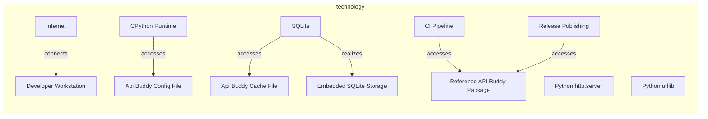
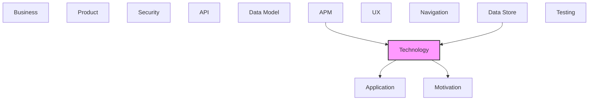

# Technology

[← Back to README](../README.md)

Infrastructure, platforms, systems, and technology components.

## Report Index

- [Layer Introduction](#layer-introduction)
- [Intra-Layer Relationships](#intra-layer-relationships)
- [Inter-Layer Dependencies](#inter-layer-dependencies)
- [Inter-Layer Relationships Table](#inter-layer-relationships-table)
- [Element Reference](#element-reference)

## Layer Introduction

| Metric                    | Count |
| ------------------------- | ----- |
| Elements                  | 12    |
| Intra-Layer Relationships | 6     |
| Inter-Layer Relationships | 12    |
| Inbound Relationships     | 2     |
| Outbound Relationships    | 10    |

**Cross-Layer References**:

- **Upstream layers**: [APM](./12-apm-layer-report.md), [Data Store](./09-data-store-layer-report.md)
- **Downstream layers**: [Application](./05-application-layer-report.md), [Motivation](./01-motivation-layer-report.md)

## Intra-Layer Relationships

## Inter-Layer Dependencies

## Inter-Layer Relationships Table

| Relationship ID                                                        | Source Node                                            | Dest Node                                                     | Dest Layer    | Predicate    | Cardinality  | Strength |
| ---------------------------------------------------------------------- | ------------------------------------------------------ | ------------------------------------------------------------- | ------------- | ------------ | ------------ | -------- |
| `apm.resource.references.technology.systemsoftware`                    | `apm.resource.reference-api-buddy-process`             | `technology.systemsoftware.cpython-runtime`                   | `technology`  | `references` | many-to-many | medium   |
| `data-store.database.depends-on.technology.systemsoftware`             | `data-store.database.api-buddy-cache-database`         | `technology.systemsoftware.sqlite`                            | `technology`  | `depends-on` | many-to-many | medium   |
| `technology.artifact.realizes.application.applicationcomponent`        | `technology.artifact.reference-api-buddy-package`      | `application.applicationcomponent.api-buddy-cli`              | `application` | `realizes`   | many-to-many | medium   |
| `technology.artifact.realizes.application.applicationcomponent`        | `technology.artifact.reference-api-buddy-package`      | `application.applicationcomponent.caching-proxy`              | `application` | `realizes`   | many-to-many | medium   |
| `technology.systemsoftware.satisfies.motivation.constraint`            | `technology.systemsoftware.cpython-runtime`            | `motivation.constraint.python-3-10-or-later`                  | `motivation`  | `satisfies`  | many-to-many | medium   |
| `technology.systemsoftware.satisfies.motivation.principle`             | `technology.systemsoftware.cpython-runtime`            | `motivation.principle.standard-library-only`                  | `motivation`  | `satisfies`  | many-to-many | medium   |
| `technology.systemsoftware.serves.application.applicationcomponent`    | `technology.systemsoftware.cpython-runtime`            | `application.applicationcomponent.caching-proxy`              | `application` | `serves`     | many-to-many | medium   |
| `technology.systemsoftware.serves.application.applicationcomponent`    | `technology.systemsoftware.python-http-server`         | `application.applicationcomponent.proxy-http-request-handler` | `application` | `serves`     | many-to-many | medium   |
| `technology.systemsoftware.serves.application.applicationcomponent`    | `technology.systemsoftware.python-http-server`         | `application.applicationcomponent.threaded-http-server`       | `application` | `serves`     | many-to-many | medium   |
| `technology.systemsoftware.satisfies.motivation.principle`             | `technology.systemsoftware.python-urllib`              | `motivation.principle.keep-upstream-tls-verification`         | `motivation`  | `satisfies`  | many-to-many | medium   |
| `technology.systemsoftware.serves.application.applicationcomponent`    | `technology.systemsoftware.python-urllib`              | `application.applicationcomponent.proxy-http-request-handler` | `application` | `serves`     | many-to-many | medium   |
| `technology.technologyservice.serves.application.applicationcomponent` | `technology.technologyservice.embedded-sqlite-storage` | `application.applicationcomponent.database-manager`           | `application` | `serves`     | many-to-many | medium   |

## Element Reference

### Api Buddy Cache File {#api-buddy-cache-file}

**ID**: `technology.artifact.api-buddy-cache-file`

**Type**: `artifact`

SQLite cache file with its -wal and -shm companions.

#### Attributes

| Name         | Value |
| ------------ | ----- |
| artifactType | file  |

#### Relationships

| Type        | Related Element                    | Predicate  | Direction |
| ----------- | ---------------------------------- | ---------- | --------- |
| intra-layer | `technology.systemsoftware.sqlite` | `accesses` | inbound   |

### Api Buddy Config File {#api-buddy-config-file}

**ID**: `technology.artifact.api-buddy-config-file`

**Type**: `artifact`

JSON configuration read by api-buddy --config and written by --generate-config.

#### Attributes

| Name         | Value         |
| ------------ | ------------- |
| artifactType | configuration |

#### Relationships

| Type        | Related Element                             | Predicate  | Direction |
| ----------- | ------------------------------------------- | ---------- | --------- |
| intra-layer | `technology.systemsoftware.cpython-runtime` | `accesses` | inbound   |

### Reference API Buddy Package {#reference-api-buddy-package}

**ID**: `technology.artifact.reference-api-buddy-package`

**Type**: `artifact`

reference-api-buddy 0.5.3 wheel and sdist published to PyPI; console script api-buddy.

#### Attributes

| Name         | Value   |
| ------------ | ------- |
| artifactType | library |

#### Relationships

| Type        | Related Element                                   | Predicate  | Direction |
| ----------- | ------------------------------------------------- | ---------- | --------- |
| inter-layer | `application.applicationcomponent.api-buddy-cli`  | `realizes` | outbound  |
| inter-layer | `application.applicationcomponent.caching-proxy`  | `realizes` | outbound  |
| intra-layer | `technology.technologyprocess.ci-pipeline`        | `accesses` | inbound   |
| intra-layer | `technology.technologyprocess.release-publishing` | `accesses` | inbound   |

### Internet {#internet}

**ID**: `technology.communicationnetwork.internet`

**Type**: `communicationnetwork`

Carries HTTPS requests from the proxy to upstream APIs.

#### Attributes

| Name        | Value    |
| ----------- | -------- |
| networkType | internet |

#### Relationships

| Type        | Related Element                           | Predicate  | Direction |
| ----------- | ----------------------------------------- | ---------- | --------- |
| intra-layer | `technology.device.developer-workstation` | `connects` | outbound  |

### Developer Workstation {#developer-workstation}

**ID**: `technology.device.developer-workstation`

**Type**: `device`

The machine that runs the pipeline and the proxy (Linux, macOS or Windows per the CI matrix).

#### Attributes

| Name       | Value       |
| ---------- | ----------- |
| deviceType | workstation |

#### Relationships

| Type        | Related Element                            | Predicate  | Direction |
| ----------- | ------------------------------------------ | ---------- | --------- |
| intra-layer | `technology.communicationnetwork.internet` | `connects` | inbound   |

### CPython Runtime {#cpython-runtime}

**ID**: `technology.systemsoftware.cpython-runtime`

**Type**: `systemsoftware`

Python 3.10+ interpreter and standard library; the package has no third-party runtime dependencies.

#### Attributes

| Name         | Value      |
| ------------ | ---------- |
| softwareType | middleware |

#### Relationships

| Type        | Related Element                                  | Predicate    | Direction |
| ----------- | ------------------------------------------------ | ------------ | --------- |
| inter-layer | `apm.resource.reference-api-buddy-process`       | `references` | inbound   |
| inter-layer | `motivation.constraint.python-3-10-or-later`     | `satisfies`  | outbound  |
| inter-layer | `motivation.principle.standard-library-only`     | `satisfies`  | outbound  |
| inter-layer | `application.applicationcomponent.caching-proxy` | `serves`     | outbound  |
| intra-layer | `technology.artifact.api-buddy-config-file`      | `accesses`   | outbound  |

### Python http.server {#python-http-server}

**ID**: `technology.systemsoftware.python-http-server`

**Type**: `systemsoftware`

Standard-library ThreadingHTTPServer and BaseHTTPRequestHandler that the proxy's server and handler extend.

#### Attributes

| Name         | Value      |
| ------------ | ---------- |
| softwareType | middleware |

#### Relationships

| Type        | Related Element                                               | Predicate | Direction |
| ----------- | ------------------------------------------------------------- | --------- | --------- |
| inter-layer | `application.applicationcomponent.proxy-http-request-handler` | `serves`  | outbound  |
| inter-layer | `application.applicationcomponent.threaded-http-server`       | `serves`  | outbound  |

### Python urllib {#python-urllib}

**ID**: `technology.systemsoftware.python-urllib`

**Type**: `systemsoftware`

Standard-library HTTP(S) client used for upstream calls, with default certificate verification.

#### Attributes

| Name         | Value      |
| ------------ | ---------- |
| softwareType | middleware |

#### Relationships

| Type        | Related Element                                               | Predicate   | Direction |
| ----------- | ------------------------------------------------------------- | ----------- | --------- |
| inter-layer | `motivation.principle.keep-upstream-tls-verification`         | `satisfies` | outbound  |
| inter-layer | `application.applicationcomponent.proxy-http-request-handler` | `serves`    | outbound  |

### SQLite {#sqlite}

**ID**: `technology.systemsoftware.sqlite`

**Type**: `systemsoftware`

Embedded database engine via the sqlite3 module.

#### Attributes

| Name         | Value |
| ------------ | ----- |
| softwareType | dbms  |

#### Relationships

| Type        | Related Element                                        | Predicate    | Direction |
| ----------- | ------------------------------------------------------ | ------------ | --------- |
| inter-layer | `data-store.database.api-buddy-cache-database`         | `depends-on` | inbound   |
| intra-layer | `technology.artifact.api-buddy-cache-file`             | `accesses`   | outbound  |
| intra-layer | `technology.technologyservice.embedded-sqlite-storage` | `realizes`   | outbound  |

### CI Pipeline {#ci-pipeline}

**ID**: `technology.technologyprocess.ci-pipeline`

**Type**: `technologyprocess`

GitHub Actions on push and PR: flake8, black, isort, mypy (non-blocking), pytest with coverage on Ubuntu, Windows and macOS for Python 3.10 to 3.15, plus bandit and pip-audit.

#### Relationships

| Type        | Related Element                                   | Predicate  | Direction |
| ----------- | ------------------------------------------------- | ---------- | --------- |
| intra-layer | `technology.artifact.reference-api-buddy-package` | `accesses` | outbound  |

### Release Publishing {#release-publishing}

**ID**: `technology.technologyprocess.release-publishing`

**Type**: `technologyprocess`

On a published GitHub release: build wheel and sdist, twine check, publish to PyPI.

#### Relationships

| Type        | Related Element                                   | Predicate  | Direction |
| ----------- | ------------------------------------------------- | ---------- | --------- |
| intra-layer | `technology.artifact.reference-api-buddy-package` | `accesses` | outbound  |

### Embedded SQLite Storage {#embedded-sqlite-storage}

**ID**: `technology.technologyservice.embedded-sqlite-storage`

**Type**: `technologyservice`

Local file or shared in-memory SQL storage.

#### Attributes

| Name        | Value    |
| ----------- | -------- |
| serviceType | database |

#### Relationships

| Type        | Related Element                                     | Predicate  | Direction |
| ----------- | --------------------------------------------------- | ---------- | --------- |
| inter-layer | `application.applicationcomponent.database-manager` | `serves`   | outbound  |
| intra-layer | `technology.systemsoftware.sqlite`                  | `realizes` | inbound   |

---

Generated: 2026-11-26T13:42:04.180Z | Model Version: 0.1.0
