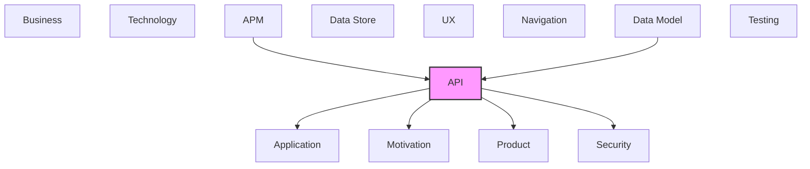

# API

[← Back to README](../README.md)

REST APIs, operations, endpoints, and API integrations.

## Report Index

- [Layer Introduction](#layer-introduction)
- [Intra-Layer Relationships](#intra-layer-relationships)
- [Inter-Layer Dependencies](#inter-layer-dependencies)
- [Inter-Layer Relationships Table](#inter-layer-relationships-table)
- [Element Reference](#element-reference)

## Layer Introduction

| Metric                    | Count |
| ------------------------- | ----- |
| Elements                  | 110   |
| Intra-Layer Relationships | 163   |
| Inter-Layer Relationships | 72    |
| Inbound Relationships     | 2     |
| Outbound Relationships    | 70    |

**Cross-Layer References**:

- **Upstream layers**: [APM](./12-apm-layer-report.md), [Data Model](./08-data-model-layer-report.md)
- **Downstream layers**: [Application](./05-application-layer-report.md), [Motivation](./01-motivation-layer-report.md), [Product](./03-product-layer-report.md), [Security](./04-security-layer-report.md)

## Intra-Layer Relationships

*This layer has >30 elements. Summary table shown instead of diagram.*

| Element                                                   | Type              | Relationships |
| --------------------------------------------------------- | ----------------- | ------------- |
| `api.components.reference-api-buddy-components`           | `components`      | 14            |
| `api.header.retry-after`                                  | `header`          | 2             |
| `api.header.x-rate-limit-limit`                           | `header`          | 2             |
| `api.header.x-rate-limit-remaining`                       | `header`          | 2             |
| `api.header.x-rate-limit-reset`                           | `header`          | 2             |
| `api.info.reference-api-buddy-info`                       | `info`            | 1             |
| `api.mediatype.validate-config-json`                      | `mediatype`       | 2             |
| `api.openapidocument.reference-api-buddy-http-api`        | `openapidocument` | 6             |
| `api.operation.delete-proxied-upstream-request`           | `operation`       | 6             |
| `api.operation.get-admin-cache`                           | `operation`       | 5             |
| `api.operation.get-admin-cache-domain`                    | `operation`       | 5             |
| `api.operation.get-admin-config`                          | `operation`       | 5             |
| `api.operation.get-admin-domains`                         | `operation`       | 5             |
| `api.operation.get-admin-health`                          | `operation`       | 5             |
| `api.operation.get-admin-status`                          | `operation`       | 5             |
| `api.operation.get-proxied-upstream-request`              | `operation`       | 6             |
| `api.operation.post-admin-validate-config`                | `operation`       | 6             |
| `api.operation.post-proxied-upstream-request`             | `operation`       | 7             |
| `api.operation.put-proxied-upstream-request`              | `operation`       | 6             |
| `api.parameter.cache-domain`                              | `parameter`       | 2             |
| `api.parameter.domain-key`                                | `parameter`       | 2             |
| `api.parameter.upstream-path`                             | `parameter`       | 2             |
| `api.pathitem.admin-cache-domain-path`                    | `pathitem`        | 3             |
| `api.pathitem.admin-cache-path`                           | `pathitem`        | 2             |
| `api.pathitem.admin-config-path`                          | `pathitem`        | 2             |
| `api.pathitem.admin-domains-path`                         | `pathitem`        | 2             |
| `api.pathitem.admin-health-path`                          | `pathitem`        | 2             |
| `api.pathitem.admin-status-path`                          | `pathitem`        | 2             |
| `api.pathitem.admin-validate-config-path`                 | `pathitem`        | 2             |
| `api.pathitem.proxied-upstream-path`                      | `pathitem`        | 7             |
| `api.paths.reference-api-buddy-paths`                     | `paths`           | 9             |
| `api.ratelimit.admin-endpoint-rate-limit`                 | `ratelimit`       | 14            |
| `api.ratelimit.upstream-domain-rate-limit`                | `ratelimit`       | 12            |
| `api.requestbody.proxied-post-body`                       | `requestbody`     | 1             |
| `api.requestbody.validate-config-body`                    | `requestbody`     | 2             |
| `api.response.delete-proxied-upstream-request-200`        | `response`        | 1             |
| `api.response.delete-proxied-upstream-request-401`        | `response`        | 1             |
| `api.response.delete-proxied-upstream-request-404`        | `response`        | 1             |
| `api.response.delete-proxied-upstream-request-429`        | `response`        | 2             |
| `api.response.delete-proxied-upstream-request-500`        | `response`        | 1             |
| `api.response.delete-proxied-upstream-request-502`        | `response`        | 1             |
| `api.response.get-admin-cache-200`                        | `response`        | 1             |
| `api.response.get-admin-cache-401`                        | `response`        | 1             |
| `api.response.get-admin-cache-429`                        | `response`        | 2             |
| `api.response.get-admin-cache-500`                        | `response`        | 1             |
| `api.response.get-admin-cache-domain-200`                 | `response`        | 1             |
| `api.response.get-admin-cache-domain-401`                 | `response`        | 1             |
| `api.response.get-admin-cache-domain-404`                 | `response`        | 1             |
| `api.response.get-admin-cache-domain-429`                 | `response`        | 2             |
| `api.response.get-admin-cache-domain-500`                 | `response`        | 1             |
| `api.response.get-admin-config-200`                       | `response`        | 1             |
| `api.response.get-admin-config-401`                       | `response`        | 1             |
| `api.response.get-admin-config-429`                       | `response`        | 2             |
| `api.response.get-admin-config-500`                       | `response`        | 1             |
| `api.response.get-admin-domains-200`                      | `response`        | 1             |
| `api.response.get-admin-domains-401`                      | `response`        | 1             |
| `api.response.get-admin-domains-429`                      | `response`        | 2             |
| `api.response.get-admin-domains-500`                      | `response`        | 1             |
| `api.response.get-admin-health-200`                       | `response`        | 1             |
| `api.response.get-admin-health-401`                       | `response`        | 1             |
| `api.response.get-admin-health-429`                       | `response`        | 2             |
| `api.response.get-admin-status-200`                       | `response`        | 1             |
| `api.response.get-admin-status-401`                       | `response`        | 1             |
| `api.response.get-admin-status-429`                       | `response`        | 2             |
| `api.response.get-admin-status-500`                       | `response`        | 1             |
| `api.response.get-proxied-upstream-request-200`           | `response`        | 1             |
| `api.response.get-proxied-upstream-request-401`           | `response`        | 1             |
| `api.response.get-proxied-upstream-request-404`           | `response`        | 1             |
| `api.response.get-proxied-upstream-request-429`           | `response`        | 2             |
| `api.response.get-proxied-upstream-request-500`           | `response`        | 1             |
| `api.response.get-proxied-upstream-request-502`           | `response`        | 1             |
| `api.response.get-proxied-upstream-request-504`           | `response`        | 1             |
| `api.response.post-admin-validate-config-200`             | `response`        | 1             |
| `api.response.post-admin-validate-config-400`             | `response`        | 1             |
| `api.response.post-admin-validate-config-401`             | `response`        | 1             |
| `api.response.post-admin-validate-config-429`             | `response`        | 2             |
| `api.response.post-admin-validate-config-500`             | `response`        | 1             |
| `api.response.post-proxied-upstream-request-200`          | `response`        | 1             |
| `api.response.post-proxied-upstream-request-401`          | `response`        | 1             |
| `api.response.post-proxied-upstream-request-404`          | `response`        | 1             |
| `api.response.post-proxied-upstream-request-429`          | `response`        | 2             |
| `api.response.post-proxied-upstream-request-500`          | `response`        | 1             |
| `api.response.post-proxied-upstream-request-502`          | `response`        | 1             |
| `api.response.post-proxied-upstream-request-504`          | `response`        | 1             |
| `api.response.put-proxied-upstream-request-200`           | `response`        | 1             |
| `api.response.put-proxied-upstream-request-401`           | `response`        | 1             |
| `api.response.put-proxied-upstream-request-404`           | `response`        | 1             |
| `api.response.put-proxied-upstream-request-429`           | `response`        | 2             |
| `api.response.put-proxied-upstream-request-500`           | `response`        | 1             |
| `api.response.put-proxied-upstream-request-502`           | `response`        | 1             |
| `api.responses.delete-proxied-upstream-request-responses` | `responses`       | 7             |
| `api.responses.get-admin-cache-domain-responses`          | `responses`       | 6             |
| `api.responses.get-admin-cache-responses`                 | `responses`       | 5             |
| `api.responses.get-admin-config-responses`                | `responses`       | 5             |
| `api.responses.get-admin-domains-responses`               | `responses`       | 5             |
| `api.responses.get-admin-health-responses`                | `responses`       | 4             |
| `api.responses.get-admin-status-responses`                | `responses`       | 5             |
| `api.responses.get-proxied-upstream-request-responses`    | `responses`       | 8             |
| `api.responses.post-admin-validate-config-responses`      | `responses`       | 6             |
| `api.responses.post-proxied-upstream-request-responses`   | `responses`       | 8             |
| `api.responses.put-proxied-upstream-request-responses`    | `responses`       | 7             |
| `api.schema.admin-error`                                  | `schema`          | 1             |
| `api.schema.validate-config-request`                      | `schema`          | 2             |
| `api.schema.validate-config-result`                       | `schema`          | 1             |
| `api.securityscheme.api-buddy-bearer-token`               | `securityscheme`  | 12            |
| `api.securityscheme.api-buddy-key-header`                 | `securityscheme`  | 12            |
| `api.securityscheme.api-buddy-key-query`                  | `securityscheme`  | 5             |
| `api.server.local-proxy-server`                           | `server`          | 1             |
| `api.tag.admin`                                           | `tag`             | 1             |
| `api.tag.proxy`                                           | `tag`             | 1             |

## Inter-Layer Dependencies

## Inter-Layer Relationships Table

| Relationship ID                                               | Source Node                                        | Dest Node                                                          | Dest Layer    | Predicate    | Cardinality  | Strength |
| ------------------------------------------------------------- | -------------------------------------------------- | ------------------------------------------------------------------ | ------------- | ------------ | ------------ | -------- |
| `api.openapidocument.realizes.application.applicationservice` | `api.openapidocument.reference-api-buddy-http-api` | `application.applicationservice.cached-reference-proxying`         | `application` | `realizes`   | many-to-many | medium   |
| `api.operation.exposes.product.feature`                       | `api.operation.delete-proxied-upstream-request`    | `product.feature.path-based-domain-mapping`                        | `product`     | `exposes`    | many-to-many | medium   |
| `api.operation.realizes.application.applicationfunction`      | `api.operation.delete-proxied-upstream-request`    | `application.applicationfunction.forward-upstream-request`         | `application` | `realizes`   | many-to-many | medium   |
| `api.operation.references.application.applicationservice`     | `api.operation.delete-proxied-upstream-request`    | `application.applicationservice.cached-reference-proxying`         | `application` | `references` | many-to-many | medium   |
| `api.operation.references.security.secureresource`            | `api.operation.delete-proxied-upstream-request`    | `security.secureresource.proxy-endpoint-resource`                  | `security`    | `references` | many-to-many | medium   |
| `api.operation.satisfies.motivation.requirement`              | `api.operation.delete-proxied-upstream-request`    | `motivation.requirement.distinguish-upstream-errors-from-outages`  | `motivation`  | `satisfies`  | many-to-many | medium   |
| `api.operation.satisfies.motivation.requirement`              | `api.operation.delete-proxied-upstream-request`    | `motivation.requirement.per-domain-rate-limiting`                  | `motivation`  | `satisfies`  | many-to-many | medium   |
| `api.operation.exposes.product.feature`                       | `api.operation.get-admin-cache-domain`             | `product.feature.admin-debug-endpoints`                            | `product`     | `exposes`    | many-to-many | medium   |
| `api.operation.realizes.application.applicationfunction`      | `api.operation.get-admin-cache-domain`             | `application.applicationfunction.report-cache-statistics`          | `application` | `realizes`   | many-to-many | medium   |
| `api.operation.references.application.applicationservice`     | `api.operation.get-admin-cache-domain`             | `application.applicationservice.admin-diagnostics`                 | `application` | `references` | many-to-many | medium   |
| `api.operation.references.security.secureresource`            | `api.operation.get-admin-cache-domain`             | `security.secureresource.admin-endpoint-resource`                  | `security`    | `references` | many-to-many | medium   |
| `api.operation.satisfies.motivation.requirement`              | `api.operation.get-admin-cache-domain`             | `motivation.requirement.admin-debug-endpoints`                     | `motivation`  | `satisfies`  | many-to-many | medium   |
| `api.operation.exposes.product.feature`                       | `api.operation.get-admin-cache`                    | `product.feature.admin-debug-endpoints`                            | `product`     | `exposes`    | many-to-many | medium   |
| `api.operation.realizes.application.applicationfunction`      | `api.operation.get-admin-cache`                    | `application.applicationfunction.report-cache-statistics`          | `application` | `realizes`   | many-to-many | medium   |
| `api.operation.references.application.applicationservice`     | `api.operation.get-admin-cache`                    | `application.applicationservice.admin-diagnostics`                 | `application` | `references` | many-to-many | medium   |
| `api.operation.references.security.secureresource`            | `api.operation.get-admin-cache`                    | `security.secureresource.admin-endpoint-resource`                  | `security`    | `references` | many-to-many | medium   |
| `api.operation.satisfies.motivation.requirement`              | `api.operation.get-admin-cache`                    | `motivation.requirement.admin-debug-endpoints`                     | `motivation`  | `satisfies`  | many-to-many | medium   |
| `api.operation.exposes.product.feature`                       | `api.operation.get-admin-config`                   | `product.feature.admin-debug-endpoints`                            | `product`     | `exposes`    | many-to-many | medium   |
| `api.operation.realizes.application.applicationfunction`      | `api.operation.get-admin-config`                   | `application.applicationfunction.sanitize-configuration`           | `application` | `realizes`   | many-to-many | medium   |
| `api.operation.realizes.security.countermeasure`              | `api.operation.get-admin-config`                   | `security.countermeasure.config-secret-redaction`                  | `security`    | `realizes`   | many-to-many | medium   |
| `api.operation.references.application.applicationservice`     | `api.operation.get-admin-config`                   | `application.applicationservice.admin-diagnostics`                 | `application` | `references` | many-to-many | medium   |
| `api.operation.references.security.secureresource`            | `api.operation.get-admin-config`                   | `security.secureresource.admin-endpoint-resource`                  | `security`    | `references` | many-to-many | medium   |
| `api.operation.satisfies.motivation.requirement`              | `api.operation.get-admin-config`                   | `motivation.requirement.admin-debug-endpoints`                     | `motivation`  | `satisfies`  | many-to-many | medium   |
| `api.operation.satisfies.motivation.requirement`              | `api.operation.get-admin-config`                   | `motivation.requirement.redact-secrets-in-admin-output`            | `motivation`  | `satisfies`  | many-to-many | medium   |
| `api.operation.exposes.product.feature`                       | `api.operation.get-admin-domains`                  | `product.feature.admin-debug-endpoints`                            | `product`     | `exposes`    | many-to-many | medium   |
| `api.operation.realizes.application.applicationfunction`      | `api.operation.get-admin-domains`                  | `application.applicationfunction.report-domain-mapping-statistics` | `application` | `realizes`   | many-to-many | medium   |
| `api.operation.references.application.applicationservice`     | `api.operation.get-admin-domains`                  | `application.applicationservice.admin-diagnostics`                 | `application` | `references` | many-to-many | medium   |
| `api.operation.references.security.secureresource`            | `api.operation.get-admin-domains`                  | `security.secureresource.admin-endpoint-resource`                  | `security`    | `references` | many-to-many | medium   |
| `api.operation.satisfies.motivation.requirement`              | `api.operation.get-admin-domains`                  | `motivation.requirement.admin-debug-endpoints`                     | `motivation`  | `satisfies`  | many-to-many | medium   |
| `api.operation.exposes.product.feature`                       | `api.operation.get-admin-health`                   | `product.feature.admin-debug-endpoints`                            | `product`     | `exposes`    | many-to-many | medium   |
| `api.operation.realizes.application.applicationfunction`      | `api.operation.get-admin-health`                   | `application.applicationfunction.handle-admin-request`             | `application` | `realizes`   | many-to-many | medium   |
| `api.operation.references.application.applicationservice`     | `api.operation.get-admin-health`                   | `application.applicationservice.admin-diagnostics`                 | `application` | `references` | many-to-many | medium   |
| `api.operation.references.security.secureresource`            | `api.operation.get-admin-health`                   | `security.secureresource.admin-endpoint-resource`                  | `security`    | `references` | many-to-many | medium   |
| `api.operation.satisfies.motivation.requirement`              | `api.operation.get-admin-health`                   | `motivation.requirement.admin-debug-endpoints`                     | `motivation`  | `satisfies`  | many-to-many | medium   |
| `api.operation.exposes.product.feature`                       | `api.operation.get-admin-status`                   | `product.feature.admin-debug-endpoints`                            | `product`     | `exposes`    | many-to-many | medium   |
| `api.operation.realizes.application.applicationfunction`      | `api.operation.get-admin-status`                   | `application.applicationfunction.report-component-status`          | `application` | `realizes`   | many-to-many | medium   |
| `api.operation.references.application.applicationservice`     | `api.operation.get-admin-status`                   | `application.applicationservice.admin-diagnostics`                 | `application` | `references` | many-to-many | medium   |
| `api.operation.references.security.secureresource`            | `api.operation.get-admin-status`                   | `security.secureresource.admin-endpoint-resource`                  | `security`    | `references` | many-to-many | medium   |
| `api.operation.satisfies.motivation.requirement`              | `api.operation.get-admin-status`                   | `motivation.requirement.admin-debug-endpoints`                     | `motivation`  | `satisfies`  | many-to-many | medium   |
| `api.operation.exposes.product.feature`                       | `api.operation.get-proxied-upstream-request`       | `product.feature.path-based-domain-mapping`                        | `product`     | `exposes`    | many-to-many | medium   |
| `api.operation.realizes.application.applicationfunction`      | `api.operation.get-proxied-upstream-request`       | `application.applicationfunction.forward-upstream-request`         | `application` | `realizes`   | many-to-many | medium   |
| `api.operation.references.application.applicationservice`     | `api.operation.get-proxied-upstream-request`       | `application.applicationservice.cached-reference-proxying`         | `application` | `references` | many-to-many | medium   |
| `api.operation.references.security.secureresource`            | `api.operation.get-proxied-upstream-request`       | `security.secureresource.proxy-endpoint-resource`                  | `security`    | `references` | many-to-many | medium   |
| `api.operation.satisfies.motivation.requirement`              | `api.operation.get-proxied-upstream-request`       | `motivation.requirement.cache-get-and-post-by-request-signature`   | `motivation`  | `satisfies`  | many-to-many | medium   |
| `api.operation.satisfies.motivation.requirement`              | `api.operation.get-proxied-upstream-request`       | `motivation.requirement.deduplicate-concurrent-requests`           | `motivation`  | `satisfies`  | many-to-many | medium   |
| `api.operation.satisfies.motivation.requirement`              | `api.operation.get-proxied-upstream-request`       | `motivation.requirement.distinguish-upstream-errors-from-outages`  | `motivation`  | `satisfies`  | many-to-many | medium   |
| `api.operation.satisfies.motivation.requirement`              | `api.operation.get-proxied-upstream-request`       | `motivation.requirement.per-domain-rate-limiting`                  | `motivation`  | `satisfies`  | many-to-many | medium   |
| `api.operation.exposes.product.feature`                       | `api.operation.post-admin-validate-config`         | `product.feature.admin-debug-endpoints`                            | `product`     | `exposes`    | many-to-many | medium   |
| `api.operation.realizes.application.applicationfunction`      | `api.operation.post-admin-validate-config`         | `application.applicationfunction.validate-posted-configuration`    | `application` | `realizes`   | many-to-many | medium   |
| `api.operation.references.application.applicationservice`     | `api.operation.post-admin-validate-config`         | `application.applicationservice.admin-diagnostics`                 | `application` | `references` | many-to-many | medium   |
| `api.operation.references.security.secureresource`            | `api.operation.post-admin-validate-config`         | `security.secureresource.admin-endpoint-resource`                  | `security`    | `references` | many-to-many | medium   |
| `api.operation.satisfies.motivation.requirement`              | `api.operation.post-admin-validate-config`         | `motivation.requirement.admin-debug-endpoints`                     | `motivation`  | `satisfies`  | many-to-many | medium   |
| `api.operation.exposes.product.feature`                       | `api.operation.post-proxied-upstream-request`      | `product.feature.path-based-domain-mapping`                        | `product`     | `exposes`    | many-to-many | medium   |
| `api.operation.realizes.application.applicationfunction`      | `api.operation.post-proxied-upstream-request`      | `application.applicationfunction.forward-upstream-request`         | `application` | `realizes`   | many-to-many | medium   |
| `api.operation.references.application.applicationservice`     | `api.operation.post-proxied-upstream-request`      | `application.applicationservice.cached-reference-proxying`         | `application` | `references` | many-to-many | medium   |
| `api.operation.references.security.secureresource`            | `api.operation.post-proxied-upstream-request`      | `security.secureresource.proxy-endpoint-resource`                  | `security`    | `references` | many-to-many | medium   |
| `api.operation.satisfies.motivation.requirement`              | `api.operation.post-proxied-upstream-request`      | `motivation.requirement.cache-get-and-post-by-request-signature`   | `motivation`  | `satisfies`  | many-to-many | medium   |
| `api.operation.satisfies.motivation.requirement`              | `api.operation.post-proxied-upstream-request`      | `motivation.requirement.deduplicate-concurrent-requests`           | `motivation`  | `satisfies`  | many-to-many | medium   |
| `api.operation.satisfies.motivation.requirement`              | `api.operation.post-proxied-upstream-request`      | `motivation.requirement.distinguish-upstream-errors-from-outages`  | `motivation`  | `satisfies`  | many-to-many | medium   |
| `api.operation.satisfies.motivation.requirement`              | `api.operation.post-proxied-upstream-request`      | `motivation.requirement.per-domain-rate-limiting`                  | `motivation`  | `satisfies`  | many-to-many | medium   |
| `api.operation.exposes.product.feature`                       | `api.operation.put-proxied-upstream-request`       | `product.feature.path-based-domain-mapping`                        | `product`     | `exposes`    | many-to-many | medium   |
| `api.operation.realizes.application.applicationfunction`      | `api.operation.put-proxied-upstream-request`       | `application.applicationfunction.forward-upstream-request`         | `application` | `realizes`   | many-to-many | medium   |
| `api.operation.references.application.applicationservice`     | `api.operation.put-proxied-upstream-request`       | `application.applicationservice.cached-reference-proxying`         | `application` | `references` | many-to-many | medium   |
| `api.operation.references.security.secureresource`            | `api.operation.put-proxied-upstream-request`       | `security.secureresource.proxy-endpoint-resource`                  | `security`    | `references` | many-to-many | medium   |
| `api.operation.satisfies.motivation.requirement`              | `api.operation.put-proxied-upstream-request`       | `motivation.requirement.distinguish-upstream-errors-from-outages`  | `motivation`  | `satisfies`  | many-to-many | medium   |
| `api.operation.satisfies.motivation.requirement`              | `api.operation.put-proxied-upstream-request`       | `motivation.requirement.per-domain-rate-limiting`                  | `motivation`  | `satisfies`  | many-to-many | medium   |
| `api.ratelimit.realizes.security.countermeasure`              | `api.ratelimit.admin-endpoint-rate-limit`          | `security.countermeasure.admin-rate-limiting`                      | `security`    | `realizes`   | many-to-many | medium   |
| `api.securityscheme.references.security.secureresource`       | `api.securityscheme.api-buddy-bearer-token`        | `security.secureresource.proxy-endpoint-resource`                  | `security`    | `references` | many-to-many | medium   |
| `api.securityscheme.references.security.secureresource`       | `api.securityscheme.api-buddy-key-header`          | `security.secureresource.proxy-endpoint-resource`                  | `security`    | `references` | many-to-many | medium   |
| `api.securityscheme.references.security.secureresource`       | `api.securityscheme.api-buddy-key-query`           | `security.secureresource.proxy-endpoint-resource`                  | `security`    | `references` | many-to-many | medium   |
| `apm.metricinstrument.monitors.api.operation`                 | `apm.metricinstrument.upstream-response-time`      | `api.operation.get-proxied-upstream-request`                       | `api`         | `monitors`   | many-to-many | medium   |
| `data-model.objectschema.maps-to.api.requestbody`             | `data-model.objectschema.proxy-configuration`      | `api.requestbody.validate-config-body`                             | `api`         | `maps-to`    | many-to-many | medium   |

## Element Reference

### Reference API Buddy Components {#reference-api-buddy-components}

**ID**: `api.components.reference-api-buddy-components`

**Type**: `components`

Shared security schemes and schemas.

#### Relationships

| Type        | Related Element                                    | Predicate  | Direction |
| ----------- | -------------------------------------------------- | ---------- | --------- |
| intra-layer | `api.header.retry-after`                           | `composes` | outbound  |
| intra-layer | `api.header.x-rate-limit-limit`                    | `composes` | outbound  |
| intra-layer | `api.header.x-rate-limit-remaining`                | `composes` | outbound  |
| intra-layer | `api.header.x-rate-limit-reset`                    | `composes` | outbound  |
| intra-layer | `api.parameter.cache-domain`                       | `composes` | outbound  |
| intra-layer | `api.parameter.domain-key`                         | `composes` | outbound  |
| intra-layer | `api.parameter.upstream-path`                      | `composes` | outbound  |
| intra-layer | `api.schema.admin-error`                           | `composes` | outbound  |
| intra-layer | `api.schema.validate-config-request`               | `composes` | outbound  |
| intra-layer | `api.schema.validate-config-result`                | `composes` | outbound  |
| intra-layer | `api.securityscheme.api-buddy-bearer-token`        | `composes` | outbound  |
| intra-layer | `api.securityscheme.api-buddy-key-header`          | `composes` | outbound  |
| intra-layer | `api.securityscheme.api-buddy-key-query`           | `composes` | outbound  |
| intra-layer | `api.openapidocument.reference-api-buddy-http-api` | `composes` | inbound   |

### Retry-After {#retry-after}

**ID**: `api.header.retry-after`

**Type**: `header`

Seconds to wait: progressive_max_delay.

#### Relationships

| Type        | Related Element                                 | Predicate    | Direction |
| ----------- | ----------------------------------------------- | ------------ | --------- |
| intra-layer | `api.components.reference-api-buddy-components` | `composes`   | inbound   |
| intra-layer | `api.ratelimit.upstream-domain-rate-limit`      | `references` | inbound   |

### X-RateLimit-Limit {#x-ratelimit-limit}

**ID**: `api.header.x-rate-limit-limit`

**Type**: `header`

The domain's hourly limit.

#### Relationships

| Type        | Related Element                                 | Predicate    | Direction |
| ----------- | ----------------------------------------------- | ------------ | --------- |
| intra-layer | `api.components.reference-api-buddy-components` | `composes`   | inbound   |
| intra-layer | `api.ratelimit.upstream-domain-rate-limit`      | `references` | inbound   |

### X-RateLimit-Remaining {#x-ratelimit-remaining}

**ID**: `api.header.x-rate-limit-remaining`

**Type**: `header`

Requests left in the hour window.

#### Relationships

| Type        | Related Element                                 | Predicate    | Direction |
| ----------- | ----------------------------------------------- | ------------ | --------- |
| intra-layer | `api.components.reference-api-buddy-components` | `composes`   | inbound   |
| intra-layer | `api.ratelimit.upstream-domain-rate-limit`      | `references` | inbound   |

### X-RateLimit-Reset {#x-ratelimit-reset}

**ID**: `api.header.x-rate-limit-reset`

**Type**: `header`

Seconds until the oldest request leaves the hour window.

#### Relationships

| Type        | Related Element                                 | Predicate    | Direction |
| ----------- | ----------------------------------------------- | ------------ | --------- |
| intra-layer | `api.components.reference-api-buddy-components` | `composes`   | inbound   |
| intra-layer | `api.ratelimit.upstream-domain-rate-limit`      | `references` | inbound   |

### Reference API Buddy Info {#reference-api-buddy-info}

**ID**: `api.info.reference-api-buddy-info`

**Type**: `info`

API metadata.

#### Attributes

| Name    | Value               |
| ------- | ------------------- |
| title   | Reference API Buddy |
| version | 0.5.2               |

#### Relationships

| Type        | Related Element                                    | Predicate  | Direction |
| ----------- | -------------------------------------------------- | ---------- | --------- |
| intra-layer | `api.openapidocument.reference-api-buddy-http-api` | `composes` | inbound   |

### Validate Config JSON {#validate-config-json}

**ID**: `api.mediatype.validate-config-json`

**Type**: `mediatype`

application/json

#### Attributes

| Name        | Value            |
| ----------- | ---------------- |
| contentType | application/json |

#### Relationships

| Type        | Related Element                        | Predicate  | Direction |
| ----------- | -------------------------------------- | ---------- | --------- |
| intra-layer | `api.schema.validate-config-request`   | `composes` | outbound  |
| intra-layer | `api.requestbody.validate-config-body` | `composes` | inbound   |

### Reference API Buddy HTTP API {#reference-api-buddy-http-api}

**ID**: `api.openapidocument.reference-api-buddy-http-api`

**Type**: `openapidocument`

The proxy's HTTP surface as served by ProxyHTTPRequestHandler. Not published as an OpenAPI file; modelled from the handler.

#### Attributes

| Name    | Value               |
| ------- | ------------------- |
| info    | Reference API Buddy |
| openapi | 3.0.3               |
| paths   | see paths           |

#### Relationships

| Type        | Related Element                                            | Predicate  | Direction |
| ----------- | ---------------------------------------------------------- | ---------- | --------- |
| inter-layer | `application.applicationservice.cached-reference-proxying` | `realizes` | outbound  |
| intra-layer | `api.components.reference-api-buddy-components`            | `composes` | outbound  |
| intra-layer | `api.info.reference-api-buddy-info`                        | `composes` | outbound  |
| intra-layer | `api.paths.reference-api-buddy-paths`                      | `composes` | outbound  |
| intra-layer | `api.server.local-proxy-server`                            | `composes` | outbound  |
| intra-layer | `api.tag.admin`                                            | `composes` | outbound  |
| intra-layer | `api.tag.proxy`                                            | `composes` | outbound  |

### DELETE Proxied Upstream Request {#delete-proxied-upstream-request}

**ID**: `api.operation.delete-proxied-upstream-request`

**Type**: `operation`

Proxied Upstream Request

#### Attributes

| Name        | Value                           |
| ----------- | ------------------------------- |
| http_method | DELETE                          |
| http_path   | /\{domainKey\}/\{path\}         |
| operationId | delete_proxied_upstream_request |
| summary     | Proxied Upstream Request        |
| tags        | proxy                           |

#### Relationships

| Type        | Related Element                                                   | Predicate    | Direction |
| ----------- | ----------------------------------------------------------------- | ------------ | --------- |
| inter-layer | `product.feature.path-based-domain-mapping`                       | `exposes`    | outbound  |
| inter-layer | `application.applicationfunction.forward-upstream-request`        | `realizes`   | outbound  |
| inter-layer | `application.applicationservice.cached-reference-proxying`        | `references` | outbound  |
| inter-layer | `security.secureresource.proxy-endpoint-resource`                 | `references` | outbound  |
| inter-layer | `motivation.requirement.distinguish-upstream-errors-from-outages` | `satisfies`  | outbound  |
| inter-layer | `motivation.requirement.per-domain-rate-limiting`                 | `satisfies`  | outbound  |
| intra-layer | `api.responses.delete-proxied-upstream-request-responses`         | `composes`   | outbound  |
| intra-layer | `api.securityscheme.api-buddy-bearer-token`                       | `uses`       | outbound  |
| intra-layer | `api.securityscheme.api-buddy-key-header`                         | `uses`       | outbound  |
| intra-layer | `api.securityscheme.api-buddy-key-query`                          | `uses`       | outbound  |
| intra-layer | `api.pathitem.proxied-upstream-path`                              | `composes`   | inbound   |
| intra-layer | `api.ratelimit.upstream-domain-rate-limit`                        | `governs`    | inbound   |

### GET Admin Cache {#get-admin-cache}

**ID**: `api.operation.get-admin-cache`

**Type**: `operation`

Admin Cache

#### Attributes

| Name        | Value           |
| ----------- | --------------- |
| http_method | GET             |
| http_path   | /admin/cache    |
| operationId | get_admin_cache |
| summary     | Admin Cache     |
| tags        | admin           |

#### Relationships

| Type        | Related Element                                           | Predicate    | Direction |
| ----------- | --------------------------------------------------------- | ------------ | --------- |
| inter-layer | `product.feature.admin-debug-endpoints`                   | `exposes`    | outbound  |
| inter-layer | `application.applicationfunction.report-cache-statistics` | `realizes`   | outbound  |
| inter-layer | `application.applicationservice.admin-diagnostics`        | `references` | outbound  |
| inter-layer | `security.secureresource.admin-endpoint-resource`         | `references` | outbound  |
| inter-layer | `motivation.requirement.admin-debug-endpoints`            | `satisfies`  | outbound  |
| intra-layer | `api.responses.get-admin-cache-responses`                 | `composes`   | outbound  |
| intra-layer | `api.securityscheme.api-buddy-bearer-token`               | `uses`       | outbound  |
| intra-layer | `api.securityscheme.api-buddy-key-header`                 | `uses`       | outbound  |
| intra-layer | `api.pathitem.admin-cache-path`                           | `composes`   | inbound   |
| intra-layer | `api.ratelimit.admin-endpoint-rate-limit`                 | `governs`    | inbound   |

### GET Admin Cache Domain {#get-admin-cache-domain}

**ID**: `api.operation.get-admin-cache-domain`

**Type**: `operation`

Admin Cache Domain

#### Attributes

| Name        | Value                   |
| ----------- | ----------------------- |
| http_method | GET                     |
| http_path   | /admin/cache/\{domain\} |
| operationId | get_admin_cache_domain  |
| summary     | Admin Cache Domain      |
| tags        | admin                   |

#### Relationships

| Type        | Related Element                                           | Predicate    | Direction |
| ----------- | --------------------------------------------------------- | ------------ | --------- |
| inter-layer | `product.feature.admin-debug-endpoints`                   | `exposes`    | outbound  |
| inter-layer | `application.applicationfunction.report-cache-statistics` | `realizes`   | outbound  |
| inter-layer | `application.applicationservice.admin-diagnostics`        | `references` | outbound  |
| inter-layer | `security.secureresource.admin-endpoint-resource`         | `references` | outbound  |
| inter-layer | `motivation.requirement.admin-debug-endpoints`            | `satisfies`  | outbound  |
| intra-layer | `api.responses.get-admin-cache-domain-responses`          | `composes`   | outbound  |
| intra-layer | `api.securityscheme.api-buddy-bearer-token`               | `uses`       | outbound  |
| intra-layer | `api.securityscheme.api-buddy-key-header`                 | `uses`       | outbound  |
| intra-layer | `api.pathitem.admin-cache-domain-path`                    | `composes`   | inbound   |
| intra-layer | `api.ratelimit.admin-endpoint-rate-limit`                 | `governs`    | inbound   |

### GET Admin Config {#get-admin-config}

**ID**: `api.operation.get-admin-config`

**Type**: `operation`

Admin Config

#### Attributes

| Name        | Value            |
| ----------- | ---------------- |
| http_method | GET              |
| http_path   | /admin/config    |
| operationId | get_admin_config |
| summary     | Admin Config     |
| tags        | admin            |

#### Relationships

| Type        | Related Element                                          | Predicate    | Direction |
| ----------- | -------------------------------------------------------- | ------------ | --------- |
| inter-layer | `product.feature.admin-debug-endpoints`                  | `exposes`    | outbound  |
| inter-layer | `application.applicationfunction.sanitize-configuration` | `realizes`   | outbound  |
| inter-layer | `security.countermeasure.config-secret-redaction`        | `realizes`   | outbound  |
| inter-layer | `application.applicationservice.admin-diagnostics`       | `references` | outbound  |
| inter-layer | `security.secureresource.admin-endpoint-resource`        | `references` | outbound  |
| inter-layer | `motivation.requirement.admin-debug-endpoints`           | `satisfies`  | outbound  |
| inter-layer | `motivation.requirement.redact-secrets-in-admin-output`  | `satisfies`  | outbound  |
| intra-layer | `api.responses.get-admin-config-responses`               | `composes`   | outbound  |
| intra-layer | `api.securityscheme.api-buddy-bearer-token`              | `uses`       | outbound  |
| intra-layer | `api.securityscheme.api-buddy-key-header`                | `uses`       | outbound  |
| intra-layer | `api.pathitem.admin-config-path`                         | `composes`   | inbound   |
| intra-layer | `api.ratelimit.admin-endpoint-rate-limit`                | `governs`    | inbound   |

### GET Admin Domains {#get-admin-domains}

**ID**: `api.operation.get-admin-domains`

**Type**: `operation`

Admin Domains

#### Attributes

| Name        | Value             |
| ----------- | ----------------- |
| http_method | GET               |
| http_path   | /admin/domains    |
| operationId | get_admin_domains |
| summary     | Admin Domains     |
| tags        | admin             |

#### Relationships

| Type        | Related Element                                                    | Predicate    | Direction |
| ----------- | ------------------------------------------------------------------ | ------------ | --------- |
| inter-layer | `product.feature.admin-debug-endpoints`                            | `exposes`    | outbound  |
| inter-layer | `application.applicationfunction.report-domain-mapping-statistics` | `realizes`   | outbound  |
| inter-layer | `application.applicationservice.admin-diagnostics`                 | `references` | outbound  |
| inter-layer | `security.secureresource.admin-endpoint-resource`                  | `references` | outbound  |
| inter-layer | `motivation.requirement.admin-debug-endpoints`                     | `satisfies`  | outbound  |
| intra-layer | `api.responses.get-admin-domains-responses`                        | `composes`   | outbound  |
| intra-layer | `api.securityscheme.api-buddy-bearer-token`                        | `uses`       | outbound  |
| intra-layer | `api.securityscheme.api-buddy-key-header`                          | `uses`       | outbound  |
| intra-layer | `api.pathitem.admin-domains-path`                                  | `composes`   | inbound   |
| intra-layer | `api.ratelimit.admin-endpoint-rate-limit`                          | `governs`    | inbound   |

### GET Admin Health {#get-admin-health}

**ID**: `api.operation.get-admin-health`

**Type**: `operation`

Admin Health

#### Attributes

| Name        | Value            |
| ----------- | ---------------- |
| http_method | GET              |
| http_path   | /admin/health    |
| operationId | get_admin_health |
| summary     | Admin Health     |
| tags        | admin            |

#### Relationships

| Type        | Related Element                                        | Predicate    | Direction |
| ----------- | ------------------------------------------------------ | ------------ | --------- |
| inter-layer | `product.feature.admin-debug-endpoints`                | `exposes`    | outbound  |
| inter-layer | `application.applicationfunction.handle-admin-request` | `realizes`   | outbound  |
| inter-layer | `application.applicationservice.admin-diagnostics`     | `references` | outbound  |
| inter-layer | `security.secureresource.admin-endpoint-resource`      | `references` | outbound  |
| inter-layer | `motivation.requirement.admin-debug-endpoints`         | `satisfies`  | outbound  |
| intra-layer | `api.responses.get-admin-health-responses`             | `composes`   | outbound  |
| intra-layer | `api.securityscheme.api-buddy-bearer-token`            | `uses`       | outbound  |
| intra-layer | `api.securityscheme.api-buddy-key-header`              | `uses`       | outbound  |
| intra-layer | `api.pathitem.admin-health-path`                       | `composes`   | inbound   |
| intra-layer | `api.ratelimit.admin-endpoint-rate-limit`              | `governs`    | inbound   |

### GET Admin Status {#get-admin-status}

**ID**: `api.operation.get-admin-status`

**Type**: `operation`

Admin Status

#### Attributes

| Name        | Value            |
| ----------- | ---------------- |
| http_method | GET              |
| http_path   | /admin/status    |
| operationId | get_admin_status |
| summary     | Admin Status     |
| tags        | admin            |

#### Relationships

| Type        | Related Element                                           | Predicate    | Direction |
| ----------- | --------------------------------------------------------- | ------------ | --------- |
| inter-layer | `product.feature.admin-debug-endpoints`                   | `exposes`    | outbound  |
| inter-layer | `application.applicationfunction.report-component-status` | `realizes`   | outbound  |
| inter-layer | `application.applicationservice.admin-diagnostics`        | `references` | outbound  |
| inter-layer | `security.secureresource.admin-endpoint-resource`         | `references` | outbound  |
| inter-layer | `motivation.requirement.admin-debug-endpoints`            | `satisfies`  | outbound  |
| intra-layer | `api.responses.get-admin-status-responses`                | `composes`   | outbound  |
| intra-layer | `api.securityscheme.api-buddy-bearer-token`               | `uses`       | outbound  |
| intra-layer | `api.securityscheme.api-buddy-key-header`                 | `uses`       | outbound  |
| intra-layer | `api.pathitem.admin-status-path`                          | `composes`   | inbound   |
| intra-layer | `api.ratelimit.admin-endpoint-rate-limit`                 | `governs`    | inbound   |

### GET Proxied Upstream Request {#get-proxied-upstream-request}

**ID**: `api.operation.get-proxied-upstream-request`

**Type**: `operation`

Proxied Upstream Request

#### Attributes

| Name        | Value                        |
| ----------- | ---------------------------- |
| http_method | GET                          |
| http_path   | /\{domainKey\}/\{path\}      |
| operationId | get_proxied_upstream_request |
| summary     | Proxied Upstream Request     |
| tags        | proxy                        |

#### Relationships

| Type        | Related Element                                                   | Predicate    | Direction |
| ----------- | ----------------------------------------------------------------- | ------------ | --------- |
| inter-layer | `product.feature.path-based-domain-mapping`                       | `exposes`    | outbound  |
| inter-layer | `application.applicationfunction.forward-upstream-request`        | `realizes`   | outbound  |
| inter-layer | `application.applicationservice.cached-reference-proxying`        | `references` | outbound  |
| inter-layer | `security.secureresource.proxy-endpoint-resource`                 | `references` | outbound  |
| inter-layer | `motivation.requirement.cache-get-and-post-by-request-signature`  | `satisfies`  | outbound  |
| inter-layer | `motivation.requirement.deduplicate-concurrent-requests`          | `satisfies`  | outbound  |
| inter-layer | `motivation.requirement.distinguish-upstream-errors-from-outages` | `satisfies`  | outbound  |
| inter-layer | `motivation.requirement.per-domain-rate-limiting`                 | `satisfies`  | outbound  |
| inter-layer | `apm.metricinstrument.upstream-response-time`                     | `monitors`   | inbound   |
| intra-layer | `api.responses.get-proxied-upstream-request-responses`            | `composes`   | outbound  |
| intra-layer | `api.securityscheme.api-buddy-bearer-token`                       | `uses`       | outbound  |
| intra-layer | `api.securityscheme.api-buddy-key-header`                         | `uses`       | outbound  |
| intra-layer | `api.securityscheme.api-buddy-key-query`                          | `uses`       | outbound  |
| intra-layer | `api.pathitem.proxied-upstream-path`                              | `composes`   | inbound   |
| intra-layer | `api.ratelimit.upstream-domain-rate-limit`                        | `governs`    | inbound   |

### POST Admin Validate Config {#post-admin-validate-config}

**ID**: `api.operation.post-admin-validate-config`

**Type**: `operation`

Admin Validate Config

#### Attributes

| Name        | Value                      |
| ----------- | -------------------------- |
| http_method | POST                       |
| http_path   | /admin/validate-config     |
| operationId | post_admin_validate_config |
| summary     | Admin Validate Config      |
| tags        | admin                      |

#### Relationships

| Type        | Related Element                                                 | Predicate    | Direction |
| ----------- | --------------------------------------------------------------- | ------------ | --------- |
| inter-layer | `product.feature.admin-debug-endpoints`                         | `exposes`    | outbound  |
| inter-layer | `application.applicationfunction.validate-posted-configuration` | `realizes`   | outbound  |
| inter-layer | `application.applicationservice.admin-diagnostics`              | `references` | outbound  |
| inter-layer | `security.secureresource.admin-endpoint-resource`               | `references` | outbound  |
| inter-layer | `motivation.requirement.admin-debug-endpoints`                  | `satisfies`  | outbound  |
| intra-layer | `api.requestbody.validate-config-body`                          | `composes`   | outbound  |
| intra-layer | `api.responses.post-admin-validate-config-responses`            | `composes`   | outbound  |
| intra-layer | `api.securityscheme.api-buddy-bearer-token`                     | `uses`       | outbound  |
| intra-layer | `api.securityscheme.api-buddy-key-header`                       | `uses`       | outbound  |
| intra-layer | `api.pathitem.admin-validate-config-path`                       | `composes`   | inbound   |
| intra-layer | `api.ratelimit.admin-endpoint-rate-limit`                       | `governs`    | inbound   |

### POST Proxied Upstream Request {#post-proxied-upstream-request}

**ID**: `api.operation.post-proxied-upstream-request`

**Type**: `operation`

Proxied Upstream Request

#### Attributes

| Name        | Value                         |
| ----------- | ----------------------------- |
| http_method | POST                          |
| http_path   | /\{domainKey\}/\{path\}       |
| operationId | post_proxied_upstream_request |
| summary     | Proxied Upstream Request      |
| tags        | proxy                         |

#### Relationships

| Type        | Related Element                                                   | Predicate    | Direction |
| ----------- | ----------------------------------------------------------------- | ------------ | --------- |
| inter-layer | `product.feature.path-based-domain-mapping`                       | `exposes`    | outbound  |
| inter-layer | `application.applicationfunction.forward-upstream-request`        | `realizes`   | outbound  |
| inter-layer | `application.applicationservice.cached-reference-proxying`        | `references` | outbound  |
| inter-layer | `security.secureresource.proxy-endpoint-resource`                 | `references` | outbound  |
| inter-layer | `motivation.requirement.cache-get-and-post-by-request-signature`  | `satisfies`  | outbound  |
| inter-layer | `motivation.requirement.deduplicate-concurrent-requests`          | `satisfies`  | outbound  |
| inter-layer | `motivation.requirement.distinguish-upstream-errors-from-outages` | `satisfies`  | outbound  |
| inter-layer | `motivation.requirement.per-domain-rate-limiting`                 | `satisfies`  | outbound  |
| intra-layer | `api.requestbody.proxied-post-body`                               | `composes`   | outbound  |
| intra-layer | `api.responses.post-proxied-upstream-request-responses`           | `composes`   | outbound  |
| intra-layer | `api.securityscheme.api-buddy-bearer-token`                       | `uses`       | outbound  |
| intra-layer | `api.securityscheme.api-buddy-key-header`                         | `uses`       | outbound  |
| intra-layer | `api.securityscheme.api-buddy-key-query`                          | `uses`       | outbound  |
| intra-layer | `api.pathitem.proxied-upstream-path`                              | `composes`   | inbound   |
| intra-layer | `api.ratelimit.upstream-domain-rate-limit`                        | `governs`    | inbound   |

### PUT Proxied Upstream Request {#put-proxied-upstream-request}

**ID**: `api.operation.put-proxied-upstream-request`

**Type**: `operation`

Proxied Upstream Request

#### Attributes

| Name        | Value                        |
| ----------- | ---------------------------- |
| http_method | PUT                          |
| http_path   | /\{domainKey\}/\{path\}      |
| operationId | put_proxied_upstream_request |
| summary     | Proxied Upstream Request     |
| tags        | proxy                        |

#### Relationships

| Type        | Related Element                                                   | Predicate    | Direction |
| ----------- | ----------------------------------------------------------------- | ------------ | --------- |
| inter-layer | `product.feature.path-based-domain-mapping`                       | `exposes`    | outbound  |
| inter-layer | `application.applicationfunction.forward-upstream-request`        | `realizes`   | outbound  |
| inter-layer | `application.applicationservice.cached-reference-proxying`        | `references` | outbound  |
| inter-layer | `security.secureresource.proxy-endpoint-resource`                 | `references` | outbound  |
| inter-layer | `motivation.requirement.distinguish-upstream-errors-from-outages` | `satisfies`  | outbound  |
| inter-layer | `motivation.requirement.per-domain-rate-limiting`                 | `satisfies`  | outbound  |
| intra-layer | `api.responses.put-proxied-upstream-request-responses`            | `composes`   | outbound  |
| intra-layer | `api.securityscheme.api-buddy-bearer-token`                       | `uses`       | outbound  |
| intra-layer | `api.securityscheme.api-buddy-key-header`                         | `uses`       | outbound  |
| intra-layer | `api.securityscheme.api-buddy-key-query`                          | `uses`       | outbound  |
| intra-layer | `api.pathitem.proxied-upstream-path`                              | `composes`   | inbound   |
| intra-layer | `api.ratelimit.upstream-domain-rate-limit`                        | `governs`    | inbound   |

### cache domain {#cache-domain}

**ID**: `api.parameter.cache-domain`

**Type**: `parameter`

Domain key whose cache statistics are wanted.

#### Attributes

| Name     | Value |
| -------- | ----- |
| in       | path  |
| required | true  |

#### Relationships

| Type        | Related Element                                 | Predicate  | Direction |
| ----------- | ----------------------------------------------- | ---------- | --------- |
| intra-layer | `api.components.reference-api-buddy-components` | `composes` | inbound   |
| intra-layer | `api.pathitem.admin-cache-domain-path`          | `composes` | inbound   |

### domain key {#domain-key}

**ID**: `api.parameter.domain-key`

**Type**: `parameter`

First path segment: a domain_mappings key.

#### Attributes

| Name     | Value |
| -------- | ----- |
| in       | path  |
| required | true  |

#### Relationships

| Type        | Related Element                                 | Predicate  | Direction |
| ----------- | ----------------------------------------------- | ---------- | --------- |
| intra-layer | `api.components.reference-api-buddy-components` | `composes` | inbound   |
| intra-layer | `api.pathitem.proxied-upstream-path`            | `composes` | inbound   |

### upstream path {#upstream-path}

**ID**: `api.parameter.upstream-path`

**Type**: `parameter`

Rest of the path, appended to the upstream base URL with the query string.

#### Attributes

| Name     | Value |
| -------- | ----- |
| in       | path  |
| required | true  |

#### Relationships

| Type        | Related Element                                 | Predicate  | Direction |
| ----------- | ----------------------------------------------- | ---------- | --------- |
| intra-layer | `api.components.reference-api-buddy-components` | `composes` | inbound   |
| intra-layer | `api.pathitem.proxied-upstream-path`            | `composes` | inbound   |

### Admin Cache Domain Path {#admin-cache-domain-path}

**ID**: `api.pathitem.admin-cache-domain-path`

**Type**: `pathitem`

/admin/cache/\{domain\}

#### Attributes

| Name    | Value                   |
| ------- | ----------------------- |
| summary | /admin/cache/\{domain\} |

#### Relationships

| Type        | Related Element                        | Predicate  | Direction |
| ----------- | -------------------------------------- | ---------- | --------- |
| intra-layer | `api.operation.get-admin-cache-domain` | `composes` | outbound  |
| intra-layer | `api.parameter.cache-domain`           | `composes` | outbound  |
| intra-layer | `api.paths.reference-api-buddy-paths`  | `composes` | inbound   |

### Admin Cache Path {#admin-cache-path}

**ID**: `api.pathitem.admin-cache-path`

**Type**: `pathitem`

/admin/cache

#### Attributes

| Name    | Value        |
| ------- | ------------ |
| summary | /admin/cache |

#### Relationships

| Type        | Related Element                       | Predicate  | Direction |
| ----------- | ------------------------------------- | ---------- | --------- |
| intra-layer | `api.operation.get-admin-cache`       | `composes` | outbound  |
| intra-layer | `api.paths.reference-api-buddy-paths` | `composes` | inbound   |

### Admin Config Path {#admin-config-path}

**ID**: `api.pathitem.admin-config-path`

**Type**: `pathitem`

/admin/config

#### Attributes

| Name    | Value         |
| ------- | ------------- |
| summary | /admin/config |

#### Relationships

| Type        | Related Element                       | Predicate  | Direction |
| ----------- | ------------------------------------- | ---------- | --------- |
| intra-layer | `api.operation.get-admin-config`      | `composes` | outbound  |
| intra-layer | `api.paths.reference-api-buddy-paths` | `composes` | inbound   |

### Admin Domains Path {#admin-domains-path}

**ID**: `api.pathitem.admin-domains-path`

**Type**: `pathitem`

/admin/domains

#### Attributes

| Name    | Value          |
| ------- | -------------- |
| summary | /admin/domains |

#### Relationships

| Type        | Related Element                       | Predicate  | Direction |
| ----------- | ------------------------------------- | ---------- | --------- |
| intra-layer | `api.operation.get-admin-domains`     | `composes` | outbound  |
| intra-layer | `api.paths.reference-api-buddy-paths` | `composes` | inbound   |

### Admin Health Path {#admin-health-path}

**ID**: `api.pathitem.admin-health-path`

**Type**: `pathitem`

/admin/health

#### Attributes

| Name    | Value         |
| ------- | ------------- |
| summary | /admin/health |

#### Relationships

| Type        | Related Element                       | Predicate  | Direction |
| ----------- | ------------------------------------- | ---------- | --------- |
| intra-layer | `api.operation.get-admin-health`      | `composes` | outbound  |
| intra-layer | `api.paths.reference-api-buddy-paths` | `composes` | inbound   |

### Admin Status Path {#admin-status-path}

**ID**: `api.pathitem.admin-status-path`

**Type**: `pathitem`

/admin/status

#### Attributes

| Name    | Value         |
| ------- | ------------- |
| summary | /admin/status |

#### Relationships

| Type        | Related Element                       | Predicate  | Direction |
| ----------- | ------------------------------------- | ---------- | --------- |
| intra-layer | `api.operation.get-admin-status`      | `composes` | outbound  |
| intra-layer | `api.paths.reference-api-buddy-paths` | `composes` | inbound   |

### Admin Validate Config Path {#admin-validate-config-path}

**ID**: `api.pathitem.admin-validate-config-path`

**Type**: `pathitem`

/admin/validate-config

#### Attributes

| Name    | Value                  |
| ------- | ---------------------- |
| summary | /admin/validate-config |

#### Relationships

| Type        | Related Element                            | Predicate  | Direction |
| ----------- | ------------------------------------------ | ---------- | --------- |
| intra-layer | `api.operation.post-admin-validate-config` | `composes` | outbound  |
| intra-layer | `api.paths.reference-api-buddy-paths`      | `composes` | inbound   |

### Proxied Upstream Path {#proxied-upstream-path}

**ID**: `api.pathitem.proxied-upstream-path`

**Type**: `pathitem`

/\{domainKey\}/\{path\}

#### Attributes

| Name    | Value                   |
| ------- | ----------------------- |
| summary | /\{domainKey\}/\{path\} |

#### Relationships

| Type        | Related Element                                 | Predicate  | Direction |
| ----------- | ----------------------------------------------- | ---------- | --------- |
| intra-layer | `api.operation.delete-proxied-upstream-request` | `composes` | outbound  |
| intra-layer | `api.operation.get-proxied-upstream-request`    | `composes` | outbound  |
| intra-layer | `api.operation.post-proxied-upstream-request`   | `composes` | outbound  |
| intra-layer | `api.operation.put-proxied-upstream-request`    | `composes` | outbound  |
| intra-layer | `api.parameter.domain-key`                      | `composes` | outbound  |
| intra-layer | `api.parameter.upstream-path`                   | `composes` | outbound  |
| intra-layer | `api.paths.reference-api-buddy-paths`           | `composes` | inbound   |

### Reference API Buddy Paths {#reference-api-buddy-paths}

**ID**: `api.paths.reference-api-buddy-paths`

**Type**: `paths`

All proxied and admin paths.

#### Relationships

| Type        | Related Element                                    | Predicate  | Direction |
| ----------- | -------------------------------------------------- | ---------- | --------- |
| intra-layer | `api.openapidocument.reference-api-buddy-http-api` | `composes` | inbound   |
| intra-layer | `api.pathitem.admin-cache-domain-path`             | `composes` | outbound  |
| intra-layer | `api.pathitem.admin-cache-path`                    | `composes` | outbound  |
| intra-layer | `api.pathitem.admin-config-path`                   | `composes` | outbound  |
| intra-layer | `api.pathitem.admin-domains-path`                  | `composes` | outbound  |
| intra-layer | `api.pathitem.admin-health-path`                   | `composes` | outbound  |
| intra-layer | `api.pathitem.admin-status-path`                   | `composes` | outbound  |
| intra-layer | `api.pathitem.admin-validate-config-path`          | `composes` | outbound  |
| intra-layer | `api.pathitem.proxied-upstream-path`               | `composes` | outbound  |

### Admin Endpoint Rate Limit {#admin-endpoint-rate-limit}

**ID**: `api.ratelimit.admin-endpoint-rate-limit`

**Type**: `ratelimit`

admin.rate_limit_per_minute (default 10) admin requests per client IP per minute; excess gets 429 RATE_LIMIT_EXCEEDED.

#### Attributes

| Name     | Value     |
| -------- | --------- |
| action   | block     |
| keyBy    | client IP |
| requests | 10        |
| scope    | per-ip    |
| window   | 1m        |

#### Relationships

| Type        | Related Element                               | Predicate  | Direction |
| ----------- | --------------------------------------------- | ---------- | --------- |
| inter-layer | `security.countermeasure.admin-rate-limiting` | `realizes` | outbound  |
| intra-layer | `api.operation.get-admin-cache`               | `governs`  | outbound  |
| intra-layer | `api.operation.get-admin-cache-domain`        | `governs`  | outbound  |
| intra-layer | `api.operation.get-admin-config`              | `governs`  | outbound  |
| intra-layer | `api.operation.get-admin-domains`             | `governs`  | outbound  |
| intra-layer | `api.operation.get-admin-health`              | `governs`  | outbound  |
| intra-layer | `api.operation.get-admin-status`              | `governs`  | outbound  |
| intra-layer | `api.operation.post-admin-validate-config`    | `governs`  | outbound  |
| intra-layer | `api.response.get-admin-cache-429`            | `triggers` | outbound  |
| intra-layer | `api.response.get-admin-cache-domain-429`     | `triggers` | outbound  |
| intra-layer | `api.response.get-admin-config-429`           | `triggers` | outbound  |
| intra-layer | `api.response.get-admin-domains-429`          | `triggers` | outbound  |
| intra-layer | `api.response.get-admin-health-429`           | `triggers` | outbound  |
| intra-layer | `api.response.get-admin-status-429`           | `triggers` | outbound  |
| intra-layer | `api.response.post-admin-validate-config-429` | `triggers` | outbound  |

### Upstream Domain Rate Limit {#upstream-domain-rate-limit}

**ID**: `api.ratelimit.upstream-domain-rate-limit`

**Type**: `ratelimit`

Per mapped domain: default 1000 requests per hour (throttling.default_requests_per_hour or domain_limits), plus optional per-minute and per-second limits. Requests wait for a slot; past progressive_max_delay (300 s) they get 429. Applies to upstream calls only, never to cache hits or deduplicated waiters.

#### Attributes

| Name     | Value      |
| -------- | ---------- |
| action   | throttle   |
| keyBy    | domain key |
| requests | 1000       |
| window   | 1h         |

#### Relationships

| Type        | Related Element                                    | Predicate    | Direction |
| ----------- | -------------------------------------------------- | ------------ | --------- |
| intra-layer | `api.operation.delete-proxied-upstream-request`    | `governs`    | outbound  |
| intra-layer | `api.operation.get-proxied-upstream-request`       | `governs`    | outbound  |
| intra-layer | `api.operation.post-proxied-upstream-request`      | `governs`    | outbound  |
| intra-layer | `api.operation.put-proxied-upstream-request`       | `governs`    | outbound  |
| intra-layer | `api.header.retry-after`                           | `references` | outbound  |
| intra-layer | `api.header.x-rate-limit-limit`                    | `references` | outbound  |
| intra-layer | `api.header.x-rate-limit-remaining`                | `references` | outbound  |
| intra-layer | `api.header.x-rate-limit-reset`                    | `references` | outbound  |
| intra-layer | `api.response.delete-proxied-upstream-request-429` | `triggers`   | outbound  |
| intra-layer | `api.response.get-proxied-upstream-request-429`    | `triggers`   | outbound  |
| intra-layer | `api.response.post-proxied-upstream-request-429`   | `triggers`   | outbound  |
| intra-layer | `api.response.put-proxied-upstream-request-429`    | `triggers`   | outbound  |

### Proxied POST Body {#proxied-post-body}

**ID**: `api.requestbody.proxied-post-body`

**Type**: `requestbody`

Forwarded to the upstream; JSON bodies are normalized for the cache key.

#### Attributes

| Name     | Value |
| -------- | ----- |
| required | false |

#### Relationships

| Type        | Related Element                               | Predicate  | Direction |
| ----------- | --------------------------------------------- | ---------- | --------- |
| intra-layer | `api.operation.post-proxied-upstream-request` | `composes` | inbound   |

### Validate Config Body {#validate-config-body}

**ID**: `api.requestbody.validate-config-body`

**Type**: `requestbody`

JSON with a configuration object.

#### Attributes

| Name     | Value |
| -------- | ----- |
| required | true  |

#### Relationships

| Type        | Related Element                               | Predicate  | Direction |
| ----------- | --------------------------------------------- | ---------- | --------- |
| inter-layer | `data-model.objectschema.proxy-configuration` | `maps-to`  | inbound   |
| intra-layer | `api.operation.post-admin-validate-config`    | `composes` | inbound   |
| intra-layer | `api.mediatype.validate-config-json`          | `composes` | outbound  |

### DELETE Proxied Upstream Request 200 {#delete-proxied-upstream-request-200}

**ID**: `api.response.delete-proxied-upstream-request-200`

**Type**: `response`

Upstream response, passed through and never cached.

#### Attributes

| Name        | Value                                               |
| ----------- | --------------------------------------------------- |
| description | Upstream response, passed through and never cached. |

#### Relationships

| Type        | Related Element                                           | Predicate  | Direction |
| ----------- | --------------------------------------------------------- | ---------- | --------- |
| intra-layer | `api.responses.delete-proxied-upstream-request-responses` | `composes` | inbound   |

### DELETE Proxied Upstream Request 401 {#delete-proxied-upstream-request-401}

**ID**: `api.response.delete-proxied-upstream-request-401`

**Type**: `response`

Secure key required and missing or wrong.

#### Attributes

| Name        | Value                                     |
| ----------- | ----------------------------------------- |
| description | Secure key required and missing or wrong. |

#### Relationships

| Type        | Related Element                                           | Predicate  | Direction |
| ----------- | --------------------------------------------------------- | ---------- | --------- |
| intra-layer | `api.responses.delete-proxied-upstream-request-responses` | `composes` | inbound   |

### DELETE Proxied Upstream Request 404 {#delete-proxied-upstream-request-404}

**ID**: `api.response.delete-proxied-upstream-request-404`

**Type**: `response`

Domain key not in domain_mappings.

#### Attributes

| Name        | Value                              |
| ----------- | ---------------------------------- |
| description | Domain key not in domain_mappings. |

#### Relationships

| Type        | Related Element                                           | Predicate  | Direction |
| ----------- | --------------------------------------------------------- | ---------- | --------- |
| intra-layer | `api.responses.delete-proxied-upstream-request-responses` | `composes` | inbound   |

### DELETE Proxied Upstream Request 429 {#delete-proxied-upstream-request-429}

**ID**: `api.response.delete-proxied-upstream-request-429`

**Type**: `response`

Upstream rate limit would need a delay over progressive_max_delay.

#### Attributes

| Name        | Value                                                              |
| ----------- | ------------------------------------------------------------------ |
| description | Upstream rate limit would need a delay over progressive_max_delay. |

#### Relationships

| Type        | Related Element                                           | Predicate  | Direction |
| ----------- | --------------------------------------------------------- | ---------- | --------- |
| intra-layer | `api.ratelimit.upstream-domain-rate-limit`                | `triggers` | inbound   |
| intra-layer | `api.responses.delete-proxied-upstream-request-responses` | `composes` | inbound   |

### DELETE Proxied Upstream Request 500 {#delete-proxied-upstream-request-500}

**ID**: `api.response.delete-proxied-upstream-request-500`

**Type**: `response`

Unhandled error while processing the request.

#### Attributes

| Name        | Value                                         |
| ----------- | --------------------------------------------- |
| description | Unhandled error while processing the request. |

#### Relationships

| Type        | Related Element                                           | Predicate  | Direction |
| ----------- | --------------------------------------------------------- | ---------- | --------- |
| intra-layer | `api.responses.delete-proxied-upstream-request-responses` | `composes` | inbound   |

### DELETE Proxied Upstream Request 502 {#delete-proxied-upstream-request-502}

**ID**: `api.response.delete-proxied-upstream-request-502`

**Type**: `response`

Upstream unreachable, or the mapping has no upstream.

#### Attributes

| Name        | Value                                                 |
| ----------- | ----------------------------------------------------- |
| description | Upstream unreachable, or the mapping has no upstream. |

#### Relationships

| Type        | Related Element                                           | Predicate  | Direction |
| ----------- | --------------------------------------------------------- | ---------- | --------- |
| intra-layer | `api.responses.delete-proxied-upstream-request-responses` | `composes` | inbound   |

### GET Admin Cache 200 {#get-admin-cache-200}

**ID**: `api.response.get-admin-cache-200`

**Type**: `response`

Cache backend, size, entry counts and hit statistics.

#### Attributes

| Name        | Value                                                 |
| ----------- | ----------------------------------------------------- |
| description | Cache backend, size, entry counts and hit statistics. |

#### Relationships

| Type        | Related Element                           | Predicate  | Direction |
| ----------- | ----------------------------------------- | ---------- | --------- |
| intra-layer | `api.responses.get-admin-cache-responses` | `composes` | inbound   |

### GET Admin Cache 401 {#get-admin-cache-401}

**ID**: `api.response.get-admin-cache-401`

**Type**: `response`

Secure key required and missing or wrong.

#### Attributes

| Name        | Value                                     |
| ----------- | ----------------------------------------- |
| description | Secure key required and missing or wrong. |

#### Relationships

| Type        | Related Element                           | Predicate  | Direction |
| ----------- | ----------------------------------------- | ---------- | --------- |
| intra-layer | `api.responses.get-admin-cache-responses` | `composes` | inbound   |

### GET Admin Cache 429 {#get-admin-cache-429}

**ID**: `api.response.get-admin-cache-429`

**Type**: `response`

RATE_LIMIT_EXCEEDED: admin rate limit hit.

#### Attributes

| Name        | Value                                      |
| ----------- | ------------------------------------------ |
| description | RATE_LIMIT_EXCEEDED: admin rate limit hit. |

#### Relationships

| Type        | Related Element                           | Predicate  | Direction |
| ----------- | ----------------------------------------- | ---------- | --------- |
| intra-layer | `api.ratelimit.admin-endpoint-rate-limit` | `triggers` | inbound   |
| intra-layer | `api.responses.get-admin-cache-responses` | `composes` | inbound   |

### GET Admin Cache 500 {#get-admin-cache-500}

**ID**: `api.response.get-admin-cache-500`

**Type**: `response`

CACHE_ERROR.

#### Attributes

| Name        | Value        |
| ----------- | ------------ |
| description | CACHE_ERROR. |

#### Relationships

| Type        | Related Element                           | Predicate  | Direction |
| ----------- | ----------------------------------------- | ---------- | --------- |
| intra-layer | `api.responses.get-admin-cache-responses` | `composes` | inbound   |

### GET Admin Cache Domain 200 {#get-admin-cache-domain-200}

**ID**: `api.response.get-admin-cache-domain-200`

**Type**: `response`

Cache statistics for one mapped domain.

#### Attributes

| Name        | Value                                   |
| ----------- | --------------------------------------- |
| description | Cache statistics for one mapped domain. |

#### Relationships

| Type        | Related Element                                  | Predicate  | Direction |
| ----------- | ------------------------------------------------ | ---------- | --------- |
| intra-layer | `api.responses.get-admin-cache-domain-responses` | `composes` | inbound   |

### GET Admin Cache Domain 401 {#get-admin-cache-domain-401}

**ID**: `api.response.get-admin-cache-domain-401`

**Type**: `response`

Secure key required and missing or wrong.

#### Attributes

| Name        | Value                                     |
| ----------- | ----------------------------------------- |
| description | Secure key required and missing or wrong. |

#### Relationships

| Type        | Related Element                                  | Predicate  | Direction |
| ----------- | ------------------------------------------------ | ---------- | --------- |
| intra-layer | `api.responses.get-admin-cache-domain-responses` | `composes` | inbound   |

### GET Admin Cache Domain 404 {#get-admin-cache-domain-404}

**ID**: `api.response.get-admin-cache-domain-404`

**Type**: `response`

DOMAIN_NOT_FOUND.

#### Attributes

| Name        | Value             |
| ----------- | ----------------- |
| description | DOMAIN_NOT_FOUND. |

#### Relationships

| Type        | Related Element                                  | Predicate  | Direction |
| ----------- | ------------------------------------------------ | ---------- | --------- |
| intra-layer | `api.responses.get-admin-cache-domain-responses` | `composes` | inbound   |

### GET Admin Cache Domain 429 {#get-admin-cache-domain-429}

**ID**: `api.response.get-admin-cache-domain-429`

**Type**: `response`

RATE_LIMIT_EXCEEDED: admin rate limit hit.

#### Attributes

| Name        | Value                                      |
| ----------- | ------------------------------------------ |
| description | RATE_LIMIT_EXCEEDED: admin rate limit hit. |

#### Relationships

| Type        | Related Element                                  | Predicate  | Direction |
| ----------- | ------------------------------------------------ | ---------- | --------- |
| intra-layer | `api.ratelimit.admin-endpoint-rate-limit`        | `triggers` | inbound   |
| intra-layer | `api.responses.get-admin-cache-domain-responses` | `composes` | inbound   |

### GET Admin Cache Domain 500 {#get-admin-cache-domain-500}

**ID**: `api.response.get-admin-cache-domain-500`

**Type**: `response`

CACHE_ERROR.

#### Attributes

| Name        | Value        |
| ----------- | ------------ |
| description | CACHE_ERROR. |

#### Relationships

| Type        | Related Element                                  | Predicate  | Direction |
| ----------- | ------------------------------------------------ | ---------- | --------- |
| intra-layer | `api.responses.get-admin-cache-domain-responses` | `composes` | inbound   |

### GET Admin Config 200 {#get-admin-config-200}

**ID**: `api.response.get-admin-config-200`

**Type**: `response`

Sanitized configuration and the list of redacted fields.

#### Attributes

| Name        | Value                                                    |
| ----------- | -------------------------------------------------------- |
| description | Sanitized configuration and the list of redacted fields. |

#### Relationships

| Type        | Related Element                            | Predicate  | Direction |
| ----------- | ------------------------------------------ | ---------- | --------- |
| intra-layer | `api.responses.get-admin-config-responses` | `composes` | inbound   |

### GET Admin Config 401 {#get-admin-config-401}

**ID**: `api.response.get-admin-config-401`

**Type**: `response`

Secure key required and missing or wrong.

#### Attributes

| Name        | Value                                     |
| ----------- | ----------------------------------------- |
| description | Secure key required and missing or wrong. |

#### Relationships

| Type        | Related Element                            | Predicate  | Direction |
| ----------- | ------------------------------------------ | ---------- | --------- |
| intra-layer | `api.responses.get-admin-config-responses` | `composes` | inbound   |

### GET Admin Config 429 {#get-admin-config-429}

**ID**: `api.response.get-admin-config-429`

**Type**: `response`

RATE_LIMIT_EXCEEDED: admin rate limit hit.

#### Attributes

| Name        | Value                                      |
| ----------- | ------------------------------------------ |
| description | RATE_LIMIT_EXCEEDED: admin rate limit hit. |

#### Relationships

| Type        | Related Element                            | Predicate  | Direction |
| ----------- | ------------------------------------------ | ---------- | --------- |
| intra-layer | `api.ratelimit.admin-endpoint-rate-limit`  | `triggers` | inbound   |
| intra-layer | `api.responses.get-admin-config-responses` | `composes` | inbound   |

### GET Admin Config 500 {#get-admin-config-500}

**ID**: `api.response.get-admin-config-500`

**Type**: `response`

CONFIG_ERROR.

#### Attributes

| Name        | Value         |
| ----------- | ------------- |
| description | CONFIG_ERROR. |

#### Relationships

| Type        | Related Element                            | Predicate  | Direction |
| ----------- | ------------------------------------------ | ---------- | --------- |
| intra-layer | `api.responses.get-admin-config-responses` | `composes` | inbound   |

### GET Admin Domains 200 {#get-admin-domains-200}

**ID**: `api.response.get-admin-domains-200`

**Type**: `response`

Per-domain upstream, TTL and request statistics.

#### Attributes

| Name        | Value                                            |
| ----------- | ------------------------------------------------ |
| description | Per-domain upstream, TTL and request statistics. |

#### Relationships

| Type        | Related Element                             | Predicate  | Direction |
| ----------- | ------------------------------------------- | ---------- | --------- |
| intra-layer | `api.responses.get-admin-domains-responses` | `composes` | inbound   |

### GET Admin Domains 401 {#get-admin-domains-401}

**ID**: `api.response.get-admin-domains-401`

**Type**: `response`

Secure key required and missing or wrong.

#### Attributes

| Name        | Value                                     |
| ----------- | ----------------------------------------- |
| description | Secure key required and missing or wrong. |

#### Relationships

| Type        | Related Element                             | Predicate  | Direction |
| ----------- | ------------------------------------------- | ---------- | --------- |
| intra-layer | `api.responses.get-admin-domains-responses` | `composes` | inbound   |

### GET Admin Domains 429 {#get-admin-domains-429}

**ID**: `api.response.get-admin-domains-429`

**Type**: `response`

RATE_LIMIT_EXCEEDED: admin rate limit hit.

#### Attributes

| Name        | Value                                      |
| ----------- | ------------------------------------------ |
| description | RATE_LIMIT_EXCEEDED: admin rate limit hit. |

#### Relationships

| Type        | Related Element                             | Predicate  | Direction |
| ----------- | ------------------------------------------- | ---------- | --------- |
| intra-layer | `api.ratelimit.admin-endpoint-rate-limit`   | `triggers` | inbound   |
| intra-layer | `api.responses.get-admin-domains-responses` | `composes` | inbound   |

### GET Admin Domains 500 {#get-admin-domains-500}

**ID**: `api.response.get-admin-domains-500`

**Type**: `response`

DOMAINS_ERROR.

#### Attributes

| Name        | Value          |
| ----------- | -------------- |
| description | DOMAINS_ERROR. |

#### Relationships

| Type        | Related Element                             | Predicate  | Direction |
| ----------- | ------------------------------------------- | ---------- | --------- |
| intra-layer | `api.responses.get-admin-domains-responses` | `composes` | inbound   |

### GET Admin Health 200 {#get-admin-health-200}

**ID**: `api.response.get-admin-health-200`

**Type**: `response`

\{status: healthy, timestamp\}.

#### Attributes

| Name        | Value                           |
| ----------- | ------------------------------- |
| description | \{status: healthy, timestamp\}. |

#### Relationships

| Type        | Related Element                            | Predicate  | Direction |
| ----------- | ------------------------------------------ | ---------- | --------- |
| intra-layer | `api.responses.get-admin-health-responses` | `composes` | inbound   |

### GET Admin Health 401 {#get-admin-health-401}

**ID**: `api.response.get-admin-health-401`

**Type**: `response`

Secure key required and missing or wrong.

#### Attributes

| Name        | Value                                     |
| ----------- | ----------------------------------------- |
| description | Secure key required and missing or wrong. |

#### Relationships

| Type        | Related Element                            | Predicate  | Direction |
| ----------- | ------------------------------------------ | ---------- | --------- |
| intra-layer | `api.responses.get-admin-health-responses` | `composes` | inbound   |

### GET Admin Health 429 {#get-admin-health-429}

**ID**: `api.response.get-admin-health-429`

**Type**: `response`

RATE_LIMIT_EXCEEDED: admin rate limit hit.

#### Attributes

| Name        | Value                                      |
| ----------- | ------------------------------------------ |
| description | RATE_LIMIT_EXCEEDED: admin rate limit hit. |

#### Relationships

| Type        | Related Element                            | Predicate  | Direction |
| ----------- | ------------------------------------------ | ---------- | --------- |
| intra-layer | `api.ratelimit.admin-endpoint-rate-limit`  | `triggers` | inbound   |
| intra-layer | `api.responses.get-admin-health-responses` | `composes` | inbound   |

### GET Admin Status 200 {#get-admin-status-200}

**ID**: `api.response.get-admin-status-200`

**Type**: `response`

Overall status, uptime, component statuses and metrics.

#### Attributes

| Name        | Value                                                   |
| ----------- | ------------------------------------------------------- |
| description | Overall status, uptime, component statuses and metrics. |

#### Relationships

| Type        | Related Element                            | Predicate  | Direction |
| ----------- | ------------------------------------------ | ---------- | --------- |
| intra-layer | `api.responses.get-admin-status-responses` | `composes` | inbound   |

### GET Admin Status 401 {#get-admin-status-401}

**ID**: `api.response.get-admin-status-401`

**Type**: `response`

Secure key required and missing or wrong.

#### Attributes

| Name        | Value                                     |
| ----------- | ----------------------------------------- |
| description | Secure key required and missing or wrong. |

#### Relationships

| Type        | Related Element                            | Predicate  | Direction |
| ----------- | ------------------------------------------ | ---------- | --------- |
| intra-layer | `api.responses.get-admin-status-responses` | `composes` | inbound   |

### GET Admin Status 429 {#get-admin-status-429}

**ID**: `api.response.get-admin-status-429`

**Type**: `response`

RATE_LIMIT_EXCEEDED: admin rate limit hit.

#### Attributes

| Name        | Value                                      |
| ----------- | ------------------------------------------ |
| description | RATE_LIMIT_EXCEEDED: admin rate limit hit. |

#### Relationships

| Type        | Related Element                            | Predicate  | Direction |
| ----------- | ------------------------------------------ | ---------- | --------- |
| intra-layer | `api.ratelimit.admin-endpoint-rate-limit`  | `triggers` | inbound   |
| intra-layer | `api.responses.get-admin-status-responses` | `composes` | inbound   |

### GET Admin Status 500 {#get-admin-status-500}

**ID**: `api.response.get-admin-status-500`

**Type**: `response`

STATUS_ERROR.

#### Attributes

| Name        | Value         |
| ----------- | ------------- |
| description | STATUS_ERROR. |

#### Relationships

| Type        | Related Element                            | Predicate  | Direction |
| ----------- | ------------------------------------------ | ---------- | --------- |
| intra-layer | `api.responses.get-admin-status-responses` | `composes` | inbound   |

### GET Proxied Upstream Request 200 {#get-proxied-upstream-request-200}

**ID**: `api.response.get-proxied-upstream-request-200`

**Type**: `response`

Upstream response (2xx is cached); upstream error statuses and bodies pass through.

#### Attributes

| Name        | Value                                                                               |
| ----------- | ----------------------------------------------------------------------------------- |
| description | Upstream response (2xx is cached); upstream error statuses and bodies pass through. |

#### Relationships

| Type        | Related Element                                        | Predicate  | Direction |
| ----------- | ------------------------------------------------------ | ---------- | --------- |
| intra-layer | `api.responses.get-proxied-upstream-request-responses` | `composes` | inbound   |

### GET Proxied Upstream Request 401 {#get-proxied-upstream-request-401}

**ID**: `api.response.get-proxied-upstream-request-401`

**Type**: `response`

Secure key required and missing or wrong.

#### Attributes

| Name        | Value                                     |
| ----------- | ----------------------------------------- |
| description | Secure key required and missing or wrong. |

#### Relationships

| Type        | Related Element                                        | Predicate  | Direction |
| ----------- | ------------------------------------------------------ | ---------- | --------- |
| intra-layer | `api.responses.get-proxied-upstream-request-responses` | `composes` | inbound   |

### GET Proxied Upstream Request 404 {#get-proxied-upstream-request-404}

**ID**: `api.response.get-proxied-upstream-request-404`

**Type**: `response`

Domain key not in domain_mappings.

#### Attributes

| Name        | Value                              |
| ----------- | ---------------------------------- |
| description | Domain key not in domain_mappings. |

#### Relationships

| Type        | Related Element                                        | Predicate  | Direction |
| ----------- | ------------------------------------------------------ | ---------- | --------- |
| intra-layer | `api.responses.get-proxied-upstream-request-responses` | `composes` | inbound   |

### GET Proxied Upstream Request 429 {#get-proxied-upstream-request-429}

**ID**: `api.response.get-proxied-upstream-request-429`

**Type**: `response`

Upstream rate limit would need a delay over progressive_max_delay.

#### Attributes

| Name        | Value                                                              |
| ----------- | ------------------------------------------------------------------ |
| description | Upstream rate limit would need a delay over progressive_max_delay. |

#### Relationships

| Type        | Related Element                                        | Predicate  | Direction |
| ----------- | ------------------------------------------------------ | ---------- | --------- |
| intra-layer | `api.ratelimit.upstream-domain-rate-limit`             | `triggers` | inbound   |
| intra-layer | `api.responses.get-proxied-upstream-request-responses` | `composes` | inbound   |

### GET Proxied Upstream Request 500 {#get-proxied-upstream-request-500}

**ID**: `api.response.get-proxied-upstream-request-500`

**Type**: `response`

Unhandled error while processing the request.

#### Attributes

| Name        | Value                                         |
| ----------- | --------------------------------------------- |
| description | Unhandled error while processing the request. |

#### Relationships

| Type        | Related Element                                        | Predicate  | Direction |
| ----------- | ------------------------------------------------------ | ---------- | --------- |
| intra-layer | `api.responses.get-proxied-upstream-request-responses` | `composes` | inbound   |

### GET Proxied Upstream Request 502 {#get-proxied-upstream-request-502}

**ID**: `api.response.get-proxied-upstream-request-502`

**Type**: `response`

Upstream unreachable, or the mapping has no upstream.

#### Attributes

| Name        | Value                                                 |
| ----------- | ----------------------------------------------------- |
| description | Upstream unreachable, or the mapping has no upstream. |

#### Relationships

| Type        | Related Element                                        | Predicate  | Direction |
| ----------- | ------------------------------------------------------ | ---------- | --------- |
| intra-layer | `api.responses.get-proxied-upstream-request-responses` | `composes` | inbound   |

### GET Proxied Upstream Request 504 {#get-proxied-upstream-request-504}

**ID**: `api.response.get-proxied-upstream-request-504`

**Type**: `response`

Timed out waiting for a concurrent identical request.

#### Attributes

| Name        | Value                                                 |
| ----------- | ----------------------------------------------------- |
| description | Timed out waiting for a concurrent identical request. |

#### Relationships

| Type        | Related Element                                        | Predicate  | Direction |
| ----------- | ------------------------------------------------------ | ---------- | --------- |
| intra-layer | `api.responses.get-proxied-upstream-request-responses` | `composes` | inbound   |

### POST Admin Validate Config 200 {#post-admin-validate-config-200}

**ID**: `api.response.post-admin-validate-config-200`

**Type**: `response`

Configuration is valid.

#### Attributes

| Name        | Value                   |
| ----------- | ----------------------- |
| description | Configuration is valid. |

#### Relationships

| Type        | Related Element                                      | Predicate  | Direction |
| ----------- | ---------------------------------------------------- | ---------- | --------- |
| intra-layer | `api.responses.post-admin-validate-config-responses` | `composes` | inbound   |

### POST Admin Validate Config 400 {#post-admin-validate-config-400}

**ID**: `api.response.post-admin-validate-config-400`

**Type**: `response`

Invalid configuration, empty body or invalid JSON.

#### Attributes

| Name        | Value                                              |
| ----------- | -------------------------------------------------- |
| description | Invalid configuration, empty body or invalid JSON. |

#### Relationships

| Type        | Related Element                                      | Predicate  | Direction |
| ----------- | ---------------------------------------------------- | ---------- | --------- |
| intra-layer | `api.responses.post-admin-validate-config-responses` | `composes` | inbound   |

### POST Admin Validate Config 401 {#post-admin-validate-config-401}

**ID**: `api.response.post-admin-validate-config-401`

**Type**: `response`

Secure key required and missing or wrong.

#### Attributes

| Name        | Value                                     |
| ----------- | ----------------------------------------- |
| description | Secure key required and missing or wrong. |

#### Relationships

| Type        | Related Element                                      | Predicate  | Direction |
| ----------- | ---------------------------------------------------- | ---------- | --------- |
| intra-layer | `api.responses.post-admin-validate-config-responses` | `composes` | inbound   |

### POST Admin Validate Config 429 {#post-admin-validate-config-429}

**ID**: `api.response.post-admin-validate-config-429`

**Type**: `response`

RATE_LIMIT_EXCEEDED: admin rate limit hit.

#### Attributes

| Name        | Value                                      |
| ----------- | ------------------------------------------ |
| description | RATE_LIMIT_EXCEEDED: admin rate limit hit. |

#### Relationships

| Type        | Related Element                                      | Predicate  | Direction |
| ----------- | ---------------------------------------------------- | ---------- | --------- |
| intra-layer | `api.ratelimit.admin-endpoint-rate-limit`            | `triggers` | inbound   |
| intra-layer | `api.responses.post-admin-validate-config-responses` | `composes` | inbound   |

### POST Admin Validate Config 500 {#post-admin-validate-config-500}

**ID**: `api.response.post-admin-validate-config-500`

**Type**: `response`

VALIDATION_ERROR.

#### Attributes

| Name        | Value             |
| ----------- | ----------------- |
| description | VALIDATION_ERROR. |

#### Relationships

| Type        | Related Element                                      | Predicate  | Direction |
| ----------- | ---------------------------------------------------- | ---------- | --------- |
| intra-layer | `api.responses.post-admin-validate-config-responses` | `composes` | inbound   |

### POST Proxied Upstream Request 200 {#post-proxied-upstream-request-200}

**ID**: `api.response.post-proxied-upstream-request-200`

**Type**: `response`

Upstream response (2xx is cached); upstream error statuses and bodies pass through.

#### Attributes

| Name        | Value                                                                               |
| ----------- | ----------------------------------------------------------------------------------- |
| description | Upstream response (2xx is cached); upstream error statuses and bodies pass through. |

#### Relationships

| Type        | Related Element                                         | Predicate  | Direction |
| ----------- | ------------------------------------------------------- | ---------- | --------- |
| intra-layer | `api.responses.post-proxied-upstream-request-responses` | `composes` | inbound   |

### POST Proxied Upstream Request 401 {#post-proxied-upstream-request-401}

**ID**: `api.response.post-proxied-upstream-request-401`

**Type**: `response`

Secure key required and missing or wrong.

#### Attributes

| Name        | Value                                     |
| ----------- | ----------------------------------------- |
| description | Secure key required and missing or wrong. |

#### Relationships

| Type        | Related Element                                         | Predicate  | Direction |
| ----------- | ------------------------------------------------------- | ---------- | --------- |
| intra-layer | `api.responses.post-proxied-upstream-request-responses` | `composes` | inbound   |

### POST Proxied Upstream Request 404 {#post-proxied-upstream-request-404}

**ID**: `api.response.post-proxied-upstream-request-404`

**Type**: `response`

Domain key not in domain_mappings.

#### Attributes

| Name        | Value                              |
| ----------- | ---------------------------------- |
| description | Domain key not in domain_mappings. |

#### Relationships

| Type        | Related Element                                         | Predicate  | Direction |
| ----------- | ------------------------------------------------------- | ---------- | --------- |
| intra-layer | `api.responses.post-proxied-upstream-request-responses` | `composes` | inbound   |

### POST Proxied Upstream Request 429 {#post-proxied-upstream-request-429}

**ID**: `api.response.post-proxied-upstream-request-429`

**Type**: `response`

Upstream rate limit would need a delay over progressive_max_delay.

#### Attributes

| Name        | Value                                                              |
| ----------- | ------------------------------------------------------------------ |
| description | Upstream rate limit would need a delay over progressive_max_delay. |

#### Relationships

| Type        | Related Element                                         | Predicate  | Direction |
| ----------- | ------------------------------------------------------- | ---------- | --------- |
| intra-layer | `api.ratelimit.upstream-domain-rate-limit`              | `triggers` | inbound   |
| intra-layer | `api.responses.post-proxied-upstream-request-responses` | `composes` | inbound   |

### POST Proxied Upstream Request 500 {#post-proxied-upstream-request-500}

**ID**: `api.response.post-proxied-upstream-request-500`

**Type**: `response`

Unhandled error while processing the request.

#### Attributes

| Name        | Value                                         |
| ----------- | --------------------------------------------- |
| description | Unhandled error while processing the request. |

#### Relationships

| Type        | Related Element                                         | Predicate  | Direction |
| ----------- | ------------------------------------------------------- | ---------- | --------- |
| intra-layer | `api.responses.post-proxied-upstream-request-responses` | `composes` | inbound   |

### POST Proxied Upstream Request 502 {#post-proxied-upstream-request-502}

**ID**: `api.response.post-proxied-upstream-request-502`

**Type**: `response`

Upstream unreachable, or the mapping has no upstream.

#### Attributes

| Name        | Value                                                 |
| ----------- | ----------------------------------------------------- |
| description | Upstream unreachable, or the mapping has no upstream. |

#### Relationships

| Type        | Related Element                                         | Predicate  | Direction |
| ----------- | ------------------------------------------------------- | ---------- | --------- |
| intra-layer | `api.responses.post-proxied-upstream-request-responses` | `composes` | inbound   |

### POST Proxied Upstream Request 504 {#post-proxied-upstream-request-504}

**ID**: `api.response.post-proxied-upstream-request-504`

**Type**: `response`

Timed out waiting for a concurrent identical request.

#### Attributes

| Name        | Value                                                 |
| ----------- | ----------------------------------------------------- |
| description | Timed out waiting for a concurrent identical request. |

#### Relationships

| Type        | Related Element                                         | Predicate  | Direction |
| ----------- | ------------------------------------------------------- | ---------- | --------- |
| intra-layer | `api.responses.post-proxied-upstream-request-responses` | `composes` | inbound   |

### PUT Proxied Upstream Request 200 {#put-proxied-upstream-request-200}

**ID**: `api.response.put-proxied-upstream-request-200`

**Type**: `response`

Upstream response, passed through and never cached.

#### Attributes

| Name        | Value                                               |
| ----------- | --------------------------------------------------- |
| description | Upstream response, passed through and never cached. |

#### Relationships

| Type        | Related Element                                        | Predicate  | Direction |
| ----------- | ------------------------------------------------------ | ---------- | --------- |
| intra-layer | `api.responses.put-proxied-upstream-request-responses` | `composes` | inbound   |

### PUT Proxied Upstream Request 401 {#put-proxied-upstream-request-401}

**ID**: `api.response.put-proxied-upstream-request-401`

**Type**: `response`

Secure key required and missing or wrong.

#### Attributes

| Name        | Value                                     |
| ----------- | ----------------------------------------- |
| description | Secure key required and missing or wrong. |

#### Relationships

| Type        | Related Element                                        | Predicate  | Direction |
| ----------- | ------------------------------------------------------ | ---------- | --------- |
| intra-layer | `api.responses.put-proxied-upstream-request-responses` | `composes` | inbound   |

### PUT Proxied Upstream Request 404 {#put-proxied-upstream-request-404}

**ID**: `api.response.put-proxied-upstream-request-404`

**Type**: `response`

Domain key not in domain_mappings.

#### Attributes

| Name        | Value                              |
| ----------- | ---------------------------------- |
| description | Domain key not in domain_mappings. |

#### Relationships

| Type        | Related Element                                        | Predicate  | Direction |
| ----------- | ------------------------------------------------------ | ---------- | --------- |
| intra-layer | `api.responses.put-proxied-upstream-request-responses` | `composes` | inbound   |

### PUT Proxied Upstream Request 429 {#put-proxied-upstream-request-429}

**ID**: `api.response.put-proxied-upstream-request-429`

**Type**: `response`

Upstream rate limit would need a delay over progressive_max_delay.

#### Attributes

| Name        | Value                                                              |
| ----------- | ------------------------------------------------------------------ |
| description | Upstream rate limit would need a delay over progressive_max_delay. |

#### Relationships

| Type        | Related Element                                        | Predicate  | Direction |
| ----------- | ------------------------------------------------------ | ---------- | --------- |
| intra-layer | `api.ratelimit.upstream-domain-rate-limit`             | `triggers` | inbound   |
| intra-layer | `api.responses.put-proxied-upstream-request-responses` | `composes` | inbound   |

### PUT Proxied Upstream Request 500 {#put-proxied-upstream-request-500}

**ID**: `api.response.put-proxied-upstream-request-500`

**Type**: `response`

Unhandled error while processing the request.

#### Attributes

| Name        | Value                                         |
| ----------- | --------------------------------------------- |
| description | Unhandled error while processing the request. |

#### Relationships

| Type        | Related Element                                        | Predicate  | Direction |
| ----------- | ------------------------------------------------------ | ---------- | --------- |
| intra-layer | `api.responses.put-proxied-upstream-request-responses` | `composes` | inbound   |

### PUT Proxied Upstream Request 502 {#put-proxied-upstream-request-502}

**ID**: `api.response.put-proxied-upstream-request-502`

**Type**: `response`

Upstream unreachable, or the mapping has no upstream.

#### Attributes

| Name        | Value                                                 |
| ----------- | ----------------------------------------------------- |
| description | Upstream unreachable, or the mapping has no upstream. |

#### Relationships

| Type        | Related Element                                        | Predicate  | Direction |
| ----------- | ------------------------------------------------------ | ---------- | --------- |
| intra-layer | `api.responses.put-proxied-upstream-request-responses` | `composes` | inbound   |

### DELETE Proxied Upstream Request responses {#delete-proxied-upstream-request-responses}

**ID**: `api.responses.delete-proxied-upstream-request-responses`

**Type**: `responses`

Responses of DELETE /\{domainKey\}/\{path\}.

#### Relationships

| Type        | Related Element                                    | Predicate  | Direction |
| ----------- | -------------------------------------------------- | ---------- | --------- |
| intra-layer | `api.operation.delete-proxied-upstream-request`    | `composes` | inbound   |
| intra-layer | `api.response.delete-proxied-upstream-request-200` | `composes` | outbound  |
| intra-layer | `api.response.delete-proxied-upstream-request-401` | `composes` | outbound  |
| intra-layer | `api.response.delete-proxied-upstream-request-404` | `composes` | outbound  |
| intra-layer | `api.response.delete-proxied-upstream-request-429` | `composes` | outbound  |
| intra-layer | `api.response.delete-proxied-upstream-request-500` | `composes` | outbound  |
| intra-layer | `api.response.delete-proxied-upstream-request-502` | `composes` | outbound  |

### GET Admin Cache Domain responses {#get-admin-cache-domain-responses}

**ID**: `api.responses.get-admin-cache-domain-responses`

**Type**: `responses`

Responses of GET /admin/cache/\{domain\}.

#### Relationships

| Type        | Related Element                           | Predicate  | Direction |
| ----------- | ----------------------------------------- | ---------- | --------- |
| intra-layer | `api.operation.get-admin-cache-domain`    | `composes` | inbound   |
| intra-layer | `api.response.get-admin-cache-domain-200` | `composes` | outbound  |
| intra-layer | `api.response.get-admin-cache-domain-401` | `composes` | outbound  |
| intra-layer | `api.response.get-admin-cache-domain-404` | `composes` | outbound  |
| intra-layer | `api.response.get-admin-cache-domain-429` | `composes` | outbound  |
| intra-layer | `api.response.get-admin-cache-domain-500` | `composes` | outbound  |

### GET Admin Cache responses {#get-admin-cache-responses}

**ID**: `api.responses.get-admin-cache-responses`

**Type**: `responses`

Responses of GET /admin/cache.

#### Relationships

| Type        | Related Element                    | Predicate  | Direction |
| ----------- | ---------------------------------- | ---------- | --------- |
| intra-layer | `api.operation.get-admin-cache`    | `composes` | inbound   |
| intra-layer | `api.response.get-admin-cache-200` | `composes` | outbound  |
| intra-layer | `api.response.get-admin-cache-401` | `composes` | outbound  |
| intra-layer | `api.response.get-admin-cache-429` | `composes` | outbound  |
| intra-layer | `api.response.get-admin-cache-500` | `composes` | outbound  |

### GET Admin Config responses {#get-admin-config-responses}

**ID**: `api.responses.get-admin-config-responses`

**Type**: `responses`

Responses of GET /admin/config.

#### Relationships

| Type        | Related Element                     | Predicate  | Direction |
| ----------- | ----------------------------------- | ---------- | --------- |
| intra-layer | `api.operation.get-admin-config`    | `composes` | inbound   |
| intra-layer | `api.response.get-admin-config-200` | `composes` | outbound  |
| intra-layer | `api.response.get-admin-config-401` | `composes` | outbound  |
| intra-layer | `api.response.get-admin-config-429` | `composes` | outbound  |
| intra-layer | `api.response.get-admin-config-500` | `composes` | outbound  |

### GET Admin Domains responses {#get-admin-domains-responses}

**ID**: `api.responses.get-admin-domains-responses`

**Type**: `responses`

Responses of GET /admin/domains.

#### Relationships

| Type        | Related Element                      | Predicate  | Direction |
| ----------- | ------------------------------------ | ---------- | --------- |
| intra-layer | `api.operation.get-admin-domains`    | `composes` | inbound   |
| intra-layer | `api.response.get-admin-domains-200` | `composes` | outbound  |
| intra-layer | `api.response.get-admin-domains-401` | `composes` | outbound  |
| intra-layer | `api.response.get-admin-domains-429` | `composes` | outbound  |
| intra-layer | `api.response.get-admin-domains-500` | `composes` | outbound  |

### GET Admin Health responses {#get-admin-health-responses}

**ID**: `api.responses.get-admin-health-responses`

**Type**: `responses`

Responses of GET /admin/health.

#### Relationships

| Type        | Related Element                     | Predicate  | Direction |
| ----------- | ----------------------------------- | ---------- | --------- |
| intra-layer | `api.operation.get-admin-health`    | `composes` | inbound   |
| intra-layer | `api.response.get-admin-health-200` | `composes` | outbound  |
| intra-layer | `api.response.get-admin-health-401` | `composes` | outbound  |
| intra-layer | `api.response.get-admin-health-429` | `composes` | outbound  |

### GET Admin Status responses {#get-admin-status-responses}

**ID**: `api.responses.get-admin-status-responses`

**Type**: `responses`

Responses of GET /admin/status.

#### Relationships

| Type        | Related Element                     | Predicate  | Direction |
| ----------- | ----------------------------------- | ---------- | --------- |
| intra-layer | `api.operation.get-admin-status`    | `composes` | inbound   |
| intra-layer | `api.response.get-admin-status-200` | `composes` | outbound  |
| intra-layer | `api.response.get-admin-status-401` | `composes` | outbound  |
| intra-layer | `api.response.get-admin-status-429` | `composes` | outbound  |
| intra-layer | `api.response.get-admin-status-500` | `composes` | outbound  |

### GET Proxied Upstream Request responses {#get-proxied-upstream-request-responses}

**ID**: `api.responses.get-proxied-upstream-request-responses`

**Type**: `responses`

Responses of GET /\{domainKey\}/\{path\}.

#### Relationships

| Type        | Related Element                                 | Predicate  | Direction |
| ----------- | ----------------------------------------------- | ---------- | --------- |
| intra-layer | `api.operation.get-proxied-upstream-request`    | `composes` | inbound   |
| intra-layer | `api.response.get-proxied-upstream-request-200` | `composes` | outbound  |
| intra-layer | `api.response.get-proxied-upstream-request-401` | `composes` | outbound  |
| intra-layer | `api.response.get-proxied-upstream-request-404` | `composes` | outbound  |
| intra-layer | `api.response.get-proxied-upstream-request-429` | `composes` | outbound  |
| intra-layer | `api.response.get-proxied-upstream-request-500` | `composes` | outbound  |
| intra-layer | `api.response.get-proxied-upstream-request-502` | `composes` | outbound  |
| intra-layer | `api.response.get-proxied-upstream-request-504` | `composes` | outbound  |

### POST Admin Validate Config responses {#post-admin-validate-config-responses}

**ID**: `api.responses.post-admin-validate-config-responses`

**Type**: `responses`

Responses of POST /admin/validate-config.

#### Relationships

| Type        | Related Element                               | Predicate  | Direction |
| ----------- | --------------------------------------------- | ---------- | --------- |
| intra-layer | `api.operation.post-admin-validate-config`    | `composes` | inbound   |
| intra-layer | `api.response.post-admin-validate-config-200` | `composes` | outbound  |
| intra-layer | `api.response.post-admin-validate-config-400` | `composes` | outbound  |
| intra-layer | `api.response.post-admin-validate-config-401` | `composes` | outbound  |
| intra-layer | `api.response.post-admin-validate-config-429` | `composes` | outbound  |
| intra-layer | `api.response.post-admin-validate-config-500` | `composes` | outbound  |

### POST Proxied Upstream Request responses {#post-proxied-upstream-request-responses}

**ID**: `api.responses.post-proxied-upstream-request-responses`

**Type**: `responses`

Responses of POST /\{domainKey\}/\{path\}.

#### Relationships

| Type        | Related Element                                  | Predicate  | Direction |
| ----------- | ------------------------------------------------ | ---------- | --------- |
| intra-layer | `api.operation.post-proxied-upstream-request`    | `composes` | inbound   |
| intra-layer | `api.response.post-proxied-upstream-request-200` | `composes` | outbound  |
| intra-layer | `api.response.post-proxied-upstream-request-401` | `composes` | outbound  |
| intra-layer | `api.response.post-proxied-upstream-request-404` | `composes` | outbound  |
| intra-layer | `api.response.post-proxied-upstream-request-429` | `composes` | outbound  |
| intra-layer | `api.response.post-proxied-upstream-request-500` | `composes` | outbound  |
| intra-layer | `api.response.post-proxied-upstream-request-502` | `composes` | outbound  |
| intra-layer | `api.response.post-proxied-upstream-request-504` | `composes` | outbound  |

### PUT Proxied Upstream Request responses {#put-proxied-upstream-request-responses}

**ID**: `api.responses.put-proxied-upstream-request-responses`

**Type**: `responses`

Responses of PUT /\{domainKey\}/\{path\}.

#### Relationships

| Type        | Related Element                                 | Predicate  | Direction |
| ----------- | ----------------------------------------------- | ---------- | --------- |
| intra-layer | `api.operation.put-proxied-upstream-request`    | `composes` | inbound   |
| intra-layer | `api.response.put-proxied-upstream-request-200` | `composes` | outbound  |
| intra-layer | `api.response.put-proxied-upstream-request-401` | `composes` | outbound  |
| intra-layer | `api.response.put-proxied-upstream-request-404` | `composes` | outbound  |
| intra-layer | `api.response.put-proxied-upstream-request-429` | `composes` | outbound  |
| intra-layer | `api.response.put-proxied-upstream-request-500` | `composes` | outbound  |
| intra-layer | `api.response.put-proxied-upstream-request-502` | `composes` | outbound  |

### Admin Error {#admin-error}

**ID**: `api.schema.admin-error`

**Type**: `schema`

Admin error body: timestamp, success=false, error message and error_code.

#### Attributes

| Name | Value  |
| ---- | ------ |
| type | object |

#### Relationships

| Type        | Related Element                                 | Predicate  | Direction |
| ----------- | ----------------------------------------------- | ---------- | --------- |
| intra-layer | `api.components.reference-api-buddy-components` | `composes` | inbound   |

### Validate Config Request {#validate-config-request}

**ID**: `api.schema.validate-config-request`

**Type**: `schema`

Body with a 'configuration' object to validate.

#### Attributes

| Name | Value  |
| ---- | ------ |
| type | object |

#### Relationships

| Type        | Related Element                                 | Predicate  | Direction |
| ----------- | ----------------------------------------------- | ---------- | --------- |
| intra-layer | `api.components.reference-api-buddy-components` | `composes` | inbound   |
| intra-layer | `api.mediatype.validate-config-json`            | `composes` | inbound   |

### Validate Config Result {#validate-config-result}

**ID**: `api.schema.validate-config-result`

**Type**: `schema`

valid, errors, warnings and merged_config.

#### Attributes

| Name | Value  |
| ---- | ------ |
| type | object |

#### Relationships

| Type        | Related Element                                 | Predicate  | Direction |
| ----------- | ----------------------------------------------- | ---------- | --------- |
| intra-layer | `api.components.reference-api-buddy-components` | `composes` | inbound   |

### Api Buddy Bearer Token {#api-buddy-bearer-token}

**ID**: `api.securityscheme.api-buddy-bearer-token`

**Type**: `securityscheme`

Secure key as Authorization: Bearer &lt;key&gt;.

#### Attributes

| Name   | Value  |
| ------ | ------ |
| scheme | bearer |
| type   | http   |

#### Relationships

| Type        | Related Element                                   | Predicate    | Direction |
| ----------- | ------------------------------------------------- | ------------ | --------- |
| inter-layer | `security.secureresource.proxy-endpoint-resource` | `references` | outbound  |
| intra-layer | `api.components.reference-api-buddy-components`   | `composes`   | inbound   |
| intra-layer | `api.operation.delete-proxied-upstream-request`   | `uses`       | inbound   |
| intra-layer | `api.operation.get-admin-cache-domain`            | `uses`       | inbound   |
| intra-layer | `api.operation.get-admin-cache`                   | `uses`       | inbound   |
| intra-layer | `api.operation.get-admin-config`                  | `uses`       | inbound   |
| intra-layer | `api.operation.get-admin-domains`                 | `uses`       | inbound   |
| intra-layer | `api.operation.get-admin-health`                  | `uses`       | inbound   |
| intra-layer | `api.operation.get-admin-status`                  | `uses`       | inbound   |
| intra-layer | `api.operation.get-proxied-upstream-request`      | `uses`       | inbound   |
| intra-layer | `api.operation.post-admin-validate-config`        | `uses`       | inbound   |
| intra-layer | `api.operation.post-proxied-upstream-request`     | `uses`       | inbound   |
| intra-layer | `api.operation.put-proxied-upstream-request`      | `uses`       | inbound   |

### Api Buddy Key Header {#api-buddy-key-header}

**ID**: `api.securityscheme.api-buddy-key-header`

**Type**: `securityscheme`

Secure key in the X-API-Buddy-Key header.

#### Attributes

| Name | Value  |
| ---- | ------ |
| in   | header |
| type | apiKey |

#### Relationships

| Type        | Related Element                                   | Predicate    | Direction |
| ----------- | ------------------------------------------------- | ------------ | --------- |
| inter-layer | `security.secureresource.proxy-endpoint-resource` | `references` | outbound  |
| intra-layer | `api.components.reference-api-buddy-components`   | `composes`   | inbound   |
| intra-layer | `api.operation.delete-proxied-upstream-request`   | `uses`       | inbound   |
| intra-layer | `api.operation.get-admin-cache-domain`            | `uses`       | inbound   |
| intra-layer | `api.operation.get-admin-cache`                   | `uses`       | inbound   |
| intra-layer | `api.operation.get-admin-config`                  | `uses`       | inbound   |
| intra-layer | `api.operation.get-admin-domains`                 | `uses`       | inbound   |
| intra-layer | `api.operation.get-admin-health`                  | `uses`       | inbound   |
| intra-layer | `api.operation.get-admin-status`                  | `uses`       | inbound   |
| intra-layer | `api.operation.get-proxied-upstream-request`      | `uses`       | inbound   |
| intra-layer | `api.operation.post-admin-validate-config`        | `uses`       | inbound   |
| intra-layer | `api.operation.post-proxied-upstream-request`     | `uses`       | inbound   |
| intra-layer | `api.operation.put-proxied-upstream-request`      | `uses`       | inbound   |

### Api Buddy Key Query {#api-buddy-key-query}

**ID**: `api.securityscheme.api-buddy-key-query`

**Type**: `securityscheme`

Secure key as a key query parameter. Among several key= values the one that validates wins; only the parameter carrying the proxy key is removed, so an upstream API's own key= passes through.

#### Attributes

| Name | Value  |
| ---- | ------ |
| in   | query  |
| type | apiKey |

#### Relationships

| Type        | Related Element                                   | Predicate    | Direction |
| ----------- | ------------------------------------------------- | ------------ | --------- |
| inter-layer | `security.secureresource.proxy-endpoint-resource` | `references` | outbound  |
| intra-layer | `api.components.reference-api-buddy-components`   | `composes`   | inbound   |
| intra-layer | `api.operation.delete-proxied-upstream-request`   | `uses`       | inbound   |
| intra-layer | `api.operation.get-proxied-upstream-request`      | `uses`       | inbound   |
| intra-layer | `api.operation.post-proxied-upstream-request`     | `uses`       | inbound   |
| intra-layer | `api.operation.put-proxied-upstream-request`      | `uses`       | inbound   |

### Local Proxy Server {#local-proxy-server}

**ID**: `api.server.local-proxy-server`

**Type**: `server`

Default listener; host and port come from server.host and server.port.

#### Attributes

| Name | Value                 |
| ---- | --------------------- |
| url  | http://127.0.0.1:8080 |

#### Relationships

| Type        | Related Element                                    | Predicate  | Direction |
| ----------- | -------------------------------------------------- | ---------- | --------- |
| intra-layer | `api.openapidocument.reference-api-buddy-http-api` | `composes` | inbound   |

### admin {#admin}

**ID**: `api.tag.admin`

**Type**: `tag`

Admin and diagnostics endpoints.

#### Relationships

| Type        | Related Element                                    | Predicate  | Direction |
| ----------- | -------------------------------------------------- | ---------- | --------- |
| intra-layer | `api.openapidocument.reference-api-buddy-http-api` | `composes` | inbound   |

### proxy {#proxy}

**ID**: `api.tag.proxy`

**Type**: `tag`

Proxied upstream requests.

#### Relationships

| Type        | Related Element                                    | Predicate  | Direction |
| ----------- | -------------------------------------------------- | ---------- | --------- |
| intra-layer | `api.openapidocument.reference-api-buddy-http-api` | `composes` | inbound   |

---

Generated: 2026-11-25T10:54:35.596Z | Model Version: 0.1.0
