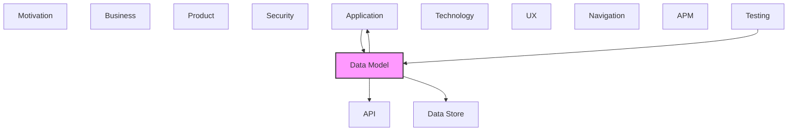

# Data Model

[← Back to README](../README.md)

Data entities, relationships, and data structure definitions.

## Report Index

- [Layer Introduction](#layer-introduction)
- [Intra-Layer Relationships](#intra-layer-relationships)
- [Inter-Layer Dependencies](#inter-layer-dependencies)
- [Inter-Layer Relationships Table](#inter-layer-relationships-table)
- [Element Reference](#element-reference)

## Layer Introduction

| Metric                    | Count |
| ------------------------- | ----- |
| Elements                  | 56    |
| Intra-Layer Relationships | 51    |
| Inter-Layer Relationships | 32    |
| Inbound Relationships     | 27    |
| Outbound Relationships    | 5     |

**Cross-Layer References**:

- **Upstream layers**: [Application](./05-application-layer-report.md), [Testing](./13-testing-layer-report.md)
- **Downstream layers**: [API](./07-api-layer-report.md), [Application](./05-application-layer-report.md), [Data Store](./09-data-store-layer-report.md)

## Intra-Layer Relationships

*This layer has >30 elements. Summary table shown instead of diagram.*

| Element                                                            | Type             | Relationships |
| ------------------------------------------------------------------ | ---------------- | ------------- |
| `data-model.objectschema.admin-config`                             | `objectschema`   | 5             |
| `data-model.objectschema.cache-config`                             | `objectschema`   | 5             |
| `data-model.objectschema.cached-response`                          | `objectschema`   | 7             |
| `data-model.objectschema.domain-mapping`                           | `objectschema`   | 5             |
| `data-model.objectschema.logging-config`                           | `objectschema`   | 9             |
| `data-model.objectschema.proxy-configuration`                      | `objectschema`   | 8             |
| `data-model.objectschema.proxy-metrics-record`                     | `objectschema`   | 0             |
| `data-model.objectschema.request-metrics-record`                   | `objectschema`   | 0             |
| `data-model.objectschema.security-config`                          | `objectschema`   | 4             |
| `data-model.objectschema.server-config`                            | `objectschema`   | 4             |
| `data-model.objectschema.throttle-state-record`                    | `objectschema`   | 0             |
| `data-model.objectschema.throttling-config`                        | `objectschema`   | 4             |
| `data-model.schemaproperty.admin-enabled`                          | `schemaproperty` | 1             |
| `data-model.schemaproperty.admin-include-sensitive-config`         | `schemaproperty` | 1             |
| `data-model.schemaproperty.admin-log-access`                       | `schemaproperty` | 1             |
| `data-model.schemaproperty.admin-rate-limit-per-minute`            | `schemaproperty` | 1             |
| `data-model.schemaproperty.cache-database-path`                    | `schemaproperty` | 1             |
| `data-model.schemaproperty.cache-default-ttl-seconds`              | `schemaproperty` | 1             |
| `data-model.schemaproperty.cache-max-cache-entries`                | `schemaproperty` | 1             |
| `data-model.schemaproperty.cache-max-cache-response-size`          | `schemaproperty` | 1             |
| `data-model.schemaproperty.cached-response-access-count`           | `schemaproperty` | 1             |
| `data-model.schemaproperty.cached-response-created-at`             | `schemaproperty` | 1             |
| `data-model.schemaproperty.cached-response-data`                   | `schemaproperty` | 1             |
| `data-model.schemaproperty.cached-response-headers`                | `schemaproperty` | 1             |
| `data-model.schemaproperty.cached-response-last-accessed`          | `schemaproperty` | 1             |
| `data-model.schemaproperty.cached-response-status-code`            | `schemaproperty` | 1             |
| `data-model.schemaproperty.cached-response-ttl-seconds`            | `schemaproperty` | 1             |
| `data-model.schemaproperty.config-admin`                           | `schemaproperty` | 2             |
| `data-model.schemaproperty.config-cache`                           | `schemaproperty` | 2             |
| `data-model.schemaproperty.config-callbacks`                       | `schemaproperty` | 1             |
| `data-model.schemaproperty.config-domain-mappings`                 | `schemaproperty` | 2             |
| `data-model.schemaproperty.config-logging`                         | `schemaproperty` | 2             |
| `data-model.schemaproperty.config-security`                        | `schemaproperty` | 2             |
| `data-model.schemaproperty.config-server`                          | `schemaproperty` | 2             |
| `data-model.schemaproperty.config-throttling`                      | `schemaproperty` | 2             |
| `data-model.schemaproperty.domain-mapping-max-requests-per-minute` | `schemaproperty` | 1             |
| `data-model.schemaproperty.domain-mapping-max-requests-per-second` | `schemaproperty` | 1             |
| `data-model.schemaproperty.domain-mapping-ttl-seconds`             | `schemaproperty` | 1             |
| `data-model.schemaproperty.domain-mapping-upstream`                | `schemaproperty` | 1             |
| `data-model.schemaproperty.logging-backup-count`                   | `schemaproperty` | 1             |
| `data-model.schemaproperty.logging-enable-console`                 | `schemaproperty` | 1             |
| `data-model.schemaproperty.logging-enable-file`                    | `schemaproperty` | 1             |
| `data-model.schemaproperty.logging-file-path`                      | `schemaproperty` | 1             |
| `data-model.schemaproperty.logging-format`                         | `schemaproperty` | 1             |
| `data-model.schemaproperty.logging-level`                          | `schemaproperty` | 1             |
| `data-model.schemaproperty.logging-max-file-size`                  | `schemaproperty` | 1             |
| `data-model.schemaproperty.logging-parent-logger`                  | `schemaproperty` | 1             |
| `data-model.schemaproperty.security-log-security-events`           | `schemaproperty` | 1             |
| `data-model.schemaproperty.security-require-secure-key`            | `schemaproperty` | 1             |
| `data-model.schemaproperty.security-secure-key`                    | `schemaproperty` | 1             |
| `data-model.schemaproperty.server-host`                            | `schemaproperty` | 1             |
| `data-model.schemaproperty.server-port`                            | `schemaproperty` | 1             |
| `data-model.schemaproperty.server-request-timeout`                 | `schemaproperty` | 1             |
| `data-model.schemaproperty.throttling-default-requests-per-hour`   | `schemaproperty` | 1             |
| `data-model.schemaproperty.throttling-domain-limits`               | `schemaproperty` | 1             |
| `data-model.schemaproperty.throttling-progressive-max-delay`       | `schemaproperty` | 1             |

## Inter-Layer Dependencies

## Inter-Layer Relationships Table

| Relationship ID                                                     | Source Node                                                                                        | Dest Node                                       | Dest Layer    | Predicate  | Cardinality  | Strength |
| ------------------------------------------------------------------- | -------------------------------------------------------------------------------------------------- | ----------------------------------------------- | ------------- | ---------- | ------------ | -------- |
| `application.applicationcomponent.accesses.data-model.objectschema` | `application.applicationcomponent.admin-rate-limiter`                                              | `data-model.objectschema.admin-config`          | `data-model`  | `accesses` | many-to-many | medium   |
| `application.applicationcomponent.accesses.data-model.objectschema` | `application.applicationcomponent.caching-proxy`                                                   | `data-model.objectschema.proxy-configuration`   | `data-model`  | `accesses` | many-to-many | medium   |
| `application.applicationcomponent.accesses.data-model.objectschema` | `application.applicationcomponent.logger-manager`                                                  | `data-model.objectschema.logging-config`        | `data-model`  | `accesses` | many-to-many | medium   |
| `application.applicationcomponent.accesses.data-model.objectschema` | `application.applicationcomponent.security-manager`                                                | `data-model.objectschema.security-config`       | `data-model`  | `accesses` | many-to-many | medium   |
| `application.applicationcomponent.accesses.data-model.objectschema` | `application.applicationcomponent.throttle-manager`                                                | `data-model.objectschema.domain-mapping`        | `data-model`  | `accesses` | many-to-many | medium   |
| `application.applicationcomponent.accesses.data-model.objectschema` | `application.applicationcomponent.ttl-manager`                                                     | `data-model.objectschema.domain-mapping`        | `data-model`  | `accesses` | many-to-many | medium   |
| `application.applicationfunction.accesses.data-model.objectschema`  | `application.applicationfunction.create-default-config`                                            | `data-model.objectschema.proxy-configuration`   | `data-model`  | `accesses` | many-to-many | medium   |
| `application.applicationfunction.accesses.data-model.objectschema`  | `application.applicationfunction.forward-upstream-request`                                         | `data-model.objectschema.domain-mapping`        | `data-model`  | `accesses` | many-to-many | medium   |
| `application.applicationfunction.accesses.data-model.objectschema`  | `application.applicationfunction.get-cached-response`                                              | `data-model.objectschema.cached-response`       | `data-model`  | `accesses` | many-to-many | medium   |
| `application.applicationfunction.accesses.data-model.objectschema`  | `application.applicationfunction.load-config-file`                                                 | `data-model.objectschema.proxy-configuration`   | `data-model`  | `accesses` | many-to-many | medium   |
| `application.applicationfunction.accesses.data-model.objectschema`  | `application.applicationfunction.merge-configuration-with-defaults`                                | `data-model.objectschema.proxy-configuration`   | `data-model`  | `accesses` | many-to-many | medium   |
| `application.applicationfunction.accesses.data-model.objectschema`  | `application.applicationfunction.reload-configuration`                                             | `data-model.objectschema.proxy-configuration`   | `data-model`  | `accesses` | many-to-many | medium   |
| `application.applicationfunction.accesses.data-model.objectschema`  | `application.applicationfunction.resolve-domain-ttl`                                               | `data-model.objectschema.domain-mapping`        | `data-model`  | `accesses` | many-to-many | medium   |
| `application.applicationfunction.accesses.data-model.objectschema`  | `application.applicationfunction.sanitize-configuration`                                           | `data-model.objectschema.proxy-configuration`   | `data-model`  | `accesses` | many-to-many | medium   |
| `application.applicationfunction.accesses.data-model.objectschema`  | `application.applicationfunction.store-cached-response`                                            | `data-model.objectschema.cached-response`       | `data-model`  | `accesses` | many-to-many | medium   |
| `application.applicationfunction.accesses.data-model.objectschema`  | `application.applicationfunction.update-configuration-value`                                       | `data-model.objectschema.proxy-configuration`   | `data-model`  | `accesses` | many-to-many | medium   |
| `application.applicationfunction.accesses.data-model.objectschema`  | `application.applicationfunction.validate-configuration`                                           | `data-model.objectschema.proxy-configuration`   | `data-model`  | `accesses` | many-to-many | medium   |
| `application.applicationprocess.accesses.data-model.objectschema`   | `application.applicationprocess.proxy-request-pipeline`                                            | `data-model.objectschema.cached-response`       | `data-model`  | `accesses` | many-to-many | medium   |
| `data-model.objectschema.maps-to.data-store.collection`             | `data-model.objectschema.cached-response`                                                          | `data-store.collection.cache-entries`           | `data-store`  | `maps-to`  | many-to-many | medium   |
| `data-model.objectschema.maps-to.api.requestbody`                   | `data-model.objectschema.proxy-configuration`                                                      | `api.requestbody.validate-config-body`          | `api`         | `maps-to`  | many-to-many | medium   |
| `data-model.objectschema.realizes.application.dataobject`           | `data-model.objectschema.proxy-metrics-record`                                                     | `application.dataobject.proxy-metrics-snapshot` | `application` | `realizes` | many-to-many | medium   |
| `data-model.objectschema.maps-to.data-store.collection`             | `data-model.objectschema.request-metrics-record`                                                   | `data-store.collection.metrics`                 | `data-store`  | `maps-to`  | many-to-many | medium   |
| `data-model.objectschema.realizes.application.dataobject`           | `data-model.objectschema.throttle-state-record`                                                    | `application.dataobject.domain-throttle-state`  | `application` | `realizes` | many-to-many | medium   |
| `testing.testcasesketch.tests.data-model.objectschema`              | `testing.testcasesketch.test-cache-engine-ttl-test-cache-engine-respects-explicit-ttl`             | `data-model.objectschema.cached-response`       | `data-model`  | `tests`    | many-to-many | medium   |
| `testing.testcasesketch.tests.data-model.objectschema`              | `testing.testcasesketch.test-cache-engine-ttl-test-cache-engine-uses-default-ttl`                  | `data-model.objectschema.cached-response`       | `data-model`  | `tests`    | many-to-many | medium   |
| `testing.testcasesketch.tests.data-model.objectschema`              | `testing.testcasesketch.test-cache-engine-ttl-test-cache-engine-uses-domain-ttl`                   | `data-model.objectschema.cached-response`       | `data-model`  | `tests`    | many-to-many | medium   |
| `testing.testcasesketch.tests.data-model.objectschema`              | `testing.testcasesketch.test-cache-engine-ttl-test-cache-engine-with-none-domain-key`              | `data-model.objectschema.cached-response`       | `data-model`  | `tests`    | many-to-many | medium   |
| `testing.testcasesketch.tests.data-model.objectschema`              | `testing.testcasesketch.test-cache-engine-ttl-test-cache-engine-without-config`                    | `data-model.objectschema.cached-response`       | `data-model`  | `tests`    | many-to-many | medium   |
| `testing.testcasesketch.tests.data-model.objectschema`              | `testing.testcasesketch.test-cache-engine-ttl-test-fallback-to-default-for-unmapped-domain`        | `data-model.objectschema.cached-response`       | `data-model`  | `tests`    | many-to-many | medium   |
| `testing.testcasesketch.tests.data-model.objectschema`              | `testing.testcasesketch.test-cache-validation-errors-test-cache-validation-errors`                 | `data-model.objectschema.cached-response`       | `data-model`  | `tests`    | many-to-many | medium   |
| `testing.testcasesketch.tests.data-model.objectschema`              | `testing.testcasesketch.test-handler-ttlintegration-test-handler-cache-hit-bypasses-caching-logic` | `data-model.objectschema.cached-response`       | `data-model`  | `tests`    | many-to-many | medium   |
| `testing.testcasesketch.tests.data-model.objectschema`              | `testing.testcasesketch.test-shutdown-cleanup-procedures-test-cleanup-with-concurrent-operations`  | `data-model.objectschema.cached-response`       | `data-model`  | `tests`    | many-to-many | medium   |

## Element Reference

### Admin Config {#admin-config}

**ID**: `data-model.objectschema.admin-config`

**Type**: `objectschema`

The 'admin' section of the proxy configuration.

#### Attributes

| Name | Value  |
| ---- | ------ |
| type | object |

#### Relationships

| Type        | Related Element                                            | Predicate    | Direction |
| ----------- | ---------------------------------------------------------- | ------------ | --------- |
| inter-layer | `application.applicationcomponent.admin-rate-limiter`      | `accesses`   | inbound   |
| intra-layer | `data-model.schemaproperty.admin-enabled`                  | `composes`   | outbound  |
| intra-layer | `data-model.schemaproperty.admin-include-sensitive-config` | `composes`   | outbound  |
| intra-layer | `data-model.schemaproperty.admin-log-access`               | `composes`   | outbound  |
| intra-layer | `data-model.schemaproperty.admin-rate-limit-per-minute`    | `composes`   | outbound  |
| intra-layer | `data-model.schemaproperty.config-admin`                   | `references` | inbound   |

### Cache Config {#cache-config}

**ID**: `data-model.objectschema.cache-config`

**Type**: `objectschema`

The 'cache' section of the proxy configuration.

#### Attributes

| Name | Value  |
| ---- | ------ |
| type | object |

#### Relationships

| Type        | Related Element                                           | Predicate    | Direction |
| ----------- | --------------------------------------------------------- | ------------ | --------- |
| intra-layer | `data-model.schemaproperty.cache-database-path`           | `composes`   | outbound  |
| intra-layer | `data-model.schemaproperty.cache-default-ttl-seconds`     | `composes`   | outbound  |
| intra-layer | `data-model.schemaproperty.cache-max-cache-entries`       | `composes`   | outbound  |
| intra-layer | `data-model.schemaproperty.cache-max-cache-response-size` | `composes`   | outbound  |
| intra-layer | `data-model.schemaproperty.config-cache`                  | `references` | inbound   |

### Cached Response {#cached-response}

**ID**: `data-model.objectschema.cached-response`

**Type**: `objectschema`

Dataclass for a cached HTTP response: body bytes, headers, status, creation time, TTL, access count and last access.

#### Attributes

| Name     | Value                                                 |
| -------- | ----------------------------------------------------- |
| required | [data, headers, status_code, created_at, ttl_seconds] |
| type     | object                                                |

#### Relationships

| Type        | Related Element                                                                                    | Predicate  | Direction |
| ----------- | -------------------------------------------------------------------------------------------------- | ---------- | --------- |
| inter-layer | `application.applicationfunction.get-cached-response`                                              | `accesses` | inbound   |
| inter-layer | `application.applicationfunction.store-cached-response`                                            | `accesses` | inbound   |
| inter-layer | `application.applicationprocess.proxy-request-pipeline`                                            | `accesses` | inbound   |
| inter-layer | `data-store.collection.cache-entries`                                                              | `maps-to`  | outbound  |
| inter-layer | `testing.testcasesketch.test-cache-engine-ttl-test-cache-engine-respects-explicit-ttl`             | `tests`    | inbound   |
| inter-layer | `testing.testcasesketch.test-cache-engine-ttl-test-cache-engine-uses-default-ttl`                  | `tests`    | inbound   |
| inter-layer | `testing.testcasesketch.test-cache-engine-ttl-test-cache-engine-uses-domain-ttl`                   | `tests`    | inbound   |
| inter-layer | `testing.testcasesketch.test-cache-engine-ttl-test-cache-engine-with-none-domain-key`              | `tests`    | inbound   |
| inter-layer | `testing.testcasesketch.test-cache-engine-ttl-test-cache-engine-without-config`                    | `tests`    | inbound   |
| inter-layer | `testing.testcasesketch.test-cache-engine-ttl-test-fallback-to-default-for-unmapped-domain`        | `tests`    | inbound   |
| inter-layer | `testing.testcasesketch.test-cache-validation-errors-test-cache-validation-errors`                 | `tests`    | inbound   |
| inter-layer | `testing.testcasesketch.test-handler-ttlintegration-test-handler-cache-hit-bypasses-caching-logic` | `tests`    | inbound   |
| inter-layer | `testing.testcasesketch.test-shutdown-cleanup-procedures-test-cleanup-with-concurrent-operations`  | `tests`    | inbound   |
| intra-layer | `data-model.schemaproperty.cached-response-access-count`                                           | `composes` | outbound  |
| intra-layer | `data-model.schemaproperty.cached-response-created-at`                                             | `composes` | outbound  |
| intra-layer | `data-model.schemaproperty.cached-response-data`                                                   | `composes` | outbound  |
| intra-layer | `data-model.schemaproperty.cached-response-headers`                                                | `composes` | outbound  |
| intra-layer | `data-model.schemaproperty.cached-response-last-accessed`                                          | `composes` | outbound  |
| intra-layer | `data-model.schemaproperty.cached-response-status-code`                                            | `composes` | outbound  |
| intra-layer | `data-model.schemaproperty.cached-response-ttl-seconds`                                            | `composes` | outbound  |

### Domain Mapping {#domain-mapping}

**ID**: `data-model.objectschema.domain-mapping`

**Type**: `objectschema`

One domain_mappings entry, keyed by the domain key used as the first path segment.

#### Attributes

| Name     | Value      |
| -------- | ---------- |
| required | [upstream] |
| type     | object     |

#### Relationships

| Type        | Related Element                                                    | Predicate    | Direction |
| ----------- | ------------------------------------------------------------------ | ------------ | --------- |
| inter-layer | `application.applicationcomponent.throttle-manager`                | `accesses`   | inbound   |
| inter-layer | `application.applicationcomponent.ttl-manager`                     | `accesses`   | inbound   |
| inter-layer | `application.applicationfunction.forward-upstream-request`         | `accesses`   | inbound   |
| inter-layer | `application.applicationfunction.resolve-domain-ttl`               | `accesses`   | inbound   |
| intra-layer | `data-model.schemaproperty.domain-mapping-max-requests-per-minute` | `composes`   | outbound  |
| intra-layer | `data-model.schemaproperty.domain-mapping-max-requests-per-second` | `composes`   | outbound  |
| intra-layer | `data-model.schemaproperty.domain-mapping-ttl-seconds`             | `composes`   | outbound  |
| intra-layer | `data-model.schemaproperty.domain-mapping-upstream`                | `composes`   | outbound  |
| intra-layer | `data-model.schemaproperty.config-domain-mappings`                 | `references` | inbound   |

### Logging Config {#logging-config}

**ID**: `data-model.objectschema.logging-config`

**Type**: `objectschema`

The 'logging' section of the proxy configuration.

#### Attributes

| Name | Value  |
| ---- | ------ |
| type | object |

#### Relationships

| Type        | Related Element                                    | Predicate    | Direction |
| ----------- | -------------------------------------------------- | ------------ | --------- |
| inter-layer | `application.applicationcomponent.logger-manager`  | `accesses`   | inbound   |
| intra-layer | `data-model.schemaproperty.logging-backup-count`   | `composes`   | outbound  |
| intra-layer | `data-model.schemaproperty.logging-enable-console` | `composes`   | outbound  |
| intra-layer | `data-model.schemaproperty.logging-enable-file`    | `composes`   | outbound  |
| intra-layer | `data-model.schemaproperty.logging-file-path`      | `composes`   | outbound  |
| intra-layer | `data-model.schemaproperty.logging-format`         | `composes`   | outbound  |
| intra-layer | `data-model.schemaproperty.logging-level`          | `composes`   | outbound  |
| intra-layer | `data-model.schemaproperty.logging-max-file-size`  | `composes`   | outbound  |
| intra-layer | `data-model.schemaproperty.logging-parent-logger`  | `composes`   | outbound  |
| intra-layer | `data-model.schemaproperty.config-logging`         | `references` | inbound   |

### Proxy Configuration {#proxy-configuration}

**ID**: `data-model.objectschema.proxy-configuration`

**Type**: `objectschema`

The configuration dictionary passed to CachingProxy and the CLI; defaults in core/config.py DEFAULT_CONFIG.

#### Attributes

| Name | Value  |
| ---- | ------ |
| type | object |

#### Relationships

| Type        | Related Element                                                     | Predicate  | Direction |
| ----------- | ------------------------------------------------------------------- | ---------- | --------- |
| inter-layer | `application.applicationcomponent.caching-proxy`                    | `accesses` | inbound   |
| inter-layer | `application.applicationfunction.create-default-config`             | `accesses` | inbound   |
| inter-layer | `application.applicationfunction.load-config-file`                  | `accesses` | inbound   |
| inter-layer | `application.applicationfunction.merge-configuration-with-defaults` | `accesses` | inbound   |
| inter-layer | `application.applicationfunction.reload-configuration`              | `accesses` | inbound   |
| inter-layer | `application.applicationfunction.sanitize-configuration`            | `accesses` | inbound   |
| inter-layer | `application.applicationfunction.update-configuration-value`        | `accesses` | inbound   |
| inter-layer | `application.applicationfunction.validate-configuration`            | `accesses` | inbound   |
| inter-layer | `api.requestbody.validate-config-body`                              | `maps-to`  | outbound  |
| intra-layer | `data-model.schemaproperty.config-admin`                            | `composes` | outbound  |
| intra-layer | `data-model.schemaproperty.config-cache`                            | `composes` | outbound  |
| intra-layer | `data-model.schemaproperty.config-callbacks`                        | `composes` | outbound  |
| intra-layer | `data-model.schemaproperty.config-domain-mappings`                  | `composes` | outbound  |
| intra-layer | `data-model.schemaproperty.config-logging`                          | `composes` | outbound  |
| intra-layer | `data-model.schemaproperty.config-security`                         | `composes` | outbound  |
| intra-layer | `data-model.schemaproperty.config-server`                           | `composes` | outbound  |
| intra-layer | `data-model.schemaproperty.config-throttling`                       | `composes` | outbound  |

### Proxy Metrics Record {#proxy-metrics-record}

**ID**: `data-model.objectschema.proxy-metrics-record`

**Type**: `objectschema`

Dataclass of overall counters with hit_rate and average_response_time. Declared but not used.

#### Attributes

| Name | Value  |
| ---- | ------ |
| type | object |

#### Relationships

| Type        | Related Element                                 | Predicate  | Direction |
| ----------- | ----------------------------------------------- | ---------- | --------- |
| inter-layer | `application.dataobject.proxy-metrics-snapshot` | `realizes` | outbound  |

### Request Metrics Record {#request-metrics-record}

**ID**: `data-model.objectschema.request-metrics-record`

**Type**: `objectschema`

Dataclass for one request's metrics (domain, method, cache_hit, response time, size, timestamp). Declared but not used; rows are written straight to the metrics table.

#### Attributes

| Name | Value  |
| ---- | ------ |
| type | object |

#### Relationships

| Type        | Related Element                 | Predicate | Direction |
| ----------- | ------------------------------- | --------- | --------- |
| inter-layer | `data-store.collection.metrics` | `maps-to` | outbound  |

### Security Config {#security-config}

**ID**: `data-model.objectschema.security-config`

**Type**: `objectschema`

The 'security' section of the proxy configuration.

#### Attributes

| Name | Value  |
| ---- | ------ |
| type | object |

#### Relationships

| Type        | Related Element                                          | Predicate    | Direction |
| ----------- | -------------------------------------------------------- | ------------ | --------- |
| inter-layer | `application.applicationcomponent.security-manager`      | `accesses`   | inbound   |
| intra-layer | `data-model.schemaproperty.security-log-security-events` | `composes`   | outbound  |
| intra-layer | `data-model.schemaproperty.security-require-secure-key`  | `composes`   | outbound  |
| intra-layer | `data-model.schemaproperty.security-secure-key`          | `composes`   | outbound  |
| intra-layer | `data-model.schemaproperty.config-security`              | `references` | inbound   |

### Server Config {#server-config}

**ID**: `data-model.objectschema.server-config`

**Type**: `objectschema`

The 'server' section of the proxy configuration.

#### Attributes

| Name | Value  |
| ---- | ------ |
| type | object |

#### Relationships

| Type        | Related Element                                    | Predicate    | Direction |
| ----------- | -------------------------------------------------- | ------------ | --------- |
| intra-layer | `data-model.schemaproperty.server-host`            | `composes`   | outbound  |
| intra-layer | `data-model.schemaproperty.server-port`            | `composes`   | outbound  |
| intra-layer | `data-model.schemaproperty.server-request-timeout` | `composes`   | outbound  |
| intra-layer | `data-model.schemaproperty.config-server`          | `references` | inbound   |

### Throttle State Record {#throttle-state-record}

**ID**: `data-model.objectschema.throttle-state-record`

**Type**: `objectschema`

Dataclass of throttle counters (violations, delay_seconds, last_violation, total_requests). Not used: ThrottleManager keeps its own ThrottleState class.

#### Attributes

| Name | Value  |
| ---- | ------ |
| type | object |

#### Relationships

| Type        | Related Element                                | Predicate  | Direction |
| ----------- | ---------------------------------------------- | ---------- | --------- |
| inter-layer | `application.dataobject.domain-throttle-state` | `realizes` | outbound  |

### Throttling Config {#throttling-config}

**ID**: `data-model.objectschema.throttling-config`

**Type**: `objectschema`

The 'throttling' section of the proxy configuration.

#### Attributes

| Name | Value  |
| ---- | ------ |
| type | object |

#### Relationships

| Type        | Related Element                                                  | Predicate    | Direction |
| ----------- | ---------------------------------------------------------------- | ------------ | --------- |
| intra-layer | `data-model.schemaproperty.throttling-default-requests-per-hour` | `composes`   | outbound  |
| intra-layer | `data-model.schemaproperty.throttling-domain-limits`             | `composes`   | outbound  |
| intra-layer | `data-model.schemaproperty.throttling-progressive-max-delay`     | `composes`   | outbound  |
| intra-layer | `data-model.schemaproperty.config-throttling`                    | `references` | inbound   |

### admin enabled {#admin-enabled}

**ID**: `data-model.schemaproperty.admin-enabled`

**Type**: `schemaproperty`

Serve /admin/\* (404 when false).

#### Attributes

| Name    | Value   |
| ------- | ------- |
| default | true    |
| type    | boolean |

#### Relationships

| Type        | Related Element                        | Predicate  | Direction |
| ----------- | -------------------------------------- | ---------- | --------- |
| intra-layer | `data-model.objectschema.admin-config` | `composes` | inbound   |

### admin include_sensitive_config {#admin-include-sensitive-config}

**ID**: `data-model.schemaproperty.admin-include-sensitive-config`

**Type**: `schemaproperty`

Validated but not used.

#### Attributes

| Name    | Value   |
| ------- | ------- |
| default | false   |
| type    | boolean |

#### Relationships

| Type        | Related Element                        | Predicate  | Direction |
| ----------- | -------------------------------------- | ---------- | --------- |
| intra-layer | `data-model.objectschema.admin-config` | `composes` | inbound   |

### admin log_access {#admin-log-access}

**ID**: `data-model.schemaproperty.admin-log-access`

**Type**: `schemaproperty`

Log admin access.

#### Attributes

| Name    | Value   |
| ------- | ------- |
| default | true    |
| type    | boolean |

#### Relationships

| Type        | Related Element                        | Predicate  | Direction |
| ----------- | -------------------------------------- | ---------- | --------- |
| intra-layer | `data-model.objectschema.admin-config` | `composes` | inbound   |

### admin rate_limit_per_minute {#admin-rate-limit-per-minute}

**ID**: `data-model.schemaproperty.admin-rate-limit-per-minute`

**Type**: `schemaproperty`

Admin requests per client IP per minute.

#### Attributes

| Name    | Value   |
| ------- | ------- |
| default | 10      |
| type    | integer |

#### Relationships

| Type        | Related Element                        | Predicate  | Direction |
| ----------- | -------------------------------------- | ---------- | --------- |
| intra-layer | `data-model.objectschema.admin-config` | `composes` | inbound   |

### cache database_path {#cache-database-path}

**ID**: `data-model.schemaproperty.cache-database-path`

**Type**: `schemaproperty`

SQLite file, or :memory:.

#### Attributes

| Name    | Value    |
| ------- | -------- |
| default | :memory: |
| type    | string   |

#### Relationships

| Type        | Related Element                        | Predicate  | Direction |
| ----------- | -------------------------------------- | ---------- | --------- |
| intra-layer | `data-model.objectschema.cache-config` | `composes` | inbound   |

### cache default_ttl_seconds {#cache-default-ttl-seconds}

**ID**: `data-model.schemaproperty.cache-default-ttl-seconds`

**Type**: `schemaproperty`

Default entry TTL.

#### Attributes

| Name    | Value   |
| ------- | ------- |
| default | 86400   |
| type    | integer |

#### Relationships

| Type        | Related Element                        | Predicate  | Direction |
| ----------- | -------------------------------------- | ---------- | --------- |
| intra-layer | `data-model.objectschema.cache-config` | `composes` | inbound   |

### cache max_cache_entries {#cache-max-cache-entries}

**ID**: `data-model.schemaproperty.cache-max-cache-entries`

**Type**: `schemaproperty`

LRU cap on entries.

#### Attributes

| Name    | Value   |
| ------- | ------- |
| default | 1000    |
| type    | integer |

#### Relationships

| Type        | Related Element                        | Predicate  | Direction |
| ----------- | -------------------------------------- | ---------- | --------- |
| intra-layer | `data-model.objectschema.cache-config` | `composes` | inbound   |

### cache max_cache_response_size {#cache-max-cache-response-size}

**ID**: `data-model.schemaproperty.cache-max-cache-response-size`

**Type**: `schemaproperty`

Largest response cached, bytes.

#### Attributes

| Name    | Value    |
| ------- | -------- |
| default | 10485760 |
| type    | integer  |

#### Relationships

| Type        | Related Element                        | Predicate  | Direction |
| ----------- | -------------------------------------- | ---------- | --------- |
| intra-layer | `data-model.objectschema.cache-config` | `composes` | inbound   |

### Cached Response access count {#cached-response-access-count}

**ID**: `data-model.schemaproperty.cached-response-access-count`

**Type**: `schemaproperty`

CachedResponse.access_count.

#### Attributes

| Name | Value   |
| ---- | ------- |
| type | integer |

#### Relationships

| Type        | Related Element                           | Predicate  | Direction |
| ----------- | ----------------------------------------- | ---------- | --------- |
| intra-layer | `data-model.objectschema.cached-response` | `composes` | inbound   |

### Cached Response created at {#cached-response-created-at}

**ID**: `data-model.schemaproperty.cached-response-created-at`

**Type**: `schemaproperty`

CachedResponse.created_at.

#### Attributes

| Name | Value  |
| ---- | ------ |
| type | string |

#### Relationships

| Type        | Related Element                           | Predicate  | Direction |
| ----------- | ----------------------------------------- | ---------- | --------- |
| intra-layer | `data-model.objectschema.cached-response` | `composes` | inbound   |

### Cached Response data {#cached-response-data}

**ID**: `data-model.schemaproperty.cached-response-data`

**Type**: `schemaproperty`

CachedResponse.data.

#### Attributes

| Name | Value  |
| ---- | ------ |
| type | string |

#### Relationships

| Type        | Related Element                           | Predicate  | Direction |
| ----------- | ----------------------------------------- | ---------- | --------- |
| intra-layer | `data-model.objectschema.cached-response` | `composes` | inbound   |

### Cached Response headers {#cached-response-headers}

**ID**: `data-model.schemaproperty.cached-response-headers`

**Type**: `schemaproperty`

CachedResponse.headers.

#### Attributes

| Name | Value  |
| ---- | ------ |
| type | object |

#### Relationships

| Type        | Related Element                           | Predicate  | Direction |
| ----------- | ----------------------------------------- | ---------- | --------- |
| intra-layer | `data-model.objectschema.cached-response` | `composes` | inbound   |

### Cached Response last accessed {#cached-response-last-accessed}

**ID**: `data-model.schemaproperty.cached-response-last-accessed`

**Type**: `schemaproperty`

CachedResponse.last_accessed.

#### Attributes

| Name | Value  |
| ---- | ------ |
| type | string |

#### Relationships

| Type        | Related Element                           | Predicate  | Direction |
| ----------- | ----------------------------------------- | ---------- | --------- |
| intra-layer | `data-model.objectschema.cached-response` | `composes` | inbound   |

### Cached Response status code {#cached-response-status-code}

**ID**: `data-model.schemaproperty.cached-response-status-code`

**Type**: `schemaproperty`

CachedResponse.status_code.

#### Attributes

| Name | Value   |
| ---- | ------- |
| type | integer |

#### Relationships

| Type        | Related Element                           | Predicate  | Direction |
| ----------- | ----------------------------------------- | ---------- | --------- |
| intra-layer | `data-model.objectschema.cached-response` | `composes` | inbound   |

### Cached Response ttl seconds {#cached-response-ttl-seconds}

**ID**: `data-model.schemaproperty.cached-response-ttl-seconds`

**Type**: `schemaproperty`

CachedResponse.ttl_seconds.

#### Attributes

| Name | Value   |
| ---- | ------- |
| type | integer |

#### Relationships

| Type        | Related Element                           | Predicate  | Direction |
| ----------- | ----------------------------------------- | ---------- | --------- |
| intra-layer | `data-model.objectschema.cached-response` | `composes` | inbound   |

### Config admin {#config-admin}

**ID**: `data-model.schemaproperty.config-admin`

**Type**: `schemaproperty`

Top-level 'admin' key.

#### Attributes

| Name | Value  |
| ---- | ------ |
| type | object |

#### Relationships

| Type        | Related Element                               | Predicate    | Direction |
| ----------- | --------------------------------------------- | ------------ | --------- |
| intra-layer | `data-model.objectschema.proxy-configuration` | `composes`   | inbound   |
| intra-layer | `data-model.objectschema.admin-config`        | `references` | outbound  |

### Config cache {#config-cache}

**ID**: `data-model.schemaproperty.config-cache`

**Type**: `schemaproperty`

Top-level 'cache' key.

#### Attributes

| Name | Value  |
| ---- | ------ |
| type | object |

#### Relationships

| Type        | Related Element                               | Predicate    | Direction |
| ----------- | --------------------------------------------- | ------------ | --------- |
| intra-layer | `data-model.objectschema.proxy-configuration` | `composes`   | inbound   |
| intra-layer | `data-model.objectschema.cache-config`        | `references` | outbound  |

### Config callbacks {#config-callbacks}

**ID**: `data-model.schemaproperty.config-callbacks`

**Type**: `schemaproperty`

Top-level 'callbacks' key; on_shutdown(proxy) is called by stop().

#### Attributes

| Name | Value  |
| ---- | ------ |
| type | object |

#### Relationships

| Type        | Related Element                               | Predicate  | Direction |
| ----------- | --------------------------------------------- | ---------- | --------- |
| intra-layer | `data-model.objectschema.proxy-configuration` | `composes` | inbound   |

### Config domain mappings {#config-domain-mappings}

**ID**: `data-model.schemaproperty.config-domain-mappings`

**Type**: `schemaproperty`

Top-level 'domain_mappings' key: domain key to Domain Mapping.

#### Attributes

| Name | Value  |
| ---- | ------ |
| type | object |

#### Relationships

| Type        | Related Element                               | Predicate    | Direction |
| ----------- | --------------------------------------------- | ------------ | --------- |
| intra-layer | `data-model.objectschema.proxy-configuration` | `composes`   | inbound   |
| intra-layer | `data-model.objectschema.domain-mapping`      | `references` | outbound  |

### Config logging {#config-logging}

**ID**: `data-model.schemaproperty.config-logging`

**Type**: `schemaproperty`

Top-level 'logging' key.

#### Attributes

| Name | Value  |
| ---- | ------ |
| type | object |

#### Relationships

| Type        | Related Element                               | Predicate    | Direction |
| ----------- | --------------------------------------------- | ------------ | --------- |
| intra-layer | `data-model.objectschema.proxy-configuration` | `composes`   | inbound   |
| intra-layer | `data-model.objectschema.logging-config`      | `references` | outbound  |

### Config security {#config-security}

**ID**: `data-model.schemaproperty.config-security`

**Type**: `schemaproperty`

Top-level 'security' key.

#### Attributes

| Name | Value  |
| ---- | ------ |
| type | object |

#### Relationships

| Type        | Related Element                               | Predicate    | Direction |
| ----------- | --------------------------------------------- | ------------ | --------- |
| intra-layer | `data-model.objectschema.proxy-configuration` | `composes`   | inbound   |
| intra-layer | `data-model.objectschema.security-config`     | `references` | outbound  |

### Config server {#config-server}

**ID**: `data-model.schemaproperty.config-server`

**Type**: `schemaproperty`

Top-level 'server' key.

#### Attributes

| Name | Value  |
| ---- | ------ |
| type | object |

#### Relationships

| Type        | Related Element                               | Predicate    | Direction |
| ----------- | --------------------------------------------- | ------------ | --------- |
| intra-layer | `data-model.objectschema.proxy-configuration` | `composes`   | inbound   |
| intra-layer | `data-model.objectschema.server-config`       | `references` | outbound  |

### Config throttling {#config-throttling}

**ID**: `data-model.schemaproperty.config-throttling`

**Type**: `schemaproperty`

Top-level 'throttling' key.

#### Attributes

| Name | Value  |
| ---- | ------ |
| type | object |

#### Relationships

| Type        | Related Element                               | Predicate    | Direction |
| ----------- | --------------------------------------------- | ------------ | --------- |
| intra-layer | `data-model.objectschema.proxy-configuration` | `composes`   | inbound   |
| intra-layer | `data-model.objectschema.throttling-config`   | `references` | outbound  |

### domain mapping max_requests_per_minute {#domain-mapping-max-requests-per-minute}

**ID**: `data-model.schemaproperty.domain-mapping-max-requests-per-minute`

**Type**: `schemaproperty`

Per-minute limit.

#### Attributes

| Name | Value   |
| ---- | ------- |
| type | integer |

#### Relationships

| Type        | Related Element                          | Predicate  | Direction |
| ----------- | ---------------------------------------- | ---------- | --------- |
| intra-layer | `data-model.objectschema.domain-mapping` | `composes` | inbound   |

### domain mapping max_requests_per_second {#domain-mapping-max-requests-per-second}

**ID**: `data-model.schemaproperty.domain-mapping-max-requests-per-second`

**Type**: `schemaproperty`

Per-second limit.

#### Attributes

| Name | Value   |
| ---- | ------- |
| type | integer |

#### Relationships

| Type        | Related Element                          | Predicate  | Direction |
| ----------- | ---------------------------------------- | ---------- | --------- |
| intra-layer | `data-model.objectschema.domain-mapping` | `composes` | inbound   |

### domain mapping ttl_seconds {#domain-mapping-ttl-seconds}

**ID**: `data-model.schemaproperty.domain-mapping-ttl-seconds`

**Type**: `schemaproperty`

TTL override for this domain.

#### Attributes

| Name | Value   |
| ---- | ------- |
| type | integer |

#### Relationships

| Type        | Related Element                          | Predicate  | Direction |
| ----------- | ---------------------------------------- | ---------- | --------- |
| intra-layer | `data-model.objectschema.domain-mapping` | `composes` | inbound   |

### domain mapping upstream {#domain-mapping-upstream}

**ID**: `data-model.schemaproperty.domain-mapping-upstream`

**Type**: `schemaproperty`

Upstream base URL, normally https.

#### Attributes

| Name | Value  |
| ---- | ------ |
| type | string |

#### Relationships

| Type        | Related Element                          | Predicate  | Direction |
| ----------- | ---------------------------------------- | ---------- | --------- |
| intra-layer | `data-model.objectschema.domain-mapping` | `composes` | inbound   |

### logging backup_count {#logging-backup-count}

**ID**: `data-model.schemaproperty.logging-backup-count`

**Type**: `schemaproperty`

Rotated files kept.

#### Attributes

| Name    | Value   |
| ------- | ------- |
| default | 5       |
| type    | integer |

#### Relationships

| Type        | Related Element                          | Predicate  | Direction |
| ----------- | ---------------------------------------- | ---------- | --------- |
| intra-layer | `data-model.objectschema.logging-config` | `composes` | inbound   |

### logging enable_console {#logging-enable-console}

**ID**: `data-model.schemaproperty.logging-enable-console`

**Type**: `schemaproperty`

Console handler.

#### Attributes

| Name    | Value   |
| ------- | ------- |
| default | true    |
| type    | boolean |

#### Relationships

| Type        | Related Element                          | Predicate  | Direction |
| ----------- | ---------------------------------------- | ---------- | --------- |
| intra-layer | `data-model.objectschema.logging-config` | `composes` | inbound   |

### logging enable_file {#logging-enable-file}

**ID**: `data-model.schemaproperty.logging-enable-file`

**Type**: `schemaproperty`

Rotating file handler.

#### Attributes

| Name    | Value   |
| ------- | ------- |
| default | false   |
| type    | boolean |

#### Relationships

| Type        | Related Element                          | Predicate  | Direction |
| ----------- | ---------------------------------------- | ---------- | --------- |
| intra-layer | `data-model.objectschema.logging-config` | `composes` | inbound   |

### logging file_path {#logging-file-path}

**ID**: `data-model.schemaproperty.logging-file-path`

**Type**: `schemaproperty`

Log file path.

#### Attributes

| Name | Value  |
| ---- | ------ |
| type | string |

#### Relationships

| Type        | Related Element                          | Predicate  | Direction |
| ----------- | ---------------------------------------- | ---------- | --------- |
| intra-layer | `data-model.objectschema.logging-config` | `composes` | inbound   |

### logging format {#logging-format}

**ID**: `data-model.schemaproperty.logging-format`

**Type**: `schemaproperty`

Log record format.

#### Attributes

| Name | Value  |
| ---- | ------ |
| type | string |

#### Relationships

| Type        | Related Element                          | Predicate  | Direction |
| ----------- | ---------------------------------------- | ---------- | --------- |
| intra-layer | `data-model.objectschema.logging-config` | `composes` | inbound   |

### logging level {#logging-level}

**ID**: `data-model.schemaproperty.logging-level`

**Type**: `schemaproperty`

Log level.

#### Attributes

| Name    | Value  |
| ------- | ------ |
| default | INFO   |
| type    | string |

#### Relationships

| Type        | Related Element                          | Predicate  | Direction |
| ----------- | ---------------------------------------- | ---------- | --------- |
| intra-layer | `data-model.objectschema.logging-config` | `composes` | inbound   |

### logging max_file_size {#logging-max-file-size}

**ID**: `data-model.schemaproperty.logging-max-file-size`

**Type**: `schemaproperty`

Rotation size, bytes.

#### Attributes

| Name    | Value    |
| ------- | -------- |
| default | 10485760 |
| type    | integer  |

#### Relationships

| Type        | Related Element                          | Predicate  | Direction |
| ----------- | ---------------------------------------- | ---------- | --------- |
| intra-layer | `data-model.objectschema.logging-config` | `composes` | inbound   |

### logging parent_logger {#logging-parent-logger}

**ID**: `data-model.schemaproperty.logging-parent-logger`

**Type**: `schemaproperty`

Parent application logger name.

#### Attributes

| Name | Value  |
| ---- | ------ |
| type | string |

#### Relationships

| Type        | Related Element                          | Predicate  | Direction |
| ----------- | ---------------------------------------- | ---------- | --------- |
| intra-layer | `data-model.objectschema.logging-config` | `composes` | inbound   |

### security log_security_events {#security-log-security-events}

**ID**: `data-model.schemaproperty.security-log-security-events`

**Type**: `schemaproperty`

Log security events.

#### Attributes

| Name    | Value   |
| ------- | ------- |
| default | true    |
| type    | boolean |

#### Relationships

| Type        | Related Element                           | Predicate  | Direction |
| ----------- | ----------------------------------------- | ---------- | --------- |
| intra-layer | `data-model.objectschema.security-config` | `composes` | inbound   |

### security require_secure_key {#security-require-secure-key}

**ID**: `data-model.schemaproperty.security-require-secure-key`

**Type**: `schemaproperty`

Require the secure key.

#### Attributes

| Name    | Value   |
| ------- | ------- |
| default | false   |
| type    | boolean |

#### Relationships

| Type        | Related Element                           | Predicate  | Direction |
| ----------- | ----------------------------------------- | ---------- | --------- |
| intra-layer | `data-model.objectschema.security-config` | `composes` | inbound   |

### security secure_key {#security-secure-key}

**ID**: `data-model.schemaproperty.security-secure-key`

**Type**: `schemaproperty`

Fixed key; generated when absent.

#### Attributes

| Name | Value  |
| ---- | ------ |
| type | string |

#### Relationships

| Type        | Related Element                           | Predicate  | Direction |
| ----------- | ----------------------------------------- | ---------- | --------- |
| intra-layer | `data-model.objectschema.security-config` | `composes` | inbound   |

### server host {#server-host}

**ID**: `data-model.schemaproperty.server-host`

**Type**: `schemaproperty`

Bind address.

#### Attributes

| Name    | Value     |
| ------- | --------- |
| default | 127.0.0.1 |
| type    | string    |

#### Relationships

| Type        | Related Element                         | Predicate  | Direction |
| ----------- | --------------------------------------- | ---------- | --------- |
| intra-layer | `data-model.objectschema.server-config` | `composes` | inbound   |

### server port {#server-port}

**ID**: `data-model.schemaproperty.server-port`

**Type**: `schemaproperty`

Bind port (CachingProxy and CLI default).

#### Attributes

| Name    | Value   |
| ------- | ------- |
| default | 8080    |
| type    | integer |

#### Relationships

| Type        | Related Element                         | Predicate  | Direction |
| ----------- | --------------------------------------- | ---------- | --------- |
| intra-layer | `data-model.objectschema.server-config` | `composes` | inbound   |

### server request_timeout {#server-request-timeout}

**ID**: `data-model.schemaproperty.server-request-timeout`

**Type**: `schemaproperty`

Validated but not used; upstream calls use 60 s.

#### Attributes

| Name    | Value   |
| ------- | ------- |
| default | 30      |
| type    | integer |

#### Relationships

| Type        | Related Element                         | Predicate  | Direction |
| ----------- | --------------------------------------- | ---------- | --------- |
| intra-layer | `data-model.objectschema.server-config` | `composes` | inbound   |

### throttling default_requests_per_hour {#throttling-default-requests-per-hour}

**ID**: `data-model.schemaproperty.throttling-default-requests-per-hour`

**Type**: `schemaproperty`

Default hourly limit.

#### Attributes

| Name    | Value   |
| ------- | ------- |
| default | 1000    |
| type    | integer |

#### Relationships

| Type        | Related Element                             | Predicate  | Direction |
| ----------- | ------------------------------------------- | ---------- | --------- |
| intra-layer | `data-model.objectschema.throttling-config` | `composes` | inbound   |

### throttling domain_limits {#throttling-domain-limits}

**ID**: `data-model.schemaproperty.throttling-domain-limits`

**Type**: `schemaproperty`

Hourly limit per domain key.

#### Attributes

| Name | Value  |
| ---- | ------ |
| type | object |

#### Relationships

| Type        | Related Element                             | Predicate  | Direction |
| ----------- | ------------------------------------------- | ---------- | --------- |
| intra-layer | `data-model.objectschema.throttling-config` | `composes` | inbound   |

### throttling progressive_max_delay {#throttling-progressive-max-delay}

**ID**: `data-model.schemaproperty.throttling-progressive-max-delay`

**Type**: `schemaproperty`

Longest delay the proxy will sleep before answering 429.

#### Attributes

| Name    | Value   |
| ------- | ------- |
| default | 300     |
| type    | integer |

#### Relationships

| Type        | Related Element                             | Predicate  | Direction |
| ----------- | ------------------------------------------- | ---------- | --------- |
| intra-layer | `data-model.objectschema.throttling-config` | `composes` | inbound   |

---

Generated: 2026-11-24T18:04:53.605Z | Model Version: 0.1.0
