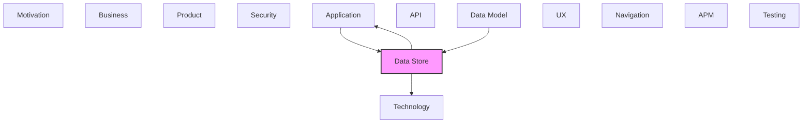

# Data Store

[← Back to README](../README.md)

Databases, data stores, and persistence mechanisms.

## Report Index

- [Layer Introduction](#layer-introduction)
- [Intra-Layer Relationships](#intra-layer-relationships)
- [Inter-Layer Dependencies](#inter-layer-dependencies)
- [Inter-Layer Relationships Table](#inter-layer-relationships-table)
- [Element Reference](#element-reference)

## Layer Introduction

| Metric                    | Count |
| ------------------------- | ----- |
| Elements                  | 37    |
| Intra-Layer Relationships | 41    |
| Inter-Layer Relationships | 21    |
| Inbound Relationships     | 12    |
| Outbound Relationships    | 9     |

**Cross-Layer References**:

- **Upstream layers**: [Application](./05-application-layer-report.md), [Data Model](./08-data-model-layer-report.md)
- **Downstream layers**: [Application](./05-application-layer-report.md), [Technology](./06-technology-layer-report.md)

## Intra-Layer Relationships

*This layer has >30 elements. Summary table shown instead of diagram.*

| Element                                                 | Type             | Relationships |
| ------------------------------------------------------- | ---------------- | ------------- |
| `data-store.accesspattern.cache-access-update`          | `accesspattern`  | 1             |
| `data-store.accesspattern.cache-clear`                  | `accesspattern`  | 1             |
| `data-store.accesspattern.cache-lookup-by-key`          | `accesspattern`  | 1             |
| `data-store.accesspattern.cache-upsert`                 | `accesspattern`  | 1             |
| `data-store.accesspattern.expired-entry-scan`           | `accesspattern`  | 2             |
| `data-store.accesspattern.lru-eviction-scan`            | `accesspattern`  | 2             |
| `data-store.accesspattern.metrics-insert`               | `accesspattern`  | 1             |
| `data-store.accesspattern.upstream-metrics-aggregation` | `accesspattern`  | 2             |
| `data-store.collection.cache-entries`                   | `collection`     | 18            |
| `data-store.collection.config-history`                  | `collection`     | 5             |
| `data-store.collection.metrics`                         | `collection`     | 13            |
| `data-store.database.api-buddy-cache-database`          | `database`       | 3             |
| `data-store.field.cache-entries-access-count`           | `field`          | 1             |
| `data-store.field.cache-entries-cache-key`              | `field`          | 2             |
| `data-store.field.cache-entries-created-at`             | `field`          | 1             |
| `data-store.field.cache-entries-headers`                | `field`          | 1             |
| `data-store.field.cache-entries-last-accessed`          | `field`          | 1             |
| `data-store.field.cache-entries-response-data`          | `field`          | 1             |
| `data-store.field.cache-entries-status-code`            | `field`          | 1             |
| `data-store.field.cache-entries-ttl-seconds`            | `field`          | 1             |
| `data-store.field.config-history-changed-by`            | `field`          | 1             |
| `data-store.field.config-history-config-data`           | `field`          | 1             |
| `data-store.field.config-history-id`                    | `field`          | 1             |
| `data-store.field.config-history-timestamp`             | `field`          | 1             |
| `data-store.field.metrics-cache-hit`                    | `field`          | 1             |
| `data-store.field.metrics-domain`                       | `field`          | 1             |
| `data-store.field.metrics-id`                           | `field`          | 2             |
| `data-store.field.metrics-method`                       | `field`          | 1             |
| `data-store.field.metrics-response-size-bytes`          | `field`          | 1             |
| `data-store.field.metrics-response-time-ms`             | `field`          | 1             |
| `data-store.field.metrics-status-code`                  | `field`          | 1             |
| `data-store.field.metrics-timestamp`                    | `field`          | 1             |
| `data-store.index.idx-cache-created-ttl`                | `index`          | 2             |
| `data-store.index.idx-cache-last-accessed`              | `index`          | 2             |
| `data-store.index.idx-metrics-domain-timestamp`         | `index`          | 2             |
| `data-store.validationrule.cache-entries-primary-key`   | `validationrule` | 2             |
| `data-store.validationrule.metrics-primary-key`         | `validationrule` | 2             |

## Inter-Layer Dependencies

## Inter-Layer Relationships Table

| Relationship ID                                                   | Source Node                                                         | Dest Node                                                           | Dest Layer    | Predicate    | Cardinality  | Strength |
| ----------------------------------------------------------------- | ------------------------------------------------------------------- | ------------------------------------------------------------------- | ------------- | ------------ | ------------ | -------- |
| `application.applicationcomponent.accesses.data-store.database`   | `application.applicationcomponent.database-manager`                 | `data-store.database.api-buddy-cache-database`                      | `data-store`  | `accesses`   | many-to-many | medium   |
| `application.applicationfunction.accesses.data-store.collection`  | `application.applicationfunction.aggregate-upstream-metrics`        | `data-store.collection.metrics`                                     | `data-store`  | `accesses`   | many-to-many | medium   |
| `application.applicationfunction.accesses.data-store.collection`  | `application.applicationfunction.clean-up-expired-entries`          | `data-store.collection.cache-entries`                               | `data-store`  | `accesses`   | many-to-many | medium   |
| `application.applicationfunction.accesses.data-store.collection`  | `application.applicationfunction.clear-cache`                       | `data-store.collection.cache-entries`                               | `data-store`  | `accesses`   | many-to-many | medium   |
| `application.applicationfunction.accesses.data-store.collection`  | `application.applicationfunction.evict-least-recently-used-entries` | `data-store.collection.cache-entries`                               | `data-store`  | `accesses`   | many-to-many | medium   |
| `application.applicationfunction.accesses.data-store.collection`  | `application.applicationfunction.get-cached-response`               | `data-store.collection.cache-entries`                               | `data-store`  | `accesses`   | many-to-many | medium   |
| `application.applicationfunction.accesses.data-store.collection`  | `application.applicationfunction.initialize-schema`                 | `data-store.collection.config-history`                              | `data-store`  | `accesses`   | many-to-many | medium   |
| `application.applicationfunction.accesses.data-store.collection`  | `application.applicationfunction.report-cache-performance`          | `data-store.collection.cache-entries`                               | `data-store`  | `accesses`   | many-to-many | medium   |
| `application.applicationfunction.accesses.data-store.collection`  | `application.applicationfunction.store-cached-response`             | `data-store.collection.cache-entries`                               | `data-store`  | `accesses`   | many-to-many | medium   |
| `application.applicationfunction.accesses.data-store.collection`  | `application.applicationfunction.store-upstream-metrics`            | `data-store.collection.metrics`                                     | `data-store`  | `accesses`   | many-to-many | medium   |
| `data-model.objectschema.maps-to.data-store.collection`           | `data-model.objectschema.cached-response`                           | `data-store.collection.cache-entries`                               | `data-store`  | `maps-to`    | many-to-many | medium   |
| `data-model.objectschema.maps-to.data-store.collection`           | `data-model.objectschema.request-metrics-record`                    | `data-store.collection.metrics`                                     | `data-store`  | `maps-to`    | many-to-many | medium   |
| `data-store.accesspattern.serves.application.applicationfunction` | `data-store.accesspattern.cache-access-update`                      | `application.applicationfunction.get-cached-response`               | `application` | `serves`     | many-to-many | medium   |
| `data-store.accesspattern.serves.application.applicationfunction` | `data-store.accesspattern.cache-clear`                              | `application.applicationfunction.clear-cache`                       | `application` | `serves`     | many-to-many | medium   |
| `data-store.accesspattern.serves.application.applicationfunction` | `data-store.accesspattern.cache-lookup-by-key`                      | `application.applicationfunction.get-cached-response`               | `application` | `serves`     | many-to-many | medium   |
| `data-store.accesspattern.serves.application.applicationfunction` | `data-store.accesspattern.cache-upsert`                             | `application.applicationfunction.store-cached-response`             | `application` | `serves`     | many-to-many | medium   |
| `data-store.accesspattern.serves.application.applicationfunction` | `data-store.accesspattern.expired-entry-scan`                       | `application.applicationfunction.clean-up-expired-entries`          | `application` | `serves`     | many-to-many | medium   |
| `data-store.accesspattern.serves.application.applicationfunction` | `data-store.accesspattern.lru-eviction-scan`                        | `application.applicationfunction.evict-least-recently-used-entries` | `application` | `serves`     | many-to-many | medium   |
| `data-store.accesspattern.serves.application.applicationfunction` | `data-store.accesspattern.metrics-insert`                           | `application.applicationfunction.store-upstream-metrics`            | `application` | `serves`     | many-to-many | medium   |
| `data-store.accesspattern.serves.application.applicationfunction` | `data-store.accesspattern.upstream-metrics-aggregation`             | `application.applicationfunction.aggregate-upstream-metrics`        | `application` | `serves`     | many-to-many | medium   |
| `data-store.database.depends-on.technology.systemsoftware`        | `data-store.database.api-buddy-cache-database`                      | `technology.systemsoftware.sqlite`                                  | `technology`  | `depends-on` | many-to-many | medium   |

## Element Reference

### Cache Access Update {#cache-access-update}

**ID**: `data-store.accesspattern.cache-access-update`

**Type**: `accesspattern`

WRITE on cache_entries: cache_key = ?.

#### Attributes

| Name              | Value         |
| ----------------- | ------------- |
| expectedFrequency | FREQUENT      |
| keyCondition      | cache_key = ? |
| patternType       | WRITE         |
| targetCollection  | cache_entries |

#### Relationships

| Type        | Related Element                                       | Predicate  | Direction |
| ----------- | ----------------------------------------------------- | ---------- | --------- |
| inter-layer | `application.applicationfunction.get-cached-response` | `serves`   | outbound  |
| intra-layer | `data-store.collection.cache-entries`                 | `accesses` | outbound  |

### Cache Clear {#cache-clear}

**ID**: `data-store.accesspattern.cache-clear`

**Type**: `accesspattern`

CUSTOM on cache_entries: all rows, or cache_key LIKE %domain%.

#### Attributes

| Name              | Value                                |
| ----------------- | ------------------------------------ |
| expectedFrequency | RARE                                 |
| keyCondition      | all rows, or cache_key LIKE %domain% |
| patternType       | CUSTOM                               |
| targetCollection  | cache_entries                        |

#### Relationships

| Type        | Related Element                               | Predicate  | Direction |
| ----------- | --------------------------------------------- | ---------- | --------- |
| inter-layer | `application.applicationfunction.clear-cache` | `serves`   | outbound  |
| intra-layer | `data-store.collection.cache-entries`         | `accesses` | outbound  |

### Cache Lookup By Key {#cache-lookup-by-key}

**ID**: `data-store.accesspattern.cache-lookup-by-key`

**Type**: `accesspattern`

POINT_READ on cache_entries: cache_key = ?.

#### Attributes

| Name              | Value         |
| ----------------- | ------------- |
| expectedFrequency | FREQUENT      |
| keyCondition      | cache_key = ? |
| patternType       | POINT_READ    |
| targetCollection  | cache_entries |

#### Relationships

| Type        | Related Element                                       | Predicate  | Direction |
| ----------- | ----------------------------------------------------- | ---------- | --------- |
| inter-layer | `application.applicationfunction.get-cached-response` | `serves`   | outbound  |
| intra-layer | `data-store.collection.cache-entries`                 | `accesses` | outbound  |

### Cache Upsert {#cache-upsert}

**ID**: `data-store.accesspattern.cache-upsert`

**Type**: `accesspattern`

UPSERT on cache_entries: cache_key.

#### Attributes

| Name              | Value         |
| ----------------- | ------------- |
| expectedFrequency | FREQUENT      |
| keyCondition      | cache_key     |
| patternType       | UPSERT        |
| targetCollection  | cache_entries |

#### Relationships

| Type        | Related Element                                         | Predicate  | Direction |
| ----------- | ------------------------------------------------------- | ---------- | --------- |
| inter-layer | `application.applicationfunction.store-cached-response` | `serves`   | outbound  |
| intra-layer | `data-store.collection.cache-entries`                   | `accesses` | outbound  |

### Expired Entry Scan {#expired-entry-scan}

**ID**: `data-store.accesspattern.expired-entry-scan`

**Type**: `accesspattern`

FULL_SCAN on cache_entries: all rows; created_at + ttl_seconds &lt; now.

#### Attributes

| Name              | Value                                       |
| ----------------- | ------------------------------------------- |
| expectedFrequency | RARE                                        |
| keyCondition      | all rows; created_at + ttl_seconds &lt; now |
| patternType       | FULL_SCAN                                   |
| targetCollection  | cache_entries                               |

#### Relationships

| Type        | Related Element                                            | Predicate  | Direction |
| ----------- | ---------------------------------------------------------- | ---------- | --------- |
| inter-layer | `application.applicationfunction.clean-up-expired-entries` | `serves`   | outbound  |
| intra-layer | `data-store.collection.cache-entries`                      | `accesses` | outbound  |
| intra-layer | `data-store.index.idx-cache-created-ttl`                   | `uses`     | outbound  |

### LRU Eviction Scan {#lru-eviction-scan}

**ID**: `data-store.accesspattern.lru-eviction-scan`

**Type**: `accesspattern`

RANGE_SCAN on cache_entries: ORDER BY last_accessed ASC LIMIT n.

#### Attributes

| Name              | Value                              |
| ----------------- | ---------------------------------- |
| expectedFrequency | OCCASIONAL                         |
| keyCondition      | ORDER BY last_accessed ASC LIMIT n |
| patternType       | RANGE_SCAN                         |
| targetCollection  | cache_entries                      |

#### Relationships

| Type        | Related Element                                                     | Predicate  | Direction |
| ----------- | ------------------------------------------------------------------- | ---------- | --------- |
| inter-layer | `application.applicationfunction.evict-least-recently-used-entries` | `serves`   | outbound  |
| intra-layer | `data-store.collection.cache-entries`                               | `accesses` | outbound  |
| intra-layer | `data-store.index.idx-cache-last-accessed`                          | `uses`     | outbound  |

### Metrics Insert {#metrics-insert}

**ID**: `data-store.accesspattern.metrics-insert`

**Type**: `accesspattern`

WRITE on metrics: append.

#### Attributes

| Name              | Value    |
| ----------------- | -------- |
| expectedFrequency | FREQUENT |
| keyCondition      | append   |
| patternType       | WRITE    |
| targetCollection  | metrics  |

#### Relationships

| Type        | Related Element                                          | Predicate  | Direction |
| ----------- | -------------------------------------------------------- | ---------- | --------- |
| inter-layer | `application.applicationfunction.store-upstream-metrics` | `serves`   | outbound  |
| intra-layer | `data-store.collection.metrics`                          | `accesses` | outbound  |

### Upstream Metrics Aggregation {#upstream-metrics-aggregation}

**ID**: `data-store.accesspattern.upstream-metrics-aggregation`

**Type**: `accesspattern`

AGGREGATION on metrics: timestamp &gt;= now - N hours \[AND domain = ?\], grouped by status_code and hour.

#### Attributes

| Name              | Value                                                                             |
| ----------------- | --------------------------------------------------------------------------------- |
| expectedFrequency | OCCASIONAL                                                                        |
| keyCondition      | timestamp &gt;= now - N hours \[AND domain = ?\], grouped by status_code and hour |
| patternType       | AGGREGATION                                                                       |
| targetCollection  | metrics                                                                           |

#### Relationships

| Type        | Related Element                                              | Predicate  | Direction |
| ----------- | ------------------------------------------------------------ | ---------- | --------- |
| inter-layer | `application.applicationfunction.aggregate-upstream-metrics` | `serves`   | outbound  |
| intra-layer | `data-store.collection.metrics`                              | `accesses` | outbound  |
| intra-layer | `data-store.index.idx-metrics-domain-timestamp`              | `uses`     | outbound  |

### cache_entries {#cache-entries}

**ID**: `data-store.collection.cache-entries`

**Type**: `collection`

Cached responses keyed by SHA-256 cache key.

#### Attributes

| Name           | Value |
| -------------- | ----- |
| collectionType | TABLE |

#### Relationships

| Type        | Related Element                                                     | Predicate  | Direction |
| ----------- | ------------------------------------------------------------------- | ---------- | --------- |
| inter-layer | `application.applicationfunction.clean-up-expired-entries`          | `accesses` | inbound   |
| inter-layer | `application.applicationfunction.clear-cache`                       | `accesses` | inbound   |
| inter-layer | `application.applicationfunction.evict-least-recently-used-entries` | `accesses` | inbound   |
| inter-layer | `application.applicationfunction.get-cached-response`               | `accesses` | inbound   |
| inter-layer | `application.applicationfunction.report-cache-performance`          | `accesses` | inbound   |
| inter-layer | `application.applicationfunction.store-cached-response`             | `accesses` | inbound   |
| inter-layer | `data-model.objectschema.cached-response`                           | `maps-to`  | inbound   |
| intra-layer | `data-store.accesspattern.cache-access-update`                      | `accesses` | inbound   |
| intra-layer | `data-store.accesspattern.cache-clear`                              | `accesses` | inbound   |
| intra-layer | `data-store.accesspattern.cache-lookup-by-key`                      | `accesses` | inbound   |
| intra-layer | `data-store.accesspattern.cache-upsert`                             | `accesses` | inbound   |
| intra-layer | `data-store.accesspattern.expired-entry-scan`                       | `accesses` | inbound   |
| intra-layer | `data-store.accesspattern.lru-eviction-scan`                        | `accesses` | inbound   |
| intra-layer | `data-store.field.cache-entries-access-count`                       | `composes` | outbound  |
| intra-layer | `data-store.field.cache-entries-cache-key`                          | `composes` | outbound  |
| intra-layer | `data-store.field.cache-entries-created-at`                         | `composes` | outbound  |
| intra-layer | `data-store.field.cache-entries-headers`                            | `composes` | outbound  |
| intra-layer | `data-store.field.cache-entries-last-accessed`                      | `composes` | outbound  |
| intra-layer | `data-store.field.cache-entries-response-data`                      | `composes` | outbound  |
| intra-layer | `data-store.field.cache-entries-status-code`                        | `composes` | outbound  |
| intra-layer | `data-store.field.cache-entries-ttl-seconds`                        | `composes` | outbound  |
| intra-layer | `data-store.index.idx-cache-created-ttl`                            | `composes` | outbound  |
| intra-layer | `data-store.index.idx-cache-last-accessed`                          | `composes` | outbound  |
| intra-layer | `data-store.validationrule.cache-entries-primary-key`               | `composes` | outbound  |
| intra-layer | `data-store.database.api-buddy-cache-database`                      | `composes` | inbound   |

### config_history {#config-history}

**ID**: `data-store.collection.config-history`

**Type**: `collection`

Created by the schema but never written or read.

#### Attributes

| Name           | Value |
| -------------- | ----- |
| collectionType | TABLE |

#### Relationships

| Type        | Related Element                                     | Predicate  | Direction |
| ----------- | --------------------------------------------------- | ---------- | --------- |
| inter-layer | `application.applicationfunction.initialize-schema` | `accesses` | inbound   |
| intra-layer | `data-store.field.config-history-changed-by`        | `composes` | outbound  |
| intra-layer | `data-store.field.config-history-config-data`       | `composes` | outbound  |
| intra-layer | `data-store.field.config-history-id`                | `composes` | outbound  |
| intra-layer | `data-store.field.config-history-timestamp`         | `composes` | outbound  |
| intra-layer | `data-store.database.api-buddy-cache-database`      | `composes` | inbound   |

### metrics {#metrics}

**ID**: `data-store.collection.metrics`

**Type**: `collection`

One row per proxied request (cache hits and upstream calls) for upstream statistics.

#### Attributes

| Name           | Value |
| -------------- | ----- |
| collectionType | TABLE |

#### Relationships

| Type        | Related Element                                              | Predicate  | Direction |
| ----------- | ------------------------------------------------------------ | ---------- | --------- |
| inter-layer | `application.applicationfunction.aggregate-upstream-metrics` | `accesses` | inbound   |
| inter-layer | `application.applicationfunction.store-upstream-metrics`     | `accesses` | inbound   |
| inter-layer | `data-model.objectschema.request-metrics-record`             | `maps-to`  | inbound   |
| intra-layer | `data-store.accesspattern.metrics-insert`                    | `accesses` | inbound   |
| intra-layer | `data-store.accesspattern.upstream-metrics-aggregation`      | `accesses` | inbound   |
| intra-layer | `data-store.field.metrics-cache-hit`                         | `composes` | outbound  |
| intra-layer | `data-store.field.metrics-domain`                            | `composes` | outbound  |
| intra-layer | `data-store.field.metrics-id`                                | `composes` | outbound  |
| intra-layer | `data-store.field.metrics-method`                            | `composes` | outbound  |
| intra-layer | `data-store.field.metrics-response-size-bytes`               | `composes` | outbound  |
| intra-layer | `data-store.field.metrics-response-time-ms`                  | `composes` | outbound  |
| intra-layer | `data-store.field.metrics-status-code`                       | `composes` | outbound  |
| intra-layer | `data-store.field.metrics-timestamp`                         | `composes` | outbound  |
| intra-layer | `data-store.index.idx-metrics-domain-timestamp`              | `composes` | outbound  |
| intra-layer | `data-store.validationrule.metrics-primary-key`              | `composes` | outbound  |
| intra-layer | `data-store.database.api-buddy-cache-database`               | `composes` | inbound   |

### API Buddy Cache Database {#api-buddy-cache-database}

**ID**: `data-store.database.api-buddy-cache-database`

**Type**: `database`

SQLite database at cache.database_path (api_buddy_cache.db from the CLI default config) or a shared in-memory database, opened in WAL mode by a five-connection pool.

#### Attributes

| Name            | Value      |
| --------------- | ---------- |
| deploymentModel | EMBEDDED   |
| engine          | SQLite     |
| paradigm        | RELATIONAL |

#### Relationships

| Type        | Related Element                                     | Predicate    | Direction |
| ----------- | --------------------------------------------------- | ------------ | --------- |
| inter-layer | `application.applicationcomponent.database-manager` | `accesses`   | inbound   |
| inter-layer | `technology.systemsoftware.sqlite`                  | `depends-on` | outbound  |
| intra-layer | `data-store.collection.cache-entries`               | `composes`   | outbound  |
| intra-layer | `data-store.collection.config-history`              | `composes`   | outbound  |
| intra-layer | `data-store.collection.metrics`                     | `composes`   | outbound  |

### cache_entries access_count {#cache-entries-access-count}

**ID**: `data-store.field.cache-entries-access-count`

**Type**: `field`

cache_entries.access_count

#### Attributes

| Name         | Value   |
| ------------ | ------- |
| dataType     | INTEGER |
| defaultValue | 0       |
| nullable     | true    |

#### Relationships

| Type        | Related Element                       | Predicate  | Direction |
| ----------- | ------------------------------------- | ---------- | --------- |
| intra-layer | `data-store.collection.cache-entries` | `composes` | inbound   |

### cache_entries cache_key {#cache-entries-cache-key}

**ID**: `data-store.field.cache-entries-cache-key`

**Type**: `field`

cache_entries.cache_key

#### Attributes

| Name     | Value |
| -------- | ----- |
| dataType | TEXT  |
| nullable | false |

#### Relationships

| Type        | Related Element                                       | Predicate    | Direction |
| ----------- | ----------------------------------------------------- | ------------ | --------- |
| intra-layer | `data-store.collection.cache-entries`                 | `composes`   | inbound   |
| intra-layer | `data-store.validationrule.cache-entries-primary-key` | `references` | inbound   |

### cache_entries created_at {#cache-entries-created-at}

**ID**: `data-store.field.cache-entries-created-at`

**Type**: `field`

cache_entries.created_at

#### Attributes

| Name         | Value             |
| ------------ | ----------------- |
| dataType     | TIMESTAMP         |
| defaultValue | CURRENT_TIMESTAMP |
| nullable     | true              |

#### Relationships

| Type        | Related Element                       | Predicate  | Direction |
| ----------- | ------------------------------------- | ---------- | --------- |
| intra-layer | `data-store.collection.cache-entries` | `composes` | inbound   |

### cache_entries headers {#cache-entries-headers}

**ID**: `data-store.field.cache-entries-headers`

**Type**: `field`

cache_entries.headers

#### Attributes

| Name     | Value |
| -------- | ----- |
| dataType | TEXT  |
| nullable | false |

#### Relationships

| Type        | Related Element                       | Predicate  | Direction |
| ----------- | ------------------------------------- | ---------- | --------- |
| intra-layer | `data-store.collection.cache-entries` | `composes` | inbound   |

### cache_entries last_accessed {#cache-entries-last-accessed}

**ID**: `data-store.field.cache-entries-last-accessed`

**Type**: `field`

cache_entries.last_accessed

#### Attributes

| Name         | Value             |
| ------------ | ----------------- |
| dataType     | TIMESTAMP         |
| defaultValue | CURRENT_TIMESTAMP |
| nullable     | true              |

#### Relationships

| Type        | Related Element                       | Predicate  | Direction |
| ----------- | ------------------------------------- | ---------- | --------- |
| intra-layer | `data-store.collection.cache-entries` | `composes` | inbound   |

### cache_entries response_data {#cache-entries-response-data}

**ID**: `data-store.field.cache-entries-response-data`

**Type**: `field`

cache_entries.response_data

#### Attributes

| Name     | Value |
| -------- | ----- |
| dataType | BLOB  |
| nullable | false |

#### Relationships

| Type        | Related Element                       | Predicate  | Direction |
| ----------- | ------------------------------------- | ---------- | --------- |
| intra-layer | `data-store.collection.cache-entries` | `composes` | inbound   |

### cache_entries status_code {#cache-entries-status-code}

**ID**: `data-store.field.cache-entries-status-code`

**Type**: `field`

cache_entries.status_code

#### Attributes

| Name     | Value   |
| -------- | ------- |
| dataType | INTEGER |
| nullable | false   |

#### Relationships

| Type        | Related Element                       | Predicate  | Direction |
| ----------- | ------------------------------------- | ---------- | --------- |
| intra-layer | `data-store.collection.cache-entries` | `composes` | inbound   |

### cache_entries ttl_seconds {#cache-entries-ttl-seconds}

**ID**: `data-store.field.cache-entries-ttl-seconds`

**Type**: `field`

cache_entries.ttl_seconds

#### Attributes

| Name     | Value   |
| -------- | ------- |
| dataType | INTEGER |
| nullable | false   |

#### Relationships

| Type        | Related Element                       | Predicate  | Direction |
| ----------- | ------------------------------------- | ---------- | --------- |
| intra-layer | `data-store.collection.cache-entries` | `composes` | inbound   |

### config_history changed_by {#config-history-changed-by}

**ID**: `data-store.field.config-history-changed-by`

**Type**: `field`

config_history.changed_by

#### Attributes

| Name     | Value |
| -------- | ----- |
| dataType | TEXT  |
| nullable | true  |

#### Relationships

| Type        | Related Element                        | Predicate  | Direction |
| ----------- | -------------------------------------- | ---------- | --------- |
| intra-layer | `data-store.collection.config-history` | `composes` | inbound   |

### config_history config_data {#config-history-config-data}

**ID**: `data-store.field.config-history-config-data`

**Type**: `field`

config_history.config_data

#### Attributes

| Name     | Value |
| -------- | ----- |
| dataType | TEXT  |
| nullable | false |

#### Relationships

| Type        | Related Element                        | Predicate  | Direction |
| ----------- | -------------------------------------- | ---------- | --------- |
| intra-layer | `data-store.collection.config-history` | `composes` | inbound   |

### config_history id {#config-history-id}

**ID**: `data-store.field.config-history-id`

**Type**: `field`

config_history.id

#### Attributes

| Name     | Value   |
| -------- | ------- |
| dataType | INTEGER |
| nullable | false   |

#### Relationships

| Type        | Related Element                        | Predicate  | Direction |
| ----------- | -------------------------------------- | ---------- | --------- |
| intra-layer | `data-store.collection.config-history` | `composes` | inbound   |

### config_history timestamp {#config-history-timestamp}

**ID**: `data-store.field.config-history-timestamp`

**Type**: `field`

config_history.timestamp

#### Attributes

| Name         | Value             |
| ------------ | ----------------- |
| dataType     | TIMESTAMP         |
| defaultValue | CURRENT_TIMESTAMP |
| nullable     | true              |

#### Relationships

| Type        | Related Element                        | Predicate  | Direction |
| ----------- | -------------------------------------- | ---------- | --------- |
| intra-layer | `data-store.collection.config-history` | `composes` | inbound   |

### metrics cache_hit {#metrics-cache-hit}

**ID**: `data-store.field.metrics-cache-hit`

**Type**: `field`

metrics.cache_hit

#### Attributes

| Name     | Value   |
| -------- | ------- |
| dataType | BOOLEAN |
| nullable | false   |

#### Relationships

| Type        | Related Element                 | Predicate  | Direction |
| ----------- | ------------------------------- | ---------- | --------- |
| intra-layer | `data-store.collection.metrics` | `composes` | inbound   |

### metrics domain {#metrics-domain}

**ID**: `data-store.field.metrics-domain`

**Type**: `field`

metrics.domain

#### Attributes

| Name     | Value |
| -------- | ----- |
| dataType | TEXT  |
| nullable | false |

#### Relationships

| Type        | Related Element                 | Predicate  | Direction |
| ----------- | ------------------------------- | ---------- | --------- |
| intra-layer | `data-store.collection.metrics` | `composes` | inbound   |

### metrics id {#metrics-id}

**ID**: `data-store.field.metrics-id`

**Type**: `field`

metrics.id

#### Attributes

| Name     | Value   |
| -------- | ------- |
| dataType | INTEGER |
| nullable | false   |

#### Relationships

| Type        | Related Element                                 | Predicate    | Direction |
| ----------- | ----------------------------------------------- | ------------ | --------- |
| intra-layer | `data-store.collection.metrics`                 | `composes`   | inbound   |
| intra-layer | `data-store.validationrule.metrics-primary-key` | `references` | inbound   |

### metrics method {#metrics-method}

**ID**: `data-store.field.metrics-method`

**Type**: `field`

metrics.method

#### Attributes

| Name     | Value |
| -------- | ----- |
| dataType | TEXT  |
| nullable | false |

#### Relationships

| Type        | Related Element                 | Predicate  | Direction |
| ----------- | ------------------------------- | ---------- | --------- |
| intra-layer | `data-store.collection.metrics` | `composes` | inbound   |

### metrics response_size_bytes {#metrics-response-size-bytes}

**ID**: `data-store.field.metrics-response-size-bytes`

**Type**: `field`

metrics.response_size_bytes

#### Attributes

| Name     | Value   |
| -------- | ------- |
| dataType | INTEGER |
| nullable | true    |

#### Relationships

| Type        | Related Element                 | Predicate  | Direction |
| ----------- | ------------------------------- | ---------- | --------- |
| intra-layer | `data-store.collection.metrics` | `composes` | inbound   |

### metrics response_time_ms {#metrics-response-time-ms}

**ID**: `data-store.field.metrics-response-time-ms`

**Type**: `field`

metrics.response_time_ms

#### Attributes

| Name     | Value   |
| -------- | ------- |
| dataType | INTEGER |
| nullable | true    |

#### Relationships

| Type        | Related Element                 | Predicate  | Direction |
| ----------- | ------------------------------- | ---------- | --------- |
| intra-layer | `data-store.collection.metrics` | `composes` | inbound   |

### metrics status_code {#metrics-status-code}

**ID**: `data-store.field.metrics-status-code`

**Type**: `field`

metrics.status_code Added at runtime by store_upstream_metrics with ALTER TABLE when missing.

#### Attributes

| Name         | Value   |
| ------------ | ------- |
| dataType     | INTEGER |
| defaultValue | 200     |
| nullable     | true    |

#### Relationships

| Type        | Related Element                 | Predicate  | Direction |
| ----------- | ------------------------------- | ---------- | --------- |
| intra-layer | `data-store.collection.metrics` | `composes` | inbound   |

### metrics timestamp {#metrics-timestamp}

**ID**: `data-store.field.metrics-timestamp`

**Type**: `field`

metrics.timestamp

#### Attributes

| Name         | Value             |
| ------------ | ----------------- |
| dataType     | TIMESTAMP         |
| defaultValue | CURRENT_TIMESTAMP |
| nullable     | true              |

#### Relationships

| Type        | Related Element                 | Predicate  | Direction |
| ----------- | ------------------------------- | ---------- | --------- |
| intra-layer | `data-store.collection.metrics` | `composes` | inbound   |

### idx_cache_created_ttl {#idx-cache-created-ttl}

**ID**: `data-store.index.idx-cache-created-ttl`

**Type**: `index`

Index on cache_entries(created_at, ttl_seconds).

#### Attributes

| Name   | Value                   |
| ------ | ----------------------- |
| fields | created_at, ttl_seconds |
| method | BTREE                   |
| unique | false                   |

#### Relationships

| Type        | Related Element                               | Predicate  | Direction |
| ----------- | --------------------------------------------- | ---------- | --------- |
| intra-layer | `data-store.accesspattern.expired-entry-scan` | `uses`     | inbound   |
| intra-layer | `data-store.collection.cache-entries`         | `composes` | inbound   |

### idx_cache_last_accessed {#idx-cache-last-accessed}

**ID**: `data-store.index.idx-cache-last-accessed`

**Type**: `index`

Index on cache_entries(last_accessed).

#### Attributes

| Name   | Value         |
| ------ | ------------- |
| fields | last_accessed |
| method | BTREE         |
| unique | false         |

#### Relationships

| Type        | Related Element                              | Predicate  | Direction |
| ----------- | -------------------------------------------- | ---------- | --------- |
| intra-layer | `data-store.accesspattern.lru-eviction-scan` | `uses`     | inbound   |
| intra-layer | `data-store.collection.cache-entries`        | `composes` | inbound   |

### idx_metrics_domain_timestamp {#idx-metrics-domain-timestamp}

**ID**: `data-store.index.idx-metrics-domain-timestamp`

**Type**: `index`

Index on metrics(domain, timestamp).

#### Attributes

| Name   | Value             |
| ------ | ----------------- |
| fields | domain, timestamp |
| method | BTREE             |
| unique | false             |

#### Relationships

| Type        | Related Element                                         | Predicate  | Direction |
| ----------- | ------------------------------------------------------- | ---------- | --------- |
| intra-layer | `data-store.accesspattern.upstream-metrics-aggregation` | `uses`     | inbound   |
| intra-layer | `data-store.collection.metrics`                         | `composes` | inbound   |

### cache_entries primary key {#cache-entries-primary-key}

**ID**: `data-store.validationrule.cache-entries-primary-key`

**Type**: `validationrule`

cache_key is the primary key of cache_entries.

#### Attributes

| Name     | Value       |
| -------- | ----------- |
| ruleType | PRIMARY_KEY |

#### Relationships

| Type        | Related Element                            | Predicate    | Direction |
| ----------- | ------------------------------------------ | ------------ | --------- |
| intra-layer | `data-store.collection.cache-entries`      | `composes`   | inbound   |
| intra-layer | `data-store.field.cache-entries-cache-key` | `references` | outbound  |

### metrics primary key {#metrics-primary-key}

**ID**: `data-store.validationrule.metrics-primary-key`

**Type**: `validationrule`

id is the primary key of metrics.

#### Attributes

| Name     | Value       |
| -------- | ----------- |
| ruleType | PRIMARY_KEY |

#### Relationships

| Type        | Related Element                 | Predicate    | Direction |
| ----------- | ------------------------------- | ------------ | --------- |
| intra-layer | `data-store.collection.metrics` | `composes`   | inbound   |
| intra-layer | `data-store.field.metrics-id`   | `references` | outbound  |

---

Generated: 2026-11-24T18:04:53.605Z | Model Version: 0.1.0
