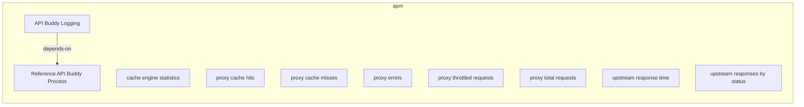
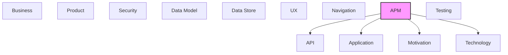

# APM

[← Back to README](../README.md)

Observability, monitoring, metrics, logging, and tracing.

## Report Index

- [Layer Introduction](#layer-introduction)
- [Intra-Layer Relationships](#intra-layer-relationships)
- [Inter-Layer Dependencies](#inter-layer-dependencies)
- [Inter-Layer Relationships Table](#inter-layer-relationships-table)
- [Element Reference](#element-reference)

## Layer Introduction

| Metric                    | Count |
| ------------------------- | ----- |
| Elements                  | 10    |
| Intra-Layer Relationships | 1     |
| Inter-Layer Relationships | 13    |
| Inbound Relationships     | 0     |
| Outbound Relationships    | 13    |

**Cross-Layer References**:

- **Downstream layers**: [API](./07-api-layer-report.md), [Application](./05-application-layer-report.md), [Motivation](./01-motivation-layer-report.md), [Technology](./06-technology-layer-report.md)

## Intra-Layer Relationships

## Inter-Layer Dependencies

## Inter-Layer Relationships Table

| Relationship ID                                                  | Source Node                                         | Dest Node                                                     | Dest Layer    | Predicate    | Cardinality  | Strength |
| ---------------------------------------------------------------- | --------------------------------------------------- | ------------------------------------------------------------- | ------------- | ------------ | ------------ | -------- |
| `apm.metricinstrument.monitors.application.applicationcomponent` | `apm.metricinstrument.cache-engine-statistics`      | `application.applicationcomponent.cache-engine`               | `application` | `monitors`   | many-to-many | medium   |
| `apm.metricinstrument.satisfies.motivation.requirement`          | `apm.metricinstrument.cache-engine-statistics`      | `motivation.requirement.programmatic-monitoring-interface`    | `motivation`  | `satisfies`  | many-to-many | medium   |
| `apm.metricinstrument.monitors.application.applicationcomponent` | `apm.metricinstrument.proxy-cache-hits`             | `application.applicationcomponent.cache-engine`               | `application` | `monitors`   | many-to-many | medium   |
| `apm.metricinstrument.monitors.application.applicationcomponent` | `apm.metricinstrument.proxy-cache-misses`           | `application.applicationcomponent.cache-engine`               | `application` | `monitors`   | many-to-many | medium   |
| `apm.metricinstrument.monitors.application.applicationcomponent` | `apm.metricinstrument.proxy-errors`                 | `application.applicationcomponent.proxy-http-request-handler` | `application` | `monitors`   | many-to-many | medium   |
| `apm.metricinstrument.monitors.application.applicationcomponent` | `apm.metricinstrument.proxy-throttled-requests`     | `application.applicationcomponent.throttle-manager`           | `application` | `monitors`   | many-to-many | medium   |
| `apm.metricinstrument.monitors.application.applicationcomponent` | `apm.metricinstrument.proxy-total-requests`         | `application.applicationcomponent.caching-proxy`              | `application` | `monitors`   | many-to-many | medium   |
| `apm.metricinstrument.monitors.api.operation`                    | `apm.metricinstrument.upstream-response-time`       | `api.operation.get-proxied-upstream-request`                  | `api`         | `monitors`   | many-to-many | medium   |
| `apm.metricinstrument.monitors.application.applicationcomponent` | `apm.metricinstrument.upstream-response-time`       | `application.applicationcomponent.upstream-reference-api`     | `application` | `monitors`   | many-to-many | medium   |
| `apm.metricinstrument.monitors.application.applicationcomponent` | `apm.metricinstrument.upstream-responses-by-status` | `application.applicationcomponent.upstream-reference-api`     | `application` | `monitors`   | many-to-many | medium   |
| `apm.metricinstrument.satisfies.motivation.requirement`          | `apm.metricinstrument.upstream-responses-by-status` | `motivation.requirement.programmatic-monitoring-interface`    | `motivation`  | `satisfies`  | many-to-many | medium   |
| `apm.resource.maps-to.application.applicationcomponent`          | `apm.resource.reference-api-buddy-process`          | `application.applicationcomponent.caching-proxy`              | `application` | `maps-to`    | many-to-many | medium   |
| `apm.resource.references.technology.systemsoftware`              | `apm.resource.reference-api-buddy-process`          | `technology.systemsoftware.cpython-runtime`                   | `technology`  | `references` | many-to-many | medium   |

## Element Reference

### API Buddy Logging {#api-buddy-logging}

**ID**: `apm.logconfiguration.api-buddy-logging`

**Type**: `logconfiguration`

Package logging configured from the 'logging' config section: colour console handler, optional rotating file handler, optional parent logger.

#### Attributes

| Name            | Value               |
| --------------- | ------------------- |
| minimumSeverity | INFO                |
| serviceName     | reference-api-buddy |

#### Relationships

| Type        | Related Element                            | Predicate    | Direction |
| ----------- | ------------------------------------------ | ------------ | --------- |
| intra-layer | `apm.resource.reference-api-buddy-process` | `depends-on` | outbound  |

### cache engine statistics {#cache-engine-statistics}

**ID**: `apm.metricinstrument.cache-engine-statistics`

**Type**: `metricinstrument`

CacheEngine hits, misses, sets, evictions, expirations and compression counts.

#### Attributes

| Name    | Value           |
| ------- | --------------- |
| enabled | true            |
| type    | ObservableGauge |
| unit    | \{entry\}       |

#### Relationships

| Type        | Related Element                                            | Predicate   | Direction |
| ----------- | ---------------------------------------------------------- | ----------- | --------- |
| inter-layer | `application.applicationcomponent.cache-engine`            | `monitors`  | outbound  |
| inter-layer | `motivation.requirement.programmatic-monitoring-interface` | `satisfies` | outbound  |

### proxy cache hits {#proxy-cache-hits}

**ID**: `apm.metricinstrument.proxy-cache-hits`

**Type**: `metricinstrument`

MetricsCollector cache_hits.

#### Attributes

| Name    | Value       |
| ------- | ----------- |
| enabled | true        |
| type    | Counter     |
| unit    | \{request\} |

#### Relationships

| Type        | Related Element                                 | Predicate  | Direction |
| ----------- | ----------------------------------------------- | ---------- | --------- |
| inter-layer | `application.applicationcomponent.cache-engine` | `monitors` | outbound  |

### proxy cache misses {#proxy-cache-misses}

**ID**: `apm.metricinstrument.proxy-cache-misses`

**Type**: `metricinstrument`

MetricsCollector cache_misses.

#### Attributes

| Name    | Value       |
| ------- | ----------- |
| enabled | true        |
| type    | Counter     |
| unit    | \{request\} |

#### Relationships

| Type        | Related Element                                 | Predicate  | Direction |
| ----------- | ----------------------------------------------- | ---------- | --------- |
| inter-layer | `application.applicationcomponent.cache-engine` | `monitors` | outbound  |

### proxy errors {#proxy-errors}

**ID**: `apm.metricinstrument.proxy-errors`

**Type**: `metricinstrument`

MetricsCollector errors.

#### Attributes

| Name    | Value       |
| ------- | ----------- |
| enabled | true        |
| type    | Counter     |
| unit    | \{request\} |

#### Relationships

| Type        | Related Element                                               | Predicate  | Direction |
| ----------- | ------------------------------------------------------------- | ---------- | --------- |
| inter-layer | `application.applicationcomponent.proxy-http-request-handler` | `monitors` | outbound  |

### proxy throttled requests {#proxy-throttled-requests}

**ID**: `apm.metricinstrument.proxy-throttled-requests`

**Type**: `metricinstrument`

MetricsCollector throttled: requests answered 429.

#### Attributes

| Name    | Value       |
| ------- | ----------- |
| enabled | true        |
| type    | Counter     |
| unit    | \{request\} |

#### Relationships

| Type        | Related Element                                     | Predicate  | Direction |
| ----------- | --------------------------------------------------- | ---------- | --------- |
| inter-layer | `application.applicationcomponent.throttle-manager` | `monitors` | outbound  |

### proxy total requests {#proxy-total-requests}

**ID**: `apm.metricinstrument.proxy-total-requests`

**Type**: `metricinstrument`

MetricsCollector total_requests (incremented per recorded event).

#### Attributes

| Name    | Value     |
| ------- | --------- |
| enabled | true      |
| type    | Counter   |
| unit    | \{event\} |

#### Relationships

| Type        | Related Element                                  | Predicate  | Direction |
| ----------- | ------------------------------------------------ | ---------- | --------- |
| inter-layer | `application.applicationcomponent.caching-proxy` | `monitors` | outbound  |

### upstream response time {#upstream-response-time}

**ID**: `apm.metricinstrument.upstream-response-time`

**Type**: `metricinstrument`

Per-request response time stored in the metrics table (0 for cache hits).

#### Attributes

| Name    | Value     |
| ------- | --------- |
| enabled | true      |
| type    | Histogram |
| unit    | ms        |

#### Relationships

| Type        | Related Element                                           | Predicate  | Direction |
| ----------- | --------------------------------------------------------- | ---------- | --------- |
| inter-layer | `api.operation.get-proxied-upstream-request`              | `monitors` | outbound  |
| inter-layer | `application.applicationcomponent.upstream-reference-api` | `monitors` | outbound  |

### upstream responses by status {#upstream-responses-by-status}

**ID**: `apm.metricinstrument.upstream-responses-by-status`

**Type**: `metricinstrument`

Upstream responses by status code from the metrics table; 4xx and 5xx count as errors.

#### Attributes

| Name    | Value       |
| ------- | ----------- |
| enabled | true        |
| type    | Counter     |
| unit    | \{request\} |

#### Relationships

| Type        | Related Element                                            | Predicate   | Direction |
| ----------- | ---------------------------------------------------------- | ----------- | --------- |
| inter-layer | `application.applicationcomponent.upstream-reference-api`  | `monitors`  | outbound  |
| inter-layer | `motivation.requirement.programmatic-monitoring-interface` | `satisfies` | outbound  |

### Reference API Buddy Process {#reference-api-buddy-process}

**ID**: `apm.resource.reference-api-buddy-process`

**Type**: `resource`

The Python process running the proxy; the package sets no OpenTelemetry resource attributes, it logs through the standard logging module.

#### Attributes

| Name                   | Value |
| ---------------------- | ----- |
| droppedAttributesCount | 0     |

#### Relationships

| Type        | Related Element                                  | Predicate    | Direction |
| ----------- | ------------------------------------------------ | ------------ | --------- |
| inter-layer | `application.applicationcomponent.caching-proxy` | `maps-to`    | outbound  |
| inter-layer | `technology.systemsoftware.cpython-runtime`      | `references` | outbound  |
| intra-layer | `apm.logconfiguration.api-buddy-logging`         | `depends-on` | inbound   |

---

Generated: 2026-11-24T18:04:53.605Z | Model Version: 0.1.0
