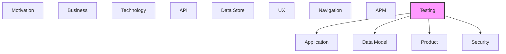

# Testing

[← Back to README](../README.md)

Test strategies, test cases, test data, and test coverage.

## Report Index

- [Layer Introduction](#layer-introduction)
- [Intra-Layer Relationships](#intra-layer-relationships)
- [Inter-Layer Dependencies](#inter-layer-dependencies)
- [Inter-Layer Relationships Table](#inter-layer-relationships-table)
- [Element Reference](#element-reference)

## Layer Introduction

| Metric                    | Count |
| ------------------------- | ----- |
| Elements                  | 421   |
| Intra-Layer Relationships | 0     |
| Inter-Layer Relationships | 558   |
| Inbound Relationships     | 0     |
| Outbound Relationships    | 558   |

**Cross-Layer References**:

- **Downstream layers**: [Application](./05-application-layer-report.md), [Data Model](./08-data-model-layer-report.md), [Product](./03-product-layer-report.md), [Security](./04-security-layer-report.md)

## Intra-Layer Relationships

*This layer has >30 elements. Summary table shown instead of diagram.*

| Element                                                                                                                       | Type             | Relationships |
| ----------------------------------------------------------------------------------------------------------------------------- | ---------------- | ------------- |
| `testing.testcasesketch.dbpedia-threading-test-test-concurrent-requests`                                                      | `testcasesketch` | 0             |
| `testing.testcasesketch.test-admin-endpoint-methods-test-cache-statistics-with-cache-engine`                                  | `testcasesketch` | 0             |
| `testing.testcasesketch.test-admin-endpoint-methods-test-cache-statistics-without-cache-engine`                               | `testcasesketch` | 0             |
| `testing.testcasesketch.test-admin-endpoint-methods-test-component-status-error`                                              | `testcasesketch` | 0             |
| `testing.testcasesketch.test-admin-endpoint-methods-test-component-status-healthy`                                            | `testcasesketch` | 0             |
| `testing.testcasesketch.test-admin-endpoint-methods-test-component-status-unavailable`                                        | `testcasesketch` | 0             |
| `testing.testcasesketch.test-admin-endpoint-methods-test-config-sanitization`                                                 | `testcasesketch` | 0             |
| `testing.testcasesketch.test-admin-endpoint-methods-test-config-validation-empty-body`                                        | `testcasesketch` | 0             |
| `testing.testcasesketch.test-admin-endpoint-methods-test-config-validation-valid`                                             | `testcasesketch` | 0             |
| `testing.testcasesketch.test-admin-endpoint-methods-test-config-warnings-generation`                                          | `testcasesketch` | 0             |
| `testing.testcasesketch.test-admin-endpoint-methods-test-domain-mapping-statistics`                                           | `testcasesketch` | 0             |
| `testing.testcasesketch.test-admin-endpoint-methods-test-is-admin-enabled`                                                    | `testcasesketch` | 0             |
| `testing.testcasesketch.test-admin-endpoint-methods-test-is-admin-path`                                                       | `testcasesketch` | 0             |
| `testing.testcasesketch.test-admin-endpoint-methods-test-overall-status-determination`                                        | `testcasesketch` | 0             |
| `testing.testcasesketch.test-admin-endpoints-integration-test-admin-cache-domain-endpoint`                                    | `testcasesketch` | 0             |
| `testing.testcasesketch.test-admin-endpoints-integration-test-admin-cache-domain-not-found`                                   | `testcasesketch` | 0             |
| `testing.testcasesketch.test-admin-endpoints-integration-test-admin-cache-endpoint`                                           | `testcasesketch` | 0             |
| `testing.testcasesketch.test-admin-endpoints-integration-test-admin-config-endpoint`                                          | `testcasesketch` | 0             |
| `testing.testcasesketch.test-admin-endpoints-integration-test-admin-domains-endpoint`                                         | `testcasesketch` | 0             |
| `testing.testcasesketch.test-admin-endpoints-integration-test-admin-endpoint-not-found`                                       | `testcasesketch` | 0             |
| `testing.testcasesketch.test-admin-endpoints-integration-test-admin-health-endpoint`                                          | `testcasesketch` | 0             |
| `testing.testcasesketch.test-admin-endpoints-integration-test-admin-method-not-allowed`                                       | `testcasesketch` | 0             |
| `testing.testcasesketch.test-admin-endpoints-integration-test-admin-status-endpoint`                                          | `testcasesketch` | 0             |
| `testing.testcasesketch.test-admin-endpoints-integration-test-admin-validate-config-empty-body`                               | `testcasesketch` | 0             |
| `testing.testcasesketch.test-admin-endpoints-integration-test-admin-validate-config-endpoint`                                 | `testcasesketch` | 0             |
| `testing.testcasesketch.test-admin-endpoints-integration-test-admin-validate-config-invalid`                                  | `testcasesketch` | 0             |
| `testing.testcasesketch.test-admin-endpoints-integration-test-admin-validate-config-invalid-json`                             | `testcasesketch` | 0             |
| `testing.testcasesketch.test-admin-endpoints-integration-test-non-admin-request`                                              | `testcasesketch` | 0             |
| `testing.testcasesketch.test-admin-endpoints-with-security-test-admin-endpoint-with-invalid-key`                              | `testcasesketch` | 0             |
| `testing.testcasesketch.test-admin-endpoints-with-security-test-admin-endpoint-with-valid-key`                                | `testcasesketch` | 0             |
| `testing.testcasesketch.test-admin-endpoints-with-security-test-admin-endpoint-without-key`                                   | `testcasesketch` | 0             |
| `testing.testcasesketch.test-admin-endpoints-with-security-test-admin-validate-config-with-security`                          | `testcasesketch` | 0             |
| `testing.testcasesketch.test-admin-health`                                                                                    | `testcasesketch` | 0             |
| `testing.testcasesketch.test-admin-rate-limiter-test-clear-all`                                                               | `testcasesketch` | 0             |
| `testing.testcasesketch.test-admin-rate-limiter-test-clear-client`                                                            | `testcasesketch` | 0             |
| `testing.testcasesketch.test-admin-rate-limiter-test-initial-state`                                                           | `testcasesketch` | 0             |
| `testing.testcasesketch.test-admin-rate-limiter-test-multiple-clients`                                                        | `testcasesketch` | 0             |
| `testing.testcasesketch.test-admin-rate-limiter-test-rate-limiting`                                                           | `testcasesketch` | 0             |
| `testing.testcasesketch.test-admin-rate-limiter-test-thread-safety`                                                           | `testcasesketch` | 0             |
| `testing.testcasesketch.test-admin-rate-limiter-test-time-window-expiry`                                                      | `testcasesketch` | 0             |
| `testing.testcasesketch.test-admin-rate-limiting-test-rate-limiting-enforcement`                                              | `testcasesketch` | 0             |
| `testing.testcasesketch.test-backoff-and-jitter-test-retry-backoff-cap`                                                       | `testcasesketch` | 0             |
| `testing.testcasesketch.test-backoff-and-jitter-test-retry-backoff-timing`                                                    | `testcasesketch` | 0             |
| `testing.testcasesketch.test-basic-performance-test-repeated-requests-performance`                                            | `testcasesketch` | 0             |
| `testing.testcasesketch.test-basic-performance-test-sequential-requests-performance`                                          | `testcasesketch` | 0             |
| `testing.testcasesketch.test-basic-queries`                                                                                   | `testcasesketch` | 0             |
| `testing.testcasesketch.test-cache-and-upstream`                                                                              | `testcasesketch` | 0             |
| `testing.testcasesketch.test-cache-behavior`                                                                                  | `testcasesketch` | 0             |
| `testing.testcasesketch.test-cache-engine-ttl-test-cache-engine-respects-explicit-ttl`                                        | `testcasesketch` | 0             |
| `testing.testcasesketch.test-cache-engine-ttl-test-cache-engine-uses-default-ttl`                                             | `testcasesketch` | 0             |
| `testing.testcasesketch.test-cache-engine-ttl-test-cache-engine-uses-domain-ttl`                                              | `testcasesketch` | 0             |
| `testing.testcasesketch.test-cache-engine-ttl-test-cache-engine-with-none-domain-key`                                         | `testcasesketch` | 0             |
| `testing.testcasesketch.test-cache-engine-ttl-test-cache-engine-without-config`                                               | `testcasesketch` | 0             |
| `testing.testcasesketch.test-cache-engine-ttl-test-fallback-to-default-for-unmapped-domain`                                   | `testcasesketch` | 0             |
| `testing.testcasesketch.test-cache-eviction-edge-cases-test-cache-eviction-with-concurrent-access`                            | `testcasesketch` | 0             |
| `testing.testcasesketch.test-cache-eviction-edge-cases-test-eviction-with-large-number-of-entries`                            | `testcasesketch` | 0             |
| `testing.testcasesketch.test-cache-expiry`                                                                                    | `testcasesketch` | 0             |
| `testing.testcasesketch.test-cache-first-throttling-test-cache-hits-bypass-throttling-integration`                            | `testcasesketch` | 0             |
| `testing.testcasesketch.test-cache-first-throttling-test-throttling-metrics-include-cache-miss-flag`                          | `testcasesketch` | 0             |
| `testing.testcasesketch.test-cache-management-edge-cases-test-clear-cache-with-none-domain`                                   | `testcasesketch` | 0             |
| `testing.testcasesketch.test-cache-management-edge-cases-test-clear-cache-with-specific-domain`                               | `testcasesketch` | 0             |
| `testing.testcasesketch.test-cache-management-edge-cases-test-stats-update-with-thread-safety`                                | `testcasesketch` | 0             |
| `testing.testcasesketch.test-cache-performance-metrics`                                                                       | `testcasesketch` | 0             |
| `testing.testcasesketch.test-cache-statistics-corner-cases-test-cache-statistics-edge-cases`                                  | `testcasesketch` | 0             |
| `testing.testcasesketch.test-cache-statistics-corner-cases-test-stats-thread-safety`                                          | `testcasesketch` | 0             |
| `testing.testcasesketch.test-cache-throttling-interaction-test-cache-hit-bypasses-throttling`                                 | `testcasesketch` | 0             |
| `testing.testcasesketch.test-cache-throttling-interaction-test-cache-miss-applies-throttling`                                 | `testcasesketch` | 0             |
| `testing.testcasesketch.test-cache-throttling-interaction-test-cache-miss-no-throttling-forwards-to-upstream`                 | `testcasesketch` | 0             |
| `testing.testcasesketch.test-cache-validation-errors-test-cache-validation-errors`                                            | `testcasesketch` | 0             |
| `testing.testcasesketch.test-cache-validation-errors-test-malformed-datetime-handling`                                        | `testcasesketch` | 0             |
| `testing.testcasesketch.test-callbacks-and-graceful-shutdown`                                                                 | `testcasesketch` | 0             |
| `testing.testcasesketch.test-cleanup-and-error-recovery-test-close-empty-pool`                                                | `testcasesketch` | 0             |
| `testing.testcasesketch.test-cleanup-and-error-recovery-test-close-with-connection-close-error`                               | `testcasesketch` | 0             |
| `testing.testcasesketch.test-cleanup-and-error-recovery-test-close-with-connections-in-pool`                                  | `testcasesketch` | 0             |
| `testing.testcasesketch.test-cleanup-and-error-recovery-test-destructor-calls-close`                                          | `testcasesketch` | 0             |
| `testing.testcasesketch.test-cleanup-expired-entries`                                                                         | `testcasesketch` | 0             |
| `testing.testcasesketch.test-cleanup-removes-old-timestamps`                                                                  | `testcasesketch` | 0             |
| `testing.testcasesketch.test-clear-cache`                                                                                     | `testcasesketch` | 0             |
| `testing.testcasesketch.test-cli-startup`                                                                                     | `testcasesketch` | 0             |
| `testing.testcasesketch.test-cli-startup-with-different-port`                                                                 | `testcasesketch` | 0             |
| `testing.testcasesketch.test-cliargument-parsing-test-cli-custom-host`                                                        | `testcasesketch` | 0             |
| `testing.testcasesketch.test-cliargument-parsing-test-cli-custom-log-level`                                                   | `testcasesketch` | 0             |
| `testing.testcasesketch.test-cliargument-parsing-test-cli-custom-port`                                                        | `testcasesketch` | 0             |
| `testing.testcasesketch.test-cliargument-parsing-test-cli-generate-config`                                                    | `testcasesketch` | 0             |
| `testing.testcasesketch.test-cliargument-parsing-test-cli-help-output`                                                        | `testcasesketch` | 0             |
| `testing.testcasesketch.test-cliargument-parsing-test-cli-security-key-only`                                                  | `testcasesketch` | 0             |
| `testing.testcasesketch.test-cliargument-parsing-test-cli-version-output`                                                     | `testcasesketch` | 0             |
| `testing.testcasesketch.test-cliargument-validation-test-cli-edge-case-port-max`                                              | `testcasesketch` | 0             |
| `testing.testcasesketch.test-cliargument-validation-test-cli-edge-case-port-zero`                                             | `testcasesketch` | 0             |
| `testing.testcasesketch.test-cliargument-validation-test-cli-invalid-log-level-argument`                                      | `testcasesketch` | 0             |
| `testing.testcasesketch.test-cliargument-validation-test-cli-invalid-port-argument`                                           | `testcasesketch` | 0             |
| `testing.testcasesketch.test-cliconfiguration-handling-test-cli-with-config-file`                                             | `testcasesketch` | 0             |
| `testing.testcasesketch.test-cliconfiguration-handling-test-cli-with-invalid-config-file`                                     | `testcasesketch` | 0             |
| `testing.testcasesketch.test-clidefault-behavior-test-cli-default-configuration-message`                                      | `testcasesketch` | 0             |
| `testing.testcasesketch.test-clidefault-behavior-test-cli-startup-information-display`                                        | `testcasesketch` | 0             |
| `testing.testcasesketch.test-cliintegration-test-cli-custom-host-port-integration`                                            | `testcasesketch` | 0             |
| `testing.testcasesketch.test-cliintegration-test-cli-generate-config-integration`                                             | `testcasesketch` | 0             |
| `testing.testcasesketch.test-cliintegration-test-cli-help-integration`                                                        | `testcasesketch` | 0             |
| `testing.testcasesketch.test-cliintegration-test-cli-invalid-arguments-integration`                                           | `testcasesketch` | 0             |
| `testing.testcasesketch.test-cliintegration-test-cli-invalid-log-level-integration`                                           | `testcasesketch` | 0             |
| `testing.testcasesketch.test-cliintegration-test-cli-malformed-config-file-integration`                                       | `testcasesketch` | 0             |
| `testing.testcasesketch.test-cliintegration-test-cli-nonexistent-config-file-integration`                                     | `testcasesketch` | 0             |
| `testing.testcasesketch.test-cliintegration-test-cli-security-key-integration`                                                | `testcasesketch` | 0             |
| `testing.testcasesketch.test-cliintegration-test-cli-version-integration`                                                     | `testcasesketch` | 0             |
| `testing.testcasesketch.test-cliintegration-test-cli-with-config-file-integration`                                            | `testcasesketch` | 0             |
| `testing.testcasesketch.test-cliserver-startup-test-cli-keyboard-interrupt-handling`                                          | `testcasesketch` | 0             |
| `testing.testcasesketch.test-cliserver-startup-test-cli-server-startup-error-handling`                                        | `testcasesketch` | 0             |
| `testing.testcasesketch.test-cliserver-startup-test-cli-server-startup-success`                                               | `testcasesketch` | 0             |
| `testing.testcasesketch.test-cliserver-startup-test-cli-server-startup-with-security-key`                                     | `testcasesketch` | 0             |
| `testing.testcasesketch.test-combined-rate-limiting`                                                                          | `testcasesketch` | 0             |
| `testing.testcasesketch.test-component-integration`                                                                           | `testcasesketch` | 0             |
| `testing.testcasesketch.test-compression-and-decompression`                                                                   | `testcasesketch` | 0             |
| `testing.testcasesketch.test-compression-edge-cases-test-decompression-exception-path`                                        | `testcasesketch` | 0             |
| `testing.testcasesketch.test-compression-header-handling-test-header-updates-after-decompression`                             | `testcasesketch` | 0             |
| `testing.testcasesketch.test-concurrent-performance-test-concurrent-requests-different-endpoints`                             | `testcasesketch` | 0             |
| `testing.testcasesketch.test-concurrent-performance-test-concurrent-requests-same-endpoint`                                   | `testcasesketch` | 0             |
| `testing.testcasesketch.test-concurrent-requests`                                                                             | `testcasesketch` | 0             |
| `testing.testcasesketch.test-concurrent-requests-wait-for-first`                                                              | `testcasesketch` | 0             |
| `testing.testcasesketch.test-configuration-manager-edge-cases-test-configuration-manager-reload-invalid-config`               | `testcasesketch` | 0             |
| `testing.testcasesketch.test-configuration-manager-edge-cases-test-configuration-manager-reload-preserves-state-on-error`     | `testcasesketch` | 0             |
| `testing.testcasesketch.test-configuration-manager-edge-cases-test-configuration-manager-update-creates-nested-keys`          | `testcasesketch` | 0             |
| `testing.testcasesketch.test-configuration-manager-edge-cases-test-configuration-manager-update-deep-nesting`                 | `testcasesketch` | 0             |
| `testing.testcasesketch.test-configuration-manager-edge-cases-test-configuration-manager-update-invalid-config`               | `testcasesketch` | 0             |
| `testing.testcasesketch.test-configuration-manager-edge-cases-test-configuration-manager-with-invalid-config`                 | `testcasesketch` | 0             |
| `testing.testcasesketch.test-configuration-validation-test-invalid-cache-database-path-type`                                  | `testcasesketch` | 0             |
| `testing.testcasesketch.test-configuration-validation-test-invalid-cache-max-cache-response-size-type`                        | `testcasesketch` | 0             |
| `testing.testcasesketch.test-configuration-validation-test-invalid-config-not-dictionary`                                     | `testcasesketch` | 0             |
| `testing.testcasesketch.test-configuration-validation-test-invalid-logging-backup-count-type`                                 | `testcasesketch` | 0             |
| `testing.testcasesketch.test-configuration-validation-test-invalid-logging-date-format-type`                                  | `testcasesketch` | 0             |
| `testing.testcasesketch.test-configuration-validation-test-invalid-logging-enable-console-type`                               | `testcasesketch` | 0             |
| `testing.testcasesketch.test-configuration-validation-test-invalid-logging-enable-file-type`                                  | `testcasesketch` | 0             |
| `testing.testcasesketch.test-configuration-validation-test-invalid-logging-file-path-type`                                    | `testcasesketch` | 0             |
| `testing.testcasesketch.test-configuration-validation-test-invalid-logging-format-type`                                       | `testcasesketch` | 0             |
| `testing.testcasesketch.test-configuration-validation-test-invalid-logging-level-type`                                        | `testcasesketch` | 0             |
| `testing.testcasesketch.test-configuration-validation-test-invalid-logging-max-file-size-type`                                | `testcasesketch` | 0             |
| `testing.testcasesketch.test-configuration-validation-test-invalid-logging-parent-logger-type`                                | `testcasesketch` | 0             |
| `testing.testcasesketch.test-configuration-validation-test-invalid-security-log-security-events-type`                         | `testcasesketch` | 0             |
| `testing.testcasesketch.test-configuration-validation-test-invalid-security-require-secure-key-type`                          | `testcasesketch` | 0             |
| `testing.testcasesketch.test-configuration-validation-test-invalid-server-host-type`                                          | `testcasesketch` | 0             |
| `testing.testcasesketch.test-configuration-validation-test-invalid-server-request-timeout-type`                               | `testcasesketch` | 0             |
| `testing.testcasesketch.test-configuration-validation-test-invalid-throttling-default-requests-per-hour-type`                 | `testcasesketch` | 0             |
| `testing.testcasesketch.test-configuration-validation-test-invalid-throttling-progressive-max-delay-type`                     | `testcasesketch` | 0             |
| `testing.testcasesketch.test-configuration-validation-test-missing-required-config-fields`                                    | `testcasesketch` | 0             |
| `testing.testcasesketch.test-configuration-validation-test-multiple-validation-errors`                                        | `testcasesketch` | 0             |
| `testing.testcasesketch.test-configuration-validation-test-partial-config-sections`                                           | `testcasesketch` | 0             |
| `testing.testcasesketch.test-configuration-validation-test-valid-boolean-values-for-booleans`                                 | `testcasesketch` | 0             |
| `testing.testcasesketch.test-configuration-validation-test-valid-integer-values-for-integers`                                 | `testcasesketch` | 0             |
| `testing.testcasesketch.test-configuration-validation-test-valid-logging-file-path-none`                                      | `testcasesketch` | 0             |
| `testing.testcasesketch.test-configuration-validation-test-valid-logging-file-path-string`                                    | `testcasesketch` | 0             |
| `testing.testcasesketch.test-configuration-validation-test-valid-logging-parent-logger-none`                                  | `testcasesketch` | 0             |
| `testing.testcasesketch.test-configuration-validation-test-valid-logging-parent-logger-string`                                | `testcasesketch` | 0             |
| `testing.testcasesketch.test-configured-upstream-caching`                                                                     | `testcasesketch` | 0             |
| `testing.testcasesketch.test-connection-error-handling-test-connection-creation-failure`                                      | `testcasesketch` | 0             |
| `testing.testcasesketch.test-connection-error-handling-test-connection-pool-exhaustion`                                       | `testcasesketch` | 0             |
| `testing.testcasesketch.test-connection-error-handling-test-return-connection-when-pool-full`                                 | `testcasesketch` | 0             |
| `testing.testcasesketch.test-connection-pooling`                                                                              | `testcasesketch` | 0             |
| `testing.testcasesketch.test-context-manager-lifecycle`                                                                       | `testcasesketch` | 0             |
| `testing.testcasesketch.test-create-default-config-test-create-default-config-cache-settings`                                 | `testcasesketch` | 0             |
| `testing.testcasesketch.test-create-default-config-test-create-default-config-domain-mappings`                                | `testcasesketch` | 0             |
| `testing.testcasesketch.test-create-default-config-test-create-default-config-security-settings`                              | `testcasesketch` | 0             |
| `testing.testcasesketch.test-create-default-config-test-create-default-config-server-settings`                                | `testcasesketch` | 0             |
| `testing.testcasesketch.test-create-default-config-test-create-default-config-structure`                                      | `testcasesketch` | 0             |
| `testing.testcasesketch.test-create-default-config-test-create-default-config-throttling-settings`                            | `testcasesketch` | 0             |
| `testing.testcasesketch.test-data-migration-edge-cases-test-concurrent-schema-initialization`                                 | `testcasesketch` | 0             |
| `testing.testcasesketch.test-data-migration-edge-cases-test-execute-query-with-zero-retries`                                  | `testcasesketch` | 0             |
| `testing.testcasesketch.test-data-migration-edge-cases-test-execute-update-with-zero-retries`                                 | `testcasesketch` | 0             |
| `testing.testcasesketch.test-data-migration-edge-cases-test-schema-initialization-with-existing-tables`                       | `testcasesketch` | 0             |
| `testing.testcasesketch.test-database-initialization-failures-test-database-initialization-with-invalid-path`                 | `testcasesketch` | 0             |
| `testing.testcasesketch.test-database-initialization-failures-test-database-initialization-with-regular-path`                 | `testcasesketch` | 0             |
| `testing.testcasesketch.test-database-initialization-failures-test-database-initialization-with-uri-path`                     | `testcasesketch` | 0             |
| `testing.testcasesketch.test-database-persistence-failures-test-database-failure-during-cleanup`                              | `testcasesketch` | 0             |
| `testing.testcasesketch.test-database-persistence-failures-test-database-failure-during-get`                                  | `testcasesketch` | 0             |
| `testing.testcasesketch.test-database-persistence-failures-test-database-persistence-failure-handling`                        | `testcasesketch` | 0             |
| `testing.testcasesketch.test-date-time-converters-test-adapt-datetime-iso`                                                    | `testcasesketch` | 0             |
| `testing.testcasesketch.test-date-time-converters-test-convert-datetime`                                                      | `testcasesketch` | 0             |
| `testing.testcasesketch.test-date-time-converters-test-convert-timestamp`                                                     | `testcasesketch` | 0             |
| `testing.testcasesketch.test-datetime-cleanup-operations-test-cleanup-exception-handling-in-datetime-parsing`                 | `testcasesketch` | 0             |
| `testing.testcasesketch.test-datetime-cleanup-operations-test-cleanup-expired-entries-datetime-handling`                      | `testcasesketch` | 0             |
| `testing.testcasesketch.test-datetime-cleanup-operations-test-cleanup-with-datetime-object`                                   | `testcasesketch` | 0             |
| `testing.testcasesketch.test-datetime-cleanup-operations-test-cleanup-with-standard-datetime-string`                          | `testcasesketch` | 0             |
| `testing.testcasesketch.test-datetime-cleanup-operations-test-mixed-datetime-formats-in-cleanup`                              | `testcasesketch` | 0             |
| `testing.testcasesketch.test-datetime-handling-test-datetime-fallback-handling`                                               | `testcasesketch` | 0             |
| `testing.testcasesketch.test-datetime-handling-test-datetime-object-handling`                                                 | `testcasesketch` | 0             |
| `testing.testcasesketch.test-datetime-handling-test-integer-created-at-handling`                                              | `testcasesketch` | 0             |
| `testing.testcasesketch.test-deep-merge-edge-cases-test-deep-merge-preserves-original-objects`                                | `testcasesketch` | 0             |
| `testing.testcasesketch.test-deep-merge-edge-cases-test-deep-merge-with-different-types`                                      | `testcasesketch` | 0             |
| `testing.testcasesketch.test-deep-merge-edge-cases-test-deep-merge-with-new-keys`                                             | `testcasesketch` | 0             |
| `testing.testcasesketch.test-deep-merge-edge-cases-test-deep-merge-with-none-values`                                          | `testcasesketch` | 0             |
| `testing.testcasesketch.test-default-config-valid`                                                                            | `testcasesketch` | 0             |
| `testing.testcasesketch.test-deflate-handling-test-deflate-decompression-error`                                               | `testcasesketch` | 0             |
| `testing.testcasesketch.test-delete-and-clear`                                                                                | `testcasesketch` | 0             |
| `testing.testcasesketch.test-different-cache-keys-independent`                                                                | `testcasesketch` | 0             |
| `testing.testcasesketch.test-different-domains-independent`                                                                   | `testcasesketch` | 0             |
| `testing.testcasesketch.test-domain-specific-limits`                                                                          | `testcasesketch` | 0             |
| `testing.testcasesketch.test-empty-normalized-path-handling`                                                                  | `testcasesketch` | 0             |
| `testing.testcasesketch.test-enhanced-throttling-stats`                                                                       | `testcasesketch` | 0             |
| `testing.testcasesketch.test-error-handling-for-missing-methods`                                                              | `testcasesketch` | 0             |
| `testing.testcasesketch.test-error-handling-paths-test-database-query-edge-cases`                                             | `testcasesketch` | 0             |
| `testing.testcasesketch.test-error-handling-paths-test-normalize-request-body-error-handling`                                 | `testcasesketch` | 0             |
| `testing.testcasesketch.test-error-handling-paths-test-normalize-url-error-handling`                                          | `testcasesketch` | 0             |
| `testing.testcasesketch.test-error-propagation`                                                                               | `testcasesketch` | 0             |
| `testing.testcasesketch.test-exception-handling-test-exception-handling-in-request`                                           | `testcasesketch` | 0             |
| `testing.testcasesketch.test-exception-handling-test-exception-traceback-writing`                                             | `testcasesketch` | 0             |
| `testing.testcasesketch.test-extract-from-header`                                                                             | `testcasesketch` | 0             |
| `testing.testcasesketch.test-extract-from-path`                                                                               | `testcasesketch` | 0             |
| `testing.testcasesketch.test-extract-from-query`                                                                              | `testcasesketch` | 0             |
| `testing.testcasesketch.test-extract-from-query-accepts-parse-qs-lists`                                                       | `testcasesketch` | 0             |
| `testing.testcasesketch.test-extract-from-query-prefers-the-proxy-key-among-several`                                          | `testcasesketch` | 0             |
| `testing.testcasesketch.test-extract-secure-key-falls-back-to-first-candidate`                                                | `testcasesketch` | 0             |
| `testing.testcasesketch.test-extract-secure-key-prefers-the-proxy-key`                                                        | `testcasesketch` | 0             |
| `testing.testcasesketch.test-extract-secure-key-priority`                                                                     | `testcasesketch` | 0             |
| `testing.testcasesketch.test-extract-secure-key-strips-query-key`                                                             | `testcasesketch` | 0             |
| `testing.testcasesketch.test-first-request-proceeds-immediately`                                                              | `testcasesketch` | 0             |
| `testing.testcasesketch.test-generate-cache-key-get`                                                                          | `testcasesketch` | 0             |
| `testing.testcasesketch.test-generate-cache-key-post-json`                                                                    | `testcasesketch` | 0             |
| `testing.testcasesketch.test-generate-secure-key-length-and-format`                                                           | `testcasesketch` | 0             |
| `testing.testcasesketch.test-get-cache-stats-returns-expected-keys`                                                           | `testcasesketch` | 0             |
| `testing.testcasesketch.test-get-database-stats-returns-expected-keys`                                                        | `testcasesketch` | 0             |
| `testing.testcasesketch.test-get-proxy-health-returns-expected-keys`                                                          | `testcasesketch` | 0             |
| `testing.testcasesketch.test-get-secure-key`                                                                                  | `testcasesketch` | 0             |
| `testing.testcasesketch.test-get-throttling-stats-returns-expected-keys`                                                      | `testcasesketch` | 0             |
| `testing.testcasesketch.test-get-upstream-stats-returns-expected-keys`                                                        | `testcasesketch` | 0             |
| `testing.testcasesketch.test-gzip-handling-test-gzip-decompression-error`                                                     | `testcasesketch` | 0             |
| `testing.testcasesketch.test-handler-cache-ttlintegration-test-cache-hit-preserves-original-ttl`                              | `testcasesketch` | 0             |
| `testing.testcasesketch.test-handler-cache-ttlintegration-test-different-domains-get-different-ttls-in-same-proxy`            | `testcasesketch` | 0             |
| `testing.testcasesketch.test-handler-cache-ttlintegration-test-end-to-end-ttl-resolution-fast-api`                            | `testcasesketch` | 0             |
| `testing.testcasesketch.test-handler-cache-ttlintegration-test-end-to-end-ttl-resolution-slow-api`                            | `testcasesketch` | 0             |
| `testing.testcasesketch.test-handler-cache-ttlintegration-test-end-to-end-ttl-resolution-unmapped-domain`                     | `testcasesketch` | 0             |
| `testing.testcasesketch.test-handler-cache-ttlintegration-test-post-request-with-domain-specific-ttl`                         | `testcasesketch` | 0             |
| `testing.testcasesketch.test-handler-edge-cases-test-admin-health-endpoint`                                                   | `testcasesketch` | 0             |
| `testing.testcasesketch.test-handler-edge-cases-test-cache-hit`                                                               | `testcasesketch` | 0             |
| `testing.testcasesketch.test-handler-edge-cases-test-cache-hit-scenario`                                                      | `testcasesketch` | 0             |
| `testing.testcasesketch.test-handler-edge-cases-test-cache-miss-and-set`                                                      | `testcasesketch` | 0             |
| `testing.testcasesketch.test-handler-edge-cases-test-cache-miss-scenario`                                                     | `testcasesketch` | 0             |
| `testing.testcasesketch.test-handler-edge-cases-test-connection-error-recovery`                                               | `testcasesketch` | 0             |
| `testing.testcasesketch.test-handler-edge-cases-test-deflate-compression-handling`                                            | `testcasesketch` | 0             |
| `testing.testcasesketch.test-handler-edge-cases-test-deflate-decompression-failure`                                           | `testcasesketch` | 0             |
| `testing.testcasesketch.test-handler-edge-cases-test-deflate-decompression-success`                                           | `testcasesketch` | 0             |
| `testing.testcasesketch.test-handler-edge-cases-test-domain-mapping-edge-cases`                                               | `testcasesketch` | 0             |
| `testing.testcasesketch.test-handler-edge-cases-test-domain-not-mapped`                                                       | `testcasesketch` | 0             |
| `testing.testcasesketch.test-handler-edge-cases-test-empty-request-body-post`                                                 | `testcasesketch` | 0             |
| `testing.testcasesketch.test-handler-edge-cases-test-exception-handling`                                                      | `testcasesketch` | 0             |
| `testing.testcasesketch.test-handler-edge-cases-test-forward-request-invalid-path`                                            | `testcasesketch` | 0             |
| `testing.testcasesketch.test-handler-edge-cases-test-forward-request-network-error`                                           | `testcasesketch` | 0             |
| `testing.testcasesketch.test-handler-edge-cases-test-forward-request-no-upstream`                                             | `testcasesketch` | 0             |
| `testing.testcasesketch.test-handler-edge-cases-test-forward-request-unmapped-domain`                                         | `testcasesketch` | 0             |
| `testing.testcasesketch.test-handler-edge-cases-test-gzip-compression-handling`                                               | `testcasesketch` | 0             |
| `testing.testcasesketch.test-handler-edge-cases-test-gzip-decompression-failure`                                              | `testcasesketch` | 0             |
| `testing.testcasesketch.test-handler-edge-cases-test-gzip-decompression-success`                                              | `testcasesketch` | 0             |
| `testing.testcasesketch.test-handler-edge-cases-test-gzip-magic-number-detection`                                             | `testcasesketch` | 0             |
| `testing.testcasesketch.test-handler-edge-cases-test-handler-initialization`                                                  | `testcasesketch` | 0             |
| `testing.testcasesketch.test-handler-edge-cases-test-handler-logger-fallback`                                                 | `testcasesketch` | 0             |
| `testing.testcasesketch.test-handler-edge-cases-test-handler-without-proxy-instance`                                          | `testcasesketch` | 0             |
| `testing.testcasesketch.test-handler-edge-cases-test-header-filtering`                                                        | `testcasesketch` | 0             |
| `testing.testcasesketch.test-handler-edge-cases-test-http-method-handlers-exist`                                              | `testcasesketch` | 0             |
| `testing.testcasesketch.test-handler-edge-cases-test-http-methods-coverage`                                                   | `testcasesketch` | 0             |
| `testing.testcasesketch.test-handler-edge-cases-test-invalid-headers-processing`                                              | `testcasesketch` | 0             |
| `testing.testcasesketch.test-handler-edge-cases-test-invalid-path-handling`                                                   | `testcasesketch` | 0             |
| `testing.testcasesketch.test-handler-edge-cases-test-large-request-body-handling`                                             | `testcasesketch` | 0             |
| `testing.testcasesketch.test-handler-edge-cases-test-malformed-request-handling`                                              | `testcasesketch` | 0             |
| `testing.testcasesketch.test-handler-edge-cases-test-metrics-collection-on-throttle`                                          | `testcasesketch` | 0             |
| `testing.testcasesketch.test-handler-edge-cases-test-no-proxy-attribute-logger`                                               | `testcasesketch` | 0             |
| `testing.testcasesketch.test-handler-edge-cases-test-post-request-with-body`                                                  | `testcasesketch` | 0             |
| `testing.testcasesketch.test-handler-edge-cases-test-query-parameters-handling`                                               | `testcasesketch` | 0             |
| `testing.testcasesketch.test-handler-edge-cases-test-query-parameters-in-url`                                                 | `testcasesketch` | 0             |
| `testing.testcasesketch.test-handler-edge-cases-test-root-path-handling`                                                      | `testcasesketch` | 0             |
| `testing.testcasesketch.test-handler-edge-cases-test-root-path-with-query`                                                    | `testcasesketch` | 0             |
| `testing.testcasesketch.test-handler-edge-cases-test-security-manager-authorized`                                             | `testcasesketch` | 0             |
| `testing.testcasesketch.test-handler-edge-cases-test-security-manager-integration`                                            | `testcasesketch` | 0             |
| `testing.testcasesketch.test-handler-edge-cases-test-security-manager-unauthorized`                                           | `testcasesketch` | 0             |
| `testing.testcasesketch.test-handler-edge-cases-test-security-manager-valid-key`                                              | `testcasesketch` | 0             |
| `testing.testcasesketch.test-handler-edge-cases-test-throttling-integration`                                                  | `testcasesketch` | 0             |
| `testing.testcasesketch.test-handler-edge-cases-test-throttling-rate-limit-exceeded`                                          | `testcasesketch` | 0             |
| `testing.testcasesketch.test-handler-edge-cases-test-timeout-scenarios`                                                       | `testcasesketch` | 0             |
| `testing.testcasesketch.test-handler-edge-cases-test-transparent-proxy-for-unmatched-domain`                                  | `testcasesketch` | 0             |
| `testing.testcasesketch.test-handler-edge-cases-test-unmatched-domain-transparent-proxy`                                      | `testcasesketch` | 0             |
| `testing.testcasesketch.test-handler-ttlintegration-test-handler-cache-hit-bypasses-caching-logic`                            | `testcasesketch` | 0             |
| `testing.testcasesketch.test-handler-ttlintegration-test-handler-creates-proper-cached-response-object`                       | `testcasesketch` | 0             |
| `testing.testcasesketch.test-handler-ttlintegration-test-handler-no-hardcoded-ttl-in-response`                                | `testcasesketch` | 0             |
| `testing.testcasesketch.test-handler-ttlintegration-test-handler-passes-correct-domain-key-for-different-domains`             | `testcasesketch` | 0             |
| `testing.testcasesketch.test-handler-ttlintegration-test-handler-post-request-with-body`                                      | `testcasesketch` | 0             |
| `testing.testcasesketch.test-handler-ttlintegration-test-handler-unmapped-domain-fallback`                                    | `testcasesketch` | 0             |
| `testing.testcasesketch.test-handler-ttlintegration-test-handler-without-cache-engine`                                        | `testcasesketch` | 0             |
| `testing.testcasesketch.test-hour-level-still-works-with-new-limits`                                                          | `testcasesketch` | 0             |
| `testing.testcasesketch.test-insert-and-query-cache-entry`                                                                    | `testcasesketch` | 0             |
| `testing.testcasesketch.test-invalid-config-raises`                                                                           | `testcasesketch` | 0             |
| `testing.testcasesketch.test-invalid-path-handling-test-invalid-path-error`                                                   | `testcasesketch` | 0             |
| `testing.testcasesketch.test-is-proxy-authorization`                                                                          | `testcasesketch` | 0             |
| `testing.testcasesketch.test-large-result-queries`                                                                            | `testcasesketch` | 0             |
| `testing.testcasesketch.test-load-config-test-load-config-empty-file`                                                         | `testcasesketch` | 0             |
| `testing.testcasesketch.test-load-config-test-load-config-file-not-found`                                                     | `testcasesketch` | 0             |
| `testing.testcasesketch.test-load-config-test-load-config-invalid-json`                                                       | `testcasesketch` | 0             |
| `testing.testcasesketch.test-load-config-test-load-valid-config`                                                              | `testcasesketch` | 0             |
| `testing.testcasesketch.test-load-performance-test-high-volume-sequential-load`                                               | `testcasesketch` | 0             |
| `testing.testcasesketch.test-load-performance-test-sustained-concurrent-load`                                                 | `testcasesketch` | 0             |
| `testing.testcasesketch.test-log-security-event-prints`                                                                       | `testcasesketch` | 0             |
| `testing.testcasesketch.test-logger-fallback-test-logger-fallback-when-no-proxy`                                              | `testcasesketch` | 0             |
| `testing.testcasesketch.test-logger-file-output-test-file-logging`                                                            | `testcasesketch` | 0             |
| `testing.testcasesketch.test-logger-integration-test-configure-logging`                                                       | `testcasesketch` | 0             |
| `testing.testcasesketch.test-logger-integration-test-get-logger-function`                                                     | `testcasesketch` | 0             |
| `testing.testcasesketch.test-logger-integration-test-reconfigure-logging`                                                     | `testcasesketch` | 0             |
| `testing.testcasesketch.test-logger-integration-test-set-log-level-function`                                                  | `testcasesketch` | 0             |
| `testing.testcasesketch.test-logger-manager-test-configure-basic`                                                             | `testcasesketch` | 0             |
| `testing.testcasesketch.test-logger-manager-test-get-logger`                                                                  | `testcasesketch` | 0             |
| `testing.testcasesketch.test-logger-manager-test-get-logger-with-parent`                                                      | `testcasesketch` | 0             |
| `testing.testcasesketch.test-logger-manager-test-get-logger-without-configuration`                                            | `testcasesketch` | 0             |
| `testing.testcasesketch.test-logger-manager-test-set-level`                                                                   | `testcasesketch` | 0             |
| `testing.testcasesketch.test-lru-eviction`                                                                                    | `testcasesketch` | 0             |
| `testing.testcasesketch.test-malformed-queries`                                                                               | `testcasesketch` | 0             |
| `testing.testcasesketch.test-max-cache-entries-test-default-is-1000`                                                          | `testcasesketch` | 0             |
| `testing.testcasesketch.test-max-cache-entries-test-invalid-values-are-rejected`                                              | `testcasesketch` | 0             |
| `testing.testcasesketch.test-max-cache-entries-test-read-from-config`                                                         | `testcasesketch` | 0             |
| `testing.testcasesketch.test-max-cache-entries-test-survives-reload`                                                          | `testcasesketch` | 0             |
| `testing.testcasesketch.test-max-delay-exceeded`                                                                              | `testcasesketch` | 0             |
| `testing.testcasesketch.test-memory-cleanup-edge-cases-test-compression-failure-handling`                                     | `testcasesketch` | 0             |
| `testing.testcasesketch.test-memory-cleanup-edge-cases-test-decompression-failure-handling`                                   | `testcasesketch` | 0             |
| `testing.testcasesketch.test-memory-cleanup-edge-cases-test-memory-cleanup-on-cache-full`                                     | `testcasesketch` | 0             |
| `testing.testcasesketch.test-merge-with-defaults`                                                                             | `testcasesketch` | 0             |
| `testing.testcasesketch.test-metrics-collection`                                                                              | `testcasesketch` | 0             |
| `testing.testcasesketch.test-monitoring-manager-initialization`                                                               | `testcasesketch` | 0             |
| `testing.testcasesketch.test-monitoring-manager-method`                                                                       | `testcasesketch` | 0             |
| `testing.testcasesketch.test-multi-window-priority`                                                                           | `testcasesketch` | 0             |
| `testing.testcasesketch.test-network-error-handling-test-network-connection-error`                                            | `testcasesketch` | 0             |
| `testing.testcasesketch.test-no-rate-limiting-when-not-configured`                                                            | `testcasesketch` | 0             |
| `testing.testcasesketch.test-no-throttle-under-limit`                                                                         | `testcasesketch` | 0             |
| `testing.testcasesketch.test-non-cacheable-methods-test-concurrent-put-and-delete-get-their-own-responses`                    | `testcasesketch` | 0             |
| `testing.testcasesketch.test-per-minute-rate-limiting`                                                                        | `testcasesketch` | 0             |
| `testing.testcasesketch.test-per-second-rate-limiting`                                                                        | `testcasesketch` | 0             |
| `testing.testcasesketch.test-persist-and-load-state`                                                                          | `testcasesketch` | 0             |
| `testing.testcasesketch.test-progressive-throttling`                                                                          | `testcasesketch` | 0             |
| `testing.testcasesketch.test-proxy-httprequest-handler-class-test-handler-initialization-with-proxy`                          | `testcasesketch` | 0             |
| `testing.testcasesketch.test-proxy-httprequest-handler-class-test-handler-initialization-without-proxy`                       | `testcasesketch` | 0             |
| `testing.testcasesketch.test-proxy-httprequest-handler-class-test-http-method-routing`                                        | `testcasesketch` | 0             |
| `testing.testcasesketch.test-proxy-key-not-in-access-log-test-path-prefix-key-is-redacted`                                    | `testcasesketch` | 0             |
| `testing.testcasesketch.test-proxy-key-not-in-access-log-test-percent-encoded-key-is-redacted`                                | `testcasesketch` | 0             |
| `testing.testcasesketch.test-proxy-key-not-in-access-log-test-query-key-is-redacted`                                          | `testcasesketch` | 0             |
| `testing.testcasesketch.test-proxy-key-not-in-access-log-test-repeated-key-is-redacted`                                       | `testcasesketch` | 0             |
| `testing.testcasesketch.test-proxy-key-wins-over-other-candidates-test-header-key-with-long-domain`                           | `testcasesketch` | 0             |
| `testing.testcasesketch.test-proxy-key-wins-over-other-candidates-test-header-key-with-long-domain-and-upstream-query-key`    | `testcasesketch` | 0             |
| `testing.testcasesketch.test-proxy-key-wins-over-other-candidates-test-header-key-with-upstream-query-key`                    | `testcasesketch` | 0             |
| `testing.testcasesketch.test-proxy-key-wins-over-other-candidates-test-key-repeated-in-query-is-not-forwarded`                | `testcasesketch` | 0             |
| `testing.testcasesketch.test-proxy-key-wins-over-other-candidates-test-proxy-query-key-after-upstream-query-key`              | `testcasesketch` | 0             |
| `testing.testcasesketch.test-proxy-key-wins-over-other-candidates-test-proxy-query-key-before-upstream-query-key`             | `testcasesketch` | 0             |
| `testing.testcasesketch.test-proxy-key-wins-over-other-candidates-test-query-key-with-long-domain`                            | `testcasesketch` | 0             |
| `testing.testcasesketch.test-proxy-key-wins-over-other-candidates-test-wrong-header-key-with-upstream-candidates-is-rejected` | `testcasesketch` | 0             |
| `testing.testcasesketch.test-proxy-startup`                                                                                   | `testcasesketch` | 0             |
| `testing.testcasesketch.test-proxy-startup-and-stop-multiple-times`                                                           | `testcasesketch` | 0             |
| `testing.testcasesketch.test-proxy-ttlintegration-test-proxy-cache-engine-without-config`                                     | `testcasesketch` | 0             |
| `testing.testcasesketch.test-proxy-ttlintegration-test-proxy-config-reload-updates-cache-engine`                              | `testcasesketch` | 0             |
| `testing.testcasesketch.test-proxy-ttlintegration-test-proxy-context-manager-with-ttl-config`                                 | `testcasesketch` | 0             |
| `testing.testcasesketch.test-proxy-ttlintegration-test-proxy-initializes-cache-engine-with-config`                            | `testcasesketch` | 0             |
| `testing.testcasesketch.test-proxy-ttlintegration-test-proxy-without-ttl-config`                                              | `testcasesketch` | 0             |
| `testing.testcasesketch.test-remove-query-param-keeps-other-parameters-verbatim`                                              | `testcasesketch` | 0             |
| `testing.testcasesketch.test-request-body-normalization-exception-handling`                                                   | `testcasesketch` | 0             |
| `testing.testcasesketch.test-request-header-filtering-test-problematic-header-filtering`                                      | `testcasesketch` | 0             |
| `testing.testcasesketch.test-reset-throttle`                                                                                  | `testcasesketch` | 0             |
| `testing.testcasesketch.test-sanitize-path-removes-null-and-nonascii`                                                         | `testcasesketch` | 0             |
| `testing.testcasesketch.test-schema-created`                                                                                  | `testcasesketch` | 0             |
| `testing.testcasesketch.test-secure-key-not-in-cache-key-test-every-placement-shares-one-cache-entry`                         | `testcasesketch` | 0             |
| `testing.testcasesketch.test-secure-key-placements-test-bearer-key`                                                           | `testcasesketch` | 0             |
| `testing.testcasesketch.test-secure-key-placements-test-header-key`                                                           | `testcasesketch` | 0             |
| `testing.testcasesketch.test-secure-key-placements-test-missing-key-is-rejected`                                              | `testcasesketch` | 0             |
| `testing.testcasesketch.test-secure-key-placements-test-path-prefix-key`                                                      | `testcasesketch` | 0             |
| `testing.testcasesketch.test-secure-key-placements-test-query-key`                                                            | `testcasesketch` | 0             |
| `testing.testcasesketch.test-secure-key-placements-test-query-key-keeps-other-parameters`                                     | `testcasesketch` | 0             |
| `testing.testcasesketch.test-secure-key-placements-test-wrong-key-is-rejected`                                                | `testcasesketch` | 0             |
| `testing.testcasesketch.test-security-validation-test-security-validation-failure`                                            | `testcasesketch` | 0             |
| `testing.testcasesketch.test-sequential-requests-dont-interfere`                                                              | `testcasesketch` | 0             |
| `testing.testcasesketch.test-server-handles-multiple-requests`                                                                | `testcasesketch` | 0             |
| `testing.testcasesketch.test-server-responds-not-implemented`                                                                 | `testcasesketch` | 0             |
| `testing.testcasesketch.test-set-and-get-cache-entry`                                                                         | `testcasesketch` | 0             |
| `testing.testcasesketch.test-set-too-large-response`                                                                          | `testcasesketch` | 0             |
| `testing.testcasesketch.test-shutdown-cleanup-procedures-test-cleanup-with-concurrent-operations`                             | `testcasesketch` | 0             |
| `testing.testcasesketch.test-shutdown-cleanup-procedures-test-shutdown-cleanup-procedures`                                    | `testcasesketch` | 0             |
| `testing.testcasesketch.test-start-stop`                                                                                      | `testcasesketch` | 0             |
| `testing.testcasesketch.test-stats-reporting`                                                                                 | `testcasesketch` | 0             |
| `testing.testcasesketch.test-stats-tracking`                                                                                  | `testcasesketch` | 0             |
| `testing.testcasesketch.test-thread-safety`                                                                                   | `testcasesketch` | 0             |
| `testing.testcasesketch.test-throttle-headers`                                                                                | `testcasesketch` | 0             |
| `testing.testcasesketch.test-throttle-over-limit`                                                                             | `testcasesketch` | 0             |
| `testing.testcasesketch.test-throttled-inflight-cleanup-test-repeated-429-returns-promptly`                                   | `testcasesketch` | 0             |
| `testing.testcasesketch.test-throttled-request`                                                                               | `testcasesketch` | 0             |
| `testing.testcasesketch.test-throttling-integration-test-throttling-with-metrics-collection`                                  | `testcasesketch` | 0             |
| `testing.testcasesketch.test-timeout-waiting-for-inflight-request`                                                            | `testcasesketch` | 0             |
| `testing.testcasesketch.test-transaction-rollback-scenarios-test-execute-query-max-retries-exceeded`                          | `testcasesketch` | 0             |
| `testing.testcasesketch.test-transaction-rollback-scenarios-test-execute-query-with-database-locked-retry`                    | `testcasesketch` | 0             |
| `testing.testcasesketch.test-transaction-rollback-scenarios-test-execute-query-with-non-locked-error`                         | `testcasesketch` | 0             |
| `testing.testcasesketch.test-transaction-rollback-scenarios-test-execute-update-max-retries-exceeded`                         | `testcasesketch` | 0             |
| `testing.testcasesketch.test-transaction-rollback-scenarios-test-execute-update-with-database-locked-retry`                   | `testcasesketch` | 0             |
| `testing.testcasesketch.test-transaction-rollback-scenarios-test-execute-update-with-non-locked-error`                        | `testcasesketch` | 0             |
| `testing.testcasesketch.test-ttlconfiguration-test-invalid-default-ttl-configuration`                                         | `testcasesketch` | 0             |
| `testing.testcasesketch.test-ttlconfiguration-test-invalid-domain-ttl-configuration`                                          | `testcasesketch` | 0             |
| `testing.testcasesketch.test-ttlconfiguration-test-missing-ttl-configuration-uses-default`                                    | `testcasesketch` | 0             |
| `testing.testcasesketch.test-ttlconfiguration-test-valid-ttl-configuration`                                                   | `testcasesketch` | 0             |
| `testing.testcasesketch.test-ttlconfiguration-test-zero-ttl-validation`                                                       | `testcasesketch` | 0             |
| `testing.testcasesketch.test-ttlmanager-test-default-ttl-resolution`                                                          | `testcasesketch` | 0             |
| `testing.testcasesketch.test-ttlmanager-test-domain-specific-ttl-resolution`                                                  | `testcasesketch` | 0             |
| `testing.testcasesketch.test-ttlmanager-test-fallback-to-default-for-unmapped-domain`                                         | `testcasesketch` | 0             |
| `testing.testcasesketch.test-ttlmanager-test-invalid-domain-mapping-format`                                                   | `testcasesketch` | 0             |
| `testing.testcasesketch.test-ttlmanager-test-missing-cache-config-uses-default`                                               | `testcasesketch` | 0             |
| `testing.testcasesketch.test-unauthorized-request`                                                                            | `testcasesketch` | 0             |
| `testing.testcasesketch.test-update-and-reload`                                                                               | `testcasesketch` | 0             |
| `testing.testcasesketch.test-update-and-reload-config`                                                                        | `testcasesketch` | 0             |
| `testing.testcasesketch.test-update-invalid-key-raises`                                                                       | `testcasesketch` | 0             |
| `testing.testcasesketch.test-upstream-configuration-errors-test-no-upstream-configured`                                       | `testcasesketch` | 0             |
| `testing.testcasesketch.test-upstream-credentials-pass-through-test-proxy-key-is-still-stripped-when-security-is-off`         | `testcasesketch` | 0             |
| `testing.testcasesketch.test-upstream-credentials-pass-through-test-upstream-bearer-token-is-forwarded`                       | `testcasesketch` | 0             |
| `testing.testcasesketch.test-upstream-credentials-pass-through-test-upstream-key-parameter-is-forwarded-when-security-is-off` | `testcasesketch` | 0             |
| `testing.testcasesketch.test-upstream-errors-test-network-error-is-not-cached`                                                | `testcasesketch` | 0             |
| `testing.testcasesketch.test-upstream-errors-test-upstream-error-is-not-cached`                                               | `testcasesketch` | 0             |
| `testing.testcasesketch.test-upstream-errors-test-upstream-error-status-is-passed-through`                                    | `testcasesketch` | 0             |
| `testing.testcasesketch.test-url-normalization-edge-cases`                                                                    | `testcasesketch` | 0             |
| `testing.testcasesketch.test-validate-request-invalid-key`                                                                    | `testcasesketch` | 0             |
| `testing.testcasesketch.test-validate-request-missing-key`                                                                    | `testcasesketch` | 0             |
| `testing.testcasesketch.test-validate-request-no-key-required`                                                                | `testcasesketch` | 0             |
| `testing.testcasesketch.test-validate-request-success-header`                                                                 | `testcasesketch` | 0             |
| `testing.testcasesketch.test-validate-request-success-path`                                                                   | `testcasesketch` | 0             |
| `testing.testcasesketch.test-validate-request-success-query`                                                                  | `testcasesketch` | 0             |
| `testing.testcasesketch.test-validate-secure-key-success-and-failure`                                                         | `testcasesketch` | 0             |
| `testing.testcasesketch.test-waiter-count-tracking`                                                                           | `testcasesketch` | 0             |
| `testing.testcasesketch.wikidata-smoke-test-test-concurrent-requests`                                                         | `testcasesketch` | 0             |

## Inter-Layer Dependencies

## Inter-Layer Relationships Table

| Relationship ID                                                 | Source Node                                                                                                                   | Dest Node                                                           | Dest Layer    | Predicate | Cardinality  | Strength |
| --------------------------------------------------------------- | ----------------------------------------------------------------------------------------------------------------------------- | ------------------------------------------------------------------- | ------------- | --------- | ------------ | -------- |
| `testing.testcasesketch.tests.application.applicationcomponent` | `testing.testcasesketch.dbpedia-threading-test-test-concurrent-requests`                                                      | `application.applicationcomponent.caching-proxy`                    | `application` | `tests`   | many-to-many | medium   |
| `testing.testcasesketch.tests.application.applicationfunction`  | `testing.testcasesketch.dbpedia-threading-test-test-concurrent-requests`                                                      | `application.applicationfunction.start-proxy`                       | `application` | `tests`   | many-to-many | medium   |
| `testing.testcasesketch.tests.application.applicationfunction`  | `testing.testcasesketch.dbpedia-threading-test-test-concurrent-requests`                                                      | `application.applicationfunction.stop-proxy`                        | `application` | `tests`   | many-to-many | medium   |
| `testing.testcasesketch.tests.application.applicationfunction`  | `testing.testcasesketch.test-admin-endpoint-methods-test-cache-statistics-with-cache-engine`                                  | `application.applicationfunction.report-cache-statistics`           | `application` | `tests`   | many-to-many | medium   |
| `testing.testcasesketch.tests.application.applicationfunction`  | `testing.testcasesketch.test-admin-endpoint-methods-test-cache-statistics-without-cache-engine`                               | `application.applicationfunction.report-cache-statistics`           | `application` | `tests`   | many-to-many | medium   |
| `testing.testcasesketch.tests.application.applicationfunction`  | `testing.testcasesketch.test-admin-endpoint-methods-test-component-status-error`                                              | `application.applicationfunction.report-component-status`           | `application` | `tests`   | many-to-many | medium   |
| `testing.testcasesketch.tests.application.applicationfunction`  | `testing.testcasesketch.test-admin-endpoint-methods-test-component-status-healthy`                                            | `application.applicationfunction.report-component-status`           | `application` | `tests`   | many-to-many | medium   |
| `testing.testcasesketch.tests.application.applicationfunction`  | `testing.testcasesketch.test-admin-endpoint-methods-test-component-status-unavailable`                                        | `application.applicationfunction.report-component-status`           | `application` | `tests`   | many-to-many | medium   |
| `testing.testcasesketch.tests.application.applicationfunction`  | `testing.testcasesketch.test-admin-endpoint-methods-test-config-sanitization`                                                 | `application.applicationfunction.sanitize-configuration`            | `application` | `tests`   | many-to-many | medium   |
| `testing.testcasesketch.tests.security.countermeasure`          | `testing.testcasesketch.test-admin-endpoint-methods-test-config-sanitization`                                                 | `security.countermeasure.config-secret-redaction`                   | `security`    | `tests`   | many-to-many | medium   |
| `testing.testcasesketch.tests.application.applicationfunction`  | `testing.testcasesketch.test-admin-endpoint-methods-test-config-validation-empty-body`                                        | `application.applicationfunction.validate-posted-configuration`     | `application` | `tests`   | many-to-many | medium   |
| `testing.testcasesketch.tests.application.applicationfunction`  | `testing.testcasesketch.test-admin-endpoint-methods-test-config-validation-valid`                                             | `application.applicationfunction.validate-posted-configuration`     | `application` | `tests`   | many-to-many | medium   |
| `testing.testcasesketch.tests.application.applicationfunction`  | `testing.testcasesketch.test-admin-endpoint-methods-test-config-warnings-generation`                                          | `application.applicationfunction.handle-admin-request`              | `application` | `tests`   | many-to-many | medium   |
| `testing.testcasesketch.tests.application.applicationfunction`  | `testing.testcasesketch.test-admin-endpoint-methods-test-domain-mapping-statistics`                                           | `application.applicationfunction.report-domain-mapping-statistics`  | `application` | `tests`   | many-to-many | medium   |
| `testing.testcasesketch.tests.security.countermeasure`          | `testing.testcasesketch.test-admin-endpoint-methods-test-is-admin-enabled`                                                    | `security.countermeasure.admin-endpoints-switch`                    | `security`    | `tests`   | many-to-many | medium   |
| `testing.testcasesketch.tests.application.applicationfunction`  | `testing.testcasesketch.test-admin-endpoint-methods-test-is-admin-path`                                                       | `application.applicationfunction.handle-admin-request`              | `application` | `tests`   | many-to-many | medium   |
| `testing.testcasesketch.tests.application.applicationfunction`  | `testing.testcasesketch.test-admin-endpoint-methods-test-overall-status-determination`                                        | `application.applicationfunction.handle-admin-request`              | `application` | `tests`   | many-to-many | medium   |
| `testing.testcasesketch.tests.application.applicationfunction`  | `testing.testcasesketch.test-admin-endpoints-integration-test-admin-cache-domain-endpoint`                                    | `application.applicationfunction.handle-admin-request`              | `application` | `tests`   | many-to-many | medium   |
| `testing.testcasesketch.tests.application.applicationfunction`  | `testing.testcasesketch.test-admin-endpoints-integration-test-admin-cache-domain-not-found`                                   | `application.applicationfunction.handle-admin-request`              | `application` | `tests`   | many-to-many | medium   |
| `testing.testcasesketch.tests.application.applicationfunction`  | `testing.testcasesketch.test-admin-endpoints-integration-test-admin-cache-endpoint`                                           | `application.applicationfunction.handle-admin-request`              | `application` | `tests`   | many-to-many | medium   |
| `testing.testcasesketch.tests.application.applicationfunction`  | `testing.testcasesketch.test-admin-endpoints-integration-test-admin-config-endpoint`                                          | `application.applicationfunction.handle-admin-request`              | `application` | `tests`   | many-to-many | medium   |
| `testing.testcasesketch.tests.application.applicationfunction`  | `testing.testcasesketch.test-admin-endpoints-integration-test-admin-domains-endpoint`                                         | `application.applicationfunction.handle-admin-request`              | `application` | `tests`   | many-to-many | medium   |
| `testing.testcasesketch.tests.application.applicationfunction`  | `testing.testcasesketch.test-admin-endpoints-integration-test-admin-endpoint-not-found`                                       | `application.applicationfunction.handle-admin-request`              | `application` | `tests`   | many-to-many | medium   |
| `testing.testcasesketch.tests.application.applicationfunction`  | `testing.testcasesketch.test-admin-endpoints-integration-test-admin-health-endpoint`                                          | `application.applicationfunction.handle-admin-request`              | `application` | `tests`   | many-to-many | medium   |
| `testing.testcasesketch.tests.application.applicationfunction`  | `testing.testcasesketch.test-admin-endpoints-integration-test-admin-method-not-allowed`                                       | `application.applicationfunction.handle-admin-request`              | `application` | `tests`   | many-to-many | medium   |
| `testing.testcasesketch.tests.application.applicationfunction`  | `testing.testcasesketch.test-admin-endpoints-integration-test-admin-status-endpoint`                                          | `application.applicationfunction.handle-admin-request`              | `application` | `tests`   | many-to-many | medium   |
| `testing.testcasesketch.tests.application.applicationfunction`  | `testing.testcasesketch.test-admin-endpoints-integration-test-admin-validate-config-empty-body`                               | `application.applicationfunction.handle-admin-request`              | `application` | `tests`   | many-to-many | medium   |
| `testing.testcasesketch.tests.application.applicationfunction`  | `testing.testcasesketch.test-admin-endpoints-integration-test-admin-validate-config-endpoint`                                 | `application.applicationfunction.handle-admin-request`              | `application` | `tests`   | many-to-many | medium   |
| `testing.testcasesketch.tests.application.applicationfunction`  | `testing.testcasesketch.test-admin-endpoints-integration-test-admin-validate-config-invalid-json`                             | `application.applicationfunction.handle-admin-request`              | `application` | `tests`   | many-to-many | medium   |
| `testing.testcasesketch.tests.application.applicationfunction`  | `testing.testcasesketch.test-admin-endpoints-integration-test-admin-validate-config-invalid`                                  | `application.applicationfunction.handle-admin-request`              | `application` | `tests`   | many-to-many | medium   |
| `testing.testcasesketch.tests.application.applicationfunction`  | `testing.testcasesketch.test-admin-endpoints-integration-test-non-admin-request`                                              | `application.applicationfunction.handle-admin-request`              | `application` | `tests`   | many-to-many | medium   |
| `testing.testcasesketch.tests.application.applicationfunction`  | `testing.testcasesketch.test-admin-endpoints-with-security-test-admin-endpoint-with-invalid-key`                              | `application.applicationfunction.handle-admin-request`              | `application` | `tests`   | many-to-many | medium   |
| `testing.testcasesketch.tests.application.applicationfunction`  | `testing.testcasesketch.test-admin-endpoints-with-security-test-admin-endpoint-with-valid-key`                                | `application.applicationfunction.handle-admin-request`              | `application` | `tests`   | many-to-many | medium   |
| `testing.testcasesketch.tests.application.applicationfunction`  | `testing.testcasesketch.test-admin-endpoints-with-security-test-admin-endpoint-without-key`                                   | `application.applicationfunction.handle-admin-request`              | `application` | `tests`   | many-to-many | medium   |
| `testing.testcasesketch.tests.application.applicationfunction`  | `testing.testcasesketch.test-admin-endpoints-with-security-test-admin-validate-config-with-security`                          | `application.applicationfunction.handle-admin-request`              | `application` | `tests`   | many-to-many | medium   |
| `testing.testcasesketch.tests.application.applicationprocess`   | `testing.testcasesketch.test-admin-health`                                                                                    | `application.applicationprocess.proxy-request-pipeline`             | `application` | `tests`   | many-to-many | medium   |
| `testing.testcasesketch.tests.application.applicationcomponent` | `testing.testcasesketch.test-admin-rate-limiter-test-clear-all`                                                               | `application.applicationcomponent.admin-rate-limiter`               | `application` | `tests`   | many-to-many | medium   |
| `testing.testcasesketch.tests.application.applicationfunction`  | `testing.testcasesketch.test-admin-rate-limiter-test-clear-all`                                                               | `application.applicationfunction.check-admin-rate-limit`            | `application` | `tests`   | many-to-many | medium   |
| `testing.testcasesketch.tests.application.applicationcomponent` | `testing.testcasesketch.test-admin-rate-limiter-test-clear-client`                                                            | `application.applicationcomponent.admin-rate-limiter`               | `application` | `tests`   | many-to-many | medium   |
| `testing.testcasesketch.tests.application.applicationfunction`  | `testing.testcasesketch.test-admin-rate-limiter-test-clear-client`                                                            | `application.applicationfunction.check-admin-rate-limit`            | `application` | `tests`   | many-to-many | medium   |
| `testing.testcasesketch.tests.application.applicationcomponent` | `testing.testcasesketch.test-admin-rate-limiter-test-initial-state`                                                           | `application.applicationcomponent.admin-rate-limiter`               | `application` | `tests`   | many-to-many | medium   |
| `testing.testcasesketch.tests.application.applicationfunction`  | `testing.testcasesketch.test-admin-rate-limiter-test-initial-state`                                                           | `application.applicationfunction.check-admin-rate-limit`            | `application` | `tests`   | many-to-many | medium   |
| `testing.testcasesketch.tests.application.applicationfunction`  | `testing.testcasesketch.test-admin-rate-limiter-test-multiple-clients`                                                        | `application.applicationfunction.check-admin-rate-limit`            | `application` | `tests`   | many-to-many | medium   |
| `testing.testcasesketch.tests.application.applicationcomponent` | `testing.testcasesketch.test-admin-rate-limiter-test-rate-limiting`                                                           | `application.applicationcomponent.admin-rate-limiter`               | `application` | `tests`   | many-to-many | medium   |
| `testing.testcasesketch.tests.application.applicationfunction`  | `testing.testcasesketch.test-admin-rate-limiter-test-rate-limiting`                                                           | `application.applicationfunction.check-admin-rate-limit`            | `application` | `tests`   | many-to-many | medium   |
| `testing.testcasesketch.tests.application.applicationcomponent` | `testing.testcasesketch.test-admin-rate-limiter-test-thread-safety`                                                           | `application.applicationcomponent.admin-rate-limiter`               | `application` | `tests`   | many-to-many | medium   |
| `testing.testcasesketch.tests.application.applicationfunction`  | `testing.testcasesketch.test-admin-rate-limiter-test-time-window-expiry`                                                      | `application.applicationfunction.check-admin-rate-limit`            | `application` | `tests`   | many-to-many | medium   |
| `testing.testcasesketch.tests.application.applicationfunction`  | `testing.testcasesketch.test-admin-rate-limiting-test-rate-limiting-enforcement`                                              | `application.applicationfunction.handle-admin-request`              | `application` | `tests`   | many-to-many | medium   |
| `testing.testcasesketch.tests.application.applicationcomponent` | `testing.testcasesketch.test-backoff-and-jitter-test-retry-backoff-cap`                                                       | `application.applicationcomponent.database-manager`                 | `application` | `tests`   | many-to-many | medium   |
| `testing.testcasesketch.tests.application.applicationcomponent` | `testing.testcasesketch.test-backoff-and-jitter-test-retry-backoff-timing`                                                    | `application.applicationcomponent.database-manager`                 | `application` | `tests`   | many-to-many | medium   |
| `testing.testcasesketch.tests.application.applicationprocess`   | `testing.testcasesketch.test-basic-performance-test-repeated-requests-performance`                                            | `application.applicationprocess.proxy-request-pipeline`             | `application` | `tests`   | many-to-many | medium   |
| `testing.testcasesketch.tests.application.applicationprocess`   | `testing.testcasesketch.test-basic-performance-test-sequential-requests-performance`                                          | `application.applicationprocess.proxy-request-pipeline`             | `application` | `tests`   | many-to-many | medium   |
| `testing.testcasesketch.tests.application.applicationcomponent` | `testing.testcasesketch.test-basic-queries`                                                                                   | `application.applicationcomponent.caching-proxy`                    | `application` | `tests`   | many-to-many | medium   |
| `testing.testcasesketch.tests.application.applicationprocess`   | `testing.testcasesketch.test-cache-and-upstream`                                                                              | `application.applicationprocess.proxy-request-pipeline`             | `application` | `tests`   | many-to-many | medium   |
| `testing.testcasesketch.tests.application.applicationcomponent` | `testing.testcasesketch.test-cache-behavior`                                                                                  | `application.applicationcomponent.caching-proxy`                    | `application` | `tests`   | many-to-many | medium   |
| `testing.testcasesketch.tests.data-model.objectschema`          | `testing.testcasesketch.test-cache-engine-ttl-test-cache-engine-respects-explicit-ttl`                                        | `data-model.objectschema.cached-response`                           | `data-model`  | `tests`   | many-to-many | medium   |
| `testing.testcasesketch.tests.data-model.objectschema`          | `testing.testcasesketch.test-cache-engine-ttl-test-cache-engine-uses-default-ttl`                                             | `data-model.objectschema.cached-response`                           | `data-model`  | `tests`   | many-to-many | medium   |
| `testing.testcasesketch.tests.data-model.objectschema`          | `testing.testcasesketch.test-cache-engine-ttl-test-cache-engine-uses-domain-ttl`                                              | `data-model.objectschema.cached-response`                           | `data-model`  | `tests`   | many-to-many | medium   |
| `testing.testcasesketch.tests.data-model.objectschema`          | `testing.testcasesketch.test-cache-engine-ttl-test-cache-engine-with-none-domain-key`                                         | `data-model.objectschema.cached-response`                           | `data-model`  | `tests`   | many-to-many | medium   |
| `testing.testcasesketch.tests.application.applicationcomponent` | `testing.testcasesketch.test-cache-engine-ttl-test-cache-engine-without-config`                                               | `application.applicationcomponent.cache-engine`                     | `application` | `tests`   | many-to-many | medium   |
| `testing.testcasesketch.tests.application.applicationcomponent` | `testing.testcasesketch.test-cache-engine-ttl-test-cache-engine-without-config`                                               | `application.applicationcomponent.database-manager`                 | `application` | `tests`   | many-to-many | medium   |
| `testing.testcasesketch.tests.application.applicationfunction`  | `testing.testcasesketch.test-cache-engine-ttl-test-cache-engine-without-config`                                               | `application.applicationfunction.store-cached-response`             | `application` | `tests`   | many-to-many | medium   |
| `testing.testcasesketch.tests.data-model.objectschema`          | `testing.testcasesketch.test-cache-engine-ttl-test-cache-engine-without-config`                                               | `data-model.objectschema.cached-response`                           | `data-model`  | `tests`   | many-to-many | medium   |
| `testing.testcasesketch.tests.data-model.objectschema`          | `testing.testcasesketch.test-cache-engine-ttl-test-fallback-to-default-for-unmapped-domain`                                   | `data-model.objectschema.cached-response`                           | `data-model`  | `tests`   | many-to-many | medium   |
| `testing.testcasesketch.tests.application.applicationcomponent` | `testing.testcasesketch.test-cache-eviction-edge-cases-test-cache-eviction-with-concurrent-access`                            | `application.applicationcomponent.cache-engine`                     | `application` | `tests`   | many-to-many | medium   |
| `testing.testcasesketch.tests.application.applicationcomponent` | `testing.testcasesketch.test-cache-eviction-edge-cases-test-eviction-with-large-number-of-entries`                            | `application.applicationcomponent.cache-engine`                     | `application` | `tests`   | many-to-many | medium   |
| `testing.testcasesketch.tests.application.applicationcomponent` | `testing.testcasesketch.test-cache-expiry`                                                                                    | `application.applicationcomponent.cache-engine`                     | `application` | `tests`   | many-to-many | medium   |
| `testing.testcasesketch.tests.application.applicationcomponent` | `testing.testcasesketch.test-cache-first-throttling-test-cache-hits-bypass-throttling-integration`                            | `application.applicationcomponent.caching-proxy`                    | `application` | `tests`   | many-to-many | medium   |
| `testing.testcasesketch.tests.application.applicationcomponent` | `testing.testcasesketch.test-cache-first-throttling-test-throttling-metrics-include-cache-miss-flag`                          | `application.applicationcomponent.caching-proxy`                    | `application` | `tests`   | many-to-many | medium   |
| `testing.testcasesketch.tests.application.applicationcomponent` | `testing.testcasesketch.test-cache-management-edge-cases-test-clear-cache-with-none-domain`                                   | `application.applicationcomponent.cache-engine`                     | `application` | `tests`   | many-to-many | medium   |
| `testing.testcasesketch.tests.application.applicationcomponent` | `testing.testcasesketch.test-cache-management-edge-cases-test-clear-cache-with-specific-domain`                               | `application.applicationcomponent.cache-engine`                     | `application` | `tests`   | many-to-many | medium   |
| `testing.testcasesketch.tests.application.applicationcomponent` | `testing.testcasesketch.test-cache-management-edge-cases-test-stats-update-with-thread-safety`                                | `application.applicationcomponent.cache-engine`                     | `application` | `tests`   | many-to-many | medium   |
| `testing.testcasesketch.tests.application.applicationcomponent` | `testing.testcasesketch.test-cache-performance-metrics`                                                                       | `application.applicationcomponent.cache-engine`                     | `application` | `tests`   | many-to-many | medium   |
| `testing.testcasesketch.tests.application.applicationcomponent` | `testing.testcasesketch.test-cache-statistics-corner-cases-test-cache-statistics-edge-cases`                                  | `application.applicationcomponent.cache-engine`                     | `application` | `tests`   | many-to-many | medium   |
| `testing.testcasesketch.tests.application.applicationcomponent` | `testing.testcasesketch.test-cache-statistics-corner-cases-test-stats-thread-safety`                                          | `application.applicationcomponent.cache-engine`                     | `application` | `tests`   | many-to-many | medium   |
| `testing.testcasesketch.tests.application.applicationprocess`   | `testing.testcasesketch.test-cache-throttling-interaction-test-cache-hit-bypasses-throttling`                                 | `application.applicationprocess.proxy-request-pipeline`             | `application` | `tests`   | many-to-many | medium   |
| `testing.testcasesketch.tests.application.applicationprocess`   | `testing.testcasesketch.test-cache-throttling-interaction-test-cache-miss-applies-throttling`                                 | `application.applicationprocess.proxy-request-pipeline`             | `application` | `tests`   | many-to-many | medium   |
| `testing.testcasesketch.tests.application.applicationprocess`   | `testing.testcasesketch.test-cache-throttling-interaction-test-cache-miss-no-throttling-forwards-to-upstream`                 | `application.applicationprocess.proxy-request-pipeline`             | `application` | `tests`   | many-to-many | medium   |
| `testing.testcasesketch.tests.data-model.objectschema`          | `testing.testcasesketch.test-cache-validation-errors-test-cache-validation-errors`                                            | `data-model.objectschema.cached-response`                           | `data-model`  | `tests`   | many-to-many | medium   |
| `testing.testcasesketch.tests.application.applicationcomponent` | `testing.testcasesketch.test-cache-validation-errors-test-malformed-datetime-handling`                                        | `application.applicationcomponent.cache-engine`                     | `application` | `tests`   | many-to-many | medium   |
| `testing.testcasesketch.tests.application.applicationcomponent` | `testing.testcasesketch.test-callbacks-and-graceful-shutdown`                                                                 | `application.applicationcomponent.caching-proxy`                    | `application` | `tests`   | many-to-many | medium   |
| `testing.testcasesketch.tests.application.applicationfunction`  | `testing.testcasesketch.test-callbacks-and-graceful-shutdown`                                                                 | `application.applicationfunction.start-proxy`                       | `application` | `tests`   | many-to-many | medium   |
| `testing.testcasesketch.tests.application.applicationfunction`  | `testing.testcasesketch.test-callbacks-and-graceful-shutdown`                                                                 | `application.applicationfunction.stop-proxy`                        | `application` | `tests`   | many-to-many | medium   |
| `testing.testcasesketch.tests.application.applicationcomponent` | `testing.testcasesketch.test-cleanup-and-error-recovery-test-close-empty-pool`                                                | `application.applicationcomponent.database-manager`                 | `application` | `tests`   | many-to-many | medium   |
| `testing.testcasesketch.tests.application.applicationcomponent` | `testing.testcasesketch.test-cleanup-and-error-recovery-test-close-with-connection-close-error`                               | `application.applicationcomponent.database-manager`                 | `application` | `tests`   | many-to-many | medium   |
| `testing.testcasesketch.tests.application.applicationcomponent` | `testing.testcasesketch.test-cleanup-and-error-recovery-test-close-with-connections-in-pool`                                  | `application.applicationcomponent.database-manager`                 | `application` | `tests`   | many-to-many | medium   |
| `testing.testcasesketch.tests.application.applicationcomponent` | `testing.testcasesketch.test-cleanup-and-error-recovery-test-destructor-calls-close`                                          | `application.applicationcomponent.database-manager`                 | `application` | `tests`   | many-to-many | medium   |
| `testing.testcasesketch.tests.application.applicationcomponent` | `testing.testcasesketch.test-cleanup-expired-entries`                                                                         | `application.applicationcomponent.cache-engine`                     | `application` | `tests`   | many-to-many | medium   |
| `testing.testcasesketch.tests.application.applicationcomponent` | `testing.testcasesketch.test-cleanup-removes-old-timestamps`                                                                  | `application.applicationcomponent.throttle-manager`                 | `application` | `tests`   | many-to-many | medium   |
| `testing.testcasesketch.tests.application.applicationcomponent` | `testing.testcasesketch.test-clear-cache`                                                                                     | `application.applicationcomponent.caching-proxy`                    | `application` | `tests`   | many-to-many | medium   |
| `testing.testcasesketch.tests.application.applicationfunction`  | `testing.testcasesketch.test-clear-cache`                                                                                     | `application.applicationfunction.clear-proxy-cache`                 | `application` | `tests`   | many-to-many | medium   |
| `testing.testcasesketch.tests.application.applicationcomponent` | `testing.testcasesketch.test-cli-startup`                                                                                     | `application.applicationcomponent.api-buddy-cli`                    | `application` | `tests`   | many-to-many | medium   |
| `testing.testcasesketch.tests.application.applicationcomponent` | `testing.testcasesketch.test-cli-startup-with-different-port`                                                                 | `application.applicationcomponent.api-buddy-cli`                    | `application` | `tests`   | many-to-many | medium   |
| `testing.testcasesketch.tests.application.applicationcomponent` | `testing.testcasesketch.test-cliargument-parsing-test-cli-custom-host`                                                        | `application.applicationcomponent.api-buddy-cli`                    | `application` | `tests`   | many-to-many | medium   |
| `testing.testcasesketch.tests.application.applicationcomponent` | `testing.testcasesketch.test-cliargument-parsing-test-cli-custom-log-level`                                                   | `application.applicationcomponent.api-buddy-cli`                    | `application` | `tests`   | many-to-many | medium   |
| `testing.testcasesketch.tests.application.applicationcomponent` | `testing.testcasesketch.test-cliargument-parsing-test-cli-custom-port`                                                        | `application.applicationcomponent.api-buddy-cli`                    | `application` | `tests`   | many-to-many | medium   |
| `testing.testcasesketch.tests.application.applicationcomponent` | `testing.testcasesketch.test-cliargument-parsing-test-cli-generate-config`                                                    | `application.applicationcomponent.api-buddy-cli`                    | `application` | `tests`   | many-to-many | medium   |
| `testing.testcasesketch.tests.application.applicationcomponent` | `testing.testcasesketch.test-cliargument-parsing-test-cli-help-output`                                                        | `application.applicationcomponent.api-buddy-cli`                    | `application` | `tests`   | many-to-many | medium   |
| `testing.testcasesketch.tests.application.applicationcomponent` | `testing.testcasesketch.test-cliargument-parsing-test-cli-security-key-only`                                                  | `application.applicationcomponent.api-buddy-cli`                    | `application` | `tests`   | many-to-many | medium   |
| `testing.testcasesketch.tests.application.applicationcomponent` | `testing.testcasesketch.test-cliargument-parsing-test-cli-version-output`                                                     | `application.applicationcomponent.api-buddy-cli`                    | `application` | `tests`   | many-to-many | medium   |
| `testing.testcasesketch.tests.application.applicationcomponent` | `testing.testcasesketch.test-cliargument-validation-test-cli-edge-case-port-max`                                              | `application.applicationcomponent.api-buddy-cli`                    | `application` | `tests`   | many-to-many | medium   |
| `testing.testcasesketch.tests.application.applicationcomponent` | `testing.testcasesketch.test-cliargument-validation-test-cli-edge-case-port-zero`                                             | `application.applicationcomponent.api-buddy-cli`                    | `application` | `tests`   | many-to-many | medium   |
| `testing.testcasesketch.tests.application.applicationcomponent` | `testing.testcasesketch.test-cliargument-validation-test-cli-invalid-log-level-argument`                                      | `application.applicationcomponent.api-buddy-cli`                    | `application` | `tests`   | many-to-many | medium   |
| `testing.testcasesketch.tests.application.applicationcomponent` | `testing.testcasesketch.test-cliargument-validation-test-cli-invalid-port-argument`                                           | `application.applicationcomponent.api-buddy-cli`                    | `application` | `tests`   | many-to-many | medium   |
| `testing.testcasesketch.tests.application.applicationcomponent` | `testing.testcasesketch.test-cliconfiguration-handling-test-cli-with-config-file`                                             | `application.applicationcomponent.api-buddy-cli`                    | `application` | `tests`   | many-to-many | medium   |
| `testing.testcasesketch.tests.application.applicationcomponent` | `testing.testcasesketch.test-cliconfiguration-handling-test-cli-with-invalid-config-file`                                     | `application.applicationcomponent.api-buddy-cli`                    | `application` | `tests`   | many-to-many | medium   |
| `testing.testcasesketch.tests.application.applicationcomponent` | `testing.testcasesketch.test-clidefault-behavior-test-cli-default-configuration-message`                                      | `application.applicationcomponent.api-buddy-cli`                    | `application` | `tests`   | many-to-many | medium   |
| `testing.testcasesketch.tests.application.applicationcomponent` | `testing.testcasesketch.test-clidefault-behavior-test-cli-startup-information-display`                                        | `application.applicationcomponent.api-buddy-cli`                    | `application` | `tests`   | many-to-many | medium   |
| `testing.testcasesketch.tests.application.applicationcomponent` | `testing.testcasesketch.test-cliintegration-test-cli-custom-host-port-integration`                                            | `application.applicationcomponent.api-buddy-cli`                    | `application` | `tests`   | many-to-many | medium   |
| `testing.testcasesketch.tests.application.applicationcomponent` | `testing.testcasesketch.test-cliintegration-test-cli-generate-config-integration`                                             | `application.applicationcomponent.api-buddy-cli`                    | `application` | `tests`   | many-to-many | medium   |
| `testing.testcasesketch.tests.application.applicationcomponent` | `testing.testcasesketch.test-cliintegration-test-cli-help-integration`                                                        | `application.applicationcomponent.api-buddy-cli`                    | `application` | `tests`   | many-to-many | medium   |
| `testing.testcasesketch.tests.application.applicationcomponent` | `testing.testcasesketch.test-cliintegration-test-cli-invalid-arguments-integration`                                           | `application.applicationcomponent.api-buddy-cli`                    | `application` | `tests`   | many-to-many | medium   |
| `testing.testcasesketch.tests.application.applicationcomponent` | `testing.testcasesketch.test-cliintegration-test-cli-invalid-log-level-integration`                                           | `application.applicationcomponent.api-buddy-cli`                    | `application` | `tests`   | many-to-many | medium   |
| `testing.testcasesketch.tests.application.applicationcomponent` | `testing.testcasesketch.test-cliintegration-test-cli-malformed-config-file-integration`                                       | `application.applicationcomponent.api-buddy-cli`                    | `application` | `tests`   | many-to-many | medium   |
| `testing.testcasesketch.tests.application.applicationcomponent` | `testing.testcasesketch.test-cliintegration-test-cli-nonexistent-config-file-integration`                                     | `application.applicationcomponent.api-buddy-cli`                    | `application` | `tests`   | many-to-many | medium   |
| `testing.testcasesketch.tests.application.applicationcomponent` | `testing.testcasesketch.test-cliintegration-test-cli-security-key-integration`                                                | `application.applicationcomponent.api-buddy-cli`                    | `application` | `tests`   | many-to-many | medium   |
| `testing.testcasesketch.tests.application.applicationcomponent` | `testing.testcasesketch.test-cliintegration-test-cli-version-integration`                                                     | `application.applicationcomponent.api-buddy-cli`                    | `application` | `tests`   | many-to-many | medium   |
| `testing.testcasesketch.tests.application.applicationcomponent` | `testing.testcasesketch.test-cliintegration-test-cli-with-config-file-integration`                                            | `application.applicationcomponent.api-buddy-cli`                    | `application` | `tests`   | many-to-many | medium   |
| `testing.testcasesketch.tests.application.applicationcomponent` | `testing.testcasesketch.test-cliserver-startup-test-cli-keyboard-interrupt-handling`                                          | `application.applicationcomponent.api-buddy-cli`                    | `application` | `tests`   | many-to-many | medium   |
| `testing.testcasesketch.tests.application.applicationcomponent` | `testing.testcasesketch.test-cliserver-startup-test-cli-server-startup-error-handling`                                        | `application.applicationcomponent.api-buddy-cli`                    | `application` | `tests`   | many-to-many | medium   |
| `testing.testcasesketch.tests.application.applicationcomponent` | `testing.testcasesketch.test-cliserver-startup-test-cli-server-startup-success`                                               | `application.applicationcomponent.api-buddy-cli`                    | `application` | `tests`   | many-to-many | medium   |
| `testing.testcasesketch.tests.application.applicationcomponent` | `testing.testcasesketch.test-cliserver-startup-test-cli-server-startup-with-security-key`                                     | `application.applicationcomponent.api-buddy-cli`                    | `application` | `tests`   | many-to-many | medium   |
| `testing.testcasesketch.tests.application.applicationcomponent` | `testing.testcasesketch.test-combined-rate-limiting`                                                                          | `application.applicationcomponent.throttle-manager`                 | `application` | `tests`   | many-to-many | medium   |
| `testing.testcasesketch.tests.application.applicationcomponent` | `testing.testcasesketch.test-component-integration`                                                                           | `application.applicationcomponent.caching-proxy`                    | `application` | `tests`   | many-to-many | medium   |
| `testing.testcasesketch.tests.application.applicationfunction`  | `testing.testcasesketch.test-component-integration`                                                                           | `application.applicationfunction.get-proxy-metrics`                 | `application` | `tests`   | many-to-many | medium   |
| `testing.testcasesketch.tests.application.applicationcomponent` | `testing.testcasesketch.test-compression-and-decompression`                                                                   | `application.applicationcomponent.cache-engine`                     | `application` | `tests`   | many-to-many | medium   |
| `testing.testcasesketch.tests.application.applicationcomponent` | `testing.testcasesketch.test-compression-edge-cases-test-decompression-exception-path`                                        | `application.applicationcomponent.cache-engine`                     | `application` | `tests`   | many-to-many | medium   |
| `testing.testcasesketch.tests.application.applicationfunction`  | `testing.testcasesketch.test-compression-header-handling-test-header-updates-after-decompression`                             | `application.applicationfunction.normalize-upstream-response`       | `application` | `tests`   | many-to-many | medium   |
| `testing.testcasesketch.tests.application.applicationprocess`   | `testing.testcasesketch.test-concurrent-performance-test-concurrent-requests-different-endpoints`                             | `application.applicationprocess.proxy-request-pipeline`             | `application` | `tests`   | many-to-many | medium   |
| `testing.testcasesketch.tests.application.applicationprocess`   | `testing.testcasesketch.test-concurrent-performance-test-concurrent-requests-same-endpoint`                                   | `application.applicationprocess.proxy-request-pipeline`             | `application` | `tests`   | many-to-many | medium   |
| `testing.testcasesketch.tests.application.applicationcomponent` | `testing.testcasesketch.test-concurrent-requests`                                                                             | `application.applicationcomponent.caching-proxy`                    | `application` | `tests`   | many-to-many | medium   |
| `testing.testcasesketch.tests.application.applicationfunction`  | `testing.testcasesketch.test-concurrent-requests`                                                                             | `application.applicationfunction.get-monitoring-manager`            | `application` | `tests`   | many-to-many | medium   |
| `testing.testcasesketch.tests.application.applicationfunction`  | `testing.testcasesketch.test-concurrent-requests`                                                                             | `application.applicationfunction.start-proxy`                       | `application` | `tests`   | many-to-many | medium   |
| `testing.testcasesketch.tests.application.applicationfunction`  | `testing.testcasesketch.test-concurrent-requests`                                                                             | `application.applicationfunction.stop-proxy`                        | `application` | `tests`   | many-to-many | medium   |
| `testing.testcasesketch.tests.application.applicationcomponent` | `testing.testcasesketch.test-concurrent-requests-wait-for-first`                                                              | `application.applicationcomponent.in-flight-tracker`                | `application` | `tests`   | many-to-many | medium   |
| `testing.testcasesketch.tests.application.applicationfunction`  | `testing.testcasesketch.test-concurrent-requests-wait-for-first`                                                              | `application.applicationfunction.complete-in-flight-request`        | `application` | `tests`   | many-to-many | medium   |
| `testing.testcasesketch.tests.application.applicationfunction`  | `testing.testcasesketch.test-concurrent-requests-wait-for-first`                                                              | `application.applicationfunction.join-or-own-in-flight-request`     | `application` | `tests`   | many-to-many | medium   |
| `testing.testcasesketch.tests.application.applicationcomponent` | `testing.testcasesketch.test-configuration-manager-edge-cases-test-configuration-manager-reload-invalid-config`               | `application.applicationcomponent.configuration-manager`            | `application` | `tests`   | many-to-many | medium   |
| `testing.testcasesketch.tests.application.applicationcomponent` | `testing.testcasesketch.test-configuration-manager-edge-cases-test-configuration-manager-reload-preserves-state-on-error`     | `application.applicationcomponent.configuration-manager`            | `application` | `tests`   | many-to-many | medium   |
| `testing.testcasesketch.tests.application.applicationcomponent` | `testing.testcasesketch.test-configuration-manager-edge-cases-test-configuration-manager-update-creates-nested-keys`          | `application.applicationcomponent.configuration-manager`            | `application` | `tests`   | many-to-many | medium   |
| `testing.testcasesketch.tests.application.applicationcomponent` | `testing.testcasesketch.test-configuration-manager-edge-cases-test-configuration-manager-update-deep-nesting`                 | `application.applicationcomponent.configuration-manager`            | `application` | `tests`   | many-to-many | medium   |
| `testing.testcasesketch.tests.application.applicationcomponent` | `testing.testcasesketch.test-configuration-manager-edge-cases-test-configuration-manager-update-invalid-config`               | `application.applicationcomponent.configuration-manager`            | `application` | `tests`   | many-to-many | medium   |
| `testing.testcasesketch.tests.application.applicationcomponent` | `testing.testcasesketch.test-configuration-manager-edge-cases-test-configuration-manager-with-invalid-config`                 | `application.applicationcomponent.configuration-manager`            | `application` | `tests`   | many-to-many | medium   |
| `testing.testcasesketch.tests.application.applicationfunction`  | `testing.testcasesketch.test-configuration-validation-test-invalid-cache-database-path-type`                                  | `application.applicationfunction.validate-configuration`            | `application` | `tests`   | many-to-many | medium   |
| `testing.testcasesketch.tests.application.applicationfunction`  | `testing.testcasesketch.test-configuration-validation-test-invalid-cache-max-cache-response-size-type`                        | `application.applicationfunction.validate-configuration`            | `application` | `tests`   | many-to-many | medium   |
| `testing.testcasesketch.tests.application.applicationfunction`  | `testing.testcasesketch.test-configuration-validation-test-invalid-config-not-dictionary`                                     | `application.applicationfunction.validate-configuration`            | `application` | `tests`   | many-to-many | medium   |
| `testing.testcasesketch.tests.application.applicationfunction`  | `testing.testcasesketch.test-configuration-validation-test-invalid-logging-backup-count-type`                                 | `application.applicationfunction.validate-configuration`            | `application` | `tests`   | many-to-many | medium   |
| `testing.testcasesketch.tests.application.applicationfunction`  | `testing.testcasesketch.test-configuration-validation-test-invalid-logging-date-format-type`                                  | `application.applicationfunction.validate-configuration`            | `application` | `tests`   | many-to-many | medium   |
| `testing.testcasesketch.tests.application.applicationfunction`  | `testing.testcasesketch.test-configuration-validation-test-invalid-logging-enable-console-type`                               | `application.applicationfunction.validate-configuration`            | `application` | `tests`   | many-to-many | medium   |
| `testing.testcasesketch.tests.application.applicationfunction`  | `testing.testcasesketch.test-configuration-validation-test-invalid-logging-enable-file-type`                                  | `application.applicationfunction.validate-configuration`            | `application` | `tests`   | many-to-many | medium   |
| `testing.testcasesketch.tests.application.applicationfunction`  | `testing.testcasesketch.test-configuration-validation-test-invalid-logging-file-path-type`                                    | `application.applicationfunction.validate-configuration`            | `application` | `tests`   | many-to-many | medium   |
| `testing.testcasesketch.tests.application.applicationfunction`  | `testing.testcasesketch.test-configuration-validation-test-invalid-logging-format-type`                                       | `application.applicationfunction.validate-configuration`            | `application` | `tests`   | many-to-many | medium   |
| `testing.testcasesketch.tests.application.applicationfunction`  | `testing.testcasesketch.test-configuration-validation-test-invalid-logging-level-type`                                        | `application.applicationfunction.validate-configuration`            | `application` | `tests`   | many-to-many | medium   |
| `testing.testcasesketch.tests.application.applicationfunction`  | `testing.testcasesketch.test-configuration-validation-test-invalid-logging-max-file-size-type`                                | `application.applicationfunction.validate-configuration`            | `application` | `tests`   | many-to-many | medium   |
| `testing.testcasesketch.tests.application.applicationfunction`  | `testing.testcasesketch.test-configuration-validation-test-invalid-logging-parent-logger-type`                                | `application.applicationfunction.validate-configuration`            | `application` | `tests`   | many-to-many | medium   |
| `testing.testcasesketch.tests.application.applicationfunction`  | `testing.testcasesketch.test-configuration-validation-test-invalid-security-log-security-events-type`                         | `application.applicationfunction.validate-configuration`            | `application` | `tests`   | many-to-many | medium   |
| `testing.testcasesketch.tests.application.applicationfunction`  | `testing.testcasesketch.test-configuration-validation-test-invalid-security-require-secure-key-type`                          | `application.applicationfunction.validate-configuration`            | `application` | `tests`   | many-to-many | medium   |
| `testing.testcasesketch.tests.application.applicationfunction`  | `testing.testcasesketch.test-configuration-validation-test-invalid-server-host-type`                                          | `application.applicationfunction.validate-configuration`            | `application` | `tests`   | many-to-many | medium   |
| `testing.testcasesketch.tests.application.applicationfunction`  | `testing.testcasesketch.test-configuration-validation-test-invalid-server-request-timeout-type`                               | `application.applicationfunction.validate-configuration`            | `application` | `tests`   | many-to-many | medium   |
| `testing.testcasesketch.tests.application.applicationfunction`  | `testing.testcasesketch.test-configuration-validation-test-invalid-throttling-default-requests-per-hour-type`                 | `application.applicationfunction.validate-configuration`            | `application` | `tests`   | many-to-many | medium   |
| `testing.testcasesketch.tests.application.applicationfunction`  | `testing.testcasesketch.test-configuration-validation-test-invalid-throttling-progressive-max-delay-type`                     | `application.applicationfunction.validate-configuration`            | `application` | `tests`   | many-to-many | medium   |
| `testing.testcasesketch.tests.application.applicationfunction`  | `testing.testcasesketch.test-configuration-validation-test-missing-required-config-fields`                                    | `application.applicationfunction.validate-configuration`            | `application` | `tests`   | many-to-many | medium   |
| `testing.testcasesketch.tests.application.applicationfunction`  | `testing.testcasesketch.test-configuration-validation-test-multiple-validation-errors`                                        | `application.applicationfunction.validate-configuration`            | `application` | `tests`   | many-to-many | medium   |
| `testing.testcasesketch.tests.application.applicationfunction`  | `testing.testcasesketch.test-configuration-validation-test-partial-config-sections`                                           | `application.applicationfunction.validate-configuration`            | `application` | `tests`   | many-to-many | medium   |
| `testing.testcasesketch.tests.application.applicationfunction`  | `testing.testcasesketch.test-configuration-validation-test-valid-boolean-values-for-booleans`                                 | `application.applicationfunction.validate-configuration`            | `application` | `tests`   | many-to-many | medium   |
| `testing.testcasesketch.tests.application.applicationfunction`  | `testing.testcasesketch.test-configuration-validation-test-valid-integer-values-for-integers`                                 | `application.applicationfunction.validate-configuration`            | `application` | `tests`   | many-to-many | medium   |
| `testing.testcasesketch.tests.application.applicationfunction`  | `testing.testcasesketch.test-configuration-validation-test-valid-logging-file-path-none`                                      | `application.applicationfunction.validate-configuration`            | `application` | `tests`   | many-to-many | medium   |
| `testing.testcasesketch.tests.application.applicationfunction`  | `testing.testcasesketch.test-configuration-validation-test-valid-logging-file-path-string`                                    | `application.applicationfunction.validate-configuration`            | `application` | `tests`   | many-to-many | medium   |
| `testing.testcasesketch.tests.application.applicationfunction`  | `testing.testcasesketch.test-configuration-validation-test-valid-logging-parent-logger-none`                                  | `application.applicationfunction.validate-configuration`            | `application` | `tests`   | many-to-many | medium   |
| `testing.testcasesketch.tests.application.applicationfunction`  | `testing.testcasesketch.test-configuration-validation-test-valid-logging-parent-logger-string`                                | `application.applicationfunction.validate-configuration`            | `application` | `tests`   | many-to-many | medium   |
| `testing.testcasesketch.tests.application.applicationcomponent` | `testing.testcasesketch.test-configured-upstream-caching`                                                                     | `application.applicationcomponent.threaded-http-server`             | `application` | `tests`   | many-to-many | medium   |
| `testing.testcasesketch.tests.application.applicationcomponent` | `testing.testcasesketch.test-connection-error-handling-test-connection-creation-failure`                                      | `application.applicationcomponent.database-manager`                 | `application` | `tests`   | many-to-many | medium   |
| `testing.testcasesketch.tests.application.applicationcomponent` | `testing.testcasesketch.test-connection-error-handling-test-connection-pool-exhaustion`                                       | `application.applicationcomponent.database-manager`                 | `application` | `tests`   | many-to-many | medium   |
| `testing.testcasesketch.tests.application.applicationcomponent` | `testing.testcasesketch.test-connection-error-handling-test-return-connection-when-pool-full`                                 | `application.applicationcomponent.database-manager`                 | `application` | `tests`   | many-to-many | medium   |
| `testing.testcasesketch.tests.application.applicationcomponent` | `testing.testcasesketch.test-connection-pooling`                                                                              | `application.applicationcomponent.database-manager`                 | `application` | `tests`   | many-to-many | medium   |
| `testing.testcasesketch.tests.application.applicationcomponent` | `testing.testcasesketch.test-context-manager-lifecycle`                                                                       | `application.applicationcomponent.caching-proxy`                    | `application` | `tests`   | many-to-many | medium   |
| `testing.testcasesketch.tests.application.applicationfunction`  | `testing.testcasesketch.test-create-default-config-test-create-default-config-cache-settings`                                 | `application.applicationfunction.create-default-config`             | `application` | `tests`   | many-to-many | medium   |
| `testing.testcasesketch.tests.application.applicationfunction`  | `testing.testcasesketch.test-create-default-config-test-create-default-config-domain-mappings`                                | `application.applicationfunction.create-default-config`             | `application` | `tests`   | many-to-many | medium   |
| `testing.testcasesketch.tests.application.applicationfunction`  | `testing.testcasesketch.test-create-default-config-test-create-default-config-security-settings`                              | `application.applicationfunction.create-default-config`             | `application` | `tests`   | many-to-many | medium   |
| `testing.testcasesketch.tests.application.applicationfunction`  | `testing.testcasesketch.test-create-default-config-test-create-default-config-server-settings`                                | `application.applicationfunction.create-default-config`             | `application` | `tests`   | many-to-many | medium   |
| `testing.testcasesketch.tests.application.applicationfunction`  | `testing.testcasesketch.test-create-default-config-test-create-default-config-structure`                                      | `application.applicationfunction.create-default-config`             | `application` | `tests`   | many-to-many | medium   |
| `testing.testcasesketch.tests.application.applicationfunction`  | `testing.testcasesketch.test-create-default-config-test-create-default-config-throttling-settings`                            | `application.applicationfunction.create-default-config`             | `application` | `tests`   | many-to-many | medium   |
| `testing.testcasesketch.tests.application.applicationcomponent` | `testing.testcasesketch.test-data-migration-edge-cases-test-concurrent-schema-initialization`                                 | `application.applicationcomponent.database-manager`                 | `application` | `tests`   | many-to-many | medium   |
| `testing.testcasesketch.tests.application.applicationcomponent` | `testing.testcasesketch.test-data-migration-edge-cases-test-execute-query-with-zero-retries`                                  | `application.applicationcomponent.database-manager`                 | `application` | `tests`   | many-to-many | medium   |
| `testing.testcasesketch.tests.application.applicationcomponent` | `testing.testcasesketch.test-data-migration-edge-cases-test-execute-update-with-zero-retries`                                 | `application.applicationcomponent.database-manager`                 | `application` | `tests`   | many-to-many | medium   |
| `testing.testcasesketch.tests.application.applicationfunction`  | `testing.testcasesketch.test-data-migration-edge-cases-test-execute-update-with-zero-retries`                                 | `application.applicationfunction.execute-sql-with-retry`            | `application` | `tests`   | many-to-many | medium   |
| `testing.testcasesketch.tests.application.applicationcomponent` | `testing.testcasesketch.test-data-migration-edge-cases-test-schema-initialization-with-existing-tables`                       | `application.applicationcomponent.database-manager`                 | `application` | `tests`   | many-to-many | medium   |
| `testing.testcasesketch.tests.application.applicationfunction`  | `testing.testcasesketch.test-data-migration-edge-cases-test-schema-initialization-with-existing-tables`                       | `application.applicationfunction.execute-sql-with-retry`            | `application` | `tests`   | many-to-many | medium   |
| `testing.testcasesketch.tests.application.applicationcomponent` | `testing.testcasesketch.test-database-initialization-failures-test-database-initialization-with-invalid-path`                 | `application.applicationcomponent.database-manager`                 | `application` | `tests`   | many-to-many | medium   |
| `testing.testcasesketch.tests.application.applicationcomponent` | `testing.testcasesketch.test-database-initialization-failures-test-database-initialization-with-regular-path`                 | `application.applicationcomponent.database-manager`                 | `application` | `tests`   | many-to-many | medium   |
| `testing.testcasesketch.tests.application.applicationcomponent` | `testing.testcasesketch.test-database-initialization-failures-test-database-initialization-with-uri-path`                     | `application.applicationcomponent.database-manager`                 | `application` | `tests`   | many-to-many | medium   |
| `testing.testcasesketch.tests.application.applicationcomponent` | `testing.testcasesketch.test-database-persistence-failures-test-database-failure-during-cleanup`                              | `application.applicationcomponent.cache-engine`                     | `application` | `tests`   | many-to-many | medium   |
| `testing.testcasesketch.tests.application.applicationfunction`  | `testing.testcasesketch.test-database-persistence-failures-test-database-failure-during-cleanup`                              | `application.applicationfunction.clean-up-expired-entries`          | `application` | `tests`   | many-to-many | medium   |
| `testing.testcasesketch.tests.application.applicationcomponent` | `testing.testcasesketch.test-database-persistence-failures-test-database-failure-during-get`                                  | `application.applicationcomponent.cache-engine`                     | `application` | `tests`   | many-to-many | medium   |
| `testing.testcasesketch.tests.application.applicationfunction`  | `testing.testcasesketch.test-database-persistence-failures-test-database-failure-during-get`                                  | `application.applicationfunction.generate-cache-key`                | `application` | `tests`   | many-to-many | medium   |
| `testing.testcasesketch.tests.application.applicationfunction`  | `testing.testcasesketch.test-database-persistence-failures-test-database-failure-during-get`                                  | `application.applicationfunction.get-cached-response`               | `application` | `tests`   | many-to-many | medium   |
| `testing.testcasesketch.tests.application.applicationfunction`  | `testing.testcasesketch.test-database-persistence-failures-test-database-failure-during-get`                                  | `application.applicationfunction.store-cached-response`             | `application` | `tests`   | many-to-many | medium   |
| `testing.testcasesketch.tests.application.applicationcomponent` | `testing.testcasesketch.test-database-persistence-failures-test-database-persistence-failure-handling`                        | `application.applicationcomponent.cache-engine`                     | `application` | `tests`   | many-to-many | medium   |
| `testing.testcasesketch.tests.application.applicationfunction`  | `testing.testcasesketch.test-database-persistence-failures-test-database-persistence-failure-handling`                        | `application.applicationfunction.generate-cache-key`                | `application` | `tests`   | many-to-many | medium   |
| `testing.testcasesketch.tests.application.applicationfunction`  | `testing.testcasesketch.test-database-persistence-failures-test-database-persistence-failure-handling`                        | `application.applicationfunction.store-cached-response`             | `application` | `tests`   | many-to-many | medium   |
| `testing.testcasesketch.tests.application.applicationcomponent` | `testing.testcasesketch.test-date-time-converters-test-adapt-datetime-iso`                                                    | `application.applicationcomponent.database-manager`                 | `application` | `tests`   | many-to-many | medium   |
| `testing.testcasesketch.tests.application.applicationcomponent` | `testing.testcasesketch.test-date-time-converters-test-convert-datetime`                                                      | `application.applicationcomponent.database-manager`                 | `application` | `tests`   | many-to-many | medium   |
| `testing.testcasesketch.tests.application.applicationcomponent` | `testing.testcasesketch.test-date-time-converters-test-convert-timestamp`                                                     | `application.applicationcomponent.database-manager`                 | `application` | `tests`   | many-to-many | medium   |
| `testing.testcasesketch.tests.application.applicationfunction`  | `testing.testcasesketch.test-datetime-cleanup-operations-test-cleanup-exception-handling-in-datetime-parsing`                 | `application.applicationfunction.clean-up-expired-entries`          | `application` | `tests`   | many-to-many | medium   |
| `testing.testcasesketch.tests.application.applicationfunction`  | `testing.testcasesketch.test-datetime-cleanup-operations-test-cleanup-expired-entries-datetime-handling`                      | `application.applicationfunction.clean-up-expired-entries`          | `application` | `tests`   | many-to-many | medium   |
| `testing.testcasesketch.tests.application.applicationfunction`  | `testing.testcasesketch.test-datetime-cleanup-operations-test-cleanup-with-datetime-object`                                   | `application.applicationfunction.clean-up-expired-entries`          | `application` | `tests`   | many-to-many | medium   |
| `testing.testcasesketch.tests.application.applicationfunction`  | `testing.testcasesketch.test-datetime-cleanup-operations-test-cleanup-with-standard-datetime-string`                          | `application.applicationfunction.clean-up-expired-entries`          | `application` | `tests`   | many-to-many | medium   |
| `testing.testcasesketch.tests.application.applicationfunction`  | `testing.testcasesketch.test-datetime-cleanup-operations-test-mixed-datetime-formats-in-cleanup`                              | `application.applicationfunction.clean-up-expired-entries`          | `application` | `tests`   | many-to-many | medium   |
| `testing.testcasesketch.tests.application.applicationfunction`  | `testing.testcasesketch.test-datetime-handling-test-datetime-fallback-handling`                                               | `application.applicationfunction.clean-up-expired-entries`          | `application` | `tests`   | many-to-many | medium   |
| `testing.testcasesketch.tests.application.applicationfunction`  | `testing.testcasesketch.test-datetime-handling-test-datetime-object-handling`                                                 | `application.applicationfunction.clean-up-expired-entries`          | `application` | `tests`   | many-to-many | medium   |
| `testing.testcasesketch.tests.application.applicationfunction`  | `testing.testcasesketch.test-datetime-handling-test-integer-created-at-handling`                                              | `application.applicationfunction.clean-up-expired-entries`          | `application` | `tests`   | many-to-many | medium   |
| `testing.testcasesketch.tests.application.applicationfunction`  | `testing.testcasesketch.test-deep-merge-edge-cases-test-deep-merge-preserves-original-objects`                                | `application.applicationfunction.merge-configuration-with-defaults` | `application` | `tests`   | many-to-many | medium   |
| `testing.testcasesketch.tests.application.applicationfunction`  | `testing.testcasesketch.test-deep-merge-edge-cases-test-deep-merge-with-different-types`                                      | `application.applicationfunction.merge-configuration-with-defaults` | `application` | `tests`   | many-to-many | medium   |
| `testing.testcasesketch.tests.application.applicationfunction`  | `testing.testcasesketch.test-deep-merge-edge-cases-test-deep-merge-with-new-keys`                                             | `application.applicationfunction.merge-configuration-with-defaults` | `application` | `tests`   | many-to-many | medium   |
| `testing.testcasesketch.tests.application.applicationfunction`  | `testing.testcasesketch.test-deep-merge-edge-cases-test-deep-merge-with-none-values`                                          | `application.applicationfunction.merge-configuration-with-defaults` | `application` | `tests`   | many-to-many | medium   |
| `testing.testcasesketch.tests.application.applicationfunction`  | `testing.testcasesketch.test-default-config-valid`                                                                            | `application.applicationfunction.validate-configuration`            | `application` | `tests`   | many-to-many | medium   |
| `testing.testcasesketch.tests.application.applicationfunction`  | `testing.testcasesketch.test-deflate-handling-test-deflate-decompression-error`                                               | `application.applicationfunction.normalize-upstream-response`       | `application` | `tests`   | many-to-many | medium   |
| `testing.testcasesketch.tests.application.applicationcomponent` | `testing.testcasesketch.test-delete-and-clear`                                                                                | `application.applicationcomponent.cache-engine`                     | `application` | `tests`   | many-to-many | medium   |
| `testing.testcasesketch.tests.application.applicationcomponent` | `testing.testcasesketch.test-different-cache-keys-independent`                                                                | `application.applicationcomponent.in-flight-tracker`                | `application` | `tests`   | many-to-many | medium   |
| `testing.testcasesketch.tests.application.applicationfunction`  | `testing.testcasesketch.test-different-cache-keys-independent`                                                                | `application.applicationfunction.complete-in-flight-request`        | `application` | `tests`   | many-to-many | medium   |
| `testing.testcasesketch.tests.application.applicationfunction`  | `testing.testcasesketch.test-different-cache-keys-independent`                                                                | `application.applicationfunction.join-or-own-in-flight-request`     | `application` | `tests`   | many-to-many | medium   |
| `testing.testcasesketch.tests.application.applicationcomponent` | `testing.testcasesketch.test-different-domains-independent`                                                                   | `application.applicationcomponent.throttle-manager`                 | `application` | `tests`   | many-to-many | medium   |
| `testing.testcasesketch.tests.application.applicationcomponent` | `testing.testcasesketch.test-domain-specific-limits`                                                                          | `application.applicationcomponent.throttle-manager`                 | `application` | `tests`   | many-to-many | medium   |
| `testing.testcasesketch.tests.application.applicationcomponent` | `testing.testcasesketch.test-empty-normalized-path-handling`                                                                  | `application.applicationcomponent.cache-engine`                     | `application` | `tests`   | many-to-many | medium   |
| `testing.testcasesketch.tests.application.applicationcomponent` | `testing.testcasesketch.test-enhanced-throttling-stats`                                                                       | `application.applicationcomponent.cache-engine`                     | `application` | `tests`   | many-to-many | medium   |
| `testing.testcasesketch.tests.application.applicationcomponent` | `testing.testcasesketch.test-enhanced-throttling-stats`                                                                       | `application.applicationcomponent.database-manager`                 | `application` | `tests`   | many-to-many | medium   |
| `testing.testcasesketch.tests.application.applicationcomponent` | `testing.testcasesketch.test-enhanced-throttling-stats`                                                                       | `application.applicationcomponent.monitoring-manager`               | `application` | `tests`   | many-to-many | medium   |
| `testing.testcasesketch.tests.application.applicationcomponent` | `testing.testcasesketch.test-enhanced-throttling-stats`                                                                       | `application.applicationcomponent.throttle-manager`                 | `application` | `tests`   | many-to-many | medium   |
| `testing.testcasesketch.tests.application.applicationfunction`  | `testing.testcasesketch.test-enhanced-throttling-stats`                                                                       | `application.applicationfunction.check-should-throttle`             | `application` | `tests`   | many-to-many | medium   |
| `testing.testcasesketch.tests.application.applicationfunction`  | `testing.testcasesketch.test-enhanced-throttling-stats`                                                                       | `application.applicationfunction.get-throttling-stats`              | `application` | `tests`   | many-to-many | medium   |
| `testing.testcasesketch.tests.application.applicationfunction`  | `testing.testcasesketch.test-enhanced-throttling-stats`                                                                       | `application.applicationfunction.record-upstream-request`           | `application` | `tests`   | many-to-many | medium   |
| `testing.testcasesketch.tests.application.applicationcomponent` | `testing.testcasesketch.test-error-handling-for-missing-methods`                                                              | `application.applicationcomponent.monitoring-manager`               | `application` | `tests`   | many-to-many | medium   |
| `testing.testcasesketch.tests.application.applicationfunction`  | `testing.testcasesketch.test-error-handling-for-missing-methods`                                                              | `application.applicationfunction.get-cache-stats`                   | `application` | `tests`   | many-to-many | medium   |
| `testing.testcasesketch.tests.application.applicationfunction`  | `testing.testcasesketch.test-error-handling-for-missing-methods`                                                              | `application.applicationfunction.get-database-stats`                | `application` | `tests`   | many-to-many | medium   |
| `testing.testcasesketch.tests.application.applicationfunction`  | `testing.testcasesketch.test-error-handling-for-missing-methods`                                                              | `application.applicationfunction.get-throttling-stats`              | `application` | `tests`   | many-to-many | medium   |
| `testing.testcasesketch.tests.application.applicationfunction`  | `testing.testcasesketch.test-error-handling-for-missing-methods`                                                              | `application.applicationfunction.get-upstream-stats`                | `application` | `tests`   | many-to-many | medium   |
| `testing.testcasesketch.tests.application.applicationcomponent` | `testing.testcasesketch.test-error-handling-paths-test-database-query-edge-cases`                                             | `application.applicationcomponent.cache-engine`                     | `application` | `tests`   | many-to-many | medium   |
| `testing.testcasesketch.tests.application.applicationcomponent` | `testing.testcasesketch.test-error-handling-paths-test-normalize-request-body-error-handling`                                 | `application.applicationcomponent.cache-engine`                     | `application` | `tests`   | many-to-many | medium   |
| `testing.testcasesketch.tests.application.applicationcomponent` | `testing.testcasesketch.test-error-handling-paths-test-normalize-url-error-handling`                                          | `application.applicationcomponent.cache-engine`                     | `application` | `tests`   | many-to-many | medium   |
| `testing.testcasesketch.tests.application.applicationcomponent` | `testing.testcasesketch.test-error-propagation`                                                                               | `application.applicationcomponent.in-flight-tracker`                | `application` | `tests`   | many-to-many | medium   |
| `testing.testcasesketch.tests.application.applicationfunction`  | `testing.testcasesketch.test-error-propagation`                                                                               | `application.applicationfunction.complete-in-flight-request`        | `application` | `tests`   | many-to-many | medium   |
| `testing.testcasesketch.tests.application.applicationfunction`  | `testing.testcasesketch.test-error-propagation`                                                                               | `application.applicationfunction.join-or-own-in-flight-request`     | `application` | `tests`   | many-to-many | medium   |
| `testing.testcasesketch.tests.application.applicationfunction`  | `testing.testcasesketch.test-exception-handling-test-exception-handling-in-request`                                           | `application.applicationfunction.forward-upstream-request`          | `application` | `tests`   | many-to-many | medium   |
| `testing.testcasesketch.tests.application.applicationfunction`  | `testing.testcasesketch.test-exception-handling-test-exception-traceback-writing`                                             | `application.applicationfunction.forward-upstream-request`          | `application` | `tests`   | many-to-many | medium   |
| `testing.testcasesketch.tests.application.applicationcomponent` | `testing.testcasesketch.test-extract-from-header`                                                                             | `application.applicationcomponent.security-manager`                 | `application` | `tests`   | many-to-many | medium   |
| `testing.testcasesketch.tests.application.applicationcomponent` | `testing.testcasesketch.test-extract-from-path`                                                                               | `application.applicationcomponent.security-manager`                 | `application` | `tests`   | many-to-many | medium   |
| `testing.testcasesketch.tests.application.applicationcomponent` | `testing.testcasesketch.test-extract-from-query-accepts-parse-qs-lists`                                                       | `application.applicationcomponent.security-manager`                 | `application` | `tests`   | many-to-many | medium   |
| `testing.testcasesketch.tests.application.applicationfunction`  | `testing.testcasesketch.test-extract-from-query-accepts-parse-qs-lists`                                                       | `application.applicationfunction.extract-secure-key`                | `application` | `tests`   | many-to-many | medium   |
| `testing.testcasesketch.tests.application.applicationcomponent` | `testing.testcasesketch.test-extract-from-query-prefers-the-proxy-key-among-several`                                          | `application.applicationcomponent.security-manager`                 | `application` | `tests`   | many-to-many | medium   |
| `testing.testcasesketch.tests.application.applicationfunction`  | `testing.testcasesketch.test-extract-from-query-prefers-the-proxy-key-among-several`                                          | `application.applicationfunction.extract-secure-key`                | `application` | `tests`   | many-to-many | medium   |
| `testing.testcasesketch.tests.application.applicationcomponent` | `testing.testcasesketch.test-extract-from-query`                                                                              | `application.applicationcomponent.security-manager`                 | `application` | `tests`   | many-to-many | medium   |
| `testing.testcasesketch.tests.application.applicationcomponent` | `testing.testcasesketch.test-extract-secure-key-falls-back-to-first-candidate`                                                | `application.applicationcomponent.security-manager`                 | `application` | `tests`   | many-to-many | medium   |
| `testing.testcasesketch.tests.application.applicationfunction`  | `testing.testcasesketch.test-extract-secure-key-falls-back-to-first-candidate`                                                | `application.applicationfunction.extract-secure-key`                | `application` | `tests`   | many-to-many | medium   |
| `testing.testcasesketch.tests.application.applicationcomponent` | `testing.testcasesketch.test-extract-secure-key-prefers-the-proxy-key`                                                        | `application.applicationcomponent.security-manager`                 | `application` | `tests`   | many-to-many | medium   |
| `testing.testcasesketch.tests.application.applicationfunction`  | `testing.testcasesketch.test-extract-secure-key-prefers-the-proxy-key`                                                        | `application.applicationfunction.extract-secure-key`                | `application` | `tests`   | many-to-many | medium   |
| `testing.testcasesketch.tests.application.applicationcomponent` | `testing.testcasesketch.test-extract-secure-key-priority`                                                                     | `application.applicationcomponent.security-manager`                 | `application` | `tests`   | many-to-many | medium   |
| `testing.testcasesketch.tests.application.applicationfunction`  | `testing.testcasesketch.test-extract-secure-key-priority`                                                                     | `application.applicationfunction.extract-secure-key`                | `application` | `tests`   | many-to-many | medium   |
| `testing.testcasesketch.tests.application.applicationcomponent` | `testing.testcasesketch.test-extract-secure-key-strips-query-key`                                                             | `application.applicationcomponent.security-manager`                 | `application` | `tests`   | many-to-many | medium   |
| `testing.testcasesketch.tests.application.applicationfunction`  | `testing.testcasesketch.test-extract-secure-key-strips-query-key`                                                             | `application.applicationfunction.extract-secure-key`                | `application` | `tests`   | many-to-many | medium   |
| `testing.testcasesketch.tests.application.applicationcomponent` | `testing.testcasesketch.test-first-request-proceeds-immediately`                                                              | `application.applicationcomponent.in-flight-tracker`                | `application` | `tests`   | many-to-many | medium   |
| `testing.testcasesketch.tests.application.applicationfunction`  | `testing.testcasesketch.test-first-request-proceeds-immediately`                                                              | `application.applicationfunction.complete-in-flight-request`        | `application` | `tests`   | many-to-many | medium   |
| `testing.testcasesketch.tests.application.applicationfunction`  | `testing.testcasesketch.test-first-request-proceeds-immediately`                                                              | `application.applicationfunction.join-or-own-in-flight-request`     | `application` | `tests`   | many-to-many | medium   |
| `testing.testcasesketch.tests.application.applicationcomponent` | `testing.testcasesketch.test-generate-cache-key-get`                                                                          | `application.applicationcomponent.cache-engine`                     | `application` | `tests`   | many-to-many | medium   |
| `testing.testcasesketch.tests.application.applicationcomponent` | `testing.testcasesketch.test-generate-cache-key-post-json`                                                                    | `application.applicationcomponent.cache-engine`                     | `application` | `tests`   | many-to-many | medium   |
| `testing.testcasesketch.tests.application.applicationcomponent` | `testing.testcasesketch.test-generate-secure-key-length-and-format`                                                           | `application.applicationcomponent.security-manager`                 | `application` | `tests`   | many-to-many | medium   |
| `testing.testcasesketch.tests.application.applicationfunction`  | `testing.testcasesketch.test-generate-secure-key-length-and-format`                                                           | `application.applicationfunction.generate-secure-key`               | `application` | `tests`   | many-to-many | medium   |
| `testing.testcasesketch.tests.application.applicationcomponent` | `testing.testcasesketch.test-get-cache-stats-returns-expected-keys`                                                           | `application.applicationcomponent.monitoring-manager`               | `application` | `tests`   | many-to-many | medium   |
| `testing.testcasesketch.tests.application.applicationfunction`  | `testing.testcasesketch.test-get-cache-stats-returns-expected-keys`                                                           | `application.applicationfunction.get-cache-stats`                   | `application` | `tests`   | many-to-many | medium   |
| `testing.testcasesketch.tests.application.applicationcomponent` | `testing.testcasesketch.test-get-database-stats-returns-expected-keys`                                                        | `application.applicationcomponent.monitoring-manager`               | `application` | `tests`   | many-to-many | medium   |
| `testing.testcasesketch.tests.application.applicationfunction`  | `testing.testcasesketch.test-get-database-stats-returns-expected-keys`                                                        | `application.applicationfunction.get-database-stats`                | `application` | `tests`   | many-to-many | medium   |
| `testing.testcasesketch.tests.application.applicationcomponent` | `testing.testcasesketch.test-get-proxy-health-returns-expected-keys`                                                          | `application.applicationcomponent.monitoring-manager`               | `application` | `tests`   | many-to-many | medium   |
| `testing.testcasesketch.tests.application.applicationfunction`  | `testing.testcasesketch.test-get-proxy-health-returns-expected-keys`                                                          | `application.applicationfunction.get-proxy-health`                  | `application` | `tests`   | many-to-many | medium   |
| `testing.testcasesketch.tests.application.applicationcomponent` | `testing.testcasesketch.test-get-secure-key`                                                                                  | `application.applicationcomponent.caching-proxy`                    | `application` | `tests`   | many-to-many | medium   |
| `testing.testcasesketch.tests.application.applicationfunction`  | `testing.testcasesketch.test-get-secure-key`                                                                                  | `application.applicationfunction.get-secure-key`                    | `application` | `tests`   | many-to-many | medium   |
| `testing.testcasesketch.tests.application.applicationcomponent` | `testing.testcasesketch.test-get-throttling-stats-returns-expected-keys`                                                      | `application.applicationcomponent.monitoring-manager`               | `application` | `tests`   | many-to-many | medium   |
| `testing.testcasesketch.tests.application.applicationfunction`  | `testing.testcasesketch.test-get-throttling-stats-returns-expected-keys`                                                      | `application.applicationfunction.get-throttling-stats`              | `application` | `tests`   | many-to-many | medium   |
| `testing.testcasesketch.tests.application.applicationcomponent` | `testing.testcasesketch.test-get-upstream-stats-returns-expected-keys`                                                        | `application.applicationcomponent.monitoring-manager`               | `application` | `tests`   | many-to-many | medium   |
| `testing.testcasesketch.tests.application.applicationfunction`  | `testing.testcasesketch.test-get-upstream-stats-returns-expected-keys`                                                        | `application.applicationfunction.get-upstream-stats`                | `application` | `tests`   | many-to-many | medium   |
| `testing.testcasesketch.tests.application.applicationfunction`  | `testing.testcasesketch.test-gzip-handling-test-gzip-decompression-error`                                                     | `application.applicationfunction.normalize-upstream-response`       | `application` | `tests`   | many-to-many | medium   |
| `testing.testcasesketch.tests.application.applicationcomponent` | `testing.testcasesketch.test-handler-cache-ttlintegration-test-cache-hit-preserves-original-ttl`                              | `application.applicationcomponent.caching-proxy`                    | `application` | `tests`   | many-to-many | medium   |
| `testing.testcasesketch.tests.application.applicationfunction`  | `testing.testcasesketch.test-handler-cache-ttlintegration-test-cache-hit-preserves-original-ttl`                              | `application.applicationfunction.stop-proxy`                        | `application` | `tests`   | many-to-many | medium   |
| `testing.testcasesketch.tests.application.applicationcomponent` | `testing.testcasesketch.test-handler-cache-ttlintegration-test-different-domains-get-different-ttls-in-same-proxy`            | `application.applicationcomponent.caching-proxy`                    | `application` | `tests`   | many-to-many | medium   |
| `testing.testcasesketch.tests.application.applicationfunction`  | `testing.testcasesketch.test-handler-cache-ttlintegration-test-different-domains-get-different-ttls-in-same-proxy`            | `application.applicationfunction.stop-proxy`                        | `application` | `tests`   | many-to-many | medium   |
| `testing.testcasesketch.tests.application.applicationcomponent` | `testing.testcasesketch.test-handler-cache-ttlintegration-test-end-to-end-ttl-resolution-fast-api`                            | `application.applicationcomponent.caching-proxy`                    | `application` | `tests`   | many-to-many | medium   |
| `testing.testcasesketch.tests.application.applicationfunction`  | `testing.testcasesketch.test-handler-cache-ttlintegration-test-end-to-end-ttl-resolution-fast-api`                            | `application.applicationfunction.stop-proxy`                        | `application` | `tests`   | many-to-many | medium   |
| `testing.testcasesketch.tests.application.applicationcomponent` | `testing.testcasesketch.test-handler-cache-ttlintegration-test-end-to-end-ttl-resolution-slow-api`                            | `application.applicationcomponent.caching-proxy`                    | `application` | `tests`   | many-to-many | medium   |
| `testing.testcasesketch.tests.application.applicationfunction`  | `testing.testcasesketch.test-handler-cache-ttlintegration-test-end-to-end-ttl-resolution-slow-api`                            | `application.applicationfunction.stop-proxy`                        | `application` | `tests`   | many-to-many | medium   |
| `testing.testcasesketch.tests.application.applicationcomponent` | `testing.testcasesketch.test-handler-cache-ttlintegration-test-end-to-end-ttl-resolution-unmapped-domain`                     | `application.applicationcomponent.caching-proxy`                    | `application` | `tests`   | many-to-many | medium   |
| `testing.testcasesketch.tests.application.applicationfunction`  | `testing.testcasesketch.test-handler-cache-ttlintegration-test-end-to-end-ttl-resolution-unmapped-domain`                     | `application.applicationfunction.stop-proxy`                        | `application` | `tests`   | many-to-many | medium   |
| `testing.testcasesketch.tests.application.applicationcomponent` | `testing.testcasesketch.test-handler-cache-ttlintegration-test-post-request-with-domain-specific-ttl`                         | `application.applicationcomponent.caching-proxy`                    | `application` | `tests`   | many-to-many | medium   |
| `testing.testcasesketch.tests.application.applicationfunction`  | `testing.testcasesketch.test-handler-cache-ttlintegration-test-post-request-with-domain-specific-ttl`                         | `application.applicationfunction.stop-proxy`                        | `application` | `tests`   | many-to-many | medium   |
| `testing.testcasesketch.tests.application.applicationcomponent` | `testing.testcasesketch.test-handler-edge-cases-test-admin-health-endpoint`                                                   | `application.applicationcomponent.proxy-http-request-handler`       | `application` | `tests`   | many-to-many | medium   |
| `testing.testcasesketch.tests.application.applicationcomponent` | `testing.testcasesketch.test-handler-edge-cases-test-cache-hit-scenario`                                                      | `application.applicationcomponent.proxy-http-request-handler`       | `application` | `tests`   | many-to-many | medium   |
| `testing.testcasesketch.tests.application.applicationcomponent` | `testing.testcasesketch.test-handler-edge-cases-test-cache-hit`                                                               | `application.applicationcomponent.proxy-http-request-handler`       | `application` | `tests`   | many-to-many | medium   |
| `testing.testcasesketch.tests.application.applicationcomponent` | `testing.testcasesketch.test-handler-edge-cases-test-cache-miss-and-set`                                                      | `application.applicationcomponent.proxy-http-request-handler`       | `application` | `tests`   | many-to-many | medium   |
| `testing.testcasesketch.tests.application.applicationcomponent` | `testing.testcasesketch.test-handler-edge-cases-test-cache-miss-scenario`                                                     | `application.applicationcomponent.proxy-http-request-handler`       | `application` | `tests`   | many-to-many | medium   |
| `testing.testcasesketch.tests.application.applicationfunction`  | `testing.testcasesketch.test-handler-edge-cases-test-connection-error-recovery`                                               | `application.applicationfunction.forward-upstream-request`          | `application` | `tests`   | many-to-many | medium   |
| `testing.testcasesketch.tests.application.applicationfunction`  | `testing.testcasesketch.test-handler-edge-cases-test-deflate-compression-handling`                                            | `application.applicationfunction.forward-upstream-request`          | `application` | `tests`   | many-to-many | medium   |
| `testing.testcasesketch.tests.application.applicationfunction`  | `testing.testcasesketch.test-handler-edge-cases-test-deflate-decompression-failure`                                           | `application.applicationfunction.forward-upstream-request`          | `application` | `tests`   | many-to-many | medium   |
| `testing.testcasesketch.tests.application.applicationfunction`  | `testing.testcasesketch.test-handler-edge-cases-test-deflate-decompression-success`                                           | `application.applicationfunction.forward-upstream-request`          | `application` | `tests`   | many-to-many | medium   |
| `testing.testcasesketch.tests.application.applicationfunction`  | `testing.testcasesketch.test-handler-edge-cases-test-domain-mapping-edge-cases`                                               | `application.applicationfunction.forward-upstream-request`          | `application` | `tests`   | many-to-many | medium   |
| `testing.testcasesketch.tests.application.applicationfunction`  | `testing.testcasesketch.test-handler-edge-cases-test-domain-not-mapped`                                                       | `application.applicationfunction.forward-upstream-request`          | `application` | `tests`   | many-to-many | medium   |
| `testing.testcasesketch.tests.application.applicationcomponent` | `testing.testcasesketch.test-handler-edge-cases-test-empty-request-body-post`                                                 | `application.applicationcomponent.proxy-http-request-handler`       | `application` | `tests`   | many-to-many | medium   |
| `testing.testcasesketch.tests.application.applicationcomponent` | `testing.testcasesketch.test-handler-edge-cases-test-exception-handling`                                                      | `application.applicationcomponent.proxy-http-request-handler`       | `application` | `tests`   | many-to-many | medium   |
| `testing.testcasesketch.tests.application.applicationfunction`  | `testing.testcasesketch.test-handler-edge-cases-test-forward-request-invalid-path`                                            | `application.applicationfunction.forward-upstream-request`          | `application` | `tests`   | many-to-many | medium   |
| `testing.testcasesketch.tests.application.applicationfunction`  | `testing.testcasesketch.test-handler-edge-cases-test-forward-request-network-error`                                           | `application.applicationfunction.forward-upstream-request`          | `application` | `tests`   | many-to-many | medium   |
| `testing.testcasesketch.tests.application.applicationfunction`  | `testing.testcasesketch.test-handler-edge-cases-test-forward-request-no-upstream`                                             | `application.applicationfunction.forward-upstream-request`          | `application` | `tests`   | many-to-many | medium   |
| `testing.testcasesketch.tests.application.applicationfunction`  | `testing.testcasesketch.test-handler-edge-cases-test-forward-request-unmapped-domain`                                         | `application.applicationfunction.forward-upstream-request`          | `application` | `tests`   | many-to-many | medium   |
| `testing.testcasesketch.tests.application.applicationfunction`  | `testing.testcasesketch.test-handler-edge-cases-test-gzip-compression-handling`                                               | `application.applicationfunction.forward-upstream-request`          | `application` | `tests`   | many-to-many | medium   |
| `testing.testcasesketch.tests.application.applicationfunction`  | `testing.testcasesketch.test-handler-edge-cases-test-gzip-decompression-failure`                                              | `application.applicationfunction.forward-upstream-request`          | `application` | `tests`   | many-to-many | medium   |
| `testing.testcasesketch.tests.application.applicationfunction`  | `testing.testcasesketch.test-handler-edge-cases-test-gzip-decompression-success`                                              | `application.applicationfunction.forward-upstream-request`          | `application` | `tests`   | many-to-many | medium   |
| `testing.testcasesketch.tests.application.applicationfunction`  | `testing.testcasesketch.test-handler-edge-cases-test-gzip-magic-number-detection`                                             | `application.applicationfunction.forward-upstream-request`          | `application` | `tests`   | many-to-many | medium   |
| `testing.testcasesketch.tests.application.applicationcomponent` | `testing.testcasesketch.test-handler-edge-cases-test-handler-initialization`                                                  | `application.applicationcomponent.proxy-http-request-handler`       | `application` | `tests`   | many-to-many | medium   |
| `testing.testcasesketch.tests.application.applicationcomponent` | `testing.testcasesketch.test-handler-edge-cases-test-handler-logger-fallback`                                                 | `application.applicationcomponent.proxy-http-request-handler`       | `application` | `tests`   | many-to-many | medium   |
| `testing.testcasesketch.tests.application.applicationcomponent` | `testing.testcasesketch.test-handler-edge-cases-test-handler-without-proxy-instance`                                          | `application.applicationcomponent.proxy-http-request-handler`       | `application` | `tests`   | many-to-many | medium   |
| `testing.testcasesketch.tests.application.applicationfunction`  | `testing.testcasesketch.test-handler-edge-cases-test-header-filtering`                                                        | `application.applicationfunction.forward-upstream-request`          | `application` | `tests`   | many-to-many | medium   |
| `testing.testcasesketch.tests.application.applicationcomponent` | `testing.testcasesketch.test-handler-edge-cases-test-http-method-handlers-exist`                                              | `application.applicationcomponent.proxy-http-request-handler`       | `application` | `tests`   | many-to-many | medium   |
| `testing.testcasesketch.tests.application.applicationcomponent` | `testing.testcasesketch.test-handler-edge-cases-test-http-methods-coverage`                                                   | `application.applicationcomponent.proxy-http-request-handler`       | `application` | `tests`   | many-to-many | medium   |
| `testing.testcasesketch.tests.application.applicationfunction`  | `testing.testcasesketch.test-handler-edge-cases-test-invalid-headers-processing`                                              | `application.applicationfunction.forward-upstream-request`          | `application` | `tests`   | many-to-many | medium   |
| `testing.testcasesketch.tests.application.applicationfunction`  | `testing.testcasesketch.test-handler-edge-cases-test-invalid-path-handling`                                                   | `application.applicationfunction.forward-upstream-request`          | `application` | `tests`   | many-to-many | medium   |
| `testing.testcasesketch.tests.application.applicationfunction`  | `testing.testcasesketch.test-handler-edge-cases-test-large-request-body-handling`                                             | `application.applicationfunction.forward-upstream-request`          | `application` | `tests`   | many-to-many | medium   |
| `testing.testcasesketch.tests.application.applicationcomponent` | `testing.testcasesketch.test-handler-edge-cases-test-malformed-request-handling`                                              | `application.applicationcomponent.proxy-http-request-handler`       | `application` | `tests`   | many-to-many | medium   |
| `testing.testcasesketch.tests.application.applicationcomponent` | `testing.testcasesketch.test-handler-edge-cases-test-metrics-collection-on-throttle`                                          | `application.applicationcomponent.proxy-http-request-handler`       | `application` | `tests`   | many-to-many | medium   |
| `testing.testcasesketch.tests.application.applicationcomponent` | `testing.testcasesketch.test-handler-edge-cases-test-no-proxy-attribute-logger`                                               | `application.applicationcomponent.proxy-http-request-handler`       | `application` | `tests`   | many-to-many | medium   |
| `testing.testcasesketch.tests.application.applicationcomponent` | `testing.testcasesketch.test-handler-edge-cases-test-post-request-with-body`                                                  | `application.applicationcomponent.proxy-http-request-handler`       | `application` | `tests`   | many-to-many | medium   |
| `testing.testcasesketch.tests.application.applicationfunction`  | `testing.testcasesketch.test-handler-edge-cases-test-query-parameters-handling`                                               | `application.applicationfunction.forward-upstream-request`          | `application` | `tests`   | many-to-many | medium   |
| `testing.testcasesketch.tests.application.applicationfunction`  | `testing.testcasesketch.test-handler-edge-cases-test-query-parameters-in-url`                                                 | `application.applicationfunction.forward-upstream-request`          | `application` | `tests`   | many-to-many | medium   |
| `testing.testcasesketch.tests.application.applicationfunction`  | `testing.testcasesketch.test-handler-edge-cases-test-root-path-handling`                                                      | `application.applicationfunction.forward-upstream-request`          | `application` | `tests`   | many-to-many | medium   |
| `testing.testcasesketch.tests.application.applicationfunction`  | `testing.testcasesketch.test-handler-edge-cases-test-root-path-with-query`                                                    | `application.applicationfunction.forward-upstream-request`          | `application` | `tests`   | many-to-many | medium   |
| `testing.testcasesketch.tests.application.applicationcomponent` | `testing.testcasesketch.test-handler-edge-cases-test-security-manager-authorized`                                             | `application.applicationcomponent.proxy-http-request-handler`       | `application` | `tests`   | many-to-many | medium   |
| `testing.testcasesketch.tests.application.applicationcomponent` | `testing.testcasesketch.test-handler-edge-cases-test-security-manager-integration`                                            | `application.applicationcomponent.proxy-http-request-handler`       | `application` | `tests`   | many-to-many | medium   |
| `testing.testcasesketch.tests.application.applicationcomponent` | `testing.testcasesketch.test-handler-edge-cases-test-security-manager-unauthorized`                                           | `application.applicationcomponent.proxy-http-request-handler`       | `application` | `tests`   | many-to-many | medium   |
| `testing.testcasesketch.tests.application.applicationcomponent` | `testing.testcasesketch.test-handler-edge-cases-test-security-manager-valid-key`                                              | `application.applicationcomponent.proxy-http-request-handler`       | `application` | `tests`   | many-to-many | medium   |
| `testing.testcasesketch.tests.application.applicationcomponent` | `testing.testcasesketch.test-handler-edge-cases-test-throttling-integration`                                                  | `application.applicationcomponent.proxy-http-request-handler`       | `application` | `tests`   | many-to-many | medium   |
| `testing.testcasesketch.tests.application.applicationcomponent` | `testing.testcasesketch.test-handler-edge-cases-test-throttling-rate-limit-exceeded`                                          | `application.applicationcomponent.proxy-http-request-handler`       | `application` | `tests`   | many-to-many | medium   |
| `testing.testcasesketch.tests.application.applicationfunction`  | `testing.testcasesketch.test-handler-edge-cases-test-timeout-scenarios`                                                       | `application.applicationfunction.forward-upstream-request`          | `application` | `tests`   | many-to-many | medium   |
| `testing.testcasesketch.tests.application.applicationcomponent` | `testing.testcasesketch.test-handler-edge-cases-test-transparent-proxy-for-unmatched-domain`                                  | `application.applicationcomponent.proxy-http-request-handler`       | `application` | `tests`   | many-to-many | medium   |
| `testing.testcasesketch.tests.application.applicationcomponent` | `testing.testcasesketch.test-handler-edge-cases-test-unmatched-domain-transparent-proxy`                                      | `application.applicationcomponent.proxy-http-request-handler`       | `application` | `tests`   | many-to-many | medium   |
| `testing.testcasesketch.tests.data-model.objectschema`          | `testing.testcasesketch.test-handler-ttlintegration-test-handler-cache-hit-bypasses-caching-logic`                            | `data-model.objectschema.cached-response`                           | `data-model`  | `tests`   | many-to-many | medium   |
| `testing.testcasesketch.tests.application.applicationprocess`   | `testing.testcasesketch.test-handler-ttlintegration-test-handler-creates-proper-cached-response-object`                       | `application.applicationprocess.proxy-request-pipeline`             | `application` | `tests`   | many-to-many | medium   |
| `testing.testcasesketch.tests.application.applicationprocess`   | `testing.testcasesketch.test-handler-ttlintegration-test-handler-no-hardcoded-ttl-in-response`                                | `application.applicationprocess.proxy-request-pipeline`             | `application` | `tests`   | many-to-many | medium   |
| `testing.testcasesketch.tests.application.applicationprocess`   | `testing.testcasesketch.test-handler-ttlintegration-test-handler-passes-correct-domain-key-for-different-domains`             | `application.applicationprocess.proxy-request-pipeline`             | `application` | `tests`   | many-to-many | medium   |
| `testing.testcasesketch.tests.application.applicationprocess`   | `testing.testcasesketch.test-handler-ttlintegration-test-handler-post-request-with-body`                                      | `application.applicationprocess.proxy-request-pipeline`             | `application` | `tests`   | many-to-many | medium   |
| `testing.testcasesketch.tests.application.applicationprocess`   | `testing.testcasesketch.test-handler-ttlintegration-test-handler-unmapped-domain-fallback`                                    | `application.applicationprocess.proxy-request-pipeline`             | `application` | `tests`   | many-to-many | medium   |
| `testing.testcasesketch.tests.application.applicationprocess`   | `testing.testcasesketch.test-handler-ttlintegration-test-handler-without-cache-engine`                                        | `application.applicationprocess.proxy-request-pipeline`             | `application` | `tests`   | many-to-many | medium   |
| `testing.testcasesketch.tests.application.applicationcomponent` | `testing.testcasesketch.test-hour-level-still-works-with-new-limits`                                                          | `application.applicationcomponent.throttle-manager`                 | `application` | `tests`   | many-to-many | medium   |
| `testing.testcasesketch.tests.application.applicationfunction`  | `testing.testcasesketch.test-hour-level-still-works-with-new-limits`                                                          | `application.applicationfunction.calculate-required-delay`          | `application` | `tests`   | many-to-many | medium   |
| `testing.testcasesketch.tests.application.applicationfunction`  | `testing.testcasesketch.test-hour-level-still-works-with-new-limits`                                                          | `application.applicationfunction.record-upstream-request`           | `application` | `tests`   | many-to-many | medium   |
| `testing.testcasesketch.tests.application.applicationcomponent` | `testing.testcasesketch.test-insert-and-query-cache-entry`                                                                    | `application.applicationcomponent.database-manager`                 | `application` | `tests`   | many-to-many | medium   |
| `testing.testcasesketch.tests.application.applicationcomponent` | `testing.testcasesketch.test-invalid-config-raises`                                                                           | `application.applicationcomponent.configuration-manager`            | `application` | `tests`   | many-to-many | medium   |
| `testing.testcasesketch.tests.application.applicationfunction`  | `testing.testcasesketch.test-invalid-path-handling-test-invalid-path-error`                                                   | `application.applicationfunction.forward-upstream-request`          | `application` | `tests`   | many-to-many | medium   |
| `testing.testcasesketch.tests.application.applicationcomponent` | `testing.testcasesketch.test-is-proxy-authorization`                                                                          | `application.applicationcomponent.security-manager`                 | `application` | `tests`   | many-to-many | medium   |
| `testing.testcasesketch.tests.application.applicationfunction`  | `testing.testcasesketch.test-is-proxy-authorization`                                                                          | `application.applicationfunction.detect-proxy-bearer-token`         | `application` | `tests`   | many-to-many | medium   |
| `testing.testcasesketch.tests.application.applicationcomponent` | `testing.testcasesketch.test-large-result-queries`                                                                            | `application.applicationcomponent.caching-proxy`                    | `application` | `tests`   | many-to-many | medium   |
| `testing.testcasesketch.tests.application.applicationfunction`  | `testing.testcasesketch.test-load-config-test-load-config-empty-file`                                                         | `application.applicationfunction.load-config-file`                  | `application` | `tests`   | many-to-many | medium   |
| `testing.testcasesketch.tests.application.applicationfunction`  | `testing.testcasesketch.test-load-config-test-load-config-file-not-found`                                                     | `application.applicationfunction.load-config-file`                  | `application` | `tests`   | many-to-many | medium   |
| `testing.testcasesketch.tests.application.applicationfunction`  | `testing.testcasesketch.test-load-config-test-load-config-invalid-json`                                                       | `application.applicationfunction.load-config-file`                  | `application` | `tests`   | many-to-many | medium   |
| `testing.testcasesketch.tests.application.applicationfunction`  | `testing.testcasesketch.test-load-config-test-load-valid-config`                                                              | `application.applicationfunction.load-config-file`                  | `application` | `tests`   | many-to-many | medium   |
| `testing.testcasesketch.tests.application.applicationprocess`   | `testing.testcasesketch.test-load-performance-test-high-volume-sequential-load`                                               | `application.applicationprocess.proxy-request-pipeline`             | `application` | `tests`   | many-to-many | medium   |
| `testing.testcasesketch.tests.application.applicationprocess`   | `testing.testcasesketch.test-load-performance-test-sustained-concurrent-load`                                                 | `application.applicationprocess.proxy-request-pipeline`             | `application` | `tests`   | many-to-many | medium   |
| `testing.testcasesketch.tests.application.applicationcomponent` | `testing.testcasesketch.test-log-security-event-prints`                                                                       | `application.applicationcomponent.caching-proxy`                    | `application` | `tests`   | many-to-many | medium   |
| `testing.testcasesketch.tests.application.applicationfunction`  | `testing.testcasesketch.test-logger-fallback-test-logger-fallback-when-no-proxy`                                              | `application.applicationfunction.forward-upstream-request`          | `application` | `tests`   | many-to-many | medium   |
| `testing.testcasesketch.tests.application.applicationcomponent` | `testing.testcasesketch.test-logger-file-output-test-file-logging`                                                            | `application.applicationcomponent.logger-manager`                   | `application` | `tests`   | many-to-many | medium   |
| `testing.testcasesketch.tests.application.applicationfunction`  | `testing.testcasesketch.test-logger-file-output-test-file-logging`                                                            | `application.applicationfunction.configure-logging`                 | `application` | `tests`   | many-to-many | medium   |
| `testing.testcasesketch.tests.application.applicationfunction`  | `testing.testcasesketch.test-logger-file-output-test-file-logging`                                                            | `application.applicationfunction.get-logger`                        | `application` | `tests`   | many-to-many | medium   |
| `testing.testcasesketch.tests.application.applicationcomponent` | `testing.testcasesketch.test-logger-integration-test-configure-logging`                                                       | `application.applicationcomponent.logger-manager`                   | `application` | `tests`   | many-to-many | medium   |
| `testing.testcasesketch.tests.application.applicationfunction`  | `testing.testcasesketch.test-logger-integration-test-configure-logging`                                                       | `application.applicationfunction.configure-logging`                 | `application` | `tests`   | many-to-many | medium   |
| `testing.testcasesketch.tests.application.applicationfunction`  | `testing.testcasesketch.test-logger-integration-test-configure-logging`                                                       | `application.applicationfunction.get-logger`                        | `application` | `tests`   | many-to-many | medium   |
| `testing.testcasesketch.tests.application.applicationcomponent` | `testing.testcasesketch.test-logger-integration-test-get-logger-function`                                                     | `application.applicationcomponent.logger-manager`                   | `application` | `tests`   | many-to-many | medium   |
| `testing.testcasesketch.tests.application.applicationfunction`  | `testing.testcasesketch.test-logger-integration-test-get-logger-function`                                                     | `application.applicationfunction.get-logger`                        | `application` | `tests`   | many-to-many | medium   |
| `testing.testcasesketch.tests.application.applicationcomponent` | `testing.testcasesketch.test-logger-integration-test-reconfigure-logging`                                                     | `application.applicationcomponent.logger-manager`                   | `application` | `tests`   | many-to-many | medium   |
| `testing.testcasesketch.tests.application.applicationfunction`  | `testing.testcasesketch.test-logger-integration-test-reconfigure-logging`                                                     | `application.applicationfunction.configure-logging`                 | `application` | `tests`   | many-to-many | medium   |
| `testing.testcasesketch.tests.application.applicationfunction`  | `testing.testcasesketch.test-logger-integration-test-reconfigure-logging`                                                     | `application.applicationfunction.get-logger`                        | `application` | `tests`   | many-to-many | medium   |
| `testing.testcasesketch.tests.application.applicationcomponent` | `testing.testcasesketch.test-logger-integration-test-set-log-level-function`                                                  | `application.applicationcomponent.logger-manager`                   | `application` | `tests`   | many-to-many | medium   |
| `testing.testcasesketch.tests.application.applicationfunction`  | `testing.testcasesketch.test-logger-integration-test-set-log-level-function`                                                  | `application.applicationfunction.configure-logging`                 | `application` | `tests`   | many-to-many | medium   |
| `testing.testcasesketch.tests.application.applicationfunction`  | `testing.testcasesketch.test-logger-integration-test-set-log-level-function`                                                  | `application.applicationfunction.get-logger`                        | `application` | `tests`   | many-to-many | medium   |
| `testing.testcasesketch.tests.application.applicationcomponent` | `testing.testcasesketch.test-logger-manager-test-configure-basic`                                                             | `application.applicationcomponent.logger-manager`                   | `application` | `tests`   | many-to-many | medium   |
| `testing.testcasesketch.tests.application.applicationcomponent` | `testing.testcasesketch.test-logger-manager-test-get-logger`                                                                  | `application.applicationcomponent.logger-manager`                   | `application` | `tests`   | many-to-many | medium   |
| `testing.testcasesketch.tests.application.applicationfunction`  | `testing.testcasesketch.test-logger-manager-test-get-logger`                                                                  | `application.applicationfunction.get-logger`                        | `application` | `tests`   | many-to-many | medium   |
| `testing.testcasesketch.tests.application.applicationcomponent` | `testing.testcasesketch.test-logger-manager-test-get-logger-with-parent`                                                      | `application.applicationcomponent.logger-manager`                   | `application` | `tests`   | many-to-many | medium   |
| `testing.testcasesketch.tests.application.applicationfunction`  | `testing.testcasesketch.test-logger-manager-test-get-logger-with-parent`                                                      | `application.applicationfunction.get-logger`                        | `application` | `tests`   | many-to-many | medium   |
| `testing.testcasesketch.tests.application.applicationcomponent` | `testing.testcasesketch.test-logger-manager-test-get-logger-without-configuration`                                            | `application.applicationcomponent.logger-manager`                   | `application` | `tests`   | many-to-many | medium   |
| `testing.testcasesketch.tests.application.applicationfunction`  | `testing.testcasesketch.test-logger-manager-test-get-logger-without-configuration`                                            | `application.applicationfunction.get-logger`                        | `application` | `tests`   | many-to-many | medium   |
| `testing.testcasesketch.tests.application.applicationcomponent` | `testing.testcasesketch.test-logger-manager-test-set-level`                                                                   | `application.applicationcomponent.logger-manager`                   | `application` | `tests`   | many-to-many | medium   |
| `testing.testcasesketch.tests.application.applicationcomponent` | `testing.testcasesketch.test-lru-eviction`                                                                                    | `application.applicationcomponent.cache-engine`                     | `application` | `tests`   | many-to-many | medium   |
| `testing.testcasesketch.tests.application.applicationcomponent` | `testing.testcasesketch.test-malformed-queries`                                                                               | `application.applicationcomponent.caching-proxy`                    | `application` | `tests`   | many-to-many | medium   |
| `testing.testcasesketch.tests.application.applicationcomponent` | `testing.testcasesketch.test-max-cache-entries-test-default-is-1000`                                                          | `application.applicationcomponent.caching-proxy`                    | `application` | `tests`   | many-to-many | medium   |
| `testing.testcasesketch.tests.application.applicationfunction`  | `testing.testcasesketch.test-max-cache-entries-test-invalid-values-are-rejected`                                              | `application.applicationfunction.merge-configuration-with-defaults` | `application` | `tests`   | many-to-many | medium   |
| `testing.testcasesketch.tests.application.applicationfunction`  | `testing.testcasesketch.test-max-cache-entries-test-invalid-values-are-rejected`                                              | `application.applicationfunction.validate-configuration`            | `application` | `tests`   | many-to-many | medium   |
| `testing.testcasesketch.tests.application.applicationcomponent` | `testing.testcasesketch.test-max-cache-entries-test-read-from-config`                                                         | `application.applicationcomponent.caching-proxy`                    | `application` | `tests`   | many-to-many | medium   |
| `testing.testcasesketch.tests.application.applicationcomponent` | `testing.testcasesketch.test-max-cache-entries-test-survives-reload`                                                          | `application.applicationcomponent.caching-proxy`                    | `application` | `tests`   | many-to-many | medium   |
| `testing.testcasesketch.tests.application.applicationcomponent` | `testing.testcasesketch.test-max-delay-exceeded`                                                                              | `application.applicationcomponent.throttle-manager`                 | `application` | `tests`   | many-to-many | medium   |
| `testing.testcasesketch.tests.application.applicationfunction`  | `testing.testcasesketch.test-max-delay-exceeded`                                                                              | `application.applicationfunction.calculate-required-delay`          | `application` | `tests`   | many-to-many | medium   |
| `testing.testcasesketch.tests.application.applicationfunction`  | `testing.testcasesketch.test-max-delay-exceeded`                                                                              | `application.applicationfunction.record-upstream-request`           | `application` | `tests`   | many-to-many | medium   |
| `testing.testcasesketch.tests.application.applicationcomponent` | `testing.testcasesketch.test-memory-cleanup-edge-cases-test-compression-failure-handling`                                     | `application.applicationcomponent.cache-engine`                     | `application` | `tests`   | many-to-many | medium   |
| `testing.testcasesketch.tests.application.applicationcomponent` | `testing.testcasesketch.test-memory-cleanup-edge-cases-test-decompression-failure-handling`                                   | `application.applicationcomponent.cache-engine`                     | `application` | `tests`   | many-to-many | medium   |
| `testing.testcasesketch.tests.application.applicationcomponent` | `testing.testcasesketch.test-memory-cleanup-edge-cases-test-memory-cleanup-on-cache-full`                                     | `application.applicationcomponent.cache-engine`                     | `application` | `tests`   | many-to-many | medium   |
| `testing.testcasesketch.tests.application.applicationfunction`  | `testing.testcasesketch.test-merge-with-defaults`                                                                             | `application.applicationfunction.merge-configuration-with-defaults` | `application` | `tests`   | many-to-many | medium   |
| `testing.testcasesketch.tests.application.applicationcomponent` | `testing.testcasesketch.test-metrics-collection`                                                                              | `application.applicationcomponent.caching-proxy`                    | `application` | `tests`   | many-to-many | medium   |
| `testing.testcasesketch.tests.application.applicationfunction`  | `testing.testcasesketch.test-metrics-collection`                                                                              | `application.applicationfunction.get-proxy-metrics`                 | `application` | `tests`   | many-to-many | medium   |
| `testing.testcasesketch.tests.application.applicationcomponent` | `testing.testcasesketch.test-monitoring-manager-initialization`                                                               | `application.applicationcomponent.monitoring-manager`               | `application` | `tests`   | many-to-many | medium   |
| `testing.testcasesketch.tests.application.applicationcomponent` | `testing.testcasesketch.test-monitoring-manager-method`                                                                       | `application.applicationcomponent.caching-proxy`                    | `application` | `tests`   | many-to-many | medium   |
| `testing.testcasesketch.tests.application.applicationfunction`  | `testing.testcasesketch.test-monitoring-manager-method`                                                                       | `application.applicationfunction.get-monitoring-manager`            | `application` | `tests`   | many-to-many | medium   |
| `testing.testcasesketch.tests.application.applicationfunction`  | `testing.testcasesketch.test-monitoring-manager-method`                                                                       | `application.applicationfunction.stop-proxy`                        | `application` | `tests`   | many-to-many | medium   |
| `testing.testcasesketch.tests.application.applicationcomponent` | `testing.testcasesketch.test-multi-window-priority`                                                                           | `application.applicationcomponent.throttle-manager`                 | `application` | `tests`   | many-to-many | medium   |
| `testing.testcasesketch.tests.application.applicationfunction`  | `testing.testcasesketch.test-network-error-handling-test-network-connection-error`                                            | `application.applicationfunction.forward-upstream-request`          | `application` | `tests`   | many-to-many | medium   |
| `testing.testcasesketch.tests.application.applicationcomponent` | `testing.testcasesketch.test-no-rate-limiting-when-not-configured`                                                            | `application.applicationcomponent.throttle-manager`                 | `application` | `tests`   | many-to-many | medium   |
| `testing.testcasesketch.tests.application.applicationcomponent` | `testing.testcasesketch.test-no-throttle-under-limit`                                                                         | `application.applicationcomponent.throttle-manager`                 | `application` | `tests`   | many-to-many | medium   |
| `testing.testcasesketch.tests.application.applicationprocess`   | `testing.testcasesketch.test-non-cacheable-methods-test-concurrent-put-and-delete-get-their-own-responses`                    | `application.applicationprocess.proxy-request-pipeline`             | `application` | `tests`   | many-to-many | medium   |
| `testing.testcasesketch.tests.application.applicationcomponent` | `testing.testcasesketch.test-per-minute-rate-limiting`                                                                        | `application.applicationcomponent.throttle-manager`                 | `application` | `tests`   | many-to-many | medium   |
| `testing.testcasesketch.tests.application.applicationcomponent` | `testing.testcasesketch.test-per-second-rate-limiting`                                                                        | `application.applicationcomponent.throttle-manager`                 | `application` | `tests`   | many-to-many | medium   |
| `testing.testcasesketch.tests.application.applicationcomponent` | `testing.testcasesketch.test-persist-and-load-state`                                                                          | `application.applicationcomponent.throttle-manager`                 | `application` | `tests`   | many-to-many | medium   |
| `testing.testcasesketch.tests.application.applicationcomponent` | `testing.testcasesketch.test-progressive-throttling`                                                                          | `application.applicationcomponent.throttle-manager`                 | `application` | `tests`   | many-to-many | medium   |
| `testing.testcasesketch.tests.application.applicationcomponent` | `testing.testcasesketch.test-proxy-httprequest-handler-class-test-handler-initialization-with-proxy`                          | `application.applicationcomponent.proxy-http-request-handler`       | `application` | `tests`   | many-to-many | medium   |
| `testing.testcasesketch.tests.application.applicationcomponent` | `testing.testcasesketch.test-proxy-httprequest-handler-class-test-handler-initialization-without-proxy`                       | `application.applicationcomponent.proxy-http-request-handler`       | `application` | `tests`   | many-to-many | medium   |
| `testing.testcasesketch.tests.application.applicationcomponent` | `testing.testcasesketch.test-proxy-httprequest-handler-class-test-http-method-routing`                                        | `application.applicationcomponent.proxy-http-request-handler`       | `application` | `tests`   | many-to-many | medium   |
| `testing.testcasesketch.tests.application.applicationfunction`  | `testing.testcasesketch.test-proxy-key-not-in-access-log-test-path-prefix-key-is-redacted`                                    | `application.applicationfunction.write-redacted-access-log`         | `application` | `tests`   | many-to-many | medium   |
| `testing.testcasesketch.tests.security.countermeasure`          | `testing.testcasesketch.test-proxy-key-not-in-access-log-test-path-prefix-key-is-redacted`                                    | `security.countermeasure.proxy-key-redacted-from-access-log`        | `security`    | `tests`   | many-to-many | medium   |
| `testing.testcasesketch.tests.application.applicationfunction`  | `testing.testcasesketch.test-proxy-key-not-in-access-log-test-percent-encoded-key-is-redacted`                                | `application.applicationfunction.write-redacted-access-log`         | `application` | `tests`   | many-to-many | medium   |
| `testing.testcasesketch.tests.security.countermeasure`          | `testing.testcasesketch.test-proxy-key-not-in-access-log-test-percent-encoded-key-is-redacted`                                | `security.countermeasure.proxy-key-redacted-from-access-log`        | `security`    | `tests`   | many-to-many | medium   |
| `testing.testcasesketch.tests.application.applicationfunction`  | `testing.testcasesketch.test-proxy-key-not-in-access-log-test-query-key-is-redacted`                                          | `application.applicationfunction.write-redacted-access-log`         | `application` | `tests`   | many-to-many | medium   |
| `testing.testcasesketch.tests.security.countermeasure`          | `testing.testcasesketch.test-proxy-key-not-in-access-log-test-query-key-is-redacted`                                          | `security.countermeasure.proxy-key-redacted-from-access-log`        | `security`    | `tests`   | many-to-many | medium   |
| `testing.testcasesketch.tests.application.applicationfunction`  | `testing.testcasesketch.test-proxy-key-not-in-access-log-test-repeated-key-is-redacted`                                       | `application.applicationfunction.write-redacted-access-log`         | `application` | `tests`   | many-to-many | medium   |
| `testing.testcasesketch.tests.security.countermeasure`          | `testing.testcasesketch.test-proxy-key-not-in-access-log-test-repeated-key-is-redacted`                                       | `security.countermeasure.proxy-key-redacted-from-access-log`        | `security`    | `tests`   | many-to-many | medium   |
| `testing.testcasesketch.tests.application.applicationfunction`  | `testing.testcasesketch.test-proxy-key-wins-over-other-candidates-test-header-key-with-long-domain-and-upstream-query-key`    | `application.applicationfunction.extract-secure-key`                | `application` | `tests`   | many-to-many | medium   |
| `testing.testcasesketch.tests.product.feature`                  | `testing.testcasesketch.test-proxy-key-wins-over-other-candidates-test-header-key-with-long-domain-and-upstream-query-key`    | `product.feature.upstream-auth-passthrough`                         | `product`     | `tests`   | many-to-many | medium   |
| `testing.testcasesketch.tests.application.applicationfunction`  | `testing.testcasesketch.test-proxy-key-wins-over-other-candidates-test-header-key-with-long-domain`                           | `application.applicationfunction.extract-secure-key`                | `application` | `tests`   | many-to-many | medium   |
| `testing.testcasesketch.tests.application.applicationfunction`  | `testing.testcasesketch.test-proxy-key-wins-over-other-candidates-test-header-key-with-upstream-query-key`                    | `application.applicationfunction.extract-secure-key`                | `application` | `tests`   | many-to-many | medium   |
| `testing.testcasesketch.tests.product.feature`                  | `testing.testcasesketch.test-proxy-key-wins-over-other-candidates-test-header-key-with-upstream-query-key`                    | `product.feature.upstream-auth-passthrough`                         | `product`     | `tests`   | many-to-many | medium   |
| `testing.testcasesketch.tests.application.applicationfunction`  | `testing.testcasesketch.test-proxy-key-wins-over-other-candidates-test-key-repeated-in-query-is-not-forwarded`                | `application.applicationfunction.strip-proxy-key-from-query`        | `application` | `tests`   | many-to-many | medium   |
| `testing.testcasesketch.tests.security.countermeasure`          | `testing.testcasesketch.test-proxy-key-wins-over-other-candidates-test-key-repeated-in-query-is-not-forwarded`                | `security.countermeasure.proxy-key-stripped-before-forwarding`      | `security`    | `tests`   | many-to-many | medium   |
| `testing.testcasesketch.tests.security.threat`                  | `testing.testcasesketch.test-proxy-key-wins-over-other-candidates-test-key-repeated-in-query-is-not-forwarded`                | `security.threat.proxy-key-forwarded-upstream`                      | `security`    | `tests`   | many-to-many | medium   |
| `testing.testcasesketch.tests.application.applicationfunction`  | `testing.testcasesketch.test-proxy-key-wins-over-other-candidates-test-proxy-query-key-after-upstream-query-key`              | `application.applicationfunction.extract-secure-key`                | `application` | `tests`   | many-to-many | medium   |
| `testing.testcasesketch.tests.application.applicationfunction`  | `testing.testcasesketch.test-proxy-key-wins-over-other-candidates-test-proxy-query-key-after-upstream-query-key`              | `application.applicationfunction.strip-proxy-key-from-query`        | `application` | `tests`   | many-to-many | medium   |
| `testing.testcasesketch.tests.application.applicationfunction`  | `testing.testcasesketch.test-proxy-key-wins-over-other-candidates-test-proxy-query-key-before-upstream-query-key`             | `application.applicationfunction.extract-secure-key`                | `application` | `tests`   | many-to-many | medium   |
| `testing.testcasesketch.tests.application.applicationfunction`  | `testing.testcasesketch.test-proxy-key-wins-over-other-candidates-test-proxy-query-key-before-upstream-query-key`             | `application.applicationfunction.strip-proxy-key-from-query`        | `application` | `tests`   | many-to-many | medium   |
| `testing.testcasesketch.tests.application.applicationfunction`  | `testing.testcasesketch.test-proxy-key-wins-over-other-candidates-test-query-key-with-long-domain`                            | `application.applicationfunction.extract-secure-key`                | `application` | `tests`   | many-to-many | medium   |
| `testing.testcasesketch.tests.security.countermeasure`          | `testing.testcasesketch.test-proxy-key-wins-over-other-candidates-test-wrong-header-key-with-upstream-candidates-is-rejected` | `security.countermeasure.secure-key-authentication`                 | `security`    | `tests`   | many-to-many | medium   |
| `testing.testcasesketch.tests.application.applicationcomponent` | `testing.testcasesketch.test-proxy-startup-and-stop-multiple-times`                                                           | `application.applicationcomponent.caching-proxy`                    | `application` | `tests`   | many-to-many | medium   |
| `testing.testcasesketch.tests.application.applicationfunction`  | `testing.testcasesketch.test-proxy-startup-and-stop-multiple-times`                                                           | `application.applicationfunction.start-proxy`                       | `application` | `tests`   | many-to-many | medium   |
| `testing.testcasesketch.tests.application.applicationfunction`  | `testing.testcasesketch.test-proxy-startup-and-stop-multiple-times`                                                           | `application.applicationfunction.stop-proxy`                        | `application` | `tests`   | many-to-many | medium   |
| `testing.testcasesketch.tests.application.applicationcomponent` | `testing.testcasesketch.test-proxy-startup`                                                                                   | `application.applicationcomponent.caching-proxy`                    | `application` | `tests`   | many-to-many | medium   |
| `testing.testcasesketch.tests.application.applicationfunction`  | `testing.testcasesketch.test-proxy-startup`                                                                                   | `application.applicationfunction.start-proxy`                       | `application` | `tests`   | many-to-many | medium   |
| `testing.testcasesketch.tests.application.applicationfunction`  | `testing.testcasesketch.test-proxy-startup`                                                                                   | `application.applicationfunction.stop-proxy`                        | `application` | `tests`   | many-to-many | medium   |
| `testing.testcasesketch.tests.application.applicationcomponent` | `testing.testcasesketch.test-proxy-ttlintegration-test-proxy-cache-engine-without-config`                                     | `application.applicationcomponent.caching-proxy`                    | `application` | `tests`   | many-to-many | medium   |
| `testing.testcasesketch.tests.application.applicationfunction`  | `testing.testcasesketch.test-proxy-ttlintegration-test-proxy-cache-engine-without-config`                                     | `application.applicationfunction.stop-proxy`                        | `application` | `tests`   | many-to-many | medium   |
| `testing.testcasesketch.tests.application.applicationcomponent` | `testing.testcasesketch.test-proxy-ttlintegration-test-proxy-config-reload-updates-cache-engine`                              | `application.applicationcomponent.caching-proxy`                    | `application` | `tests`   | many-to-many | medium   |
| `testing.testcasesketch.tests.application.applicationfunction`  | `testing.testcasesketch.test-proxy-ttlintegration-test-proxy-config-reload-updates-cache-engine`                              | `application.applicationfunction.reload-configuration`              | `application` | `tests`   | many-to-many | medium   |
| `testing.testcasesketch.tests.application.applicationfunction`  | `testing.testcasesketch.test-proxy-ttlintegration-test-proxy-config-reload-updates-cache-engine`                              | `application.applicationfunction.stop-proxy`                        | `application` | `tests`   | many-to-many | medium   |
| `testing.testcasesketch.tests.application.applicationcomponent` | `testing.testcasesketch.test-proxy-ttlintegration-test-proxy-context-manager-with-ttl-config`                                 | `application.applicationcomponent.caching-proxy`                    | `application` | `tests`   | many-to-many | medium   |
| `testing.testcasesketch.tests.application.applicationcomponent` | `testing.testcasesketch.test-proxy-ttlintegration-test-proxy-initializes-cache-engine-with-config`                            | `application.applicationcomponent.caching-proxy`                    | `application` | `tests`   | many-to-many | medium   |
| `testing.testcasesketch.tests.application.applicationfunction`  | `testing.testcasesketch.test-proxy-ttlintegration-test-proxy-initializes-cache-engine-with-config`                            | `application.applicationfunction.stop-proxy`                        | `application` | `tests`   | many-to-many | medium   |
| `testing.testcasesketch.tests.application.applicationcomponent` | `testing.testcasesketch.test-proxy-ttlintegration-test-proxy-without-ttl-config`                                              | `application.applicationcomponent.caching-proxy`                    | `application` | `tests`   | many-to-many | medium   |
| `testing.testcasesketch.tests.application.applicationfunction`  | `testing.testcasesketch.test-proxy-ttlintegration-test-proxy-without-ttl-config`                                              | `application.applicationfunction.stop-proxy`                        | `application` | `tests`   | many-to-many | medium   |
| `testing.testcasesketch.tests.application.applicationfunction`  | `testing.testcasesketch.test-remove-query-param-keeps-other-parameters-verbatim`                                              | `application.applicationfunction.strip-proxy-key-from-query`        | `application` | `tests`   | many-to-many | medium   |
| `testing.testcasesketch.tests.application.applicationcomponent` | `testing.testcasesketch.test-request-body-normalization-exception-handling`                                                   | `application.applicationcomponent.cache-engine`                     | `application` | `tests`   | many-to-many | medium   |
| `testing.testcasesketch.tests.application.applicationfunction`  | `testing.testcasesketch.test-request-header-filtering-test-problematic-header-filtering`                                      | `application.applicationfunction.forward-upstream-request`          | `application` | `tests`   | many-to-many | medium   |
| `testing.testcasesketch.tests.application.applicationcomponent` | `testing.testcasesketch.test-reset-throttle`                                                                                  | `application.applicationcomponent.throttle-manager`                 | `application` | `tests`   | many-to-many | medium   |
| `testing.testcasesketch.tests.application.applicationcomponent` | `testing.testcasesketch.test-sanitize-path-removes-null-and-nonascii`                                                         | `application.applicationcomponent.caching-proxy`                    | `application` | `tests`   | many-to-many | medium   |
| `testing.testcasesketch.tests.application.applicationcomponent` | `testing.testcasesketch.test-schema-created`                                                                                  | `application.applicationcomponent.database-manager`                 | `application` | `tests`   | many-to-many | medium   |
| `testing.testcasesketch.tests.application.applicationfunction`  | `testing.testcasesketch.test-secure-key-not-in-cache-key-test-every-placement-shares-one-cache-entry`                         | `application.applicationfunction.extract-secure-key`                | `application` | `tests`   | many-to-many | medium   |
| `testing.testcasesketch.tests.security.countermeasure`          | `testing.testcasesketch.test-secure-key-not-in-cache-key-test-every-placement-shares-one-cache-entry`                         | `security.countermeasure.proxy-key-stripped-before-forwarding`      | `security`    | `tests`   | many-to-many | medium   |
| `testing.testcasesketch.tests.application.applicationfunction`  | `testing.testcasesketch.test-secure-key-placements-test-bearer-key`                                                           | `application.applicationfunction.extract-secure-key`                | `application` | `tests`   | many-to-many | medium   |
| `testing.testcasesketch.tests.security.countermeasure`          | `testing.testcasesketch.test-secure-key-placements-test-bearer-key`                                                           | `security.countermeasure.secure-key-authentication`                 | `security`    | `tests`   | many-to-many | medium   |
| `testing.testcasesketch.tests.application.applicationfunction`  | `testing.testcasesketch.test-secure-key-placements-test-header-key`                                                           | `application.applicationfunction.extract-secure-key`                | `application` | `tests`   | many-to-many | medium   |
| `testing.testcasesketch.tests.security.countermeasure`          | `testing.testcasesketch.test-secure-key-placements-test-header-key`                                                           | `security.countermeasure.secure-key-authentication`                 | `security`    | `tests`   | many-to-many | medium   |
| `testing.testcasesketch.tests.security.countermeasure`          | `testing.testcasesketch.test-secure-key-placements-test-missing-key-is-rejected`                                              | `security.countermeasure.secure-key-authentication`                 | `security`    | `tests`   | many-to-many | medium   |
| `testing.testcasesketch.tests.application.applicationfunction`  | `testing.testcasesketch.test-secure-key-placements-test-path-prefix-key`                                                      | `application.applicationfunction.extract-secure-key`                | `application` | `tests`   | many-to-many | medium   |
| `testing.testcasesketch.tests.security.countermeasure`          | `testing.testcasesketch.test-secure-key-placements-test-path-prefix-key`                                                      | `security.countermeasure.secure-key-authentication`                 | `security`    | `tests`   | many-to-many | medium   |
| `testing.testcasesketch.tests.application.applicationfunction`  | `testing.testcasesketch.test-secure-key-placements-test-query-key-keeps-other-parameters`                                     | `application.applicationfunction.strip-proxy-key-from-query`        | `application` | `tests`   | many-to-many | medium   |
| `testing.testcasesketch.tests.application.applicationfunction`  | `testing.testcasesketch.test-secure-key-placements-test-query-key`                                                            | `application.applicationfunction.extract-secure-key`                | `application` | `tests`   | many-to-many | medium   |
| `testing.testcasesketch.tests.security.countermeasure`          | `testing.testcasesketch.test-secure-key-placements-test-query-key`                                                            | `security.countermeasure.secure-key-authentication`                 | `security`    | `tests`   | many-to-many | medium   |
| `testing.testcasesketch.tests.security.countermeasure`          | `testing.testcasesketch.test-secure-key-placements-test-wrong-key-is-rejected`                                                | `security.countermeasure.secure-key-authentication`                 | `security`    | `tests`   | many-to-many | medium   |
| `testing.testcasesketch.tests.application.applicationprocess`   | `testing.testcasesketch.test-security-validation-test-security-validation-failure`                                            | `application.applicationprocess.proxy-request-pipeline`             | `application` | `tests`   | many-to-many | medium   |
| `testing.testcasesketch.tests.application.applicationcomponent` | `testing.testcasesketch.test-sequential-requests-dont-interfere`                                                              | `application.applicationcomponent.in-flight-tracker`                | `application` | `tests`   | many-to-many | medium   |
| `testing.testcasesketch.tests.application.applicationfunction`  | `testing.testcasesketch.test-sequential-requests-dont-interfere`                                                              | `application.applicationfunction.complete-in-flight-request`        | `application` | `tests`   | many-to-many | medium   |
| `testing.testcasesketch.tests.application.applicationfunction`  | `testing.testcasesketch.test-sequential-requests-dont-interfere`                                                              | `application.applicationfunction.join-or-own-in-flight-request`     | `application` | `tests`   | many-to-many | medium   |
| `testing.testcasesketch.tests.application.applicationcomponent` | `testing.testcasesketch.test-server-handles-multiple-requests`                                                                | `application.applicationcomponent.threaded-http-server`             | `application` | `tests`   | many-to-many | medium   |
| `testing.testcasesketch.tests.application.applicationcomponent` | `testing.testcasesketch.test-server-responds-not-implemented`                                                                 | `application.applicationcomponent.threaded-http-server`             | `application` | `tests`   | many-to-many | medium   |
| `testing.testcasesketch.tests.application.applicationcomponent` | `testing.testcasesketch.test-set-and-get-cache-entry`                                                                         | `application.applicationcomponent.cache-engine`                     | `application` | `tests`   | many-to-many | medium   |
| `testing.testcasesketch.tests.application.applicationcomponent` | `testing.testcasesketch.test-set-too-large-response`                                                                          | `application.applicationcomponent.cache-engine`                     | `application` | `tests`   | many-to-many | medium   |
| `testing.testcasesketch.tests.data-model.objectschema`          | `testing.testcasesketch.test-shutdown-cleanup-procedures-test-cleanup-with-concurrent-operations`                             | `data-model.objectschema.cached-response`                           | `data-model`  | `tests`   | many-to-many | medium   |
| `testing.testcasesketch.tests.application.applicationcomponent` | `testing.testcasesketch.test-shutdown-cleanup-procedures-test-shutdown-cleanup-procedures`                                    | `application.applicationcomponent.cache-engine`                     | `application` | `tests`   | many-to-many | medium   |
| `testing.testcasesketch.tests.application.applicationcomponent` | `testing.testcasesketch.test-start-stop`                                                                                      | `application.applicationcomponent.caching-proxy`                    | `application` | `tests`   | many-to-many | medium   |
| `testing.testcasesketch.tests.application.applicationfunction`  | `testing.testcasesketch.test-start-stop`                                                                                      | `application.applicationfunction.start-proxy`                       | `application` | `tests`   | many-to-many | medium   |
| `testing.testcasesketch.tests.application.applicationfunction`  | `testing.testcasesketch.test-start-stop`                                                                                      | `application.applicationfunction.stop-proxy`                        | `application` | `tests`   | many-to-many | medium   |
| `testing.testcasesketch.tests.application.applicationcomponent` | `testing.testcasesketch.test-stats-reporting`                                                                                 | `application.applicationcomponent.in-flight-tracker`                | `application` | `tests`   | many-to-many | medium   |
| `testing.testcasesketch.tests.application.applicationfunction`  | `testing.testcasesketch.test-stats-reporting`                                                                                 | `application.applicationfunction.complete-in-flight-request`        | `application` | `tests`   | many-to-many | medium   |
| `testing.testcasesketch.tests.application.applicationfunction`  | `testing.testcasesketch.test-stats-reporting`                                                                                 | `application.applicationfunction.join-or-own-in-flight-request`     | `application` | `tests`   | many-to-many | medium   |
| `testing.testcasesketch.tests.application.applicationcomponent` | `testing.testcasesketch.test-stats-tracking`                                                                                  | `application.applicationcomponent.cache-engine`                     | `application` | `tests`   | many-to-many | medium   |
| `testing.testcasesketch.tests.application.applicationcomponent` | `testing.testcasesketch.test-thread-safety`                                                                                   | `application.applicationcomponent.database-manager`                 | `application` | `tests`   | many-to-many | medium   |
| `testing.testcasesketch.tests.application.applicationcomponent` | `testing.testcasesketch.test-throttle-headers`                                                                                | `application.applicationcomponent.configuration-manager`            | `application` | `tests`   | many-to-many | medium   |
| `testing.testcasesketch.tests.application.applicationcomponent` | `testing.testcasesketch.test-throttle-headers`                                                                                | `application.applicationcomponent.threaded-http-server`             | `application` | `tests`   | many-to-many | medium   |
| `testing.testcasesketch.tests.application.applicationcomponent` | `testing.testcasesketch.test-throttle-over-limit`                                                                             | `application.applicationcomponent.throttle-manager`                 | `application` | `tests`   | many-to-many | medium   |
| `testing.testcasesketch.tests.application.applicationprocess`   | `testing.testcasesketch.test-throttled-inflight-cleanup-test-repeated-429-returns-promptly`                                   | `application.applicationprocess.proxy-request-pipeline`             | `application` | `tests`   | many-to-many | medium   |
| `testing.testcasesketch.tests.application.applicationprocess`   | `testing.testcasesketch.test-throttled-request`                                                                               | `application.applicationprocess.proxy-request-pipeline`             | `application` | `tests`   | many-to-many | medium   |
| `testing.testcasesketch.tests.application.applicationfunction`  | `testing.testcasesketch.test-throttling-integration-test-throttling-with-metrics-collection`                                  | `application.applicationfunction.throttle-upstream-request`         | `application` | `tests`   | many-to-many | medium   |
| `testing.testcasesketch.tests.application.applicationcomponent` | `testing.testcasesketch.test-timeout-waiting-for-inflight-request`                                                            | `application.applicationcomponent.in-flight-tracker`                | `application` | `tests`   | many-to-many | medium   |
| `testing.testcasesketch.tests.application.applicationfunction`  | `testing.testcasesketch.test-timeout-waiting-for-inflight-request`                                                            | `application.applicationfunction.complete-in-flight-request`        | `application` | `tests`   | many-to-many | medium   |
| `testing.testcasesketch.tests.application.applicationfunction`  | `testing.testcasesketch.test-timeout-waiting-for-inflight-request`                                                            | `application.applicationfunction.join-or-own-in-flight-request`     | `application` | `tests`   | many-to-many | medium   |
| `testing.testcasesketch.tests.application.applicationfunction`  | `testing.testcasesketch.test-timeout-waiting-for-inflight-request`                                                            | `application.applicationfunction.wait-for-in-flight-result`         | `application` | `tests`   | many-to-many | medium   |
| `testing.testcasesketch.tests.application.applicationcomponent` | `testing.testcasesketch.test-transaction-rollback-scenarios-test-execute-query-max-retries-exceeded`                          | `application.applicationcomponent.database-manager`                 | `application` | `tests`   | many-to-many | medium   |
| `testing.testcasesketch.tests.application.applicationcomponent` | `testing.testcasesketch.test-transaction-rollback-scenarios-test-execute-query-with-database-locked-retry`                    | `application.applicationcomponent.database-manager`                 | `application` | `tests`   | many-to-many | medium   |
| `testing.testcasesketch.tests.application.applicationcomponent` | `testing.testcasesketch.test-transaction-rollback-scenarios-test-execute-query-with-non-locked-error`                         | `application.applicationcomponent.database-manager`                 | `application` | `tests`   | many-to-many | medium   |
| `testing.testcasesketch.tests.application.applicationcomponent` | `testing.testcasesketch.test-transaction-rollback-scenarios-test-execute-update-max-retries-exceeded`                         | `application.applicationcomponent.database-manager`                 | `application` | `tests`   | many-to-many | medium   |
| `testing.testcasesketch.tests.application.applicationfunction`  | `testing.testcasesketch.test-transaction-rollback-scenarios-test-execute-update-max-retries-exceeded`                         | `application.applicationfunction.execute-sql-with-retry`            | `application` | `tests`   | many-to-many | medium   |
| `testing.testcasesketch.tests.application.applicationcomponent` | `testing.testcasesketch.test-transaction-rollback-scenarios-test-execute-update-with-database-locked-retry`                   | `application.applicationcomponent.database-manager`                 | `application` | `tests`   | many-to-many | medium   |
| `testing.testcasesketch.tests.application.applicationfunction`  | `testing.testcasesketch.test-transaction-rollback-scenarios-test-execute-update-with-database-locked-retry`                   | `application.applicationfunction.execute-sql-with-retry`            | `application` | `tests`   | many-to-many | medium   |
| `testing.testcasesketch.tests.application.applicationcomponent` | `testing.testcasesketch.test-transaction-rollback-scenarios-test-execute-update-with-non-locked-error`                        | `application.applicationcomponent.database-manager`                 | `application` | `tests`   | many-to-many | medium   |
| `testing.testcasesketch.tests.application.applicationfunction`  | `testing.testcasesketch.test-transaction-rollback-scenarios-test-execute-update-with-non-locked-error`                        | `application.applicationfunction.execute-sql-with-retry`            | `application` | `tests`   | many-to-many | medium   |
| `testing.testcasesketch.tests.application.applicationfunction`  | `testing.testcasesketch.test-ttlconfiguration-test-invalid-default-ttl-configuration`                                         | `application.applicationfunction.validate-configuration`            | `application` | `tests`   | many-to-many | medium   |
| `testing.testcasesketch.tests.application.applicationfunction`  | `testing.testcasesketch.test-ttlconfiguration-test-invalid-domain-ttl-configuration`                                          | `application.applicationfunction.validate-configuration`            | `application` | `tests`   | many-to-many | medium   |
| `testing.testcasesketch.tests.application.applicationfunction`  | `testing.testcasesketch.test-ttlconfiguration-test-missing-ttl-configuration-uses-default`                                    | `application.applicationfunction.validate-configuration`            | `application` | `tests`   | many-to-many | medium   |
| `testing.testcasesketch.tests.application.applicationfunction`  | `testing.testcasesketch.test-ttlconfiguration-test-valid-ttl-configuration`                                                   | `application.applicationfunction.validate-configuration`            | `application` | `tests`   | many-to-many | medium   |
| `testing.testcasesketch.tests.application.applicationfunction`  | `testing.testcasesketch.test-ttlconfiguration-test-zero-ttl-validation`                                                       | `application.applicationfunction.validate-configuration`            | `application` | `tests`   | many-to-many | medium   |
| `testing.testcasesketch.tests.application.applicationcomponent` | `testing.testcasesketch.test-ttlmanager-test-default-ttl-resolution`                                                          | `application.applicationcomponent.ttl-manager`                      | `application` | `tests`   | many-to-many | medium   |
| `testing.testcasesketch.tests.application.applicationfunction`  | `testing.testcasesketch.test-ttlmanager-test-default-ttl-resolution`                                                          | `application.applicationfunction.resolve-domain-ttl`                | `application` | `tests`   | many-to-many | medium   |
| `testing.testcasesketch.tests.application.applicationcomponent` | `testing.testcasesketch.test-ttlmanager-test-domain-specific-ttl-resolution`                                                  | `application.applicationcomponent.ttl-manager`                      | `application` | `tests`   | many-to-many | medium   |
| `testing.testcasesketch.tests.application.applicationfunction`  | `testing.testcasesketch.test-ttlmanager-test-domain-specific-ttl-resolution`                                                  | `application.applicationfunction.resolve-domain-ttl`                | `application` | `tests`   | many-to-many | medium   |
| `testing.testcasesketch.tests.application.applicationcomponent` | `testing.testcasesketch.test-ttlmanager-test-fallback-to-default-for-unmapped-domain`                                         | `application.applicationcomponent.ttl-manager`                      | `application` | `tests`   | many-to-many | medium   |
| `testing.testcasesketch.tests.application.applicationfunction`  | `testing.testcasesketch.test-ttlmanager-test-fallback-to-default-for-unmapped-domain`                                         | `application.applicationfunction.resolve-domain-ttl`                | `application` | `tests`   | many-to-many | medium   |
| `testing.testcasesketch.tests.application.applicationcomponent` | `testing.testcasesketch.test-ttlmanager-test-invalid-domain-mapping-format`                                                   | `application.applicationcomponent.ttl-manager`                      | `application` | `tests`   | many-to-many | medium   |
| `testing.testcasesketch.tests.application.applicationfunction`  | `testing.testcasesketch.test-ttlmanager-test-invalid-domain-mapping-format`                                                   | `application.applicationfunction.resolve-domain-ttl`                | `application` | `tests`   | many-to-many | medium   |
| `testing.testcasesketch.tests.application.applicationcomponent` | `testing.testcasesketch.test-ttlmanager-test-missing-cache-config-uses-default`                                               | `application.applicationcomponent.ttl-manager`                      | `application` | `tests`   | many-to-many | medium   |
| `testing.testcasesketch.tests.application.applicationfunction`  | `testing.testcasesketch.test-ttlmanager-test-missing-cache-config-uses-default`                                               | `application.applicationfunction.resolve-domain-ttl`                | `application` | `tests`   | many-to-many | medium   |
| `testing.testcasesketch.tests.application.applicationprocess`   | `testing.testcasesketch.test-unauthorized-request`                                                                            | `application.applicationprocess.proxy-request-pipeline`             | `application` | `tests`   | many-to-many | medium   |
| `testing.testcasesketch.tests.application.applicationcomponent` | `testing.testcasesketch.test-update-and-reload-config`                                                                        | `application.applicationcomponent.caching-proxy`                    | `application` | `tests`   | many-to-many | medium   |
| `testing.testcasesketch.tests.application.applicationfunction`  | `testing.testcasesketch.test-update-and-reload-config`                                                                        | `application.applicationfunction.reload-configuration`              | `application` | `tests`   | many-to-many | medium   |
| `testing.testcasesketch.tests.application.applicationfunction`  | `testing.testcasesketch.test-update-and-reload-config`                                                                        | `application.applicationfunction.update-configuration-value`        | `application` | `tests`   | many-to-many | medium   |
| `testing.testcasesketch.tests.application.applicationcomponent` | `testing.testcasesketch.test-update-and-reload`                                                                               | `application.applicationcomponent.configuration-manager`            | `application` | `tests`   | many-to-many | medium   |
| `testing.testcasesketch.tests.application.applicationcomponent` | `testing.testcasesketch.test-update-invalid-key-raises`                                                                       | `application.applicationcomponent.configuration-manager`            | `application` | `tests`   | many-to-many | medium   |
| `testing.testcasesketch.tests.application.applicationfunction`  | `testing.testcasesketch.test-upstream-configuration-errors-test-no-upstream-configured`                                       | `application.applicationfunction.forward-upstream-request`          | `application` | `tests`   | many-to-many | medium   |
| `testing.testcasesketch.tests.security.countermeasure`          | `testing.testcasesketch.test-upstream-credentials-pass-through-test-proxy-key-is-still-stripped-when-security-is-off`         | `security.countermeasure.proxy-key-stripped-before-forwarding`      | `security`    | `tests`   | many-to-many | medium   |
| `testing.testcasesketch.tests.security.threat`                  | `testing.testcasesketch.test-upstream-credentials-pass-through-test-proxy-key-is-still-stripped-when-security-is-off`         | `security.threat.proxy-key-forwarded-upstream`                      | `security`    | `tests`   | many-to-many | medium   |
| `testing.testcasesketch.tests.application.applicationfunction`  | `testing.testcasesketch.test-upstream-credentials-pass-through-test-upstream-bearer-token-is-forwarded`                       | `application.applicationfunction.detect-proxy-bearer-token`         | `application` | `tests`   | many-to-many | medium   |
| `testing.testcasesketch.tests.product.feature`                  | `testing.testcasesketch.test-upstream-credentials-pass-through-test-upstream-bearer-token-is-forwarded`                       | `product.feature.upstream-auth-passthrough`                         | `product`     | `tests`   | many-to-many | medium   |
| `testing.testcasesketch.tests.product.feature`                  | `testing.testcasesketch.test-upstream-credentials-pass-through-test-upstream-key-parameter-is-forwarded-when-security-is-off` | `product.feature.upstream-auth-passthrough`                         | `product`     | `tests`   | many-to-many | medium   |
| `testing.testcasesketch.tests.application.applicationprocess`   | `testing.testcasesketch.test-upstream-errors-test-network-error-is-not-cached`                                                | `application.applicationprocess.proxy-request-pipeline`             | `application` | `tests`   | many-to-many | medium   |
| `testing.testcasesketch.tests.application.applicationprocess`   | `testing.testcasesketch.test-upstream-errors-test-upstream-error-is-not-cached`                                               | `application.applicationprocess.proxy-request-pipeline`             | `application` | `tests`   | many-to-many | medium   |
| `testing.testcasesketch.tests.application.applicationprocess`   | `testing.testcasesketch.test-upstream-errors-test-upstream-error-status-is-passed-through`                                    | `application.applicationprocess.proxy-request-pipeline`             | `application` | `tests`   | many-to-many | medium   |
| `testing.testcasesketch.tests.application.applicationcomponent` | `testing.testcasesketch.test-url-normalization-edge-cases`                                                                    | `application.applicationcomponent.cache-engine`                     | `application` | `tests`   | many-to-many | medium   |
| `testing.testcasesketch.tests.application.applicationcomponent` | `testing.testcasesketch.test-validate-request-invalid-key`                                                                    | `application.applicationcomponent.caching-proxy`                    | `application` | `tests`   | many-to-many | medium   |
| `testing.testcasesketch.tests.application.applicationfunction`  | `testing.testcasesketch.test-validate-request-invalid-key`                                                                    | `application.applicationfunction.validate-request-key`              | `application` | `tests`   | many-to-many | medium   |
| `testing.testcasesketch.tests.application.applicationcomponent` | `testing.testcasesketch.test-validate-request-missing-key`                                                                    | `application.applicationcomponent.caching-proxy`                    | `application` | `tests`   | many-to-many | medium   |
| `testing.testcasesketch.tests.application.applicationfunction`  | `testing.testcasesketch.test-validate-request-missing-key`                                                                    | `application.applicationfunction.validate-request-key`              | `application` | `tests`   | many-to-many | medium   |
| `testing.testcasesketch.tests.application.applicationcomponent` | `testing.testcasesketch.test-validate-request-no-key-required`                                                                | `application.applicationcomponent.caching-proxy`                    | `application` | `tests`   | many-to-many | medium   |
| `testing.testcasesketch.tests.application.applicationfunction`  | `testing.testcasesketch.test-validate-request-no-key-required`                                                                | `application.applicationfunction.validate-request-key`              | `application` | `tests`   | many-to-many | medium   |
| `testing.testcasesketch.tests.application.applicationcomponent` | `testing.testcasesketch.test-validate-request-success-header`                                                                 | `application.applicationcomponent.caching-proxy`                    | `application` | `tests`   | many-to-many | medium   |
| `testing.testcasesketch.tests.application.applicationfunction`  | `testing.testcasesketch.test-validate-request-success-header`                                                                 | `application.applicationfunction.validate-request-key`              | `application` | `tests`   | many-to-many | medium   |
| `testing.testcasesketch.tests.application.applicationcomponent` | `testing.testcasesketch.test-validate-request-success-path`                                                                   | `application.applicationcomponent.caching-proxy`                    | `application` | `tests`   | many-to-many | medium   |
| `testing.testcasesketch.tests.application.applicationfunction`  | `testing.testcasesketch.test-validate-request-success-path`                                                                   | `application.applicationfunction.validate-request-key`              | `application` | `tests`   | many-to-many | medium   |
| `testing.testcasesketch.tests.application.applicationcomponent` | `testing.testcasesketch.test-validate-request-success-query`                                                                  | `application.applicationcomponent.caching-proxy`                    | `application` | `tests`   | many-to-many | medium   |
| `testing.testcasesketch.tests.application.applicationfunction`  | `testing.testcasesketch.test-validate-request-success-query`                                                                  | `application.applicationfunction.validate-request-key`              | `application` | `tests`   | many-to-many | medium   |
| `testing.testcasesketch.tests.application.applicationcomponent` | `testing.testcasesketch.test-validate-secure-key-success-and-failure`                                                         | `application.applicationcomponent.security-manager`                 | `application` | `tests`   | many-to-many | medium   |
| `testing.testcasesketch.tests.application.applicationcomponent` | `testing.testcasesketch.test-waiter-count-tracking`                                                                           | `application.applicationcomponent.in-flight-tracker`                | `application` | `tests`   | many-to-many | medium   |
| `testing.testcasesketch.tests.application.applicationfunction`  | `testing.testcasesketch.test-waiter-count-tracking`                                                                           | `application.applicationfunction.complete-in-flight-request`        | `application` | `tests`   | many-to-many | medium   |
| `testing.testcasesketch.tests.application.applicationfunction`  | `testing.testcasesketch.test-waiter-count-tracking`                                                                           | `application.applicationfunction.join-or-own-in-flight-request`     | `application` | `tests`   | many-to-many | medium   |
| `testing.testcasesketch.tests.application.applicationcomponent` | `testing.testcasesketch.wikidata-smoke-test-test-concurrent-requests`                                                         | `application.applicationcomponent.caching-proxy`                    | `application` | `tests`   | many-to-many | medium   |

## Element Reference

### dbpedia_threading_test test_concurrent_requests {#dbpedia-threading-test-test-concurrent-requests}

**ID**: `testing.testcasesketch.dbpedia-threading-test-test-concurrent-requests`

**Type**: `testcasesketch`

Test concurrent requests to reproduce the threading issue.

#### Attributes

| Name   | Value     |
| ------ | --------- |
| status | automated |

#### Relationships

| Type        | Related Element                                  | Predicate | Direction |
| ----------- | ------------------------------------------------ | --------- | --------- |
| inter-layer | `application.applicationcomponent.caching-proxy` | `tests`   | outbound  |
| inter-layer | `application.applicationfunction.start-proxy`    | `tests`   | outbound  |
| inter-layer | `application.applicationfunction.stop-proxy`     | `tests`   | outbound  |

### TestAdminEndpointMethods.test_cache_statistics_with_cache_engine {#testadminendpointmethods-test-cache-statistics-with-cache-engine}

**ID**: `testing.testcasesketch.test-admin-endpoint-methods-test-cache-statistics-with-cache-engine`

**Type**: `testcasesketch`

Test cache statistics collection with cache engine.

#### Attributes

| Name   | Value     |
| ------ | --------- |
| status | automated |

#### Relationships

| Type        | Related Element                                           | Predicate | Direction |
| ----------- | --------------------------------------------------------- | --------- | --------- |
| inter-layer | `application.applicationfunction.report-cache-statistics` | `tests`   | outbound  |

### TestAdminEndpointMethods.test_cache_statistics_without_cache_engine {#testadminendpointmethods-test-cache-statistics-without-cache-engine}

**ID**: `testing.testcasesketch.test-admin-endpoint-methods-test-cache-statistics-without-cache-engine`

**Type**: `testcasesketch`

Test cache statistics collection without cache engine.

#### Attributes

| Name   | Value     |
| ------ | --------- |
| status | automated |

#### Relationships

| Type        | Related Element                                           | Predicate | Direction |
| ----------- | --------------------------------------------------------- | --------- | --------- |
| inter-layer | `application.applicationfunction.report-cache-statistics` | `tests`   | outbound  |

### TestAdminEndpointMethods.test_component_status_error {#testadminendpointmethods-test-component-status-error}

**ID**: `testing.testcasesketch.test-admin-endpoint-methods-test-component-status-error`

**Type**: `testcasesketch`

Test component status when components have errors.

#### Attributes

| Name   | Value     |
| ------ | --------- |
| status | automated |

#### Relationships

| Type        | Related Element                                           | Predicate | Direction |
| ----------- | --------------------------------------------------------- | --------- | --------- |
| inter-layer | `application.applicationfunction.report-component-status` | `tests`   | outbound  |

### TestAdminEndpointMethods.test_component_status_healthy {#testadminendpointmethods-test-component-status-healthy}

**ID**: `testing.testcasesketch.test-admin-endpoint-methods-test-component-status-healthy`

**Type**: `testcasesketch`

Test component status when all components are healthy.

#### Attributes

| Name   | Value     |
| ------ | --------- |
| status | automated |

#### Relationships

| Type        | Related Element                                           | Predicate | Direction |
| ----------- | --------------------------------------------------------- | --------- | --------- |
| inter-layer | `application.applicationfunction.report-component-status` | `tests`   | outbound  |

### TestAdminEndpointMethods.test_component_status_unavailable {#testadminendpointmethods-test-component-status-unavailable}

**ID**: `testing.testcasesketch.test-admin-endpoint-methods-test-component-status-unavailable`

**Type**: `testcasesketch`

Test component status when components are unavailable.

#### Attributes

| Name   | Value     |
| ------ | --------- |
| status | automated |

#### Relationships

| Type        | Related Element                                           | Predicate | Direction |
| ----------- | --------------------------------------------------------- | --------- | --------- |
| inter-layer | `application.applicationfunction.report-component-status` | `tests`   | outbound  |

### TestAdminEndpointMethods.test_config_sanitization {#testadminendpointmethods-test-config-sanitization}

**ID**: `testing.testcasesketch.test-admin-endpoint-methods-test-config-sanitization`

**Type**: `testcasesketch`

Test configuration sanitization.

#### Attributes

| Name   | Value     |
| ------ | --------- |
| status | automated |

#### Relationships

| Type        | Related Element                                          | Predicate | Direction |
| ----------- | -------------------------------------------------------- | --------- | --------- |
| inter-layer | `application.applicationfunction.sanitize-configuration` | `tests`   | outbound  |
| inter-layer | `security.countermeasure.config-secret-redaction`        | `tests`   | outbound  |

### TestAdminEndpointMethods.test_config_validation_empty_body {#testadminendpointmethods-test-config-validation-empty-body}

**ID**: `testing.testcasesketch.test-admin-endpoint-methods-test-config-validation-empty-body`

**Type**: `testcasesketch`

Test configuration validation with empty body.

#### Attributes

| Name   | Value     |
| ------ | --------- |
| status | automated |

#### Relationships

| Type        | Related Element                                                 | Predicate | Direction |
| ----------- | --------------------------------------------------------------- | --------- | --------- |
| inter-layer | `application.applicationfunction.validate-posted-configuration` | `tests`   | outbound  |

### TestAdminEndpointMethods.test_config_validation_valid {#testadminendpointmethods-test-config-validation-valid}

**ID**: `testing.testcasesketch.test-admin-endpoint-methods-test-config-validation-valid`

**Type**: `testcasesketch`

Test configuration validation with valid config.

#### Attributes

| Name   | Value     |
| ------ | --------- |
| status | automated |

#### Relationships

| Type        | Related Element                                                 | Predicate | Direction |
| ----------- | --------------------------------------------------------------- | --------- | --------- |
| inter-layer | `application.applicationfunction.validate-posted-configuration` | `tests`   | outbound  |

### TestAdminEndpointMethods.test_config_warnings_generation {#testadminendpointmethods-test-config-warnings-generation}

**ID**: `testing.testcasesketch.test-admin-endpoint-methods-test-config-warnings-generation`

**Type**: `testcasesketch`

Test configuration warnings generation.

#### Attributes

| Name   | Value     |
| ------ | --------- |
| status | automated |

#### Relationships

| Type        | Related Element                                        | Predicate | Direction |
| ----------- | ------------------------------------------------------ | --------- | --------- |
| inter-layer | `application.applicationfunction.handle-admin-request` | `tests`   | outbound  |

### TestAdminEndpointMethods.test_domain_mapping_statistics {#testadminendpointmethods-test-domain-mapping-statistics}

**ID**: `testing.testcasesketch.test-admin-endpoint-methods-test-domain-mapping-statistics`

**Type**: `testcasesketch`

Test domain mapping statistics collection.

#### Attributes

| Name   | Value     |
| ------ | --------- |
| status | automated |

#### Relationships

| Type        | Related Element                                                    | Predicate | Direction |
| ----------- | ------------------------------------------------------------------ | --------- | --------- |
| inter-layer | `application.applicationfunction.report-domain-mapping-statistics` | `tests`   | outbound  |

### TestAdminEndpointMethods.test_is_admin_enabled {#testadminendpointmethods-test-is-admin-enabled}

**ID**: `testing.testcasesketch.test-admin-endpoint-methods-test-is-admin-enabled`

**Type**: `testcasesketch`

Test admin enabled check.

#### Attributes

| Name   | Value     |
| ------ | --------- |
| status | automated |

#### Relationships

| Type        | Related Element                                  | Predicate | Direction |
| ----------- | ------------------------------------------------ | --------- | --------- |
| inter-layer | `security.countermeasure.admin-endpoints-switch` | `tests`   | outbound  |

### TestAdminEndpointMethods.test_is_admin_path {#testadminendpointmethods-test-is-admin-path}

**ID**: `testing.testcasesketch.test-admin-endpoint-methods-test-is-admin-path`

**Type**: `testcasesketch`

Test admin path detection.

#### Attributes

| Name   | Value     |
| ------ | --------- |
| status | automated |

#### Relationships

| Type        | Related Element                                        | Predicate | Direction |
| ----------- | ------------------------------------------------------ | --------- | --------- |
| inter-layer | `application.applicationfunction.handle-admin-request` | `tests`   | outbound  |

### TestAdminEndpointMethods.test_overall_status_determination {#testadminendpointmethods-test-overall-status-determination}

**ID**: `testing.testcasesketch.test-admin-endpoint-methods-test-overall-status-determination`

**Type**: `testcasesketch`

Test overall status determination logic.

#### Attributes

| Name   | Value     |
| ------ | --------- |
| status | automated |

#### Relationships

| Type        | Related Element                                        | Predicate | Direction |
| ----------- | ------------------------------------------------------ | --------- | --------- |
| inter-layer | `application.applicationfunction.handle-admin-request` | `tests`   | outbound  |

### TestAdminEndpointsIntegration.test_admin_cache_domain_endpoint {#testadminendpointsintegration-test-admin-cache-domain-endpoint}

**ID**: `testing.testcasesketch.test-admin-endpoints-integration-test-admin-cache-domain-endpoint`

**Type**: `testcasesketch`

Test GET /admin/cache/\{domain\} endpoint.

#### Attributes

| Name   | Value     |
| ------ | --------- |
| status | automated |

#### Relationships

| Type        | Related Element                                        | Predicate | Direction |
| ----------- | ------------------------------------------------------ | --------- | --------- |
| inter-layer | `application.applicationfunction.handle-admin-request` | `tests`   | outbound  |

### TestAdminEndpointsIntegration.test_admin_cache_domain_not_found {#testadminendpointsintegration-test-admin-cache-domain-not-found}

**ID**: `testing.testcasesketch.test-admin-endpoints-integration-test-admin-cache-domain-not-found`

**Type**: `testcasesketch`

Test GET /admin/cache/\{domain\} with non-existent domain.

#### Attributes

| Name   | Value     |
| ------ | --------- |
| status | automated |

#### Relationships

| Type        | Related Element                                        | Predicate | Direction |
| ----------- | ------------------------------------------------------ | --------- | --------- |
| inter-layer | `application.applicationfunction.handle-admin-request` | `tests`   | outbound  |

### TestAdminEndpointsIntegration.test_admin_cache_endpoint {#testadminendpointsintegration-test-admin-cache-endpoint}

**ID**: `testing.testcasesketch.test-admin-endpoints-integration-test-admin-cache-endpoint`

**Type**: `testcasesketch`

Test GET /admin/cache endpoint.

#### Attributes

| Name   | Value     |
| ------ | --------- |
| status | automated |

#### Relationships

| Type        | Related Element                                        | Predicate | Direction |
| ----------- | ------------------------------------------------------ | --------- | --------- |
| inter-layer | `application.applicationfunction.handle-admin-request` | `tests`   | outbound  |

### TestAdminEndpointsIntegration.test_admin_config_endpoint {#testadminendpointsintegration-test-admin-config-endpoint}

**ID**: `testing.testcasesketch.test-admin-endpoints-integration-test-admin-config-endpoint`

**Type**: `testcasesketch`

Test GET /admin/config endpoint.

#### Attributes

| Name   | Value     |
| ------ | --------- |
| status | automated |

#### Relationships

| Type        | Related Element                                        | Predicate | Direction |
| ----------- | ------------------------------------------------------ | --------- | --------- |
| inter-layer | `application.applicationfunction.handle-admin-request` | `tests`   | outbound  |

### TestAdminEndpointsIntegration.test_admin_domains_endpoint {#testadminendpointsintegration-test-admin-domains-endpoint}

**ID**: `testing.testcasesketch.test-admin-endpoints-integration-test-admin-domains-endpoint`

**Type**: `testcasesketch`

Test GET /admin/domains endpoint.

#### Attributes

| Name   | Value     |
| ------ | --------- |
| status | automated |

#### Relationships

| Type        | Related Element                                        | Predicate | Direction |
| ----------- | ------------------------------------------------------ | --------- | --------- |
| inter-layer | `application.applicationfunction.handle-admin-request` | `tests`   | outbound  |

### TestAdminEndpointsIntegration.test_admin_endpoint_not_found {#testadminendpointsintegration-test-admin-endpoint-not-found}

**ID**: `testing.testcasesketch.test-admin-endpoints-integration-test-admin-endpoint-not-found`

**Type**: `testcasesketch`

Test accessing non-existent admin endpoint.

#### Attributes

| Name   | Value     |
| ------ | --------- |
| status | automated |

#### Relationships

| Type        | Related Element                                        | Predicate | Direction |
| ----------- | ------------------------------------------------------ | --------- | --------- |
| inter-layer | `application.applicationfunction.handle-admin-request` | `tests`   | outbound  |

### TestAdminEndpointsIntegration.test_admin_health_endpoint {#testadminendpointsintegration-test-admin-health-endpoint}

**ID**: `testing.testcasesketch.test-admin-endpoints-integration-test-admin-health-endpoint`

**Type**: `testcasesketch`

Test GET /admin/health endpoint.

#### Attributes

| Name   | Value     |
| ------ | --------- |
| status | automated |

#### Relationships

| Type        | Related Element                                        | Predicate | Direction |
| ----------- | ------------------------------------------------------ | --------- | --------- |
| inter-layer | `application.applicationfunction.handle-admin-request` | `tests`   | outbound  |

### TestAdminEndpointsIntegration.test_admin_method_not_allowed {#testadminendpointsintegration-test-admin-method-not-allowed}

**ID**: `testing.testcasesketch.test-admin-endpoints-integration-test-admin-method-not-allowed`

**Type**: `testcasesketch`

Test using unsupported HTTP method on admin endpoint.

#### Attributes

| Name   | Value     |
| ------ | --------- |
| status | automated |

#### Relationships

| Type        | Related Element                                        | Predicate | Direction |
| ----------- | ------------------------------------------------------ | --------- | --------- |
| inter-layer | `application.applicationfunction.handle-admin-request` | `tests`   | outbound  |

### TestAdminEndpointsIntegration.test_admin_status_endpoint {#testadminendpointsintegration-test-admin-status-endpoint}

**ID**: `testing.testcasesketch.test-admin-endpoints-integration-test-admin-status-endpoint`

**Type**: `testcasesketch`

Test GET /admin/status endpoint.

#### Attributes

| Name   | Value     |
| ------ | --------- |
| status | automated |

#### Relationships

| Type        | Related Element                                        | Predicate | Direction |
| ----------- | ------------------------------------------------------ | --------- | --------- |
| inter-layer | `application.applicationfunction.handle-admin-request` | `tests`   | outbound  |

### TestAdminEndpointsIntegration.test_admin_validate_config_empty_body {#testadminendpointsintegration-test-admin-validate-config-empty-body}

**ID**: `testing.testcasesketch.test-admin-endpoints-integration-test-admin-validate-config-empty-body`

**Type**: `testcasesketch`

Test POST /admin/validate-config with empty body.

#### Attributes

| Name   | Value     |
| ------ | --------- |
| status | automated |

#### Relationships

| Type        | Related Element                                        | Predicate | Direction |
| ----------- | ------------------------------------------------------ | --------- | --------- |
| inter-layer | `application.applicationfunction.handle-admin-request` | `tests`   | outbound  |

### TestAdminEndpointsIntegration.test_admin_validate_config_endpoint {#testadminendpointsintegration-test-admin-validate-config-endpoint}

**ID**: `testing.testcasesketch.test-admin-endpoints-integration-test-admin-validate-config-endpoint`

**Type**: `testcasesketch`

Test POST /admin/validate-config endpoint.

#### Attributes

| Name   | Value     |
| ------ | --------- |
| status | automated |

#### Relationships

| Type        | Related Element                                        | Predicate | Direction |
| ----------- | ------------------------------------------------------ | --------- | --------- |
| inter-layer | `application.applicationfunction.handle-admin-request` | `tests`   | outbound  |

### TestAdminEndpointsIntegration.test_admin_validate_config_invalid {#testadminendpointsintegration-test-admin-validate-config-invalid}

**ID**: `testing.testcasesketch.test-admin-endpoints-integration-test-admin-validate-config-invalid`

**Type**: `testcasesketch`

Test POST /admin/validate-config with invalid config.

#### Attributes

| Name   | Value     |
| ------ | --------- |
| status | automated |

#### Relationships

| Type        | Related Element                                        | Predicate | Direction |
| ----------- | ------------------------------------------------------ | --------- | --------- |
| inter-layer | `application.applicationfunction.handle-admin-request` | `tests`   | outbound  |

### TestAdminEndpointsIntegration.test_admin_validate_config_invalid_json {#testadminendpointsintegration-test-admin-validate-config-invalid-json}

**ID**: `testing.testcasesketch.test-admin-endpoints-integration-test-admin-validate-config-invalid-json`

**Type**: `testcasesketch`

Test POST /admin/validate-config with invalid JSON.

#### Attributes

| Name   | Value     |
| ------ | --------- |
| status | automated |

#### Relationships

| Type        | Related Element                                        | Predicate | Direction |
| ----------- | ------------------------------------------------------ | --------- | --------- |
| inter-layer | `application.applicationfunction.handle-admin-request` | `tests`   | outbound  |

### TestAdminEndpointsIntegration.test_non_admin_request {#testadminendpointsintegration-test-non-admin-request}

**ID**: `testing.testcasesketch.test-admin-endpoints-integration-test-non-admin-request`

**Type**: `testcasesketch`

Test that non-admin requests still work normally.

#### Attributes

| Name   | Value     |
| ------ | --------- |
| status | automated |

#### Relationships

| Type        | Related Element                                        | Predicate | Direction |
| ----------- | ------------------------------------------------------ | --------- | --------- |
| inter-layer | `application.applicationfunction.handle-admin-request` | `tests`   | outbound  |

### TestAdminEndpointsWithSecurity.test_admin_endpoint_with_invalid_key {#testadminendpointswithsecurity-test-admin-endpoint-with-invalid-key}

**ID**: `testing.testcasesketch.test-admin-endpoints-with-security-test-admin-endpoint-with-invalid-key`

**Type**: `testcasesketch`

Test admin endpoint access with invalid secure key.

#### Attributes

| Name   | Value     |
| ------ | --------- |
| status | automated |

#### Relationships

| Type        | Related Element                                        | Predicate | Direction |
| ----------- | ------------------------------------------------------ | --------- | --------- |
| inter-layer | `application.applicationfunction.handle-admin-request` | `tests`   | outbound  |

### TestAdminEndpointsWithSecurity.test_admin_endpoint_with_valid_key {#testadminendpointswithsecurity-test-admin-endpoint-with-valid-key}

**ID**: `testing.testcasesketch.test-admin-endpoints-with-security-test-admin-endpoint-with-valid-key`

**Type**: `testcasesketch`

Test admin endpoint access with valid secure key.

#### Attributes

| Name   | Value     |
| ------ | --------- |
| status | automated |

#### Relationships

| Type        | Related Element                                        | Predicate | Direction |
| ----------- | ------------------------------------------------------ | --------- | --------- |
| inter-layer | `application.applicationfunction.handle-admin-request` | `tests`   | outbound  |

### TestAdminEndpointsWithSecurity.test_admin_endpoint_without_key {#testadminendpointswithsecurity-test-admin-endpoint-without-key}

**ID**: `testing.testcasesketch.test-admin-endpoints-with-security-test-admin-endpoint-without-key`

**Type**: `testcasesketch`

Test admin endpoint access without secure key.

#### Attributes

| Name   | Value     |
| ------ | --------- |
| status | automated |

#### Relationships

| Type        | Related Element                                        | Predicate | Direction |
| ----------- | ------------------------------------------------------ | --------- | --------- |
| inter-layer | `application.applicationfunction.handle-admin-request` | `tests`   | outbound  |

### TestAdminEndpointsWithSecurity.test_admin_validate_config_with_security {#testadminendpointswithsecurity-test-admin-validate-config-with-security}

**ID**: `testing.testcasesketch.test-admin-endpoints-with-security-test-admin-validate-config-with-security`

**Type**: `testcasesketch`

Test POST endpoint with security enabled.

#### Attributes

| Name   | Value     |
| ------ | --------- |
| status | automated |

#### Relationships

| Type        | Related Element                                        | Predicate | Direction |
| ----------- | ------------------------------------------------------ | --------- | --------- |
| inter-layer | `application.applicationfunction.handle-admin-request` | `tests`   | outbound  |

### test_admin_health {#test-admin-health}

**ID**: `testing.testcasesketch.test-admin-health`

**Type**: `testcasesketch`

#### Attributes

| Name   | Value     |
| ------ | --------- |
| status | automated |

#### Relationships

| Type        | Related Element                                         | Predicate | Direction |
| ----------- | ------------------------------------------------------- | --------- | --------- |
| inter-layer | `application.applicationprocess.proxy-request-pipeline` | `tests`   | outbound  |

### TestAdminRateLimiter.test_clear_all {#testadminratelimiter-test-clear-all}

**ID**: `testing.testcasesketch.test-admin-rate-limiter-test-clear-all`

**Type**: `testcasesketch`

Test clearing all rate limit data.

#### Attributes

| Name   | Value     |
| ------ | --------- |
| status | automated |

#### Relationships

| Type        | Related Element                                          | Predicate | Direction |
| ----------- | -------------------------------------------------------- | --------- | --------- |
| inter-layer | `application.applicationcomponent.admin-rate-limiter`    | `tests`   | outbound  |
| inter-layer | `application.applicationfunction.check-admin-rate-limit` | `tests`   | outbound  |

### TestAdminRateLimiter.test_clear_client {#testadminratelimiter-test-clear-client}

**ID**: `testing.testcasesketch.test-admin-rate-limiter-test-clear-client`

**Type**: `testcasesketch`

Test clearing rate limit data for specific client.

#### Attributes

| Name   | Value     |
| ------ | --------- |
| status | automated |

#### Relationships

| Type        | Related Element                                          | Predicate | Direction |
| ----------- | -------------------------------------------------------- | --------- | --------- |
| inter-layer | `application.applicationcomponent.admin-rate-limiter`    | `tests`   | outbound  |
| inter-layer | `application.applicationfunction.check-admin-rate-limit` | `tests`   | outbound  |

### TestAdminRateLimiter.test_initial_state {#testadminratelimiter-test-initial-state}

**ID**: `testing.testcasesketch.test-admin-rate-limiter-test-initial-state`

**Type**: `testcasesketch`

Test initial state of rate limiter.

#### Attributes

| Name   | Value     |
| ------ | --------- |
| status | automated |

#### Relationships

| Type        | Related Element                                          | Predicate | Direction |
| ----------- | -------------------------------------------------------- | --------- | --------- |
| inter-layer | `application.applicationcomponent.admin-rate-limiter`    | `tests`   | outbound  |
| inter-layer | `application.applicationfunction.check-admin-rate-limit` | `tests`   | outbound  |

### TestAdminRateLimiter.test_multiple_clients {#testadminratelimiter-test-multiple-clients}

**ID**: `testing.testcasesketch.test-admin-rate-limiter-test-multiple-clients`

**Type**: `testcasesketch`

Test rate limiting with multiple clients.

#### Attributes

| Name   | Value     |
| ------ | --------- |
| status | automated |

#### Relationships

| Type        | Related Element                                          | Predicate | Direction |
| ----------- | -------------------------------------------------------- | --------- | --------- |
| inter-layer | `application.applicationfunction.check-admin-rate-limit` | `tests`   | outbound  |

### TestAdminRateLimiter.test_rate_limiting {#testadminratelimiter-test-rate-limiting}

**ID**: `testing.testcasesketch.test-admin-rate-limiter-test-rate-limiting`

**Type**: `testcasesketch`

Test basic rate limiting functionality.

#### Attributes

| Name   | Value     |
| ------ | --------- |
| status | automated |

#### Relationships

| Type        | Related Element                                          | Predicate | Direction |
| ----------- | -------------------------------------------------------- | --------- | --------- |
| inter-layer | `application.applicationcomponent.admin-rate-limiter`    | `tests`   | outbound  |
| inter-layer | `application.applicationfunction.check-admin-rate-limit` | `tests`   | outbound  |

### TestAdminRateLimiter.test_thread_safety {#testadminratelimiter-test-thread-safety}

**ID**: `testing.testcasesketch.test-admin-rate-limiter-test-thread-safety`

**Type**: `testcasesketch`

Test thread safety of rate limiter.

#### Attributes

| Name   | Value     |
| ------ | --------- |
| status | automated |

#### Relationships

| Type        | Related Element                                       | Predicate | Direction |
| ----------- | ----------------------------------------------------- | --------- | --------- |
| inter-layer | `application.applicationcomponent.admin-rate-limiter` | `tests`   | outbound  |

### TestAdminRateLimiter.test_time_window_expiry {#testadminratelimiter-test-time-window-expiry}

**ID**: `testing.testcasesketch.test-admin-rate-limiter-test-time-window-expiry`

**Type**: `testcasesketch`

Test that rate limits expire after time window.

#### Attributes

| Name   | Value     |
| ------ | --------- |
| status | automated |

#### Relationships

| Type        | Related Element                                          | Predicate | Direction |
| ----------- | -------------------------------------------------------- | --------- | --------- |
| inter-layer | `application.applicationfunction.check-admin-rate-limit` | `tests`   | outbound  |

### TestAdminRateLimiting.test_rate_limiting_enforcement {#testadminratelimiting-test-rate-limiting-enforcement}

**ID**: `testing.testcasesketch.test-admin-rate-limiting-test-rate-limiting-enforcement`

**Type**: `testcasesketch`

Test that rate limiting is enforced on admin endpoints.

#### Attributes

| Name   | Value     |
| ------ | --------- |
| status | automated |

#### Relationships

| Type        | Related Element                                        | Predicate | Direction |
| ----------- | ------------------------------------------------------ | --------- | --------- |
| inter-layer | `application.applicationfunction.handle-admin-request` | `tests`   | outbound  |

### TestBackoffAndJitter.test_retry_backoff_cap {#testbackoffandjitter-test-retry-backoff-cap}

**ID**: `testing.testcasesketch.test-backoff-and-jitter-test-retry-backoff-cap`

**Type**: `testcasesketch`

Test that retry backoff is capped at 1 second.

#### Attributes

| Name   | Value     |
| ------ | --------- |
| status | automated |

#### Relationships

| Type        | Related Element                                     | Predicate | Direction |
| ----------- | --------------------------------------------------- | --------- | --------- |
| inter-layer | `application.applicationcomponent.database-manager` | `tests`   | outbound  |

### TestBackoffAndJitter.test_retry_backoff_timing {#testbackoffandjitter-test-retry-backoff-timing}

**ID**: `testing.testcasesketch.test-backoff-and-jitter-test-retry-backoff-timing`

**Type**: `testcasesketch`

Test that retry backoff increases exponentially.

#### Attributes

| Name   | Value     |
| ------ | --------- |
| status | automated |

#### Relationships

| Type        | Related Element                                     | Predicate | Direction |
| ----------- | --------------------------------------------------- | --------- | --------- |
| inter-layer | `application.applicationcomponent.database-manager` | `tests`   | outbound  |

### TestBasicPerformance.test_repeated_requests_performance {#testbasicperformance-test-repeated-requests-performance}

**ID**: `testing.testcasesketch.test-basic-performance-test-repeated-requests-performance`

**Type**: `testcasesketch`

Test performance of repeated requests to the same endpoint.

#### Attributes

| Name   | Value     |
| ------ | --------- |
| status | automated |

#### Relationships

| Type        | Related Element                                         | Predicate | Direction |
| ----------- | ------------------------------------------------------- | --------- | --------- |
| inter-layer | `application.applicationprocess.proxy-request-pipeline` | `tests`   | outbound  |

### TestBasicPerformance.test_sequential_requests_performance {#testbasicperformance-test-sequential-requests-performance}

**ID**: `testing.testcasesketch.test-basic-performance-test-sequential-requests-performance`

**Type**: `testcasesketch`

Test sequential request performance with cache hits and misses.

#### Attributes

| Name   | Value     |
| ------ | --------- |
| status | automated |

#### Relationships

| Type        | Related Element                                         | Predicate | Direction |
| ----------- | ------------------------------------------------------- | --------- | --------- |
| inter-layer | `application.applicationprocess.proxy-request-pipeline` | `tests`   | outbound  |

### test_basic_queries {#test-basic-queries}

**ID**: `testing.testcasesketch.test-basic-queries`

**Type**: `testcasesketch`

Test basic SPARQL queries with both GET and POST methods.

#### Attributes

| Name   | Value     |
| ------ | --------- |
| status | automated |

#### Relationships

| Type        | Related Element                                  | Predicate | Direction |
| ----------- | ------------------------------------------------ | --------- | --------- |
| inter-layer | `application.applicationcomponent.caching-proxy` | `tests`   | outbound  |

### test_cache_and_upstream {#test-cache-and-upstream}

**ID**: `testing.testcasesketch.test-cache-and-upstream`

**Type**: `testcasesketch`

#### Attributes

| Name   | Value     |
| ------ | --------- |
| status | automated |

#### Relationships

| Type        | Related Element                                         | Predicate | Direction |
| ----------- | ------------------------------------------------------- | --------- | --------- |
| inter-layer | `application.applicationprocess.proxy-request-pipeline` | `tests`   | outbound  |

### test_cache_behavior {#test-cache-behavior}

**ID**: `testing.testcasesketch.test-cache-behavior`

**Type**: `testcasesketch`

Test caching behavior with repeated queries.

#### Attributes

| Name   | Value     |
| ------ | --------- |
| status | automated |

#### Relationships

| Type        | Related Element                                  | Predicate | Direction |
| ----------- | ------------------------------------------------ | --------- | --------- |
| inter-layer | `application.applicationcomponent.caching-proxy` | `tests`   | outbound  |

### TestCacheEngineTTL.test_cache_engine_respects_explicit_ttl {#testcacheenginettl-test-cache-engine-respects-explicit-ttl}

**ID**: `testing.testcasesketch.test-cache-engine-ttl-test-cache-engine-respects-explicit-ttl`

**Type**: `testcasesketch`

Test cache engine respects explicitly set TTL in response object.

#### Attributes

| Name   | Value     |
| ------ | --------- |
| status | automated |

#### Relationships

| Type        | Related Element                           | Predicate | Direction |
| ----------- | ----------------------------------------- | --------- | --------- |
| inter-layer | `data-model.objectschema.cached-response` | `tests`   | outbound  |

### TestCacheEngineTTL.test_cache_engine_uses_default_ttl {#testcacheenginettl-test-cache-engine-uses-default-ttl}

**ID**: `testing.testcasesketch.test-cache-engine-ttl-test-cache-engine-uses-default-ttl`

**Type**: `testcasesketch`

Test cache engine uses default TTL when no domain specified.

#### Attributes

| Name   | Value     |
| ------ | --------- |
| status | automated |

#### Relationships

| Type        | Related Element                           | Predicate | Direction |
| ----------- | ----------------------------------------- | --------- | --------- |
| inter-layer | `data-model.objectschema.cached-response` | `tests`   | outbound  |

### TestCacheEngineTTL.test_cache_engine_uses_domain_ttl {#testcacheenginettl-test-cache-engine-uses-domain-ttl}

**ID**: `testing.testcasesketch.test-cache-engine-ttl-test-cache-engine-uses-domain-ttl`

**Type**: `testcasesketch`

Test cache engine uses domain-specific TTL when provided.

#### Attributes

| Name   | Value     |
| ------ | --------- |
| status | automated |

#### Relationships

| Type        | Related Element                           | Predicate | Direction |
| ----------- | ----------------------------------------- | --------- | --------- |
| inter-layer | `data-model.objectschema.cached-response` | `tests`   | outbound  |

### TestCacheEngineTTL.test_cache_engine_with_none_domain_key {#testcacheenginettl-test-cache-engine-with-none-domain-key}

**ID**: `testing.testcasesketch.test-cache-engine-ttl-test-cache-engine-with-none-domain-key`

**Type**: `testcasesketch`

Test cache engine handles None domain_key gracefully.

#### Attributes

| Name   | Value     |
| ------ | --------- |
| status | automated |

#### Relationships

| Type        | Related Element                           | Predicate | Direction |
| ----------- | ----------------------------------------- | --------- | --------- |
| inter-layer | `data-model.objectschema.cached-response` | `tests`   | outbound  |

### TestCacheEngineTTL.test_cache_engine_without_config {#testcacheenginettl-test-cache-engine-without-config}

**ID**: `testing.testcasesketch.test-cache-engine-ttl-test-cache-engine-without-config`

**Type**: `testcasesketch`

Test cache engine works without TTL configuration.

#### Attributes

| Name   | Value     |
| ------ | --------- |
| status | automated |

#### Relationships

| Type        | Related Element                                         | Predicate | Direction |
| ----------- | ------------------------------------------------------- | --------- | --------- |
| inter-layer | `application.applicationcomponent.cache-engine`         | `tests`   | outbound  |
| inter-layer | `application.applicationcomponent.database-manager`     | `tests`   | outbound  |
| inter-layer | `application.applicationfunction.store-cached-response` | `tests`   | outbound  |
| inter-layer | `data-model.objectschema.cached-response`               | `tests`   | outbound  |

### TestCacheEngineTTL.test_fallback_to_default_for_unmapped_domain {#testcacheenginettl-test-fallback-to-default-for-unmapped-domain}

**ID**: `testing.testcasesketch.test-cache-engine-ttl-test-fallback-to-default-for-unmapped-domain`

**Type**: `testcasesketch`

Test fallback to default TTL for domains without specific configuration.

#### Attributes

| Name   | Value     |
| ------ | --------- |
| status | automated |

#### Relationships

| Type        | Related Element                           | Predicate | Direction |
| ----------- | ----------------------------------------- | --------- | --------- |
| inter-layer | `data-model.objectschema.cached-response` | `tests`   | outbound  |

### TestCacheEvictionEdgeCases.test_cache_eviction_with_concurrent_access {#testcacheevictionedgecases-test-cache-eviction-with-concurrent-access}

**ID**: `testing.testcasesketch.test-cache-eviction-edge-cases-test-cache-eviction-with-concurrent-access`

**Type**: `testcasesketch`

Test cache eviction when multiple threads are accessing cache simultaneously.

#### Attributes

| Name   | Value     |
| ------ | --------- |
| status | automated |

#### Relationships

| Type        | Related Element                                 | Predicate | Direction |
| ----------- | ----------------------------------------------- | --------- | --------- |
| inter-layer | `application.applicationcomponent.cache-engine` | `tests`   | outbound  |

### TestCacheEvictionEdgeCases.test_eviction_with_large_number_of_entries {#testcacheevictionedgecases-test-eviction-with-large-number-of-entries}

**ID**: `testing.testcasesketch.test-cache-eviction-edge-cases-test-eviction-with-large-number-of-entries`

**Type**: `testcasesketch`

Test eviction behavior when adding many entries beyond capacity.

#### Attributes

| Name   | Value     |
| ------ | --------- |
| status | automated |

#### Relationships

| Type        | Related Element                                 | Predicate | Direction |
| ----------- | ----------------------------------------------- | --------- | --------- |
| inter-layer | `application.applicationcomponent.cache-engine` | `tests`   | outbound  |

### test_cache_expiry {#test-cache-expiry}

**ID**: `testing.testcasesketch.test-cache-expiry`

**Type**: `testcasesketch`

#### Attributes

| Name   | Value     |
| ------ | --------- |
| status | automated |

#### Relationships

| Type        | Related Element                                 | Predicate | Direction |
| ----------- | ----------------------------------------------- | --------- | --------- |
| inter-layer | `application.applicationcomponent.cache-engine` | `tests`   | outbound  |

### TestCacheFirstThrottling.test_cache_hits_bypass_throttling_integration {#testcachefirstthrottling-test-cache-hits-bypass-throttling-integration}

**ID**: `testing.testcasesketch.test-cache-first-throttling-test-cache-hits-bypass-throttling-integration`

**Type**: `testcasesketch`

Test that cache hits bypass throttling in a real proxy scenario.

#### Attributes

| Name   | Value     |
| ------ | --------- |
| status | automated |

#### Relationships

| Type        | Related Element                                  | Predicate | Direction |
| ----------- | ------------------------------------------------ | --------- | --------- |
| inter-layer | `application.applicationcomponent.caching-proxy` | `tests`   | outbound  |

### TestCacheFirstThrottling.test_throttling_metrics_include_cache_miss_flag {#testcachefirstthrottling-test-throttling-metrics-include-cache-miss-flag}

**ID**: `testing.testcasesketch.test-cache-first-throttling-test-throttling-metrics-include-cache-miss-flag`

**Type**: `testcasesketch`

Test that throttling metrics include cache_miss flag for debugging.

#### Attributes

| Name   | Value     |
| ------ | --------- |
| status | automated |

#### Relationships

| Type        | Related Element                                  | Predicate | Direction |
| ----------- | ------------------------------------------------ | --------- | --------- |
| inter-layer | `application.applicationcomponent.caching-proxy` | `tests`   | outbound  |

### TestCacheManagementEdgeCases.test_clear_cache_with_none_domain {#testcachemanagementedgecases-test-clear-cache-with-none-domain}

**ID**: `testing.testcasesketch.test-cache-management-edge-cases-test-clear-cache-with-none-domain`

**Type**: `testcasesketch`

Test clear_cache with None domain (clears all entries).

#### Attributes

| Name   | Value     |
| ------ | --------- |
| status | automated |

#### Relationships

| Type        | Related Element                                 | Predicate | Direction |
| ----------- | ----------------------------------------------- | --------- | --------- |
| inter-layer | `application.applicationcomponent.cache-engine` | `tests`   | outbound  |

### TestCacheManagementEdgeCases.test_clear_cache_with_specific_domain {#testcachemanagementedgecases-test-clear-cache-with-specific-domain}

**ID**: `testing.testcasesketch.test-cache-management-edge-cases-test-clear-cache-with-specific-domain`

**Type**: `testcasesketch`

Test clear_cache with specific domain pattern matching.

#### Attributes

| Name   | Value     |
| ------ | --------- |
| status | automated |

#### Relationships

| Type        | Related Element                                 | Predicate | Direction |
| ----------- | ----------------------------------------------- | --------- | --------- |
| inter-layer | `application.applicationcomponent.cache-engine` | `tests`   | outbound  |

### TestCacheManagementEdgeCases.test_stats_update_with_thread_safety {#testcachemanagementedgecases-test-stats-update-with-thread-safety}

**ID**: `testing.testcasesketch.test-cache-management-edge-cases-test-stats-update-with-thread-safety`

**Type**: `testcasesketch`

Test thread-safe stats updates during concurrent operations.

#### Attributes

| Name   | Value     |
| ------ | --------- |
| status | automated |

#### Relationships

| Type        | Related Element                                 | Predicate | Direction |
| ----------- | ----------------------------------------------- | --------- | --------- |
| inter-layer | `application.applicationcomponent.cache-engine` | `tests`   | outbound  |

### test_cache_performance_metrics {#test-cache-performance-metrics}

**ID**: `testing.testcasesketch.test-cache-performance-metrics`

**Type**: `testcasesketch`

#### Attributes

| Name   | Value     |
| ------ | --------- |
| status | automated |

#### Relationships

| Type        | Related Element                                 | Predicate | Direction |
| ----------- | ----------------------------------------------- | --------- | --------- |
| inter-layer | `application.applicationcomponent.cache-engine` | `tests`   | outbound  |

### TestCacheStatisticsCornerCases.test_cache_statistics_edge_cases {#testcachestatisticscornercases-test-cache-statistics-edge-cases}

**ID**: `testing.testcasesketch.test-cache-statistics-corner-cases-test-cache-statistics-edge-cases`

**Type**: `testcasesketch`

Test statistics tracking in edge cases.

#### Attributes

| Name   | Value     |
| ------ | --------- |
| status | automated |

#### Relationships

| Type        | Related Element                                 | Predicate | Direction |
| ----------- | ----------------------------------------------- | --------- | --------- |
| inter-layer | `application.applicationcomponent.cache-engine` | `tests`   | outbound  |

### TestCacheStatisticsCornerCases.test_stats_thread_safety {#testcachestatisticscornercases-test-stats-thread-safety}

**ID**: `testing.testcasesketch.test-cache-statistics-corner-cases-test-stats-thread-safety`

**Type**: `testcasesketch`

Test that statistics tracking is thread-safe.

#### Attributes

| Name   | Value     |
| ------ | --------- |
| status | automated |

#### Relationships

| Type        | Related Element                                 | Predicate | Direction |
| ----------- | ----------------------------------------------- | --------- | --------- |
| inter-layer | `application.applicationcomponent.cache-engine` | `tests`   | outbound  |

### TestCacheThrottlingInteraction.test_cache_hit_bypasses_throttling {#testcachethrottlinginteraction-test-cache-hit-bypasses-throttling}

**ID**: `testing.testcasesketch.test-cache-throttling-interaction-test-cache-hit-bypasses-throttling`

**Type**: `testcasesketch`

Test that cache hits bypass throttling entirely.

#### Attributes

| Name   | Value     |
| ------ | --------- |
| status | automated |

#### Relationships

| Type        | Related Element                                         | Predicate | Direction |
| ----------- | ------------------------------------------------------- | --------- | --------- |
| inter-layer | `application.applicationprocess.proxy-request-pipeline` | `tests`   | outbound  |

### TestCacheThrottlingInteraction.test_cache_miss_applies_throttling {#testcachethrottlinginteraction-test-cache-miss-applies-throttling}

**ID**: `testing.testcasesketch.test-cache-throttling-interaction-test-cache-miss-applies-throttling`

**Type**: `testcasesketch`

Test that cache misses apply throttling before upstream request.

#### Attributes

| Name   | Value     |
| ------ | --------- |
| status | automated |

#### Relationships

| Type        | Related Element                                         | Predicate | Direction |
| ----------- | ------------------------------------------------------- | --------- | --------- |
| inter-layer | `application.applicationprocess.proxy-request-pipeline` | `tests`   | outbound  |

### TestCacheThrottlingInteraction.test_cache_miss_no_throttling_forwards_to_upstream {#testcachethrottlinginteraction-test-cache-miss-no-throttling-forwards-to-upstream}

**ID**: `testing.testcasesketch.test-cache-throttling-interaction-test-cache-miss-no-throttling-forwards-to-upstream`

**Type**: `testcasesketch`

Test that cache misses without throttling forward to upstream.

#### Attributes

| Name   | Value     |
| ------ | --------- |
| status | automated |

#### Relationships

| Type        | Related Element                                         | Predicate | Direction |
| ----------- | ------------------------------------------------------- | --------- | --------- |
| inter-layer | `application.applicationprocess.proxy-request-pipeline` | `tests`   | outbound  |

### TestCacheValidationErrors.test_cache_validation_errors {#testcachevalidationerrors-test-cache-validation-errors}

**ID**: `testing.testcasesketch.test-cache-validation-errors-test-cache-validation-errors`

**Type**: `testcasesketch`

Test validation of cache keys and data.

#### Attributes

| Name   | Value     |
| ------ | --------- |
| status | automated |

#### Relationships

| Type        | Related Element                           | Predicate | Direction |
| ----------- | ----------------------------------------- | --------- | --------- |
| inter-layer | `data-model.objectschema.cached-response` | `tests`   | outbound  |

### TestCacheValidationErrors.test_malformed_datetime_handling {#testcachevalidationerrors-test-malformed-datetime-handling}

**ID**: `testing.testcasesketch.test-cache-validation-errors-test-malformed-datetime-handling`

**Type**: `testcasesketch`

Test handling of malformed datetime values.

#### Attributes

| Name   | Value     |
| ------ | --------- |
| status | automated |

#### Relationships

| Type        | Related Element                                 | Predicate | Direction |
| ----------- | ----------------------------------------------- | --------- | --------- |
| inter-layer | `application.applicationcomponent.cache-engine` | `tests`   | outbound  |

### test_callbacks_and_graceful_shutdown {#test-callbacks-and-graceful-shutdown}

**ID**: `testing.testcasesketch.test-callbacks-and-graceful-shutdown`

**Type**: `testcasesketch`

#### Attributes

| Name   | Value     |
| ------ | --------- |
| status | automated |

#### Relationships

| Type        | Related Element                                  | Predicate | Direction |
| ----------- | ------------------------------------------------ | --------- | --------- |
| inter-layer | `application.applicationcomponent.caching-proxy` | `tests`   | outbound  |
| inter-layer | `application.applicationfunction.start-proxy`    | `tests`   | outbound  |
| inter-layer | `application.applicationfunction.stop-proxy`     | `tests`   | outbound  |

### TestCleanupAndErrorRecovery.test_close_empty_pool {#testcleanupanderrorrecovery-test-close-empty-pool}

**ID**: `testing.testcasesketch.test-cleanup-and-error-recovery-test-close-empty-pool`

**Type**: `testcasesketch`

Test closing database manager with empty pool.

#### Attributes

| Name   | Value     |
| ------ | --------- |
| status | automated |

#### Relationships

| Type        | Related Element                                     | Predicate | Direction |
| ----------- | --------------------------------------------------- | --------- | --------- |
| inter-layer | `application.applicationcomponent.database-manager` | `tests`   | outbound  |

### TestCleanupAndErrorRecovery.test_close_with_connection_close_error {#testcleanupanderrorrecovery-test-close-with-connection-close-error}

**ID**: `testing.testcasesketch.test-cleanup-and-error-recovery-test-close-with-connection-close-error`

**Type**: `testcasesketch`

Test close method handling connection close errors gracefully.

#### Attributes

| Name   | Value     |
| ------ | --------- |
| status | automated |

#### Relationships

| Type        | Related Element                                     | Predicate | Direction |
| ----------- | --------------------------------------------------- | --------- | --------- |
| inter-layer | `application.applicationcomponent.database-manager` | `tests`   | outbound  |

### TestCleanupAndErrorRecovery.test_close_with_connections_in_pool {#testcleanupanderrorrecovery-test-close-with-connections-in-pool}

**ID**: `testing.testcasesketch.test-cleanup-and-error-recovery-test-close-with-connections-in-pool`

**Type**: `testcasesketch`

Test closing database manager with connections in pool.

#### Attributes

| Name   | Value     |
| ------ | --------- |
| status | automated |

#### Relationships

| Type        | Related Element                                     | Predicate | Direction |
| ----------- | --------------------------------------------------- | --------- | --------- |
| inter-layer | `application.applicationcomponent.database-manager` | `tests`   | outbound  |

### TestCleanupAndErrorRecovery.test_destructor_calls_close {#testcleanupanderrorrecovery-test-destructor-calls-close}

**ID**: `testing.testcasesketch.test-cleanup-and-error-recovery-test-destructor-calls-close`

**Type**: `testcasesketch`

Test that __del__ calls close method.

#### Attributes

| Name   | Value     |
| ------ | --------- |
| status | automated |

#### Relationships

| Type        | Related Element                                     | Predicate | Direction |
| ----------- | --------------------------------------------------- | --------- | --------- |
| inter-layer | `application.applicationcomponent.database-manager` | `tests`   | outbound  |

### test_cleanup_expired_entries {#test-cleanup-expired-entries}

**ID**: `testing.testcasesketch.test-cleanup-expired-entries`

**Type**: `testcasesketch`

#### Attributes

| Name   | Value     |
| ------ | --------- |
| status | automated |

#### Relationships

| Type        | Related Element                                 | Predicate | Direction |
| ----------- | ----------------------------------------------- | --------- | --------- |
| inter-layer | `application.applicationcomponent.cache-engine` | `tests`   | outbound  |

### test_cleanup_removes_old_timestamps {#test-cleanup-removes-old-timestamps}

**ID**: `testing.testcasesketch.test-cleanup-removes-old-timestamps`

**Type**: `testcasesketch`

Test that old timestamps are properly cleaned up.

#### Attributes

| Name   | Value     |
| ------ | --------- |
| status | automated |

#### Relationships

| Type        | Related Element                                     | Predicate | Direction |
| ----------- | --------------------------------------------------- | --------- | --------- |
| inter-layer | `application.applicationcomponent.throttle-manager` | `tests`   | outbound  |

### test_clear_cache {#test-clear-cache}

**ID**: `testing.testcasesketch.test-clear-cache`

**Type**: `testcasesketch`

#### Attributes

| Name   | Value     |
| ------ | --------- |
| status | automated |

#### Relationships

| Type        | Related Element                                     | Predicate | Direction |
| ----------- | --------------------------------------------------- | --------- | --------- |
| inter-layer | `application.applicationcomponent.caching-proxy`    | `tests`   | outbound  |
| inter-layer | `application.applicationfunction.clear-proxy-cache` | `tests`   | outbound  |

### test_cli_startup {#test-cli-startup}

**ID**: `testing.testcasesketch.test-cli-startup`

**Type**: `testcasesketch`

Test CLI startup with proper process management.

#### Attributes

| Name   | Value     |
| ------ | --------- |
| status | automated |

#### Relationships

| Type        | Related Element                                  | Predicate | Direction |
| ----------- | ------------------------------------------------ | --------- | --------- |
| inter-layer | `application.applicationcomponent.api-buddy-cli` | `tests`   | outbound  |

### test_cli_startup_with_different_port {#test-cli-startup-with-different-port}

**ID**: `testing.testcasesketch.test-cli-startup-with-different-port`

**Type**: `testcasesketch`

Test CLI startup on a different port.

#### Attributes

| Name   | Value     |
| ------ | --------- |
| status | automated |

#### Relationships

| Type        | Related Element                                  | Predicate | Direction |
| ----------- | ------------------------------------------------ | --------- | --------- |
| inter-layer | `application.applicationcomponent.api-buddy-cli` | `tests`   | outbound  |

### TestCLIArgumentParsing.test_cli_custom_host {#testcliargumentparsing-test-cli-custom-host}

**ID**: `testing.testcasesketch.test-cliargument-parsing-test-cli-custom-host`

**Type**: `testcasesketch`

Test CLI with custom host parameter.

#### Attributes

| Name   | Value     |
| ------ | --------- |
| status | automated |

#### Relationships

| Type        | Related Element                                  | Predicate | Direction |
| ----------- | ------------------------------------------------ | --------- | --------- |
| inter-layer | `application.applicationcomponent.api-buddy-cli` | `tests`   | outbound  |

### TestCLIArgumentParsing.test_cli_custom_log_level {#testcliargumentparsing-test-cli-custom-log-level}

**ID**: `testing.testcasesketch.test-cliargument-parsing-test-cli-custom-log-level`

**Type**: `testcasesketch`

Test CLI with custom log level parameter.

#### Attributes

| Name   | Value     |
| ------ | --------- |
| status | automated |

#### Relationships

| Type        | Related Element                                  | Predicate | Direction |
| ----------- | ------------------------------------------------ | --------- | --------- |
| inter-layer | `application.applicationcomponent.api-buddy-cli` | `tests`   | outbound  |

### TestCLIArgumentParsing.test_cli_custom_port {#testcliargumentparsing-test-cli-custom-port}

**ID**: `testing.testcasesketch.test-cliargument-parsing-test-cli-custom-port`

**Type**: `testcasesketch`

Test CLI with custom port parameter.

#### Attributes

| Name   | Value     |
| ------ | --------- |
| status | automated |

#### Relationships

| Type        | Related Element                                  | Predicate | Direction |
| ----------- | ------------------------------------------------ | --------- | --------- |
| inter-layer | `application.applicationcomponent.api-buddy-cli` | `tests`   | outbound  |

### TestCLIArgumentParsing.test_cli_generate_config {#testcliargumentparsing-test-cli-generate-config}

**ID**: `testing.testcasesketch.test-cliargument-parsing-test-cli-generate-config`

**Type**: `testcasesketch`

Test CLI configuration generation functionality.

#### Attributes

| Name   | Value     |
| ------ | --------- |
| status | automated |

#### Relationships

| Type        | Related Element                                  | Predicate | Direction |
| ----------- | ------------------------------------------------ | --------- | --------- |
| inter-layer | `application.applicationcomponent.api-buddy-cli` | `tests`   | outbound  |

### TestCLIArgumentParsing.test_cli_help_output {#testcliargumentparsing-test-cli-help-output}

**ID**: `testing.testcasesketch.test-cliargument-parsing-test-cli-help-output`

**Type**: `testcasesketch`

Test CLI help output functionality.

#### Attributes

| Name   | Value     |
| ------ | --------- |
| status | automated |

#### Relationships

| Type        | Related Element                                  | Predicate | Direction |
| ----------- | ------------------------------------------------ | --------- | --------- |
| inter-layer | `application.applicationcomponent.api-buddy-cli` | `tests`   | outbound  |

### TestCLIArgumentParsing.test_cli_security_key_only {#testcliargumentparsing-test-cli-security-key-only}

**ID**: `testing.testcasesketch.test-cliargument-parsing-test-cli-security-key-only`

**Type**: `testcasesketch`

Test CLI security key generation functionality.

#### Attributes

| Name   | Value     |
| ------ | --------- |
| status | automated |

#### Relationships

| Type        | Related Element                                  | Predicate | Direction |
| ----------- | ------------------------------------------------ | --------- | --------- |
| inter-layer | `application.applicationcomponent.api-buddy-cli` | `tests`   | outbound  |

### TestCLIArgumentParsing.test_cli_version_output {#testcliargumentparsing-test-cli-version-output}

**ID**: `testing.testcasesketch.test-cliargument-parsing-test-cli-version-output`

**Type**: `testcasesketch`

Test CLI version output functionality.

#### Attributes

| Name   | Value     |
| ------ | --------- |
| status | automated |

#### Relationships

| Type        | Related Element                                  | Predicate | Direction |
| ----------- | ------------------------------------------------ | --------- | --------- |
| inter-layer | `application.applicationcomponent.api-buddy-cli` | `tests`   | outbound  |

### TestCLIArgumentValidation.test_cli_edge_case_port_max {#testcliargumentvalidation-test-cli-edge-case-port-max}

**ID**: `testing.testcasesketch.test-cliargument-validation-test-cli-edge-case-port-max`

**Type**: `testcasesketch`

Test CLI with maximum port number (edge case).

#### Attributes

| Name   | Value     |
| ------ | --------- |
| status | automated |

#### Relationships

| Type        | Related Element                                  | Predicate | Direction |
| ----------- | ------------------------------------------------ | --------- | --------- |
| inter-layer | `application.applicationcomponent.api-buddy-cli` | `tests`   | outbound  |

### TestCLIArgumentValidation.test_cli_edge_case_port_zero {#testcliargumentvalidation-test-cli-edge-case-port-zero}

**ID**: `testing.testcasesketch.test-cliargument-validation-test-cli-edge-case-port-zero`

**Type**: `testcasesketch`

Test CLI with port 0 (edge case).

#### Attributes

| Name   | Value     |
| ------ | --------- |
| status | automated |

#### Relationships

| Type        | Related Element                                  | Predicate | Direction |
| ----------- | ------------------------------------------------ | --------- | --------- |
| inter-layer | `application.applicationcomponent.api-buddy-cli` | `tests`   | outbound  |

### TestCLIArgumentValidation.test_cli_invalid_log_level_argument {#testcliargumentvalidation-test-cli-invalid-log-level-argument}

**ID**: `testing.testcasesketch.test-cliargument-validation-test-cli-invalid-log-level-argument`

**Type**: `testcasesketch`

Test CLI with invalid log level argument.

#### Attributes

| Name   | Value     |
| ------ | --------- |
| status | automated |

#### Relationships

| Type        | Related Element                                  | Predicate | Direction |
| ----------- | ------------------------------------------------ | --------- | --------- |
| inter-layer | `application.applicationcomponent.api-buddy-cli` | `tests`   | outbound  |

### TestCLIArgumentValidation.test_cli_invalid_port_argument {#testcliargumentvalidation-test-cli-invalid-port-argument}

**ID**: `testing.testcasesketch.test-cliargument-validation-test-cli-invalid-port-argument`

**Type**: `testcasesketch`

Test CLI with invalid port argument.

#### Attributes

| Name   | Value     |
| ------ | --------- |
| status | automated |

#### Relationships

| Type        | Related Element                                  | Predicate | Direction |
| ----------- | ------------------------------------------------ | --------- | --------- |
| inter-layer | `application.applicationcomponent.api-buddy-cli` | `tests`   | outbound  |

### TestCLIConfigurationHandling.test_cli_with_config_file {#testcliconfigurationhandling-test-cli-with-config-file}

**ID**: `testing.testcasesketch.test-cliconfiguration-handling-test-cli-with-config-file`

**Type**: `testcasesketch`

Test CLI with configuration file.

#### Attributes

| Name   | Value     |
| ------ | --------- |
| status | automated |

#### Relationships

| Type        | Related Element                                  | Predicate | Direction |
| ----------- | ------------------------------------------------ | --------- | --------- |
| inter-layer | `application.applicationcomponent.api-buddy-cli` | `tests`   | outbound  |

### TestCLIConfigurationHandling.test_cli_with_invalid_config_file {#testcliconfigurationhandling-test-cli-with-invalid-config-file}

**ID**: `testing.testcasesketch.test-cliconfiguration-handling-test-cli-with-invalid-config-file`

**Type**: `testcasesketch`

Test CLI with non-existent configuration file.

#### Attributes

| Name   | Value     |
| ------ | --------- |
| status | automated |

#### Relationships

| Type        | Related Element                                  | Predicate | Direction |
| ----------- | ------------------------------------------------ | --------- | --------- |
| inter-layer | `application.applicationcomponent.api-buddy-cli` | `tests`   | outbound  |

### TestCLIDefaultBehavior.test_cli_default_configuration_message {#testclidefaultbehavior-test-cli-default-configuration-message}

**ID**: `testing.testcasesketch.test-clidefault-behavior-test-cli-default-configuration-message`

**Type**: `testcasesketch`

Test that default configuration message is displayed.

#### Attributes

| Name   | Value     |
| ------ | --------- |
| status | automated |

#### Relationships

| Type        | Related Element                                  | Predicate | Direction |
| ----------- | ------------------------------------------------ | --------- | --------- |
| inter-layer | `application.applicationcomponent.api-buddy-cli` | `tests`   | outbound  |

### TestCLIDefaultBehavior.test_cli_startup_information_display {#testclidefaultbehavior-test-cli-startup-information-display}

**ID**: `testing.testcasesketch.test-clidefault-behavior-test-cli-startup-information-display`

**Type**: `testcasesketch`

Test that startup information is properly displayed.

#### Attributes

| Name   | Value     |
| ------ | --------- |
| status | automated |

#### Relationships

| Type        | Related Element                                  | Predicate | Direction |
| ----------- | ------------------------------------------------ | --------- | --------- |
| inter-layer | `application.applicationcomponent.api-buddy-cli` | `tests`   | outbound  |

### TestCLIIntegration.test_cli_custom_host_port_integration {#testcliintegration-test-cli-custom-host-port-integration}

**ID**: `testing.testcasesketch.test-cliintegration-test-cli-custom-host-port-integration`

**Type**: `testcasesketch`

Test CLI with custom host and port integration.

#### Attributes

| Name   | Value     |
| ------ | --------- |
| status | automated |

#### Relationships

| Type        | Related Element                                  | Predicate | Direction |
| ----------- | ------------------------------------------------ | --------- | --------- |
| inter-layer | `application.applicationcomponent.api-buddy-cli` | `tests`   | outbound  |

### TestCLIIntegration.test_cli_generate_config_integration {#testcliintegration-test-cli-generate-config-integration}

**ID**: `testing.testcasesketch.test-cliintegration-test-cli-generate-config-integration`

**Type**: `testcasesketch`

Test CLI config generation integration.

#### Attributes

| Name   | Value     |
| ------ | --------- |
| status | automated |

#### Relationships

| Type        | Related Element                                  | Predicate | Direction |
| ----------- | ------------------------------------------------ | --------- | --------- |
| inter-layer | `application.applicationcomponent.api-buddy-cli` | `tests`   | outbound  |

### TestCLIIntegration.test_cli_help_integration {#testcliintegration-test-cli-help-integration}

**ID**: `testing.testcasesketch.test-cliintegration-test-cli-help-integration`

**Type**: `testcasesketch`

Test CLI help command integration.

#### Attributes

| Name   | Value     |
| ------ | --------- |
| status | automated |

#### Relationships

| Type        | Related Element                                  | Predicate | Direction |
| ----------- | ------------------------------------------------ | --------- | --------- |
| inter-layer | `application.applicationcomponent.api-buddy-cli` | `tests`   | outbound  |

### TestCLIIntegration.test_cli_invalid_arguments_integration {#testcliintegration-test-cli-invalid-arguments-integration}

**ID**: `testing.testcasesketch.test-cliintegration-test-cli-invalid-arguments-integration`

**Type**: `testcasesketch`

Test CLI with invalid arguments integration.

#### Attributes

| Name   | Value     |
| ------ | --------- |
| status | automated |

#### Relationships

| Type        | Related Element                                  | Predicate | Direction |
| ----------- | ------------------------------------------------ | --------- | --------- |
| inter-layer | `application.applicationcomponent.api-buddy-cli` | `tests`   | outbound  |

### TestCLIIntegration.test_cli_invalid_log_level_integration {#testcliintegration-test-cli-invalid-log-level-integration}

**ID**: `testing.testcasesketch.test-cliintegration-test-cli-invalid-log-level-integration`

**Type**: `testcasesketch`

Test CLI with invalid log level integration.

#### Attributes

| Name   | Value     |
| ------ | --------- |
| status | automated |

#### Relationships

| Type        | Related Element                                  | Predicate | Direction |
| ----------- | ------------------------------------------------ | --------- | --------- |
| inter-layer | `application.applicationcomponent.api-buddy-cli` | `tests`   | outbound  |

### TestCLIIntegration.test_cli_malformed_config_file_integration {#testcliintegration-test-cli-malformed-config-file-integration}

**ID**: `testing.testcasesketch.test-cliintegration-test-cli-malformed-config-file-integration`

**Type**: `testcasesketch`

Test CLI with malformed configuration file integration.

#### Attributes

| Name   | Value     |
| ------ | --------- |
| status | automated |

#### Relationships

| Type        | Related Element                                  | Predicate | Direction |
| ----------- | ------------------------------------------------ | --------- | --------- |
| inter-layer | `application.applicationcomponent.api-buddy-cli` | `tests`   | outbound  |

### TestCLIIntegration.test_cli_nonexistent_config_file_integration {#testcliintegration-test-cli-nonexistent-config-file-integration}

**ID**: `testing.testcasesketch.test-cliintegration-test-cli-nonexistent-config-file-integration`

**Type**: `testcasesketch`

Test CLI with non-existent configuration file integration.

#### Attributes

| Name   | Value     |
| ------ | --------- |
| status | automated |

#### Relationships

| Type        | Related Element                                  | Predicate | Direction |
| ----------- | ------------------------------------------------ | --------- | --------- |
| inter-layer | `application.applicationcomponent.api-buddy-cli` | `tests`   | outbound  |

### TestCLIIntegration.test_cli_security_key_integration {#testcliintegration-test-cli-security-key-integration}

**ID**: `testing.testcasesketch.test-cliintegration-test-cli-security-key-integration`

**Type**: `testcasesketch`

Test CLI security key generation integration.

#### Attributes

| Name   | Value     |
| ------ | --------- |
| status | automated |

#### Relationships

| Type        | Related Element                                  | Predicate | Direction |
| ----------- | ------------------------------------------------ | --------- | --------- |
| inter-layer | `application.applicationcomponent.api-buddy-cli` | `tests`   | outbound  |

### TestCLIIntegration.test_cli_version_integration {#testcliintegration-test-cli-version-integration}

**ID**: `testing.testcasesketch.test-cliintegration-test-cli-version-integration`

**Type**: `testcasesketch`

Test CLI version command integration.

#### Attributes

| Name   | Value     |
| ------ | --------- |
| status | automated |

#### Relationships

| Type        | Related Element                                  | Predicate | Direction |
| ----------- | ------------------------------------------------ | --------- | --------- |
| inter-layer | `application.applicationcomponent.api-buddy-cli` | `tests`   | outbound  |

### TestCLIIntegration.test_cli_with_config_file_integration {#testcliintegration-test-cli-with-config-file-integration}

**ID**: `testing.testcasesketch.test-cliintegration-test-cli-with-config-file-integration`

**Type**: `testcasesketch`

Test CLI with custom configuration file integration.

#### Attributes

| Name   | Value     |
| ------ | --------- |
| status | automated |

#### Relationships

| Type        | Related Element                                  | Predicate | Direction |
| ----------- | ------------------------------------------------ | --------- | --------- |
| inter-layer | `application.applicationcomponent.api-buddy-cli` | `tests`   | outbound  |

### TestCLIServerStartup.test_cli_keyboard_interrupt_handling {#testcliserverstartup-test-cli-keyboard-interrupt-handling}

**ID**: `testing.testcasesketch.test-cliserver-startup-test-cli-keyboard-interrupt-handling`

**Type**: `testcasesketch`

Test graceful shutdown on keyboard interrupt.

#### Attributes

| Name   | Value     |
| ------ | --------- |
| status | automated |

#### Relationships

| Type        | Related Element                                  | Predicate | Direction |
| ----------- | ------------------------------------------------ | --------- | --------- |
| inter-layer | `application.applicationcomponent.api-buddy-cli` | `tests`   | outbound  |

### TestCLIServerStartup.test_cli_server_startup_error_handling {#testcliserverstartup-test-cli-server-startup-error-handling}

**ID**: `testing.testcasesketch.test-cliserver-startup-test-cli-server-startup-error-handling`

**Type**: `testcasesketch`

Test server startup error handling.

#### Attributes

| Name   | Value     |
| ------ | --------- |
| status | automated |

#### Relationships

| Type        | Related Element                                  | Predicate | Direction |
| ----------- | ------------------------------------------------ | --------- | --------- |
| inter-layer | `application.applicationcomponent.api-buddy-cli` | `tests`   | outbound  |

### TestCLIServerStartup.test_cli_server_startup_success {#testcliserverstartup-test-cli-server-startup-success}

**ID**: `testing.testcasesketch.test-cliserver-startup-test-cli-server-startup-success`

**Type**: `testcasesketch`

Test successful server startup.

#### Attributes

| Name   | Value     |
| ------ | --------- |
| status | automated |

#### Relationships

| Type        | Related Element                                  | Predicate | Direction |
| ----------- | ------------------------------------------------ | --------- | --------- |
| inter-layer | `application.applicationcomponent.api-buddy-cli` | `tests`   | outbound  |

### TestCLIServerStartup.test_cli_server_startup_with_security_key {#testcliserverstartup-test-cli-server-startup-with-security-key}

**ID**: `testing.testcasesketch.test-cliserver-startup-test-cli-server-startup-with-security-key`

**Type**: `testcasesketch`

Test server startup with security key display.

#### Attributes

| Name   | Value     |
| ------ | --------- |
| status | automated |

#### Relationships

| Type        | Related Element                                  | Predicate | Direction |
| ----------- | ------------------------------------------------ | --------- | --------- |
| inter-layer | `application.applicationcomponent.api-buddy-cli` | `tests`   | outbound  |

### test_combined_rate_limiting {#test-combined-rate-limiting}

**ID**: `testing.testcasesketch.test-combined-rate-limiting`

**Type**: `testcasesketch`

Test that per-second and per-minute limits work together.

#### Attributes

| Name   | Value     |
| ------ | --------- |
| status | automated |

#### Relationships

| Type        | Related Element                                     | Predicate | Direction |
| ----------- | --------------------------------------------------- | --------- | --------- |
| inter-layer | `application.applicationcomponent.throttle-manager` | `tests`   | outbound  |

### test_component_integration {#test-component-integration}

**ID**: `testing.testcasesketch.test-component-integration`

**Type**: `testcasesketch`

#### Attributes

| Name   | Value     |
| ------ | --------- |
| status | automated |

#### Relationships

| Type        | Related Element                                     | Predicate | Direction |
| ----------- | --------------------------------------------------- | --------- | --------- |
| inter-layer | `application.applicationcomponent.caching-proxy`    | `tests`   | outbound  |
| inter-layer | `application.applicationfunction.get-proxy-metrics` | `tests`   | outbound  |

### test_compression_and_decompression {#test-compression-and-decompression}

**ID**: `testing.testcasesketch.test-compression-and-decompression`

**Type**: `testcasesketch`

#### Attributes

| Name   | Value     |
| ------ | --------- |
| status | automated |

#### Relationships

| Type        | Related Element                                 | Predicate | Direction |
| ----------- | ----------------------------------------------- | --------- | --------- |
| inter-layer | `application.applicationcomponent.cache-engine` | `tests`   | outbound  |

### TestCompressionEdgeCases.test_decompression_exception_path {#testcompressionedgecases-test-decompression-exception-path}

**ID**: `testing.testcasesketch.test-compression-edge-cases-test-decompression-exception-path`

**Type**: `testcasesketch`

Test decompression exception handling.

#### Attributes

| Name   | Value     |
| ------ | --------- |
| status | automated |

#### Relationships

| Type        | Related Element                                 | Predicate | Direction |
| ----------- | ----------------------------------------------- | --------- | --------- |
| inter-layer | `application.applicationcomponent.cache-engine` | `tests`   | outbound  |

### TestCompressionHeaderHandling.test_header_updates_after_decompression {#testcompressionheaderhandling-test-header-updates-after-decompression}

**ID**: `testing.testcasesketch.test-compression-header-handling-test-header-updates-after-decompression`

**Type**: `testcasesketch`

Test header updates after successful decompression.

#### Attributes

| Name   | Value     |
| ------ | --------- |
| status | automated |

#### Relationships

| Type        | Related Element                                               | Predicate | Direction |
| ----------- | ------------------------------------------------------------- | --------- | --------- |
| inter-layer | `application.applicationfunction.normalize-upstream-response` | `tests`   | outbound  |

### TestConcurrentPerformance.test_concurrent_requests_different_endpoints {#testconcurrentperformance-test-concurrent-requests-different-endpoints}

**ID**: `testing.testcasesketch.test-concurrent-performance-test-concurrent-requests-different-endpoints`

**Type**: `testcasesketch`

Test concurrent requests to different endpoints.

#### Attributes

| Name   | Value     |
| ------ | --------- |
| status | automated |

#### Relationships

| Type        | Related Element                                         | Predicate | Direction |
| ----------- | ------------------------------------------------------- | --------- | --------- |
| inter-layer | `application.applicationprocess.proxy-request-pipeline` | `tests`   | outbound  |

### TestConcurrentPerformance.test_concurrent_requests_same_endpoint {#testconcurrentperformance-test-concurrent-requests-same-endpoint}

**ID**: `testing.testcasesketch.test-concurrent-performance-test-concurrent-requests-same-endpoint`

**Type**: `testcasesketch`

Test concurrent requests to the same endpoint.

#### Attributes

| Name   | Value     |
| ------ | --------- |
| status | automated |

#### Relationships

| Type        | Related Element                                         | Predicate | Direction |
| ----------- | ------------------------------------------------------- | --------- | --------- |
| inter-layer | `application.applicationprocess.proxy-request-pipeline` | `tests`   | outbound  |

### test_concurrent_requests {#test-concurrent-requests}

**ID**: `testing.testcasesketch.test-concurrent-requests`

**Type**: `testcasesketch`

Test concurrent requests to reproduce the threading issue.

#### Attributes

| Name   | Value     |
| ------ | --------- |
| status | automated |

#### Relationships

| Type        | Related Element                                          | Predicate | Direction |
| ----------- | -------------------------------------------------------- | --------- | --------- |
| inter-layer | `application.applicationcomponent.caching-proxy`         | `tests`   | outbound  |
| inter-layer | `application.applicationfunction.get-monitoring-manager` | `tests`   | outbound  |
| inter-layer | `application.applicationfunction.start-proxy`            | `tests`   | outbound  |
| inter-layer | `application.applicationfunction.stop-proxy`             | `tests`   | outbound  |

### test_concurrent_requests_wait_for_first {#test-concurrent-requests-wait-for-first}

**ID**: `testing.testcasesketch.test-concurrent-requests-wait-for-first`

**Type**: `testcasesketch`

Test that concurrent requests for the same key wait for the first one.

#### Attributes

| Name   | Value     |
| ------ | --------- |
| status | automated |

#### Relationships

| Type        | Related Element                                                 | Predicate | Direction |
| ----------- | --------------------------------------------------------------- | --------- | --------- |
| inter-layer | `application.applicationcomponent.in-flight-tracker`            | `tests`   | outbound  |
| inter-layer | `application.applicationfunction.complete-in-flight-request`    | `tests`   | outbound  |
| inter-layer | `application.applicationfunction.join-or-own-in-flight-request` | `tests`   | outbound  |

### TestConfigurationManagerEdgeCases.test_configuration_manager_reload_invalid_config {#testconfigurationmanageredgecases-test-configuration-manager-reload-invalid-config}

**ID**: `testing.testcasesketch.test-configuration-manager-edge-cases-test-configuration-manager-reload-invalid-config`

**Type**: `testcasesketch`

Test ConfigurationManager reload with invalid config.

#### Attributes

| Name   | Value     |
| ------ | --------- |
| status | automated |

#### Relationships

| Type        | Related Element                                          | Predicate | Direction |
| ----------- | -------------------------------------------------------- | --------- | --------- |
| inter-layer | `application.applicationcomponent.configuration-manager` | `tests`   | outbound  |

### TestConfigurationManagerEdgeCases.test_configuration_manager_reload_preserves_state_on_error {#testconfigurationmanageredgecases-test-configuration-manager-reload-preserves-state-on-error}

**ID**: `testing.testcasesketch.test-configuration-manager-edge-cases-test-configuration-manager-reload-preserves-state-on-error`

**Type**: `testcasesketch`

Test ConfigurationManager preserves state when reload fails.

#### Attributes

| Name   | Value     |
| ------ | --------- |
| status | automated |

#### Relationships

| Type        | Related Element                                          | Predicate | Direction |
| ----------- | -------------------------------------------------------- | --------- | --------- |
| inter-layer | `application.applicationcomponent.configuration-manager` | `tests`   | outbound  |

### TestConfigurationManagerEdgeCases.test_configuration_manager_update_creates_nested_keys {#testconfigurationmanageredgecases-test-configuration-manager-update-creates-nested-keys}

**ID**: `testing.testcasesketch.test-configuration-manager-edge-cases-test-configuration-manager-update-creates-nested-keys`

**Type**: `testcasesketch`

Test ConfigurationManager update creates nested keys if they don't exist.

#### Attributes

| Name   | Value     |
| ------ | --------- |
| status | automated |

#### Relationships

| Type        | Related Element                                          | Predicate | Direction |
| ----------- | -------------------------------------------------------- | --------- | --------- |
| inter-layer | `application.applicationcomponent.configuration-manager` | `tests`   | outbound  |

### TestConfigurationManagerEdgeCases.test_configuration_manager_update_deep_nesting {#testconfigurationmanageredgecases-test-configuration-manager-update-deep-nesting}

**ID**: `testing.testcasesketch.test-configuration-manager-edge-cases-test-configuration-manager-update-deep-nesting`

**Type**: `testcasesketch`

Test ConfigurationManager update with deep nesting.

#### Attributes

| Name   | Value     |
| ------ | --------- |
| status | automated |

#### Relationships

| Type        | Related Element                                          | Predicate | Direction |
| ----------- | -------------------------------------------------------- | --------- | --------- |
| inter-layer | `application.applicationcomponent.configuration-manager` | `tests`   | outbound  |

### TestConfigurationManagerEdgeCases.test_configuration_manager_update_invalid_config {#testconfigurationmanageredgecases-test-configuration-manager-update-invalid-config}

**ID**: `testing.testcasesketch.test-configuration-manager-edge-cases-test-configuration-manager-update-invalid-config`

**Type**: `testcasesketch`

Test ConfigurationManager update with invalid value.

#### Attributes

| Name   | Value     |
| ------ | --------- |
| status | automated |

#### Relationships

| Type        | Related Element                                          | Predicate | Direction |
| ----------- | -------------------------------------------------------- | --------- | --------- |
| inter-layer | `application.applicationcomponent.configuration-manager` | `tests`   | outbound  |

### TestConfigurationManagerEdgeCases.test_configuration_manager_with_invalid_config {#testconfigurationmanageredgecases-test-configuration-manager-with-invalid-config}

**ID**: `testing.testcasesketch.test-configuration-manager-edge-cases-test-configuration-manager-with-invalid-config`

**Type**: `testcasesketch`

Test ConfigurationManager initialization with invalid config.

#### Attributes

| Name   | Value     |
| ------ | --------- |
| status | automated |

#### Relationships

| Type        | Related Element                                          | Predicate | Direction |
| ----------- | -------------------------------------------------------- | --------- | --------- |
| inter-layer | `application.applicationcomponent.configuration-manager` | `tests`   | outbound  |

### TestConfigurationValidation.test_invalid_cache_database_path_type {#testconfigurationvalidation-test-invalid-cache-database-path-type}

**ID**: `testing.testcasesketch.test-configuration-validation-test-invalid-cache-database-path-type`

**Type**: `testcasesketch`

Test validation when cache.database_path is not a string.

#### Attributes

| Name   | Value     |
| ------ | --------- |
| status | automated |

#### Relationships

| Type        | Related Element                                          | Predicate | Direction |
| ----------- | -------------------------------------------------------- | --------- | --------- |
| inter-layer | `application.applicationfunction.validate-configuration` | `tests`   | outbound  |

### TestConfigurationValidation.test_invalid_cache_max_cache_response_size_type {#testconfigurationvalidation-test-invalid-cache-max-cache-response-size-type}

**ID**: `testing.testcasesketch.test-configuration-validation-test-invalid-cache-max-cache-response-size-type`

**Type**: `testcasesketch`

Test validation when cache.max_cache_response_size is not an integer.

#### Attributes

| Name   | Value     |
| ------ | --------- |
| status | automated |

#### Relationships

| Type        | Related Element                                          | Predicate | Direction |
| ----------- | -------------------------------------------------------- | --------- | --------- |
| inter-layer | `application.applicationfunction.validate-configuration` | `tests`   | outbound  |

### TestConfigurationValidation.test_invalid_config_not_dictionary {#testconfigurationvalidation-test-invalid-config-not-dictionary}

**ID**: `testing.testcasesketch.test-configuration-validation-test-invalid-config-not-dictionary`

**Type**: `testcasesketch`

Test validation when config is not a dictionary.

#### Attributes

| Name   | Value     |
| ------ | --------- |
| status | automated |

#### Relationships

| Type        | Related Element                                          | Predicate | Direction |
| ----------- | -------------------------------------------------------- | --------- | --------- |
| inter-layer | `application.applicationfunction.validate-configuration` | `tests`   | outbound  |

### TestConfigurationValidation.test_invalid_logging_backup_count_type {#testconfigurationvalidation-test-invalid-logging-backup-count-type}

**ID**: `testing.testcasesketch.test-configuration-validation-test-invalid-logging-backup-count-type`

**Type**: `testcasesketch`

Test validation when logging.backup_count is not an integer.

#### Attributes

| Name   | Value     |
| ------ | --------- |
| status | automated |

#### Relationships

| Type        | Related Element                                          | Predicate | Direction |
| ----------- | -------------------------------------------------------- | --------- | --------- |
| inter-layer | `application.applicationfunction.validate-configuration` | `tests`   | outbound  |

### TestConfigurationValidation.test_invalid_logging_date_format_type {#testconfigurationvalidation-test-invalid-logging-date-format-type}

**ID**: `testing.testcasesketch.test-configuration-validation-test-invalid-logging-date-format-type`

**Type**: `testcasesketch`

Test validation when logging.date_format is not a string.

#### Attributes

| Name   | Value     |
| ------ | --------- |
| status | automated |

#### Relationships

| Type        | Related Element                                          | Predicate | Direction |
| ----------- | -------------------------------------------------------- | --------- | --------- |
| inter-layer | `application.applicationfunction.validate-configuration` | `tests`   | outbound  |

### TestConfigurationValidation.test_invalid_logging_enable_console_type {#testconfigurationvalidation-test-invalid-logging-enable-console-type}

**ID**: `testing.testcasesketch.test-configuration-validation-test-invalid-logging-enable-console-type`

**Type**: `testcasesketch`

Test validation when logging.enable_console is not a boolean.

#### Attributes

| Name   | Value     |
| ------ | --------- |
| status | automated |

#### Relationships

| Type        | Related Element                                          | Predicate | Direction |
| ----------- | -------------------------------------------------------- | --------- | --------- |
| inter-layer | `application.applicationfunction.validate-configuration` | `tests`   | outbound  |

### TestConfigurationValidation.test_invalid_logging_enable_file_type {#testconfigurationvalidation-test-invalid-logging-enable-file-type}

**ID**: `testing.testcasesketch.test-configuration-validation-test-invalid-logging-enable-file-type`

**Type**: `testcasesketch`

Test validation when logging.enable_file is not a boolean.

#### Attributes

| Name   | Value     |
| ------ | --------- |
| status | automated |

#### Relationships

| Type        | Related Element                                          | Predicate | Direction |
| ----------- | -------------------------------------------------------- | --------- | --------- |
| inter-layer | `application.applicationfunction.validate-configuration` | `tests`   | outbound  |

### TestConfigurationValidation.test_invalid_logging_file_path_type {#testconfigurationvalidation-test-invalid-logging-file-path-type}

**ID**: `testing.testcasesketch.test-configuration-validation-test-invalid-logging-file-path-type`

**Type**: `testcasesketch`

Test validation when logging.file_path is not a string or None.

#### Attributes

| Name   | Value     |
| ------ | --------- |
| status | automated |

#### Relationships

| Type        | Related Element                                          | Predicate | Direction |
| ----------- | -------------------------------------------------------- | --------- | --------- |
| inter-layer | `application.applicationfunction.validate-configuration` | `tests`   | outbound  |

### TestConfigurationValidation.test_invalid_logging_format_type {#testconfigurationvalidation-test-invalid-logging-format-type}

**ID**: `testing.testcasesketch.test-configuration-validation-test-invalid-logging-format-type`

**Type**: `testcasesketch`

Test validation when logging.format is not a string.

#### Attributes

| Name   | Value     |
| ------ | --------- |
| status | automated |

#### Relationships

| Type        | Related Element                                          | Predicate | Direction |
| ----------- | -------------------------------------------------------- | --------- | --------- |
| inter-layer | `application.applicationfunction.validate-configuration` | `tests`   | outbound  |

### TestConfigurationValidation.test_invalid_logging_level_type {#testconfigurationvalidation-test-invalid-logging-level-type}

**ID**: `testing.testcasesketch.test-configuration-validation-test-invalid-logging-level-type`

**Type**: `testcasesketch`

Test validation when logging.level is not a string.

#### Attributes

| Name   | Value     |
| ------ | --------- |
| status | automated |

#### Relationships

| Type        | Related Element                                          | Predicate | Direction |
| ----------- | -------------------------------------------------------- | --------- | --------- |
| inter-layer | `application.applicationfunction.validate-configuration` | `tests`   | outbound  |

### TestConfigurationValidation.test_invalid_logging_max_file_size_type {#testconfigurationvalidation-test-invalid-logging-max-file-size-type}

**ID**: `testing.testcasesketch.test-configuration-validation-test-invalid-logging-max-file-size-type`

**Type**: `testcasesketch`

Test validation when logging.max_file_size is not an integer.

#### Attributes

| Name   | Value     |
| ------ | --------- |
| status | automated |

#### Relationships

| Type        | Related Element                                          | Predicate | Direction |
| ----------- | -------------------------------------------------------- | --------- | --------- |
| inter-layer | `application.applicationfunction.validate-configuration` | `tests`   | outbound  |

### TestConfigurationValidation.test_invalid_logging_parent_logger_type {#testconfigurationvalidation-test-invalid-logging-parent-logger-type}

**ID**: `testing.testcasesketch.test-configuration-validation-test-invalid-logging-parent-logger-type`

**Type**: `testcasesketch`

Test validation when logging.parent_logger is not a string or None.

#### Attributes

| Name   | Value     |
| ------ | --------- |
| status | automated |

#### Relationships

| Type        | Related Element                                          | Predicate | Direction |
| ----------- | -------------------------------------------------------- | --------- | --------- |
| inter-layer | `application.applicationfunction.validate-configuration` | `tests`   | outbound  |

### TestConfigurationValidation.test_invalid_security_log_security_events_type {#testconfigurationvalidation-test-invalid-security-log-security-events-type}

**ID**: `testing.testcasesketch.test-configuration-validation-test-invalid-security-log-security-events-type`

**Type**: `testcasesketch`

Test validation when security.log_security_events is not a boolean.

#### Attributes

| Name   | Value     |
| ------ | --------- |
| status | automated |

#### Relationships

| Type        | Related Element                                          | Predicate | Direction |
| ----------- | -------------------------------------------------------- | --------- | --------- |
| inter-layer | `application.applicationfunction.validate-configuration` | `tests`   | outbound  |

### TestConfigurationValidation.test_invalid_security_require_secure_key_type {#testconfigurationvalidation-test-invalid-security-require-secure-key-type}

**ID**: `testing.testcasesketch.test-configuration-validation-test-invalid-security-require-secure-key-type`

**Type**: `testcasesketch`

Test validation when security.require_secure_key is not a boolean.

#### Attributes

| Name   | Value     |
| ------ | --------- |
| status | automated |

#### Relationships

| Type        | Related Element                                          | Predicate | Direction |
| ----------- | -------------------------------------------------------- | --------- | --------- |
| inter-layer | `application.applicationfunction.validate-configuration` | `tests`   | outbound  |

### TestConfigurationValidation.test_invalid_server_host_type {#testconfigurationvalidation-test-invalid-server-host-type}

**ID**: `testing.testcasesketch.test-configuration-validation-test-invalid-server-host-type`

**Type**: `testcasesketch`

Test validation when server.host is not a string.

#### Attributes

| Name   | Value     |
| ------ | --------- |
| status | automated |

#### Relationships

| Type        | Related Element                                          | Predicate | Direction |
| ----------- | -------------------------------------------------------- | --------- | --------- |
| inter-layer | `application.applicationfunction.validate-configuration` | `tests`   | outbound  |

### TestConfigurationValidation.test_invalid_server_request_timeout_type {#testconfigurationvalidation-test-invalid-server-request-timeout-type}

**ID**: `testing.testcasesketch.test-configuration-validation-test-invalid-server-request-timeout-type`

**Type**: `testcasesketch`

Test validation when server.request_timeout is not an integer.

#### Attributes

| Name   | Value     |
| ------ | --------- |
| status | automated |

#### Relationships

| Type        | Related Element                                          | Predicate | Direction |
| ----------- | -------------------------------------------------------- | --------- | --------- |
| inter-layer | `application.applicationfunction.validate-configuration` | `tests`   | outbound  |

### TestConfigurationValidation.test_invalid_throttling_default_requests_per_hour_type {#testconfigurationvalidation-test-invalid-throttling-default-requests-per-hour-type}

**ID**: `testing.testcasesketch.test-configuration-validation-test-invalid-throttling-default-requests-per-hour-type`

**Type**: `testcasesketch`

Test validation when throttling.default_requests_per_hour is not an integer.

#### Attributes

| Name   | Value     |
| ------ | --------- |
| status | automated |

#### Relationships

| Type        | Related Element                                          | Predicate | Direction |
| ----------- | -------------------------------------------------------- | --------- | --------- |
| inter-layer | `application.applicationfunction.validate-configuration` | `tests`   | outbound  |

### TestConfigurationValidation.test_invalid_throttling_progressive_max_delay_type {#testconfigurationvalidation-test-invalid-throttling-progressive-max-delay-type}

**ID**: `testing.testcasesketch.test-configuration-validation-test-invalid-throttling-progressive-max-delay-type`

**Type**: `testcasesketch`

Test validation when throttling.progressive_max_delay is not an integer.

#### Attributes

| Name   | Value     |
| ------ | --------- |
| status | automated |

#### Relationships

| Type        | Related Element                                          | Predicate | Direction |
| ----------- | -------------------------------------------------------- | --------- | --------- |
| inter-layer | `application.applicationfunction.validate-configuration` | `tests`   | outbound  |

### TestConfigurationValidation.test_missing_required_config_fields {#testconfigurationvalidation-test-missing-required-config-fields}

**ID**: `testing.testcasesketch.test-configuration-validation-test-missing-required-config-fields`

**Type**: `testcasesketch`

Test validation when required config fields are missing.

#### Attributes

| Name   | Value     |
| ------ | --------- |
| status | automated |

#### Relationships

| Type        | Related Element                                          | Predicate | Direction |
| ----------- | -------------------------------------------------------- | --------- | --------- |
| inter-layer | `application.applicationfunction.validate-configuration` | `tests`   | outbound  |

### TestConfigurationValidation.test_multiple_validation_errors {#testconfigurationvalidation-test-multiple-validation-errors}

**ID**: `testing.testcasesketch.test-configuration-validation-test-multiple-validation-errors`

**Type**: `testcasesketch`

Test that multiple validation errors are collected and reported.

#### Attributes

| Name   | Value     |
| ------ | --------- |
| status | automated |

#### Relationships

| Type        | Related Element                                          | Predicate | Direction |
| ----------- | -------------------------------------------------------- | --------- | --------- |
| inter-layer | `application.applicationfunction.validate-configuration` | `tests`   | outbound  |

### TestConfigurationValidation.test_partial_config_sections {#testconfigurationvalidation-test-partial-config-sections}

**ID**: `testing.testcasesketch.test-configuration-validation-test-partial-config-sections`

**Type**: `testcasesketch`

Test validation with partial config sections.

#### Attributes

| Name   | Value     |
| ------ | --------- |
| status | automated |

#### Relationships

| Type        | Related Element                                          | Predicate | Direction |
| ----------- | -------------------------------------------------------- | --------- | --------- |
| inter-layer | `application.applicationfunction.validate-configuration` | `tests`   | outbound  |

### TestConfigurationValidation.test_valid_boolean_values_for_booleans {#testconfigurationvalidation-test-valid-boolean-values-for-booleans}

**ID**: `testing.testcasesketch.test-configuration-validation-test-valid-boolean-values-for-booleans`

**Type**: `testcasesketch`

Test that actual boolean values are valid for boolean fields.

#### Attributes

| Name   | Value     |
| ------ | --------- |
| status | automated |

#### Relationships

| Type        | Related Element                                          | Predicate | Direction |
| ----------- | -------------------------------------------------------- | --------- | --------- |
| inter-layer | `application.applicationfunction.validate-configuration` | `tests`   | outbound  |

### TestConfigurationValidation.test_valid_integer_values_for_integers {#testconfigurationvalidation-test-valid-integer-values-for-integers}

**ID**: `testing.testcasesketch.test-configuration-validation-test-valid-integer-values-for-integers`

**Type**: `testcasesketch`

Test that actual integer values (including 0 and negative) are valid.

#### Attributes

| Name   | Value     |
| ------ | --------- |
| status | automated |

#### Relationships

| Type        | Related Element                                          | Predicate | Direction |
| ----------- | -------------------------------------------------------- | --------- | --------- |
| inter-layer | `application.applicationfunction.validate-configuration` | `tests`   | outbound  |

### TestConfigurationValidation.test_valid_logging_file_path_none {#testconfigurationvalidation-test-valid-logging-file-path-none}

**ID**: `testing.testcasesketch.test-configuration-validation-test-valid-logging-file-path-none`

**Type**: `testcasesketch`

Test validation when logging.file_path is None (should be valid).

#### Attributes

| Name   | Value     |
| ------ | --------- |
| status | automated |

#### Relationships

| Type        | Related Element                                          | Predicate | Direction |
| ----------- | -------------------------------------------------------- | --------- | --------- |
| inter-layer | `application.applicationfunction.validate-configuration` | `tests`   | outbound  |

### TestConfigurationValidation.test_valid_logging_file_path_string {#testconfigurationvalidation-test-valid-logging-file-path-string}

**ID**: `testing.testcasesketch.test-configuration-validation-test-valid-logging-file-path-string`

**Type**: `testcasesketch`

Test validation when logging.file_path is a string (should be valid).

#### Attributes

| Name   | Value     |
| ------ | --------- |
| status | automated |

#### Relationships

| Type        | Related Element                                          | Predicate | Direction |
| ----------- | -------------------------------------------------------- | --------- | --------- |
| inter-layer | `application.applicationfunction.validate-configuration` | `tests`   | outbound  |

### TestConfigurationValidation.test_valid_logging_parent_logger_none {#testconfigurationvalidation-test-valid-logging-parent-logger-none}

**ID**: `testing.testcasesketch.test-configuration-validation-test-valid-logging-parent-logger-none`

**Type**: `testcasesketch`

Test validation when logging.parent_logger is None (should be valid).

#### Attributes

| Name   | Value     |
| ------ | --------- |
| status | automated |

#### Relationships

| Type        | Related Element                                          | Predicate | Direction |
| ----------- | -------------------------------------------------------- | --------- | --------- |
| inter-layer | `application.applicationfunction.validate-configuration` | `tests`   | outbound  |

### TestConfigurationValidation.test_valid_logging_parent_logger_string {#testconfigurationvalidation-test-valid-logging-parent-logger-string}

**ID**: `testing.testcasesketch.test-configuration-validation-test-valid-logging-parent-logger-string`

**Type**: `testcasesketch`

Test validation when logging.parent_logger is a string (should be valid).

#### Attributes

| Name   | Value     |
| ------ | --------- |
| status | automated |

#### Relationships

| Type        | Related Element                                          | Predicate | Direction |
| ----------- | -------------------------------------------------------- | --------- | --------- |
| inter-layer | `application.applicationfunction.validate-configuration` | `tests`   | outbound  |

### test_configured_upstream_caching {#test-configured-upstream-caching}

**ID**: `testing.testcasesketch.test-configured-upstream-caching`

**Type**: `testcasesketch`

Test caching with a properly configured upstream

#### Attributes

| Name   | Value     |
| ------ | --------- |
| status | automated |

#### Relationships

| Type        | Related Element                                         | Predicate | Direction |
| ----------- | ------------------------------------------------------- | --------- | --------- |
| inter-layer | `application.applicationcomponent.threaded-http-server` | `tests`   | outbound  |

### TestConnectionErrorHandling.test_connection_creation_failure {#testconnectionerrorhandling-test-connection-creation-failure}

**ID**: `testing.testcasesketch.test-connection-error-handling-test-connection-creation-failure`

**Type**: `testcasesketch`

Test handling of connection creation failures.

#### Attributes

| Name   | Value     |
| ------ | --------- |
| status | automated |

#### Relationships

| Type        | Related Element                                     | Predicate | Direction |
| ----------- | --------------------------------------------------- | --------- | --------- |
| inter-layer | `application.applicationcomponent.database-manager` | `tests`   | outbound  |

### TestConnectionErrorHandling.test_connection_pool_exhaustion {#testconnectionerrorhandling-test-connection-pool-exhaustion}

**ID**: `testing.testcasesketch.test-connection-error-handling-test-connection-pool-exhaustion`

**Type**: `testcasesketch`

Test behavior when connection pool is exhausted.

#### Attributes

| Name   | Value     |
| ------ | --------- |
| status | automated |

#### Relationships

| Type        | Related Element                                     | Predicate | Direction |
| ----------- | --------------------------------------------------- | --------- | --------- |
| inter-layer | `application.applicationcomponent.database-manager` | `tests`   | outbound  |

### TestConnectionErrorHandling.test_return_connection_when_pool_full {#testconnectionerrorhandling-test-return-connection-when-pool-full}

**ID**: `testing.testcasesketch.test-connection-error-handling-test-return-connection-when-pool-full`

**Type**: `testcasesketch`

Test returning connection when pool is at max capacity.

#### Attributes

| Name   | Value     |
| ------ | --------- |
| status | automated |

#### Relationships

| Type        | Related Element                                     | Predicate | Direction |
| ----------- | --------------------------------------------------- | --------- | --------- |
| inter-layer | `application.applicationcomponent.database-manager` | `tests`   | outbound  |

### test_connection_pooling {#test-connection-pooling}

**ID**: `testing.testcasesketch.test-connection-pooling`

**Type**: `testcasesketch`

#### Attributes

| Name   | Value     |
| ------ | --------- |
| status | automated |

#### Relationships

| Type        | Related Element                                     | Predicate | Direction |
| ----------- | --------------------------------------------------- | --------- | --------- |
| inter-layer | `application.applicationcomponent.database-manager` | `tests`   | outbound  |

### test_context_manager_lifecycle {#test-context-manager-lifecycle}

**ID**: `testing.testcasesketch.test-context-manager-lifecycle`

**Type**: `testcasesketch`

#### Attributes

| Name   | Value     |
| ------ | --------- |
| status | automated |

#### Relationships

| Type        | Related Element                                  | Predicate | Direction |
| ----------- | ------------------------------------------------ | --------- | --------- |
| inter-layer | `application.applicationcomponent.caching-proxy` | `tests`   | outbound  |

### TestCreateDefaultConfig.test_create_default_config_cache_settings {#testcreatedefaultconfig-test-create-default-config-cache-settings}

**ID**: `testing.testcasesketch.test-create-default-config-test-create-default-config-cache-settings`

**Type**: `testcasesketch`

Test default cache configuration values.

#### Attributes

| Name   | Value     |
| ------ | --------- |
| status | automated |

#### Relationships

| Type        | Related Element                                         | Predicate | Direction |
| ----------- | ------------------------------------------------------- | --------- | --------- |
| inter-layer | `application.applicationfunction.create-default-config` | `tests`   | outbound  |

### TestCreateDefaultConfig.test_create_default_config_domain_mappings {#testcreatedefaultconfig-test-create-default-config-domain-mappings}

**ID**: `testing.testcasesketch.test-create-default-config-test-create-default-config-domain-mappings`

**Type**: `testcasesketch`

Test default domain mappings configuration.

#### Attributes

| Name   | Value     |
| ------ | --------- |
| status | automated |

#### Relationships

| Type        | Related Element                                         | Predicate | Direction |
| ----------- | ------------------------------------------------------- | --------- | --------- |
| inter-layer | `application.applicationfunction.create-default-config` | `tests`   | outbound  |

### TestCreateDefaultConfig.test_create_default_config_security_settings {#testcreatedefaultconfig-test-create-default-config-security-settings}

**ID**: `testing.testcasesketch.test-create-default-config-test-create-default-config-security-settings`

**Type**: `testcasesketch`

Test default security configuration values.

#### Attributes

| Name   | Value     |
| ------ | --------- |
| status | automated |

#### Relationships

| Type        | Related Element                                         | Predicate | Direction |
| ----------- | ------------------------------------------------------- | --------- | --------- |
| inter-layer | `application.applicationfunction.create-default-config` | `tests`   | outbound  |

### TestCreateDefaultConfig.test_create_default_config_server_settings {#testcreatedefaultconfig-test-create-default-config-server-settings}

**ID**: `testing.testcasesketch.test-create-default-config-test-create-default-config-server-settings`

**Type**: `testcasesketch`

Test default server configuration values.

#### Attributes

| Name   | Value     |
| ------ | --------- |
| status | automated |

#### Relationships

| Type        | Related Element                                         | Predicate | Direction |
| ----------- | ------------------------------------------------------- | --------- | --------- |
| inter-layer | `application.applicationfunction.create-default-config` | `tests`   | outbound  |

### TestCreateDefaultConfig.test_create_default_config_structure {#testcreatedefaultconfig-test-create-default-config-structure}

**ID**: `testing.testcasesketch.test-create-default-config-test-create-default-config-structure`

**Type**: `testcasesketch`

Test that default config contains all required sections.

#### Attributes

| Name   | Value     |
| ------ | --------- |
| status | automated |

#### Relationships

| Type        | Related Element                                         | Predicate | Direction |
| ----------- | ------------------------------------------------------- | --------- | --------- |
| inter-layer | `application.applicationfunction.create-default-config` | `tests`   | outbound  |

### TestCreateDefaultConfig.test_create_default_config_throttling_settings {#testcreatedefaultconfig-test-create-default-config-throttling-settings}

**ID**: `testing.testcasesketch.test-create-default-config-test-create-default-config-throttling-settings`

**Type**: `testcasesketch`

Test default throttling configuration values.

#### Attributes

| Name   | Value     |
| ------ | --------- |
| status | automated |

#### Relationships

| Type        | Related Element                                         | Predicate | Direction |
| ----------- | ------------------------------------------------------- | --------- | --------- |
| inter-layer | `application.applicationfunction.create-default-config` | `tests`   | outbound  |

### TestDataMigrationEdgeCases.test_concurrent_schema_initialization {#testdatamigrationedgecases-test-concurrent-schema-initialization}

**ID**: `testing.testcasesketch.test-data-migration-edge-cases-test-concurrent-schema-initialization`

**Type**: `testcasesketch`

Test concurrent schema initialization doesn't cause conflicts.

#### Attributes

| Name   | Value     |
| ------ | --------- |
| status | automated |

#### Relationships

| Type        | Related Element                                     | Predicate | Direction |
| ----------- | --------------------------------------------------- | --------- | --------- |
| inter-layer | `application.applicationcomponent.database-manager` | `tests`   | outbound  |

### TestDataMigrationEdgeCases.test_execute_query_with_zero_retries {#testdatamigrationedgecases-test-execute-query-with-zero-retries}

**ID**: `testing.testcasesketch.test-data-migration-edge-cases-test-execute-query-with-zero-retries`

**Type**: `testcasesketch`

Test execute_query with zero retries reaches fallback return.

#### Attributes

| Name   | Value     |
| ------ | --------- |
| status | automated |

#### Relationships

| Type        | Related Element                                     | Predicate | Direction |
| ----------- | --------------------------------------------------- | --------- | --------- |
| inter-layer | `application.applicationcomponent.database-manager` | `tests`   | outbound  |

### TestDataMigrationEdgeCases.test_execute_update_with_zero_retries {#testdatamigrationedgecases-test-execute-update-with-zero-retries}

**ID**: `testing.testcasesketch.test-data-migration-edge-cases-test-execute-update-with-zero-retries`

**Type**: `testcasesketch`

Test execute_update with zero retries reaches fallback return.

#### Attributes

| Name   | Value     |
| ------ | --------- |
| status | automated |

#### Relationships

| Type        | Related Element                                          | Predicate | Direction |
| ----------- | -------------------------------------------------------- | --------- | --------- |
| inter-layer | `application.applicationcomponent.database-manager`      | `tests`   | outbound  |
| inter-layer | `application.applicationfunction.execute-sql-with-retry` | `tests`   | outbound  |

### TestDataMigrationEdgeCases.test_schema_initialization_with_existing_tables {#testdatamigrationedgecases-test-schema-initialization-with-existing-tables}

**ID**: `testing.testcasesketch.test-data-migration-edge-cases-test-schema-initialization-with-existing-tables`

**Type**: `testcasesketch`

Test schema initialization when tables already exist.

#### Attributes

| Name   | Value     |
| ------ | --------- |
| status | automated |

#### Relationships

| Type        | Related Element                                          | Predicate | Direction |
| ----------- | -------------------------------------------------------- | --------- | --------- |
| inter-layer | `application.applicationcomponent.database-manager`      | `tests`   | outbound  |
| inter-layer | `application.applicationfunction.execute-sql-with-retry` | `tests`   | outbound  |

### TestDatabaseInitializationFailures.test_database_initialization_with_invalid_path {#testdatabaseinitializationfailures-test-database-initialization-with-invalid-path}

**ID**: `testing.testcasesketch.test-database-initialization-failures-test-database-initialization-with-invalid-path`

**Type**: `testcasesketch`

Test database initialization with invalid file path.

#### Attributes

| Name   | Value     |
| ------ | --------- |
| status | automated |

#### Relationships

| Type        | Related Element                                     | Predicate | Direction |
| ----------- | --------------------------------------------------- | --------- | --------- |
| inter-layer | `application.applicationcomponent.database-manager` | `tests`   | outbound  |

### TestDatabaseInitializationFailures.test_database_initialization_with_regular_path {#testdatabaseinitializationfailures-test-database-initialization-with-regular-path}

**ID**: `testing.testcasesketch.test-database-initialization-failures-test-database-initialization-with-regular-path`

**Type**: `testcasesketch`

Test database initialization with regular file path.

#### Attributes

| Name   | Value     |
| ------ | --------- |
| status | automated |

#### Relationships

| Type        | Related Element                                     | Predicate | Direction |
| ----------- | --------------------------------------------------- | --------- | --------- |
| inter-layer | `application.applicationcomponent.database-manager` | `tests`   | outbound  |

### TestDatabaseInitializationFailures.test_database_initialization_with_uri_path {#testdatabaseinitializationfailures-test-database-initialization-with-uri-path}

**ID**: `testing.testcasesketch.test-database-initialization-failures-test-database-initialization-with-uri-path`

**Type**: `testcasesketch`

Test database initialization with URI-style path.

#### Attributes

| Name   | Value     |
| ------ | --------- |
| status | automated |

#### Relationships

| Type        | Related Element                                     | Predicate | Direction |
| ----------- | --------------------------------------------------- | --------- | --------- |
| inter-layer | `application.applicationcomponent.database-manager` | `tests`   | outbound  |

### TestDatabasePersistenceFailures.test_database_failure_during_cleanup {#testdatabasepersistencefailures-test-database-failure-during-cleanup}

**ID**: `testing.testcasesketch.test-database-persistence-failures-test-database-failure-during-cleanup`

**Type**: `testcasesketch`

Test handling of database failures during cleanup operations.

#### Attributes

| Name   | Value     |
| ------ | --------- |
| status | automated |

#### Relationships

| Type        | Related Element                                            | Predicate | Direction |
| ----------- | ---------------------------------------------------------- | --------- | --------- |
| inter-layer | `application.applicationcomponent.cache-engine`            | `tests`   | outbound  |
| inter-layer | `application.applicationfunction.clean-up-expired-entries` | `tests`   | outbound  |

### TestDatabasePersistenceFailures.test_database_failure_during_get {#testdatabasepersistencefailures-test-database-failure-during-get}

**ID**: `testing.testcasesketch.test-database-persistence-failures-test-database-failure-during-get`

**Type**: `testcasesketch`

Test handling of database failures during get operations.

#### Attributes

| Name   | Value     |
| ------ | --------- |
| status | automated |

#### Relationships

| Type        | Related Element                                         | Predicate | Direction |
| ----------- | ------------------------------------------------------- | --------- | --------- |
| inter-layer | `application.applicationcomponent.cache-engine`         | `tests`   | outbound  |
| inter-layer | `application.applicationfunction.generate-cache-key`    | `tests`   | outbound  |
| inter-layer | `application.applicationfunction.get-cached-response`   | `tests`   | outbound  |
| inter-layer | `application.applicationfunction.store-cached-response` | `tests`   | outbound  |

### TestDatabasePersistenceFailures.test_database_persistence_failure_handling {#testdatabasepersistencefailures-test-database-persistence-failure-handling}

**ID**: `testing.testcasesketch.test-database-persistence-failures-test-database-persistence-failure-handling`

**Type**: `testcasesketch`

Test handling of database failures during cache operations.

#### Attributes

| Name   | Value     |
| ------ | --------- |
| status | automated |

#### Relationships

| Type        | Related Element                                         | Predicate | Direction |
| ----------- | ------------------------------------------------------- | --------- | --------- |
| inter-layer | `application.applicationcomponent.cache-engine`         | `tests`   | outbound  |
| inter-layer | `application.applicationfunction.generate-cache-key`    | `tests`   | outbound  |
| inter-layer | `application.applicationfunction.store-cached-response` | `tests`   | outbound  |

### TestDateTimeConverters.test_adapt_datetime_iso {#testdatetimeconverters-test-adapt-datetime-iso}

**ID**: `testing.testcasesketch.test-date-time-converters-test-adapt-datetime-iso`

**Type**: `testcasesketch`

Test datetime to ISO string conversion.

#### Attributes

| Name   | Value     |
| ------ | --------- |
| status | automated |

#### Relationships

| Type        | Related Element                                     | Predicate | Direction |
| ----------- | --------------------------------------------------- | --------- | --------- |
| inter-layer | `application.applicationcomponent.database-manager` | `tests`   | outbound  |

### TestDateTimeConverters.test_convert_datetime {#testdatetimeconverters-test-convert-datetime}

**ID**: `testing.testcasesketch.test-date-time-converters-test-convert-datetime`

**Type**: `testcasesketch`

Test ISO string to datetime conversion.

#### Attributes

| Name   | Value     |
| ------ | --------- |
| status | automated |

#### Relationships

| Type        | Related Element                                     | Predicate | Direction |
| ----------- | --------------------------------------------------- | --------- | --------- |
| inter-layer | `application.applicationcomponent.database-manager` | `tests`   | outbound  |

### TestDateTimeConverters.test_convert_timestamp {#testdatetimeconverters-test-convert-timestamp}

**ID**: `testing.testcasesketch.test-date-time-converters-test-convert-timestamp`

**Type**: `testcasesketch`

Test timestamp string to datetime conversion.

#### Attributes

| Name   | Value     |
| ------ | --------- |
| status | automated |

#### Relationships

| Type        | Related Element                                     | Predicate | Direction |
| ----------- | --------------------------------------------------- | --------- | --------- |
| inter-layer | `application.applicationcomponent.database-manager` | `tests`   | outbound  |

### TestDatetimeCleanupOperations.test_cleanup_exception_handling_in_datetime_parsing {#testdatetimecleanupoperations-test-cleanup-exception-handling-in-datetime-parsing}

**ID**: `testing.testcasesketch.test-datetime-cleanup-operations-test-cleanup-exception-handling-in-datetime-parsing`

**Type**: `testcasesketch`

Test exception handling when datetime parsing fails during cleanup.

#### Attributes

| Name   | Value     |
| ------ | --------- |
| status | automated |

#### Relationships

| Type        | Related Element                                            | Predicate | Direction |
| ----------- | ---------------------------------------------------------- | --------- | --------- |
| inter-layer | `application.applicationfunction.clean-up-expired-entries` | `tests`   | outbound  |

### TestDatetimeCleanupOperations.test_cleanup_expired_entries_datetime_handling {#testdatetimecleanupoperations-test-cleanup-expired-entries-datetime-handling}

**ID**: `testing.testcasesketch.test-datetime-cleanup-operations-test-cleanup-expired-entries-datetime-handling`

**Type**: `testcasesketch`

Test datetime handling in cleanup expired entries with various formats.

#### Attributes

| Name   | Value     |
| ------ | --------- |
| status | automated |

#### Relationships

| Type        | Related Element                                            | Predicate | Direction |
| ----------- | ---------------------------------------------------------- | --------- | --------- |
| inter-layer | `application.applicationfunction.clean-up-expired-entries` | `tests`   | outbound  |

### TestDatetimeCleanupOperations.test_cleanup_with_datetime_object {#testdatetimecleanupoperations-test-cleanup-with-datetime-object}

**ID**: `testing.testcasesketch.test-datetime-cleanup-operations-test-cleanup-with-datetime-object`

**Type**: `testcasesketch`

Test cleanup operations with datetime objects.

#### Attributes

| Name   | Value     |
| ------ | --------- |
| status | automated |

#### Relationships

| Type        | Related Element                                            | Predicate | Direction |
| ----------- | ---------------------------------------------------------- | --------- | --------- |
| inter-layer | `application.applicationfunction.clean-up-expired-entries` | `tests`   | outbound  |

### TestDatetimeCleanupOperations.test_cleanup_with_standard_datetime_string {#testdatetimecleanupoperations-test-cleanup-with-standard-datetime-string}

**ID**: `testing.testcasesketch.test-datetime-cleanup-operations-test-cleanup-with-standard-datetime-string`

**Type**: `testcasesketch`

Test cleanup with standard datetime string format.

#### Attributes

| Name   | Value     |
| ------ | --------- |
| status | automated |

#### Relationships

| Type        | Related Element                                            | Predicate | Direction |
| ----------- | ---------------------------------------------------------- | --------- | --------- |
| inter-layer | `application.applicationfunction.clean-up-expired-entries` | `tests`   | outbound  |

### TestDatetimeCleanupOperations.test_mixed_datetime_formats_in_cleanup {#testdatetimecleanupoperations-test-mixed-datetime-formats-in-cleanup}

**ID**: `testing.testcasesketch.test-datetime-cleanup-operations-test-mixed-datetime-formats-in-cleanup`

**Type**: `testcasesketch`

Test cleanup with multiple entries having different datetime formats.

#### Attributes

| Name   | Value     |
| ------ | --------- |
| status | automated |

#### Relationships

| Type        | Related Element                                            | Predicate | Direction |
| ----------- | ---------------------------------------------------------- | --------- | --------- |
| inter-layer | `application.applicationfunction.clean-up-expired-entries` | `tests`   | outbound  |

### TestDatetimeHandling.test_datetime_fallback_handling {#testdatetimehandling-test-datetime-fallback-handling}

**ID**: `testing.testcasesketch.test-datetime-handling-test-datetime-fallback-handling`

**Type**: `testcasesketch`

Test datetime fallback handling in get method using fromisoformat.

#### Attributes

| Name   | Value     |
| ------ | --------- |
| status | automated |

#### Relationships

| Type        | Related Element                                            | Predicate | Direction |
| ----------- | ---------------------------------------------------------- | --------- | --------- |
| inter-layer | `application.applicationfunction.clean-up-expired-entries` | `tests`   | outbound  |

### TestDatetimeHandling.test_datetime_object_handling {#testdatetimehandling-test-datetime-object-handling}

**ID**: `testing.testcasesketch.test-datetime-handling-test-datetime-object-handling`

**Type**: `testcasesketch`

Test handling of datetime objects in cache operations.

#### Attributes

| Name   | Value     |
| ------ | --------- |
| status | automated |

#### Relationships

| Type        | Related Element                                            | Predicate | Direction |
| ----------- | ---------------------------------------------------------- | --------- | --------- |
| inter-layer | `application.applicationfunction.clean-up-expired-entries` | `tests`   | outbound  |

### TestDatetimeHandling.test_integer_created_at_handling {#testdatetimehandling-test-integer-created-at-handling}

**ID**: `testing.testcasesketch.test-datetime-handling-test-integer-created-at-handling`

**Type**: `testcasesketch`

Test handling of integer timestamp values.

#### Attributes

| Name   | Value     |
| ------ | --------- |
| status | automated |

#### Relationships

| Type        | Related Element                                            | Predicate | Direction |
| ----------- | ---------------------------------------------------------- | --------- | --------- |
| inter-layer | `application.applicationfunction.clean-up-expired-entries` | `tests`   | outbound  |

### TestDeepMergeEdgeCases.test_deep_merge_preserves_original_objects {#testdeepmergeedgecases-test-deep-merge-preserves-original-objects}

**ID**: `testing.testcasesketch.test-deep-merge-edge-cases-test-deep-merge-preserves-original-objects`

**Type**: `testcasesketch`

Test deep_merge doesn't modify original dictionaries.

#### Attributes

| Name   | Value     |
| ------ | --------- |
| status | automated |

#### Relationships

| Type        | Related Element                                                     | Predicate | Direction |
| ----------- | ------------------------------------------------------------------- | --------- | --------- |
| inter-layer | `application.applicationfunction.merge-configuration-with-defaults` | `tests`   | outbound  |

### TestDeepMergeEdgeCases.test_deep_merge_with_different_types {#testdeepmergeedgecases-test-deep-merge-with-different-types}

**ID**: `testing.testcasesketch.test-deep-merge-edge-cases-test-deep-merge-with-different-types`

**Type**: `testcasesketch`

Test deep_merge when override changes data types.

#### Attributes

| Name   | Value     |
| ------ | --------- |
| status | automated |

#### Relationships

| Type        | Related Element                                                     | Predicate | Direction |
| ----------- | ------------------------------------------------------------------- | --------- | --------- |
| inter-layer | `application.applicationfunction.merge-configuration-with-defaults` | `tests`   | outbound  |

### TestDeepMergeEdgeCases.test_deep_merge_with_new_keys {#testdeepmergeedgecases-test-deep-merge-with-new-keys}

**ID**: `testing.testcasesketch.test-deep-merge-edge-cases-test-deep-merge-with-new-keys`

**Type**: `testcasesketch`

Test deep_merge adds new keys from override.

#### Attributes

| Name   | Value     |
| ------ | --------- |
| status | automated |

#### Relationships

| Type        | Related Element                                                     | Predicate | Direction |
| ----------- | ------------------------------------------------------------------- | --------- | --------- |
| inter-layer | `application.applicationfunction.merge-configuration-with-defaults` | `tests`   | outbound  |

### TestDeepMergeEdgeCases.test_deep_merge_with_none_values {#testdeepmergeedgecases-test-deep-merge-with-none-values}

**ID**: `testing.testcasesketch.test-deep-merge-edge-cases-test-deep-merge-with-none-values`

**Type**: `testcasesketch`

Test deep_merge handles None values correctly.

#### Attributes

| Name   | Value     |
| ------ | --------- |
| status | automated |

#### Relationships

| Type        | Related Element                                                     | Predicate | Direction |
| ----------- | ------------------------------------------------------------------- | --------- | --------- |
| inter-layer | `application.applicationfunction.merge-configuration-with-defaults` | `tests`   | outbound  |

### test_default_config_valid {#test-default-config-valid}

**ID**: `testing.testcasesketch.test-default-config-valid`

**Type**: `testcasesketch`

#### Attributes

| Name   | Value     |
| ------ | --------- |
| status | automated |

#### Relationships

| Type        | Related Element                                          | Predicate | Direction |
| ----------- | -------------------------------------------------------- | --------- | --------- |
| inter-layer | `application.applicationfunction.validate-configuration` | `tests`   | outbound  |

### TestDeflateHandling.test_deflate_decompression_error {#testdeflatehandling-test-deflate-decompression-error}

**ID**: `testing.testcasesketch.test-deflate-handling-test-deflate-decompression-error`

**Type**: `testcasesketch`

Test deflate decompression error handling.

#### Attributes

| Name   | Value     |
| ------ | --------- |
| status | automated |

#### Relationships

| Type        | Related Element                                               | Predicate | Direction |
| ----------- | ------------------------------------------------------------- | --------- | --------- |
| inter-layer | `application.applicationfunction.normalize-upstream-response` | `tests`   | outbound  |

### test_delete_and_clear {#test-delete-and-clear}

**ID**: `testing.testcasesketch.test-delete-and-clear`

**Type**: `testcasesketch`

#### Attributes

| Name   | Value     |
| ------ | --------- |
| status | automated |

#### Relationships

| Type        | Related Element                                 | Predicate | Direction |
| ----------- | ----------------------------------------------- | --------- | --------- |
| inter-layer | `application.applicationcomponent.cache-engine` | `tests`   | outbound  |

### test_different_cache_keys_independent {#test-different-cache-keys-independent}

**ID**: `testing.testcasesketch.test-different-cache-keys-independent`

**Type**: `testcasesketch`

Test that requests for different cache keys don't interfere.

#### Attributes

| Name   | Value     |
| ------ | --------- |
| status | automated |

#### Relationships

| Type        | Related Element                                                 | Predicate | Direction |
| ----------- | --------------------------------------------------------------- | --------- | --------- |
| inter-layer | `application.applicationcomponent.in-flight-tracker`            | `tests`   | outbound  |
| inter-layer | `application.applicationfunction.complete-in-flight-request`    | `tests`   | outbound  |
| inter-layer | `application.applicationfunction.join-or-own-in-flight-request` | `tests`   | outbound  |

### test_different_domains_independent {#test-different-domains-independent}

**ID**: `testing.testcasesketch.test-different-domains-independent`

**Type**: `testcasesketch`

Test that rate limits for different domains are independent.

#### Attributes

| Name   | Value     |
| ------ | --------- |
| status | automated |

#### Relationships

| Type        | Related Element                                     | Predicate | Direction |
| ----------- | --------------------------------------------------- | --------- | --------- |
| inter-layer | `application.applicationcomponent.throttle-manager` | `tests`   | outbound  |

### test_domain_specific_limits {#test-domain-specific-limits}

**ID**: `testing.testcasesketch.test-domain-specific-limits`

**Type**: `testcasesketch`

#### Attributes

| Name   | Value     |
| ------ | --------- |
| status | automated |

#### Relationships

| Type        | Related Element                                     | Predicate | Direction |
| ----------- | --------------------------------------------------- | --------- | --------- |
| inter-layer | `application.applicationcomponent.throttle-manager` | `tests`   | outbound  |

### test_empty_normalized_path_handling {#test-empty-normalized-path-handling}

**ID**: `testing.testcasesketch.test-empty-normalized-path-handling`

**Type**: `testcasesketch`

Test handling when normalized path is empty.

#### Attributes

| Name   | Value     |
| ------ | --------- |
| status | automated |

#### Relationships

| Type        | Related Element                                 | Predicate | Direction |
| ----------- | ----------------------------------------------- | --------- | --------- |
| inter-layer | `application.applicationcomponent.cache-engine` | `tests`   | outbound  |

### test_enhanced_throttling_stats {#test-enhanced-throttling-stats}

**ID**: `testing.testcasesketch.test-enhanced-throttling-stats`

**Type**: `testcasesketch`

Test enhanced throttling statistics with realistic scenarios.

#### Attributes

| Name   | Value     |
| ------ | --------- |
| status | automated |

#### Relationships

| Type        | Related Element                                           | Predicate | Direction |
| ----------- | --------------------------------------------------------- | --------- | --------- |
| inter-layer | `application.applicationcomponent.cache-engine`           | `tests`   | outbound  |
| inter-layer | `application.applicationcomponent.database-manager`       | `tests`   | outbound  |
| inter-layer | `application.applicationcomponent.monitoring-manager`     | `tests`   | outbound  |
| inter-layer | `application.applicationcomponent.throttle-manager`       | `tests`   | outbound  |
| inter-layer | `application.applicationfunction.check-should-throttle`   | `tests`   | outbound  |
| inter-layer | `application.applicationfunction.get-throttling-stats`    | `tests`   | outbound  |
| inter-layer | `application.applicationfunction.record-upstream-request` | `tests`   | outbound  |

### test_error_handling_for_missing_methods {#test-error-handling-for-missing-methods}

**ID**: `testing.testcasesketch.test-error-handling-for-missing-methods`

**Type**: `testcasesketch`

#### Attributes

| Name   | Value     |
| ------ | --------- |
| status | automated |

#### Relationships

| Type        | Related Element                                        | Predicate | Direction |
| ----------- | ------------------------------------------------------ | --------- | --------- |
| inter-layer | `application.applicationcomponent.monitoring-manager`  | `tests`   | outbound  |
| inter-layer | `application.applicationfunction.get-cache-stats`      | `tests`   | outbound  |
| inter-layer | `application.applicationfunction.get-database-stats`   | `tests`   | outbound  |
| inter-layer | `application.applicationfunction.get-throttling-stats` | `tests`   | outbound  |
| inter-layer | `application.applicationfunction.get-upstream-stats`   | `tests`   | outbound  |

### TestErrorHandlingPaths.test_database_query_edge_cases {#testerrorhandlingpaths-test-database-query-edge-cases}

**ID**: `testing.testcasesketch.test-error-handling-paths-test-database-query-edge-cases`

**Type**: `testcasesketch`

Test edge cases in database queries.

#### Attributes

| Name   | Value     |
| ------ | --------- |
| status | automated |

#### Relationships

| Type        | Related Element                                 | Predicate | Direction |
| ----------- | ----------------------------------------------- | --------- | --------- |
| inter-layer | `application.applicationcomponent.cache-engine` | `tests`   | outbound  |

### TestErrorHandlingPaths.test_normalize_request_body_error_handling {#testerrorhandlingpaths-test-normalize-request-body-error-handling}

**ID**: `testing.testcasesketch.test-error-handling-paths-test-normalize-request-body-error-handling`

**Type**: `testcasesketch`

Test request body normalization with various content types.

#### Attributes

| Name   | Value     |
| ------ | --------- |
| status | automated |

#### Relationships

| Type        | Related Element                                 | Predicate | Direction |
| ----------- | ----------------------------------------------- | --------- | --------- |
| inter-layer | `application.applicationcomponent.cache-engine` | `tests`   | outbound  |

### TestErrorHandlingPaths.test_normalize_url_error_handling {#testerrorhandlingpaths-test-normalize-url-error-handling}

**ID**: `testing.testcasesketch.test-error-handling-paths-test-normalize-url-error-handling`

**Type**: `testcasesketch`

Test URL normalization with malformed URLs.

#### Attributes

| Name   | Value     |
| ------ | --------- |
| status | automated |

#### Relationships

| Type        | Related Element                                 | Predicate | Direction |
| ----------- | ----------------------------------------------- | --------- | --------- |
| inter-layer | `application.applicationcomponent.cache-engine` | `tests`   | outbound  |

### test_error_propagation {#test-error-propagation}

**ID**: `testing.testcasesketch.test-error-propagation`

**Type**: `testcasesketch`

Test that errors from the first request are propagated to waiters.

#### Attributes

| Name   | Value     |
| ------ | --------- |
| status | automated |

#### Relationships

| Type        | Related Element                                                 | Predicate | Direction |
| ----------- | --------------------------------------------------------------- | --------- | --------- |
| inter-layer | `application.applicationcomponent.in-flight-tracker`            | `tests`   | outbound  |
| inter-layer | `application.applicationfunction.complete-in-flight-request`    | `tests`   | outbound  |
| inter-layer | `application.applicationfunction.join-or-own-in-flight-request` | `tests`   | outbound  |

### TestExceptionHandling.test_exception_handling_in_request {#testexceptionhandling-test-exception-handling-in-request}

**ID**: `testing.testcasesketch.test-exception-handling-test-exception-handling-in-request`

**Type**: `testcasesketch`

Test exception handling in _handle_request.

#### Attributes

| Name   | Value     |
| ------ | --------- |
| status | automated |

#### Relationships

| Type        | Related Element                                            | Predicate | Direction |
| ----------- | ---------------------------------------------------------- | --------- | --------- |
| inter-layer | `application.applicationfunction.forward-upstream-request` | `tests`   | outbound  |

### TestExceptionHandling.test_exception_traceback_writing {#testexceptionhandling-test-exception-traceback-writing}

**ID**: `testing.testcasesketch.test-exception-handling-test-exception-traceback-writing`

**Type**: `testcasesketch`

Test exception traceback writing to response.

#### Attributes

| Name   | Value     |
| ------ | --------- |
| status | automated |

#### Relationships

| Type        | Related Element                                            | Predicate | Direction |
| ----------- | ---------------------------------------------------------- | --------- | --------- |
| inter-layer | `application.applicationfunction.forward-upstream-request` | `tests`   | outbound  |

### test_extract_from_header {#test-extract-from-header}

**ID**: `testing.testcasesketch.test-extract-from-header`

**Type**: `testcasesketch`

#### Attributes

| Name   | Value     |
| ------ | --------- |
| status | automated |

#### Relationships

| Type        | Related Element                                     | Predicate | Direction |
| ----------- | --------------------------------------------------- | --------- | --------- |
| inter-layer | `application.applicationcomponent.security-manager` | `tests`   | outbound  |

### test_extract_from_path {#test-extract-from-path}

**ID**: `testing.testcasesketch.test-extract-from-path`

**Type**: `testcasesketch`

#### Attributes

| Name   | Value     |
| ------ | --------- |
| status | automated |

#### Relationships

| Type        | Related Element                                     | Predicate | Direction |
| ----------- | --------------------------------------------------- | --------- | --------- |
| inter-layer | `application.applicationcomponent.security-manager` | `tests`   | outbound  |

### test_extract_from_query {#test-extract-from-query}

**ID**: `testing.testcasesketch.test-extract-from-query`

**Type**: `testcasesketch`

#### Attributes

| Name   | Value     |
| ------ | --------- |
| status | automated |

#### Relationships

| Type        | Related Element                                     | Predicate | Direction |
| ----------- | --------------------------------------------------- | --------- | --------- |
| inter-layer | `application.applicationcomponent.security-manager` | `tests`   | outbound  |

### test_extract_from_query_accepts_parse_qs_lists {#test-extract-from-query-accepts-parse-qs-lists}

**ID**: `testing.testcasesketch.test-extract-from-query-accepts-parse-qs-lists`

**Type**: `testcasesketch`

#### Attributes

| Name   | Value     |
| ------ | --------- |
| status | automated |

#### Relationships

| Type        | Related Element                                      | Predicate | Direction |
| ----------- | ---------------------------------------------------- | --------- | --------- |
| inter-layer | `application.applicationcomponent.security-manager`  | `tests`   | outbound  |
| inter-layer | `application.applicationfunction.extract-secure-key` | `tests`   | outbound  |

### test_extract_from_query_prefers_the_proxy_key_among_several {#test-extract-from-query-prefers-the-proxy-key-among-several}

**ID**: `testing.testcasesketch.test-extract-from-query-prefers-the-proxy-key-among-several`

**Type**: `testcasesketch`

#### Attributes

| Name   | Value     |
| ------ | --------- |
| status | automated |

#### Relationships

| Type        | Related Element                                      | Predicate | Direction |
| ----------- | ---------------------------------------------------- | --------- | --------- |
| inter-layer | `application.applicationcomponent.security-manager`  | `tests`   | outbound  |
| inter-layer | `application.applicationfunction.extract-secure-key` | `tests`   | outbound  |

### test_extract_secure_key_falls_back_to_first_candidate {#test-extract-secure-key-falls-back-to-first-candidate}

**ID**: `testing.testcasesketch.test-extract-secure-key-falls-back-to-first-candidate`

**Type**: `testcasesketch`

#### Attributes

| Name   | Value     |
| ------ | --------- |
| status | automated |

#### Relationships

| Type        | Related Element                                      | Predicate | Direction |
| ----------- | ---------------------------------------------------- | --------- | --------- |
| inter-layer | `application.applicationcomponent.security-manager`  | `tests`   | outbound  |
| inter-layer | `application.applicationfunction.extract-secure-key` | `tests`   | outbound  |

### test_extract_secure_key_prefers_the_proxy_key {#test-extract-secure-key-prefers-the-proxy-key}

**ID**: `testing.testcasesketch.test-extract-secure-key-prefers-the-proxy-key`

**Type**: `testcasesketch`

#### Attributes

| Name   | Value     |
| ------ | --------- |
| status | automated |

#### Relationships

| Type        | Related Element                                      | Predicate | Direction |
| ----------- | ---------------------------------------------------- | --------- | --------- |
| inter-layer | `application.applicationcomponent.security-manager`  | `tests`   | outbound  |
| inter-layer | `application.applicationfunction.extract-secure-key` | `tests`   | outbound  |

### test_extract_secure_key_priority {#test-extract-secure-key-priority}

**ID**: `testing.testcasesketch.test-extract-secure-key-priority`

**Type**: `testcasesketch`

#### Attributes

| Name   | Value     |
| ------ | --------- |
| status | automated |

#### Relationships

| Type        | Related Element                                      | Predicate | Direction |
| ----------- | ---------------------------------------------------- | --------- | --------- |
| inter-layer | `application.applicationcomponent.security-manager`  | `tests`   | outbound  |
| inter-layer | `application.applicationfunction.extract-secure-key` | `tests`   | outbound  |

### test_extract_secure_key_strips_query_key {#test-extract-secure-key-strips-query-key}

**ID**: `testing.testcasesketch.test-extract-secure-key-strips-query-key`

**Type**: `testcasesketch`

#### Attributes

| Name   | Value     |
| ------ | --------- |
| status | automated |

#### Relationships

| Type        | Related Element                                      | Predicate | Direction |
| ----------- | ---------------------------------------------------- | --------- | --------- |
| inter-layer | `application.applicationcomponent.security-manager`  | `tests`   | outbound  |
| inter-layer | `application.applicationfunction.extract-secure-key` | `tests`   | outbound  |

### test_first_request_proceeds_immediately {#test-first-request-proceeds-immediately}

**ID**: `testing.testcasesketch.test-first-request-proceeds-immediately`

**Type**: `testcasesketch`

Test that the first request for a cache key proceeds without waiting.

#### Attributes

| Name   | Value     |
| ------ | --------- |
| status | automated |

#### Relationships

| Type        | Related Element                                                 | Predicate | Direction |
| ----------- | --------------------------------------------------------------- | --------- | --------- |
| inter-layer | `application.applicationcomponent.in-flight-tracker`            | `tests`   | outbound  |
| inter-layer | `application.applicationfunction.complete-in-flight-request`    | `tests`   | outbound  |
| inter-layer | `application.applicationfunction.join-or-own-in-flight-request` | `tests`   | outbound  |

### test_generate_cache_key_get {#test-generate-cache-key-get}

**ID**: `testing.testcasesketch.test-generate-cache-key-get`

**Type**: `testcasesketch`

#### Attributes

| Name   | Value     |
| ------ | --------- |
| status | automated |

#### Relationships

| Type        | Related Element                                 | Predicate | Direction |
| ----------- | ----------------------------------------------- | --------- | --------- |
| inter-layer | `application.applicationcomponent.cache-engine` | `tests`   | outbound  |

### test_generate_cache_key_post_json {#test-generate-cache-key-post-json}

**ID**: `testing.testcasesketch.test-generate-cache-key-post-json`

**Type**: `testcasesketch`

#### Attributes

| Name   | Value     |
| ------ | --------- |
| status | automated |

#### Relationships

| Type        | Related Element                                 | Predicate | Direction |
| ----------- | ----------------------------------------------- | --------- | --------- |
| inter-layer | `application.applicationcomponent.cache-engine` | `tests`   | outbound  |

### test_generate_secure_key_length_and_format {#test-generate-secure-key-length-and-format}

**ID**: `testing.testcasesketch.test-generate-secure-key-length-and-format`

**Type**: `testcasesketch`

#### Attributes

| Name   | Value     |
| ------ | --------- |
| status | automated |

#### Relationships

| Type        | Related Element                                       | Predicate | Direction |
| ----------- | ----------------------------------------------------- | --------- | --------- |
| inter-layer | `application.applicationcomponent.security-manager`   | `tests`   | outbound  |
| inter-layer | `application.applicationfunction.generate-secure-key` | `tests`   | outbound  |

### test_get_cache_stats_returns_expected_keys {#test-get-cache-stats-returns-expected-keys}

**ID**: `testing.testcasesketch.test-get-cache-stats-returns-expected-keys`

**Type**: `testcasesketch`

#### Attributes

| Name   | Value     |
| ------ | --------- |
| status | automated |

#### Relationships

| Type        | Related Element                                       | Predicate | Direction |
| ----------- | ----------------------------------------------------- | --------- | --------- |
| inter-layer | `application.applicationcomponent.monitoring-manager` | `tests`   | outbound  |
| inter-layer | `application.applicationfunction.get-cache-stats`     | `tests`   | outbound  |

### test_get_database_stats_returns_expected_keys {#test-get-database-stats-returns-expected-keys}

**ID**: `testing.testcasesketch.test-get-database-stats-returns-expected-keys`

**Type**: `testcasesketch`

#### Attributes

| Name   | Value     |
| ------ | --------- |
| status | automated |

#### Relationships

| Type        | Related Element                                       | Predicate | Direction |
| ----------- | ----------------------------------------------------- | --------- | --------- |
| inter-layer | `application.applicationcomponent.monitoring-manager` | `tests`   | outbound  |
| inter-layer | `application.applicationfunction.get-database-stats`  | `tests`   | outbound  |

### test_get_proxy_health_returns_expected_keys {#test-get-proxy-health-returns-expected-keys}

**ID**: `testing.testcasesketch.test-get-proxy-health-returns-expected-keys`

**Type**: `testcasesketch`

#### Attributes

| Name   | Value     |
| ------ | --------- |
| status | automated |

#### Relationships

| Type        | Related Element                                       | Predicate | Direction |
| ----------- | ----------------------------------------------------- | --------- | --------- |
| inter-layer | `application.applicationcomponent.monitoring-manager` | `tests`   | outbound  |
| inter-layer | `application.applicationfunction.get-proxy-health`    | `tests`   | outbound  |

### test_get_secure_key {#test-get-secure-key}

**ID**: `testing.testcasesketch.test-get-secure-key`

**Type**: `testcasesketch`

#### Attributes

| Name   | Value     |
| ------ | --------- |
| status | automated |

#### Relationships

| Type        | Related Element                                  | Predicate | Direction |
| ----------- | ------------------------------------------------ | --------- | --------- |
| inter-layer | `application.applicationcomponent.caching-proxy` | `tests`   | outbound  |
| inter-layer | `application.applicationfunction.get-secure-key` | `tests`   | outbound  |

### test_get_throttling_stats_returns_expected_keys {#test-get-throttling-stats-returns-expected-keys}

**ID**: `testing.testcasesketch.test-get-throttling-stats-returns-expected-keys`

**Type**: `testcasesketch`

#### Attributes

| Name   | Value     |
| ------ | --------- |
| status | automated |

#### Relationships

| Type        | Related Element                                        | Predicate | Direction |
| ----------- | ------------------------------------------------------ | --------- | --------- |
| inter-layer | `application.applicationcomponent.monitoring-manager`  | `tests`   | outbound  |
| inter-layer | `application.applicationfunction.get-throttling-stats` | `tests`   | outbound  |

### test_get_upstream_stats_returns_expected_keys {#test-get-upstream-stats-returns-expected-keys}

**ID**: `testing.testcasesketch.test-get-upstream-stats-returns-expected-keys`

**Type**: `testcasesketch`

#### Attributes

| Name   | Value     |
| ------ | --------- |
| status | automated |

#### Relationships

| Type        | Related Element                                       | Predicate | Direction |
| ----------- | ----------------------------------------------------- | --------- | --------- |
| inter-layer | `application.applicationcomponent.monitoring-manager` | `tests`   | outbound  |
| inter-layer | `application.applicationfunction.get-upstream-stats`  | `tests`   | outbound  |

### TestGzipHandling.test_gzip_decompression_error {#testgziphandling-test-gzip-decompression-error}

**ID**: `testing.testcasesketch.test-gzip-handling-test-gzip-decompression-error`

**Type**: `testcasesketch`

Test gzip decompression error handling.

#### Attributes

| Name   | Value     |
| ------ | --------- |
| status | automated |

#### Relationships

| Type        | Related Element                                               | Predicate | Direction |
| ----------- | ------------------------------------------------------------- | --------- | --------- |
| inter-layer | `application.applicationfunction.normalize-upstream-response` | `tests`   | outbound  |

### TestHandlerCacheTTLIntegration.test_cache_hit_preserves_original_ttl {#testhandlercachettlintegration-test-cache-hit-preserves-original-ttl}

**ID**: `testing.testcasesketch.test-handler-cache-ttlintegration-test-cache-hit-preserves-original-ttl`

**Type**: `testcasesketch`

Test that cache hits preserve the original TTL set by domain configuration.

#### Attributes

| Name   | Value     |
| ------ | --------- |
| status | automated |

#### Relationships

| Type        | Related Element                                  | Predicate | Direction |
| ----------- | ------------------------------------------------ | --------- | --------- |
| inter-layer | `application.applicationcomponent.caching-proxy` | `tests`   | outbound  |
| inter-layer | `application.applicationfunction.stop-proxy`     | `tests`   | outbound  |

### TestHandlerCacheTTLIntegration.test_different_domains_get_different_ttls_in_same_proxy {#testhandlercachettlintegration-test-different-domains-get-different-ttls-in-same-proxy}

**ID**: `testing.testcasesketch.test-handler-cache-ttlintegration-test-different-domains-get-different-ttls-in-same-proxy`

**Type**: `testcasesketch`

Test that different domains get different TTLs in the same proxy instance.

#### Attributes

| Name   | Value     |
| ------ | --------- |
| status | automated |

#### Relationships

| Type        | Related Element                                  | Predicate | Direction |
| ----------- | ------------------------------------------------ | --------- | --------- |
| inter-layer | `application.applicationcomponent.caching-proxy` | `tests`   | outbound  |
| inter-layer | `application.applicationfunction.stop-proxy`     | `tests`   | outbound  |

### TestHandlerCacheTTLIntegration.test_end_to_end_ttl_resolution_fast_api {#testhandlercachettlintegration-test-end-to-end-ttl-resolution-fast-api}

**ID**: `testing.testcasesketch.test-handler-cache-ttlintegration-test-end-to-end-ttl-resolution-fast-api`

**Type**: `testcasesketch`

Test complete TTL resolution flow for fast API domain.

#### Attributes

| Name   | Value     |
| ------ | --------- |
| status | automated |

#### Relationships

| Type        | Related Element                                  | Predicate | Direction |
| ----------- | ------------------------------------------------ | --------- | --------- |
| inter-layer | `application.applicationcomponent.caching-proxy` | `tests`   | outbound  |
| inter-layer | `application.applicationfunction.stop-proxy`     | `tests`   | outbound  |

### TestHandlerCacheTTLIntegration.test_end_to_end_ttl_resolution_slow_api {#testhandlercachettlintegration-test-end-to-end-ttl-resolution-slow-api}

**ID**: `testing.testcasesketch.test-handler-cache-ttlintegration-test-end-to-end-ttl-resolution-slow-api`

**Type**: `testcasesketch`

Test complete TTL resolution flow for slow API domain.

#### Attributes

| Name   | Value     |
| ------ | --------- |
| status | automated |

#### Relationships

| Type        | Related Element                                  | Predicate | Direction |
| ----------- | ------------------------------------------------ | --------- | --------- |
| inter-layer | `application.applicationcomponent.caching-proxy` | `tests`   | outbound  |
| inter-layer | `application.applicationfunction.stop-proxy`     | `tests`   | outbound  |

### TestHandlerCacheTTLIntegration.test_end_to_end_ttl_resolution_unmapped_domain {#testhandlercachettlintegration-test-end-to-end-ttl-resolution-unmapped-domain}

**ID**: `testing.testcasesketch.test-handler-cache-ttlintegration-test-end-to-end-ttl-resolution-unmapped-domain`

**Type**: `testcasesketch`

Test TTL resolution for unmapped domains using default TTL.

#### Attributes

| Name   | Value     |
| ------ | --------- |
| status | automated |

#### Relationships

| Type        | Related Element                                  | Predicate | Direction |
| ----------- | ------------------------------------------------ | --------- | --------- |
| inter-layer | `application.applicationcomponent.caching-proxy` | `tests`   | outbound  |
| inter-layer | `application.applicationfunction.stop-proxy`     | `tests`   | outbound  |

### TestHandlerCacheTTLIntegration.test_post_request_with_domain_specific_ttl {#testhandlercachettlintegration-test-post-request-with-domain-specific-ttl}

**ID**: `testing.testcasesketch.test-handler-cache-ttlintegration-test-post-request-with-domain-specific-ttl`

**Type**: `testcasesketch`

Test POST request caching with domain-specific TTL.

#### Attributes

| Name   | Value     |
| ------ | --------- |
| status | automated |

#### Relationships

| Type        | Related Element                                  | Predicate | Direction |
| ----------- | ------------------------------------------------ | --------- | --------- |
| inter-layer | `application.applicationcomponent.caching-proxy` | `tests`   | outbound  |
| inter-layer | `application.applicationfunction.stop-proxy`     | `tests`   | outbound  |

### TestHandlerEdgeCases.test_admin_health_endpoint {#testhandleredgecases-test-admin-health-endpoint}

**ID**: `testing.testcasesketch.test-handler-edge-cases-test-admin-health-endpoint`

**Type**: `testcasesketch`

Test admin health endpoint.

#### Attributes

| Name   | Value     |
| ------ | --------- |
| status | automated |

#### Relationships

| Type        | Related Element                                               | Predicate | Direction |
| ----------- | ------------------------------------------------------------- | --------- | --------- |
| inter-layer | `application.applicationcomponent.proxy-http-request-handler` | `tests`   | outbound  |

### TestHandlerEdgeCases.test_cache_hit {#testhandleredgecases-test-cache-hit}

**ID**: `testing.testcasesketch.test-handler-edge-cases-test-cache-hit`

**Type**: `testcasesketch`

Test cache hit scenario.

#### Attributes

| Name   | Value     |
| ------ | --------- |
| status | automated |

#### Relationships

| Type        | Related Element                                               | Predicate | Direction |
| ----------- | ------------------------------------------------------------- | --------- | --------- |
| inter-layer | `application.applicationcomponent.proxy-http-request-handler` | `tests`   | outbound  |

### TestHandlerEdgeCases.test_cache_hit_scenario {#testhandleredgecases-test-cache-hit-scenario}

**ID**: `testing.testcasesketch.test-handler-edge-cases-test-cache-hit-scenario`

**Type**: `testcasesketch`

Test cache hit scenario.

#### Attributes

| Name   | Value     |
| ------ | --------- |
| status | automated |

#### Relationships

| Type        | Related Element                                               | Predicate | Direction |
| ----------- | ------------------------------------------------------------- | --------- | --------- |
| inter-layer | `application.applicationcomponent.proxy-http-request-handler` | `tests`   | outbound  |

### TestHandlerEdgeCases.test_cache_miss_and_set {#testhandleredgecases-test-cache-miss-and-set}

**ID**: `testing.testcasesketch.test-handler-edge-cases-test-cache-miss-and-set`

**Type**: `testcasesketch`

Test cache miss and subsequent cache set.

#### Attributes

| Name   | Value     |
| ------ | --------- |
| status | automated |

#### Relationships

| Type        | Related Element                                               | Predicate | Direction |
| ----------- | ------------------------------------------------------------- | --------- | --------- |
| inter-layer | `application.applicationcomponent.proxy-http-request-handler` | `tests`   | outbound  |

### TestHandlerEdgeCases.test_cache_miss_scenario {#testhandleredgecases-test-cache-miss-scenario}

**ID**: `testing.testcasesketch.test-handler-edge-cases-test-cache-miss-scenario`

**Type**: `testcasesketch`

Test cache miss scenario.

#### Attributes

| Name   | Value     |
| ------ | --------- |
| status | automated |

#### Relationships

| Type        | Related Element                                               | Predicate | Direction |
| ----------- | ------------------------------------------------------------- | --------- | --------- |
| inter-layer | `application.applicationcomponent.proxy-http-request-handler` | `tests`   | outbound  |

### TestHandlerEdgeCases.test_connection_error_recovery {#testhandleredgecases-test-connection-error-recovery}

**ID**: `testing.testcasesketch.test-handler-edge-cases-test-connection-error-recovery`

**Type**: `testcasesketch`

Test connection error handling.

#### Attributes

| Name   | Value     |
| ------ | --------- |
| status | automated |

#### Relationships

| Type        | Related Element                                            | Predicate | Direction |
| ----------- | ---------------------------------------------------------- | --------- | --------- |
| inter-layer | `application.applicationfunction.forward-upstream-request` | `tests`   | outbound  |

### TestHandlerEdgeCases.test_deflate_compression_handling {#testhandleredgecases-test-deflate-compression-handling}

**ID**: `testing.testcasesketch.test-handler-edge-cases-test-deflate-compression-handling`

**Type**: `testcasesketch`

Test deflate compression handling.

#### Attributes

| Name   | Value     |
| ------ | --------- |
| status | automated |

#### Relationships

| Type        | Related Element                                            | Predicate | Direction |
| ----------- | ---------------------------------------------------------- | --------- | --------- |
| inter-layer | `application.applicationfunction.forward-upstream-request` | `tests`   | outbound  |

### TestHandlerEdgeCases.test_deflate_decompression_failure {#testhandleredgecases-test-deflate-decompression-failure}

**ID**: `testing.testcasesketch.test-handler-edge-cases-test-deflate-decompression-failure`

**Type**: `testcasesketch`

Test deflate decompression failure handling.

#### Attributes

| Name   | Value     |
| ------ | --------- |
| status | automated |

#### Relationships

| Type        | Related Element                                            | Predicate | Direction |
| ----------- | ---------------------------------------------------------- | --------- | --------- |
| inter-layer | `application.applicationfunction.forward-upstream-request` | `tests`   | outbound  |

### TestHandlerEdgeCases.test_deflate_decompression_success {#testhandleredgecases-test-deflate-decompression-success}

**ID**: `testing.testcasesketch.test-handler-edge-cases-test-deflate-decompression-success`

**Type**: `testcasesketch`

Test successful deflate decompression.

#### Attributes

| Name   | Value     |
| ------ | --------- |
| status | automated |

#### Relationships

| Type        | Related Element                                            | Predicate | Direction |
| ----------- | ---------------------------------------------------------- | --------- | --------- |
| inter-layer | `application.applicationfunction.forward-upstream-request` | `tests`   | outbound  |

### TestHandlerEdgeCases.test_domain_mapping_edge_cases {#testhandleredgecases-test-domain-mapping-edge-cases}

**ID**: `testing.testcasesketch.test-handler-edge-cases-test-domain-mapping-edge-cases`

**Type**: `testcasesketch`

Test domain mapping error scenarios.

#### Attributes

| Name   | Value     |
| ------ | --------- |
| status | automated |

#### Relationships

| Type        | Related Element                                            | Predicate | Direction |
| ----------- | ---------------------------------------------------------- | --------- | --------- |
| inter-layer | `application.applicationfunction.forward-upstream-request` | `tests`   | outbound  |

### TestHandlerEdgeCases.test_domain_not_mapped {#testhandleredgecases-test-domain-not-mapped}

**ID**: `testing.testcasesketch.test-handler-edge-cases-test-domain-not-mapped`

**Type**: `testcasesketch`

Test request to unmapped domain.

#### Attributes

| Name   | Value     |
| ------ | --------- |
| status | automated |

#### Relationships

| Type        | Related Element                                            | Predicate | Direction |
| ----------- | ---------------------------------------------------------- | --------- | --------- |
| inter-layer | `application.applicationfunction.forward-upstream-request` | `tests`   | outbound  |

### TestHandlerEdgeCases.test_empty_request_body_post {#testhandleredgecases-test-empty-request-body-post}

**ID**: `testing.testcasesketch.test-handler-edge-cases-test-empty-request-body-post`

**Type**: `testcasesketch`

Test POST request with empty body.

#### Attributes

| Name   | Value     |
| ------ | --------- |
| status | automated |

#### Relationships

| Type        | Related Element                                               | Predicate | Direction |
| ----------- | ------------------------------------------------------------- | --------- | --------- |
| inter-layer | `application.applicationcomponent.proxy-http-request-handler` | `tests`   | outbound  |

### TestHandlerEdgeCases.test_exception_handling {#testhandleredgecases-test-exception-handling}

**ID**: `testing.testcasesketch.test-handler-edge-cases-test-exception-handling`

**Type**: `testcasesketch`

Test exception handling in _handle_request.

#### Attributes

| Name   | Value     |
| ------ | --------- |
| status | automated |

#### Relationships

| Type        | Related Element                                               | Predicate | Direction |
| ----------- | ------------------------------------------------------------- | --------- | --------- |
| inter-layer | `application.applicationcomponent.proxy-http-request-handler` | `tests`   | outbound  |

### TestHandlerEdgeCases.test_forward_request_invalid_path {#testhandleredgecases-test-forward-request-invalid-path}

**ID**: `testing.testcasesketch.test-handler-edge-cases-test-forward-request-invalid-path`

**Type**: `testcasesketch`

Test _forward_request with invalid path.

#### Attributes

| Name   | Value     |
| ------ | --------- |
| status | automated |

#### Relationships

| Type        | Related Element                                            | Predicate | Direction |
| ----------- | ---------------------------------------------------------- | --------- | --------- |
| inter-layer | `application.applicationfunction.forward-upstream-request` | `tests`   | outbound  |

### TestHandlerEdgeCases.test_forward_request_network_error {#testhandleredgecases-test-forward-request-network-error}

**ID**: `testing.testcasesketch.test-handler-edge-cases-test-forward-request-network-error`

**Type**: `testcasesketch`

Test _forward_request with network error.

#### Attributes

| Name   | Value     |
| ------ | --------- |
| status | automated |

#### Relationships

| Type        | Related Element                                            | Predicate | Direction |
| ----------- | ---------------------------------------------------------- | --------- | --------- |
| inter-layer | `application.applicationfunction.forward-upstream-request` | `tests`   | outbound  |

### TestHandlerEdgeCases.test_forward_request_no_upstream {#testhandleredgecases-test-forward-request-no-upstream}

**ID**: `testing.testcasesketch.test-handler-edge-cases-test-forward-request-no-upstream`

**Type**: `testcasesketch`

Test _forward_request with domain that has no upstream configured.

#### Attributes

| Name   | Value     |
| ------ | --------- |
| status | automated |

#### Relationships

| Type        | Related Element                                            | Predicate | Direction |
| ----------- | ---------------------------------------------------------- | --------- | --------- |
| inter-layer | `application.applicationfunction.forward-upstream-request` | `tests`   | outbound  |

### TestHandlerEdgeCases.test_forward_request_unmapped_domain {#testhandleredgecases-test-forward-request-unmapped-domain}

**ID**: `testing.testcasesketch.test-handler-edge-cases-test-forward-request-unmapped-domain`

**Type**: `testcasesketch`

Test _forward_request with unmapped domain.

#### Attributes

| Name   | Value     |
| ------ | --------- |
| status | automated |

#### Relationships

| Type        | Related Element                                            | Predicate | Direction |
| ----------- | ---------------------------------------------------------- | --------- | --------- |
| inter-layer | `application.applicationfunction.forward-upstream-request` | `tests`   | outbound  |

### TestHandlerEdgeCases.test_gzip_compression_handling {#testhandleredgecases-test-gzip-compression-handling}

**ID**: `testing.testcasesketch.test-handler-edge-cases-test-gzip-compression-handling`

**Type**: `testcasesketch`

Test gzip compression and decompression edge cases.

#### Attributes

| Name   | Value     |
| ------ | --------- |
| status | automated |

#### Relationships

| Type        | Related Element                                            | Predicate | Direction |
| ----------- | ---------------------------------------------------------- | --------- | --------- |
| inter-layer | `application.applicationfunction.forward-upstream-request` | `tests`   | outbound  |

### TestHandlerEdgeCases.test_gzip_decompression_failure {#testhandleredgecases-test-gzip-decompression-failure}

**ID**: `testing.testcasesketch.test-handler-edge-cases-test-gzip-decompression-failure`

**Type**: `testcasesketch`

Test gzip decompression failure handling.

#### Attributes

| Name   | Value     |
| ------ | --------- |
| status | automated |

#### Relationships

| Type        | Related Element                                            | Predicate | Direction |
| ----------- | ---------------------------------------------------------- | --------- | --------- |
| inter-layer | `application.applicationfunction.forward-upstream-request` | `tests`   | outbound  |

### TestHandlerEdgeCases.test_gzip_decompression_success {#testhandleredgecases-test-gzip-decompression-success}

**ID**: `testing.testcasesketch.test-handler-edge-cases-test-gzip-decompression-success`

**Type**: `testcasesketch`

Test successful gzip decompression.

#### Attributes

| Name   | Value     |
| ------ | --------- |
| status | automated |

#### Relationships

| Type        | Related Element                                            | Predicate | Direction |
| ----------- | ---------------------------------------------------------- | --------- | --------- |
| inter-layer | `application.applicationfunction.forward-upstream-request` | `tests`   | outbound  |

### TestHandlerEdgeCases.test_gzip_magic_number_detection {#testhandleredgecases-test-gzip-magic-number-detection}

**ID**: `testing.testcasesketch.test-handler-edge-cases-test-gzip-magic-number-detection`

**Type**: `testcasesketch`

Test gzip detection by magic number.

#### Attributes

| Name   | Value     |
| ------ | --------- |
| status | automated |

#### Relationships

| Type        | Related Element                                            | Predicate | Direction |
| ----------- | ---------------------------------------------------------- | --------- | --------- |
| inter-layer | `application.applicationfunction.forward-upstream-request` | `tests`   | outbound  |

### TestHandlerEdgeCases.test_handler_initialization {#testhandleredgecases-test-handler-initialization}

**ID**: `testing.testcasesketch.test-handler-edge-cases-test-handler-initialization`

**Type**: `testcasesketch`

Test ProxyHTTPRequestHandler initialization.

#### Attributes

| Name   | Value     |
| ------ | --------- |
| status | automated |

#### Relationships

| Type        | Related Element                                               | Predicate | Direction |
| ----------- | ------------------------------------------------------------- | --------- | --------- |
| inter-layer | `application.applicationcomponent.proxy-http-request-handler` | `tests`   | outbound  |

### TestHandlerEdgeCases.test_handler_logger_fallback {#testhandleredgecases-test-handler-logger-fallback}

**ID**: `testing.testcasesketch.test-handler-edge-cases-test-handler-logger-fallback`

**Type**: `testcasesketch`

Test handler logger fallback when no proxy logger available.

#### Attributes

| Name   | Value     |
| ------ | --------- |
| status | automated |

#### Relationships

| Type        | Related Element                                               | Predicate | Direction |
| ----------- | ------------------------------------------------------------- | --------- | --------- |
| inter-layer | `application.applicationcomponent.proxy-http-request-handler` | `tests`   | outbound  |

### TestHandlerEdgeCases.test_handler_without_proxy_instance {#testhandleredgecases-test-handler-without-proxy-instance}

**ID**: `testing.testcasesketch.test-handler-edge-cases-test-handler-without-proxy-instance`

**Type**: `testcasesketch`

Test handler initialization without proxy instance.

#### Attributes

| Name   | Value     |
| ------ | --------- |
| status | automated |

#### Relationships

| Type        | Related Element                                               | Predicate | Direction |
| ----------- | ------------------------------------------------------------- | --------- | --------- |
| inter-layer | `application.applicationcomponent.proxy-http-request-handler` | `tests`   | outbound  |

### TestHandlerEdgeCases.test_header_filtering {#testhandleredgecases-test-header-filtering}

**ID**: `testing.testcasesketch.test-handler-edge-cases-test-header-filtering`

**Type**: `testcasesketch`

Test that problematic headers are filtered.

#### Attributes

| Name   | Value     |
| ------ | --------- |
| status | automated |

#### Relationships

| Type        | Related Element                                            | Predicate | Direction |
| ----------- | ---------------------------------------------------------- | --------- | --------- |
| inter-layer | `application.applicationfunction.forward-upstream-request` | `tests`   | outbound  |

### TestHandlerEdgeCases.test_http_method_handlers_exist {#testhandleredgecases-test-http-method-handlers-exist}

**ID**: `testing.testcasesketch.test-handler-edge-cases-test-http-method-handlers-exist`

**Type**: `testcasesketch`

Test that all HTTP method handlers exist.

#### Attributes

| Name   | Value     |
| ------ | --------- |
| status | automated |

#### Relationships

| Type        | Related Element                                               | Predicate | Direction |
| ----------- | ------------------------------------------------------------- | --------- | --------- |
| inter-layer | `application.applicationcomponent.proxy-http-request-handler` | `tests`   | outbound  |

### TestHandlerEdgeCases.test_http_methods_coverage {#testhandleredgecases-test-http-methods-coverage}

**ID**: `testing.testcasesketch.test-handler-edge-cases-test-http-methods-coverage`

**Type**: `testcasesketch`

Test all HTTP methods are handled.

#### Attributes

| Name   | Value     |
| ------ | --------- |
| status | automated |

#### Relationships

| Type        | Related Element                                               | Predicate | Direction |
| ----------- | ------------------------------------------------------------- | --------- | --------- |
| inter-layer | `application.applicationcomponent.proxy-http-request-handler` | `tests`   | outbound  |

### TestHandlerEdgeCases.test_invalid_headers_processing {#testhandleredgecases-test-invalid-headers-processing}

**ID**: `testing.testcasesketch.test-handler-edge-cases-test-invalid-headers-processing`

**Type**: `testcasesketch`

Test processing of invalid headers.

#### Attributes

| Name   | Value     |
| ------ | --------- |
| status | automated |

#### Relationships

| Type        | Related Element                                            | Predicate | Direction |
| ----------- | ---------------------------------------------------------- | --------- | --------- |
| inter-layer | `application.applicationfunction.forward-upstream-request` | `tests`   | outbound  |

### TestHandlerEdgeCases.test_invalid_path_handling {#testhandleredgecases-test-invalid-path-handling}

**ID**: `testing.testcasesketch.test-handler-edge-cases-test-invalid-path-handling`

**Type**: `testcasesketch`

Test handling of invalid request paths.

#### Attributes

| Name   | Value     |
| ------ | --------- |
| status | automated |

#### Relationships

| Type        | Related Element                                            | Predicate | Direction |
| ----------- | ---------------------------------------------------------- | --------- | --------- |
| inter-layer | `application.applicationfunction.forward-upstream-request` | `tests`   | outbound  |

### TestHandlerEdgeCases.test_large_request_body_handling {#testhandleredgecases-test-large-request-body-handling}

**ID**: `testing.testcasesketch.test-handler-edge-cases-test-large-request-body-handling`

**Type**: `testcasesketch`

Test handling of large request bodies.

#### Attributes

| Name   | Value     |
| ------ | --------- |
| status | automated |

#### Relationships

| Type        | Related Element                                            | Predicate | Direction |
| ----------- | ---------------------------------------------------------- | --------- | --------- |
| inter-layer | `application.applicationfunction.forward-upstream-request` | `tests`   | outbound  |

### TestHandlerEdgeCases.test_malformed_request_handling {#testhandleredgecases-test-malformed-request-handling}

**ID**: `testing.testcasesketch.test-handler-edge-cases-test-malformed-request-handling`

**Type**: `testcasesketch`

Test handling of malformed requests.

#### Attributes

| Name   | Value     |
| ------ | --------- |
| status | automated |

#### Relationships

| Type        | Related Element                                               | Predicate | Direction |
| ----------- | ------------------------------------------------------------- | --------- | --------- |
| inter-layer | `application.applicationcomponent.proxy-http-request-handler` | `tests`   | outbound  |

### TestHandlerEdgeCases.test_metrics_collection_on_throttle {#testhandleredgecases-test-metrics-collection-on-throttle}

**ID**: `testing.testcasesketch.test-handler-edge-cases-test-metrics-collection-on-throttle`

**Type**: `testcasesketch`

Test metrics collection when throttling occurs.

#### Attributes

| Name   | Value     |
| ------ | --------- |
| status | automated |

#### Relationships

| Type        | Related Element                                               | Predicate | Direction |
| ----------- | ------------------------------------------------------------- | --------- | --------- |
| inter-layer | `application.applicationcomponent.proxy-http-request-handler` | `tests`   | outbound  |

### TestHandlerEdgeCases.test_no_proxy_attribute_logger {#testhandleredgecases-test-no-proxy-attribute-logger}

**ID**: `testing.testcasesketch.test-handler-edge-cases-test-no-proxy-attribute-logger`

**Type**: `testcasesketch`

Test handler without proxy attribute uses default logger.

#### Attributes

| Name   | Value     |
| ------ | --------- |
| status | automated |

#### Relationships

| Type        | Related Element                                               | Predicate | Direction |
| ----------- | ------------------------------------------------------------- | --------- | --------- |
| inter-layer | `application.applicationcomponent.proxy-http-request-handler` | `tests`   | outbound  |

### TestHandlerEdgeCases.test_post_request_with_body {#testhandleredgecases-test-post-request-with-body}

**ID**: `testing.testcasesketch.test-handler-edge-cases-test-post-request-with-body`

**Type**: `testcasesketch`

Test POST request with body.

#### Attributes

| Name   | Value     |
| ------ | --------- |
| status | automated |

#### Relationships

| Type        | Related Element                                               | Predicate | Direction |
| ----------- | ------------------------------------------------------------- | --------- | --------- |
| inter-layer | `application.applicationcomponent.proxy-http-request-handler` | `tests`   | outbound  |

### TestHandlerEdgeCases.test_query_parameters_handling {#testhandleredgecases-test-query-parameters-handling}

**ID**: `testing.testcasesketch.test-handler-edge-cases-test-query-parameters-handling`

**Type**: `testcasesketch`

Test URL with query parameters.

#### Attributes

| Name   | Value     |
| ------ | --------- |
| status | automated |

#### Relationships

| Type        | Related Element                                            | Predicate | Direction |
| ----------- | ---------------------------------------------------------- | --------- | --------- |
| inter-layer | `application.applicationfunction.forward-upstream-request` | `tests`   | outbound  |

### TestHandlerEdgeCases.test_query_parameters_in_url {#testhandleredgecases-test-query-parameters-in-url}

**ID**: `testing.testcasesketch.test-handler-edge-cases-test-query-parameters-in-url`

**Type**: `testcasesketch`

Test handling URLs with query parameters.

#### Attributes

| Name   | Value     |
| ------ | --------- |
| status | automated |

#### Relationships

| Type        | Related Element                                            | Predicate | Direction |
| ----------- | ---------------------------------------------------------- | --------- | --------- |
| inter-layer | `application.applicationfunction.forward-upstream-request` | `tests`   | outbound  |

### TestHandlerEdgeCases.test_root_path_handling {#testhandleredgecases-test-root-path-handling}

**ID**: `testing.testcasesketch.test-handler-edge-cases-test-root-path-handling`

**Type**: `testcasesketch`

Test handling of root path requests.

#### Attributes

| Name   | Value     |
| ------ | --------- |
| status | automated |

#### Relationships

| Type        | Related Element                                            | Predicate | Direction |
| ----------- | ---------------------------------------------------------- | --------- | --------- |
| inter-layer | `application.applicationfunction.forward-upstream-request` | `tests`   | outbound  |

### TestHandlerEdgeCases.test_root_path_with_query {#testhandleredgecases-test-root-path-with-query}

**ID**: `testing.testcasesketch.test-handler-edge-cases-test-root-path-with-query`

**Type**: `testcasesketch`

Test handling of root path with query parameters.

#### Attributes

| Name   | Value     |
| ------ | --------- |
| status | automated |

#### Relationships

| Type        | Related Element                                            | Predicate | Direction |
| ----------- | ---------------------------------------------------------- | --------- | --------- |
| inter-layer | `application.applicationfunction.forward-upstream-request` | `tests`   | outbound  |

### TestHandlerEdgeCases.test_security_manager_authorized {#testhandleredgecases-test-security-manager-authorized}

**ID**: `testing.testcasesketch.test-handler-edge-cases-test-security-manager-authorized`

**Type**: `testcasesketch`

Test security manager allowing authorized request.

#### Attributes

| Name   | Value     |
| ------ | --------- |
| status | automated |

#### Relationships

| Type        | Related Element                                               | Predicate | Direction |
| ----------- | ------------------------------------------------------------- | --------- | --------- |
| inter-layer | `application.applicationcomponent.proxy-http-request-handler` | `tests`   | outbound  |

### TestHandlerEdgeCases.test_security_manager_integration {#testhandleredgecases-test-security-manager-integration}

**ID**: `testing.testcasesketch.test-handler-edge-cases-test-security-manager-integration`

**Type**: `testcasesketch`

Test security manager integration.

#### Attributes

| Name   | Value     |
| ------ | --------- |
| status | automated |

#### Relationships

| Type        | Related Element                                               | Predicate | Direction |
| ----------- | ------------------------------------------------------------- | --------- | --------- |
| inter-layer | `application.applicationcomponent.proxy-http-request-handler` | `tests`   | outbound  |

### TestHandlerEdgeCases.test_security_manager_unauthorized {#testhandleredgecases-test-security-manager-unauthorized}

**ID**: `testing.testcasesketch.test-handler-edge-cases-test-security-manager-unauthorized`

**Type**: `testcasesketch`

Test security manager rejecting unauthorized request.

#### Attributes

| Name   | Value     |
| ------ | --------- |
| status | automated |

#### Relationships

| Type        | Related Element                                               | Predicate | Direction |
| ----------- | ------------------------------------------------------------- | --------- | --------- |
| inter-layer | `application.applicationcomponent.proxy-http-request-handler` | `tests`   | outbound  |

### TestHandlerEdgeCases.test_security_manager_valid_key {#testhandleredgecases-test-security-manager-valid-key}

**ID**: `testing.testcasesketch.test-handler-edge-cases-test-security-manager-valid-key`

**Type**: `testcasesketch`

Test security manager with valid key.

#### Attributes

| Name   | Value     |
| ------ | --------- |
| status | automated |

#### Relationships

| Type        | Related Element                                               | Predicate | Direction |
| ----------- | ------------------------------------------------------------- | --------- | --------- |
| inter-layer | `application.applicationcomponent.proxy-http-request-handler` | `tests`   | outbound  |

### TestHandlerEdgeCases.test_throttling_integration {#testhandleredgecases-test-throttling-integration}

**ID**: `testing.testcasesketch.test-handler-edge-cases-test-throttling-integration`

**Type**: `testcasesketch`

Test throttling manager integration.

#### Attributes

| Name   | Value     |
| ------ | --------- |
| status | automated |

#### Relationships

| Type        | Related Element                                               | Predicate | Direction |
| ----------- | ------------------------------------------------------------- | --------- | --------- |
| inter-layer | `application.applicationcomponent.proxy-http-request-handler` | `tests`   | outbound  |

### TestHandlerEdgeCases.test_throttling_rate_limit_exceeded {#testhandleredgecases-test-throttling-rate-limit-exceeded}

**ID**: `testing.testcasesketch.test-handler-edge-cases-test-throttling-rate-limit-exceeded`

**Type**: `testcasesketch`

Test throttling when rate limit is exceeded.

#### Attributes

| Name   | Value     |
| ------ | --------- |
| status | automated |

#### Relationships

| Type        | Related Element                                               | Predicate | Direction |
| ----------- | ------------------------------------------------------------- | --------- | --------- |
| inter-layer | `application.applicationcomponent.proxy-http-request-handler` | `tests`   | outbound  |

### TestHandlerEdgeCases.test_timeout_scenarios {#testhandleredgecases-test-timeout-scenarios}

**ID**: `testing.testcasesketch.test-handler-edge-cases-test-timeout-scenarios`

**Type**: `testcasesketch`

Test timeout handling.

#### Attributes

| Name   | Value     |
| ------ | --------- |
| status | automated |

#### Relationships

| Type        | Related Element                                            | Predicate | Direction |
| ----------- | ---------------------------------------------------------- | --------- | --------- |
| inter-layer | `application.applicationfunction.forward-upstream-request` | `tests`   | outbound  |

### TestHandlerEdgeCases.test_transparent_proxy_for_unmatched_domain {#testhandleredgecases-test-transparent-proxy-for-unmatched-domain}

**ID**: `testing.testcasesketch.test-handler-edge-cases-test-transparent-proxy-for-unmatched-domain`

**Type**: `testcasesketch`

Test transparent proxying for domains not in mapping.

#### Attributes

| Name   | Value     |
| ------ | --------- |
| status | automated |

#### Relationships

| Type        | Related Element                                               | Predicate | Direction |
| ----------- | ------------------------------------------------------------- | --------- | --------- |
| inter-layer | `application.applicationcomponent.proxy-http-request-handler` | `tests`   | outbound  |

### TestHandlerEdgeCases.test_unmatched_domain_transparent_proxy {#testhandleredgecases-test-unmatched-domain-transparent-proxy}

**ID**: `testing.testcasesketch.test-handler-edge-cases-test-unmatched-domain-transparent-proxy`

**Type**: `testcasesketch`

Test transparent proxying for unmatched domains.

#### Attributes

| Name   | Value     |
| ------ | --------- |
| status | automated |

#### Relationships

| Type        | Related Element                                               | Predicate | Direction |
| ----------- | ------------------------------------------------------------- | --------- | --------- |
| inter-layer | `application.applicationcomponent.proxy-http-request-handler` | `tests`   | outbound  |

### TestHandlerTTLIntegration.test_handler_cache_hit_bypasses_caching_logic {#testhandlerttlintegration-test-handler-cache-hit-bypasses-caching-logic}

**ID**: `testing.testcasesketch.test-handler-ttlintegration-test-handler-cache-hit-bypasses-caching-logic`

**Type**: `testcasesketch`

Test that cache hits bypass the caching logic entirely.

#### Attributes

| Name   | Value     |
| ------ | --------- |
| status | automated |

#### Relationships

| Type        | Related Element                           | Predicate | Direction |
| ----------- | ----------------------------------------- | --------- | --------- |
| inter-layer | `data-model.objectschema.cached-response` | `tests`   | outbound  |

### TestHandlerTTLIntegration.test_handler_creates_proper_cached_response_object {#testhandlerttlintegration-test-handler-creates-proper-cached-response-object}

**ID**: `testing.testcasesketch.test-handler-ttlintegration-test-handler-creates-proper-cached-response-object`

**Type**: `testcasesketch`

Test that handler creates proper CachedResponse objects.

#### Attributes

| Name   | Value     |
| ------ | --------- |
| status | automated |

#### Relationships

| Type        | Related Element                                         | Predicate | Direction |
| ----------- | ------------------------------------------------------- | --------- | --------- |
| inter-layer | `application.applicationprocess.proxy-request-pipeline` | `tests`   | outbound  |

### TestHandlerTTLIntegration.test_handler_no_hardcoded_ttl_in_response {#testhandlerttlintegration-test-handler-no-hardcoded-ttl-in-response}

**ID**: `testing.testcasesketch.test-handler-ttlintegration-test-handler-no-hardcoded-ttl-in-response`

**Type**: `testcasesketch`

Test that handler no longer uses hardcoded TTL values.

#### Attributes

| Name   | Value     |
| ------ | --------- |
| status | automated |

#### Relationships

| Type        | Related Element                                         | Predicate | Direction |
| ----------- | ------------------------------------------------------- | --------- | --------- |
| inter-layer | `application.applicationprocess.proxy-request-pipeline` | `tests`   | outbound  |

### TestHandlerTTLIntegration.test_handler_passes_correct_domain_key_for_different_domains {#testhandlerttlintegration-test-handler-passes-correct-domain-key-for-different-domains}

**ID**: `testing.testcasesketch.test-handler-ttlintegration-test-handler-passes-correct-domain-key-for-different-domains`

**Type**: `testcasesketch`

Test that handler passes correct domain keys for different domain mappings.

#### Attributes

| Name   | Value     |
| ------ | --------- |
| status | automated |

#### Relationships

| Type        | Related Element                                         | Predicate | Direction |
| ----------- | ------------------------------------------------------- | --------- | --------- |
| inter-layer | `application.applicationprocess.proxy-request-pipeline` | `tests`   | outbound  |

### TestHandlerTTLIntegration.test_handler_post_request_with_body {#testhandlerttlintegration-test-handler-post-request-with-body}

**ID**: `testing.testcasesketch.test-handler-ttlintegration-test-handler-post-request-with-body`

**Type**: `testcasesketch`

Test that handler properly handles POST requests with body.

#### Attributes

| Name   | Value     |
| ------ | --------- |
| status | automated |

#### Relationships

| Type        | Related Element                                         | Predicate | Direction |
| ----------- | ------------------------------------------------------- | --------- | --------- |
| inter-layer | `application.applicationprocess.proxy-request-pipeline` | `tests`   | outbound  |

### TestHandlerTTLIntegration.test_handler_unmapped_domain_fallback {#testhandlerttlintegration-test-handler-unmapped-domain-fallback}

**ID**: `testing.testcasesketch.test-handler-ttlintegration-test-handler-unmapped-domain-fallback`

**Type**: `testcasesketch`

Test that handler handles unmapped domains appropriately.

#### Attributes

| Name   | Value     |
| ------ | --------- |
| status | automated |

#### Relationships

| Type        | Related Element                                         | Predicate | Direction |
| ----------- | ------------------------------------------------------- | --------- | --------- |
| inter-layer | `application.applicationprocess.proxy-request-pipeline` | `tests`   | outbound  |

### TestHandlerTTLIntegration.test_handler_without_cache_engine {#testhandlerttlintegration-test-handler-without-cache-engine}

**ID**: `testing.testcasesketch.test-handler-ttlintegration-test-handler-without-cache-engine`

**Type**: `testcasesketch`

Test that handler works when cache engine is not available.

#### Attributes

| Name   | Value     |
| ------ | --------- |
| status | automated |

#### Relationships

| Type        | Related Element                                         | Predicate | Direction |
| ----------- | ------------------------------------------------------- | --------- | --------- |
| inter-layer | `application.applicationprocess.proxy-request-pipeline` | `tests`   | outbound  |

### test_hour_level_still_works_with_new_limits {#test-hour-level-still-works-with-new-limits}

**ID**: `testing.testcasesketch.test-hour-level-still-works-with-new-limits`

**Type**: `testcasesketch`

Test that existing hour-level throttling still functions.

#### Attributes

| Name   | Value     |
| ------ | --------- |
| status | automated |

#### Relationships

| Type        | Related Element                                            | Predicate | Direction |
| ----------- | ---------------------------------------------------------- | --------- | --------- |
| inter-layer | `application.applicationcomponent.throttle-manager`        | `tests`   | outbound  |
| inter-layer | `application.applicationfunction.calculate-required-delay` | `tests`   | outbound  |
| inter-layer | `application.applicationfunction.record-upstream-request`  | `tests`   | outbound  |

### test_insert_and_query_cache_entry {#test-insert-and-query-cache-entry}

**ID**: `testing.testcasesketch.test-insert-and-query-cache-entry`

**Type**: `testcasesketch`

#### Attributes

| Name   | Value     |
| ------ | --------- |
| status | automated |

#### Relationships

| Type        | Related Element                                     | Predicate | Direction |
| ----------- | --------------------------------------------------- | --------- | --------- |
| inter-layer | `application.applicationcomponent.database-manager` | `tests`   | outbound  |

### test_invalid_config_raises {#test-invalid-config-raises}

**ID**: `testing.testcasesketch.test-invalid-config-raises`

**Type**: `testcasesketch`

#### Attributes

| Name   | Value     |
| ------ | --------- |
| status | automated |

#### Relationships

| Type        | Related Element                                          | Predicate | Direction |
| ----------- | -------------------------------------------------------- | --------- | --------- |
| inter-layer | `application.applicationcomponent.configuration-manager` | `tests`   | outbound  |

### TestInvalidPathHandling.test_invalid_path_error {#testinvalidpathhandling-test-invalid-path-error}

**ID**: `testing.testcasesketch.test-invalid-path-handling-test-invalid-path-error`

**Type**: `testcasesketch`

Test invalid request path error handling.

#### Attributes

| Name   | Value     |
| ------ | --------- |
| status | automated |

#### Relationships

| Type        | Related Element                                            | Predicate | Direction |
| ----------- | ---------------------------------------------------------- | --------- | --------- |
| inter-layer | `application.applicationfunction.forward-upstream-request` | `tests`   | outbound  |

### test_is_proxy_authorization {#test-is-proxy-authorization}

**ID**: `testing.testcasesketch.test-is-proxy-authorization`

**Type**: `testcasesketch`

#### Attributes

| Name   | Value     |
| ------ | --------- |
| status | automated |

#### Relationships

| Type        | Related Element                                             | Predicate | Direction |
| ----------- | ----------------------------------------------------------- | --------- | --------- |
| inter-layer | `application.applicationcomponent.security-manager`         | `tests`   | outbound  |
| inter-layer | `application.applicationfunction.detect-proxy-bearer-token` | `tests`   | outbound  |

### test_large_result_queries {#test-large-result-queries}

**ID**: `testing.testcasesketch.test-large-result-queries`

**Type**: `testcasesketch`

Test queries that might return large result sets.

#### Attributes

| Name   | Value     |
| ------ | --------- |
| status | automated |

#### Relationships

| Type        | Related Element                                  | Predicate | Direction |
| ----------- | ------------------------------------------------ | --------- | --------- |
| inter-layer | `application.applicationcomponent.caching-proxy` | `tests`   | outbound  |

### TestLoadConfig.test_load_config_empty_file {#testloadconfig-test-load-config-empty-file}

**ID**: `testing.testcasesketch.test-load-config-test-load-config-empty-file`

**Type**: `testcasesketch`

Test loading an empty configuration file.

#### Attributes

| Name   | Value     |
| ------ | --------- |
| status | automated |

#### Relationships

| Type        | Related Element                                    | Predicate | Direction |
| ----------- | -------------------------------------------------- | --------- | --------- |
| inter-layer | `application.applicationfunction.load-config-file` | `tests`   | outbound  |

### TestLoadConfig.test_load_config_file_not_found {#testloadconfig-test-load-config-file-not-found}

**ID**: `testing.testcasesketch.test-load-config-test-load-config-file-not-found`

**Type**: `testcasesketch`

Test loading a non-existent configuration file.

#### Attributes

| Name   | Value     |
| ------ | --------- |
| status | automated |

#### Relationships

| Type        | Related Element                                    | Predicate | Direction |
| ----------- | -------------------------------------------------- | --------- | --------- |
| inter-layer | `application.applicationfunction.load-config-file` | `tests`   | outbound  |

### TestLoadConfig.test_load_config_invalid_json {#testloadconfig-test-load-config-invalid-json}

**ID**: `testing.testcasesketch.test-load-config-test-load-config-invalid-json`

**Type**: `testcasesketch`

Test loading a configuration file with invalid JSON.

#### Attributes

| Name   | Value     |
| ------ | --------- |
| status | automated |

#### Relationships

| Type        | Related Element                                    | Predicate | Direction |
| ----------- | -------------------------------------------------- | --------- | --------- |
| inter-layer | `application.applicationfunction.load-config-file` | `tests`   | outbound  |

### TestLoadConfig.test_load_valid_config {#testloadconfig-test-load-valid-config}

**ID**: `testing.testcasesketch.test-load-config-test-load-valid-config`

**Type**: `testcasesketch`

Test loading a valid JSON configuration file.

#### Attributes

| Name   | Value     |
| ------ | --------- |
| status | automated |

#### Relationships

| Type        | Related Element                                    | Predicate | Direction |
| ----------- | -------------------------------------------------- | --------- | --------- |
| inter-layer | `application.applicationfunction.load-config-file` | `tests`   | outbound  |

### TestLoadPerformance.test_high_volume_sequential_load {#testloadperformance-test-high-volume-sequential-load}

**ID**: `testing.testcasesketch.test-load-performance-test-high-volume-sequential-load`

**Type**: `testcasesketch`

Test high volume of sequential requests.

#### Attributes

| Name   | Value     |
| ------ | --------- |
| status | automated |

#### Relationships

| Type        | Related Element                                         | Predicate | Direction |
| ----------- | ------------------------------------------------------- | --------- | --------- |
| inter-layer | `application.applicationprocess.proxy-request-pipeline` | `tests`   | outbound  |

### TestLoadPerformance.test_sustained_concurrent_load {#testloadperformance-test-sustained-concurrent-load}

**ID**: `testing.testcasesketch.test-load-performance-test-sustained-concurrent-load`

**Type**: `testcasesketch`

Test sustained concurrent load over time.

#### Attributes

| Name   | Value     |
| ------ | --------- |
| status | automated |

#### Relationships

| Type        | Related Element                                         | Predicate | Direction |
| ----------- | ------------------------------------------------------- | --------- | --------- |
| inter-layer | `application.applicationprocess.proxy-request-pipeline` | `tests`   | outbound  |

### test_log_security_event_prints {#test-log-security-event-prints}

**ID**: `testing.testcasesketch.test-log-security-event-prints`

**Type**: `testcasesketch`

#### Attributes

| Name   | Value     |
| ------ | --------- |
| status | automated |

#### Relationships

| Type        | Related Element                                  | Predicate | Direction |
| ----------- | ------------------------------------------------ | --------- | --------- |
| inter-layer | `application.applicationcomponent.caching-proxy` | `tests`   | outbound  |

### TestLoggerFallback.test_logger_fallback_when_no_proxy {#testloggerfallback-test-logger-fallback-when-no-proxy}

**ID**: `testing.testcasesketch.test-logger-fallback-test-logger-fallback-when-no-proxy`

**Type**: `testcasesketch`

Test logger fallback when no proxy logger available.

#### Attributes

| Name   | Value     |
| ------ | --------- |
| status | automated |

#### Relationships

| Type        | Related Element                                            | Predicate | Direction |
| ----------- | ---------------------------------------------------------- | --------- | --------- |
| inter-layer | `application.applicationfunction.forward-upstream-request` | `tests`   | outbound  |

### TestLoggerFileOutput.test_file_logging {#testloggerfileoutput-test-file-logging}

**ID**: `testing.testcasesketch.test-logger-file-output-test-file-logging`

**Type**: `testcasesketch`

Test logging to file.

#### Attributes

| Name   | Value     |
| ------ | --------- |
| status | automated |

#### Relationships

| Type        | Related Element                                     | Predicate | Direction |
| ----------- | --------------------------------------------------- | --------- | --------- |
| inter-layer | `application.applicationcomponent.logger-manager`   | `tests`   | outbound  |
| inter-layer | `application.applicationfunction.configure-logging` | `tests`   | outbound  |
| inter-layer | `application.applicationfunction.get-logger`        | `tests`   | outbound  |

### TestLoggerIntegration.test_configure_logging {#testloggerintegration-test-configure-logging}

**ID**: `testing.testcasesketch.test-logger-integration-test-configure-logging`

**Type**: `testcasesketch`

Test configure_logging function.

#### Attributes

| Name   | Value     |
| ------ | --------- |
| status | automated |

#### Relationships

| Type        | Related Element                                     | Predicate | Direction |
| ----------- | --------------------------------------------------- | --------- | --------- |
| inter-layer | `application.applicationcomponent.logger-manager`   | `tests`   | outbound  |
| inter-layer | `application.applicationfunction.configure-logging` | `tests`   | outbound  |
| inter-layer | `application.applicationfunction.get-logger`        | `tests`   | outbound  |

### TestLoggerIntegration.test_get_logger_function {#testloggerintegration-test-get-logger-function}

**ID**: `testing.testcasesketch.test-logger-integration-test-get-logger-function`

**Type**: `testcasesketch`

Test get_logger convenience function.

#### Attributes

| Name   | Value     |
| ------ | --------- |
| status | automated |

#### Relationships

| Type        | Related Element                                   | Predicate | Direction |
| ----------- | ------------------------------------------------- | --------- | --------- |
| inter-layer | `application.applicationcomponent.logger-manager` | `tests`   | outbound  |
| inter-layer | `application.applicationfunction.get-logger`      | `tests`   | outbound  |

### TestLoggerIntegration.test_reconfigure_logging {#testloggerintegration-test-reconfigure-logging}

**ID**: `testing.testcasesketch.test-logger-integration-test-reconfigure-logging`

**Type**: `testcasesketch`

Test reconfiguring logging.

#### Attributes

| Name   | Value     |
| ------ | --------- |
| status | automated |

#### Relationships

| Type        | Related Element                                     | Predicate | Direction |
| ----------- | --------------------------------------------------- | --------- | --------- |
| inter-layer | `application.applicationcomponent.logger-manager`   | `tests`   | outbound  |
| inter-layer | `application.applicationfunction.configure-logging` | `tests`   | outbound  |
| inter-layer | `application.applicationfunction.get-logger`        | `tests`   | outbound  |

### TestLoggerIntegration.test_set_log_level_function {#testloggerintegration-test-set-log-level-function}

**ID**: `testing.testcasesketch.test-logger-integration-test-set-log-level-function`

**Type**: `testcasesketch`

Test set_log_level convenience function.

#### Attributes

| Name   | Value     |
| ------ | --------- |
| status | automated |

#### Relationships

| Type        | Related Element                                     | Predicate | Direction |
| ----------- | --------------------------------------------------- | --------- | --------- |
| inter-layer | `application.applicationcomponent.logger-manager`   | `tests`   | outbound  |
| inter-layer | `application.applicationfunction.configure-logging` | `tests`   | outbound  |
| inter-layer | `application.applicationfunction.get-logger`        | `tests`   | outbound  |

### TestLoggerManager.test_configure_basic {#testloggermanager-test-configure-basic}

**ID**: `testing.testcasesketch.test-logger-manager-test-configure-basic`

**Type**: `testcasesketch`

Test basic logger configuration.

#### Attributes

| Name   | Value     |
| ------ | --------- |
| status | automated |

#### Relationships

| Type        | Related Element                                   | Predicate | Direction |
| ----------- | ------------------------------------------------- | --------- | --------- |
| inter-layer | `application.applicationcomponent.logger-manager` | `tests`   | outbound  |

### TestLoggerManager.test_get_logger {#testloggermanager-test-get-logger}

**ID**: `testing.testcasesketch.test-logger-manager-test-get-logger`

**Type**: `testcasesketch`

Test getting logger instances.

#### Attributes

| Name   | Value     |
| ------ | --------- |
| status | automated |

#### Relationships

| Type        | Related Element                                   | Predicate | Direction |
| ----------- | ------------------------------------------------- | --------- | --------- |
| inter-layer | `application.applicationcomponent.logger-manager` | `tests`   | outbound  |
| inter-layer | `application.applicationfunction.get-logger`      | `tests`   | outbound  |

### TestLoggerManager.test_get_logger_with_parent {#testloggermanager-test-get-logger-with-parent}

**ID**: `testing.testcasesketch.test-logger-manager-test-get-logger-with-parent`

**Type**: `testcasesketch`

Test getting logger with custom parent.

#### Attributes

| Name   | Value     |
| ------ | --------- |
| status | automated |

#### Relationships

| Type        | Related Element                                   | Predicate | Direction |
| ----------- | ------------------------------------------------- | --------- | --------- |
| inter-layer | `application.applicationcomponent.logger-manager` | `tests`   | outbound  |
| inter-layer | `application.applicationfunction.get-logger`      | `tests`   | outbound  |

### TestLoggerManager.test_get_logger_without_configuration {#testloggermanager-test-get-logger-without-configuration}

**ID**: `testing.testcasesketch.test-logger-manager-test-get-logger-without-configuration`

**Type**: `testcasesketch`

Test getting logger without prior configuration uses defaults.

#### Attributes

| Name   | Value     |
| ------ | --------- |
| status | automated |

#### Relationships

| Type        | Related Element                                   | Predicate | Direction |
| ----------- | ------------------------------------------------- | --------- | --------- |
| inter-layer | `application.applicationcomponent.logger-manager` | `tests`   | outbound  |
| inter-layer | `application.applicationfunction.get-logger`      | `tests`   | outbound  |

### TestLoggerManager.test_set_level {#testloggermanager-test-set-level}

**ID**: `testing.testcasesketch.test-logger-manager-test-set-level`

**Type**: `testcasesketch`

Test setting log level.

#### Attributes

| Name   | Value     |
| ------ | --------- |
| status | automated |

#### Relationships

| Type        | Related Element                                   | Predicate | Direction |
| ----------- | ------------------------------------------------- | --------- | --------- |
| inter-layer | `application.applicationcomponent.logger-manager` | `tests`   | outbound  |

### test_lru_eviction {#test-lru-eviction}

**ID**: `testing.testcasesketch.test-lru-eviction`

**Type**: `testcasesketch`

#### Attributes

| Name   | Value     |
| ------ | --------- |
| status | automated |

#### Relationships

| Type        | Related Element                                 | Predicate | Direction |
| ----------- | ----------------------------------------------- | --------- | --------- |
| inter-layer | `application.applicationcomponent.cache-engine` | `tests`   | outbound  |

### test_malformed_queries {#test-malformed-queries}

**ID**: `testing.testcasesketch.test-malformed-queries`

**Type**: `testcasesketch`

Test handling of malformed SPARQL queries.

#### Attributes

| Name   | Value     |
| ------ | --------- |
| status | automated |

#### Relationships

| Type        | Related Element                                  | Predicate | Direction |
| ----------- | ------------------------------------------------ | --------- | --------- |
| inter-layer | `application.applicationcomponent.caching-proxy` | `tests`   | outbound  |

### TestMaxCacheEntries.test_default_is_1000 {#testmaxcacheentries-test-default-is-1000}

**ID**: `testing.testcasesketch.test-max-cache-entries-test-default-is-1000`

**Type**: `testcasesketch`

#### Attributes

| Name   | Value     |
| ------ | --------- |
| status | automated |

#### Relationships

| Type        | Related Element                                  | Predicate | Direction |
| ----------- | ------------------------------------------------ | --------- | --------- |
| inter-layer | `application.applicationcomponent.caching-proxy` | `tests`   | outbound  |

### TestMaxCacheEntries.test_invalid_values_are_rejected {#testmaxcacheentries-test-invalid-values-are-rejected}

**ID**: `testing.testcasesketch.test-max-cache-entries-test-invalid-values-are-rejected`

**Type**: `testcasesketch`

#### Attributes

| Name   | Value     |
| ------ | --------- |
| status | automated |

#### Relationships

| Type        | Related Element                                                     | Predicate | Direction |
| ----------- | ------------------------------------------------------------------- | --------- | --------- |
| inter-layer | `application.applicationfunction.merge-configuration-with-defaults` | `tests`   | outbound  |
| inter-layer | `application.applicationfunction.validate-configuration`            | `tests`   | outbound  |

### TestMaxCacheEntries.test_read_from_config {#testmaxcacheentries-test-read-from-config}

**ID**: `testing.testcasesketch.test-max-cache-entries-test-read-from-config`

**Type**: `testcasesketch`

#### Attributes

| Name   | Value     |
| ------ | --------- |
| status | automated |

#### Relationships

| Type        | Related Element                                  | Predicate | Direction |
| ----------- | ------------------------------------------------ | --------- | --------- |
| inter-layer | `application.applicationcomponent.caching-proxy` | `tests`   | outbound  |

### TestMaxCacheEntries.test_survives_reload {#testmaxcacheentries-test-survives-reload}

**ID**: `testing.testcasesketch.test-max-cache-entries-test-survives-reload`

**Type**: `testcasesketch`

#### Attributes

| Name   | Value     |
| ------ | --------- |
| status | automated |

#### Relationships

| Type        | Related Element                                  | Predicate | Direction |
| ----------- | ------------------------------------------------ | --------- | --------- |
| inter-layer | `application.applicationcomponent.caching-proxy` | `tests`   | outbound  |

### test_max_delay_exceeded {#test-max-delay-exceeded}

**ID**: `testing.testcasesketch.test-max-delay-exceeded`

**Type**: `testcasesketch`

Test that get_required_delay returns -1 when delay exceeds max_delay.

#### Attributes

| Name   | Value     |
| ------ | --------- |
| status | automated |

#### Relationships

| Type        | Related Element                                            | Predicate | Direction |
| ----------- | ---------------------------------------------------------- | --------- | --------- |
| inter-layer | `application.applicationcomponent.throttle-manager`        | `tests`   | outbound  |
| inter-layer | `application.applicationfunction.calculate-required-delay` | `tests`   | outbound  |
| inter-layer | `application.applicationfunction.record-upstream-request`  | `tests`   | outbound  |

### TestMemoryCleanupEdgeCases.test_compression_failure_handling {#testmemorycleanupedgecases-test-compression-failure-handling}

**ID**: `testing.testcasesketch.test-memory-cleanup-edge-cases-test-compression-failure-handling`

**Type**: `testcasesketch`

Test handling of compression failures.

#### Attributes

| Name   | Value     |
| ------ | --------- |
| status | automated |

#### Relationships

| Type        | Related Element                                 | Predicate | Direction |
| ----------- | ----------------------------------------------- | --------- | --------- |
| inter-layer | `application.applicationcomponent.cache-engine` | `tests`   | outbound  |

### TestMemoryCleanupEdgeCases.test_decompression_failure_handling {#testmemorycleanupedgecases-test-decompression-failure-handling}

**ID**: `testing.testcasesketch.test-memory-cleanup-edge-cases-test-decompression-failure-handling`

**Type**: `testcasesketch`

Test handling of decompression failures during retrieval.

#### Attributes

| Name   | Value     |
| ------ | --------- |
| status | automated |

#### Relationships

| Type        | Related Element                                 | Predicate | Direction |
| ----------- | ----------------------------------------------- | --------- | --------- |
| inter-layer | `application.applicationcomponent.cache-engine` | `tests`   | outbound  |

### TestMemoryCleanupEdgeCases.test_memory_cleanup_on_cache_full {#testmemorycleanupedgecases-test-memory-cleanup-on-cache-full}

**ID**: `testing.testcasesketch.test-memory-cleanup-edge-cases-test-memory-cleanup-on-cache-full`

**Type**: `testcasesketch`

Test memory cleanup when cache reaches capacity.

#### Attributes

| Name   | Value     |
| ------ | --------- |
| status | automated |

#### Relationships

| Type        | Related Element                                 | Predicate | Direction |
| ----------- | ----------------------------------------------- | --------- | --------- |
| inter-layer | `application.applicationcomponent.cache-engine` | `tests`   | outbound  |

### test_merge_with_defaults {#test-merge-with-defaults}

**ID**: `testing.testcasesketch.test-merge-with-defaults`

**Type**: `testcasesketch`

#### Attributes

| Name   | Value     |
| ------ | --------- |
| status | automated |

#### Relationships

| Type        | Related Element                                                     | Predicate | Direction |
| ----------- | ------------------------------------------------------------------- | --------- | --------- |
| inter-layer | `application.applicationfunction.merge-configuration-with-defaults` | `tests`   | outbound  |

### test_metrics_collection {#test-metrics-collection}

**ID**: `testing.testcasesketch.test-metrics-collection`

**Type**: `testcasesketch`

#### Attributes

| Name   | Value     |
| ------ | --------- |
| status | automated |

#### Relationships

| Type        | Related Element                                     | Predicate | Direction |
| ----------- | --------------------------------------------------- | --------- | --------- |
| inter-layer | `application.applicationcomponent.caching-proxy`    | `tests`   | outbound  |
| inter-layer | `application.applicationfunction.get-proxy-metrics` | `tests`   | outbound  |

### test_monitoring_manager_initialization {#test-monitoring-manager-initialization}

**ID**: `testing.testcasesketch.test-monitoring-manager-initialization`

**Type**: `testcasesketch`

#### Attributes

| Name   | Value     |
| ------ | --------- |
| status | automated |

#### Relationships

| Type        | Related Element                                       | Predicate | Direction |
| ----------- | ----------------------------------------------------- | --------- | --------- |
| inter-layer | `application.applicationcomponent.monitoring-manager` | `tests`   | outbound  |

### test_monitoring_manager_method {#test-monitoring-manager-method}

**ID**: `testing.testcasesketch.test-monitoring-manager-method`

**Type**: `testcasesketch`

Test that the get_monitoring_manager() method works correctly.

#### Attributes

| Name   | Value     |
| ------ | --------- |
| status | automated |

#### Relationships

| Type        | Related Element                                          | Predicate | Direction |
| ----------- | -------------------------------------------------------- | --------- | --------- |
| inter-layer | `application.applicationcomponent.caching-proxy`         | `tests`   | outbound  |
| inter-layer | `application.applicationfunction.get-monitoring-manager` | `tests`   | outbound  |
| inter-layer | `application.applicationfunction.stop-proxy`             | `tests`   | outbound  |

### test_multi_window_priority {#test-multi-window-priority}

**ID**: `testing.testcasesketch.test-multi-window-priority`

**Type**: `testcasesketch`

Test that the system returns the maximum delay across all windows.

#### Attributes

| Name   | Value     |
| ------ | --------- |
| status | automated |

#### Relationships

| Type        | Related Element                                     | Predicate | Direction |
| ----------- | --------------------------------------------------- | --------- | --------- |
| inter-layer | `application.applicationcomponent.throttle-manager` | `tests`   | outbound  |

### TestNetworkErrorHandling.test_network_connection_error {#testnetworkerrorhandling-test-network-connection-error}

**ID**: `testing.testcasesketch.test-network-error-handling-test-network-connection-error`

**Type**: `testcasesketch`

Test network connection error handling.

#### Attributes

| Name   | Value     |
| ------ | --------- |
| status | automated |

#### Relationships

| Type        | Related Element                                            | Predicate | Direction |
| ----------- | ---------------------------------------------------------- | --------- | --------- |
| inter-layer | `application.applicationfunction.forward-upstream-request` | `tests`   | outbound  |

### test_no_rate_limiting_when_not_configured {#test-no-rate-limiting-when-not-configured}

**ID**: `testing.testcasesketch.test-no-rate-limiting-when-not-configured`

**Type**: `testcasesketch`

Test that domains without rate limits work normally.

#### Attributes

| Name   | Value     |
| ------ | --------- |
| status | automated |

#### Relationships

| Type        | Related Element                                     | Predicate | Direction |
| ----------- | --------------------------------------------------- | --------- | --------- |
| inter-layer | `application.applicationcomponent.throttle-manager` | `tests`   | outbound  |

### test_no_throttle_under_limit {#test-no-throttle-under-limit}

**ID**: `testing.testcasesketch.test-no-throttle-under-limit`

**Type**: `testcasesketch`

#### Attributes

| Name   | Value     |
| ------ | --------- |
| status | automated |

#### Relationships

| Type        | Related Element                                     | Predicate | Direction |
| ----------- | --------------------------------------------------- | --------- | --------- |
| inter-layer | `application.applicationcomponent.throttle-manager` | `tests`   | outbound  |

### TestNonCacheableMethods.test_concurrent_put_and_delete_get_their_own_responses {#testnoncacheablemethods-test-concurrent-put-and-delete-get-their-own-responses}

**ID**: `testing.testcasesketch.test-non-cacheable-methods-test-concurrent-put-and-delete-get-their-own-responses`

**Type**: `testcasesketch`

#### Attributes

| Name   | Value     |
| ------ | --------- |
| status | automated |

#### Relationships

| Type        | Related Element                                         | Predicate | Direction |
| ----------- | ------------------------------------------------------- | --------- | --------- |
| inter-layer | `application.applicationprocess.proxy-request-pipeline` | `tests`   | outbound  |

### test_per_minute_rate_limiting {#test-per-minute-rate-limiting}

**ID**: `testing.testcasesketch.test-per-minute-rate-limiting`

**Type**: `testcasesketch`

Test that per-minute rate limiting works correctly.

#### Attributes

| Name   | Value     |
| ------ | --------- |
| status | automated |

#### Relationships

| Type        | Related Element                                     | Predicate | Direction |
| ----------- | --------------------------------------------------- | --------- | --------- |
| inter-layer | `application.applicationcomponent.throttle-manager` | `tests`   | outbound  |

### test_per_second_rate_limiting {#test-per-second-rate-limiting}

**ID**: `testing.testcasesketch.test-per-second-rate-limiting`

**Type**: `testcasesketch`

Test that per-second rate limiting works correctly.

#### Attributes

| Name   | Value     |
| ------ | --------- |
| status | automated |

#### Relationships

| Type        | Related Element                                     | Predicate | Direction |
| ----------- | --------------------------------------------------- | --------- | --------- |
| inter-layer | `application.applicationcomponent.throttle-manager` | `tests`   | outbound  |

### test_persist_and_load_state {#test-persist-and-load-state}

**ID**: `testing.testcasesketch.test-persist-and-load-state`

**Type**: `testcasesketch`

#### Attributes

| Name   | Value     |
| ------ | --------- |
| status | automated |

#### Relationships

| Type        | Related Element                                     | Predicate | Direction |
| ----------- | --------------------------------------------------- | --------- | --------- |
| inter-layer | `application.applicationcomponent.throttle-manager` | `tests`   | outbound  |

### test_progressive_throttling {#test-progressive-throttling}

**ID**: `testing.testcasesketch.test-progressive-throttling`

**Type**: `testcasesketch`

#### Attributes

| Name   | Value     |
| ------ | --------- |
| status | automated |

#### Relationships

| Type        | Related Element                                     | Predicate | Direction |
| ----------- | --------------------------------------------------- | --------- | --------- |
| inter-layer | `application.applicationcomponent.throttle-manager` | `tests`   | outbound  |

### TestProxyHTTPRequestHandlerClass.test_handler_initialization_with_proxy {#testproxyhttprequesthandlerclass-test-handler-initialization-with-proxy}

**ID**: `testing.testcasesketch.test-proxy-httprequest-handler-class-test-handler-initialization-with-proxy`

**Type**: `testcasesketch`

Test handler initialization with proxy instance.

#### Attributes

| Name   | Value     |
| ------ | --------- |
| status | automated |

#### Relationships

| Type        | Related Element                                               | Predicate | Direction |
| ----------- | ------------------------------------------------------------- | --------- | --------- |
| inter-layer | `application.applicationcomponent.proxy-http-request-handler` | `tests`   | outbound  |

### TestProxyHTTPRequestHandlerClass.test_handler_initialization_without_proxy {#testproxyhttprequesthandlerclass-test-handler-initialization-without-proxy}

**ID**: `testing.testcasesketch.test-proxy-httprequest-handler-class-test-handler-initialization-without-proxy`

**Type**: `testcasesketch`

Test handler initialization without proxy instance.

#### Attributes

| Name   | Value     |
| ------ | --------- |
| status | automated |

#### Relationships

| Type        | Related Element                                               | Predicate | Direction |
| ----------- | ------------------------------------------------------------- | --------- | --------- |
| inter-layer | `application.applicationcomponent.proxy-http-request-handler` | `tests`   | outbound  |

### TestProxyHTTPRequestHandlerClass.test_http_method_routing {#testproxyhttprequesthandlerclass-test-http-method-routing}

**ID**: `testing.testcasesketch.test-proxy-httprequest-handler-class-test-http-method-routing`

**Type**: `testcasesketch`

Test that HTTP method handlers call _handle_request correctly.

#### Attributes

| Name   | Value     |
| ------ | --------- |
| status | automated |

#### Relationships

| Type        | Related Element                                               | Predicate | Direction |
| ----------- | ------------------------------------------------------------- | --------- | --------- |
| inter-layer | `application.applicationcomponent.proxy-http-request-handler` | `tests`   | outbound  |

### TestProxyKeyNotInAccessLog.test_path_prefix_key_is_redacted {#testproxykeynotinaccesslog-test-path-prefix-key-is-redacted}

**ID**: `testing.testcasesketch.test-proxy-key-not-in-access-log-test-path-prefix-key-is-redacted`

**Type**: `testcasesketch`

A request with the proxy key as a path prefix: the stderr access log line shows \[REDACTED\] and never the key.

#### Attributes

| Name                 | Value     |
| -------------------- | --------- |
| implementationFormat | automated |
| status               | automated |

#### Relationships

| Type        | Related Element                                              | Predicate | Direction |
| ----------- | ------------------------------------------------------------ | --------- | --------- |
| inter-layer | `application.applicationfunction.write-redacted-access-log`  | `tests`   | outbound  |
| inter-layer | `security.countermeasure.proxy-key-redacted-from-access-log` | `tests`   | outbound  |

### TestProxyKeyNotInAccessLog.test_percent_encoded_key_is_redacted {#testproxykeynotinaccesslog-test-percent-encoded-key-is-redacted}

**ID**: `testing.testcasesketch.test-proxy-key-not-in-access-log-test-percent-encoded-key-is-redacted`

**Type**: `testcasesketch`

A configured key with /, + and = sent as a ?key= value percent-encoded in lower case: the access log line shows key=\[REDACTED\] and never the encoded key.

#### Attributes

| Name                 | Value     |
| -------------------- | --------- |
| implementationFormat | automated |
| status               | automated |

#### Relationships

| Type        | Related Element                                              | Predicate | Direction |
| ----------- | ------------------------------------------------------------ | --------- | --------- |
| inter-layer | `application.applicationfunction.write-redacted-access-log`  | `tests`   | outbound  |
| inter-layer | `security.countermeasure.proxy-key-redacted-from-access-log` | `tests`   | outbound  |

### TestProxyKeyNotInAccessLog.test_query_key_is_redacted {#testproxykeynotinaccesslog-test-query-key-is-redacted}

**ID**: `testing.testcasesketch.test-proxy-key-not-in-access-log-test-query-key-is-redacted`

**Type**: `testcasesketch`

A request with ?key=&lt;proxy key&gt; next to other parameters: the access log line shows key=\[REDACTED\], keeps the other parameters, and never contains the key.

#### Attributes

| Name                 | Value     |
| -------------------- | --------- |
| implementationFormat | automated |
| status               | automated |

#### Relationships

| Type        | Related Element                                              | Predicate | Direction |
| ----------- | ------------------------------------------------------------ | --------- | --------- |
| inter-layer | `application.applicationfunction.write-redacted-access-log`  | `tests`   | outbound  |
| inter-layer | `security.countermeasure.proxy-key-redacted-from-access-log` | `tests`   | outbound  |

### TestProxyKeyNotInAccessLog.test_repeated_key_is_redacted {#testproxykeynotinaccesslog-test-repeated-key-is-redacted}

**ID**: `testing.testcasesketch.test-proxy-key-not-in-access-log-test-repeated-key-is-redacted`

**Type**: `testcasesketch`

The proxy key sent in the X-API-Buddy-Key header and again as ?key=: the access log line never contains the key.

#### Attributes

| Name                 | Value     |
| -------------------- | --------- |
| implementationFormat | automated |
| status               | automated |

#### Relationships

| Type        | Related Element                                              | Predicate | Direction |
| ----------- | ------------------------------------------------------------ | --------- | --------- |
| inter-layer | `application.applicationfunction.write-redacted-access-log`  | `tests`   | outbound  |
| inter-layer | `security.countermeasure.proxy-key-redacted-from-access-log` | `tests`   | outbound  |

### TestProxyKeyWinsOverOtherCandidates.test_header_key_with_long_domain {#testproxykeywinsoverothercandidates-test-header-key-with-long-domain}

**ID**: `testing.testcasesketch.test-proxy-key-wins-over-other-candidates-test-header-key-with-long-domain`

**Type**: `testcasesketch`

#### Attributes

| Name   | Value     |
| ------ | --------- |
| status | automated |

#### Relationships

| Type        | Related Element                                      | Predicate | Direction |
| ----------- | ---------------------------------------------------- | --------- | --------- |
| inter-layer | `application.applicationfunction.extract-secure-key` | `tests`   | outbound  |

### TestProxyKeyWinsOverOtherCandidates.test_header_key_with_long_domain_and_upstream_query_key {#testproxykeywinsoverothercandidates-test-header-key-with-long-domain-and-upstream-query-key}

**ID**: `testing.testcasesketch.test-proxy-key-wins-over-other-candidates-test-header-key-with-long-domain-and-upstream-query-key`

**Type**: `testcasesketch`

#### Attributes

| Name   | Value     |
| ------ | --------- |
| status | automated |

#### Relationships

| Type        | Related Element                                      | Predicate | Direction |
| ----------- | ---------------------------------------------------- | --------- | --------- |
| inter-layer | `application.applicationfunction.extract-secure-key` | `tests`   | outbound  |
| inter-layer | `product.feature.upstream-auth-passthrough`          | `tests`   | outbound  |

### TestProxyKeyWinsOverOtherCandidates.test_header_key_with_upstream_query_key {#testproxykeywinsoverothercandidates-test-header-key-with-upstream-query-key}

**ID**: `testing.testcasesketch.test-proxy-key-wins-over-other-candidates-test-header-key-with-upstream-query-key`

**Type**: `testcasesketch`

#### Attributes

| Name   | Value     |
| ------ | --------- |
| status | automated |

#### Relationships

| Type        | Related Element                                      | Predicate | Direction |
| ----------- | ---------------------------------------------------- | --------- | --------- |
| inter-layer | `application.applicationfunction.extract-secure-key` | `tests`   | outbound  |
| inter-layer | `product.feature.upstream-auth-passthrough`          | `tests`   | outbound  |

### TestProxyKeyWinsOverOtherCandidates.test_key_repeated_in_query_is_not_forwarded {#testproxykeywinsoverothercandidates-test-key-repeated-in-query-is-not-forwarded}

**ID**: `testing.testcasesketch.test-proxy-key-wins-over-other-candidates-test-key-repeated-in-query-is-not-forwarded`

**Type**: `testcasesketch`

#### Attributes

| Name   | Value     |
| ------ | --------- |
| status | automated |

#### Relationships

| Type        | Related Element                                                | Predicate | Direction |
| ----------- | -------------------------------------------------------------- | --------- | --------- |
| inter-layer | `application.applicationfunction.strip-proxy-key-from-query`   | `tests`   | outbound  |
| inter-layer | `security.countermeasure.proxy-key-stripped-before-forwarding` | `tests`   | outbound  |
| inter-layer | `security.threat.proxy-key-forwarded-upstream`                 | `tests`   | outbound  |

### TestProxyKeyWinsOverOtherCandidates.test_proxy_query_key_after_upstream_query_key {#testproxykeywinsoverothercandidates-test-proxy-query-key-after-upstream-query-key}

**ID**: `testing.testcasesketch.test-proxy-key-wins-over-other-candidates-test-proxy-query-key-after-upstream-query-key`

**Type**: `testcasesketch`

#### Attributes

| Name   | Value     |
| ------ | --------- |
| status | automated |

#### Relationships

| Type        | Related Element                                              | Predicate | Direction |
| ----------- | ------------------------------------------------------------ | --------- | --------- |
| inter-layer | `application.applicationfunction.extract-secure-key`         | `tests`   | outbound  |
| inter-layer | `application.applicationfunction.strip-proxy-key-from-query` | `tests`   | outbound  |

### TestProxyKeyWinsOverOtherCandidates.test_proxy_query_key_before_upstream_query_key {#testproxykeywinsoverothercandidates-test-proxy-query-key-before-upstream-query-key}

**ID**: `testing.testcasesketch.test-proxy-key-wins-over-other-candidates-test-proxy-query-key-before-upstream-query-key`

**Type**: `testcasesketch`

#### Attributes

| Name   | Value     |
| ------ | --------- |
| status | automated |

#### Relationships

| Type        | Related Element                                              | Predicate | Direction |
| ----------- | ------------------------------------------------------------ | --------- | --------- |
| inter-layer | `application.applicationfunction.extract-secure-key`         | `tests`   | outbound  |
| inter-layer | `application.applicationfunction.strip-proxy-key-from-query` | `tests`   | outbound  |

### TestProxyKeyWinsOverOtherCandidates.test_query_key_with_long_domain {#testproxykeywinsoverothercandidates-test-query-key-with-long-domain}

**ID**: `testing.testcasesketch.test-proxy-key-wins-over-other-candidates-test-query-key-with-long-domain`

**Type**: `testcasesketch`

#### Attributes

| Name   | Value     |
| ------ | --------- |
| status | automated |

#### Relationships

| Type        | Related Element                                      | Predicate | Direction |
| ----------- | ---------------------------------------------------- | --------- | --------- |
| inter-layer | `application.applicationfunction.extract-secure-key` | `tests`   | outbound  |

### TestProxyKeyWinsOverOtherCandidates.test_wrong_header_key_with_upstream_candidates_is_rejected {#testproxykeywinsoverothercandidates-test-wrong-header-key-with-upstream-candidates-is-rejected}

**ID**: `testing.testcasesketch.test-proxy-key-wins-over-other-candidates-test-wrong-header-key-with-upstream-candidates-is-rejected`

**Type**: `testcasesketch`

#### Attributes

| Name   | Value     |
| ------ | --------- |
| status | automated |

#### Relationships

| Type        | Related Element                                     | Predicate | Direction |
| ----------- | --------------------------------------------------- | --------- | --------- |
| inter-layer | `security.countermeasure.secure-key-authentication` | `tests`   | outbound  |

### test_proxy_startup {#test-proxy-startup}

**ID**: `testing.testcasesketch.test-proxy-startup`

**Type**: `testcasesketch`

Test basic proxy startup and shutdown.

#### Attributes

| Name   | Value     |
| ------ | --------- |
| status | automated |

#### Relationships

| Type        | Related Element                                  | Predicate | Direction |
| ----------- | ------------------------------------------------ | --------- | --------- |
| inter-layer | `application.applicationcomponent.caching-proxy` | `tests`   | outbound  |
| inter-layer | `application.applicationfunction.start-proxy`    | `tests`   | outbound  |
| inter-layer | `application.applicationfunction.stop-proxy`     | `tests`   | outbound  |

### test_proxy_startup_and_stop_multiple_times {#test-proxy-startup-and-stop-multiple-times}

**ID**: `testing.testcasesketch.test-proxy-startup-and-stop-multiple-times`

**Type**: `testcasesketch`

Test that proxy can be started and stopped multiple times with new instances.

#### Attributes

| Name   | Value     |
| ------ | --------- |
| status | automated |

#### Relationships

| Type        | Related Element                                  | Predicate | Direction |
| ----------- | ------------------------------------------------ | --------- | --------- |
| inter-layer | `application.applicationcomponent.caching-proxy` | `tests`   | outbound  |
| inter-layer | `application.applicationfunction.start-proxy`    | `tests`   | outbound  |
| inter-layer | `application.applicationfunction.stop-proxy`     | `tests`   | outbound  |

### TestProxyTTLIntegration.test_proxy_cache_engine_without_config {#testproxyttlintegration-test-proxy-cache-engine-without-config}

**ID**: `testing.testcasesketch.test-proxy-ttlintegration-test-proxy-cache-engine-without-config`

**Type**: `testcasesketch`

Test cache engine creation when no config is provided.

#### Attributes

| Name   | Value     |
| ------ | --------- |
| status | automated |

#### Relationships

| Type        | Related Element                                  | Predicate | Direction |
| ----------- | ------------------------------------------------ | --------- | --------- |
| inter-layer | `application.applicationcomponent.caching-proxy` | `tests`   | outbound  |
| inter-layer | `application.applicationfunction.stop-proxy`     | `tests`   | outbound  |

### TestProxyTTLIntegration.test_proxy_config_reload_updates_cache_engine {#testproxyttlintegration-test-proxy-config-reload-updates-cache-engine}

**ID**: `testing.testcasesketch.test-proxy-ttlintegration-test-proxy-config-reload-updates-cache-engine`

**Type**: `testcasesketch`

Test that proxy config reload properly updates cache engine TTL configuration.

#### Attributes

| Name   | Value     |
| ------ | --------- |
| status | automated |

#### Relationships

| Type        | Related Element                                        | Predicate | Direction |
| ----------- | ------------------------------------------------------ | --------- | --------- |
| inter-layer | `application.applicationcomponent.caching-proxy`       | `tests`   | outbound  |
| inter-layer | `application.applicationfunction.reload-configuration` | `tests`   | outbound  |
| inter-layer | `application.applicationfunction.stop-proxy`           | `tests`   | outbound  |

### TestProxyTTLIntegration.test_proxy_context_manager_with_ttl_config {#testproxyttlintegration-test-proxy-context-manager-with-ttl-config}

**ID**: `testing.testcasesketch.test-proxy-ttlintegration-test-proxy-context-manager-with-ttl-config`

**Type**: `testcasesketch`

Test proxy context manager functionality with TTL configuration.

#### Attributes

| Name   | Value     |
| ------ | --------- |
| status | automated |

#### Relationships

| Type        | Related Element                                  | Predicate | Direction |
| ----------- | ------------------------------------------------ | --------- | --------- |
| inter-layer | `application.applicationcomponent.caching-proxy` | `tests`   | outbound  |

### TestProxyTTLIntegration.test_proxy_initializes_cache_engine_with_config {#testproxyttlintegration-test-proxy-initializes-cache-engine-with-config}

**ID**: `testing.testcasesketch.test-proxy-ttlintegration-test-proxy-initializes-cache-engine-with-config`

**Type**: `testcasesketch`

Test that proxy passes configuration to cache engine during initialization.

#### Attributes

| Name   | Value     |
| ------ | --------- |
| status | automated |

#### Relationships

| Type        | Related Element                                  | Predicate | Direction |
| ----------- | ------------------------------------------------ | --------- | --------- |
| inter-layer | `application.applicationcomponent.caching-proxy` | `tests`   | outbound  |
| inter-layer | `application.applicationfunction.stop-proxy`     | `tests`   | outbound  |

### TestProxyTTLIntegration.test_proxy_without_ttl_config {#testproxyttlintegration-test-proxy-without-ttl-config}

**ID**: `testing.testcasesketch.test-proxy-ttlintegration-test-proxy-without-ttl-config`

**Type**: `testcasesketch`

Test proxy initialization without TTL configuration.

#### Attributes

| Name   | Value     |
| ------ | --------- |
| status | automated |

#### Relationships

| Type        | Related Element                                  | Predicate | Direction |
| ----------- | ------------------------------------------------ | --------- | --------- |
| inter-layer | `application.applicationcomponent.caching-proxy` | `tests`   | outbound  |
| inter-layer | `application.applicationfunction.stop-proxy`     | `tests`   | outbound  |

### test_remove_query_param_keeps_other_parameters_verbatim {#test-remove-query-param-keeps-other-parameters-verbatim}

**ID**: `testing.testcasesketch.test-remove-query-param-keeps-other-parameters-verbatim`

**Type**: `testcasesketch`

#### Attributes

| Name   | Value     |
| ------ | --------- |
| status | automated |

#### Relationships

| Type        | Related Element                                              | Predicate | Direction |
| ----------- | ------------------------------------------------------------ | --------- | --------- |
| inter-layer | `application.applicationfunction.strip-proxy-key-from-query` | `tests`   | outbound  |

### test_request_body_normalization_exception_handling {#test-request-body-normalization-exception-handling}

**ID**: `testing.testcasesketch.test-request-body-normalization-exception-handling`

**Type**: `testcasesketch`

Test exception handling in request body normalization.

#### Attributes

| Name   | Value     |
| ------ | --------- |
| status | automated |

#### Relationships

| Type        | Related Element                                 | Predicate | Direction |
| ----------- | ----------------------------------------------- | --------- | --------- |
| inter-layer | `application.applicationcomponent.cache-engine` | `tests`   | outbound  |

### TestRequestHeaderFiltering.test_problematic_header_filtering {#testrequestheaderfiltering-test-problematic-header-filtering}

**ID**: `testing.testcasesketch.test-request-header-filtering-test-problematic-header-filtering`

**Type**: `testcasesketch`

Test that problematic headers are filtered from requests.

#### Attributes

| Name   | Value     |
| ------ | --------- |
| status | automated |

#### Relationships

| Type        | Related Element                                            | Predicate | Direction |
| ----------- | ---------------------------------------------------------- | --------- | --------- |
| inter-layer | `application.applicationfunction.forward-upstream-request` | `tests`   | outbound  |

### test_reset_throttle {#test-reset-throttle}

**ID**: `testing.testcasesketch.test-reset-throttle`

**Type**: `testcasesketch`

#### Attributes

| Name   | Value     |
| ------ | --------- |
| status | automated |

#### Relationships

| Type        | Related Element                                     | Predicate | Direction |
| ----------- | --------------------------------------------------- | --------- | --------- |
| inter-layer | `application.applicationcomponent.throttle-manager` | `tests`   | outbound  |

### test_sanitize_path_removes_null_and_nonascii {#test-sanitize-path-removes-null-and-nonascii}

**ID**: `testing.testcasesketch.test-sanitize-path-removes-null-and-nonascii`

**Type**: `testcasesketch`

#### Attributes

| Name   | Value     |
| ------ | --------- |
| status | automated |

#### Relationships

| Type        | Related Element                                  | Predicate | Direction |
| ----------- | ------------------------------------------------ | --------- | --------- |
| inter-layer | `application.applicationcomponent.caching-proxy` | `tests`   | outbound  |

### test_schema_created {#test-schema-created}

**ID**: `testing.testcasesketch.test-schema-created`

**Type**: `testcasesketch`

#### Attributes

| Name   | Value     |
| ------ | --------- |
| status | automated |

#### Relationships

| Type        | Related Element                                     | Predicate | Direction |
| ----------- | --------------------------------------------------- | --------- | --------- |
| inter-layer | `application.applicationcomponent.database-manager` | `tests`   | outbound  |

### TestSecureKeyNotInCacheKey.test_every_placement_shares_one_cache_entry {#testsecurekeynotincachekey-test-every-placement-shares-one-cache-entry}

**ID**: `testing.testcasesketch.test-secure-key-not-in-cache-key-test-every-placement-shares-one-cache-entry`

**Type**: `testcasesketch`

#### Attributes

| Name   | Value     |
| ------ | --------- |
| status | automated |

#### Relationships

| Type        | Related Element                                                | Predicate | Direction |
| ----------- | -------------------------------------------------------------- | --------- | --------- |
| inter-layer | `application.applicationfunction.extract-secure-key`           | `tests`   | outbound  |
| inter-layer | `security.countermeasure.proxy-key-stripped-before-forwarding` | `tests`   | outbound  |

### TestSecureKeyPlacements.test_bearer_key {#testsecurekeyplacements-test-bearer-key}

**ID**: `testing.testcasesketch.test-secure-key-placements-test-bearer-key`

**Type**: `testcasesketch`

#### Attributes

| Name   | Value     |
| ------ | --------- |
| status | automated |

#### Relationships

| Type        | Related Element                                      | Predicate | Direction |
| ----------- | ---------------------------------------------------- | --------- | --------- |
| inter-layer | `application.applicationfunction.extract-secure-key` | `tests`   | outbound  |
| inter-layer | `security.countermeasure.secure-key-authentication`  | `tests`   | outbound  |

### TestSecureKeyPlacements.test_header_key {#testsecurekeyplacements-test-header-key}

**ID**: `testing.testcasesketch.test-secure-key-placements-test-header-key`

**Type**: `testcasesketch`

#### Attributes

| Name   | Value     |
| ------ | --------- |
| status | automated |

#### Relationships

| Type        | Related Element                                      | Predicate | Direction |
| ----------- | ---------------------------------------------------- | --------- | --------- |
| inter-layer | `application.applicationfunction.extract-secure-key` | `tests`   | outbound  |
| inter-layer | `security.countermeasure.secure-key-authentication`  | `tests`   | outbound  |

### TestSecureKeyPlacements.test_missing_key_is_rejected {#testsecurekeyplacements-test-missing-key-is-rejected}

**ID**: `testing.testcasesketch.test-secure-key-placements-test-missing-key-is-rejected`

**Type**: `testcasesketch`

#### Attributes

| Name   | Value     |
| ------ | --------- |
| status | automated |

#### Relationships

| Type        | Related Element                                     | Predicate | Direction |
| ----------- | --------------------------------------------------- | --------- | --------- |
| inter-layer | `security.countermeasure.secure-key-authentication` | `tests`   | outbound  |

### TestSecureKeyPlacements.test_path_prefix_key {#testsecurekeyplacements-test-path-prefix-key}

**ID**: `testing.testcasesketch.test-secure-key-placements-test-path-prefix-key`

**Type**: `testcasesketch`

#### Attributes

| Name   | Value     |
| ------ | --------- |
| status | automated |

#### Relationships

| Type        | Related Element                                      | Predicate | Direction |
| ----------- | ---------------------------------------------------- | --------- | --------- |
| inter-layer | `application.applicationfunction.extract-secure-key` | `tests`   | outbound  |
| inter-layer | `security.countermeasure.secure-key-authentication`  | `tests`   | outbound  |

### TestSecureKeyPlacements.test_query_key {#testsecurekeyplacements-test-query-key}

**ID**: `testing.testcasesketch.test-secure-key-placements-test-query-key`

**Type**: `testcasesketch`

#### Attributes

| Name   | Value     |
| ------ | --------- |
| status | automated |

#### Relationships

| Type        | Related Element                                      | Predicate | Direction |
| ----------- | ---------------------------------------------------- | --------- | --------- |
| inter-layer | `application.applicationfunction.extract-secure-key` | `tests`   | outbound  |
| inter-layer | `security.countermeasure.secure-key-authentication`  | `tests`   | outbound  |

### TestSecureKeyPlacements.test_query_key_keeps_other_parameters {#testsecurekeyplacements-test-query-key-keeps-other-parameters}

**ID**: `testing.testcasesketch.test-secure-key-placements-test-query-key-keeps-other-parameters`

**Type**: `testcasesketch`

#### Attributes

| Name   | Value     |
| ------ | --------- |
| status | automated |

#### Relationships

| Type        | Related Element                                              | Predicate | Direction |
| ----------- | ------------------------------------------------------------ | --------- | --------- |
| inter-layer | `application.applicationfunction.strip-proxy-key-from-query` | `tests`   | outbound  |

### TestSecureKeyPlacements.test_wrong_key_is_rejected {#testsecurekeyplacements-test-wrong-key-is-rejected}

**ID**: `testing.testcasesketch.test-secure-key-placements-test-wrong-key-is-rejected`

**Type**: `testcasesketch`

#### Attributes

| Name   | Value     |
| ------ | --------- |
| status | automated |

#### Relationships

| Type        | Related Element                                     | Predicate | Direction |
| ----------- | --------------------------------------------------- | --------- | --------- |
| inter-layer | `security.countermeasure.secure-key-authentication` | `tests`   | outbound  |

### TestSecurityValidation.test_security_validation_failure {#testsecurityvalidation-test-security-validation-failure}

**ID**: `testing.testcasesketch.test-security-validation-test-security-validation-failure`

**Type**: `testcasesketch`

Test security validation failure handling.

#### Attributes

| Name   | Value     |
| ------ | --------- |
| status | automated |

#### Relationships

| Type        | Related Element                                         | Predicate | Direction |
| ----------- | ------------------------------------------------------- | --------- | --------- |
| inter-layer | `application.applicationprocess.proxy-request-pipeline` | `tests`   | outbound  |

### test_sequential_requests_dont_interfere {#test-sequential-requests-dont-interfere}

**ID**: `testing.testcasesketch.test-sequential-requests-dont-interfere`

**Type**: `testcasesketch`

Test that sequential requests for the same key work independently.

#### Attributes

| Name   | Value     |
| ------ | --------- |
| status | automated |

#### Relationships

| Type        | Related Element                                                 | Predicate | Direction |
| ----------- | --------------------------------------------------------------- | --------- | --------- |
| inter-layer | `application.applicationcomponent.in-flight-tracker`            | `tests`   | outbound  |
| inter-layer | `application.applicationfunction.complete-in-flight-request`    | `tests`   | outbound  |
| inter-layer | `application.applicationfunction.join-or-own-in-flight-request` | `tests`   | outbound  |

### test_server_handles_multiple_requests {#test-server-handles-multiple-requests}

**ID**: `testing.testcasesketch.test-server-handles-multiple-requests`

**Type**: `testcasesketch`

#### Attributes

| Name   | Value     |
| ------ | --------- |
| status | automated |

#### Relationships

| Type        | Related Element                                         | Predicate | Direction |
| ----------- | ------------------------------------------------------- | --------- | --------- |
| inter-layer | `application.applicationcomponent.threaded-http-server` | `tests`   | outbound  |

### test_server_responds_not_implemented {#test-server-responds-not-implemented}

**ID**: `testing.testcasesketch.test-server-responds-not-implemented`

**Type**: `testcasesketch`

#### Attributes

| Name   | Value     |
| ------ | --------- |
| status | automated |

#### Relationships

| Type        | Related Element                                         | Predicate | Direction |
| ----------- | ------------------------------------------------------- | --------- | --------- |
| inter-layer | `application.applicationcomponent.threaded-http-server` | `tests`   | outbound  |

### test_set_and_get_cache_entry {#test-set-and-get-cache-entry}

**ID**: `testing.testcasesketch.test-set-and-get-cache-entry`

**Type**: `testcasesketch`

#### Attributes

| Name   | Value     |
| ------ | --------- |
| status | automated |

#### Relationships

| Type        | Related Element                                 | Predicate | Direction |
| ----------- | ----------------------------------------------- | --------- | --------- |
| inter-layer | `application.applicationcomponent.cache-engine` | `tests`   | outbound  |

### test_set_too_large_response {#test-set-too-large-response}

**ID**: `testing.testcasesketch.test-set-too-large-response`

**Type**: `testcasesketch`

#### Attributes

| Name   | Value     |
| ------ | --------- |
| status | automated |

#### Relationships

| Type        | Related Element                                 | Predicate | Direction |
| ----------- | ----------------------------------------------- | --------- | --------- |
| inter-layer | `application.applicationcomponent.cache-engine` | `tests`   | outbound  |

### TestShutdownCleanupProcedures.test_cleanup_with_concurrent_operations {#testshutdowncleanupprocedures-test-cleanup-with-concurrent-operations}

**ID**: `testing.testcasesketch.test-shutdown-cleanup-procedures-test-cleanup-with-concurrent-operations`

**Type**: `testcasesketch`

Test cleanup while other operations are happening.

#### Attributes

| Name   | Value     |
| ------ | --------- |
| status | automated |

#### Relationships

| Type        | Related Element                           | Predicate | Direction |
| ----------- | ----------------------------------------- | --------- | --------- |
| inter-layer | `data-model.objectschema.cached-response` | `tests`   | outbound  |

### TestShutdownCleanupProcedures.test_shutdown_cleanup_procedures {#testshutdowncleanupprocedures-test-shutdown-cleanup-procedures}

**ID**: `testing.testcasesketch.test-shutdown-cleanup-procedures-test-shutdown-cleanup-procedures`

**Type**: `testcasesketch`

Test cleanup procedures during shutdown scenarios.

#### Attributes

| Name   | Value     |
| ------ | --------- |
| status | automated |

#### Relationships

| Type        | Related Element                                 | Predicate | Direction |
| ----------- | ----------------------------------------------- | --------- | --------- |
| inter-layer | `application.applicationcomponent.cache-engine` | `tests`   | outbound  |

### test_start_stop {#test-start-stop}

**ID**: `testing.testcasesketch.test-start-stop`

**Type**: `testcasesketch`

#### Attributes

| Name   | Value     |
| ------ | --------- |
| status | automated |

#### Relationships

| Type        | Related Element                                  | Predicate | Direction |
| ----------- | ------------------------------------------------ | --------- | --------- |
| inter-layer | `application.applicationcomponent.caching-proxy` | `tests`   | outbound  |
| inter-layer | `application.applicationfunction.start-proxy`    | `tests`   | outbound  |
| inter-layer | `application.applicationfunction.stop-proxy`     | `tests`   | outbound  |

### test_stats_reporting {#test-stats-reporting}

**ID**: `testing.testcasesketch.test-stats-reporting`

**Type**: `testcasesketch`

Test that stats are reported correctly.

#### Attributes

| Name   | Value     |
| ------ | --------- |
| status | automated |

#### Relationships

| Type        | Related Element                                                 | Predicate | Direction |
| ----------- | --------------------------------------------------------------- | --------- | --------- |
| inter-layer | `application.applicationcomponent.in-flight-tracker`            | `tests`   | outbound  |
| inter-layer | `application.applicationfunction.complete-in-flight-request`    | `tests`   | outbound  |
| inter-layer | `application.applicationfunction.join-or-own-in-flight-request` | `tests`   | outbound  |

### test_stats_tracking {#test-stats-tracking}

**ID**: `testing.testcasesketch.test-stats-tracking`

**Type**: `testcasesketch`

#### Attributes

| Name   | Value     |
| ------ | --------- |
| status | automated |

#### Relationships

| Type        | Related Element                                 | Predicate | Direction |
| ----------- | ----------------------------------------------- | --------- | --------- |
| inter-layer | `application.applicationcomponent.cache-engine` | `tests`   | outbound  |

### test_thread_safety {#test-thread-safety}

**ID**: `testing.testcasesketch.test-thread-safety`

**Type**: `testcasesketch`

#### Attributes

| Name   | Value     |
| ------ | --------- |
| status | automated |

#### Relationships

| Type        | Related Element                                     | Predicate | Direction |
| ----------- | --------------------------------------------------- | --------- | --------- |
| inter-layer | `application.applicationcomponent.database-manager` | `tests`   | outbound  |

### test_throttle_headers {#test-throttle-headers}

**ID**: `testing.testcasesketch.test-throttle-headers`

**Type**: `testcasesketch`

#### Attributes

| Name   | Value     |
| ------ | --------- |
| status | automated |

#### Relationships

| Type        | Related Element                                          | Predicate | Direction |
| ----------- | -------------------------------------------------------- | --------- | --------- |
| inter-layer | `application.applicationcomponent.configuration-manager` | `tests`   | outbound  |
| inter-layer | `application.applicationcomponent.threaded-http-server`  | `tests`   | outbound  |

### test_throttle_over_limit {#test-throttle-over-limit}

**ID**: `testing.testcasesketch.test-throttle-over-limit`

**Type**: `testcasesketch`

#### Attributes

| Name   | Value     |
| ------ | --------- |
| status | automated |

#### Relationships

| Type        | Related Element                                     | Predicate | Direction |
| ----------- | --------------------------------------------------- | --------- | --------- |
| inter-layer | `application.applicationcomponent.throttle-manager` | `tests`   | outbound  |

### TestThrottledInflightCleanup.test_repeated_429_returns_promptly {#testthrottledinflightcleanup-test-repeated-429-returns-promptly}

**ID**: `testing.testcasesketch.test-throttled-inflight-cleanup-test-repeated-429-returns-promptly`

**Type**: `testcasesketch`

#### Attributes

| Name   | Value     |
| ------ | --------- |
| status | automated |

#### Relationships

| Type        | Related Element                                         | Predicate | Direction |
| ----------- | ------------------------------------------------------- | --------- | --------- |
| inter-layer | `application.applicationprocess.proxy-request-pipeline` | `tests`   | outbound  |

### test_throttled_request {#test-throttled-request}

**ID**: `testing.testcasesketch.test-throttled-request`

**Type**: `testcasesketch`

#### Attributes

| Name   | Value     |
| ------ | --------- |
| status | automated |

#### Relationships

| Type        | Related Element                                         | Predicate | Direction |
| ----------- | ------------------------------------------------------- | --------- | --------- |
| inter-layer | `application.applicationprocess.proxy-request-pipeline` | `tests`   | outbound  |

### TestThrottlingIntegration.test_throttling_with_metrics_collection {#testthrottlingintegration-test-throttling-with-metrics-collection}

**ID**: `testing.testcasesketch.test-throttling-integration-test-throttling-with-metrics-collection`

**Type**: `testcasesketch`

Test throttling with metrics collection.

#### Attributes

| Name   | Value     |
| ------ | --------- |
| status | automated |

#### Relationships

| Type        | Related Element                                             | Predicate | Direction |
| ----------- | ----------------------------------------------------------- | --------- | --------- |
| inter-layer | `application.applicationfunction.throttle-upstream-request` | `tests`   | outbound  |

### test_timeout_waiting_for_inflight_request {#test-timeout-waiting-for-inflight-request}

**ID**: `testing.testcasesketch.test-timeout-waiting-for-inflight-request`

**Type**: `testcasesketch`

Test that waiters timeout if the first request takes too long.

#### Attributes

| Name   | Value     |
| ------ | --------- |
| status | automated |

#### Relationships

| Type        | Related Element                                                 | Predicate | Direction |
| ----------- | --------------------------------------------------------------- | --------- | --------- |
| inter-layer | `application.applicationcomponent.in-flight-tracker`            | `tests`   | outbound  |
| inter-layer | `application.applicationfunction.complete-in-flight-request`    | `tests`   | outbound  |
| inter-layer | `application.applicationfunction.join-or-own-in-flight-request` | `tests`   | outbound  |
| inter-layer | `application.applicationfunction.wait-for-in-flight-result`     | `tests`   | outbound  |

### TestTransactionRollbackScenarios.test_execute_query_max_retries_exceeded {#testtransactionrollbackscenarios-test-execute-query-max-retries-exceeded}

**ID**: `testing.testcasesketch.test-transaction-rollback-scenarios-test-execute-query-max-retries-exceeded`

**Type**: `testcasesketch`

Test execute_query when max retries are exceeded.

#### Attributes

| Name   | Value     |
| ------ | --------- |
| status | automated |

#### Relationships

| Type        | Related Element                                     | Predicate | Direction |
| ----------- | --------------------------------------------------- | --------- | --------- |
| inter-layer | `application.applicationcomponent.database-manager` | `tests`   | outbound  |

### TestTransactionRollbackScenarios.test_execute_query_with_database_locked_retry {#testtransactionrollbackscenarios-test-execute-query-with-database-locked-retry}

**ID**: `testing.testcasesketch.test-transaction-rollback-scenarios-test-execute-query-with-database-locked-retry`

**Type**: `testcasesketch`

Test execute_query retry logic with database locked errors.

#### Attributes

| Name   | Value     |
| ------ | --------- |
| status | automated |

#### Relationships

| Type        | Related Element                                     | Predicate | Direction |
| ----------- | --------------------------------------------------- | --------- | --------- |
| inter-layer | `application.applicationcomponent.database-manager` | `tests`   | outbound  |

### TestTransactionRollbackScenarios.test_execute_query_with_non_locked_error {#testtransactionrollbackscenarios-test-execute-query-with-non-locked-error}

**ID**: `testing.testcasesketch.test-transaction-rollback-scenarios-test-execute-query-with-non-locked-error`

**Type**: `testcasesketch`

Test execute_query with non-recoverable database error.

#### Attributes

| Name   | Value     |
| ------ | --------- |
| status | automated |

#### Relationships

| Type        | Related Element                                     | Predicate | Direction |
| ----------- | --------------------------------------------------- | --------- | --------- |
| inter-layer | `application.applicationcomponent.database-manager` | `tests`   | outbound  |

### TestTransactionRollbackScenarios.test_execute_update_max_retries_exceeded {#testtransactionrollbackscenarios-test-execute-update-max-retries-exceeded}

**ID**: `testing.testcasesketch.test-transaction-rollback-scenarios-test-execute-update-max-retries-exceeded`

**Type**: `testcasesketch`

Test execute_update when max retries are exceeded.

#### Attributes

| Name   | Value     |
| ------ | --------- |
| status | automated |

#### Relationships

| Type        | Related Element                                          | Predicate | Direction |
| ----------- | -------------------------------------------------------- | --------- | --------- |
| inter-layer | `application.applicationcomponent.database-manager`      | `tests`   | outbound  |
| inter-layer | `application.applicationfunction.execute-sql-with-retry` | `tests`   | outbound  |

### TestTransactionRollbackScenarios.test_execute_update_with_database_locked_retry {#testtransactionrollbackscenarios-test-execute-update-with-database-locked-retry}

**ID**: `testing.testcasesketch.test-transaction-rollback-scenarios-test-execute-update-with-database-locked-retry`

**Type**: `testcasesketch`

Test execute_update retry logic with database locked errors.

#### Attributes

| Name   | Value     |
| ------ | --------- |
| status | automated |

#### Relationships

| Type        | Related Element                                          | Predicate | Direction |
| ----------- | -------------------------------------------------------- | --------- | --------- |
| inter-layer | `application.applicationcomponent.database-manager`      | `tests`   | outbound  |
| inter-layer | `application.applicationfunction.execute-sql-with-retry` | `tests`   | outbound  |

### TestTransactionRollbackScenarios.test_execute_update_with_non_locked_error {#testtransactionrollbackscenarios-test-execute-update-with-non-locked-error}

**ID**: `testing.testcasesketch.test-transaction-rollback-scenarios-test-execute-update-with-non-locked-error`

**Type**: `testcasesketch`

Test execute_update with non-recoverable database error.

#### Attributes

| Name   | Value     |
| ------ | --------- |
| status | automated |

#### Relationships

| Type        | Related Element                                          | Predicate | Direction |
| ----------- | -------------------------------------------------------- | --------- | --------- |
| inter-layer | `application.applicationcomponent.database-manager`      | `tests`   | outbound  |
| inter-layer | `application.applicationfunction.execute-sql-with-retry` | `tests`   | outbound  |

### TestTTLConfiguration.test_invalid_default_ttl_configuration {#testttlconfiguration-test-invalid-default-ttl-configuration}

**ID**: `testing.testcasesketch.test-ttlconfiguration-test-invalid-default-ttl-configuration`

**Type**: `testcasesketch`

Test validation of invalid default TTL configuration.

#### Attributes

| Name   | Value     |
| ------ | --------- |
| status | automated |

#### Relationships

| Type        | Related Element                                          | Predicate | Direction |
| ----------- | -------------------------------------------------------- | --------- | --------- |
| inter-layer | `application.applicationfunction.validate-configuration` | `tests`   | outbound  |

### TestTTLConfiguration.test_invalid_domain_ttl_configuration {#testttlconfiguration-test-invalid-domain-ttl-configuration}

**ID**: `testing.testcasesketch.test-ttlconfiguration-test-invalid-domain-ttl-configuration`

**Type**: `testcasesketch`

Test validation of invalid domain-specific TTL configuration.

#### Attributes

| Name   | Value     |
| ------ | --------- |
| status | automated |

#### Relationships

| Type        | Related Element                                          | Predicate | Direction |
| ----------- | -------------------------------------------------------- | --------- | --------- |
| inter-layer | `application.applicationfunction.validate-configuration` | `tests`   | outbound  |

### TestTTLConfiguration.test_missing_ttl_configuration_uses_default {#testttlconfiguration-test-missing-ttl-configuration-uses-default}

**ID**: `testing.testcasesketch.test-ttlconfiguration-test-missing-ttl-configuration-uses-default`

**Type**: `testcasesketch`

Test that missing TTL configuration is handled (should use default from merge).

#### Attributes

| Name   | Value     |
| ------ | --------- |
| status | automated |

#### Relationships

| Type        | Related Element                                          | Predicate | Direction |
| ----------- | -------------------------------------------------------- | --------- | --------- |
| inter-layer | `application.applicationfunction.validate-configuration` | `tests`   | outbound  |

### TestTTLConfiguration.test_valid_ttl_configuration {#testttlconfiguration-test-valid-ttl-configuration}

**ID**: `testing.testcasesketch.test-ttlconfiguration-test-valid-ttl-configuration`

**Type**: `testcasesketch`

Test validation of valid TTL configuration.

#### Attributes

| Name   | Value     |
| ------ | --------- |
| status | automated |

#### Relationships

| Type        | Related Element                                          | Predicate | Direction |
| ----------- | -------------------------------------------------------- | --------- | --------- |
| inter-layer | `application.applicationfunction.validate-configuration` | `tests`   | outbound  |

### TestTTLConfiguration.test_zero_ttl_validation {#testttlconfiguration-test-zero-ttl-validation}

**ID**: `testing.testcasesketch.test-ttlconfiguration-test-zero-ttl-validation`

**Type**: `testcasesketch`

Test validation of zero TTL (should be invalid).

#### Attributes

| Name   | Value     |
| ------ | --------- |
| status | automated |

#### Relationships

| Type        | Related Element                                          | Predicate | Direction |
| ----------- | -------------------------------------------------------- | --------- | --------- |
| inter-layer | `application.applicationfunction.validate-configuration` | `tests`   | outbound  |

### TestTTLManager.test_default_ttl_resolution {#testttlmanager-test-default-ttl-resolution}

**ID**: `testing.testcasesketch.test-ttlmanager-test-default-ttl-resolution`

**Type**: `testcasesketch`

Test default TTL is used when no domain-specific TTL is configured.

#### Attributes

| Name   | Value     |
| ------ | --------- |
| status | automated |

#### Relationships

| Type        | Related Element                                      | Predicate | Direction |
| ----------- | ---------------------------------------------------- | --------- | --------- |
| inter-layer | `application.applicationcomponent.ttl-manager`       | `tests`   | outbound  |
| inter-layer | `application.applicationfunction.resolve-domain-ttl` | `tests`   | outbound  |

### TestTTLManager.test_domain_specific_ttl_resolution {#testttlmanager-test-domain-specific-ttl-resolution}

**ID**: `testing.testcasesketch.test-ttlmanager-test-domain-specific-ttl-resolution`

**Type**: `testcasesketch`

Test domain-specific TTL overrides default.

#### Attributes

| Name   | Value     |
| ------ | --------- |
| status | automated |

#### Relationships

| Type        | Related Element                                      | Predicate | Direction |
| ----------- | ---------------------------------------------------- | --------- | --------- |
| inter-layer | `application.applicationcomponent.ttl-manager`       | `tests`   | outbound  |
| inter-layer | `application.applicationfunction.resolve-domain-ttl` | `tests`   | outbound  |

### TestTTLManager.test_fallback_to_default_for_unmapped_domain {#testttlmanager-test-fallback-to-default-for-unmapped-domain}

**ID**: `testing.testcasesketch.test-ttlmanager-test-fallback-to-default-for-unmapped-domain`

**Type**: `testcasesketch`

Test fallback to default TTL for domains without specific configuration.

#### Attributes

| Name   | Value     |
| ------ | --------- |
| status | automated |

#### Relationships

| Type        | Related Element                                      | Predicate | Direction |
| ----------- | ---------------------------------------------------- | --------- | --------- |
| inter-layer | `application.applicationcomponent.ttl-manager`       | `tests`   | outbound  |
| inter-layer | `application.applicationfunction.resolve-domain-ttl` | `tests`   | outbound  |

### TestTTLManager.test_invalid_domain_mapping_format {#testttlmanager-test-invalid-domain-mapping-format}

**ID**: `testing.testcasesketch.test-ttlmanager-test-invalid-domain-mapping-format`

**Type**: `testcasesketch`

Test TTL manager handles invalid domain mapping formats gracefully.

#### Attributes

| Name   | Value     |
| ------ | --------- |
| status | automated |

#### Relationships

| Type        | Related Element                                      | Predicate | Direction |
| ----------- | ---------------------------------------------------- | --------- | --------- |
| inter-layer | `application.applicationcomponent.ttl-manager`       | `tests`   | outbound  |
| inter-layer | `application.applicationfunction.resolve-domain-ttl` | `tests`   | outbound  |

### TestTTLManager.test_missing_cache_config_uses_default {#testttlmanager-test-missing-cache-config-uses-default}

**ID**: `testing.testcasesketch.test-ttlmanager-test-missing-cache-config-uses-default`

**Type**: `testcasesketch`

Test TTL manager works with missing cache configuration.

#### Attributes

| Name   | Value     |
| ------ | --------- |
| status | automated |

#### Relationships

| Type        | Related Element                                      | Predicate | Direction |
| ----------- | ---------------------------------------------------- | --------- | --------- |
| inter-layer | `application.applicationcomponent.ttl-manager`       | `tests`   | outbound  |
| inter-layer | `application.applicationfunction.resolve-domain-ttl` | `tests`   | outbound  |

### test_unauthorized_request {#test-unauthorized-request}

**ID**: `testing.testcasesketch.test-unauthorized-request`

**Type**: `testcasesketch`

#### Attributes

| Name   | Value     |
| ------ | --------- |
| status | automated |

#### Relationships

| Type        | Related Element                                         | Predicate | Direction |
| ----------- | ------------------------------------------------------- | --------- | --------- |
| inter-layer | `application.applicationprocess.proxy-request-pipeline` | `tests`   | outbound  |

### test_update_and_reload {#test-update-and-reload}

**ID**: `testing.testcasesketch.test-update-and-reload`

**Type**: `testcasesketch`

#### Attributes

| Name   | Value     |
| ------ | --------- |
| status | automated |

#### Relationships

| Type        | Related Element                                          | Predicate | Direction |
| ----------- | -------------------------------------------------------- | --------- | --------- |
| inter-layer | `application.applicationcomponent.configuration-manager` | `tests`   | outbound  |

### test_update_and_reload_config {#test-update-and-reload-config}

**ID**: `testing.testcasesketch.test-update-and-reload-config`

**Type**: `testcasesketch`

#### Attributes

| Name   | Value     |
| ------ | --------- |
| status | automated |

#### Relationships

| Type        | Related Element                                              | Predicate | Direction |
| ----------- | ------------------------------------------------------------ | --------- | --------- |
| inter-layer | `application.applicationcomponent.caching-proxy`             | `tests`   | outbound  |
| inter-layer | `application.applicationfunction.reload-configuration`       | `tests`   | outbound  |
| inter-layer | `application.applicationfunction.update-configuration-value` | `tests`   | outbound  |

### test_update_invalid_key_raises {#test-update-invalid-key-raises}

**ID**: `testing.testcasesketch.test-update-invalid-key-raises`

**Type**: `testcasesketch`

#### Attributes

| Name   | Value     |
| ------ | --------- |
| status | automated |

#### Relationships

| Type        | Related Element                                          | Predicate | Direction |
| ----------- | -------------------------------------------------------- | --------- | --------- |
| inter-layer | `application.applicationcomponent.configuration-manager` | `tests`   | outbound  |

### TestUpstreamConfigurationErrors.test_no_upstream_configured {#testupstreamconfigurationerrors-test-no-upstream-configured}

**ID**: `testing.testcasesketch.test-upstream-configuration-errors-test-no-upstream-configured`

**Type**: `testcasesketch`

Test error when domain has no upstream configured.

#### Attributes

| Name   | Value     |
| ------ | --------- |
| status | automated |

#### Relationships

| Type        | Related Element                                            | Predicate | Direction |
| ----------- | ---------------------------------------------------------- | --------- | --------- |
| inter-layer | `application.applicationfunction.forward-upstream-request` | `tests`   | outbound  |

### TestUpstreamCredentialsPassThrough.test_proxy_key_is_still_stripped_when_security_is_off {#testupstreamcredentialspassthrough-test-proxy-key-is-still-stripped-when-security-is-off}

**ID**: `testing.testcasesketch.test-upstream-credentials-pass-through-test-proxy-key-is-still-stripped-when-security-is-off`

**Type**: `testcasesketch`

#### Attributes

| Name   | Value     |
| ------ | --------- |
| status | automated |

#### Relationships

| Type        | Related Element                                                | Predicate | Direction |
| ----------- | -------------------------------------------------------------- | --------- | --------- |
| inter-layer | `security.countermeasure.proxy-key-stripped-before-forwarding` | `tests`   | outbound  |
| inter-layer | `security.threat.proxy-key-forwarded-upstream`                 | `tests`   | outbound  |

### TestUpstreamCredentialsPassThrough.test_upstream_bearer_token_is_forwarded {#testupstreamcredentialspassthrough-test-upstream-bearer-token-is-forwarded}

**ID**: `testing.testcasesketch.test-upstream-credentials-pass-through-test-upstream-bearer-token-is-forwarded`

**Type**: `testcasesketch`

#### Attributes

| Name   | Value     |
| ------ | --------- |
| status | automated |

#### Relationships

| Type        | Related Element                                             | Predicate | Direction |
| ----------- | ----------------------------------------------------------- | --------- | --------- |
| inter-layer | `application.applicationfunction.detect-proxy-bearer-token` | `tests`   | outbound  |
| inter-layer | `product.feature.upstream-auth-passthrough`                 | `tests`   | outbound  |

### TestUpstreamCredentialsPassThrough.test_upstream_key_parameter_is_forwarded_when_security_is_off {#testupstreamcredentialspassthrough-test-upstream-key-parameter-is-forwarded-when-security-is-off}

**ID**: `testing.testcasesketch.test-upstream-credentials-pass-through-test-upstream-key-parameter-is-forwarded-when-security-is-off`

**Type**: `testcasesketch`

#### Attributes

| Name   | Value     |
| ------ | --------- |
| status | automated |

#### Relationships

| Type        | Related Element                             | Predicate | Direction |
| ----------- | ------------------------------------------- | --------- | --------- |
| inter-layer | `product.feature.upstream-auth-passthrough` | `tests`   | outbound  |

### TestUpstreamErrors.test_network_error_is_not_cached {#testupstreamerrors-test-network-error-is-not-cached}

**ID**: `testing.testcasesketch.test-upstream-errors-test-network-error-is-not-cached`

**Type**: `testcasesketch`

#### Attributes

| Name   | Value     |
| ------ | --------- |
| status | automated |

#### Relationships

| Type        | Related Element                                         | Predicate | Direction |
| ----------- | ------------------------------------------------------- | --------- | --------- |
| inter-layer | `application.applicationprocess.proxy-request-pipeline` | `tests`   | outbound  |

### TestUpstreamErrors.test_upstream_error_is_not_cached {#testupstreamerrors-test-upstream-error-is-not-cached}

**ID**: `testing.testcasesketch.test-upstream-errors-test-upstream-error-is-not-cached`

**Type**: `testcasesketch`

#### Attributes

| Name   | Value     |
| ------ | --------- |
| status | automated |

#### Relationships

| Type        | Related Element                                         | Predicate | Direction |
| ----------- | ------------------------------------------------------- | --------- | --------- |
| inter-layer | `application.applicationprocess.proxy-request-pipeline` | `tests`   | outbound  |

### TestUpstreamErrors.test_upstream_error_status_is_passed_through {#testupstreamerrors-test-upstream-error-status-is-passed-through}

**ID**: `testing.testcasesketch.test-upstream-errors-test-upstream-error-status-is-passed-through`

**Type**: `testcasesketch`

#### Attributes

| Name   | Value     |
| ------ | --------- |
| status | automated |

#### Relationships

| Type        | Related Element                                         | Predicate | Direction |
| ----------- | ------------------------------------------------------- | --------- | --------- |
| inter-layer | `application.applicationprocess.proxy-request-pipeline` | `tests`   | outbound  |

### test_url_normalization_edge_cases {#test-url-normalization-edge-cases}

**ID**: `testing.testcasesketch.test-url-normalization-edge-cases`

**Type**: `testcasesketch`

Test URL normalization edge cases - empty path after strip.

#### Attributes

| Name   | Value     |
| ------ | --------- |
| status | automated |

#### Relationships

| Type        | Related Element                                 | Predicate | Direction |
| ----------- | ----------------------------------------------- | --------- | --------- |
| inter-layer | `application.applicationcomponent.cache-engine` | `tests`   | outbound  |

### test_validate_request_invalid_key {#test-validate-request-invalid-key}

**ID**: `testing.testcasesketch.test-validate-request-invalid-key`

**Type**: `testcasesketch`

#### Attributes

| Name   | Value     |
| ------ | --------- |
| status | automated |

#### Relationships

| Type        | Related Element                                        | Predicate | Direction |
| ----------- | ------------------------------------------------------ | --------- | --------- |
| inter-layer | `application.applicationcomponent.caching-proxy`       | `tests`   | outbound  |
| inter-layer | `application.applicationfunction.validate-request-key` | `tests`   | outbound  |

### test_validate_request_missing_key {#test-validate-request-missing-key}

**ID**: `testing.testcasesketch.test-validate-request-missing-key`

**Type**: `testcasesketch`

#### Attributes

| Name   | Value     |
| ------ | --------- |
| status | automated |

#### Relationships

| Type        | Related Element                                        | Predicate | Direction |
| ----------- | ------------------------------------------------------ | --------- | --------- |
| inter-layer | `application.applicationcomponent.caching-proxy`       | `tests`   | outbound  |
| inter-layer | `application.applicationfunction.validate-request-key` | `tests`   | outbound  |

### test_validate_request_no_key_required {#test-validate-request-no-key-required}

**ID**: `testing.testcasesketch.test-validate-request-no-key-required`

**Type**: `testcasesketch`

#### Attributes

| Name   | Value     |
| ------ | --------- |
| status | automated |

#### Relationships

| Type        | Related Element                                        | Predicate | Direction |
| ----------- | ------------------------------------------------------ | --------- | --------- |
| inter-layer | `application.applicationcomponent.caching-proxy`       | `tests`   | outbound  |
| inter-layer | `application.applicationfunction.validate-request-key` | `tests`   | outbound  |

### test_validate_request_success_header {#test-validate-request-success-header}

**ID**: `testing.testcasesketch.test-validate-request-success-header`

**Type**: `testcasesketch`

#### Attributes

| Name   | Value     |
| ------ | --------- |
| status | automated |

#### Relationships

| Type        | Related Element                                        | Predicate | Direction |
| ----------- | ------------------------------------------------------ | --------- | --------- |
| inter-layer | `application.applicationcomponent.caching-proxy`       | `tests`   | outbound  |
| inter-layer | `application.applicationfunction.validate-request-key` | `tests`   | outbound  |

### test_validate_request_success_path {#test-validate-request-success-path}

**ID**: `testing.testcasesketch.test-validate-request-success-path`

**Type**: `testcasesketch`

#### Attributes

| Name   | Value     |
| ------ | --------- |
| status | automated |

#### Relationships

| Type        | Related Element                                        | Predicate | Direction |
| ----------- | ------------------------------------------------------ | --------- | --------- |
| inter-layer | `application.applicationcomponent.caching-proxy`       | `tests`   | outbound  |
| inter-layer | `application.applicationfunction.validate-request-key` | `tests`   | outbound  |

### test_validate_request_success_query {#test-validate-request-success-query}

**ID**: `testing.testcasesketch.test-validate-request-success-query`

**Type**: `testcasesketch`

#### Attributes

| Name   | Value     |
| ------ | --------- |
| status | automated |

#### Relationships

| Type        | Related Element                                        | Predicate | Direction |
| ----------- | ------------------------------------------------------ | --------- | --------- |
| inter-layer | `application.applicationcomponent.caching-proxy`       | `tests`   | outbound  |
| inter-layer | `application.applicationfunction.validate-request-key` | `tests`   | outbound  |

### test_validate_secure_key_success_and_failure {#test-validate-secure-key-success-and-failure}

**ID**: `testing.testcasesketch.test-validate-secure-key-success-and-failure`

**Type**: `testcasesketch`

#### Attributes

| Name   | Value     |
| ------ | --------- |
| status | automated |

#### Relationships

| Type        | Related Element                                     | Predicate | Direction |
| ----------- | --------------------------------------------------- | --------- | --------- |
| inter-layer | `application.applicationcomponent.security-manager` | `tests`   | outbound  |

### test_waiter_count_tracking {#test-waiter-count-tracking}

**ID**: `testing.testcasesketch.test-waiter-count-tracking`

**Type**: `testcasesketch`

Test that waiter counts are tracked correctly.

#### Attributes

| Name   | Value     |
| ------ | --------- |
| status | automated |

#### Relationships

| Type        | Related Element                                                 | Predicate | Direction |
| ----------- | --------------------------------------------------------------- | --------- | --------- |
| inter-layer | `application.applicationcomponent.in-flight-tracker`            | `tests`   | outbound  |
| inter-layer | `application.applicationfunction.complete-in-flight-request`    | `tests`   | outbound  |
| inter-layer | `application.applicationfunction.join-or-own-in-flight-request` | `tests`   | outbound  |

### wikidata_smoke_test test_concurrent_requests {#wikidata-smoke-test-test-concurrent-requests}

**ID**: `testing.testcasesketch.wikidata-smoke-test-test-concurrent-requests`

**Type**: `testcasesketch`

Test concurrent SPARQL requests to identify threading issues.

#### Attributes

| Name   | Value     |
| ------ | --------- |
| status | automated |

#### Relationships

| Type        | Related Element                                  | Predicate | Direction |
| ----------- | ------------------------------------------------ | --------- | --------- |
| inter-layer | `application.applicationcomponent.caching-proxy` | `tests`   | outbound  |

---

Generated: 2026-11-25T16:28:13.357Z | Model Version: 0.1.0
